# Repo-Note

## Purpose

ESP3D-WEBUI provides a client-side graphical user interface for communicating with embedded machine firmware. It is used by operators to control 3D printers, CNC systems, and kinetic sand tables via web browsers.

## Key Technologies

Preact, Spectre.css, JavaScript, Node.js, HTML5, WebSockets, Gzip, Brotli

## Top-Level Structure

- `src/`: Frontend application source code
- `dist/`: Compiled production distribution bundles
- `README.md`: Setup instructions and metadata
- `package.json`: Node dependencies and build scripts
- `package-lock.json`: Deterministic dependency lock file
- `info.json`: Version metadata and build targets
- `.all-contributorsrc`: Contributor tracking configuration

## Key Concepts

- ESP3D-WEBUI: Preact-based client web interface layer
- GRBL / GRBL-HAL: CNC milling controller firmware
- Marlin: 3D printer motion control firmware
- Smoothieware: 32-bit ARM printer and CNC firmware
- Repetier: 3D printer host and server ecosystem
- Sand Table: Kinetic art plotter mechanism
- ExtraContentItem: Dynamic content and extension container
- G-code: Numerical control machine programming language
- DRO: Digital Readout for real-time axis coordinates
- Compressed Assets: Gzip and Brotli distribution bundles

---

# 1-Overview

# Overview
Relevant source files

- [.all-contributorsrc](https://github.com/luc-github/ESP3D-WEBUI/blob/97c01e85/.all-contributorsrc)
- [.github/ci/final-check.sh](https://github.com/luc-github/ESP3D-WEBUI/blob/97c01e85/.github/ci/final-check.sh)
- [.github/workflows/build-ci.yml](https://github.com/luc-github/ESP3D-WEBUI/blob/97c01e85/.github/workflows/build-ci.yml)
- [LICENSE](https://github.com/luc-github/ESP3D-WEBUI/blob/97c01e85/LICENSE)
- [README.md](https://github.com/luc-github/ESP3D-WEBUI/blob/97c01e85/README.md?plain=1)
- [dist/Printer3D/Repetier/index.html.gz](https://github.com/luc-github/ESP3D-WEBUI/blob/97c01e85/dist/Printer3D/Repetier/index.html.gz)
- [dist/Printer3D/Smoothieware/index.html.gz](https://github.com/luc-github/ESP3D-WEBUI/blob/97c01e85/dist/Printer3D/Smoothieware/index.html.gz)
- [dist/SandTable/GRBL/index.html.gz](https://github.com/luc-github/ESP3D-WEBUI/blob/97c01e85/dist/SandTable/GRBL/index.html.gz)
- [info.json](https://github.com/luc-github/ESP3D-WEBUI/blob/97c01e85/info.json)
- [src/components/App/version.js](https://github.com/luc-github/ESP3D-WEBUI/blob/97c01e85/src/components/App/version.js)
- [src/components/ExtraContent/extraContentItem.js](https://github.com/luc-github/ESP3D-WEBUI/blob/97c01e85/src/components/ExtraContent/extraContentItem.js)

## Purpose and Scope

ESP3D-WEBUI is a universal web interface for controlling and monitoring 3D printers, CNC machines, and sand tables. This documentation covers the complete system architecture, build process, and development workflow for ESP3D-WEBUI version 3.0.

**Related Documentation:**

- For detailed feature descriptions, see [Features and Capabilities](/org/luc-github/wiki/luc-github/ESP3D-WEBUI/page/1.1?branch=%223.0%22)
- For firmware-specific details, see [Supported Targets and Firmware](/org/luc-github/wiki/luc-github/ESP3D-WEBUI/page/1.2?branch=%223.0%22)
- For installation procedures, see [Installation and Deployment](/org/luc-github/wiki/luc-github/ESP3D-WEBUI/page/1.3?branch=%223.0%22)
- For development setup, see [Development Guide](/org/luc-github/wiki/luc-github/ESP3D-WEBUI/page/11?branch=%223.0%22)

**Sources:**[README.md#1-78](https://github.com/luc-github/ESP3D-WEBUI/blob/97c01e85/README.md?plain=1#L1-L78)[src/components/App/version.js#20](https://github.com/luc-github/ESP3D-WEBUI/blob/97c01e85/src/components/App/version.js#L20-L20)[info.json#1-4](https://github.com/luc-github/ESP3D-WEBUI/blob/97c01e85/info.json#L1-L4)

## What is ESP3D-WEBUI?

ESP3D-WEBUI is a single-page web application (SPA) built with Preact that provides a unified control interface for 3D printers, CNC machines, and sand tables. The application targets resource-constrained ESP32/ESP8266 devices by compiling into a single compressed `index.html.gz` file (typically 300-400KB) served from the device's flash storage.

**Core Architecture:**

[Flowchart Diagram]

**Key Technical Characteristics:**

- **Multi-Target Build System**: Target-specific configurations in `src/targets/` generate firmware-optimized builds.
- **Context-Based State Management**: `UiContext`, `SettingsContext`, and `TargetContext` manage application state.
- **HTTP Queue System**: `useHttpQueue` hook manages command queuing with retry logic.
- **WebSocket Streaming**: Real-time data parsed by target-specific `processData` functions.
- **Compressed Single-File Deployment**: Webpack bundles all assets into `index.html.gz`.

**Sources:**[README.md#1-9](https://github.com/luc-github/ESP3D-WEBUI/blob/97c01e85/README.md?plain=1#L1-L9)[src/components/App/version.js#1-26](https://github.com/luc-github/ESP3D-WEBUI/blob/97c01e85/src/components/App/version.js#L1-L26)[src/areas/index.js#20-26](https://github.com/luc-github/ESP3D-WEBUI/blob/97c01e85/src/areas/index.js#L20-L26)

## Technology Stack and Build Pipeline

ESP3D-WEBUI uses a carefully selected technology stack optimized for minimal bundle size:

|  |  |  |
| --- | --- | --- |
| **Preact** | UI Framework (3KB) | [src/areas/index.js#20](https://github.com/luc-github/ESP3D-WEBUI/blob/97c01e85/src/areas/index.js#L20-L20) imports `h`, `Fragment`, `render` |
| **Spectre.css** | Lightweight CSS Framework | Replaces Bootstrap 4.x for smaller footprint |
| **Webpack** | Module Bundler | Configured in build scripts |
| **Babel** | ES6+ Transpiler | Transforms JSX and modern JavaScript |
| **Sass** | CSS Preprocessor | `.scss` files compiled to CSS |
| **Express + express-ws** | Dev Server | WebSocket support via `express-ws`, static files via `express-static-gzip` |

**Build Pipeline Architecture:**

[Flowchart Diagram]

**Build Commands:**

- Development: `npm run dev-<system>-<firmware>` (launches Express server on port 8088) [README.md#38-52](https://github.com/luc-github/ESP3D-WEBUI/blob/97c01e85/README.md?plain=1#L38-L52)
- Production: `npm run <system>-<firmware>` (outputs to `dist/`) [README.md#64-75](https://github.com/luc-github/ESP3D-WEBUI/blob/97c01e85/README.md?plain=1#L64-L75)
- Build all: `npm run buildall` (generates all target variants) [README.md#54-62](https://github.com/luc-github/ESP3D-WEBUI/blob/97c01e85/README.md?plain=1#L54-L62)

**Sources:**[README.md#6-7](https://github.com/luc-github/ESP3D-WEBUI/blob/97c01e85/README.md?plain=1#L6-L7)[README.md#38-69](https://github.com/luc-github/ESP3D-WEBUI/blob/97c01e85/README.md?plain=1#L38-L69)[src/areas/index.js#20](https://github.com/luc-github/ESP3D-WEBUI/blob/97c01e85/src/areas/index.js#L20-L20)

## Compatible Backend Systems

ESP3D-WEBUI 3.0 is compatible with the following backend systems:

[Flowchart Diagram]

**Version Information:**

- **WebUI Version**: `3.0.2` (defined in [src/components/App/version.js#20](https://github.com/luc-github/ESP3D-WEBUI/blob/97c01e85/src/components/App/version.js#L20-L20))
- **Backend Compatibility**: ESP3D 3.0, ESP3DLib 3.0, grblHAL, ESP3D_TFT 1.0 [README.md#9](https://github.com/luc-github/ESP3D-WEBUI/blob/97c01e85/README.md?plain=1#L9-L9)

**Sources:**[README.md#6](https://github.com/luc-github/ESP3D-WEBUI/blob/97c01e85/README.md?plain=1#L6-L6)[src/components/App/version.js#20-24](https://github.com/luc-github/ESP3D-WEBUI/blob/97c01e85/src/components/App/version.js#L20-L24)[info.json#2](https://github.com/luc-github/ESP3D-WEBUI/blob/97c01e85/info.json#L2-L2)

## Supported Firmware Types

ESP3D-WEBUI supports six primary firmware types across three machine categories:

|  |  |  |  |
| --- | --- | --- | --- |
| **3D Printer** | Marlin | `npm run printer-marlin` | `dist/Printer3D/Marlin/` |
|  | Marlin-embedded (ESP3DLib) | `npm run printer-marlin-embedded` | `dist/Printer3D/Marlin-embedded/` |
|  | Repetier | `npm run printer-repetier` | `dist/Printer3D/Repetier/` |
|  | Smoothieware | `npm run printer-smoothieware` | `dist/Printer3D/Smoothieware/` |
| **CNC** | GRBL | `npm run cnc-grbl` | `dist/CNC/GRBL/` |
|  | grblHAL | `npm run cnc-grblhal` | `dist/CNC/grblHAL/` |
| **Sand Table** | GRBL | `npm run sand-grbl` | `dist/SandTable/GRBL/` |

Each build produces a firmware-specific `index.html.gz` file optimized for that target's capabilities and UI requirements.

**Build All Targets:**

```
npm run buildall
```

**Sources:**[README.md#37-69](https://github.com/luc-github/ESP3D-WEBUI/blob/97c01e85/README.md?plain=1#L37-L69)[dist/Printer3D/Smoothieware/index.html.gz](https://github.com/luc-github/ESP3D-WEBUI/blob/97c01e85/dist/Printer3D/Smoothieware/index.html.gz)[dist/Printer3D/Repetier/index.html.gz](https://github.com/luc-github/ESP3D-WEBUI/blob/97c01e85/dist/Printer3D/Repetier/index.html.gz)[dist/SandTable/GRBL/index.html.gz](https://github.com/luc-github/ESP3D-WEBUI/blob/97c01e85/dist/SandTable/GRBL/index.html.gz)

## High-Level System Architecture

The following diagram shows the complete lifecycle from development to production deployment:

**System Architecture Overview**

[Flowchart Diagram]

**Sources:**[README.md#15-69](https://github.com/luc-github/ESP3D-WEBUI/blob/97c01e85/README.md?plain=1#L15-L69)[src/areas/index.js#1-40](https://github.com/luc-github/ESP3D-WEBUI/blob/97c01e85/src/areas/index.js#L1-L40)

## Application Component Architecture

The application follows a hierarchical component structure with Preact Context API for state management.

**Component Hierarchy and Context Flow:**

[Flowchart Diagram]

**Context API Usage:**

Each context provides both state and update functions accessible via hooks:

|  |  |  |  |  |
| --- | --- | --- | --- | --- |
| **UiContext** | `useUiContext()` | `connection`, `dialogs`, `toasts`, `modals`, `panels` | `setConnectionState()`, `showToast()`, `showModal()`, `panels.setVisibility()` | [src/contexts/UiContext](https://github.com/luc-github/ESP3D-WEBUI/blob/97c01e85/src/contexts/UiContext) |
| **SettingsContext** | `useSettingsContext()` | `interfaceSettings`, `connectionSettings`, `featuresSettings` | `updateSettings()`, `loadSettings()`, `saveSettings()` | [src/contexts/SettingsContext](https://github.com/luc-github/ESP3D-WEBUI/blob/97c01e85/src/contexts/SettingsContext) |
| **TargetContext** | `useTargetContext()` | `temperatures`, `positions`, `printState`, `gcodeParams` | `processData()`, `updateTargetState()` | [src/contexts/TargetContext](https://github.com/luc-github/ESP3D-WEBUI/blob/97c01e85/src/contexts/TargetContext) |

**View Routing Logic:**

`ViewContainer` implements conditional rendering based on authentication and connection state [src/areas/index.js#49-73](https://github.com/luc-github/ESP3D-WEBUI/blob/97c01e85/src/areas/index.js#L49-L73)

**Sources:**[src/areas/index.js#20-73](https://github.com/luc-github/ESP3D-WEBUI/blob/97c01e85/src/areas/index.js#L20-L73)[src/areas/index.js#75-240](https://github.com/luc-github/ESP3D-WEBUI/blob/97c01e85/src/areas/index.js#L75-L240)

## Development vs. Production Flow

**Development Mode:**

```
npm run dev-<system>-<firmware>
# Example: npm run dev-printer-marlin
# Opens http://localhost:8088
```

In development mode, an Express server with WebSocket support simulates the ESP3D backend, enabling rapid iteration without hardware [README.md#38-52](https://github.com/luc-github/ESP3D-WEBUI/blob/97c01e85/README.md?plain=1#L38-L52)

**Production Build:**

```
npm run <system>-<firmware>
# Example: npm run printer-marlin
# Outputs: dist/Printer3D/Marlin/index.html.gz
```

Production builds create a single compressed HTML file containing all JavaScript, CSS, and resources, which is uploaded to the ESP3D device's filesystem [README.md#64-75](https://github.com/luc-github/ESP3D-WEBUI/blob/97c01e85/README.md?plain=1#L64-L75)

**Sources:**[README.md#33-69](https://github.com/luc-github/ESP3D-WEBUI/blob/97c01e85/README.md?plain=1#L33-L69)

## Communication Architecture

ESP3D-WEBUI employs a multi-layered communication architecture for interacting with the ESP3D device.

**HTTP and WebSocket Communication Layers:**

[Flowchart Diagram]

**HTTP Request Patterns:**

|  |  |  |  |
| --- | --- | --- | --- |
| **Queued Requests** | `useHttpQueue()` | Commands requiring order/retry | G-code commands, file operations |
| **Single Requests** | `useHttpFn` | One-off queries | Configuration fetch, status check |

**Extension IFrame Communication:**

Extensions (loaded via `ExtraContentItem`) communicate with the main UI via `postMessage`[src/components/ExtraContent/extraContentItem.js#34-65](https://github.com/luc-github/ESP3D-WEBUI/blob/97c01e85/src/components/ExtraContent/extraContentItem.js#L34-L65)

[Flowchart Diagram]

**Sources:**[src/areas/index.js#84-206](https://github.com/luc-github/ESP3D-WEBUI/blob/97c01e85/src/areas/index.js#L84-L206)[src/components/ExtraContent/extraContentItem.js#34-170](https://github.com/luc-github/ESP3D-WEBUI/blob/97c01e85/src/components/ExtraContent/extraContentItem.js#L34-L170)[src/components/Helpers](https://github.com/luc-github/ESP3D-WEBUI/blob/97c01e85/src/components/Helpers)

## Key Architectural Patterns

**1. Target Configuration System**
Each firmware type has a target-specific configuration in `src/targets/` defining capabilities and response filters.

**2. Context-Based State Management**
Transient UI state, persistent settings, and runtime machine data are isolated into separate Preact contexts.

**3. Capability-Driven UI**
UI elements are conditionally rendered based on the machine's reported capabilities and current connection state.

**4. Real-Time Data Pipeline**

[Flowchart Diagram]

**5. Single-File Deployment**
The build process ensures that the entire application, including styles and translations, is bundled into a single compressed file for easy flashing to ESP devices.

**Sources:**[src/areas/index.js#75-240](https://github.com/luc-github/ESP3D-WEBUI/blob/97c01e85/src/areas/index.js#L75-L240)[README.md#1-78](https://github.com/luc-github/ESP3D-WEBUI/blob/97c01e85/README.md?plain=1#L1-L78)[src/targets/](https://github.com/luc-github/ESP3D-WEBUI/blob/97c01e85/src/targets/)

## Version and Compatibility

**Current Version:**`3.0.2`[src/components/App/version.js#20](https://github.com/luc-github/ESP3D-WEBUI/blob/97c01e85/src/components/App/version.js#L20-L20)

Version information is defined across multiple files:

- **WebUI Version**: `webUIversion = "3.0.2"` in [src/components/App/version.js#20](https://github.com/luc-github/ESP3D-WEBUI/blob/97c01e85/src/components/App/version.js#L20-L20)
- **Development Version**: `devt: "3.1.0 beta 1"` in [info.json#3](https://github.com/luc-github/ESP3D-WEBUI/blob/97c01e85/info.json#L3-L3)
- **Build Number**: `webUIbuild` imported from target-specific configuration [src/components/App/version.js#19](https://github.com/luc-github/ESP3D-WEBUI/blob/97c01e85/src/components/App/version.js#L19-L19)

**Sources:**[README.md#9](https://github.com/luc-github/ESP3D-WEBUI/blob/97c01e85/README.md?plain=1#L9-L9)[src/components/App/version.js#1-26](https://github.com/luc-github/ESP3D-WEBUI/blob/97c01e85/src/components/App/version.js#L1-L26)[info.json#1-4](https://github.com/luc-github/ESP3D-WEBUI/blob/97c01e85/info.json#L1-L4)

## License

ESP3D-WEBUI is licensed under the GNU General Public License v3.0 [LICENSE#1-674](https://github.com/luc-github/ESP3D-WEBUI/blob/97c01e85/LICENSE#L1-L674) The software is provided "as is" without warranty [README.md#15-18](https://github.com/luc-github/ESP3D-WEBUI/blob/97c01e85/README.md?plain=1#L15-L18)

## Additional Resources

- **Project Website**: [https://esp3d.io](https://esp3d.io)
- **Discord Community**: [https://discord.gg/Z4ujTwE](https://discord.gg/Z4ujTwE)
- **GitHub Repository**: [https://github.com/luc-github/ESP3D-WEBUI](https://github.com/luc-github/ESP3D-WEBUI)

**Sources:**[README.md#71-83](https://github.com/luc-github/ESP3D-WEBUI/blob/97c01e85/README.md?plain=1#L71-L83)

---

# 1.1-Features-and-Capabilities

# Features and Capabilities
Relevant source files

- [.all-contributorsrc](https://github.com/luc-github/ESP3D-WEBUI/blob/97c01e85/.all-contributorsrc)
- [.github/ci/final-check.sh](https://github.com/luc-github/ESP3D-WEBUI/blob/97c01e85/.github/ci/final-check.sh)
- [.github/workflows/build-ci.yml](https://github.com/luc-github/ESP3D-WEBUI/blob/97c01e85/.github/workflows/build-ci.yml)
- [LICENSE](https://github.com/luc-github/ESP3D-WEBUI/blob/97c01e85/LICENSE)
- [README.md](https://github.com/luc-github/ESP3D-WEBUI/blob/97c01e85/README.md?plain=1)
- [dist/CNC/GRBL/index.html.gz](https://github.com/luc-github/ESP3D-WEBUI/blob/97c01e85/dist/CNC/GRBL/index.html.gz)
- [dist/CNC/GRBLHal/index.html.gz](https://github.com/luc-github/ESP3D-WEBUI/blob/97c01e85/dist/CNC/GRBLHal/index.html.gz)
- [dist/Printer3D/Marlin-embedded/index.html.gz](https://github.com/luc-github/ESP3D-WEBUI/blob/97c01e85/dist/Printer3D/Marlin-embedded/index.html.gz)
- [dist/Printer3D/Marlin/index.html.gz](https://github.com/luc-github/ESP3D-WEBUI/blob/97c01e85/dist/Printer3D/Marlin/index.html.gz)
- [dist/Printer3D/Repetier/index.html.gz](https://github.com/luc-github/ESP3D-WEBUI/blob/97c01e85/dist/Printer3D/Repetier/index.html.gz)
- [dist/Printer3D/Smoothieware/index.html.gz](https://github.com/luc-github/ESP3D-WEBUI/blob/97c01e85/dist/Printer3D/Smoothieware/index.html.gz)
- [dist/SandTable/GRBL/index.html.gz](https://github.com/luc-github/ESP3D-WEBUI/blob/97c01e85/dist/SandTable/GRBL/index.html.gz)
- [info.json](https://github.com/luc-github/ESP3D-WEBUI/blob/97c01e85/info.json)
- [src/components/App/version.js](https://github.com/luc-github/ESP3D-WEBUI/blob/97c01e85/src/components/App/version.js)
- [src/components/ExtraContent/extraContentItem.js](https://github.com/luc-github/ESP3D-WEBUI/blob/97c01e85/src/components/ExtraContent/extraContentItem.js)

ESP3D-WEBUI is a high-performance, responsive web interface designed to control 3D printers, CNC machines, and sand tables running [ESP3D](https://github.com/luc-github/ESP3D/tree/3.0) or [ESP3DLib](https://github.com/luc-github/ESP3DLib/tree/3.0) firmware. Built with **Preact** and **Spectre.css**, it provides a lightweight alternative to traditional heavy web interfaces, optimized for the resource-constrained environments of ESP32 and ESP8266 microcontrollers. [README.md#1-13](https://github.com/luc-github/ESP3D-WEBUI/blob/97c01e85/README.md?plain=1#L1-L13)

## Multi-Firmware and Multi-Target Support

The core strength of ESP3D-WEBUI is its ability to adapt to different machine types and firmware protocols using a single codebase. This is achieved through a "Target" abstraction layer.

### Supported Build Targets

The build system generates specialized `index.html.gz` files for specific combinations of machine types and firmware. [README.md#43-50](https://github.com/luc-github/ESP3D-WEBUI/blob/97c01e85/README.md?plain=1#L43-L50)

|  |  |  |  |
| --- | --- | --- | --- |
| **CNC** | GRBL | `npm run cnc-grbl` | `dist/CNC/GRBL/index.html.gz` |
| **CNC** | grblHAL | `npm run cnc-grblhal` | `dist/CNC/GRBLHal/index.html.gz` |
| **Printer** | Marlin | `npm run printer-marlin` | `dist/Printer3D/Marlin/index.html.gz` |
| **Printer** | Marlin-Embedded | `npm run printer-marlin-embedded` | `dist/Printer3D/Marlin-embedded/index.html.gz` |
| **Printer** | Repetier | `npm run printer-repetier` | `dist/Printer3D/Repetier/index.html.gz` |
| **Printer** | Smoothieware | `npm run printer-smoothieware` | `dist/Printer3D/Smoothieware/index.html.gz` |
| **Sand Table** | GRBL | `npm run sand-grbl` | `dist/SandTable/GRBL/index.html.gz` |

### Target Abstraction Architecture

Each target defines its own parsing logic, UI preferences, and command sets. The `webUIbuild` variable is used to distinguish these builds at runtime. [src/components/App/version.js#19-23](https://github.com/luc-github/ESP3D-WEBUI/blob/97c01e85/src/components/App/version.js#L19-L23)

**Target Logic Association**

[Flowchart Diagram]

Sources: [src/targets/index.js](https://github.com/luc-github/ESP3D-WEBUI/blob/97c01e85/src/targets/index.js)[src/components/App/version.js#19](https://github.com/luc-github/ESP3D-WEBUI/blob/97c01e85/src/components/App/version.js#L19-L19)

## Real-Time Monitoring and Control

The UI provides live updates of machine state, temperatures, and positions by processing serial streams from the firmware.

### Data Processing Pipeline

Data flows from the machine via WebSockets or HTTP, where it is buffered and parsed by target-specific filters.

1. **Ingress**: Raw data enters through `processData` in the communication layer.
2. **Filtering**: Target-specific `filters.js` identify patterns (e.g., temperature reports `T:210.0 /220.0`).
3. **State Update**: Parsed values are dispatched to the `TargetContext` to trigger UI re-renders.

**Firmware Data Flow**

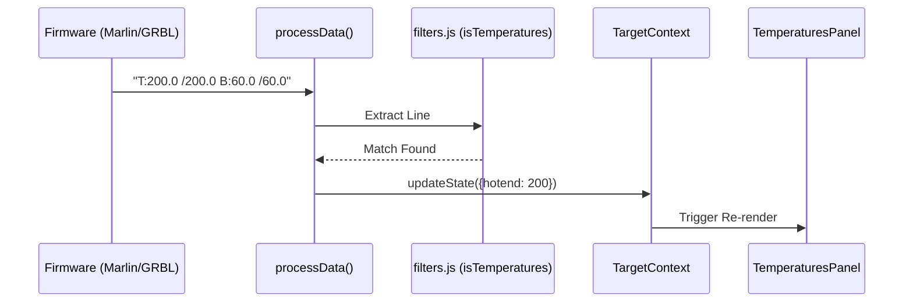

Sources: [src/targets/index.js](https://github.com/luc-github/ESP3D-WEBUI/blob/97c01e85/src/targets/index.js)[dist/Printer3D/Marlin/index.html.gz](https://github.com/luc-github/ESP3D-WEBUI/blob/97c01e85/dist/Printer3D/Marlin/index.html.gz) (simulated logic based on build targets).

## File Management System

ESP3D-WEBUI features a unified file management interface that abstracts operations across various storage backends.

### Supported Storage Backends

The system can interact with multiple sources simultaneously:

- **FLASH**: Internal ESP module storage.
- **SD**: Standard SD card attached to the controller.
- **DIRECTSD**: Direct SPI access to SD cards (supported by grblHAL).
- **TFT SD/USB**: Storage attached to a connected TFT screen.

### Capabilities and Commands

The file system is controlled via the `files` object in each target, which defines:

- `capability(source, cap)`: Checks if a source supports `upload`, `delete`, or `download`.
- `command(source, op, params)`: Executes operations like `list`, `play`, or `upload`.

Sources: [dist/CNC/GRBLHal/index.html.gz](https://github.com/luc-github/ESP3D-WEBUI/blob/97c01e85/dist/CNC/GRBLHal/index.html.gz)[dist/Printer3D/Marlin-embedded/index.html.gz](https://github.com/luc-github/ESP3D-WEBUI/blob/97c01e85/dist/Printer3D/Marlin-embedded/index.html.gz) (Capability sets vary by target).

## Extensibility and Custom Content

The UI can be extended without modifying the core codebase through "Extra Content" and "Extensions".

### ExtraContentItem Component

The `ExtraContentItem` component allows embedding external resources such as camera feeds or custom web pages. [src/components/ExtraContent/extraContentItem.js#34-42](https://github.com/luc-github/ESP3D-WEBUI/blob/97c01e85/src/components/ExtraContent/extraContentItem.js#L34-L42)

- **Camera/Image**: Supports MJPEG streams or static images with auto-refresh via `refreshtime`. [src/components/ExtraContent/extraContentItem.js#69-73](https://github.com/luc-github/ESP3D-WEBUI/blob/97c01e85/src/components/ExtraContent/extraContentItem.js#L69-L73)
- **Extensions**: Loads HTML content into a sandboxed iframe. [src/components/ExtraContent/extraContentItem.js#74-76](https://github.com/luc-github/ESP3D-WEBUI/blob/97c01e85/src/components/ExtraContent/extraContentItem.js#L74-L76)
- **Lifecycle Management**: Tracks visibility state (`visibilityState`) to pause background refreshes when the panel is hidden, saving bandwidth and ESP resources. [src/components/ExtraContent/extraContentItem.js#102-105](https://github.com/luc-github/ESP3D-WEBUI/blob/97c01e85/src/components/ExtraContent/extraContentItem.js#L102-L105)

### Extension Communication

Extensions can communicate with the main UI using `postMessage`.

- **Parent to Extension**: Notifies the extension about visibility changes. [src/components/ExtraContent/extraContentItem.js#53-61](https://github.com/luc-github/ESP3D-WEBUI/blob/97c01e85/src/components/ExtraContent/extraContentItem.js#L53-L61)
- **Extension to Parent**: Can trigger commands or request machine state through `dispatchToExtensions`. [src/components/ExtraContent/extraContentItem.js#22](https://github.com/luc-github/ESP3D-WEBUI/blob/97c01e85/src/components/ExtraContent/extraContentItem.js#L22-L22)

**Extension Integration Map**

[Flowchart Diagram]

Sources: [src/components/ExtraContent/extraContentItem.js#21-28](https://github.com/luc-github/ESP3D-WEBUI/blob/97c01e85/src/components/ExtraContent/extraContentItem.js#L21-L28)[src/components/ExtraContent/extraContentItem.js#154-166](https://github.com/luc-github/ESP3D-WEBUI/blob/97c01e85/src/components/ExtraContent/extraContentItem.js#L154-L166)

## Build System and Deployment

The project uses a Webpack-based pipeline to minimize the final footprint.

- **Compression**: All production assets are Gzipped. The ESP32 serves the `.gz` file directly, and the browser handles decompression. [dist/CNC/GRBL/index.html.gz#1](https://github.com/luc-github/ESP3D-WEBUI/blob/97c01e85/dist/CNC/GRBL/index.html.gz#L1-L1)
- **Versioning**: The UI version (e.g., `3.0.2`) and target-specific build IDs are embedded in the UI. [src/components/App/version.js#20-23](https://github.com/luc-github/ESP3D-WEBUI/blob/97c01e85/src/components/App/version.js#L20-L23)
- **Development Server**: Developers can run `npm run dev-<system>-<firmware>` to start a local server at `localhost:8088` with hot-module replacement. [README.md#38-52](https://github.com/luc-github/ESP3D-WEBUI/blob/97c01e85/README.md?plain=1#L38-L52)

Sources: [README.md#54-62](https://github.com/luc-github/ESP3D-WEBUI/blob/97c01e85/README.md?plain=1#L54-L62)[src/components/App/version.js#18-25](https://github.com/luc-github/ESP3D-WEBUI/blob/97c01e85/src/components/App/version.js#L18-L25)

---

# 1.2-Supported-Targets-and-Firmware

# Supported Targets and Firmware
Relevant source files

- [.all-contributorsrc](https://github.com/luc-github/ESP3D-WEBUI/blob/97c01e85/.all-contributorsrc)
- [.github/ci/final-check.sh](https://github.com/luc-github/ESP3D-WEBUI/blob/97c01e85/.github/ci/final-check.sh)
- [.github/workflows/build-ci.yml](https://github.com/luc-github/ESP3D-WEBUI/blob/97c01e85/.github/workflows/build-ci.yml)
- [LICENSE](https://github.com/luc-github/ESP3D-WEBUI/blob/97c01e85/LICENSE)
- [README.md](https://github.com/luc-github/ESP3D-WEBUI/blob/97c01e85/README.md?plain=1)
- [dist/CNC/GRBL/index.html.gz](https://github.com/luc-github/ESP3D-WEBUI/blob/97c01e85/dist/CNC/GRBL/index.html.gz)
- [dist/CNC/GRBLHal/index.html.gz](https://github.com/luc-github/ESP3D-WEBUI/blob/97c01e85/dist/CNC/GRBLHal/index.html.gz)
- [dist/Printer3D/Marlin-embedded/index.html.gz](https://github.com/luc-github/ESP3D-WEBUI/blob/97c01e85/dist/Printer3D/Marlin-embedded/index.html.gz)
- [dist/Printer3D/Marlin/index.html.gz](https://github.com/luc-github/ESP3D-WEBUI/blob/97c01e85/dist/Printer3D/Marlin/index.html.gz)
- [info.json](https://github.com/luc-github/ESP3D-WEBUI/blob/97c01e85/info.json)
- [src/targets/Printer3D/Marlin-embedded/preferences.json](https://github.com/luc-github/ESP3D-WEBUI/blob/97c01e85/src/targets/Printer3D/Marlin-embedded/preferences.json)
- [src/targets/Printer3D/Marlin/preferences.json](https://github.com/luc-github/ESP3D-WEBUI/blob/97c01e85/src/targets/Printer3D/Marlin/preferences.json)
- [src/targets/Printer3D/Repetier/preferences.json](https://github.com/luc-github/ESP3D-WEBUI/blob/97c01e85/src/targets/Printer3D/Repetier/preferences.json)
- [src/targets/Printer3D/Smoothieware/preferences.json](https://github.com/luc-github/ESP3D-WEBUI/blob/97c01e85/src/targets/Printer3D/Smoothieware/preferences.json)
- [src/targets/Printer3D/preferences.json](https://github.com/luc-github/ESP3D-WEBUI/blob/97c01e85/src/targets/Printer3D/preferences.json)
- [src/targets/preferences.json](https://github.com/luc-github/ESP3D-WEBUI/blob/97c01e85/src/targets/preferences.json)

## Purpose and Scope

This document catalogs all supported machine types and firmware variants in ESP3D-WEBUI, detailing the specific configurations available for each target platform. ESP3D-WEBUI employs a **multi-target build architecture** that generates firmware-specific web interface builds from a single codebase. Each target represents a combination of machine type (3D Printer, CNC, SandTable) and firmware implementation (Marlin, GRBL, Repetier, etc.).

For information about how the target system is implemented and how to extend it, see [Target Configuration System](https://github.com/luc-github/ESP3D-WEBUI/blob/97c01e85/Target Configuration System) For deployment procedures, see [Installation and Deployment](https://github.com/luc-github/ESP3D-WEBUI/blob/97c01e85/Installation and Deployment)

---

## Target Overview

ESP3D-WEBUI supports three primary machine categories, each with multiple firmware variants. The selection is determined at build time via `npm` scripts which map to specific directory structures in `src/targets/`.

**System Mapping to Code Entities**

[Flowchart Diagram]

**Sources:**[README.md#46-50](https://github.com/luc-github/ESP3D-WEBUI/blob/97c01e85/README.md?plain=1#L46-L50)[README.md#70-74](https://github.com/luc-github/ESP3D-WEBUI/blob/97c01e85/README.md?plain=1#L70-L74)[src/targets/Printer3D/preferences.json#1-10](https://github.com/luc-github/ESP3D-WEBUI/blob/97c01e85/src/targets/Printer3D/preferences.json#L1-L10)[src/targets/CNC/preferences.json#1-10](https://github.com/luc-github/ESP3D-WEBUI/blob/97c01e85/src/targets/CNC/preferences.json#L1-L10)

---

## 3D Printer Targets

### Marlin

**Build Output:**`dist/Printer3D/Marlin/index.html.gz`

Standard Marlin firmware implementation for FDM 3D printers. It is optimized for the full Marlin G-code command set and provides comprehensive hardware monitoring.

**Key Features:**

- **Temperature Control:** Support for multiple extruders, heated bed, and chamber.
- **File Systems:** Unified access to `SD`, `DIRECTSD`, `FLASH`, `SDEXT`, `TFTSD`, and `TFTUSB`[src/targets/Printer3D/Marlin/preferences.json#184-200](https://github.com/luc-github/ESP3D-WEBUI/blob/97c01e85/src/targets/Printer3D/Marlin/preferences.json#L184-L200)
- **Emergency Stop:** Hardcoded to `M112`[src/targets/Printer3D/Marlin/preferences.json#8](https://github.com/luc-github/ESP3D-WEBUI/blob/97c01e85/src/targets/Printer3D/Marlin/preferences.json#L8-L8)
- **Polling:** Default status polling uses `M105` every 3000ms [src/targets/Printer3D/Marlin/preferences.json#62-63](https://github.com/luc-github/ESP3D-WEBUI/blob/97c01e85/src/targets/Printer3D/Marlin/preferences.json#L62-L63)

**Sources:**[src/targets/Printer3D/Marlin/preferences.json#1-152](https://github.com/luc-github/ESP3D-WEBUI/blob/97c01e85/src/targets/Printer3D/Marlin/preferences.json#L1-L152)[dist/Printer3D/Marlin/index.html.gz#1-10](https://github.com/luc-github/ESP3D-WEBUI/blob/97c01e85/dist/Printer3D/Marlin/index.html.gz#L1-L10)

---

### Marlin-embedded

**Build Output:**`dist/Printer3D/Marlin-embedded/index.html.gz`

Specialized variant for **embedded mode** where the ESP3D device (running `ESP3DLib`) shares the serial connection with a host computer or a TFT screen.

**Key Differences:**

- **Shared Connection:** Optimized for `SDConnection` modes where the serial line is not exclusive to the WebUI.
- **Simplified UI:** Reduced polling frequency and simplified file management to minimize serial traffic interference.
- **Compatibility:** Specifically targets `ESP3DLib 3.0`[README.md#9](https://github.com/luc-github/ESP3D-WEBUI/blob/97c01e85/README.md?plain=1#L9-L9)

**Sources:**[dist/Printer3D/Marlin-embedded/index.html.gz#1-10](https://github.com/luc-github/ESP3D-WEBUI/blob/97c01e85/dist/Printer3D/Marlin-embedded/index.html.gz#L1-L10)[src/targets/Printer3D/Marlin-embedded/preferences.json#1-50](https://github.com/luc-github/ESP3D-WEBUI/blob/97c01e85/src/targets/Printer3D/Marlin-embedded/preferences.json#L1-L50)

---

### Repetier

**Build Output:**`dist/Printer3D/Repetier/index.html.gz`

Supports Repetier firmware's unique response formats and command structures.

**Key Features:**

- **File Management:** Uses `M20` for listing but allows configuration of `sdlistcmd`, `sdplaycmd`, and `sddeletecmd`[src/targets/Printer3D/Repetier/preferences.json#97-135](https://github.com/luc-github/ESP3D-WEBUI/blob/97c01e85/src/targets/Printer3D/Repetier/preferences.json#L97-L135)
- **Default Storage:** Defaults to `FLASH` but supports `SD`, `TFTSD`, and `TFTUSB` backends [src/targets/Printer3D/Repetier/preferences.json#161-196](https://github.com/luc-github/ESP3D-WEBUI/blob/97c01e85/src/targets/Printer3D/Repetier/preferences.json#L161-L196)

**Sources:**[src/targets/Printer3D/Repetier/preferences.json#1-200](https://github.com/luc-github/ESP3D-WEBUI/blob/97c01e85/src/targets/Printer3D/Repetier/preferences.json#L1-L200)

---

### Smoothieware

**Build Output:**`dist/Printer3D/Smoothieware/index.html.gz`

Supports the Smoothieware firmware which utilizes Unix-like commands (e.g., `ls`, `cd`) rather than standard G-code for file operations.

**Sources:**[README.md#49](https://github.com/luc-github/ESP3D-WEBUI/blob/97c01e85/README.md?plain=1#L49-L49)[src/targets/Printer3D/Smoothieware/preferences.json#1-50](https://github.com/luc-github/ESP3D-WEBUI/blob/97c01e85/src/targets/Printer3D/Smoothieware/preferences.json#L1-L50)

---

## CNC Targets

### GRBL

**Build Output:**`dist/CNC/GRBL/index.html.gz`

Standard GRBL firmware for 3-axis CNC machines, lasers, and spindles.

**Key Features:**

- **Real-time Interaction:** Uses `?` for status reports and character-based overrides (feed/spindle).
- **Settings Management:** Full support for `$`-prefixed configuration parameters (e.g., `$0` to `$132`).
- **Jogging:** Optimized for `$J=` jogging commands.

**Sources:**[src/targets/CNC/GRBL/preferences.json#1-50](https://github.com/luc-github/ESP3D-WEBUI/blob/97c01e85/src/targets/CNC/GRBL/preferences.json#L1-L50)[dist/CNC/GRBL/index.html.gz#1-10](https://github.com/luc-github/ESP3D-WEBUI/blob/97c01e85/dist/CNC/GRBL/index.html.gz#L1-L10)

---

### GrblHAL

**Build Output:**`dist/CNC/GRBLHal/index.html.gz`

The next-generation GRBL (Hardware Abstraction Layer) target, supporting up to 6 axes and advanced hardware features.

**Key Features:**

- **Extended Axes:** Support for X, Y, Z, A, B, and C axes.
- **DIRECTSD:** Implements a high-performance direct SD card access protocol [dist/CNC/GRBLHal/index.html.gz#20-25](https://github.com/luc-github/ESP3D-WEBUI/blob/97c01e85/dist/CNC/GRBLHal/index.html.gz#L20-L25)
- **Compatibility:** Compatible with `grblHAL` core [README.md#9](https://github.com/luc-github/ESP3D-WEBUI/blob/97c01e85/README.md?plain=1#L9-L9)

**Sources:**[src/targets/CNC/grblHAL/preferences.json#1-50](https://github.com/luc-github/ESP3D-WEBUI/blob/97c01e85/src/targets/CNC/grblHAL/preferences.json#L1-L50)[dist/CNC/GRBLHal/index.html.gz#1-10](https://github.com/luc-github/ESP3D-WEBUI/blob/97c01e85/dist/CNC/GRBLHal/index.html.gz#L1-L10)

---

## Target Configuration Hierarchy

Each target build is composed of a three-tier configuration hierarchy. The build system merges these `preferences.json` files to create the final application state.

**Configuration Merge Flow**

[Flowchart Diagram]

**Sources:**[src/targets/preferences.json#3-120](https://github.com/luc-github/ESP3D-WEBUI/blob/97c01e85/src/targets/preferences.json#L3-L120)[src/targets/Printer3D/preferences.json#1-166](https://github.com/luc-github/ESP3D-WEBUI/blob/97c01e85/src/targets/Printer3D/preferences.json#L1-L166)[src/targets/Printer3D/Marlin/preferences.json#1-176](https://github.com/luc-github/ESP3D-WEBUI/blob/97c01e85/src/targets/Printer3D/Marlin/preferences.json#L1-L176)

---

## Feature Matrix by Target

|  |  |  |  |  |
| --- | --- | --- | --- | --- |
| **Emergency Stop** | `M112` | `M112` | `Ctrl+X` | `Ctrl+X` |
| **Status Polling** | `M105`/`M114` | `M105` | `?` | `?` |
| **Max Axes** | 4 (XYZ+E) | 4 (XYZ+E) | 3 (XYZ) | 6 (XYZABC) |
| **Laser Panel** | No | No | Yes | Yes |
| **Storage: FLASH** | Yes | Yes | Yes | Yes |
| **Storage: SD** | Yes | Yes | No | Yes |
| **Storage: DIRECTSD** | Yes | No | No | Yes |

**Sources:**[src/targets/Printer3D/Marlin/preferences.json#8-184](https://github.com/luc-github/ESP3D-WEBUI/blob/97c01e85/src/targets/Printer3D/Marlin/preferences.json#L8-L184)[src/targets/Printer3D/Repetier/preferences.json#8-189](https://github.com/luc-github/ESP3D-WEBUI/blob/97c01e85/src/targets/Printer3D/Repetier/preferences.json#L8-L189)[src/targets/CNC/GRBL/preferences.json#1-50](https://github.com/luc-github/ESP3D-WEBUI/blob/97c01e85/src/targets/CNC/GRBL/preferences.json#L1-L50)[src/targets/CNC/grblHAL/preferences.json#1-50](https://github.com/luc-github/ESP3D-WEBUI/blob/97c01e85/src/targets/CNC/grblHAL/preferences.json#L1-L50)

---

## Build Artifacts

The project generates a compressed single-file application for each target. These are located in the `dist/` directory following the hierarchy of the `src/targets/` folder.

**Artifact Structure:**

- `dist/Printer3D/Marlin/index.html.gz`[dist/Printer3D/Marlin/index.html.gz#1](https://github.com/luc-github/ESP3D-WEBUI/blob/97c01e85/dist/Printer3D/Marlin/index.html.gz#L1-L1)
- `dist/Printer3D/Marlin-embedded/index.html.gz`[dist/Printer3D/Marlin-embedded/index.html.gz#1](https://github.com/luc-github/ESP3D-WEBUI/blob/97c01e85/dist/Printer3D/Marlin-embedded/index.html.gz#L1-L1)
- `dist/CNC/GRBL/index.html.gz`[dist/CNC/GRBL/index.html.gz#1](https://github.com/luc-github/ESP3D-WEBUI/blob/97c01e85/dist/CNC/GRBL/index.html.gz#L1-L1)
- `dist/CNC/GRBLHal/index.html.gz`[dist/CNC/GRBLHal/index.html.gz#1](https://github.com/luc-github/ESP3D-WEBUI/blob/97c01e85/dist/CNC/GRBLHal/index.html.gz#L1-L1)

**Sources:**[README.md#54-62](https://github.com/luc-github/ESP3D-WEBUI/blob/97c01e85/README.md?plain=1#L54-L62)[dist/Printer3D/Marlin/index.html.gz#1-10](https://github.com/luc-github/ESP3D-WEBUI/blob/97c01e85/dist/Printer3D/Marlin/index.html.gz#L1-L10)[dist/CNC/GRBL/index.html.gz#1-10](https://github.com/luc-github/ESP3D-WEBUI/blob/97c01e85/dist/CNC/GRBL/index.html.gz#L1-L10)

---

# 1.3-Installation-and-Deployment

# Installation and Deployment
Relevant source files

- [.all-contributorsrc](https://github.com/luc-github/ESP3D-WEBUI/blob/97c01e85/.all-contributorsrc)
- [.github/ci/final-check.sh](https://github.com/luc-github/ESP3D-WEBUI/blob/97c01e85/.github/ci/final-check.sh)
- [.github/workflows/build-ci.yml](https://github.com/luc-github/ESP3D-WEBUI/blob/97c01e85/.github/workflows/build-ci.yml)
- [LICENSE](https://github.com/luc-github/ESP3D-WEBUI/blob/97c01e85/LICENSE)
- [README.md](https://github.com/luc-github/ESP3D-WEBUI/blob/97c01e85/README.md?plain=1)
- [info.json](https://github.com/luc-github/ESP3D-WEBUI/blob/97c01e85/info.json)
- [package-lock.json](https://github.com/luc-github/ESP3D-WEBUI/blob/97c01e85/package-lock.json)
- [package.json](https://github.com/luc-github/ESP3D-WEBUI/blob/97c01e85/package.json)

## Purpose and Scope

This document covers the complete lifecycle of setting up, building, and deploying ESP3D-WEBUI from source code to a running ESP3D device. It includes development environment configuration, build pipeline execution, and deployment procedures for all supported firmware targets. This version of the WebUI (3.0) is built using Preact and Spectre.css for a lightweight footprint suitable for embedded controllers.

---

## Prerequisites

### Node.js and npm

ESP3D-WEBUI requires Node.js LTS version 20.8.0 or compatible for the build toolchain:

```
node -v
# Expected output: v20.8.0
 
npm -v
# Expected output: 10.2.0
```

### Target Hardware Compatibility

Deployment requires one of the following compatible firmware versions:

- **ESP3D 3.0** (ESP8266/ESP32)
- **ESP3DLib 3.0** (For Marlin-embedded targets)
- **grblHAL** (CNC controllers)
- **ESP3D_TFT 1.0** (TFT-based configurations)

**Sources:**[README.md#9-30](https://github.com/luc-github/ESP3D-WEBUI/blob/97c01e85/README.md?plain=1#L9-L30)[package.json#3-4](https://github.com/luc-github/ESP3D-WEBUI/blob/97c01e85/package.json#L3-L4)

---

## Development Environment Setup

### 1. Clone Repository

```
git clone https://github.com/luc-github/ESP3D-WEBUI.git
cd ESP3D-WEBUI
```

### 2. Install Dependencies

From the repository root directory, install the required node modules:

```
npm install
```

This populates the `node_modules/` directory with the following core dependencies:

- **UI Framework:**`preact`[package.json#72](https://github.com/luc-github/ESP3D-WEBUI/blob/97c01e85/package.json#L72-L72)
- **Icons:**`preact-feather`[package.json#73](https://github.com/luc-github/ESP3D-WEBUI/blob/97c01e85/package.json#L73-L73)
- **Charts:**`smoothie`[package.json#74](https://github.com/luc-github/ESP3D-WEBUI/blob/97c01e85/package.json#L74-L74)
- **CSS Framework:**`spectre.css`[package.json#75](https://github.com/luc-github/ESP3D-WEBUI/blob/97c01e85/package.json#L75-L75)
- **Build Tools:**`webpack`, `babel-loader`, `sass-loader`[package.json#38-70](https://github.com/luc-github/ESP3D-WEBUI/blob/97c01e85/package.json#L38-L70)

[Flowchart Diagram]

**Sources:**[README.md#32-36](https://github.com/luc-github/ESP3D-WEBUI/blob/97c01e85/README.md?plain=1#L32-L36)[package.json#37-76](https://github.com/luc-github/ESP3D-WEBUI/blob/97c01e85/package.json#L37-L76)

---

## Development Workflow

### Starting the Development Server

The development environment utilizes `concurrently` to run a local Express server and the Webpack development server simultaneously. This allows for real-time UI updates while simulating device communication.

```
npm run dev-<system>-<firmware>
```

### Available Target Combinations

The build system uses `TARGET_ENV` and `SUBTARGET_ENV` environment variables to inject the correct target context during compilation.

|  |  |  |
| --- | --- | --- |
| `Printer3D` | `Marlin` | `npm run dev-printer-marlin` |
| `Printer3D` | `Marlin-embedded` | `npm run dev-printer-marlin-embedded` |
| `Printer3D` | `Repetier` | `npm run dev-printer-repetier` |
| `Printer3D` | `Smoothieware` | `npm run dev-printer-smoothieware` |
| `CNC` | `GRBL` | `npm run dev-cnc-grbl` |
| `CNC` | `grblHAL` | `npm run dev-cnc-grblhal` |
| `SandTable` | `GRBL` | `npm run dev-sand-grbl` |

Example for CNC with grblHAL:

```
npm run dev-cnc-grblhal
```

This command triggers `cross-env TARGET_ENV=CNC SUBTARGET_ENV=grblHAL concurrently "npm run server" "npm run front"`[package.json#11](https://github.com/luc-github/ESP3D-WEBUI/blob/97c01e85/package.json#L11-L11)

Loading diagram…

**Sources:**[README.md#38-52](https://github.com/luc-github/ESP3D-WEBUI/blob/97c01e85/README.md?plain=1#L38-L52)[package.json#10-17](https://github.com/luc-github/ESP3D-WEBUI/blob/97c01e85/package.json#L10-L17)

---

## Building for Production

### Target-Specific Builds

To build a production-ready `index.html.gz` for a specific machine:

```
npm run <system>-<firmware>
```

These scripts invoke Webpack with `config/webpack.prod.js`[package.json#18-24](https://github.com/luc-github/ESP3D-WEBUI/blob/97c01e85/package.json#L18-L24)

### Full Distribution Build

To generate artifacts for all supported targets at once:

```
npm run buildall
```

This executes `buildsand`, `buildprinter`, and `buildcnc` sequentially [package.json#29](https://github.com/luc-github/ESP3D-WEBUI/blob/97c01e85/package.json#L29-L29)

### Build Artifacts Structure

Generated files are placed in the `dist/` directory, organized by target type and firmware:

- `dist/Printer3D/Marlin/index.html.gz`
- `dist/Printer3D/Repetier/index.html.gz`
- `dist/CNC/GRBL/index.html.gz`
- ...and others for each target combination.

**Sources:**[README.md#54-74](https://github.com/luc-github/ESP3D-WEBUI/blob/97c01e85/README.md?plain=1#L54-L74)[package.json#18-29](https://github.com/luc-github/ESP3D-WEBUI/blob/97c01e85/package.json#L18-L29)

---

## Deployment to ESP3D Devices

### Deployment Procedure

1. **Locate Artifact:** Navigate to the `dist/` folder and select the `index.html.gz` file that matches your machine's firmware (e.g., `dist/CNC/grblHAL/index.html.gz`).
2. **Access Web Interface:** Connect to your ESP3D device's current IP address in a browser.
3. **Upload File:** Use the device's built-in file manager or system update tool to upload the new `index.html.gz`.

- Note: The file must be named exactly `index.html.gz` on the device's filesystem for the web server to serve it as the default page.
4. **Restart/Refresh:** Once the upload is complete, refresh the page. The device will serve the compressed file, which the browser will automatically decompress and render.

### Continuous Integration (CI)

The project uses GitHub Actions to automate builds on every push to major branches (`2.1`, `3.0`, `3.1`). The CI workflow performs the following:

1. Installs libraries via `npm install`[.github/workflows/build-ci.yml#26](https://github.com/luc-github/ESP3D-WEBUI/blob/97c01e85/.github/workflows/build-ci.yml#L26-L26)
2. Executes `npm run buildall` to verify all targets compile successfully [.github/workflows/build-ci.yml#30](https://github.com/luc-github/ESP3D-WEBUI/blob/97c01e85/.github/workflows/build-ci.yml#L30-L30)
3. Runs a final check script [.github/ci/final-check.sh](https://github.com/luc-github/ESP3D-WEBUI/blob/97c01e85/.github/ci/final-check.sh) which notifies Discord via webhook if configured [.github/workflows/build-ci.yml#37-42](https://github.com/luc-github/ESP3D-WEBUI/blob/97c01e85/.github/workflows/build-ci.yml#L37-L42)

Loading diagram…

**Sources:**[.github/workflows/build-ci.yml#1-43](https://github.com/luc-github/ESP3D-WEBUI/blob/97c01e85/.github/workflows/build-ci.yml#L1-L43)[.github/ci/final-check.sh#17-35](https://github.com/luc-github/ESP3D-WEBUI/blob/97c01e85/.github/ci/final-check.sh#L17-L35)

---

## Versioning and Information

The current version of the WebUI is tracked in `info.json`:

- **Stable Version:**`3.0.1`[info.json#2](https://github.com/luc-github/ESP3D-WEBUI/blob/97c01e85/info.json#L2-L2)
- **Development Version:**`3.1.0 beta 1`[info.json#3](https://github.com/luc-github/ESP3D-WEBUI/blob/97c01e85/info.json#L3-L3)

This information is used by the build system to tag generated artifacts and is displayed in the UI's about/information sections.

**Sources:**[info.json#1-4](https://github.com/luc-github/ESP3D-WEBUI/blob/97c01e85/info.json#L1-L4)[package.json#3](https://github.com/luc-github/ESP3D-WEBUI/blob/97c01e85/package.json#L3-L3)

---

# 2-Architecture-Overview

# Architecture Overview
Relevant source files

- [.all-contributorsrc](https://github.com/luc-github/ESP3D-WEBUI/blob/97c01e85/.all-contributorsrc)
- [.github/ci/final-check.sh](https://github.com/luc-github/ESP3D-WEBUI/blob/97c01e85/.github/ci/final-check.sh)
- [.github/workflows/build-ci.yml](https://github.com/luc-github/ESP3D-WEBUI/blob/97c01e85/.github/workflows/build-ci.yml)
- [LICENSE](https://github.com/luc-github/ESP3D-WEBUI/blob/97c01e85/LICENSE)
- [README.md](https://github.com/luc-github/ESP3D-WEBUI/blob/97c01e85/README.md?plain=1)
- [dist/Printer3D/Repetier/index.html.gz](https://github.com/luc-github/ESP3D-WEBUI/blob/97c01e85/dist/Printer3D/Repetier/index.html.gz)
- [dist/Printer3D/Smoothieware/index.html.gz](https://github.com/luc-github/ESP3D-WEBUI/blob/97c01e85/dist/Printer3D/Smoothieware/index.html.gz)
- [dist/SandTable/GRBL/index.html.gz](https://github.com/luc-github/ESP3D-WEBUI/blob/97c01e85/dist/SandTable/GRBL/index.html.gz)
- [info.json](https://github.com/luc-github/ESP3D-WEBUI/blob/97c01e85/info.json)
- [src/areas/elementsCache.js](https://github.com/luc-github/ESP3D-WEBUI/blob/97c01e85/src/areas/elementsCache.js)
- [src/components/App/version.js](https://github.com/luc-github/ESP3D-WEBUI/blob/97c01e85/src/components/App/version.js)
- [src/components/ExtraContent/extraContentItem.js](https://github.com/luc-github/ESP3D-WEBUI/blob/97c01e85/src/components/ExtraContent/extraContentItem.js)
- [src/contexts/UiContext.js](https://github.com/luc-github/ESP3D-WEBUI/blob/97c01e85/src/contexts/UiContext.js)
- [src/hooks/eventBus.js](https://github.com/luc-github/ESP3D-WEBUI/blob/97c01e85/src/hooks/eventBus.js)

## Purpose and Scope

This document provides a high-level overview of the ESP3D-WEBUI system architecture. It describes the build pipeline, the runtime environment based on Preact, and the core abstraction layers that allow the interface to support a wide variety of 3D printers and CNC firmwares.

For deep dives into specific subsystems, refer to the following child pages:

- [Multi-Target Build Architecture](/org/luc-github/wiki/luc-github/ESP3D-WEBUI/page/2.1?branch=%223.0%22) — The cascading configuration system.
- [Client-Server Communication](/org/luc-github/wiki/luc-github/ESP3D-WEBUI/page/2.2?branch=%223.0%22) — HTTP and WebSocket protocols.
- [Context and State Management](/org/luc-github/wiki/luc-github/ESP3D-WEBUI/page/2.3?branch=%223.0%22) — Preact contexts (`UiContext`, `SettingsContext`, `TargetContext`).
- [File System Abstraction Layer](/org/luc-github/wiki/luc-github/ESP3D-WEBUI/page/2.4?branch=%223.0%22) — Unified API for FLASH, SD, and TFT storage.
- [Component Hierarchy](/org/luc-github/wiki/luc-github/ESP3D-WEBUI/page/2.5?branch=%223.0%22) — The UI tree from `ViewContainer` to fields.

---

## System Architecture Overview

ESP3D-WEBUI is a single-page application (SPA) built with Preact and Spectre.css. It operates as a thin client that communicates with ESP3D firmware running on ESP32 or ESP8266 hardware.

### High-Level Component Interaction

[Flowchart Diagram]

**Sources:**[src/contexts/UiContext.js#33-57](https://github.com/luc-github/ESP3D-WEBUI/blob/97c01e85/src/contexts/UiContext.js#L33-L57)[src/components/App/version.js#18-25](https://github.com/luc-github/ESP3D-WEBUI/blob/97c01e85/src/components/App/version.js#L18-L25)

---

## Multi-Target Build Architecture

The codebase uses a cascading build system to generate optimized firmware-specific bundles. A single command like `npm run buildall` triggers Webpack to produce tailored versions for Marlin, GRBL, Smoothieware, and others.

|  |  |  |
| --- | --- | --- |
| **Printer3D** | Marlin, Repetier, Smoothieware | `dist/Printer3D/` |
| **CNC** | GRBL, grblHAL | `dist/CNC/` |
| **SandTable** | GRBL | `dist/SandTable/` |

Each build results in a highly compressed `index.html.gz` file (typically ~45-50KB) designed to fit within the limited flash space of ESP devices.

**Sources:**[README.md#42-74](https://github.com/luc-github/ESP3D-WEBUI/blob/97c01e85/README.md?plain=1#L42-L74)[dist/Printer3D/Smoothieware/index.html.gz#1-2](https://github.com/luc-github/ESP3D-WEBUI/blob/97c01e85/dist/Printer3D/Smoothieware/index.html.gz#L1-L2)[dist/SandTable/GRBL/index.html.gz#1-2](https://github.com/luc-github/ESP3D-WEBUI/blob/97c01e85/dist/SandTable/GRBL/index.html.gz#L1-L2)

---

## State and Context Management

The application state is partitioned into three primary Preact contexts to ensure efficient updates and clear separation of concerns.

1. **`UiContext`**: Manages the "Application Shell" state, including the connection status (`connectionState`), active modals, toasts, and panel visibility.
2. **`SettingsContext`**: Stores persistent user preferences and hardware configuration (e.g., `interfaceSettings`).
3. **`TargetContext`**: A firmware-specific context provided by the active target. it holds real-time machine data like positions, temperatures, and buffer status.

**Sources:**[src/contexts/UiContext.js#33-61](https://github.com/luc-github/ESP3D-WEBUI/blob/97c01e85/src/contexts/UiContext.js#L33-L61)[src/areas/elementsCache.js#28-29](https://github.com/luc-github/ESP3D-WEBUI/blob/97c01e85/src/areas/elementsCache.js#L28-L29)

---

## Real-time Data Pipeline

Data flows from the machine firmware to the UI through a pattern-matching filter system. Raw strings from the WebSocket or HTTP responses are passed through `filters.js` to update the application state.

[Flowchart Diagram]

**Sources:**[src/areas/elementsCache.js#32-38](https://github.com/luc-github/ESP3D-WEBUI/blob/97c01e85/src/areas/elementsCache.js#L32-L38)[src/components/ExtraContent/extraContentItem.js#67-86](https://github.com/luc-github/ESP3D-WEBUI/blob/97c01e85/src/components/ExtraContent/extraContentItem.js#L67-L86)

---

## Extension and Extra Content System

ESP3D-WEBUI features an extensible architecture that allows embedding external tools (like G-Code viewers or camera feeds) via the `ExtraContentItem` component.

- **`ElementsCache`**: A hidden DOM area (`#elementsCache`) where extra content is pre-rendered to maintain state even when panels are closed.
- **`ExtraContentItem`**: Handles the lifecycle of iframes or images, including refresh intervals and visibility notifications via `postMessage`.
- **`eventBus`**: A lightweight mechanism used to share data between components and extensions without the overhead of a full Preact context.

**Sources:**[src/areas/elementsCache.js#66-72](https://github.com/luc-github/ESP3D-WEBUI/blob/97c01e85/src/areas/elementsCache.js#L66-L72)[src/components/ExtraContent/extraContentItem.js#34-65](https://github.com/luc-github/ESP3D-WEBUI/blob/97c01e85/src/components/ExtraContent/extraContentItem.js#L34-L65)[src/hooks/eventBus.js#25-52](https://github.com/luc-github/ESP3D-WEBUI/blob/97c01e85/src/hooks/eventBus.js#L25-L52)

---

## Versioning

The WebUI maintains its own versioning independent of the ESP3D backend.

- **WebUI Version**: `3.0.2` (defined in `src/components/App/version.js`)
- **Build Version**: Appended during the build process based on the target configuration.

**Sources:**[src/components/App/version.js#20-25](https://github.com/luc-github/ESP3D-WEBUI/blob/97c01e85/src/components/App/version.js#L20-L25)[info.json#2-3](https://github.com/luc-github/ESP3D-WEBUI/blob/97c01e85/info.json#L2-L3)

---

# 2.1-Multi-Target-Build-Architecture

# Multi-Target Build Architecture
Relevant source files

- [.all-contributorsrc](https://github.com/luc-github/ESP3D-WEBUI/blob/97c01e85/.all-contributorsrc)
- [.github/ci/final-check.sh](https://github.com/luc-github/ESP3D-WEBUI/blob/97c01e85/.github/ci/final-check.sh)
- [.github/workflows/build-ci.yml](https://github.com/luc-github/ESP3D-WEBUI/blob/97c01e85/.github/workflows/build-ci.yml)
- [LICENSE](https://github.com/luc-github/ESP3D-WEBUI/blob/97c01e85/LICENSE)
- [Memo/Commands.md](https://github.com/luc-github/ESP3D-WEBUI/blob/97c01e85/Memo/Commands.md?plain=1)
- [Memo/ESP3D [ESP400] format.md](Memo/ESP3D [ESP400] format.md)
- [README.md](https://github.com/luc-github/ESP3D-WEBUI/blob/97c01e85/README.md?plain=1)
- [config/targets/CNC/GRBL/index.js](https://github.com/luc-github/ESP3D-WEBUI/blob/97c01e85/config/targets/CNC/GRBL/index.js)
- [config/targets/Printer3D/Marlin-embedded/index.js](https://github.com/luc-github/ESP3D-WEBUI/blob/97c01e85/config/targets/Printer3D/Marlin-embedded/index.js)
- [config/targets/Printer3D/Marlin/index.js](https://github.com/luc-github/ESP3D-WEBUI/blob/97c01e85/config/targets/Printer3D/Marlin/index.js)
- [config/targets/Printer3D/Repetier/index.js](https://github.com/luc-github/ESP3D-WEBUI/blob/97c01e85/config/targets/Printer3D/Repetier/index.js)
- [config/targets/Printer3D/Smoothieware/index.js](https://github.com/luc-github/ESP3D-WEBUI/blob/97c01e85/config/targets/Printer3D/Smoothieware/index.js)
- [config/targets/SandTable/GRBL/index.js](https://github.com/luc-github/ESP3D-WEBUI/blob/97c01e85/config/targets/SandTable/GRBL/index.js)
- [info.json](https://github.com/luc-github/ESP3D-WEBUI/blob/97c01e85/info.json)
- [src/targets/Printer3D/Marlin/DIRECTSD-source.js](https://github.com/luc-github/ESP3D-WEBUI/blob/97c01e85/src/targets/Printer3D/Marlin/DIRECTSD-source.js)
- [src/targets/Printer3D/Marlin/FLASH-source.js](https://github.com/luc-github/ESP3D-WEBUI/blob/97c01e85/src/targets/Printer3D/Marlin/FLASH-source.js)
- [src/targets/Printer3D/Marlin/files.js](https://github.com/luc-github/ESP3D-WEBUI/blob/97c01e85/src/targets/Printer3D/Marlin/files.js)

## Purpose and Scope

This document explains how ESP3D-WEBUI's build system produces firmware-specific, optimized web bundles from a single codebase. The multi-target build architecture enables one source tree to generate specialized builds for different machine types (`cnc`, `printer`, `sand`) and firmware variants (`marlin`, `grbl`, `grblhal`, `smoothieware`, etc.), each with appropriate UI components, settings, and command protocols [README.md#43-50](https://github.com/luc-github/ESP3D-WEBUI/blob/97c01e85/README.md?plain=1#L43-L50)

---

## Overview

ESP3D-WEBUI implements a **single-codebase, multi-target build strategy** where:

- **One source tree** contains all UI code using Preact [README.md#6-7](https://github.com/luc-github/ESP3D-WEBUI/blob/97c01e85/README.md?plain=1#L6-L7)
- **Target-specific configurations** define firmware behaviors and simulated server responses [config/targets/Printer3D/Marlin/index.js#1-30](https://github.com/luc-github/ESP3D-WEBUI/blob/97c01e85/config/targets/Printer3D/Marlin/index.js#L1-L30)
- **Build scripts** generate optimized, compressed `.html.gz` bundles for each target [README.md#54-62](https://github.com/luc-github/ESP3D-WEBUI/blob/97c01e85/README.md?plain=1#L54-L62)
- **Output structure** organizes builds by machine type and firmware [README.md#67-75](https://github.com/luc-github/ESP3D-WEBUI/blob/97c01e85/README.md?plain=1#L67-L75)

This architecture eliminates code duplication while allowing each target to have tailored functionality, settings schemas, and command protocols.

**Sources:**[README.md#1-75](https://github.com/luc-github/ESP3D-WEBUI/blob/97c01e85/README.md?plain=1#L1-L75)[config/targets/Printer3D/Marlin/index.js#1-30](https://github.com/luc-github/ESP3D-WEBUI/blob/97c01e85/config/targets/Printer3D/Marlin/index.js#L1-L30)

---

## Build System Components

The build system is orchestrated through npm scripts to transform modern JavaScript and SCSS into a single, compressed HTML file optimized for embedded deployment on [ESP3D 3.0](https://github.com/luc-github/ESP3D/tree/3.0) and [grblHAL](https://github.com/grblHAL) devices [README.md#9-35](https://github.com/luc-github/ESP3D-WEBUI/blob/97c01e85/README.md?plain=1#L9-L35)

|  |  |
| --- | --- |
| **Node.js** | Runtime environment (v20.8.0 recommended) [README.md#22-26](https://github.com/luc-github/ESP3D-WEBUI/blob/97c01e85/README.md?plain=1#L22-L26) |
| **npm** | Package manager (v10.2.0 recommended) [README.md#28-30](https://github.com/luc-github/ESP3D-WEBUI/blob/97c01e85/README.md?plain=1#L28-L30) |
| **Webpack** | Module bundler used to generate production versions [README.md#62](https://github.com/luc-github/ESP3D-WEBUI/blob/97c01e85/README.md?plain=1#L62-L62) |
| **Dev Server** | Local test server for rapid iteration [README.md#52](https://github.com/luc-github/ESP3D-WEBUI/blob/97c01e85/README.md?plain=1#L52-L52) |
| **Gzip** | Compression for the final `index.html.gz`[README.md#54](https://github.com/luc-github/ESP3D-WEBUI/blob/97c01e85/README.md?plain=1#L54-L54) |

**Sources:**[README.md#9-62](https://github.com/luc-github/ESP3D-WEBUI/blob/97c01e85/README.md?plain=1#L9-L62)

---

## Target Matrix

ESP3D-WEBUI supports a variety of system and firmware combinations.

[Flowchart Diagram]

**Sources:**[README.md#43-50](https://github.com/luc-github/ESP3D-WEBUI/blob/97c01e85/README.md?plain=1#L43-L50)[README.md#67-75](https://github.com/luc-github/ESP3D-WEBUI/blob/97c01e85/README.md?plain=1#L67-L75)

---

## Build Commands and Script Architecture

### Production Build Scripts

The build system generates production-ready files in the `/dist` folder [README.md#54](https://github.com/luc-github/ESP3D-WEBUI/blob/97c01e85/README.md?plain=1#L54-L54)

**Build all targets sequentially:**

```
npm run buildall
```

**Build specific targets:**
The syntax is `npm run <system>-<firmware>`[README.md#67](https://github.com/luc-github/ESP3D-WEBUI/blob/97c01e85/README.md?plain=1#L67-L67)

- `npm run printer-marlin`
- `npm run cnc-grblhal`
- `npm run sand-grbl`

### Development Server Scripts

Development builds use a local test server available at `http://localhost:8088`[README.md#52](https://github.com/luc-github/ESP3D-WEBUI/blob/97c01e85/README.md?plain=1#L52-L52)

```
npm run dev-<system>-<firmware>
```

The development environment includes a mock backend (e.g., `config/targets/Printer3D/Marlin/index.js`) that simulates firmware responses like temperatures, file lists, and position updates [config/targets/Printer3D/Marlin/index.js#137-215](https://github.com/luc-github/ESP3D-WEBUI/blob/97c01e85/config/targets/Printer3D/Marlin/index.js#L137-L215)

**Sources:**[README.md#38-75](https://github.com/luc-github/ESP3D-WEBUI/blob/97c01e85/README.md?plain=1#L38-L75)[config/targets/Printer3D/Marlin/index.js#137-215](https://github.com/luc-github/ESP3D-WEBUI/blob/97c01e85/config/targets/Printer3D/Marlin/index.js#L137-L215)

---

## Target-Specific Code Resolution

**Code Entity Mapping: Target Configuration**

[Flowchart Diagram]

### File System Abstraction Layer

The build system includes target-specific file system implementations. For example, the Marlin target includes specific logic for `FLASH`, `SD`, and `DIRECTSD`[src/targets/Printer3D/Marlin/files.js#21-26](https://github.com/luc-github/ESP3D-WEBUI/blob/97c01e85/src/targets/Printer3D/Marlin/files.js#L21-L26)

- **Capabilities**: Defines what the file system can do (e.g., `Upload`, `DeleteFile`, `CreateDir`) [src/targets/Printer3D/Marlin/FLASH-source.js#24-54](https://github.com/luc-github/ESP3D-WEBUI/blob/97c01e85/src/targets/Printer3D/Marlin/FLASH-source.js#L24-L54)
- **Commands**: Maps UI actions to firmware-specific URLs or G-Code commands [src/targets/Printer3D/Marlin/DIRECTSD-source.js#60-156](https://github.com/luc-github/ESP3D-WEBUI/blob/97c01e85/src/targets/Printer3D/Marlin/DIRECTSD-source.js#L60-L156)
- **Dynamic Selection**: File systems are shown in the UI based on dependencies like `SDConnection` settings [src/targets/Printer3D/Marlin/files.js#30-85](https://github.com/luc-github/ESP3D-WEBUI/blob/97c01e85/src/targets/Printer3D/Marlin/files.js#L30-L85)

**Sources:**[src/targets/Printer3D/Marlin/files.js#21-85](https://github.com/luc-github/ESP3D-WEBUI/blob/97c01e85/src/targets/Printer3D/Marlin/files.js#L21-L85)[src/targets/Printer3D/Marlin/FLASH-source.js#24-54](https://github.com/luc-github/ESP3D-WEBUI/blob/97c01e85/src/targets/Printer3D/Marlin/FLASH-source.js#L24-L54)[src/targets/Printer3D/Marlin/DIRECTSD-source.js#60-156](https://github.com/luc-github/ESP3D-WEBUI/blob/97c01e85/src/targets/Printer3D/Marlin/DIRECTSD-source.js#L60-L156)

---

## Mock Backend Implementation

For development purposes, each target provides a Node.js-based mock of the firmware's behavior. This allows testing the UI without a physical ESP32.

**Marlin Mock Example (`config/targets/Printer3D/Marlin/index.js`):**

- **Temperature Simulation**: Simulates heating and cooling logic with random variations [config/targets/Printer3D/Marlin/index.js#77-127](https://github.com/luc-github/ESP3D-WEBUI/blob/97c01e85/config/targets/Printer3D/Marlin/index.js#L77-L127)
- **Command Handling**: Responds to G-Codes like `M114` (Position) and `M20` (File List) [config/targets/Printer3D/Marlin/index.js#192-215](https://github.com/luc-github/ESP3D-WEBUI/blob/97c01e85/config/targets/Printer3D/Marlin/index.js#L192-L215)
- **ESP-Specific Commands**: Handles `ESP800` (System Info) and `ESP420` (Status) queries [config/targets/CNC/GRBL/index.js#85-168](https://github.com/luc-github/ESP3D-WEBUI/blob/97c01e85/config/targets/CNC/GRBL/index.js#L85-L168)

**Sources:**[config/targets/Printer3D/Marlin/index.js#77-215](https://github.com/luc-github/ESP3D-WEBUI/blob/97c01e85/config/targets/Printer3D/Marlin/index.js#L77-L215)[config/targets/CNC/GRBL/index.js#85-168](https://github.com/luc-github/ESP3D-WEBUI/blob/97c01e85/config/targets/CNC/GRBL/index.js#L85-L168)

---

## Build Pipeline Flow

**Build Process Visualization**

[Flowchart Diagram]

**Sources:**[README.md#54-75](https://github.com/luc-github/ESP3D-WEBUI/blob/97c01e85/README.md?plain=1#L54-L75)[src/targets/Printer3D/Marlin/files.js#1-130](https://github.com/luc-github/ESP3D-WEBUI/blob/97c01e85/src/targets/Printer3D/Marlin/files.js#L1-L130)

---

## Continuous Integration (CI)

The project uses GitHub Actions to ensure build integrity across all targets. The `build-ci` workflow automatically runs `npm install` and `npm run buildall` on every push to the `3.0` and `3.1` branches [`.github/workflows/build-ci.yml:1-30`]().

- **Automated Validation**: Verifies that all target combinations compile successfully [`.github/workflows/build-ci.yml:28-31`]().
- **Notification**: Sends build status updates (Success/Failure) to a Discord webhook [`.github/ci/final-check.sh:17-35`]().

**Sources:**[`.github/workflows/build-ci.yml:1-31`](), [`.github/ci/final-check.sh:17-35`]()

---

# 2.2-Client-Server-Communication

# Client-Server Communication
Relevant source files

- [server/CNC/GRBL/Flash/preferences.json](https://github.com/luc-github/ESP3D-WEBUI/blob/97c01e85/server/CNC/GRBL/Flash/preferences.json)
- [src/components/Helpers/http.js](https://github.com/luc-github/ESP3D-WEBUI/blob/97c01e85/src/components/Helpers/http.js)
- [src/contexts/WsContext.js](https://github.com/luc-github/ESP3D-WEBUI/blob/97c01e85/src/contexts/WsContext.js)
- [src/tabs/interface/importHelper.js](https://github.com/luc-github/ESP3D-WEBUI/blob/97c01e85/src/tabs/interface/importHelper.js)
- [src/targets/Printer3D/Marlin-embedded/SD-source.js](https://github.com/luc-github/ESP3D-WEBUI/blob/97c01e85/src/targets/Printer3D/Marlin-embedded/SD-source.js)
- [src/targets/Printer3D/Marlin/SD-source.js](https://github.com/luc-github/ESP3D-WEBUI/blob/97c01e85/src/targets/Printer3D/Marlin/SD-source.js)
- [src/targets/Printer3D/Marlin/SDEXT-source.js](https://github.com/luc-github/ESP3D-WEBUI/blob/97c01e85/src/targets/Printer3D/Marlin/SDEXT-source.js)

This page describes the HTTP and WebSocket communication protocols used by ESP3D-WEBUI to exchange data between the browser client and the ESP3D device. It covers URL construction, authentication mechanisms, request queue management, and the backend server architecture that translates web requests into firmware-specific serial commands.

For information about how target-specific data is processed after receiving responses, see [Data Processing Pipeline](/org/luc-github/wiki/luc-github/ESP3D-WEBUI/page/3.3?branch=%223.0%22). For details on connection state management and authentication flows, see [Connection Management](/org/luc-github/wiki/luc-github/ESP3D-WEBUI/page/3.2?branch=%223.0%22).

---

## Overview

ESP3D-WEBUI uses a **three-layer communication architecture**:

[Flowchart Diagram]

**Sources**: [src/contexts/WsContext.js#41-53](https://github.com/luc-github/ESP3D-WEBUI/blob/97c01e85/src/contexts/WsContext.js#L41-L53)[src/components/Helpers/http.js#37-49](https://github.com/luc-github/ESP3D-WEBUI/blob/97c01e85/src/components/Helpers/http.js#L37-L49)

---

## HTTP Communication

### URL Construction

The `espHttpURL` helper function constructs properly-formatted URLs for communicating with the ESP3D device:

[Flowchart Diagram]

The function handles both relative and absolute URLs:

|  |  |  |
| --- | --- | --- |
| Relative path | `"command"` | Appends to `window.location.host`[src/components/Helpers/http.js#42](https://github.com/luc-github/ESP3D-WEBUI/blob/97c01e85/src/components/Helpers/http.js#L42-L42) |
| Absolute URL | `"http://192.168.1.100/command"` | Uses as-is [src/components/Helpers/http.js#40](https://github.com/luc-github/ESP3D-WEBUI/blob/97c01e85/src/components/Helpers/http.js#L40-L40) |
| Empty base | `""` | Returns current host [src/components/Helpers/http.js#42](https://github.com/luc-github/ESP3D-WEBUI/blob/97c01e85/src/components/Helpers/http.js#L42-L42) |

**Key behavior**: Query parameters are automatically URL-encoded and appended using `URLSearchParams`[src/components/Helpers/http.js#45-48](https://github.com/luc-github/ESP3D-WEBUI/blob/97c01e85/src/components/Helpers/http.js#L45-L48)

**Sources**: [src/components/Helpers/http.js#37-50](https://github.com/luc-github/ESP3D-WEBUI/blob/97c01e85/src/components/Helpers/http.js#L37-L50)

### Authentication

ESP3D-WEBUI uses **cookie-based session authentication**:

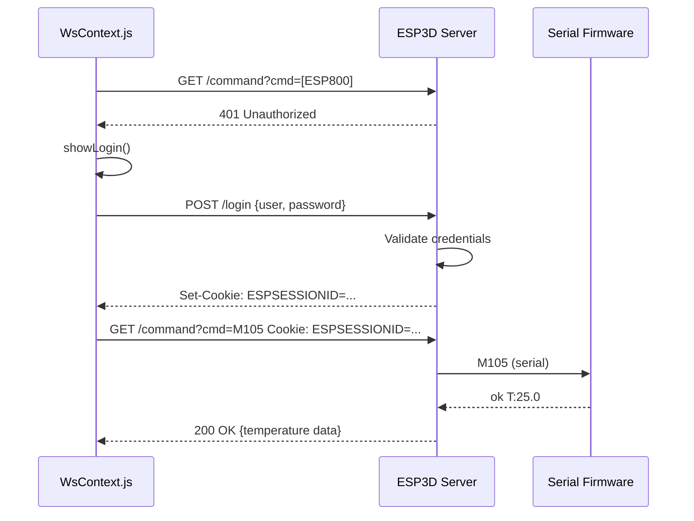

**Cookie handling**:

- `getCookie(cname)` retrieves session cookies from `document.cookie`[src/components/Helpers/http.js#19-33](https://github.com/luc-github/ESP3D-WEBUI/blob/97c01e85/src/components/Helpers/http.js#L19-L33)
- In `WsContext.js`, the session cookie is retrieved and sent as a `PING` message to maintain the connection [src/contexts/WsContext.js#66-68](https://github.com/luc-github/ESP3D-WEBUI/blob/97c01e85/src/contexts/WsContext.js#L66-L68)

**Sources**: [src/components/Helpers/http.js#19-33](https://github.com/luc-github/ESP3D-WEBUI/blob/97c01e85/src/components/Helpers/http.js#L19-L33)[src/contexts/WsContext.js#66-68](https://github.com/luc-github/ESP3D-WEBUI/blob/97c01e85/src/contexts/WsContext.js#L66-L68)

---

## WebSocket Communication

### Connection Management

The `WsContext.js` file manages the WebSocket lifecycle. It includes a heartbeat mechanism (`ping`) and reconnection logic [src/contexts/WsContext.js#38-40](https://github.com/luc-github/ESP3D-WEBUI/blob/97c01e85/src/contexts/WsContext.js#L38-L40)

|  |  |
| --- | --- |
| **Ping Delay** | 5000ms [src/contexts/WsContext.js#38](https://github.com/luc-github/ESP3D-WEBUI/blob/97c01e85/src/contexts/WsContext.js#L38-L38) |
| **Max Retries** | 4 attempts [src/contexts/WsContext.js#39](https://github.com/luc-github/ESP3D-WEBUI/blob/97c01e85/src/contexts/WsContext.js#L39-L39) |
| **Binary Support** | Handles `ArrayBuffer` for stream data [src/contexts/WsContext.js#77-80](https://github.com/luc-github/ESP3D-WEBUI/blob/97c01e85/src/contexts/WsContext.js#L77-L80) |
| **Session Check** | Pings include `ESPSESSIONID`[src/contexts/WsContext.js#66-68](https://github.com/luc-github/ESP3D-WEBUI/blob/97c01e85/src/contexts/WsContext.js#L66-L68) |

**Sources**: [src/contexts/WsContext.js#36-71](https://github.com/luc-github/ESP3D-WEBUI/blob/97c01e85/src/contexts/WsContext.js#L36-L71)

### Real-time Data Streaming

Incoming WebSocket messages are parsed based on their prefix [src/contexts/WsContext.js#84-140](https://github.com/luc-github/ESP3D-WEBUI/blob/97c01e85/src/contexts/WsContext.js#L84-L140)

|  |  |  |
| --- | --- | --- |
| `CURRENTID` | Updates local WebSocket ID | [src/contexts/WsContext.js#85-87](https://github.com/luc-github/ESP3D-WEBUI/blob/97c01e85/src/contexts/WsContext.js#L85-L87) |
| `PING` | Monitors session timeout/expiry | [src/contexts/WsContext.js#93-101](https://github.com/luc-github/ESP3D-WEBUI/blob/97c01e85/src/contexts/WsContext.js#L93-L101) |
| `NOTIFICATION` | Triggers a UI Toast notification | [src/contexts/WsContext.js#102-122](https://github.com/luc-github/ESP3D-WEBUI/blob/97c01e85/src/contexts/WsContext.js#L102-L122) |
| `ERROR` | Aborts current HTTP request and alerts user | [src/contexts/WsContext.js#123-135](https://github.com/luc-github/ESP3D-WEBUI/blob/97c01e85/src/contexts/WsContext.js#L123-L135) |
| Default | Passes data to `processData("core", ...)` | [src/contexts/WsContext.js#137-138](https://github.com/luc-github/ESP3D-WEBUI/blob/97c01e85/src/contexts/WsContext.js#L137-L138) |

**Sources**: [src/contexts/WsContext.js#73-142](https://github.com/luc-github/ESP3D-WEBUI/blob/97c01e85/src/contexts/WsContext.js#L73-L142)

---

## File System Communication Protocols

File operations vary significantly between storage backends (FLASH vs. SD vs. SDEXT).

### SD Card Protocol (Marlin)

The `SD-source.js` defines how the client interacts with the printer's SD card via serial commands [src/targets/Printer3D/Marlin/SD-source.js#178-180](https://github.com/luc-github/ESP3D-WEBUI/blob/97c01e85/src/targets/Printer3D/Marlin/SD-source.js#L178-L180)

|  |  |  |
| --- | --- | --- |
| **List Files** | Serial Command | Sends `sdlistcmd` (usually `M20`) [src/targets/Printer3D/Marlin/SD-source.js#88](https://github.com/luc-github/ESP3D-WEBUI/blob/97c01e85/src/targets/Printer3D/Marlin/SD-source.js#L88-L88) |
| **Play/Print** | Serial Command | Replaces `#` in `sdplaycmd` with path [src/targets/Printer3D/Marlin/SD-source.js#136](https://github.com/luc-github/ESP3D-WEBUI/blob/97c01e85/src/targets/Printer3D/Marlin/SD-source.js#L136-L136) |
| **Delete** | Serial Command | Replaces `#` in `sddeletecmd` with path [src/targets/Printer3D/Marlin/SD-source.js#148](https://github.com/luc-github/ESP3D-WEBUI/blob/97c01e85/src/targets/Printer3D/Marlin/SD-source.js#L148-L148) |
| **Upload** | HTTP URL | Uses `/upload` endpoint if `SerialProtocol` is "MKS" [src/targets/Printer3D/Marlin/SD-source.js#92-97](https://github.com/luc-github/ESP3D-WEBUI/blob/97c01e85/src/targets/Printer3D/Marlin/SD-source.js#L92-L97) |

### Response Parsing (Marlin SD)

The `responseSteps` object defines how to identify the start and end of a serial file list [src/targets/Printer3D/Marlin/SD-source.js#155-176](https://github.com/luc-github/ESP3D-WEBUI/blob/97c01e85/src/targets/Printer3D/Marlin/SD-source.js#L155-L176)

- **Start**: "Begin file list" [src/targets/Printer3D/Marlin/SD-source.js#159](https://github.com/luc-github/ESP3D-WEBUI/blob/97c01e85/src/targets/Printer3D/Marlin/SD-source.js#L159-L159)
- **End**: "End file list" [src/targets/Printer3D/Marlin/SD-source.js#160](https://github.com/luc-github/ESP3D-WEBUI/blob/97c01e85/src/targets/Printer3D/Marlin/SD-source.js#L160-L160)
- **Errors**: Includes "No SD card", "No media", or "Unknown command: M20" [src/targets/Printer3D/Marlin/SD-source.js#161-168](https://github.com/luc-github/ESP3D-WEBUI/blob/97c01e85/src/targets/Printer3D/Marlin/SD-source.js#L161-L168)

**Sources**: [src/targets/Printer3D/Marlin/SD-source.js#84-176](https://github.com/luc-github/ESP3D-WEBUI/blob/97c01e85/src/targets/Printer3D/Marlin/SD-source.js#L84-L176)[src/targets/Printer3D/Marlin/SDEXT-source.js#84-178](https://github.com/luc-github/ESP3D-WEBUI/blob/97c01e85/src/targets/Printer3D/Marlin/SDEXT-source.js#L84-L178)

---

## Client-Side Request Management

### useHttpQueue Hook

The `useHttpQueue` hook provides **request queue management** for operations that must be sequential.

[Flowchart Diagram]

In `WsContext.js`, the `removeAllRequests()` function is called upon disconnection to clear the queue and prevent stale commands from executing [src/contexts/WsContext.js#160](https://github.com/luc-github/ESP3D-WEBUI/blob/97c01e85/src/contexts/WsContext.js#L160-L160)

**Sources**: [src/contexts/WsContext.js#43](https://github.com/luc-github/ESP3D-WEBUI/blob/97c01e85/src/contexts/WsContext.js#L43-L43)[src/contexts/WsContext.js#159-160](https://github.com/luc-github/ESP3D-WEBUI/blob/97c01e85/src/contexts/WsContext.js#L159-L160)

### Polling Mechanism

For CNC/GRBL targets, real-time status is often achieved through polling rather than pure push-based WebSockets. The `preferences.json` defines polling commands [server/CNC/GRBL/Flash/preferences.json#64-72](https://github.com/luc-github/ESP3D-WEBUI/blob/97c01e85/server/CNC/GRBL/Flash/preferences.json#L64-L72)

- **Example**: Sending `?;[ESP701]json` every 3000ms [server/CNC/GRBL/Flash/preferences.json#69-70](https://github.com/luc-github/ESP3D-WEBUI/blob/97c01e85/server/CNC/GRBL/Flash/preferences.json#L69-L70)
- **Management**: Controlled by the `activity` object in `WsContext.js`[src/contexts/WsContext.js#158](https://github.com/luc-github/ESP3D-WEBUI/blob/97c01e85/src/contexts/WsContext.js#L158-L158)

**Sources**: [server/CNC/GRBL/Flash/preferences.json#64-72](https://github.com/luc-github/ESP3D-WEBUI/blob/97c01e85/server/CNC/GRBL/Flash/preferences.json#L64-L72)[src/contexts/WsContext.js#158](https://github.com/luc-github/ESP3D-WEBUI/blob/97c01e85/src/contexts/WsContext.js#L158-L158)

---

## Summary Table: Communication Endpoints

|  |  |  |  |
| --- | --- | --- | --- |
| `/command` | GET | Send G-code/M-codes | `espHttpURL` in `http.js` |
| `/config` | GET | Get device config | `useHttpFn` |
| `/files` | GET | List/download files | `SD-source.js` / `SDEXT-source.js` |
| `/upload` | POST | Upload file | `SD-source.js` (MKS Protocol) |
| `/login` | POST | Authenticate user | `getCookie` in `http.js` |
| WebSocket | WS | Real-time streaming | `WsContext.js` |

**Sources**: [src/components/Helpers/http.js#37-49](https://github.com/luc-github/ESP3D-WEBUI/blob/97c01e85/src/components/Helpers/http.js#L37-L49)[src/contexts/WsContext.js#41-53](https://github.com/luc-github/ESP3D-WEBUI/blob/97c01e85/src/contexts/WsContext.js#L41-L53)[src/targets/Printer3D/Marlin/SD-source.js#92-97](https://github.com/luc-github/ESP3D-WEBUI/blob/97c01e85/src/targets/Printer3D/Marlin/SD-source.js#L92-L97)

---

# 2.3-Context-and-State-Management

# Context and State Management
Relevant source files

- [src/areas/elementsCache.js](https://github.com/luc-github/ESP3D-WEBUI/blob/97c01e85/src/areas/elementsCache.js)
- [src/components/Helpers/filters.js](https://github.com/luc-github/ESP3D-WEBUI/blob/97c01e85/src/components/Helpers/filters.js)
- [src/components/Helpers/storedState.js](https://github.com/luc-github/ESP3D-WEBUI/blob/97c01e85/src/components/Helpers/storedState.js)
- [src/components/Modal/logginModal.js](https://github.com/luc-github/ESP3D-WEBUI/blob/97c01e85/src/components/Modal/logginModal.js)
- [src/contexts/DatasContext.js](https://github.com/luc-github/ESP3D-WEBUI/blob/97c01e85/src/contexts/DatasContext.js)
- [src/contexts/UiContext.js](https://github.com/luc-github/ESP3D-WEBUI/blob/97c01e85/src/contexts/UiContext.js)
- [src/hooks/eventBus.js](https://github.com/luc-github/ESP3D-WEBUI/blob/97c01e85/src/hooks/eventBus.js)
- [src/hooks/useSettings.js](https://github.com/luc-github/ESP3D-WEBUI/blob/97c01e85/src/hooks/useSettings.js)
- [src/targets/CNC/Controls/QuickStopButton.js](https://github.com/luc-github/ESP3D-WEBUI/blob/97c01e85/src/targets/CNC/Controls/QuickStopButton.js)
- [src/targets/CNC/GRBL/Controls/BackgroundContainer.js](https://github.com/luc-github/ESP3D-WEBUI/blob/97c01e85/src/targets/CNC/GRBL/Controls/BackgroundContainer.js)

## Purpose and Scope

This document describes the primary Preact contexts that manage application state in ESP3D-WEBUI: `UiContext`, `SettingsContext`, `TargetContext`, and `DatasContext`. These contexts provide a centralized state management architecture that enables loose coupling between UI components, persistent user preferences, and firmware-specific logic.

For component lifecycle and data flow, see [Application Lifecycle](/org/luc-github/wiki/luc-github/ESP3D-WEBUI/page/3.1?branch=%223.0%22). For target-specific configuration, see [Target Configuration System](/org/luc-github/wiki/luc-github/ESP3D-WEBUI/page/4?branch=%223.0%22).

---

## Context Architecture Overview

ESP3D-WEBUI employs a multi-tier context architecture where each context manages a distinct category of application state.

|  |  |  |
| --- | --- | --- |
| `UiContext` | [src/contexts/UiContext.js#33-35](https://github.com/luc-github/ESP3D-WEBUI/blob/97c01e85/src/contexts/UiContext.js#L33-L35) | Manages transient UI state (modals, toasts, connection status). |
| `SettingsContext` | [src/contexts/index.js](https://github.com/luc-github/ESP3D-WEBUI/blob/97c01e85/src/contexts/index.js) | Manages persistent user configuration and preferences. |
| `TargetContext` | [src/targets/index.js](https://github.com/luc-github/ESP3D-WEBUI/blob/97c01e85/src/targets/index.js) | Manages firmware-specific runtime data (temperatures, positions). |
| `DatasContext` | [src/contexts/DatasContext.js#27-30](https://github.com/luc-github/ESP3D-WEBUI/blob/97c01e85/src/contexts/DatasContext.js#L27-L30) | Manages high-volume data like terminal buffers and history. |

### Context Dependency Graph

[Flowchart Diagram]

**Sources:**[src/contexts/UiContext.js#33-35](https://github.com/luc-github/ESP3D-WEBUI/blob/97c01e85/src/contexts/UiContext.js#L33-L35)[src/contexts/DatasContext.js#27-105](https://github.com/luc-github/ESP3D-WEBUI/blob/97c01e85/src/contexts/DatasContext.js#L27-L105)[src/hooks/useSettings.js#58-62](https://github.com/luc-github/ESP3D-WEBUI/blob/97c01e85/src/hooks/useSettings.js#L58-L62)

---

## UiContext: Transient UI State

### Purpose

`UiContext` manages ephemeral UI state that does not persist between sessions. This includes the real-time connection status, the active modal stack, and the notification system.

### Key State and Logic

The context provides state for managing the visibility of various UI elements:

- **Panels Management**: Tracks `panelsList`[src/contexts/UiContext.js#36](https://github.com/luc-github/ESP3D-WEBUI/blob/97c01e85/src/contexts/UiContext.js#L36-L36) and `visiblePanelsListRef`[src/contexts/UiContext.js#38](https://github.com/luc-github/ESP3D-WEBUI/blob/97c01e85/src/contexts/UiContext.js#L38-L38) It uses `addToVisibles`[src/contexts/UiContext.js#70](https://github.com/luc-github/ESP3D-WEBUI/blob/97c01e85/src/contexts/UiContext.js#L70-L70) and `removeFromVisibles`[src/contexts/UiContext.js#63](https://github.com/luc-github/ESP3D-WEBUI/blob/97c01e85/src/contexts/UiContext.js#L63-L63) to control which panels are rendered.
- **Modals and Toasts**: Maintains a stack of `modals`[src/contexts/UiContext.js#44](https://github.com/luc-github/ESP3D-WEBUI/blob/97c01e85/src/contexts/UiContext.js#L44-L44) and a queue of `toasts`[src/contexts/UiContext.js#45](https://github.com/luc-github/ESP3D-WEBUI/blob/97c01e85/src/contexts/UiContext.js#L45-L45)
- **Connection State**: A central object `connectionState`[src/contexts/UiContext.js#52](https://github.com/luc-github/ESP3D-WEBUI/blob/97c01e85/src/contexts/UiContext.js#L52-L52) tracks if the UI is `connected`, if it requires `authenticate`, and the current `page` (e.g., "connecting").

### Component Integration (Natural Language to Code)

[Flowchart Diagram]

**Sources:**[src/contexts/UiContext.js#35-146](https://github.com/luc-github/ESP3D-WEBUI/blob/97c01e85/src/contexts/UiContext.js#L35-L146)[src/components/Modal/logginModal.js#34-85](https://github.com/luc-github/ESP3D-WEBUI/blob/97c01e85/src/components/Modal/logginModal.js#L34-L85)

---

## SettingsContext: Persistent Configuration

### Purpose

`SettingsContext` manages user preferences stored in `localStorage`. It utilizes the `useStoredState` hook [src/components/Helpers/storedState.js#21-33](https://github.com/luc-github/ESP3D-WEBUI/blob/97c01e85/src/components/Helpers/storedState.js#L21-L33) to ensure values persist across browser refreshes.

### Implementation Detail

The `useSettings` hook [src/hooks/useSettings.js#56](https://github.com/luc-github/ESP3D-WEBUI/blob/97c01e85/src/hooks/useSettings.js#L56-L56) acts as the primary orchestrator for initializing the application based on these settings:

- **Polling**: `initPolling()`[src/hooks/useSettings.js#92](https://github.com/luc-github/ESP3D-WEBUI/blob/97c01e85/src/hooks/useSettings.js#L92-L92) reads `enablepolling` and `pollingcmds` from the interface settings and schedules commands via `activity.startPolling`[src/hooks/useSettings.js#135](https://github.com/luc-github/ESP3D-WEBUI/blob/97c01e85/src/hooks/useSettings.js#L135-L135)
- **Initialization**: `getConnectionSettings()`[src/hooks/useSettings.js#173](https://github.com/luc-github/ESP3D-WEBUI/blob/97c01e85/src/hooks/useSettings.js#L173-L173) fetches firmware configuration (via `[ESP800]`) to sync the web UI with the physical device state.

**Sources:**[src/hooks/useSettings.js#56-173](https://github.com/luc-github/ESP3D-WEBUI/blob/97c01e85/src/hooks/useSettings.js#L56-L173)[src/components/Helpers/storedState.js#21-33](https://github.com/luc-github/ESP3D-WEBUI/blob/97c01e85/src/components/Helpers/storedState.js#L21-L33)

---

## TargetContext: Firmware Runtime Data

### Purpose

`TargetContext` provides firmware-specific runtime state. Unlike `UiContext`, its structure varies depending on the selected machine type (3D Printer vs. CNC).

### Data Flow and Processing

The `processData` function [src/hooks/useSettings.js#59](https://github.com/luc-github/ESP3D-WEBUI/blob/97c01e85/src/hooks/useSettings.js#L59-L59) is the entry point for all firmware responses. It routes raw strings through target-specific filters (e.g., `isTemperatures`, `isPositions`) to update the context state.

|  |  |  |
| --- | --- | --- |
| `variablesList` | Maps generic variables to firmware commands. | [src/targets/CNC/Controls/QuickStopButton.js#35](https://github.com/luc-github/ESP3D-WEBUI/blob/97c01e85/src/targets/CNC/Controls/QuickStopButton.js#L35-L35) |
| `replaceVariables` | Utility to inject runtime values into commands. | [src/targets/CNC/Controls/QuickStopButton.js#35](https://github.com/luc-github/ESP3D-WEBUI/blob/97c01e85/src/targets/CNC/Controls/QuickStopButton.js#L35-L35) |
| `BackgroundContainer` | Monitors context state (like `alarmCode`) to trigger UI side-effects. | [src/targets/CNC/GRBL/Controls/BackgroundContainer.js#26-43](https://github.com/luc-github/ESP3D-WEBUI/blob/97c01e85/src/targets/CNC/GRBL/Controls/BackgroundContainer.js#L26-L43) |

**Sources:**[src/targets/CNC/GRBL/Controls/BackgroundContainer.js#26-43](https://github.com/luc-github/ESP3D-WEBUI/blob/97c01e85/src/targets/CNC/GRBL/Controls/BackgroundContainer.js#L26-L43)[src/targets/CNC/Controls/QuickStopButton.js#28-69](https://github.com/luc-github/ESP3D-WEBUI/blob/97c01e85/src/targets/CNC/Controls/QuickStopButton.js#L28-L69)

---

## DatasContext: Terminal and Buffers

### Purpose

`DatasContext`[src/contexts/DatasContext.js#30](https://github.com/luc-github/ESP3D-WEBUI/blob/97c01e85/src/contexts/DatasContext.js#L30-L30) handles the "heavy" data stream coming from the machine's serial console. It manages the terminal history and auto-scroll logic.

### Buffer Management

To prevent memory leaks and UI lag, `DatasContext` uses `limitArr`[src/contexts/DatasContext.js#21](https://github.com/luc-github/ESP3D-WEBUI/blob/97c01e85/src/contexts/DatasContext.js#L21-L21) to cap the number of lines stored in the terminal.

- **`terminalBuffer`**: Stores all lines for verbose mode [src/contexts/DatasContext.js#34](https://github.com/luc-github/ESP3D-WEBUI/blob/97c01e85/src/contexts/DatasContext.js#L34-L34)
- **`terminalBufferQuiet`**: Filters out non-essential status updates [src/contexts/DatasContext.js#35](https://github.com/luc-github/ESP3D-WEBUI/blob/97c01e85/src/contexts/DatasContext.js#L35-L35)
- **`terminalInputHistory`**: Persists previous commands sent by the user in `localStorage`[src/contexts/DatasContext.js#37](https://github.com/luc-github/ESP3D-WEBUI/blob/97c01e85/src/contexts/DatasContext.js#L37-L37)

**Sources:**[src/contexts/DatasContext.js#30-103](https://github.com/luc-github/ESP3D-WEBUI/blob/97c01e85/src/contexts/DatasContext.js#L30-L103)

---

## EventBus: Decoupled Communication

In addition to Contexts, the system uses an `EventBus`[src/hooks/eventBus.js#25](https://github.com/luc-github/ESP3D-WEBUI/blob/97c01e85/src/hooks/eventBus.js#L25-L25) for non-reactive communication between components that shouldn't trigger a full Preact render cycle.

### EventBus Mechanism

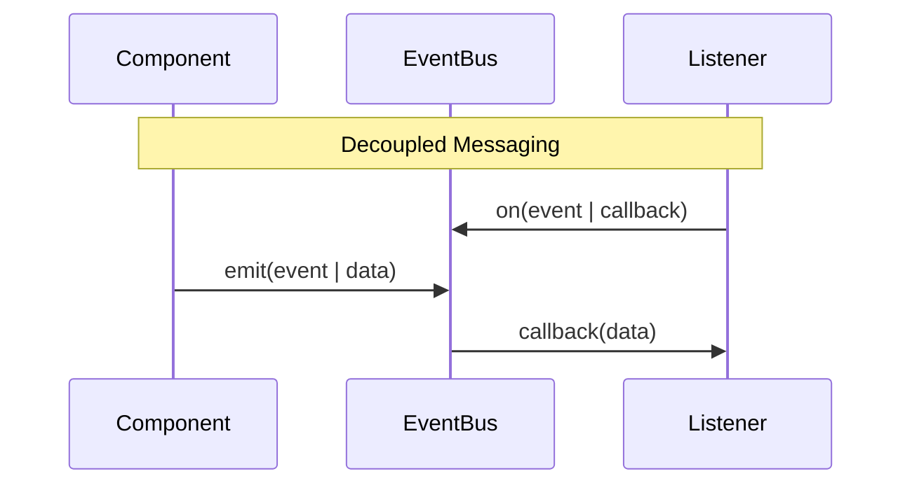

**Sources:**[src/hooks/eventBus.js#25-80](https://github.com/luc-github/ESP3D-WEBUI/blob/97c01e85/src/hooks/eventBus.js#L25-L80)[src/areas/elementsCache.js#25](https://github.com/luc-github/ESP3D-WEBUI/blob/97c01e85/src/areas/elementsCache.js#L25-L25)

---

## Context Consumption Summary

Components access these states through specialized hooks:

1. **`useUiContext()`**: Access `toasts`, `modals`, and `connection`[src/targets/CNC/Controls/QuickStopButton.js#29](https://github.com/luc-github/ESP3D-WEBUI/blob/97c01e85/src/targets/CNC/Controls/QuickStopButton.js#L29-L29)
2. **`useTargetContext()`**: Access runtime variables like `alarmCode` or `status`[src/targets/CNC/GRBL/Controls/BackgroundContainer.js#27](https://github.com/luc-github/ESP3D-WEBUI/blob/97c01e85/src/targets/CNC/GRBL/Controls/BackgroundContainer.js#L27-L27)
3. **`useDatasContext()`**: Access terminal `content` and `add` functions [src/contexts/DatasContext.js#28](https://github.com/luc-github/ESP3D-WEBUI/blob/97c01e85/src/contexts/DatasContext.js#L28-L28)
4. **`useUiContextFn`**: A static object providing helper functions (like `haptic()`) without causing re-renders [src/components/Modal/logginModal.js#53](https://github.com/luc-github/ESP3D-WEBUI/blob/97c01e85/src/components/Modal/logginModal.js#L53-L53)

**Sources:**[src/contexts/UiContext.js#34](https://github.com/luc-github/ESP3D-WEBUI/blob/97c01e85/src/contexts/UiContext.js#L34-L34)[src/contexts/DatasContext.js#28](https://github.com/luc-github/ESP3D-WEBUI/blob/97c01e85/src/contexts/DatasContext.js#L28-L28)[src/hooks/useSettings.js#58-62](https://github.com/luc-github/ESP3D-WEBUI/blob/97c01e85/src/hooks/useSettings.js#L58-L62)

---

# 2.4-File-System-Abstraction-Layer

# File System Abstraction Layer
Relevant source files

- [src/components/Helpers/http.js](https://github.com/luc-github/ESP3D-WEBUI/blob/97c01e85/src/components/Helpers/http.js)
- [src/tabs/interface/importHelper.js](https://github.com/luc-github/ESP3D-WEBUI/blob/97c01e85/src/tabs/interface/importHelper.js)
- [src/targets/CNC/GRBL/index.js](https://github.com/luc-github/ESP3D-WEBUI/blob/97c01e85/src/targets/CNC/GRBL/index.js)
- [src/targets/CNC/grblHAL/DIRECTSD-source.js](https://github.com/luc-github/ESP3D-WEBUI/blob/97c01e85/src/targets/CNC/grblHAL/DIRECTSD-source.js)
- [src/targets/CNC/grblHAL/FLASH-source.js](https://github.com/luc-github/ESP3D-WEBUI/blob/97c01e85/src/targets/CNC/grblHAL/FLASH-source.js)
- [src/targets/CNC/grblHAL/files.js](https://github.com/luc-github/ESP3D-WEBUI/blob/97c01e85/src/targets/CNC/grblHAL/files.js)
- [src/targets/CNC/grblHAL/index.js](https://github.com/luc-github/ESP3D-WEBUI/blob/97c01e85/src/targets/CNC/grblHAL/index.js)
- [src/targets/CNC/grblHAL/realCommandsTable.js](https://github.com/luc-github/ESP3D-WEBUI/blob/97c01e85/src/targets/CNC/grblHAL/realCommandsTable.js)
- [src/targets/CNC/grblHAL/translations/en.json](https://github.com/luc-github/ESP3D-WEBUI/blob/97c01e85/src/targets/CNC/grblHAL/translations/en.json)
- [src/targets/CNC/translations/en.json](https://github.com/luc-github/ESP3D-WEBUI/blob/97c01e85/src/targets/CNC/translations/en.json)
- [src/targets/FLASH-source.js](https://github.com/luc-github/ESP3D-WEBUI/blob/97c01e85/src/targets/FLASH-source.js)
- [src/targets/Printer3D/Marlin-embedded/SD-source.js](https://github.com/luc-github/ESP3D-WEBUI/blob/97c01e85/src/targets/Printer3D/Marlin-embedded/SD-source.js)
- [src/targets/Printer3D/Marlin/SD-source.js](https://github.com/luc-github/ESP3D-WEBUI/blob/97c01e85/src/targets/Printer3D/Marlin/SD-source.js)
- [src/targets/Printer3D/Marlin/SDEXT-source.js](https://github.com/luc-github/ESP3D-WEBUI/blob/97c01e85/src/targets/Printer3D/Marlin/SDEXT-source.js)
- [src/targets/Printer3D/Smoothieware/SD-source.js](https://github.com/luc-github/ESP3D-WEBUI/blob/97c01e85/src/targets/Printer3D/Smoothieware/SD-source.js)
- [src/targets/Printer3D/Smoothieware/SDEXT-source.js](https://github.com/luc-github/ESP3D-WEBUI/blob/97c01e85/src/targets/Printer3D/Smoothieware/SDEXT-source.js)

## Purpose and Scope

The File System Abstraction Layer provides a unified API for interacting with diverse storage backends across different firmware and hardware configurations. This layer enables the ESP3D-WEBUI to perform file operations (list, upload, download, delete, play) without UI components needing knowledge of the underlying storage protocol or hardware implementation.

This document covers the architecture, storage backend implementations, capability system, and command routing. For information about how these file operations are used in the UI, see [File Manager Panel](/org/luc-github/wiki/luc-github/ESP3D-WEBUI/page/5.4?branch=%223.0%22). For target-specific configuration that determines which storage types are available, see [Target Configuration System](/org/luc-github/wiki/luc-github/ESP3D-WEBUI/page/4?branch=%223.0%22).

---

## Unified Files API

The file system abstraction is exposed through a `files` object that exports three primary members:

**API Surface**

```
files.command(filesystem, cmd, ...args)  // Execute a command
files.capability(filesystem, cap, ...args)  // Query capabilities
files.supported  // Array of available filesystems
```

The `files` object is exported from target-specific modules and provides a consistent interface regardless of firmware type. The API routes requests to the appropriate storage backend based on the `filesystem` parameter.

**Files API Architecture**

Loading diagram…

**Sources:**[src/targets/CNC/grblHAL/files.js#1-84](https://github.com/luc-github/ESP3D-WEBUI/blob/97c01e85/src/targets/CNC/grblHAL/files.js#L1-L84)[src/targets/CNC/grblHAL/index.js#22](https://github.com/luc-github/ESP3D-WEBUI/blob/97c01e85/src/targets/CNC/grblHAL/index.js#L22-L22)[src/targets/CNC/grblHAL/index.js#87](https://github.com/luc-github/ESP3D-WEBUI/blob/97c01e85/src/targets/CNC/grblHAL/index.js#L87-L87)

---

## Storage Backend Implementations

Each storage type is implemented in a dedicated source file that exports a structured object containing `capabilities`, `commands`, and optionally `responseSteps`.

### Backend Structure

Loading diagram…

**Storage Types by Target**

|  |  |  |  |
| --- | --- | --- | --- |
| **FLASH** | ✓ | ✓ | ESP internal memory (LittleFS/SPIFFS) |
| **SD** | ✓ | ✗ | SD card via serial G-code (M20/M23/M30) |
| **DIRECTSD** | ✓ | ✓ | Hardware direct SD card access |
| **SDEXT** | ✓ | ✗ | External SD card reader |
| **TFTSD** | ✓ | ✗ | TFT display controller SD slot |
| **TFTUSB** | ✓ | ✗ | TFT display controller USB port |

**Sources:**[src/targets/CNC/grblHAL/files.js#26-47](https://github.com/luc-github/ESP3D-WEBUI/blob/97c01e85/src/targets/CNC/grblHAL/files.js#L26-L47)[src/targets/Printer3D/Marlin/SD-source.js#178-180](https://github.com/luc-github/ESP3D-WEBUI/blob/97c01e85/src/targets/Printer3D/Marlin/SD-source.js#L178-L180)[src/targets/Printer3D/Marlin/SDEXT-source.js#180](https://github.com/luc-github/ESP3D-WEBUI/blob/97c01e85/src/targets/Printer3D/Marlin/SDEXT-source.js#L180-L180)

### FLASH Storage

FLASH storage represents the ESP device's internal memory. It provides full file system capabilities and is accessed via HTTP endpoints.

**Implementation Details:**

- **File**: `FLASH-source.js`
- **Protocol**: HTTP JSON API (`/files` endpoint) [src/targets/CNC/grblHAL/FLASH-source.js#57-59](https://github.com/luc-github/ESP3D-WEBUI/blob/97c01e85/src/targets/CNC/grblHAL/FLASH-source.js#L57-L59)
- **Hierarchical**: Supports directories and nested paths [src/targets/CNC/grblHAL/FLASH-source.js#29](https://github.com/luc-github/ESP3D-WEBUI/blob/97c01e85/src/targets/CNC/grblHAL/FLASH-source.js#L29-L29)
- **Features**: Full CRUD operations including directory creation [src/targets/CNC/grblHAL/FLASH-source.js#48-50](https://github.com/luc-github/ESP3D-WEBUI/blob/97c01e85/src/targets/CNC/grblHAL/FLASH-source.js#L48-L50)

**Key Characteristics:**

```
capabilities = {
    Process: (path, filename) => canProcessFile(filename), [src/targets/CNC/grblHAL/FLASH-source.js:25-27]
    UseFilters: () => true, [src/targets/CNC/grblHAL/FLASH-source.js:28-28]
    IsFlatFS: () => false, [src/targets/CNC/grblHAL/FLASH-source.js:29-29]
    Upload: () => true, [src/targets/CNC/grblHAL/FLASH-source.js:30-32]
    UploadMultiple: () => true, [src/targets/CNC/grblHAL/FLASH-source.js:36-38]
    Download: () => true, [src/targets/CNC/grblHAL/FLASH-source.js:39-41]
    DeleteFile: () => true, [src/targets/CNC/grblHAL/FLASH-source.js:42-44]
    DeleteDir: () => true, [src/targets/CNC/grblHAL/FLASH-source.js:45-47]
    CreateDir: () => true [src/targets/CNC/grblHAL/FLASH-source.js:48-50]
}
```

**Sources:**[src/targets/CNC/grblHAL/FLASH-source.js#1-134](https://github.com/luc-github/ESP3D-WEBUI/blob/97c01e85/src/targets/CNC/grblHAL/FLASH-source.js#L1-L134)

### SD Storage

SD storage accesses SD cards through firmware serial protocol commands. The firmware acts as an intermediary, translating HTTP/serial commands to SD operations.

**Implementation Details:**

- **File**: `SD-source.js`
- **Protocol**: Serial G-code commands (e.g., `M20`) [src/targets/Printer3D/Marlin/SD-source.js#88](https://github.com/luc-github/ESP3D-WEBUI/blob/97c01e85/src/targets/Printer3D/Marlin/SD-source.js#L88-L88)
- **Flat**: Files listed without directory structure [src/targets/Printer3D/Marlin/SD-source.js#60](https://github.com/luc-github/ESP3D-WEBUI/blob/97c01e85/src/targets/Printer3D/Marlin/SD-source.js#L60-L60)
- **Response Parsing**: Multi-line serial responses parsed using `responseSteps`[src/targets/Printer3D/Marlin/SD-source.js#157-176](https://github.com/luc-github/ESP3D-WEBUI/blob/97c01e85/src/targets/Printer3D/Marlin/SD-source.js#L157-L176)

**Response Parsing Pattern:**

```
responseSteps = {
    list: {
        start: (data) => data.startsWith("Begin file list"), [src/targets/Printer3D/Marlin/SD-source.js:159-159]
        end: (data) => data.startsWith("End file list"), [src/targets/Printer3D/Marlin/SD-source.js:160-160]
        error: (data) => data.indexOf("echo:No SD card") != -1 [src/targets/Printer3D/Marlin/SD-source.js:161-168]
    }
}
```

**Sources:**[src/targets/Printer3D/Marlin/SD-source.js#1-181](https://github.com/luc-github/ESP3D-WEBUI/blob/97c01e85/src/targets/Printer3D/Marlin/SD-source.js#L1-L181)

### DIRECTSD Storage

DIRECTSD provides hardware-level access to SD cards, bypassing firmware protocol layer. The ESP device reads/writes SD card directly via HTTP.

**Implementation Details:**

- **File**: `DIRECTSD-source.js`
- **Protocol**: HTTP JSON API (`/sdfiles` endpoint) [src/targets/CNC/grblHAL/DIRECTSD-source.js#58-59](https://github.com/luc-github/ESP3D-WEBUI/blob/97c01e85/src/targets/CNC/grblHAL/DIRECTSD-source.js#L58-L59)
- **Hierarchical**: Full directory support [src/targets/CNC/grblHAL/DIRECTSD-source.js#30](https://github.com/luc-github/ESP3D-WEBUI/blob/97c01e85/src/targets/CNC/grblHAL/DIRECTSD-source.js#L30-L30)

**Capability Summary (grblHAL):**

- **Upload**: Supported (including Multiple) [src/targets/CNC/grblHAL/DIRECTSD-source.js#31-39](https://github.com/luc-github/ESP3D-WEBUI/blob/97c01e85/src/targets/CNC/grblHAL/DIRECTSD-source.js#L31-L39)
- **Download**: Supported [src/targets/CNC/grblHAL/DIRECTSD-source.js#40-42](https://github.com/luc-github/ESP3D-WEBUI/blob/97c01e85/src/targets/CNC/grblHAL/DIRECTSD-source.js#L40-L42)
- **Directories**: Create and Delete supported [src/targets/CNC/grblHAL/DIRECTSD-source.js#46-51](https://github.com/luc-github/ESP3D-WEBUI/blob/97c01e85/src/targets/CNC/grblHAL/DIRECTSD-source.js#L46-L51)

**Sources:**[src/targets/CNC/grblHAL/DIRECTSD-source.js#1-125](https://github.com/luc-github/ESP3D-WEBUI/blob/97c01e85/src/targets/CNC/grblHAL/DIRECTSD-source.js#L1-L125)

---

## Capabilities System

The capabilities system enables runtime UI adaptation based on storage backend features. Each capability is a function that returns a boolean or error message.

### Capability Functions

Loading diagram…

**Capability Types**

|  |  |  |
| --- | --- | --- |
| `Process(path, filename)` | Can file be executed/streamed? | Boolean |
| `UseFilters()` | Should extension filters apply? | Boolean |
| `IsFlatFS()` | Is filesystem flat (no dirs)? | Boolean |
| `Upload(path, filename, eMsg)` | Can upload files? | Boolean / Error String |
| `UploadMultiple()` | Supports multi-file upload? | Boolean |
| `Download()` | Can download files? | Boolean |
| `DeleteFile()` | Can delete files? | Boolean |
| `DeleteDir()` | Can delete directories? | Boolean |
| `CreateDir()` | Can create directories? | Boolean |

**Sources:**[src/targets/CNC/grblHAL/files.js#59-66](https://github.com/luc-github/ESP3D-WEBUI/blob/97c01e85/src/targets/CNC/grblHAL/files.js#L59-L66)[src/targets/CNC/grblHAL/FLASH-source.js#24-51](https://github.com/luc-github/ESP3D-WEBUI/blob/97c01e85/src/targets/CNC/grblHAL/FLASH-source.js#L24-L51)[src/targets/Printer3D/Marlin/SD-source.js#55-82](https://github.com/luc-github/ESP3D-WEBUI/blob/97c01e85/src/targets/Printer3D/Marlin/SD-source.js#L55-L82)

---

## Commands System

Commands define how to perform operations on each storage backend. Each command returns a command descriptor object.

### Command Descriptor Types

Loading diagram…

**Command Functions (grblHAL FLASH Example):**

```
// List operation [src/targets/CNC/grblHAL/FLASH-source.js:54-60]
commands.list = (path, filename) => {
    return {
        type: "url",
        url: "files",
        args: { path, action: "list" },
    }
}
 
// Play operation [src/targets/CNC/grblHAL/FLASH-source.js:115-127]
commands.play = (path, filename) => {
    const spath = (path + (path == "/" ? "" : "/") + filename).replaceAll("//", "/")
    const cmd = useUiContextFn.getValue("playcmd").replace("#", spath)
    return { type: "cmd", cmd }
}
```

**Sources:**[src/targets/CNC/grblHAL/FLASH-source.js#53-129](https://github.com/luc-github/ESP3D-WEBUI/blob/97c01e85/src/targets/CNC/grblHAL/FLASH-source.js#L53-L129)[src/targets/CNC/grblHAL/DIRECTSD-source.js#54-120](https://github.com/luc-github/ESP3D-WEBUI/blob/97c01e85/src/targets/CNC/grblHAL/DIRECTSD-source.js#L54-L120)

### Result Formatting

The `formatResult` function parses backend responses into standardized structures.

**Format Result Flow:**

Loading diagram…

**Sources:**[src/targets/CNC/grblHAL/FLASH-source.js#71-78](https://github.com/luc-github/ESP3D-WEBUI/blob/97c01e85/src/targets/CNC/grblHAL/FLASH-source.js#L71-L78)[src/targets/CNC/grblHAL/DIRECTSD-source.js#69-76](https://github.com/luc-github/ESP3D-WEBUI/blob/97c01e85/src/targets/CNC/grblHAL/DIRECTSD-source.js#L69-L76)

---

## Supported Filesystems Registry

The `supportedFileSystems` array defines which storage types are available for a given target based on settings dependencies.

**Registry Structure (grblHAL):**

```
const supportedFileSystems = [
    {
        value: "FLASH",
        name: "S137",
        depend: () => {
            return (
                useUiContextFn.getValue("flashfs") &&
                useSettingsContextFn.getValue("FlashFileSystem") != "none"
            )
        },
    },
    {
        value: "DIRECTSD",
        name: "S190",
        depend: () => {
            return (
                useUiContextFn.getValue("directsd") &&
                useSettingsContextFn.getValue("SDConnection") != "none"
            )
        },
    }
]
```

**Sources:**[src/targets/CNC/grblHAL/files.js#26-47](https://github.com/luc-github/ESP3D-WEBUI/blob/97c01e85/src/targets/CNC/grblHAL/files.js#L26-L47)

---

## File Processing and Streaming

The `Process` capability and `play` command enable file execution.

**Processing Logic:**

- **Extension Check**: Uses `canProcessFile(filename)` to match allowed extensions (e.g., .gcode, .nc) [src/targets/CNC/grblHAL/FLASH-source.js#26](https://github.com/luc-github/ESP3D-WEBUI/blob/97c01e85/src/targets/CNC/grblHAL/FLASH-source.js#L26-L26)
- **Command Replacement**: The `play` command retrieves the `playcmd` from UI settings and replaces the `#` placeholder with the full file path [src/targets/CNC/grblHAL/DIRECTSD-source.js#106-118](https://github.com/luc-github/ESP3D-WEBUI/blob/97c01e85/src/targets/CNC/grblHAL/DIRECTSD-source.js#L106-L118)

**Sources:**[src/targets/CNC/grblHAL/FLASH-source.js#115-127](https://github.com/luc-github/ESP3D-WEBUI/blob/97c01e85/src/targets/CNC/grblHAL/FLASH-source.js#L115-L127)[src/targets/CNC/grblHAL/DIRECTSD-source.js#106-118](https://github.com/luc-github/ESP3D-WEBUI/blob/97c01e85/src/targets/CNC/grblHAL/DIRECTSD-source.js#L106-L118)[src/targets/Printer3D/Marlin/SD-source.js#131-141](https://github.com/luc-github/ESP3D-WEBUI/blob/97c01e85/src/targets/Printer3D/Marlin/SD-source.js#L131-L141)

---

## File Upload Handling

Upload operations are routed either via specific HTTP endpoints or G-code protocols.

**grblHAL FLASH Upload:**

- Uses the `/files` URL [src/targets/CNC/grblHAL/FLASH-source.js#67](https://github.com/luc-github/ESP3D-WEBUI/blob/97c01e85/src/targets/CNC/grblHAL/FLASH-source.js#L67-L67)
- Prepends `HostUploadPath` setting to the destination path [src/targets/CNC/grblHAL/FLASH-source.js#63-64](https://github.com/luc-github/ESP3D-WEBUI/blob/97c01e85/src/targets/CNC/grblHAL/FLASH-source.js#L63-L64)

**Marlin SD Upload:**

- Only supported if `SerialProtocol` is set to "MKS" [src/targets/Printer3D/Marlin/SD-source.js#65](https://github.com/luc-github/ESP3D-WEBUI/blob/97c01e85/src/targets/Printer3D/Marlin/SD-source.js#L65-L65)
- Returns a `refresh` type command post-upload to update the UI after a 3000ms timeout [src/targets/Printer3D/Marlin/SD-source.js#104-111](https://github.com/luc-github/ESP3D-WEBUI/blob/97c01e85/src/targets/Printer3D/Marlin/SD-source.js#L104-L111)

**Sources:**[src/targets/CNC/grblHAL/FLASH-source.js#61-70](https://github.com/luc-github/ESP3D-WEBUI/blob/97c01e85/src/targets/CNC/grblHAL/FLASH-source.js#L61-L70)[src/targets/Printer3D/Marlin/SD-source.js#91-113](https://github.com/luc-github/ESP3D-WEBUI/blob/97c01e85/src/targets/Printer3D/Marlin/SD-source.js#L91-L113)

---

## Sorting and Filtering

The abstraction layer handles sorting and filtering to ensure a consistent UI experience.

**Sorting:**

- Triggered by UI context values (e.g., `sort_flashfs_files`, `sort_directsd_files`) [src/targets/CNC/grblHAL/FLASH-source.js#73-75](https://github.com/luc-github/ESP3D-WEBUI/blob/97c01e85/src/targets/CNC/grblHAL/FLASH-source.js#L73-L75)
- Uses `sortedFilesList()` helper to organize the file array [src/targets/CNC/grblHAL/DIRECTSD-source.js#72](https://github.com/luc-github/ESP3D-WEBUI/blob/97c01e85/src/targets/CNC/grblHAL/DIRECTSD-source.js#L72-L72)

**Filtering (Flat Filesystems):**

- Flat filesystems (like standard Marlin SD) use `filterResultFiles(data.files, path)` to simulate directory structures by filtering files based on path prefixes [src/targets/Printer3D/Marlin/SD-source.js#127](https://github.com/luc-github/ESP3D-WEBUI/blob/97c01e85/src/targets/Printer3D/Marlin/SD-source.js#L127-L127)

**Sources:**[src/targets/CNC/grblHAL/FLASH-source.js#71-78](https://github.com/luc-github/ESP3D-WEBUI/blob/97c01e85/src/targets/CNC/grblHAL/FLASH-source.js#L71-L78)[src/targets/CNC/grblHAL/DIRECTSD-source.js#69-76](https://github.com/luc-github/ESP3D-WEBUI/blob/97c01e85/src/targets/CNC/grblHAL/DIRECTSD-source.js#L69-L76)[src/targets/Printer3D/Marlin/SD-source.js#123-130](https://github.com/luc-github/ESP3D-WEBUI/blob/97c01e85/src/targets/Printer3D/Marlin/SD-source.js#L123-L130)

---

# 2.5-Component-Hierarchy

# Component Hierarchy
Relevant source files

- [src/areas/index.js](https://github.com/luc-github/ESP3D-WEBUI/blob/97c01e85/src/areas/index.js)
- [src/components/ExtraContent/index.js](https://github.com/luc-github/ESP3D-WEBUI/blob/97c01e85/src/components/ExtraContent/index.js)
- [src/components/Panels/Files.js](https://github.com/luc-github/ESP3D-WEBUI/blob/97c01e85/src/components/Panels/Files.js)
- [src/components/Panels/Jog.js](https://github.com/luc-github/ESP3D-WEBUI/blob/97c01e85/src/components/Panels/Jog.js)
- [src/components/Panels/JogCNC.js](https://github.com/luc-github/ESP3D-WEBUI/blob/97c01e85/src/components/Panels/JogCNC.js)
- [src/components/Panels/JogPlotter.js](https://github.com/luc-github/ESP3D-WEBUI/blob/97c01e85/src/components/Panels/JogPlotter.js)
- [src/components/Panels/Notifications.js](https://github.com/luc-github/ESP3D-WEBUI/blob/97c01e85/src/components/Panels/Notifications.js)
- [src/components/Panels/OverridesCNC.js](https://github.com/luc-github/ESP3D-WEBUI/blob/97c01e85/src/components/Panels/OverridesCNC.js)
- [src/pages/dashboard/index.js](https://github.com/luc-github/ESP3D-WEBUI/blob/97c01e85/src/pages/dashboard/index.js)

This document explains the hierarchical structure of Preact components in ESP3D-WEBUI, from the root `ViewContainer` down to individual panels and fields. It covers how components are organized, how conditional rendering determines the UI state (authenticated vs. unauthenticated), and how the panel system provides modular functionality.

---

## Overview of Component Structure

ESP3D-WEBUI uses a hierarchical component architecture where `ContentContainer` serves as the application root. It orchestrates all top-level functionality including context management, extension messaging, and lifecycle handling. The hierarchy branches based on authentication state: authenticated users see the full interface with panels, while unauthenticated users see only the connection/login screen.

**Component Tree (High-Level)**

[Flowchart Diagram]

**Sources:**[src/areas/index.js#49-73](https://github.com/luc-github/ESP3D-WEBUI/blob/97c01e85/src/areas/index.js#L49-L73)[src/areas/index.js#75-306](https://github.com/luc-github/ESP3D-WEBUI/blob/97c01e85/src/areas/index.js#L75-L306)

---

## ContentContainer - Application Root

The `ContentContainer` component [src/areas/index.js#75-306](https://github.com/luc-github/ESP3D-WEBUI/blob/97c01e85/src/areas/index.js#L75-L306) is the top-level orchestrator. It wraps the UI in context providers and handles critical application-level concerns like extension communication.

### Responsibilities

|  |  |
| --- | --- |
| Context provisioning | Wraps children with `SettingsContextProvider`, `TargetContextProvider`, `UiContextProvider`[src/areas/index.js#191-306](https://github.com/luc-github/ESP3D-WEBUI/blob/97c01e85/src/areas/index.js#L191-L306) |
| Extension messaging | Handles `postMessage` events from iframe extensions via `processExtensionMessage`[src/areas/index.js#84-156](https://github.com/luc-github/ESP3D-WEBUI/blob/97c01e85/src/areas/index.js#L84-L156) |
| Icon management | Merges `iconsTarget` and `iconsFeather` into `iconsList`[src/areas/index.js#82](https://github.com/luc-github/ESP3D-WEBUI/blob/97c01e85/src/areas/index.js#L82-L82) |
| Settings persistence | Provides `exportPreferencesSection` and `importPreferencesSection` functions [src/areas/index.js#28-31](https://github.com/luc-github/ESP3D-WEBUI/blob/97c01e85/src/areas/index.js#L28-L31) |

### Extension Message Protocol

`ContentContainer` implements a router for messages coming from iframes [src/areas/index.js#84-156](https://github.com/luc-github/ESP3D-WEBUI/blob/97c01e85/src/areas/index.js#L84-L156) It supports `cmd` (serial commands), `query` (URL-based API calls), and `upload` (file transfers) by wrapping them in `createNewRequest` from the `useHttpQueue` hook.

**Sources:**[src/areas/index.js#84-156](https://github.com/luc-github/ESP3D-WEBUI/blob/97c01e85/src/areas/index.js#L84-L156)[src/areas/index.js#191-306](https://github.com/luc-github/ESP3D-WEBUI/blob/97c01e85/src/areas/index.js#L191-L306)

---

## ViewContainer - Conditional Rendering

The `ViewContainer` component [src/areas/index.js#49-73](https://github.com/luc-github/ESP3D-WEBUI/blob/97c01e85/src/areas/index.js#L49-L73) determines which UI tree to render based on the authentication state stored in `UiContext`.

### Rendering Logic

[Flowchart Diagram]

**Sources:**[src/areas/index.js#49-73](https://github.com/luc-github/ESP3D-WEBUI/blob/97c01e85/src/areas/index.js#L49-L73)

---

## MainContainer and Dashboard

`MainContainer`[src/areas/main/index.js](https://github.com/luc-github/ESP3D-WEBUI/blob/97c01e85/src/areas/main/index.js) hosts the functional pages. The primary view is the `Dashboard`[src/pages/dashboard/index.js#113](https://github.com/luc-github/ESP3D-WEBUI/blob/97c01e85/src/pages/dashboard/index.js#L113-L113) which acts as a grid for functional panels.

### Dashboard Responsibilities

- **Keyboard Shortcuts**: Manages global keyboard listeners via `AddKeyboardListener`[src/pages/dashboard/index.js#166-172](https://github.com/luc-github/ESP3D-WEBUI/blob/97c01e85/src/pages/dashboard/index.js#L166-L172) and `keyboardEventHandlerDown`[src/pages/dashboard/index.js#43-110](https://github.com/luc-github/ESP3D-WEBUI/blob/97c01e85/src/pages/dashboard/index.js#L43-L110)
- **Panel Layout**: Renders panels based on `uisettings.getValue("fixedpanels")`[src/pages/dashboard/index.js#118](https://github.com/luc-github/ESP3D-WEBUI/blob/97c01e85/src/pages/dashboard/index.js#L118-L118)
- **Quick Buttons**: Renders the `QuickButtonsBar`[src/pages/dashboard/index.js#26](https://github.com/luc-github/ESP3D-WEBUI/blob/97c01e85/src/pages/dashboard/index.js#L26-L26)

**Sources:**[src/pages/dashboard/index.js#43-110](https://github.com/luc-github/ESP3D-WEBUI/blob/97c01e85/src/pages/dashboard/index.js#L43-L110)[src/pages/dashboard/index.js#113-200](https://github.com/luc-github/ESP3D-WEBUI/blob/97c01e85/src/pages/dashboard/index.js#L113-L200)

---

## Panel System

Each panel is a self-contained Preact component. Panels generally use `useTargetContext` to access real-time machine data and `useUiContext` for UI state (toasts, modals).

### Panel Types and Implementations

|  |  |  |
| --- | --- | --- |
| **FilesPanel** | [src/components/Panels/Files.js](https://github.com/luc-github/ESP3D-WEBUI/blob/97c01e85/src/components/Panels/Files.js) | Manages file systems via `files.command()`[src/components/Panels/Files.js#121](https://github.com/luc-github/ESP3D-WEBUI/blob/97c01e85/src/components/Panels/Files.js#L121-L121) Handles uploads [src/components/Panels/Files.js#196](https://github.com/luc-github/ESP3D-WEBUI/blob/97c01e85/src/components/Panels/Files.js#L196-L196) and directory navigation. |
| **JogPanel (CNC)** | [src/components/Panels/JogCNC.js](https://github.com/luc-github/ESP3D-WEBUI/blob/97c01e85/src/components/Panels/JogCNC.js) | Handles multi-axis movement (X, Y, Z, A, B, C, U, V, W) [src/components/Panels/JogCNC.js#41-43](https://github.com/luc-github/ESP3D-WEBUI/blob/97c01e85/src/components/Panels/JogCNC.js#L41-L43) Supports MPos and WPos display [src/components/Panels/JogCNC.js#50-112](https://github.com/luc-github/ESP3D-WEBUI/blob/97c01e85/src/components/Panels/JogCNC.js#L50-L112) |
| **JogPanel (3D)** | [src/components/Panels/Jog.js](https://github.com/luc-github/ESP3D-WEBUI/blob/97c01e85/src/components/Panels/Jog.js) | Optimized for 3D printer axis control with feedrate selection [src/components/Panels/Jog.js#188-205](https://github.com/luc-github/ESP3D-WEBUI/blob/97c01e85/src/components/Panels/Jog.js#L188-L205) |
| **JogPanel (Plotter)** | [src/components/Panels/JogPlotter.js](https://github.com/luc-github/ESP3D-WEBUI/blob/97c01e85/src/components/Panels/JogPlotter.js) | Simplified XY control with Pen up/down status [src/components/Panels/JogPlotter.js#81-100](https://github.com/luc-github/ESP3D-WEBUI/blob/97c01e85/src/components/Panels/JogPlotter.js#L81-L100) |
| **Notifications** | [src/components/Panels/Notifications.js](https://github.com/luc-github/ESP3D-WEBUI/blob/97c01e85/src/components/Panels/Notifications.js) | Displays time-stamped logs with auto-scroll logic [src/components/Panels/Notifications.js#52-60](https://github.com/luc-github/ESP3D-WEBUI/blob/97c01e85/src/components/Panels/Notifications.js#L52-L60) |
| **Overrides** | [src/components/Panels/OverridesCNC.js](https://github.com/luc-github/ESP3D-WEBUI/blob/97c01e85/src/components/Panels/OverridesCNC.js) | Real-time spindle, feed, and rapid override controls [src/components/Panels/OverridesCNC.js#34-69](https://github.com/luc-github/ESP3D-WEBUI/blob/97c01e85/src/components/Panels/OverridesCNC.js#L34-L69) |

### Common Panel Structure

Panels use `ContainerHelper`[src/components/Controls/index.js](https://github.com/luc-github/ESP3D-WEBUI/blob/97c01e85/src/components/Controls/index.js) to provide a consistent wrapper, and often include `FullScreenButton` and `CloseButton`.

[Flowchart Diagram]

**Sources:**[src/components/Panels/Files.js#57-195](https://github.com/luc-github/ESP3D-WEBUI/blob/97c01e85/src/components/Panels/Files.js#L57-L195)[src/components/Panels/JogCNC.js#114-145](https://github.com/luc-github/ESP3D-WEBUI/blob/97c01e85/src/components/Panels/JogCNC.js#L114-L145)

---

## ExtraContent and Extensions

The `ExtraContent` component [src/components/ExtraContent/index.js#36](https://github.com/luc-github/ESP3D-WEBUI/blob/97c01e85/src/components/ExtraContent/index.js#L36-L36) manages external content like camera streams or custom HTML. It uses `ExtraContentItem`[src/components/ExtraContent/extraContentItem.js](https://github.com/luc-github/ESP3D-WEBUI/blob/97c01e85/src/components/ExtraContent/extraContentItem.js) for actual rendering.

### Dynamic Positioning

`ExtraContent` calculates its position relative to a target DOM element (e.g., a panel or page area) using `getBoundingClientRect()`[src/components/ExtraContent/index.js#53](https://github.com/luc-github/ESP3D-WEBUI/blob/97c01e85/src/components/ExtraContent/index.js#L53-L53) It communicates this position to the rendering layer via the `eventBus`[src/components/ExtraContent/index.js#55](https://github.com/luc-github/ESP3D-WEBUI/blob/97c01e85/src/components/ExtraContent/index.js#L55-L55)

### Extension Messaging

When `target === "panel"`, it renders standard panel controls (Refresh, Fullscreen, Close) [src/components/ExtraContent/index.js#125-145](https://github.com/luc-github/ESP3D-WEBUI/blob/97c01e85/src/components/ExtraContent/index.js#L125-L145)

**Sources:**[src/components/ExtraContent/index.js#45-82](https://github.com/luc-github/ESP3D-WEBUI/blob/97c01e85/src/components/ExtraContent/index.js#L45-L82)[src/components/ExtraContent/index.js#125-145](https://github.com/luc-github/ESP3D-WEBUI/blob/97c01e85/src/components/ExtraContent/index.js#L125-L145)

---

## Field Component Hierarchy

Configuration interfaces (like the Settings tab) are built using a recursive hierarchy of `Field` and `FieldGroup` components.

### Field Mapping

|  |  |
| --- | --- |
| `boolean` | Checkbox / Toggle |
| `number` | `Input` (type=number) [src/components/Controls/index.js](https://github.com/luc-github/ESP3D-WEBUI/blob/97c01e85/src/components/Controls/index.js) |
| `select` | `Select` dropdown |
| `mask` | `Mask` bitmask selector [src/components/Controls/index.js](https://github.com/luc-github/ESP3D-WEBUI/blob/97c01e85/src/components/Controls/index.js) |
| `group` | `FieldGroup` container [src/components/Controls/index.js](https://github.com/luc-github/ESP3D-WEBUI/blob/97c01e85/src/components/Controls/index.js) |

**Sources:**[src/areas/index.js#38](https://github.com/luc-github/ESP3D-WEBUI/blob/97c01e85/src/areas/index.js#L38-L38)[src/components/Controls/index.js](https://github.com/luc-github/ESP3D-WEBUI/blob/97c01e85/src/components/Controls/index.js)

---

## Summary of Data Flow

1. **Top-Down**: Contexts (`UiContext`, `SettingsContext`, `TargetContext`) are provided at the root and consumed by leaf components (Panels, Fields).
2. **Bottom-Up**: User interactions (button clicks, input changes) trigger `createNewRequest`[src/hooks/index.js](https://github.com/luc-github/ESP3D-WEBUI/blob/97c01e85/src/hooks/index.js) or context update functions.
3. **Cross-Component**: The `eventBus`[src/hooks/eventBus.js](https://github.com/luc-github/ESP3D-WEBUI/blob/97c01e85/src/hooks/eventBus.js) is used for non-hierarchical communication, such as updating `ExtraContent` positions when panels are scrolled or resized [src/components/ExtraContent/index.js#61-63](https://github.com/luc-github/ESP3D-WEBUI/blob/97c01e85/src/components/ExtraContent/index.js#L61-L63)

**Sources:**[src/areas/index.js#191-306](https://github.com/luc-github/ESP3D-WEBUI/blob/97c01e85/src/areas/index.js#L191-L306)[src/components/ExtraContent/index.js#61-82](https://github.com/luc-github/ESP3D-WEBUI/blob/97c01e85/src/components/ExtraContent/index.js#L61-L82)

---

# 3-Application-Lifecycle

# Application Lifecycle
Relevant source files

- [src/areas/elementsCache.js](https://github.com/luc-github/ESP3D-WEBUI/blob/97c01e85/src/areas/elementsCache.js)
- [src/components/Helpers/filters.js](https://github.com/luc-github/ESP3D-WEBUI/blob/97c01e85/src/components/Helpers/filters.js)
- [src/components/Helpers/storedState.js](https://github.com/luc-github/ESP3D-WEBUI/blob/97c01e85/src/components/Helpers/storedState.js)
- [src/components/Modal/logginModal.js](https://github.com/luc-github/ESP3D-WEBUI/blob/97c01e85/src/components/Modal/logginModal.js)
- [src/contexts/DatasContext.js](https://github.com/luc-github/ESP3D-WEBUI/blob/97c01e85/src/contexts/DatasContext.js)
- [src/contexts/UiContext.js](https://github.com/luc-github/ESP3D-WEBUI/blob/97c01e85/src/contexts/UiContext.js)
- [src/hooks/eventBus.js](https://github.com/luc-github/ESP3D-WEBUI/blob/97c01e85/src/hooks/eventBus.js)
- [src/hooks/useSettings.js](https://github.com/luc-github/ESP3D-WEBUI/blob/97c01e85/src/hooks/useSettings.js)
- [src/targets/CNC/Controls/QuickStopButton.js](https://github.com/luc-github/ESP3D-WEBUI/blob/97c01e85/src/targets/CNC/Controls/QuickStopButton.js)
- [src/targets/CNC/GRBL/Controls/BackgroundContainer.js](https://github.com/luc-github/ESP3D-WEBUI/blob/97c01e85/src/targets/CNC/GRBL/Controls/BackgroundContainer.js)

## Purpose and Scope

This page walks through the complete lifecycle of ESP3D-WEBUI from initial page load to steady-state operation. It documents the four major phases: **Loading** (browser fetches/decompressed `index.html.gz`), **Initialization** (context providers mount, settings load), **Connection** (authentication and `ViewContainer` routing), and **Steady-State** (bidirectional data flow via WebSocket and HTTP).

The lifecycle is orchestrated by several key components:

- `App` - The entry point component [src/hooks/useSettings.js#21](https://github.com/luc-github/ESP3D-WEBUI/blob/97c01e85/src/hooks/useSettings.js#L21-L21)
- `ViewContainer` - Conditional renderer that switches between login UI and authenticated UI [src/contexts/UiContext.js#55](https://github.com/luc-github/ESP3D-WEBUI/blob/97c01e85/src/contexts/UiContext.js#L55-L55)
- `UiContext`, `SettingsContext`, `TargetContext` - Primary providers managing application state [src/hooks/useSettings.js#30-34](https://github.com/luc-github/ESP3D-WEBUI/blob/97c01e85/src/hooks/useSettings.js#L30-L34)
- `processData()` - The central function for parsing incoming firmware data [src/hooks/useSettings.js#59](https://github.com/luc-github/ESP3D-WEBUI/blob/97c01e85/src/hooks/useSettings.js#L59-L59)

For implementation details of each phase:

- **Initialization and Loading**: see [Initialization and Loading](/org/luc-github/wiki/luc-github/ESP3D-WEBUI/page/3.1?branch=%223.0%22)
- **Connection Management**: see [Connection Management](/org/luc-github/wiki/luc-github/ESP3D-WEBUI/page/3.2?branch=%223.0%22)
- **Data Processing Pipeline**: see [Data Processing Pipeline](/org/luc-github/wiki/luc-github/ESP3D-WEBUI/page/3.3?branch=%223.0%22)

---

## Lifecycle Phases Overview

ESP3D-WEBUI progresses through four phases:

|  |  |  |  |
| --- | --- | --- | --- |
| **Loading** | Browser fetches and decompresses `index.html.gz` | `webUIversion`, gzip decompression | User navigates to device URL |
| **Initialization** | Preact app mounts contexts and loads preferences | `UiContextProvider`, `useSettings`, `useStoredState` | Script execution begins |
| **Connection** | UI renders login or main view based on auth state | `connectionState`, `showLogin`, `showKeepConnected` | Context providers ready |
| **Steady-State** | Bidirectional data flow and UI updates | `processData()`, `eventBus`, `initPolling()` | `connected: true` in `UiContext` |

### Application Lifecycle State Machine

Loading diagram…

**Sources:**[src/hooks/useSettings.js#52-171](https://github.com/luc-github/ESP3D-WEBUI/blob/97c01e85/src/hooks/useSettings.js#L52-L171)[src/contexts/UiContext.js#50-57](https://github.com/luc-github/ESP3D-WEBUI/blob/97c01e85/src/contexts/UiContext.js#L50-L57)[src/components/Helpers/storedState.js#21-33](https://github.com/luc-github/ESP3D-WEBUI/blob/97c01e85/src/components/Helpers/storedState.js#L21-L33)[src/hooks/eventBus.js#25-68](https://github.com/luc-github/ESP3D-WEBUI/blob/97c01e85/src/hooks/eventBus.js#L25-L68)

---

## Phase 1: Application Loading

The loading phase begins when the browser requests the target-specific bundle. ESP3D-WEBUI is distributed as target-specific compressed single-page applications.

### Build Artifacts and Deployment

The build system produces one `.html.gz` file per firmware variant. These files are self-contained, inlining all JS and CSS to minimize requests on resource-constrained ESP devices.

|  |  |  |
| --- | --- | --- |
| `printer3d-marlin` | `dist/Printer3D/Marlin/index.html.gz` | Marlin |
| `cnc-grbl` | `dist/CNC/GRBL/index.html.gz` | GRBL |
| `cnc-grblhal` | `dist/CNC/GRBLHal/index.html.gz` | grblHAL |

**Sources:**[src/components/App/version.js#21](https://github.com/luc-github/ESP3D-WEBUI/blob/97c01e85/src/components/App/version.js#L21-L21)[src/hooks/useSettings.js#176](https://github.com/luc-github/ESP3D-WEBUI/blob/97c01e85/src/hooks/useSettings.js#L176-L176)

---

## Phase 2: Initialization

Once the JS bundle executes, Preact initializes the context providers.

### Component and Context Provider Tree

Loading diagram…

### Initialization Steps

1. **Preference Retrieval**: `useStoredState` retrieves UI preferences from `localStorage`[src/components/Helpers/storedState.js#21-33](https://github.com/luc-github/ESP3D-WEBUI/blob/97c01e85/src/components/Helpers/storedState.js#L21-L33)
2. **Context Setup**: `UiContextProvider` initializes `connectionState` and UI elements like `panelsList`[src/contexts/UiContext.js#35-57](https://github.com/luc-github/ESP3D-WEBUI/blob/97c01e85/src/contexts/UiContext.js#L35-L57)
3. **Target Sync**: `useSettings` triggers `getConnectionSettings` which calls `[ESP800]` to sync time, timezone, and version with the hardware [src/hooks/useSettings.js#173-182](https://github.com/luc-github/ESP3D-WEBUI/blob/97c01e85/src/hooks/useSettings.js#L173-L182)
4. **Cache Preparation**: `ElementsCache` prepares extra content items (like cameras or custom frames) [src/areas/elementsCache.js#40-61](https://github.com/luc-github/ESP3D-WEBUI/blob/97c01e85/src/areas/elementsCache.js#L40-L61)

**Sources:**[src/contexts/UiContext.js#35-57](https://github.com/luc-github/ESP3D-WEBUI/blob/97c01e85/src/contexts/UiContext.js#L35-L57)[src/hooks/useSettings.js#173-182](https://github.com/luc-github/ESP3D-WEBUI/blob/97c01e85/src/hooks/useSettings.js#L173-L182)[src/areas/elementsCache.js#27-61](https://github.com/luc-github/ESP3D-WEBUI/blob/97c01e85/src/areas/elementsCache.js#L27-L61)

---

## Phase 3: Connection Management

Connection state is managed within `UiContext`. The UI adapts based on whether the device requires authentication (`needLogin`) or is currently connected.

### Authentication Flow

If the ESP3D backend returns a requirement for authentication, the `showLogin` function is triggered, mounting the `logginModal`.

Loading diagram…

**Sources:**[src/components/Modal/logginModal.js#33-79](https://github.com/luc-github/ESP3D-WEBUI/blob/97c01e85/src/components/Modal/logginModal.js#L33-L79)[src/contexts/UiContext.js#50-56](https://github.com/luc-github/ESP3D-WEBUI/blob/97c01e85/src/contexts/UiContext.js#L50-L56)

---

## Phase 4: Steady-State Operation

Steady-state is characterized by continuous monitoring and command execution.

### Data Processing Loop

1. **Polling**: `initPolling()` sends periodic commands (e.g., status, temperatures) defined in `uisettings`[src/hooks/useSettings.js#92-171](https://github.com/luc-github/ESP3D-WEBUI/blob/97c01e85/src/hooks/useSettings.js#L92-L171)
2. **Command Execution**: Components use `createNewRequest` to send G-code or ESP commands via `espHttpURL`[src/hooks/useSettings.js#63-90](https://github.com/luc-github/ESP3D-WEBUI/blob/97c01e85/src/hooks/useSettings.js#L63-L90)
3. **Data Handling**: Incoming responses are passed to `processData`. If the response starts with `{`, it is treated as JSON; otherwise, it is processed as a standard firmware response [src/hooks/useSettings.js#74-81](https://github.com/luc-github/ESP3D-WEBUI/blob/97c01e85/src/hooks/useSettings.js#L74-L81)
4. **Terminal Logging**: Raw data is appended to the `DatasContext` terminal buffer for display in the Terminal Panel [src/contexts/DatasContext.js#49-78](https://github.com/luc-github/ESP3D-WEBUI/blob/97c01e85/src/contexts/DatasContext.js#L49-L78)

### Event Distribution

The `eventBus` allows components to communicate without direct context dependencies, which is used for high-frequency updates or decoupled interactions [src/hooks/eventBus.js#25-68](https://github.com/luc-github/ESP3D-WEBUI/blob/97c01e85/src/hooks/eventBus.js#L25-L68)

Loading diagram…

**Sources:**[src/hooks/useSettings.js#59-171](https://github.com/luc-github/ESP3D-WEBUI/blob/97c01e85/src/hooks/useSettings.js#L59-L171)[src/contexts/DatasContext.js#86-98](https://github.com/luc-github/ESP3D-WEBUI/blob/97c01e85/src/contexts/DatasContext.js#L86-L98)[src/hooks/eventBus.js#60-68](https://github.com/luc-github/ESP3D-WEBUI/blob/97c01e85/src/hooks/eventBus.js#L60-L68)

---

## Lifecycle Summary

1. **Loading**: Decompression and mounting of the Preact tree.
2. **Initialization**: Loading local state and syncing with hardware via `[ESP800]`.
3. **Connection**: Handling authentication via `logginModal` and establishing WebSocket/HTTP communication.
4. **Steady-State**: Running the `initPolling` loop and updating `TargetContext` via `processData`.

For implementation details, refer to the sub-pages:

- [Initialization and Loading](/org/luc-github/wiki/luc-github/ESP3D-WEBUI/page/3.1?branch=%223.0%22)
- [Connection Management](/org/luc-github/wiki/luc-github/ESP3D-WEBUI/page/3.2?branch=%223.0%22)
- [Data Processing Pipeline](/org/luc-github/wiki/luc-github/ESP3D-WEBUI/page/3.3?branch=%223.0%22)

**Sources:**[src/hooks/useSettings.js](https://github.com/luc-github/ESP3D-WEBUI/blob/97c01e85/src/hooks/useSettings.js)[src/contexts/UiContext.js](https://github.com/luc-github/ESP3D-WEBUI/blob/97c01e85/src/contexts/UiContext.js)[src/contexts/DatasContext.js](https://github.com/luc-github/ESP3D-WEBUI/blob/97c01e85/src/contexts/DatasContext.js)[src/components/Modal/logginModal.js](https://github.com/luc-github/ESP3D-WEBUI/blob/97c01e85/src/components/Modal/logginModal.js)

---

# 3.1-Initialization-and-Loading

# Initialization and Loading
Relevant source files

- [src/areas/elementsCache.js](https://github.com/luc-github/ESP3D-WEBUI/blob/97c01e85/src/areas/elementsCache.js)
- [src/components/ExtraContent/index.js](https://github.com/luc-github/ESP3D-WEBUI/blob/97c01e85/src/components/ExtraContent/index.js)
- [src/contexts/UiContext.js](https://github.com/luc-github/ESP3D-WEBUI/blob/97c01e85/src/contexts/UiContext.js)
- [src/hooks/eventBus.js](https://github.com/luc-github/ESP3D-WEBUI/blob/97c01e85/src/hooks/eventBus.js)
- [src/hooks/useSettings.js](https://github.com/luc-github/ESP3D-WEBUI/blob/97c01e85/src/hooks/useSettings.js)
- [src/pages/dashboard/index.js](https://github.com/luc-github/ESP3D-WEBUI/blob/97c01e85/src/pages/dashboard/index.js)

This page describes how the ESP3D-WEBUI application bootstraps from initial page load through context initialization, settings loading, and the first UI render. For information about connection establishment after initial load, see [Connection Management](/org/luc-github/wiki/luc-github/ESP3D-WEBUI/page/3.2?branch=%223.0%22). For details on the build process that creates the deployable artifacts, see [Build Pipeline Overview](/org/luc-github/wiki/luc-github/ESP3D-WEBUI/page/9.1?branch=%223.0%22).

---

## Overview

The initialization process transforms a compressed HTML file served by the ESP3D device into a fully interactive Preact application. The process involves five distinct phases:

1. **Asset Loading**: The browser requests and decompresses the `index.html.gz` artifact.
2. **Script Execution**: Webpack-bundled JavaScript executes, initializing Preact.
3. **Context Setup**: Three primary context providers (`UiContextProvider`, `SettingsContextProvider`, `TargetContextProvider`) instantiate global state.
4. **Settings Restoration**: User preferences load from browser `localStorage` or defaults via the `useSettings` hook.
5. **Initial Render**: The application renders either the connection screen or the dashboard interface.

---

## Initialization Sequence

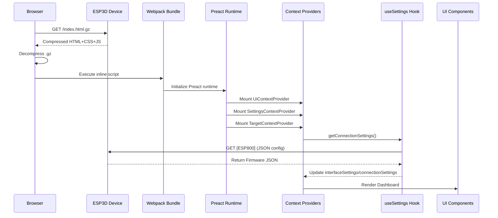

**Sources**: [src/hooks/useSettings.js#173-200](https://github.com/luc-github/ESP3D-WEBUI/blob/97c01e85/src/hooks/useSettings.js#L173-L200)[src/contexts/UiContext.js#35-57](https://github.com/luc-github/ESP3D-WEBUI/blob/97c01e85/src/contexts/UiContext.js#L35-L57)

---

## Application Entry Point

The application begins execution in the root mounting point where context providers are nested. The `UiContextProvider` is the outermost layer, managing the core application state including connection status and UI visibility.

### Root Component Structure

[Flowchart Diagram]

The initialization orchestrates:

- **UI State**: `UiContextProvider` initializes `panelsList`, `modals`, and `connectionState`[src/contexts/UiContext.js#36-56](https://github.com/luc-github/ESP3D-WEBUI/blob/97c01e85/src/contexts/UiContext.js#L36-L56)
- **Keyboard Shortcuts**: The `Dashboard` component checks `enableshortcuts` and attaches global listeners [src/pages/dashboard/index.js#187-193](https://github.com/luc-github/ESP3D-WEBUI/blob/97c01e85/src/pages/dashboard/index.js#L187-L193)
- **Extra Content**: The `ElementsCache` component initializes iframe-based extensions if `showextracontents` is enabled [src/areas/elementsCache.js#41-47](https://github.com/luc-github/ESP3D-WEBUI/blob/97c01e85/src/areas/elementsCache.js#L41-L47)

**Sources**: [src/contexts/UiContext.js#35-57](https://github.com/luc-github/ESP3D-WEBUI/blob/97c01e85/src/contexts/UiContext.js#L35-L57)[src/pages/dashboard/index.js#113-200](https://github.com/luc-github/ESP3D-WEBUI/blob/97c01e85/src/pages/dashboard/index.js#L113-L200)[src/areas/elementsCache.js#27-72](https://github.com/luc-github/ESP3D-WEBUI/blob/97c01e85/src/areas/elementsCache.js#L27-L72)

---

## Context Initialization and Polling

The `useSettings` hook is a critical part of the bootstrap process. It handles the initial communication with the ESP3D backend to retrieve device-specific parameters.

### Settings and Polling Flow

1. **Connection Settings**: The hook calls `getConnectionSettings`, which sends an `[ESP800]` command to the firmware to sync time, timezone, and retrieve version info [src/hooks/useSettings.js#173-180](https://github.com/luc-github/ESP3D-WEBUI/blob/97c01e85/src/hooks/useSettings.js#L173-L180)
2. **Polling Initialization**: Once settings are loaded, `initPolling()` is called. This reads `pollingcmds` from the interface settings and schedules recurring `sendCommand` calls via `activity.startPolling`[src/hooks/useSettings.js#92-135](https://github.com/luc-github/ESP3D-WEBUI/blob/97c01e85/src/hooks/useSettings.js#L92-L135)
3. **Command Formatting**: Commands sent during initialization are passed through `variablesList.formatCommand` to replace placeholders with runtime values [src/hooks/useSettings.js#120-124](https://github.com/luc-github/ESP3D-WEBUI/blob/97c01e85/src/hooks/useSettings.js#L120-L124)

**Sources**: [src/hooks/useSettings.js#92-171](https://github.com/luc-github/ESP3D-WEBUI/blob/97c01e85/src/hooks/useSettings.js#L92-L171)[src/hooks/useSettings.js#173-200](https://github.com/luc-github/ESP3D-WEBUI/blob/97c01e85/src/hooks/useSettings.js#L173-L200)

---

## UI Component Bootstrapping

### Dashboard and Keyboard Listeners

Upon mounting, the `Dashboard` component initializes the keyboard shortcut system. It uses `AddKeyboardListener` to attach `keydown` and `keyup` events to the window [src/pages/dashboard/index.js#166-172](https://github.com/luc-github/ESP3D-WEBUI/blob/97c01e85/src/pages/dashboard/index.js#L166-L172) This allows global G-code triggers (macros/jogging) even when no input is focused.

### Extra Content (Iframe) Loading

The `ElementsCache` component serves as a persistent background container for "Extra Content" (like camera feeds or custom web views).

- It extracts settings from `interfaceSettings.current.settings.extracontents`[src/areas/elementsCache.js#49-50](https://github.com/luc-github/ESP3D-WEBUI/blob/97c01e85/src/areas/elementsCache.js#L49-L50)
- It renders `ExtraContentItem` components into a hidden `div` with `id="elementsCache"`[src/areas/elementsCache.js#66](https://github.com/luc-github/ESP3D-WEBUI/blob/97c01e85/src/areas/elementsCache.js#L66-L66)
- These items communicate with the main UI via the `eventBus` to update their visibility and position [src/hooks/eventBus.js#25-78](https://github.com/luc-github/ESP3D-WEBUI/blob/97c01e85/src/hooks/eventBus.js#L25-L78)[src/components/ExtraContent/index.js#55](https://github.com/luc-github/ESP3D-WEBUI/blob/97c01e85/src/components/ExtraContent/index.js#L55-L55)

**Sources**: [src/pages/dashboard/index.js#166-185](https://github.com/luc-github/ESP3D-WEBUI/blob/97c01e85/src/pages/dashboard/index.js#L166-L185)[src/areas/elementsCache.js#41-68](https://github.com/luc-github/ESP3D-WEBUI/blob/97c01e85/src/areas/elementsCache.js#L41-L68)[src/components/ExtraContent/index.js#36-113](https://github.com/luc-github/ESP3D-WEBUI/blob/97c01e85/src/components/ExtraContent/index.js#L36-L113)

---

## Version and Environment Checks

During loading, the system performs environment checks to adapt the UI:

- **Limited Environment**: The `isLimitedEnvironment` helper determines if the browser has restricted capabilities [src/hooks/useSettings.js#26](https://github.com/luc-github/ESP3D-WEBUI/blob/97c01e85/src/hooks/useSettings.js#L26-L26)
- **Version Sync**: The `webUIversion` is sent to the ESP3D device during the initial handshake to ensure compatibility [src/hooks/useSettings.js#176](https://github.com/luc-github/ESP3D-WEBUI/blob/97c01e85/src/hooks/useSettings.js#L176-L176)

|  |  |  |
| --- | --- | --- |
| `webUIversion` | `../components/App/version` | Identifies the UI version to the firmware [src/hooks/useSettings.js#21](https://github.com/luc-github/ESP3D-WEBUI/blob/97c01e85/src/hooks/useSettings.js#L21-L21) |
| `connectionState` | `UiContext` | Tracks if the UI is "connecting", "authenticating", or "ready" [src/contexts/UiContext.js#52-56](https://github.com/luc-github/ESP3D-WEBUI/blob/97c01e85/src/contexts/UiContext.js#L52-L56) |
| `ui.ready` | `UiContext` | Global flag indicating contexts and settings are fully initialized [src/areas/elementsCache.js#41](https://github.com/luc-github/ESP3D-WEBUI/blob/97c01e85/src/areas/elementsCache.js#L41-L41) |

**Sources**: [src/hooks/useSettings.js#21-27](https://github.com/luc-github/ESP3D-WEBUI/blob/97c01e85/src/hooks/useSettings.js#L21-L27)[src/contexts/UiContext.js#52-57](https://github.com/luc-github/ESP3D-WEBUI/blob/97c01e85/src/contexts/UiContext.js#L52-L57)[src/areas/elementsCache.js#41-61](https://github.com/luc-github/ESP3D-WEBUI/blob/97c01e85/src/areas/elementsCache.js#L41-L61)

---

## Target-Specific Initialization

The application loads firmware-specific configuration during the build process. Each target (Marlin, GRBL, Smoothieware, etc.) has its own configuration embedded:

- **defaultPreferences**: Loaded from `../targets` to provide firmware-specific defaults [src/hooks/useSettings.js#41](https://github.com/luc-github/ESP3D-WEBUI/blob/97c01e85/src/hooks/useSettings.js#L41-L41)
- **processData**: The `useTargetContextFn` provides the specific data processor for the active firmware (e.g., parsing Marlin vs. GRBL status reports) [src/hooks/useSettings.js#59](https://github.com/luc-github/ESP3D-WEBUI/blob/97c01e85/src/hooks/useSettings.js#L59-L59)
- **variablesList**: Contains firmware-specific command formatters and variable definitions [src/hooks/useSettings.js#43](https://github.com/luc-github/ESP3D-WEBUI/blob/97c01e85/src/hooks/useSettings.js#L43-L43)

**Sources**: [src/hooks/useSettings.js#40-44](https://github.com/luc-github/ESP3D-WEBUI/blob/97c01e85/src/hooks/useSettings.js#L40-L44)[src/hooks/useSettings.js#59](https://github.com/luc-github/ESP3D-WEBUI/blob/97c01e85/src/hooks/useSettings.js#L59-L59)[src/hooks/useSettings.js#120-124](https://github.com/luc-github/ESP3D-WEBUI/blob/97c01e85/src/hooks/useSettings.js#L120-L124)

---

# 3.2-Connection-Management

# Connection Management
Relevant source files

- [src/components/Helpers/filters.js](https://github.com/luc-github/ESP3D-WEBUI/blob/97c01e85/src/components/Helpers/filters.js)
- [src/components/Helpers/storedState.js](https://github.com/luc-github/ESP3D-WEBUI/blob/97c01e85/src/components/Helpers/storedState.js)
- [src/components/Modal/logginModal.js](https://github.com/luc-github/ESP3D-WEBUI/blob/97c01e85/src/components/Modal/logginModal.js)
- [src/contexts/DatasContext.js](https://github.com/luc-github/ESP3D-WEBUI/blob/97c01e85/src/contexts/DatasContext.js)
- [src/contexts/WsContext.js](https://github.com/luc-github/ESP3D-WEBUI/blob/97c01e85/src/contexts/WsContext.js)
- [src/targets/CNC/Controls/QuickStopButton.js](https://github.com/luc-github/ESP3D-WEBUI/blob/97c01e85/src/targets/CNC/Controls/QuickStopButton.js)
- [src/targets/CNC/GRBL/Controls/BackgroundContainer.js](https://github.com/luc-github/ESP3D-WEBUI/blob/97c01e85/src/targets/CNC/GRBL/Controls/BackgroundContainer.js)

## Purpose and Scope

Connection Management handles the authentication lifecycle, connection state tracking, and conditional UI rendering in ESP3D-WEBUI. This system determines whether users see the login screen (`ConnectionContainer`) or the authenticated interface (`Menu` + `MainContainer`). It also manages the WebSocket lifecycle, including heartbeat (ping) mechanisms and automatic reconnection logic.

## Connection State Architecture

The connection state is centrally managed in `UiContext` and accessed throughout the application to control UI visibility and enable/disable features. The `ViewContainer` component acts as the primary decision point for rendering authenticated vs. unauthenticated views.

[Flowchart Diagram]

**Sources:**[src/areas/index.js#49-73](https://github.com/luc-github/ESP3D-WEBUI/blob/97c01e85/src/areas/index.js#L49-L73)[src/contexts/WsContext.js#144-150](https://github.com/luc-github/ESP3D-WEBUI/blob/97c01e85/src/contexts/WsContext.js#L144-L150)

## WebSocket Lifecycle Management

The `WsContextProvider` manages the persistent communication channel with the firmware. It handles binary streams for terminal data and text-based events for system notifications.

### Connection State Machine (Code Entity Space)

The following diagram maps WebSocket events to specific functions and state updates within `WsContext.js`.

[Flowchart Diagram]

**Sources:**[src/contexts/WsContext.js#41-166](https://github.com/luc-github/ESP3D-WEBUI/blob/97c01e85/src/contexts/WsContext.js#L41-L166)[src/contexts/WsContext.js#175-186](https://github.com/luc-github/ESP3D-WEBUI/blob/97c01e85/src/contexts/WsContext.js#L175-L186)

## Authentication Flow

Authentication is handled via the `showLogin` modal, which performs a `POST` request to the `/login` endpoint.

### Login Sequence

1. **Trigger**: The `ViewContainer` detects `dialogs.needLogin` and calls `showLogin()`. [src/areas/index.js#51-54](https://github.com/luc-github/ESP3D-WEBUI/blob/97c01e85/src/areas/index.js#L51-L54)
2. **Input**: User enters credentials in `logginModal.js`. [src/components/Modal/logginModal.js#94-126](https://github.com/luc-github/ESP3D-WEBUI/blob/97c01e85/src/components/Modal/logginModal.js#L94-L126)
3. **Submission**: `clickLogin` creates a `POST` request with `USER` and `PASSWORD` fields. [src/components/Modal/logginModal.js#46-61](https://github.com/luc-github/ESP3D-WEBUI/blob/97c01e85/src/components/Modal/logginModal.js#L46-L61)
4. **Success**: On `onSuccess`, the page reloads to initialize the session. [src/components/Modal/logginModal.js#62-65](https://github.com/luc-github/ESP3D-WEBUI/blob/97c01e85/src/components/Modal/logginModal.js#L62-L65)
5. **Failure**: The UI displays an error message (T("S201")). [src/components/Modal/logginModal.js#127-131](https://github.com/luc-github/ESP3D-WEBUI/blob/97c01e85/src/components/Modal/logginModal.js#L127-L131)

**Sources:**[src/components/Modal/logginModal.js#33-147](https://github.com/luc-github/ESP3D-WEBUI/blob/97c01e85/src/components/Modal/logginModal.js#L33-L147)

## Terminal Data Management

Connection status directly impacts how terminal data is buffered and displayed. The `DatasContext` manages the history of commands and responses received over the connection.

|  |  |  |
| --- | --- | --- |
| `addTerminalContent` | Adds lines to buffer | Limits array size based on scroll state (300-600 lines). [src/contexts/DatasContext.js#49-78](https://github.com/luc-github/ESP3D-WEBUI/blob/97c01e85/src/contexts/DatasContext.js#L49-L78) |
| `clearTerminal` | Flushes buffers | Resets `terminalBuffer` and `terminalContent`. [src/contexts/DatasContext.js#43-47](https://github.com/luc-github/ESP3D-WEBUI/blob/97c01e85/src/contexts/DatasContext.js#L43-L47) |
| `addInputHistory` | Saves sent commands | Uses `useStoredState` to persist 50 items in `localStorage`. [src/contexts/DatasContext.js#37-40](https://github.com/luc-github/ESP3D-WEBUI/blob/97c01e85/src/contexts/DatasContext.js#L37-L40)[src/contexts/DatasContext.js#80-84](https://github.com/luc-github/ESP3D-WEBUI/blob/97c01e85/src/contexts/DatasContext.js#L80-L84) |

**Sources:**[src/contexts/DatasContext.js#30-103](https://github.com/luc-github/ESP3D-WEBUI/blob/97c01e85/src/contexts/DatasContext.js#L30-L103)[src/components/Helpers/storedState.js#21-33](https://github.com/luc-github/ESP3D-WEBUI/blob/97c01e85/src/components/Helpers/storedState.js#L21-L33)

## Connection Resilience and Heartbeats

To ensure the connection remains active, the UI implements a PING mechanism.

- **Ping Interval**: 5000ms. [src/contexts/WsContext.js#38](https://github.com/luc-github/ESP3D-WEBUI/blob/97c01e85/src/contexts/WsContext.js#L38-L38)
- **Payload**: `PING:ESPSESSIONID` (or "none" if no cookie exists). [src/contexts/WsContext.js#66-68](https://github.com/luc-github/ESP3D-WEBUI/blob/97c01e85/src/contexts/WsContext.js#L66-L68)
- **Timeout Handling**: If the server returns a ping response with a value `< 30000`, the UI triggers `dialogs.setShowKeepConnected(true)`. [src/contexts/WsContext.js#93-101](https://github.com/luc-github/ESP3D-WEBUI/blob/97c01e85/src/contexts/WsContext.js#L93-L101)

**Sources:**[src/contexts/WsContext.js#55-71](https://github.com/luc-github/ESP3D-WEBUI/blob/97c01e85/src/contexts/WsContext.js#L55-L71)[src/contexts/WsContext.js#93-101](https://github.com/luc-github/ESP3D-WEBUI/blob/97c01e85/src/contexts/WsContext.js#L93-L101)

## Emergency and Quick Actions

Connection management also includes high-priority command handling, such as the `QuickStopButton` (Emergency Stop).

- **Implementation**: Sends commands defined in the `emergencystop` setting. [src/targets/CNC/Controls/QuickStopButton.js#63-67](https://github.com/luc-github/ESP3D-WEBUI/blob/97c01e85/src/targets/CNC/Controls/QuickStopButton.js#L63-L67)
- **Variable Injection**: Commands are processed through `replaceVariables` before transmission to handle dynamic parameters. [src/targets/CNC/Controls/QuickStopButton.js#35-40](https://github.com/luc-github/ESP3D-WEBUI/blob/97c01e85/src/targets/CNC/Controls/QuickStopButton.js#L35-L40)

**Sources:**[src/targets/CNC/Controls/QuickStopButton.js#28-71](https://github.com/luc-github/ESP3D-WEBUI/blob/97c01e85/src/targets/CNC/Controls/QuickStopButton.js#L28-L71)

---

# 3.3-Data-Processing-Pipeline

# Data Processing Pipeline
Relevant source files

- [src/components/Helpers/filters.js](https://github.com/luc-github/ESP3D-WEBUI/blob/97c01e85/src/components/Helpers/filters.js)
- [src/components/Helpers/storedState.js](https://github.com/luc-github/ESP3D-WEBUI/blob/97c01e85/src/components/Helpers/storedState.js)
- [src/components/Modal/logginModal.js](https://github.com/luc-github/ESP3D-WEBUI/blob/97c01e85/src/components/Modal/logginModal.js)
- [src/components/Panels/Status.js](https://github.com/luc-github/ESP3D-WEBUI/blob/97c01e85/src/components/Panels/Status.js)
- [src/contexts/DatasContext.js](https://github.com/luc-github/ESP3D-WEBUI/blob/97c01e85/src/contexts/DatasContext.js)
- [src/targets/CNC/Controls/QuickStopButton.js](https://github.com/luc-github/ESP3D-WEBUI/blob/97c01e85/src/targets/CNC/Controls/QuickStopButton.js)
- [src/targets/CNC/GRBL/Controls/BackgroundContainer.js](https://github.com/luc-github/ESP3D-WEBUI/blob/97c01e85/src/targets/CNC/GRBL/Controls/BackgroundContainer.js)
- [src/targets/Printer3D/Marlin-embedded/TargetContext.js](https://github.com/luc-github/ESP3D-WEBUI/blob/97c01e85/src/targets/Printer3D/Marlin-embedded/TargetContext.js)
- [src/targets/Printer3D/Marlin-embedded/filters.js](https://github.com/luc-github/ESP3D-WEBUI/blob/97c01e85/src/targets/Printer3D/Marlin-embedded/filters.js)
- [src/targets/Printer3D/Marlin/TargetContext.js](https://github.com/luc-github/ESP3D-WEBUI/blob/97c01e85/src/targets/Printer3D/Marlin/TargetContext.js)
- [src/targets/Printer3D/Marlin/filters.js](https://github.com/luc-github/ESP3D-WEBUI/blob/97c01e85/src/targets/Printer3D/Marlin/filters.js)
- [src/targets/Printer3D/Repetier/TargetContext.js](https://github.com/luc-github/ESP3D-WEBUI/blob/97c01e85/src/targets/Printer3D/Repetier/TargetContext.js)
- [src/targets/Printer3D/Repetier/filters.js](https://github.com/luc-github/ESP3D-WEBUI/blob/97c01e85/src/targets/Printer3D/Repetier/filters.js)
- [src/targets/Printer3D/Smoothieware/TargetContext.js](https://github.com/luc-github/ESP3D-WEBUI/blob/97c01e85/src/targets/Printer3D/Smoothieware/TargetContext.js)
- [src/targets/Printer3D/Smoothieware/filters.js](https://github.com/luc-github/ESP3D-WEBUI/blob/97c01e85/src/targets/Printer3D/Smoothieware/filters.js)
- [src/targets/Printer3D/Smoothieware/index.js](https://github.com/luc-github/ESP3D-WEBUI/blob/97c01e85/src/targets/Printer3D/Smoothieware/index.js)

The data processing pipeline is responsible for transforming raw serial/HTTP responses from the firmware into structured state that drives the user interface. This pipeline handles character-level stream buffering, firmware-specific pattern matching, data extraction, and state updates.

## Pipeline Overview

The data processing pipeline implements a three-stage transformation that converts raw firmware responses into structured application state. The entry point is `useTargetContextFn.processData(type, data, noecho)` which is called from WebSocket handlers and HTTP response callbacks.

**Pipeline Entry Point:**`useTargetContextFn.processData(type, data, noecho)`[src/targets/Printer3D/Marlin/TargetContext.js#312-313](https://github.com/luc-github/ESP3D-WEBUI/blob/97c01e85/src/targets/Printer3D/Marlin/TargetContext.js#L312-L313)

**Data Flow Architecture:**

[Flowchart Diagram]

**Sources:**[src/targets/Printer3D/Marlin/TargetContext.js#312-414](https://github.com/luc-github/ESP3D-WEBUI/blob/97c01e85/src/targets/Printer3D/Marlin/TargetContext.js#L312-L414)[src/targets/Printer3D/Marlin/filters.js#1-100](https://github.com/luc-github/ESP3D-WEBUI/blob/97c01e85/src/targets/Printer3D/Marlin/filters.js#L1-L100)

## Data Types and Sources

The pipeline processes five distinct data types defined in `dataBuffer.current`, each originating from different communication channels:

|  |  |  |  |  |
| --- | --- | --- | --- | --- |
| `stream` | WebSocket `onmessage` | Firmware serial output (M105, M114, status reports) | Character-by-character | [src/targets/Printer3D/Marlin/TargetContext.js#314-373](https://github.com/luc-github/ESP3D-WEBUI/blob/97c01e85/src/targets/Printer3D/Marlin/TargetContext.js#L314-L373) |
| `response` | HTTP `fetch()` responses | Synchronous command replies (ESP800, ESP420) | Line-based | [src/targets/Printer3D/Marlin/TargetContext.js#374-405](https://github.com/luc-github/ESP3D-WEBUI/blob/97c01e85/src/targets/Printer3D/Marlin/TargetContext.js#L374-L405) |
| `core` | ESP3D internal messages | System notifications (SENSOR: data) | Line-based | [src/targets/Printer3D/Marlin/TargetContext.js#248-257](https://github.com/luc-github/ESP3D-WEBUI/blob/97c01e85/src/targets/Printer3D/Marlin/TargetContext.js#L248-L257) |
| `error` | Error handlers | Exception messages | Line-based | [src/targets/Printer3D/Marlin/TargetContext.js#168](https://github.com/luc-github/ESP3D-WEBUI/blob/97c01e85/src/targets/Printer3D/Marlin/TargetContext.js#L168-L168) |
| `echo` | Command echo | User command feedback | Line-based | [src/targets/Printer3D/Marlin/TargetContext.js#169](https://github.com/luc-github/ESP3D-WEBUI/blob/97c01e85/src/targets/Printer3D/Marlin/TargetContext.js#L169-L169) |

**Buffer Structure:**

```
const dataBuffer = useRef({
    stream: "",
    core: "",
    response: "",
    error: "",
    echo: "",
})
```

[src/targets/Printer3D/Marlin/TargetContext.js#164-170](https://github.com/luc-github/ESP3D-WEBUI/blob/97c01e85/src/targets/Printer3D/Marlin/TargetContext.js#L164-L170)

The `type` parameter in `processData(type, data, noecho)` determines processing logic. Stream data requires character-level buffering (newline detection) to handle fragmented WebSocket packets.

**Sources:**[src/targets/Printer3D/Marlin/TargetContext.js#164-170](https://github.com/luc-github/ESP3D-WEBUI/blob/97c01e85/src/targets/Printer3D/Marlin/TargetContext.js#L164-L170)[src/targets/Printer3D/Marlin/TargetContext.js#312-414](https://github.com/luc-github/ESP3D-WEBUI/blob/97c01e85/src/targets/Printer3D/Marlin/TargetContext.js#L312-L414)

## Stream Buffering Mechanism

### Character-by-Character Accumulation

Stream data from the WebSocket connection arrives in potentially fragmented chunks. The buffering system accumulates characters until a complete line is detected:

[Flowchart Diagram]

The implementation in `TargetContext.js` shows this buffering logic:

```
data.split("").forEach((element, index) => {
    if (element == "\n" || element == "\r") {
        if (dataBuffer.current[type].length > 0) {
            dispatchInternally(type, dataBuffer.current[type])
            // ... terminal processing ...
            dataBuffer.current[type] = ""
        }
    } else {
        dataBuffer.current[type] += element
    }
})
```

[src/targets/Printer3D/Marlin/TargetContext.js#318-373](https://github.com/luc-github/ESP3D-WEBUI/blob/97c01e85/src/targets/Printer3D/Marlin/TargetContext.js#L318-L373)

**Sources:**[src/targets/Printer3D/Marlin/TargetContext.js#318-373](https://github.com/luc-github/ESP3D-WEBUI/blob/97c01e85/src/targets/Printer3D/Marlin/TargetContext.js#L318-L373)[src/targets/Printer3D/Smoothieware/TargetContext.js#221-261](https://github.com/luc-github/ESP3D-WEBUI/blob/97c01e85/src/targets/Printer3D/Smoothieware/TargetContext.js#L221-L261)

## Internal Dispatch and Filter Matching

### The dispatchInternally Function

The `dispatchInternally(type, data)` function orchestrates filter matching and state updates. It implements a non-exclusive pattern-matching strategy where multiple filters may process the same data.

**Dispatch Logic Flow:**

[Flowchart Diagram]

**Filter Processing Order (Marlin):**

1. `processor.handle()`: File operation responses (M20, M30, upload confirmations) [src/targets/Printer3D/Marlin/TargetContext.js#174](https://github.com/luc-github/ESP3D-WEBUI/blob/97c01e85/src/targets/Printer3D/Marlin/TargetContext.js#L174-L174)
2. `isOk()`: Simple acknowledgments [src/targets/Printer3D/Marlin/TargetContext.js#178](https://github.com/luc-github/ESP3D-WEBUI/blob/97c01e85/src/targets/Printer3D/Marlin/TargetContext.js#L178-L178)
3. `isTemperatures()`: Temperature reports (M105 output) [src/targets/Printer3D/Marlin/TargetContext.js#180](https://github.com/luc-github/ESP3D-WEBUI/blob/97c01e85/src/targets/Printer3D/Marlin/TargetContext.js#L180-L180)
4. `isPositions()`: Position data (M114 output) [src/targets/Printer3D/Marlin/TargetContext.js#184](https://github.com/luc-github/ESP3D-WEBUI/blob/97c01e85/src/targets/Printer3D/Marlin/TargetContext.js#L184-L184)
5. `isPrintStatus()`: Print progress (M27 output) [src/targets/Printer3D/Marlin/TargetContext.js#187](https://github.com/luc-github/ESP3D-WEBUI/blob/97c01e85/src/targets/Printer3D/Marlin/TargetContext.js#L187-L187)
6. `isStatus()`: Busy/error states [src/targets/Printer3D/Marlin/TargetContext.js#213](https://github.com/luc-github/ESP3D-WEBUI/blob/97c01e85/src/targets/Printer3D/Marlin/TargetContext.js#L213-L213)
7. `isSensor()`: Custom sensor data [src/targets/Printer3D/Marlin/TargetContext.js#235](https://github.com/luc-github/ESP3D-WEBUI/blob/97c01e85/src/targets/Printer3D/Marlin/TargetContext.js#L235-L235)

**Sources:**[src/targets/Printer3D/Marlin/TargetContext.js#172-310](https://github.com/luc-github/ESP3D-WEBUI/blob/97c01e85/src/targets/Printer3D/Marlin/TargetContext.js#L172-L310)[src/targets/Printer3D/Marlin/filters.js#1-414](https://github.com/luc-github/ESP3D-WEBUI/blob/97c01e85/src/targets/Printer3D/Marlin/filters.js#L1-L414)

## Filter Implementation Pattern

### Regex-Based Pattern Matching

Each filter consists of an `is*` function for detection and a `get*` function for extraction.

#### Temperature Filter Example (Marlin)

Marlin temperature responses follow the format `T:25.00 /210.00 B:25.00 /0.00`:

```
const isTemperatures = (str) => {
    const regex_search = /T:.*\s@:[0-9]*/g
    return regex_search.test(str)
}
 
const getTemperatures = (str) => {
    const response = {
        T: [], R: [], B: [], C: [], P: [], M: [], L: [],
    }
    const regex_search = /(B|T|C|P|R)([\d]*):([+|-]?[0-9]*\.?[0-9]+|inf)? \/([+]?[0-9]*\.?[0-9]+)/g
    while ((result = regex_search.exec(str)) !== null) {
        response[result[1]][result[2] == "" ? 0 : result[2]] = {
            value: result[3],
            target: result[4],
        }
    }
    return response
}
```

[src/targets/Printer3D/Marlin/filters.js#44-78](https://github.com/luc-github/ESP3D-WEBUI/blob/97c01e85/src/targets/Printer3D/Marlin/filters.js#L44-L78)

#### Position Filter Example (Smoothieware)

Smoothieware uses a slightly different regex for position reports:

```
const isPositions = (str) => {
    const regex_search = /X:\s*[+,-]?[0-9]*\.?[0-9]+?\s*Y:\s*[+,-]?[0-9]*\.?[0-9]+?\s*Z:\s*[+,-]?[0-9]*\.?[0-9]+?\s*E/
    return regex_search.test(str)
}
```

[src/targets/Printer3D/Smoothieware/filters.js#87-91](https://github.com/luc-github/ESP3D-WEBUI/blob/97c01e85/src/targets/Printer3D/Smoothieware/filters.js#L87-L91)

**Sources:**[src/targets/Printer3D/Marlin/filters.js#44-100](https://github.com/luc-github/ESP3D-WEBUI/blob/97c01e85/src/targets/Printer3D/Marlin/filters.js#L44-L100)[src/targets/Printer3D/Smoothieware/filters.js#87-101](https://github.com/luc-github/ESP3D-WEBUI/blob/97c01e85/src/targets/Printer3D/Smoothieware/filters.js#L87-L101)

## State Update Flow

### Preact State Management

Once data is extracted, it updates Preact state variables exposed through `TargetContext`.

**Temperature State Update Logic:**

[Flowchart Diagram]

**Sources:**[src/targets/Printer3D/Marlin/TargetContext.js#78-121](https://github.com/luc-github/ESP3D-WEBUI/blob/97c01e85/src/targets/Printer3D/Marlin/TargetContext.js#L78-L121)[src/targets/Printer3D/Marlin/TargetContext.js#180-183](https://github.com/luc-github/ESP3D-WEBUI/blob/97c01e85/src/targets/Printer3D/Marlin/TargetContext.js#L180-L183)

### Complex State: Print Status with Time Estimation

The print status processing calculates derived state like `printLeftTime` by combining progress percentage and elapsed time.

```
const estimatedTime = (progress, time) => {
    const total = (time.day ? parseInt(time.day) * 86400 : 0) + ...;
    const totalSecondsLeft = (total * (100 - progress)) / progress
    return {
        day: Math.floor(totalSecondsLeft / 86400),
        hour: Math.floor((totalSecondsLeft % 86400) / 3600),
        min: Math.floor((totalSecondsLeft % 3600) / 60),
        sec: Math.floor(totalSecondsLeft % 60),
    }
}
```

[src/targets/Printer3D/Marlin/TargetContext.js#142-156](https://github.com/luc-github/ESP3D-WEBUI/blob/97c01e85/src/targets/Printer3D/Marlin/TargetContext.js#L142-L156)

**Sources:**[src/targets/Printer3D/Marlin/TargetContext.js#142-156](https://github.com/luc-github/ESP3D-WEBUI/blob/97c01e85/src/targets/Printer3D/Marlin/TargetContext.js#L142-L156)[src/targets/Printer3D/Marlin/TargetContext.js#187-209](https://github.com/luc-github/ESP3D-WEBUI/blob/97c01e85/src/targets/Printer3D/Marlin/TargetContext.js#L187-L209)

## Terminal and Extension Integration

### Terminal Output

Processed data is forwarded to the `DatasContext` terminal buffer for display in the console.

```
const addTerminalContent = (element) => {
    const newData = {}
    newData.verbose = limitArr([...terminalBuffer.current, element], 300)
    if (!element.isverboseOnly) {
        newData.quiet = limitArr([...terminalBufferQuiet.current, element], 300)
    }
    setTerminalContent(isVerbose.current ? newData.verbose : newData.quiet)
}
```

[src/contexts/DatasContext.js#49-78](https://github.com/luc-github/ESP3D-WEBUI/blob/97c01e85/src/contexts/DatasContext.js#L49-L78)

### Extension Forwarding

Raw and processed data is dispatched to iframe extensions via `dispatchToExtensions(type, data)`.

```
dispatchToExtensions(type, data)
```

[src/targets/Printer3D/Marlin/TargetContext.js#412](https://github.com/luc-github/ESP3D-WEBUI/blob/97c01e85/src/targets/Printer3D/Marlin/TargetContext.js#L412-L412)

**Sources:**[src/contexts/DatasContext.js#49-78](https://github.com/luc-github/ESP3D-WEBUI/blob/97c01e85/src/contexts/DatasContext.js#L49-L78)[src/targets/Printer3D/Marlin/TargetContext.js#412](https://github.com/luc-github/ESP3D-WEBUI/blob/97c01e85/src/targets/Printer3D/Marlin/TargetContext.js#L412-L412)[src/components/Helpers/index.js#NaN-NaN](https://github.com/luc-github/ESP3D-WEBUI/blob/97c01e85/src/components/Helpers/index.js#LNaN-LNaN)

## UI Consumption Example

### Status Panel Integration

The `StatusPanel` consumes the `status` and `streamStatus` state from `TargetContext` to render real-time progress.

```
const StatusControls = () => {
    const { streamStatus, status } = useTargetContext()
    
    return (
        <Fragment>
            {streamStatus?.status && (
                <div class="status-ctrls">
                    <div class="extra-control-header">{T(streamStatus.status)}</div>
                    <div class="extra-control-value">{streamStatus.progress}%</div>
                    <TimeControl label="P105" time={streamStatus.printTime} />
                </div>
            )}
            {/* ... Machine State and SD Status ... */}
        </Fragment>
    )
}
```

[src/components/Panels/Status.js#72-166](https://github.com/luc-github/ESP3D-WEBUI/blob/97c01e85/src/components/Panels/Status.js#L72-L166)

**Sources:**[src/components/Panels/Status.js#29-166](https://github.com/luc-github/ESP3D-WEBUI/blob/97c01e85/src/components/Panels/Status.js#L29-L166)[src/targets/Printer3D/Marlin/TargetContext.js#418-456](https://github.com/luc-github/ESP3D-WEBUI/blob/97c01e85/src/targets/Printer3D/Marlin/TargetContext.js#L418-L456)

---

# 4-Target-Configuration-System

# Target Configuration System
Relevant source files

- [src/components/Controls/Fields/Mask.js](https://github.com/luc-github/ESP3D-WEBUI/blob/97c01e85/src/components/Controls/Fields/Mask.js)
- [src/targets/CNC/GRBL/index.js](https://github.com/luc-github/ESP3D-WEBUI/blob/97c01e85/src/targets/CNC/GRBL/index.js)
- [src/targets/CNC/GRBL/preferences.json](https://github.com/luc-github/ESP3D-WEBUI/blob/97c01e85/src/targets/CNC/GRBL/preferences.json)
- [src/targets/CNC/grblHAL/DIRECTSD-source.js](https://github.com/luc-github/ESP3D-WEBUI/blob/97c01e85/src/targets/CNC/grblHAL/DIRECTSD-source.js)
- [src/targets/CNC/grblHAL/FLASH-source.js](https://github.com/luc-github/ESP3D-WEBUI/blob/97c01e85/src/targets/CNC/grblHAL/FLASH-source.js)
- [src/targets/CNC/grblHAL/files.js](https://github.com/luc-github/ESP3D-WEBUI/blob/97c01e85/src/targets/CNC/grblHAL/files.js)
- [src/targets/CNC/grblHAL/index.js](https://github.com/luc-github/ESP3D-WEBUI/blob/97c01e85/src/targets/CNC/grblHAL/index.js)
- [src/targets/CNC/grblHAL/preferences.json](https://github.com/luc-github/ESP3D-WEBUI/blob/97c01e85/src/targets/CNC/grblHAL/preferences.json)
- [src/targets/CNC/grblHAL/realCommandsTable.js](https://github.com/luc-github/ESP3D-WEBUI/blob/97c01e85/src/targets/CNC/grblHAL/realCommandsTable.js)
- [src/targets/CNC/grblHAL/translations/en.json](https://github.com/luc-github/ESP3D-WEBUI/blob/97c01e85/src/targets/CNC/grblHAL/translations/en.json)
- [src/targets/CNC/preferences.json](https://github.com/luc-github/ESP3D-WEBUI/blob/97c01e85/src/targets/CNC/preferences.json)
- [src/targets/CNC/translations/en.json](https://github.com/luc-github/ESP3D-WEBUI/blob/97c01e85/src/targets/CNC/translations/en.json)
- [src/targets/Printer3D/Marlin-embedded/preferences.json](https://github.com/luc-github/ESP3D-WEBUI/blob/97c01e85/src/targets/Printer3D/Marlin-embedded/preferences.json)
- [src/targets/Printer3D/Marlin/preferences.json](https://github.com/luc-github/ESP3D-WEBUI/blob/97c01e85/src/targets/Printer3D/Marlin/preferences.json)
- [src/targets/Printer3D/Repetier/preferences.json](https://github.com/luc-github/ESP3D-WEBUI/blob/97c01e85/src/targets/Printer3D/Repetier/preferences.json)
- [src/targets/Printer3D/Smoothieware/preferences.json](https://github.com/luc-github/ESP3D-WEBUI/blob/97c01e85/src/targets/Printer3D/Smoothieware/preferences.json)
- [src/targets/Printer3D/preferences.json](https://github.com/luc-github/ESP3D-WEBUI/blob/97c01e85/src/targets/Printer3D/preferences.json)
- [src/targets/preferences.json](https://github.com/luc-github/ESP3D-WEBUI/blob/97c01e85/src/targets/preferences.json)
- [src/targets/translations/en.json](https://github.com/luc-github/ESP3D-WEBUI/blob/97c01e85/src/targets/translations/en.json)

The Target Configuration System is the architectural foundation that enables ESP3D-WEBUI to support multiple firmware types (Marlin, GRBL, grblHAL, Smoothieware, Repetier) and machine types (3D Printers, CNC, SandTables) from a single codebase. This system provides declarative configuration through JSON preferences files, firmware-specific data processing through the `TargetContext` pattern, and dynamic UI adaptation through dependency evaluation.

For information about the UI components that consume target configurations, see [User Interface Components](/org/luc-github/wiki/luc-github/ESP3D-WEBUI/page/5?branch=%223.0%22). For build pipeline details, see [Build System](/org/luc-github/wiki/luc-github/ESP3D-WEBUI/page/9?branch=%223.0%22). For file system operations across different targets, see [File System Operations](/org/luc-github/wiki/luc-github/ESP3D-WEBUI/page/10?branch=%223.0%22).

---

## Target Types and Structure

Each target in ESP3D-WEBUI represents a specific firmware type and is organized in a hierarchical directory structure. Targets inherit base configurations and override them with firmware-specific behavior.

### Directory Organization

[Flowchart Diagram]

**Sources:**[src/targets/preferences.json#1-251](https://github.com/luc-github/ESP3D-WEBUI/blob/97c01e85/src/targets/preferences.json#L1-L251)[src/targets/Printer3D/preferences.json#1-165](https://github.com/luc-github/ESP3D-WEBUI/blob/97c01e85/src/targets/Printer3D/preferences.json#L1-L165)[src/targets/CNC/preferences.json#1-216](https://github.com/luc-github/ESP3D-WEBUI/blob/97c01e85/src/targets/CNC/preferences.json#L1-L216)[src/targets/CNC/grblHAL/preferences.json#1-200](https://github.com/luc-github/ESP3D-WEBUI/blob/97c01e85/src/targets/CNC/grblHAL/preferences.json#L1-L200)[src/targets/Printer3D/Marlin/preferences.json#1-175](https://github.com/luc-github/ESP3D-WEBUI/blob/97c01e85/src/targets/Printer3D/Marlin/preferences.json#L1-L175)

### Target Index Exports

Each target's `index.js` file exports a standard set of objects that define the target's behavior:

[Flowchart Diagram]

**Example Target Export Structure:**[src/targets/CNC/grblHAL/index.js#81-103](https://github.com/luc-github/ESP3D-WEBUI/blob/97c01e85/src/targets/CNC/grblHAL/index.js#L81-L103)

**Sources:**[src/targets/CNC/grblHAL/index.js#43-103](https://github.com/luc-github/ESP3D-WEBUI/blob/97c01e85/src/targets/CNC/grblHAL/index.js#L43-L103)[src/targets/CNC/GRBL/index.js#1-102](https://github.com/luc-github/ESP3D-WEBUI/blob/97c01e85/src/targets/CNC/GRBL/index.js#L1-L102)

---

## Preferences System

The preferences system uses hierarchical JSON files to define UI settings with type information, validation rules, and dependency logic. Preferences cascade from base to machine type to firmware-specific layers.

### Setting Types

ESP3D-WEBUI supports several distinct setting types, each mapping to specific UI controls:

|  |  |  |  |
| --- | --- | --- | --- |
| `boolean` | Toggle/Checkbox | `true`/`false` | Enable/disable panels [src/targets/Printer3D/preferences.json#5-9](https://github.com/luc-github/ESP3D-WEBUI/blob/97c01e85/src/targets/Printer3D/preferences.json#L5-L9) |
| `number` | Numeric Input | Integer/Float | Feedrates, temperatures [src/targets/Printer3D/preferences.json#46-51](https://github.com/luc-github/ESP3D-WEBUI/blob/97c01e85/src/targets/Printer3D/preferences.json#L46-L51) |
| `text` | Text Input | String | G-code commands [src/targets/Printer3D/preferences.json#61-66](https://github.com/luc-github/ESP3D-WEBUI/blob/97c01e85/src/targets/Printer3D/preferences.json#L61-L66) |
| `select` | Dropdown | String (from options) | Filesystem selection [src/targets/CNC/grblHAL/preferences.json#159-162](https://github.com/luc-github/ESP3D-WEBUI/blob/97c01e85/src/targets/CNC/grblHAL/preferences.json#L159-L162) |
| `list` | Ordered List Editor | Array of objects | Polling commands [src/targets/Printer3D/Marlin/preferences.json#48-66](https://github.com/luc-github/ESP3D-WEBUI/blob/97c01e85/src/targets/Printer3D/Marlin/preferences.json#L48-L66) |
| `group` | Nested Container | Array of settings | Related control groups [src/targets/Printer3D/preferences.json#40-44](https://github.com/luc-github/ESP3D-WEBUI/blob/97c01e85/src/targets/Printer3D/preferences.json#L40-L44) |
| `mask` | Bitmask Toggles | Integer (bit flags) | Axis visibility [src/components/Controls/Fields/Mask.js#43-55](https://github.com/luc-github/ESP3D-WEBUI/blob/97c01e85/src/components/Controls/Fields/Mask.js#L43-L55) |
| `pickup` | Dynamic Loader | String (resource id) | Language packs [src/targets/preferences.json#5-9](https://github.com/luc-github/ESP3D-WEBUI/blob/97c01e85/src/targets/preferences.json#L5-L9) |

**Sources:**[src/targets/Printer3D/preferences.json#1-165](https://github.com/luc-github/ESP3D-WEBUI/blob/97c01e85/src/targets/Printer3D/preferences.json#L1-L165)[src/components/Controls/Fields/Mask.js#43-165](https://github.com/luc-github/ESP3D-WEBUI/blob/97c01e85/src/components/Controls/Fields/Mask.js#L43-L165)[src/targets/preferences.json#1-96](https://github.com/luc-github/ESP3D-WEBUI/blob/97c01e85/src/targets/preferences.json#L1-L96)

### Preference Object Structure

**Example Boolean Setting with Dependencies:**[src/targets/Printer3D/preferences.json#10-16](https://github.com/luc-github/ESP3D-WEBUI/blob/97c01e85/src/targets/Printer3D/preferences.json#L10-L16)

**Example Group Setting with Nested Values:**[src/targets/Printer3D/preferences.json#115-143](https://github.com/luc-github/ESP3D-WEBUI/blob/97c01e85/src/targets/Printer3D/preferences.json#L115-L143)

**Sources:**[src/targets/Printer3D/preferences.json#10-143](https://github.com/luc-github/ESP3D-WEBUI/blob/97c01e85/src/targets/Printer3D/preferences.json#L10-L143)[src/targets/CNC/grblHAL/preferences.json#169-180](https://github.com/luc-github/ESP3D-WEBUI/blob/97c01e85/src/targets/CNC/grblHAL/preferences.json#L169-L180)

### Dependency Evaluation System

The dependency system uses the `checkDependencies` function to evaluate complex visibility rules based on current settings and connection state.

**Example Complex Dependency with OR Groups:**[src/targets/CNC/grblHAL/preferences.json#169-180](https://github.com/luc-github/ESP3D-WEBUI/blob/97c01e85/src/targets/CNC/grblHAL/preferences.json#L169-L180)

**Example Connection-Based Dependency:**[src/targets/Printer3D/Marlin/preferences.json#99-101](https://github.com/luc-github/ESP3D-WEBUI/blob/97c01e85/src/targets/Printer3D/Marlin/preferences.json#L99-L101)

**Sources:**[src/components/Controls/Fields/Mask.js#74-83](https://github.com/luc-github/ESP3D-WEBUI/blob/97c01e85/src/components/Controls/Fields/Mask.js#L74-L83)[src/targets/Printer3D/Marlin/preferences.json#99-106](https://github.com/luc-github/ESP3D-WEBUI/blob/97c01e85/src/targets/Printer3D/Marlin/preferences.json#L99-L106)

---

## TargetContext and Data Processing

The `TargetContext` system provides firmware-specific state management and real-time data processing. Each target exports a `TargetContextProvider` that wraps the application and maintains machine state.

For details, see [TargetContext and Data Processing](/org/luc-github/wiki/luc-github/ESP3D-WEBUI/page/4.3?branch=%223.0%22).

**Sources:**[src/targets/CNC/grblHAL/index.js#33-36](https://github.com/luc-github/ESP3D-WEBUI/blob/97c01e85/src/targets/CNC/grblHAL/index.js#L33-L36)[src/targets/CNC/grblHAL/index.js#92-94](https://github.com/luc-github/ESP3D-WEBUI/blob/97c01e85/src/targets/CNC/grblHAL/index.js#L92-L94)

---

## Filter System

The filter system provides pattern matching and data extraction for firmware-specific response formats. Filters follow an `is`/`get` naming convention for detection and extraction, typically used within the `processor` module.

For details, see [Filter System](/org/luc-github/wiki/luc-github/ESP3D-WEBUI/page/4.4?branch=%223.0%22).

**Sources:**[src/targets/CNC/grblHAL/index.js#23](https://github.com/luc-github/ESP3D-WEBUI/blob/97c01e85/src/targets/CNC/grblHAL/index.js#L23-L23)[src/targets/CNC/grblHAL/index.js#89](https://github.com/luc-github/ESP3D-WEBUI/blob/97c01e85/src/targets/CNC/grblHAL/index.js#L89-L89)

---

## Variables and Events System

The variables and events system provides dynamic command substitution and extensibility hooks for target-specific behaviors.

### Variables List

The `variablesList` object contains a combined table of `realCommandsTable` (firmware-specific non-printable commands) and `variablesTable` (UI-level placeholders).

[src/targets/CNC/grblHAL/index.js#52-61](https://github.com/luc-github/ESP3D-WEBUI/blob/97c01e85/src/targets/CNC/grblHAL/index.js#L52-L61)

### Events System

The `eventsList` provides a standard `on`/`off`/`emit` pattern for inter-component communication within a target's context.

[src/targets/CNC/grblHAL/index.js#62-79](https://github.com/luc-github/ESP3D-WEBUI/blob/97c01e85/src/targets/CNC/grblHAL/index.js#L62-L79)

For details, see [Variables and Events System](/org/luc-github/wiki/luc-github/ESP3D-WEBUI/page/4.5?branch=%223.0%22).

**Sources:**[src/targets/CNC/grblHAL/index.js#52-79](https://github.com/luc-github/ESP3D-WEBUI/blob/97c01e85/src/targets/CNC/grblHAL/index.js#L52-L79)[src/targets/CNC/grblHAL/realCommandsTable.js#1-50](https://github.com/luc-github/ESP3D-WEBUI/blob/97c01e85/src/targets/CNC/grblHAL/realCommandsTable.js#L1-L50)

---

## File System Abstraction

The target system defines storage backend implementations through the `files` export. This includes capabilities (e.g., `Upload`, `CreateDir`) and command generators (e.g., `list`, `play`).

**Example Files Export Structure:**[src/targets/CNC/grblHAL/files.js#49-83](https://github.com/luc-github/ESP3D-WEBUI/blob/97c01e85/src/targets/CNC/grblHAL/files.js#L49-L83)

**Sources:**[src/targets/CNC/grblHAL/files.js#49-83](https://github.com/luc-github/ESP3D-WEBUI/blob/97c01e85/src/targets/CNC/grblHAL/files.js#L49-L83)[src/targets/CNC/grblHAL/FLASH-source.js#25-52](https://github.com/luc-github/ESP3D-WEBUI/blob/97c01e85/src/targets/CNC/grblHAL/FLASH-source.js#L25-L52)[src/targets/CNC/grblHAL/DIRECTSD-source.js#25-52](https://github.com/luc-github/ESP3D-WEBUI/blob/97c01e85/src/targets/CNC/grblHAL/DIRECTSD-source.js#L25-L52)

---

# 4.1-Target-Types-and-Structure

# Target Types and Structure
Relevant source files

- [config/targets/Printer3D/Marlin/index.js](https://github.com/luc-github/ESP3D-WEBUI/blob/97c01e85/config/targets/Printer3D/Marlin/index.js)
- [src/targets/CNC/GRBL/index.js](https://github.com/luc-github/ESP3D-WEBUI/blob/97c01e85/src/targets/CNC/GRBL/index.js)
- [src/targets/CNC/grblHAL/DIRECTSD-source.js](https://github.com/luc-github/ESP3D-WEBUI/blob/97c01e85/src/targets/CNC/grblHAL/DIRECTSD-source.js)
- [src/targets/CNC/grblHAL/FLASH-source.js](https://github.com/luc-github/ESP3D-WEBUI/blob/97c01e85/src/targets/CNC/grblHAL/FLASH-source.js)
- [src/targets/CNC/grblHAL/files.js](https://github.com/luc-github/ESP3D-WEBUI/blob/97c01e85/src/targets/CNC/grblHAL/files.js)
- [src/targets/CNC/grblHAL/index.js](https://github.com/luc-github/ESP3D-WEBUI/blob/97c01e85/src/targets/CNC/grblHAL/index.js)
- [src/targets/CNC/grblHAL/realCommandsTable.js](https://github.com/luc-github/ESP3D-WEBUI/blob/97c01e85/src/targets/CNC/grblHAL/realCommandsTable.js)
- [src/targets/CNC/grblHAL/translations/en.json](https://github.com/luc-github/ESP3D-WEBUI/blob/97c01e85/src/targets/CNC/grblHAL/translations/en.json)
- [src/targets/CNC/translations/en.json](https://github.com/luc-github/ESP3D-WEBUI/blob/97c01e85/src/targets/CNC/translations/en.json)
- [src/targets/Printer3D/Marlin-embedded/filters.js](https://github.com/luc-github/ESP3D-WEBUI/blob/97c01e85/src/targets/Printer3D/Marlin-embedded/filters.js)
- [src/targets/Printer3D/Marlin/DIRECTSD-source.js](https://github.com/luc-github/ESP3D-WEBUI/blob/97c01e85/src/targets/Printer3D/Marlin/DIRECTSD-source.js)
- [src/targets/Printer3D/Marlin/FLASH-source.js](https://github.com/luc-github/ESP3D-WEBUI/blob/97c01e85/src/targets/Printer3D/Marlin/FLASH-source.js)
- [src/targets/Printer3D/Marlin/files.js](https://github.com/luc-github/ESP3D-WEBUI/blob/97c01e85/src/targets/Printer3D/Marlin/files.js)
- [src/targets/Printer3D/Repetier/filters.js](https://github.com/luc-github/ESP3D-WEBUI/blob/97c01e85/src/targets/Printer3D/Repetier/filters.js)
- [src/targets/Printer3D/Smoothieware/filters.js](https://github.com/luc-github/ESP3D-WEBUI/blob/97c01e85/src/targets/Printer3D/Smoothieware/filters.js)
- [src/targets/Printer3D/Smoothieware/index.js](https://github.com/luc-github/ESP3D-WEBUI/blob/97c01e85/src/targets/Printer3D/Smoothieware/index.js)

## Purpose and Scope

This document describes the organization and structure of target directories in ESP3D-WEBUI. A "target" represents a specific firmware type (e.g., Marlin, GRBL, grblHAL) that the WebUI can communicate with. This page covers the directory hierarchy, the key exports from each target's `index.js` file, and how targets inherit and override configurations.

For information about the preferences system within targets, see [4.2](https://github.com/luc-github/ESP3D-WEBUI/blob/97c01e85/4.2) For details on how targets process firmware data, see [4.3](https://github.com/luc-github/ESP3D-WEBUI/blob/97c01e85/4.3) For file system abstractions provided by targets, see [10.1](https://github.com/luc-github/ESP3D-WEBUI/blob/97c01e85/10.1)

---

## Target Directory Hierarchy

The target system employs a three-tier hierarchical structure that enables configuration inheritance and specialization:

**Directory Structure Diagram**

[Flowchart Diagram]

Sources: [src/targets/CNC/grblHAL/index.js#43-45](https://github.com/luc-github/ESP3D-WEBUI/blob/97c01e85/src/targets/CNC/grblHAL/index.js#L43-L45)[src/targets/CNC/GRBL/index.js#43-45](https://github.com/luc-github/ESP3D-WEBUI/blob/97c01e85/src/targets/CNC/GRBL/index.js#L43-L45)[src/targets/CNC/translations/en.json#1-10](https://github.com/luc-github/ESP3D-WEBUI/blob/97c01e85/src/targets/CNC/translations/en.json#L1-L10)

### Tier Definitions

|  |  |  |  |
| --- | --- | --- | --- |
| **Base** | `src/targets/` | Common settings for all targets | `translations/en.json` |
| **Machine Type** | `src/targets/CNC/` | Settings shared by machine category | `translations/en.json` |
| **Firmware** | `src/targets/CNC/grblHAL/` | Firmware-specific implementation | `index.js`, `files.js`, `processor.js` |

---

## Target Index Exports

Each firmware target exports a standardized set of components and configurations from its `index.js` file. These exports define the target's identity, capabilities, and UI customizations.

**Target Export Structure**

[Flowchart Diagram]

Sources: [src/targets/CNC/grblHAL/index.js#81-103](https://github.com/luc-github/ESP3D-WEBUI/blob/97c01e85/src/targets/CNC/grblHAL/index.js#L81-L103)[src/targets/CNC/GRBL/index.js#79-101](https://github.com/luc-github/ESP3D-WEBUI/blob/97c01e85/src/targets/CNC/GRBL/index.js#L79-L101)

### Required Exports

The following table documents the exports that every target must provide:

|  |  |  |  |
| --- | --- | --- | --- |
| `Target` | string | Unique target identifier | `"grblHAL"`[src/targets/CNC/grblHAL/index.js#43](https://github.com/luc-github/ESP3D-WEBUI/blob/97c01e85/src/targets/CNC/grblHAL/index.js#L43-L43) |
| `Name` | string | Display name | `"grblHAL"`[src/targets/CNC/grblHAL/index.js#45](https://github.com/luc-github/ESP3D-WEBUI/blob/97c01e85/src/targets/CNC/grblHAL/index.js#L45-L45) |
| `webUIbuild` | string | Build identifier for this target | `"GH5"`[src/targets/CNC/grblHAL/index.js#44](https://github.com/luc-github/ESP3D-WEBUI/blob/97c01e85/src/targets/CNC/grblHAL/index.js#L44-L44) |
| `fwUrl` | string[] | Links to firmware repositories | `["https://github.com/grblHAL", ...]`[src/targets/CNC/grblHAL/index.js#46-49](https://github.com/luc-github/ESP3D-WEBUI/blob/97c01e85/src/targets/CNC/grblHAL/index.js#L46-L49) |
| `restartdelay` | number | Seconds to wait after restart | `30`[src/targets/CNC/grblHAL/index.js#51](https://github.com/luc-github/ESP3D-WEBUI/blob/97c01e85/src/targets/CNC/grblHAL/index.js#L51-L51) |
| `files` | object | File system abstraction | `{ command, capability, supported }`[src/targets/CNC/grblHAL/files.js#77-81](https://github.com/luc-github/ESP3D-WEBUI/blob/97c01e85/src/targets/CNC/grblHAL/files.js#L77-L81) |
| `processor` | function | Processes firmware data streams | `processor`[src/targets/CNC/grblHAL/index.js#89](https://github.com/luc-github/ESP3D-WEBUI/blob/97c01e85/src/targets/CNC/grblHAL/index.js#L89-L89) |
| `TargetContextProvider` | component | Preact context provider | React component [src/targets/CNC/grblHAL/index.js#92](https://github.com/luc-github/ESP3D-WEBUI/blob/97c01e85/src/targets/CNC/grblHAL/index.js#L92-L92) |
| `useTargetContext` | hook | Context consumer hook | Preact hook [src/targets/CNC/grblHAL/index.js#93](https://github.com/luc-github/ESP3D-WEBUI/blob/97c01e85/src/targets/CNC/grblHAL/index.js#L93-L93) |
| `useTargetContextFn` | hook | Function-based context access | Preact hook [src/targets/CNC/grblHAL/index.js#94](https://github.com/luc-github/ESP3D-WEBUI/blob/97c01e85/src/targets/CNC/grblHAL/index.js#L94-L94) |
| `MachineSettings` | component | Settings UI component | React component [src/targets/CNC/grblHAL/index.js#82](https://github.com/luc-github/ESP3D-WEBUI/blob/97c01e85/src/targets/CNC/grblHAL/index.js#L82-L82) |
| `machineSettings` | object | Settings configuration | Configuration object [src/targets/CNC/grblHAL/index.js#83](https://github.com/luc-github/ESP3D-WEBUI/blob/97c01e85/src/targets/CNC/grblHAL/index.js#L83-L83) |
| `variablesList` | object | Command variables and modes | See Variables section below |
| `eventsList` | object | Event subscription system | See Events section below |
| `defaultPanelsList` | array | Default panel configuration | `defaultPanelsList`[src/targets/CNC/grblHAL/index.js#91](https://github.com/luc-github/ESP3D-WEBUI/blob/97c01e85/src/targets/CNC/grblHAL/index.js#L91-L91) |

Sources: [src/targets/CNC/grblHAL/index.js#81-103](https://github.com/luc-github/ESP3D-WEBUI/blob/97c01e85/src/targets/CNC/grblHAL/index.js#L81-L103)[src/targets/CNC/GRBL/index.js#79-101](https://github.com/luc-github/ESP3D-WEBUI/blob/97c01e85/src/targets/CNC/GRBL/index.js#L79-L101)

---

## Variables List System

The `variablesList` export provides a dynamic command system that allows runtime modification of available commands and variables.

**variablesList Structure**

[Flowchart Diagram]

Sources: [src/targets/CNC/grblHAL/index.js#52-61](https://github.com/luc-github/ESP3D-WEBUI/blob/97c01e85/src/targets/CNC/grblHAL/index.js#L52-L61)

### variablesList Properties

|  |  |  |
| --- | --- | --- |
| `commands` | array | Combined array of real commands and variable placeholders [src/targets/CNC/grblHAL/index.js#53](https://github.com/luc-github/ESP3D-WEBUI/blob/97c01e85/src/targets/CNC/grblHAL/index.js#L53-L53) |
| `addCommand(variable)` | function | Dynamically add a command/variable at runtime [src/targets/CNC/grblHAL/index.js#54-55](https://github.com/luc-github/ESP3D-WEBUI/blob/97c01e85/src/targets/CNC/grblHAL/index.js#L54-L55) |
| `removeCommand(name)` | function | Remove a command/variable by name [src/targets/CNC/grblHAL/index.js#56-57](https://github.com/luc-github/ESP3D-WEBUI/blob/97c01e85/src/targets/CNC/grblHAL/index.js#L56-L57) |
| `modes` | array | G-code parser mode definitions for syntax highlighting [src/targets/CNC/grblHAL/index.js#58](https://github.com/luc-github/ESP3D-WEBUI/blob/97c01e85/src/targets/CNC/grblHAL/index.js#L58-L58) |
| `hideFeatures` | boolean | Whether to hide feature-specific commands (grblHAL only) [src/targets/CNC/grblHAL/index.js#59](https://github.com/luc-github/ESP3D-WEBUI/blob/97c01e85/src/targets/CNC/grblHAL/index.js#L59-L59) |

**Real Commands Example**

```
// From src/targets/CNC/grblHAL/realCommandsTable.js:20-50
const realCommandsTable = [
    { name: "#SOFTRESET#", value: "\x18", notprintable: true },
    { name: "#STATUSREPORT#", value: "\x80", notprintable: true },
    { name: "#CYCLESTART#", value: "\x81", notprintable: true },
    // ...
]
```

Sources: [src/targets/CNC/grblHAL/realCommandsTable.js#20-50](https://github.com/luc-github/ESP3D-WEBUI/blob/97c01e85/src/targets/CNC/grblHAL/realCommandsTable.js#L20-L50)[src/targets/CNC/grblHAL/index.js#52-61](https://github.com/luc-github/ESP3D-WEBUI/blob/97c01e85/src/targets/CNC/grblHAL/index.js#L52-L61)

---

## Events List System

The `eventsList` export provides a pub-sub event system for inter-component communication within a target.

**eventsList API**

[Flowchart Diagram]

Sources: [src/targets/CNC/grblHAL/index.js#62-79](https://github.com/luc-github/ESP3D-WEBUI/blob/97c01e85/src/targets/CNC/grblHAL/index.js#L62-L79)

### Event Methods

|  |  |  |
| --- | --- | --- |
| `on(event, fn)` | `event`: string, `fn`: function | Register a callback for an event [src/targets/CNC/grblHAL/index.js#64-69](https://github.com/luc-github/ESP3D-WEBUI/blob/97c01e85/src/targets/CNC/grblHAL/index.js#L64-L69) |
| `off(event, fn)` | `event`: string, `fn`: function | Unregister a callback [src/targets/CNC/grblHAL/index.js#70-72](https://github.com/luc-github/ESP3D-WEBUI/blob/97c01e85/src/targets/CNC/grblHAL/index.js#L70-L72) |
| `emit(event, data)` | `event`: string, `data`: any | Trigger all callbacks for an event [src/targets/CNC/grblHAL/index.js#73-78](https://github.com/luc-github/ESP3D-WEBUI/blob/97c01e85/src/targets/CNC/grblHAL/index.js#L73-L78) |

---

## File System Abstraction

Each target defines which file systems it supports and how to interact with them. The file system abstraction is exported as the `files` object.

**File System Structure**

[Flowchart Diagram]

Sources: [src/targets/CNC/grblHAL/files.js#49-81](https://github.com/luc-github/ESP3D-WEBUI/blob/97c01e85/src/targets/CNC/grblHAL/files.js#L49-L81)

### Supported File Systems (grblHAL Example)

|  |  |  |
| --- | --- | --- |
| `FLASH` | `FLASH-source.js` | `flashfs` enabled AND `FlashFileSystem != "none"`[src/targets/CNC/grblHAL/files.js#30-35](https://github.com/luc-github/ESP3D-WEBUI/blob/97c01e85/src/targets/CNC/grblHAL/files.js#L30-L35) |
| `DIRECTSD` | `DIRECTSD-source.js` | `directsd` enabled AND `SDConnection != "none"`[src/targets/CNC/grblHAL/files.js#40-45](https://github.com/luc-github/ESP3D-WEBUI/blob/97c01e85/src/targets/CNC/grblHAL/files.js#L40-L45) |

### File System Capabilities

Each file system implementation (e.g., `FLASH`, `DIRECTSD`) defines a `capabilities` object:

|  |  |  |
| --- | --- | --- |
| `Process` | function | Whether file can be executed [src/targets/CNC/grblHAL/DIRECTSD-source.js#26-28](https://github.com/luc-github/ESP3D-WEBUI/blob/97c01e85/src/targets/CNC/grblHAL/DIRECTSD-source.js#L26-L28) |
| `UseFilters` | function | Whether to apply file extension filters [src/targets/CNC/grblHAL/DIRECTSD-source.js#29](https://github.com/luc-github/ESP3D-WEBUI/blob/97c01e85/src/targets/CNC/grblHAL/DIRECTSD-source.js#L29-L29) |
| `Upload` | function | Whether file upload is supported [src/targets/CNC/grblHAL/DIRECTSD-source.js#31-33](https://github.com/luc-github/ESP3D-WEBUI/blob/97c01e85/src/targets/CNC/grblHAL/DIRECTSD-source.js#L31-L33) |
| `Download` | function | Whether file download is supported [src/targets/CNC/grblHAL/DIRECTSD-source.js#40-42](https://github.com/luc-github/ESP3D-WEBUI/blob/97c01e85/src/targets/CNC/grblHAL/DIRECTSD-source.js#L40-L42) |

### File System Commands

Commands return objects specifying the action type (URL or CMD):

|  |  |  |
| --- | --- | --- |
| `list` | (path) | `{ type: "url", url: "sdfiles", args: { path, action: "list" } }`[src/targets/CNC/grblHAL/DIRECTSD-source.js#55-60](https://github.com/luc-github/ESP3D-WEBUI/blob/97c01e85/src/targets/CNC/grblHAL/DIRECTSD-source.js#L55-L60) |
| `play` | (path, filename) | `{ type: "cmd", cmd: "M24 ..." }`[src/targets/Printer3D/Marlin/FLASH-source.js#131-138](https://github.com/luc-github/ESP3D-WEBUI/blob/97c01e85/src/targets/Printer3D/Marlin/FLASH-source.js#L131-L138) |
| `formatResult` | (resultTxt) | Parsed JSON with formatted status [src/targets/CNC/grblHAL/DIRECTSD-source.js#69-76](https://github.com/luc-github/ESP3D-WEBUI/blob/97c01e85/src/targets/CNC/grblHAL/DIRECTSD-source.js#L69-L76) |

---

## Translation Files

Translation files are organized hierarchically, allowing machine-specific strings to override base strings.

**Translation Hierarchy**

[Flowchart Diagram]

Sources: [src/targets/CNC/translations/en.json#1-10](https://github.com/luc-github/ESP3D-WEBUI/blob/97c01e85/src/targets/CNC/translations/en.json#L1-L10)[src/targets/CNC/grblHAL/translations/en.json#1-10](https://github.com/luc-github/ESP3D-WEBUI/blob/97c01e85/src/targets/CNC/grblHAL/translations/en.json#L1-L10)

### Translation Key Prefixes

|  |  |  |  |
| --- | --- | --- | --- |
| `CN` | CNC-specific | `CN36` | "Spindle" [src/targets/CNC/translations/en.json#27](https://github.com/luc-github/ESP3D-WEBUI/blob/97c01e85/src/targets/CNC/translations/en.json#L27-L27) |
| `$` | GRBL settings | `$100` | "X steps/mm" [src/targets/CNC/grblHAL/translations/en.json#96](https://github.com/luc-github/ESP3D-WEBUI/blob/97c01e85/src/targets/CNC/grblHAL/translations/en.json#L96-L96) |
| `ALARM` | Firmware Alarms | `ALARM:1` | "Hard limit has been triggered..." [src/targets/CNC/translations/en.json#140](https://github.com/luc-github/ESP3D-WEBUI/blob/97c01e85/src/targets/CNC/translations/en.json#L140-L140) |

---

## Filter System

Targets implement filters to parse specific firmware responses (e.g., temperatures, positions) into the application state.

**Filter Implementation (Smoothieware Example)**

|  |  |  |
| --- | --- | --- |
| `isTemperatures` | `/T:.*\s@[0-2]/g` | Detects temperature reports [src/targets/Printer3D/Smoothieware/filters.js#48-51](https://github.com/luc-github/ESP3D-WEBUI/blob/97c01e85/src/targets/Printer3D/Smoothieware/filters.js#L48-L51) |
| `getTemperatures` | `/(B\|T\|C\|P\|R)([\d]*):.../g` | Parses tool, current, and target temps [src/targets/Printer3D/Smoothieware/filters.js#53-79](https://github.com/luc-github/ESP3D-WEBUI/blob/97c01e85/src/targets/Printer3D/Smoothieware/filters.js#L53-L79) |
| `isPositions` | `/X:\s*[+,-]?[0-9].../` | Detects coordinate reports [src/targets/Printer3D/Smoothieware/filters.js#87-91](https://github.com/luc-github/ESP3D-WEBUI/blob/97c01e85/src/targets/Printer3D/Smoothieware/filters.js#L87-L91) |
| `getPrintStatus` | `/(Not\scurrently\splaying)/` | Parses SD printing progress [src/targets/Printer3D/Smoothieware/filters.js#120-139](https://github.com/luc-github/ESP3D-WEBUI/blob/97c01e85/src/targets/Printer3D/Smoothieware/filters.js#L120-L139) |

Sources: [src/targets/Printer3D/Smoothieware/filters.js#1-236](https://github.com/luc-github/ESP3D-WEBUI/blob/97c01e85/src/targets/Printer3D/Smoothieware/filters.js#L1-L236)

---

# 4.2-Preferences-System

# Preferences System
Relevant source files

- [Memo/preferences.md](https://github.com/luc-github/ESP3D-WEBUI/blob/97c01e85/Memo/preferences.md?plain=1)
- [src/components/Controls/FieldGroup.js](https://github.com/luc-github/ESP3D-WEBUI/blob/97c01e85/src/components/Controls/FieldGroup.js)
- [src/components/Controls/Fields/Boolean.js](https://github.com/luc-github/ESP3D-WEBUI/blob/97c01e85/src/components/Controls/Fields/Boolean.js)
- [src/components/Controls/Fields/ItemsList.js](https://github.com/luc-github/ESP3D-WEBUI/blob/97c01e85/src/components/Controls/Fields/ItemsList.js)
- [src/components/Controls/Fields/Mask.js](https://github.com/luc-github/ESP3D-WEBUI/blob/97c01e85/src/components/Controls/Fields/Mask.js)
- [src/components/Controls/Fields/Select.js](https://github.com/luc-github/ESP3D-WEBUI/blob/97c01e85/src/components/Controls/Fields/Select.js)
- [src/components/Controls/Fields/Slider.js](https://github.com/luc-github/ESP3D-WEBUI/blob/97c01e85/src/components/Controls/Fields/Slider.js)
- [src/targets/CNC/GRBL/preferences.json](https://github.com/luc-github/ESP3D-WEBUI/blob/97c01e85/src/targets/CNC/GRBL/preferences.json)
- [src/targets/CNC/grblHAL/preferences.json](https://github.com/luc-github/ESP3D-WEBUI/blob/97c01e85/src/targets/CNC/grblHAL/preferences.json)
- [src/targets/CNC/preferences.json](https://github.com/luc-github/ESP3D-WEBUI/blob/97c01e85/src/targets/CNC/preferences.json)
- [src/targets/Printer3D/Marlin-embedded/preferences.json](https://github.com/luc-github/ESP3D-WEBUI/blob/97c01e85/src/targets/Printer3D/Marlin-embedded/preferences.json)
- [src/targets/Printer3D/Marlin/preferences.json](https://github.com/luc-github/ESP3D-WEBUI/blob/97c01e85/src/targets/Printer3D/Marlin/preferences.json)
- [src/targets/Printer3D/Repetier/preferences.json](https://github.com/luc-github/ESP3D-WEBUI/blob/97c01e85/src/targets/Printer3D/Repetier/preferences.json)
- [src/targets/Printer3D/Smoothieware/preferences.json](https://github.com/luc-github/ESP3D-WEBUI/blob/97c01e85/src/targets/Printer3D/Smoothieware/preferences.json)
- [src/targets/Printer3D/preferences.json](https://github.com/luc-github/ESP3D-WEBUI/blob/97c01e85/src/targets/Printer3D/preferences.json)
- [src/targets/preferences.json](https://github.com/luc-github/ESP3D-WEBUI/blob/97c01e85/src/targets/preferences.json)
- [src/targets/translations/en.json](https://github.com/luc-github/ESP3D-WEBUI/blob/97c01e85/src/targets/translations/en.json)

The Preferences System provides a declarative, JSON-based configuration mechanism that controls the behavior and appearance of the ESP3D-WEBUI interface. Settings are organized hierarchically across target types (base, machine type, firmware), support complex visibility dependencies, and automatically generate validated UI controls.

For information about how preferences are rendered in the user interface, see [Settings Interface](/org/luc-github/wiki/luc-github/ESP3D-WEBUI/page/5.5?branch=%223.0%22). For details on how settings are stored and persisted, see [Settings and Configuration](/org/luc-github/wiki/luc-github/ESP3D-WEBUI/page/7?branch=%223.0%22).

---

## Hierarchical Preferences Architecture

The preferences system employs a three-tier cascading structure where each level inherits from and extends the previous level:

[Flowchart Diagram]

**Sources**: [src/targets/preferences.json#1-251](https://github.com/luc-github/ESP3D-WEBUI/blob/97c01e85/src/targets/preferences.json#L1-L251)[src/targets/Printer3D/preferences.json#1-165](https://github.com/luc-github/ESP3D-WEBUI/blob/97c01e85/src/targets/Printer3D/preferences.json#L1-L165)[src/targets/CNC/preferences.json#1-235](https://github.com/luc-github/ESP3D-WEBUI/blob/97c01e85/src/targets/CNC/preferences.json#L1-L235)[src/targets/Printer3D/Marlin/preferences.json#1-175](https://github.com/luc-github/ESP3D-WEBUI/blob/97c01e85/src/targets/Printer3D/Marlin/preferences.json#L1-L175)[src/targets/CNC/grblHAL/preferences.json#1-215](https://github.com/luc-github/ESP3D-WEBUI/blob/97c01e85/src/targets/CNC/grblHAL/preferences.json#L1-L215)

### Preferences Structure

All preferences files follow the same JSON structure with a top-level `settings` object containing category arrays:

```
{
  "settings": {
    "general": [...],
    "panels": [...],
    "polling": [...],
    "terminal": [...],
    "files": [...],
    "jog": [...]
  }
}
```

Categories defined at the base level:

- `general`: Language, theme, audio, shortcuts, mobile view [src/targets/preferences.json#3-97](https://github.com/luc-github/ESP3D-WEBUI/blob/97c01e85/src/targets/preferences.json#L3-L97)
- `panels`: Panel ordering and fixed layout settings [src/targets/preferences.json#98](https://github.com/luc-github/ESP3D-WEBUI/blob/97c01e85/src/targets/preferences.json#L98-L98)
- `polling`: Polling command configuration [src/targets/preferences.json#99-119](https://github.com/luc-github/ESP3D-WEBUI/blob/97c01e85/src/targets/preferences.json#L99-L119)
- `terminal`: Terminal panel settings [src/targets/preferences.json#120-153](https://github.com/luc-github/ESP3D-WEBUI/blob/97c01e85/src/targets/preferences.json#L120-L153)
- `files`: File system visibility and configuration [src/targets/preferences.json#154-168](https://github.com/luc-github/ESP3D-WEBUI/blob/97c01e85/src/targets/preferences.json#L154-L168)
- `jog`: Jog panel visibility [src/targets/preferences.json#169-183](https://github.com/luc-github/ESP3D-WEBUI/blob/97c01e85/src/targets/preferences.json#L169-L183)
- `notification`: Notification panel settings [src/targets/preferences.json#184-205](https://github.com/luc-github/ESP3D-WEBUI/blob/97c01e85/src/targets/preferences.json#L184-L205)
- `macros`: Macro definitions [src/targets/preferences.json#206-227](https://github.com/luc-github/ESP3D-WEBUI/blob/97c01e85/src/targets/preferences.json#L206-L227)
- `extracontents`: Extra content panels [src/targets/preferences.json#228-232](https://github.com/luc-github/ESP3D-WEBUI/blob/97c01e85/src/targets/preferences.json#L228-L232)

Machine-type-specific categories:

- **Printer3D**: `status`, `temperatures`, `charts`[src/targets/Printer3D/preferences.json#3-205](https://github.com/luc-github/ESP3D-WEBUI/blob/97c01e85/src/targets/Printer3D/preferences.json#L3-L205)
- **CNC**: `status`, `probe`, `laser`, `spindle`, `overrides`, `jog`[src/targets/CNC/preferences.json#3-219](https://github.com/luc-github/ESP3D-WEBUI/blob/97c01e85/src/targets/CNC/preferences.json#L3-L219)

---

## Setting Types

The preferences system supports several distinct setting types, each mapping to a specific UI control:

|  |  |  |  |  |
| --- | --- | --- | --- | --- |
| `boolean` | On/off toggle | `true` or `false` | Checkbox | Enable/disable panels [src/targets/preferences.json#18](https://github.com/luc-github/ESP3D-WEBUI/blob/97c01e85/src/targets/preferences.json#L18-L18) |
| `number` | Numeric input | Integer or float | Number input | Feedrate, temperature limits [src/targets/Printer3D/preferences.json#47](https://github.com/luc-github/ESP3D-WEBUI/blob/97c01e85/src/targets/Printer3D/preferences.json#L47-L47) |
| `text` | Single-line text | String | Text input | Commands, file extensions [src/targets/Printer3D/preferences.json#54](https://github.com/luc-github/ESP3D-WEBUI/blob/97c01e85/src/targets/Printer3D/preferences.json#L54-L54) |
| `select` | Single choice | String | Dropdown | Filesystem selection [src/targets/CNC/grblHAL/preferences.json#160](https://github.com/luc-github/ESP3D-WEBUI/blob/97c01e85/src/targets/CNC/grblHAL/preferences.json#L160-L160) |
| `list` | Ordered items | Array of objects | List editor | Macros, polling commands [src/targets/preferences.json#114](https://github.com/luc-github/ESP3D-WEBUI/blob/97c01e85/src/targets/preferences.json#L114-L114) |
| `group` | Nested settings | Array of setting objects | Fieldset | Related settings grouping [src/targets/Printer3D/preferences.json#41](https://github.com/luc-github/ESP3D-WEBUI/blob/97c01e85/src/targets/Printer3D/preferences.json#L41-L41) |
| `mask` | Bit flags | Integer (as bitmask) | Checkbox group | Axis visibility [src/components/Controls/Fields/Mask.js#43](https://github.com/luc-github/ESP3D-WEBUI/blob/97c01e85/src/components/Controls/Fields/Mask.js#L43-L43) |
| `pickup` | Dynamic selection | String | Picker modal | Language/theme selection [src/targets/preferences.json#6](https://github.com/luc-github/ESP3D-WEBUI/blob/97c01e85/src/targets/preferences.json#L6-L6) |

**Sources**: [src/targets/preferences.json#5-114](https://github.com/luc-github/ESP3D-WEBUI/blob/97c01e85/src/targets/preferences.json#L5-L114)[src/targets/Printer3D/preferences.json#41-67](https://github.com/luc-github/ESP3D-WEBUI/blob/97c01e85/src/targets/Printer3D/preferences.json#L41-L67)[src/components/Controls/Fields/Mask.js#43-165](https://github.com/luc-github/ESP3D-WEBUI/blob/97c01e85/src/components/Controls/Fields/Mask.js#L43-L165)

### Setting Property Reference

Each setting object contains the following properties:

**Required Properties**:

- `id` (string): Unique identifier for the setting [src/targets/Printer3D/preferences.json#5](https://github.com/luc-github/ESP3D-WEBUI/blob/97c01e85/src/targets/Printer3D/preferences.json#L5-L5)
- `type` (string): One of the types listed above [src/targets/Printer3D/preferences.json#6](https://github.com/luc-github/ESP3D-WEBUI/blob/97c01e85/src/targets/Printer3D/preferences.json#L6-L6)
- `label` (string): Translation key (e.g., "S63", "P82") [src/targets/Printer3D/preferences.json#7](https://github.com/luc-github/ESP3D-WEBUI/blob/97c01e85/src/targets/Printer3D/preferences.json#L7-L7)
- `value` (mixed): Default value matching the type [src/targets/Printer3D/preferences.json#8](https://github.com/luc-github/ESP3D-WEBUI/blob/97c01e85/src/targets/Printer3D/preferences.json#L8-L8)

**Optional Properties**:

- `depend` (array): Dependency conditions for visibility [src/targets/Printer3D/preferences.json#15](https://github.com/luc-github/ESP3D-WEBUI/blob/97c01e85/src/targets/Printer3D/preferences.json#L15-L15)
- `help` (string): Translation key for help text [src/targets/Printer3D/preferences.json#58](https://github.com/luc-github/ESP3D-WEBUI/blob/97c01e85/src/targets/Printer3D/preferences.json#L58-L58)
- `append` (string): Translation key for suffix text (e.g., units) [src/targets/Printer3D/preferences.json#50](https://github.com/luc-github/ESP3D-WEBUI/blob/97c01e85/src/targets/Printer3D/preferences.json#L50-L50)
- `min` (number): Minimum value for number types [src/targets/Printer3D/preferences.json#88](https://github.com/luc-github/ESP3D-WEBUI/blob/97c01e85/src/targets/Printer3D/preferences.json#L88-L88)
- `max` (number): Maximum value for number types [src/targets/CNC/preferences.json#104](https://github.com/luc-github/ESP3D-WEBUI/blob/97c01e85/src/targets/CNC/preferences.json#L104-L104)
- `step` (number): Increment step for number types [src/targets/CNC/preferences.json#55](https://github.com/luc-github/ESP3D-WEBUI/blob/97c01e85/src/targets/CNC/preferences.json#L55-L55)
- `options` (array): Available choices for select/mask types [src/targets/CNC/grblHAL/preferences.json#181](https://github.com/luc-github/ESP3D-WEBUI/blob/97c01e85/src/targets/CNC/grblHAL/preferences.json#L181-L181)

---

## Dependency System

Settings can conditionally appear or be enabled based on the values of other settings or connection properties. The dependency evaluation system supports complex boolean logic.

[Flowchart Diagram]

**Sources**: [src/components/Controls/Fields/Mask.js#30-83](https://github.com/luc-github/ESP3D-WEBUI/blob/97c01e85/src/components/Controls/Fields/Mask.js#L30-L83)[src/components/Controls/FieldGroup.js#26-33](https://github.com/luc-github/ESP3D-WEBUI/blob/97c01e85/src/components/Controls/FieldGroup.js#L26-L33)

### Dependency Conditions

**Simple Setting Dependency**:

```
{
  "id": "openstatusonstart",
  "type": "boolean",
  "label": "S93",
  "value": true,
  "depend": [{"id": "showstatuspanel", "value": true}]
}
```

This setting only appears when `showstatuspanel` is `true`[src/targets/Printer3D/preferences.json#11-16](https://github.com/luc-github/ESP3D-WEBUI/blob/97c01e85/src/targets/Printer3D/preferences.json#L11-L16)

**Connection Property Dependency**:

```
{
    "id": "sdlistcmd",
    "depend": [
        {"id": "sd", "value": true},
        {"connection_id": "SDConnection", "value": "=='none'"}
    ]
}
```

This setting appears only when `sd` is enabled AND the machine connection property `SDConnection` equals `'none'`[src/targets/Printer3D/Marlin/preferences.json#88-107](https://github.com/luc-github/ESP3D-WEBUI/blob/97c01e85/src/targets/Printer3D/Marlin/preferences.json#L88-L107)

**Complex OR Logic**:

```
{
  "id": "playcmd",
  "depend": [ {
      "orGroups": [
          [{"id": "directsd", "value": true}],
          [{"id": "flashfs", "value": true}]
      ]
  }]
}
```

This uses `orGroups` to express: `(directsd==true) OR (flashfs==true)`[src/targets/CNC/grblHAL/preferences.json#135-157](https://github.com/luc-github/ESP3D-WEBUI/blob/97c01e85/src/targets/CNC/grblHAL/preferences.json#L135-L157)

### Dependency Operators

|  |  |  |  |
| --- | --- | --- | --- |
| `value` | Setting or Connection | Exact match or comparison | `"value": "=='none'"`[src/targets/Printer3D/Marlin/preferences.json#100](https://github.com/luc-github/ESP3D-WEBUI/blob/97c01e85/src/targets/Printer3D/Marlin/preferences.json#L100-L100) |
| `notvalue` | Setting or Connection | Not equal | `"notvalue": "none"`[src/targets/Printer3D/Repetier/preferences.json#178](https://github.com/luc-github/ESP3D-WEBUI/blob/97c01e85/src/targets/Printer3D/Repetier/preferences.json#L178-L178) |
| `contains` | Connection (string) | Substring match | Used for checking axis availability [src/targets/CNC/grblHAL/preferences.json#207-209](https://github.com/luc-github/ESP3D-WEBUI/blob/97c01e85/src/targets/CNC/grblHAL/preferences.json#L207-L209) |

---

## Setting Type Details

### Mask Type Implementation

The `Mask` component represents a bitmask as a group of checkboxes. It is used extensively for axis visibility configuration in CNC targets.

- **Data Flow**: It uses `BitsArray.fromInt(value, maskSize)` to convert the integer setting value into an array of bits [src/components/Controls/Fields/Mask.js#91](https://github.com/luc-github/ESP3D-WEBUI/blob/97c01e85/src/components/Controls/Fields/Mask.js#L91-L91)
- **UI Generation**: It maps over the `options` array, creating a `Boolean` component for each bit [src/components/Controls/Fields/Mask.js#100-139](https://github.com/luc-github/ESP3D-WEBUI/blob/97c01e85/src/components/Controls/Fields/Mask.js#L100-L139)
- **State Update**: When a checkbox is toggled, it uses `mask.setBit()` and then calls `setValue(mask.toInt())` to save the new integer value back to settings [src/components/Controls/Fields/Mask.js#145-153](https://github.com/luc-github/ESP3D-WEBUI/blob/97c01e85/src/components/Controls/Fields/Mask.js#L145-L153)

**Sources**: [src/components/Controls/Fields/Mask.js#43-165](https://github.com/luc-github/ESP3D-WEBUI/blob/97c01e85/src/components/Controls/Fields/Mask.js#L43-L165)[src/targets/CNC/grblHAL/preferences.json#197-201](https://github.com/luc-github/ESP3D-WEBUI/blob/97c01e85/src/targets/CNC/grblHAL/preferences.json#L197-L201)

### Group Type Implementation

The `FieldGroup` component serves as a container for nested settings. It evaluates its own `depend` array; if conditions are not met, the entire group and its children are not rendered [src/components/Controls/FieldGroup.js#28-33](https://github.com/luc-github/ESP3D-WEBUI/blob/97c01e85/src/components/Controls/FieldGroup.js#L28-L33)

**Sources**: [src/components/Controls/FieldGroup.js#28-53](https://github.com/luc-github/ESP3D-WEBUI/blob/97c01e85/src/components/Controls/FieldGroup.js#L28-L53)[src/targets/Printer3D/preferences.json#40-44](https://github.com/luc-github/ESP3D-WEBUI/blob/97c01e85/src/targets/Printer3D/preferences.json#L40-L44)

---

## Target-Specific Preference Examples

### Marlin File System

Marlin targets define complex storage dependencies, supporting internal SD, external SD, and TFT-based storage (USB/SD) [src/targets/Printer3D/Marlin/preferences.json#68-210](https://github.com/luc-github/ESP3D-WEBUI/blob/97c01e85/src/targets/Printer3D/Marlin/preferences.json#L68-L210) Visibility of specific commands like `sdlistcmd` or `sddeletecmd` is strictly tied to whether the `SDConnection` is "direct" or "none" [src/targets/Printer3D/Marlin/preferences.json#88-153](https://github.com/luc-github/ESP3D-WEBUI/blob/97c01e85/src/targets/Printer3D/Marlin/preferences.json#L88-L153)

### GrblHAL Axis Control

GrblHAL uses the `Axisletters` connection property to dynamically show or hide axis controls. If the firmware reports it only supports "XYZ", the "A", "B", and "C" axis toggles are hidden via the dependency system [src/targets/CNC/grblHAL/preferences.json#202-215](https://github.com/luc-github/ESP3D-WEBUI/blob/97c01e85/src/targets/CNC/grblHAL/preferences.json#L202-L215)

### Smoothieware Unix-like Commands

Smoothieware preferences replace standard G-code commands (like `M20`) with Unix-like commands (like `ls -s /sd/#`) in the `sdlistcmd` and `sdplaycmd` fields [src/targets/Printer3D/Smoothieware/preferences.json#98-126](https://github.com/luc-github/ESP3D-WEBUI/blob/97c01e85/src/targets/Printer3D/Smoothieware/preferences.json#L98-L126)

---

## Translation and Labeling

The preferences system uses a unified labeling system where strings are replaced by keys referencing `src/targets/translations/en.json`.

- **S-Prefix**: System strings (e.g., "S63" = "Show" [src/targets/translations/en.json#64](https://github.com/luc-github/ESP3D-WEBUI/blob/97c01e85/src/targets/translations/en.json#L64-L64)).
- **P-Prefix**: Printer-specific strings (e.g., "P15" = "Emergency stop" [src/targets/Printer3D/Marlin/preferences.json#7](https://github.com/luc-github/ESP3D-WEBUI/blob/97c01e85/src/targets/Printer3D/Marlin/preferences.json#L7-L7)).
- **CN-Prefix**: CNC-specific strings (e.g., "CN8" = "Axis" [src/targets/CNC/grblHAL/preferences.json#199](https://github.com/luc-github/ESP3D-WEBUI/blob/97c01e85/src/targets/CNC/grblHAL/preferences.json#L199-L199)).

**Sources**: [src/targets/translations/en.json#1-235](https://github.com/luc-github/ESP3D-WEBUI/blob/97c01e85/src/targets/translations/en.json#L1-L235)[src/targets/Printer3D/preferences.json#7](https://github.com/luc-github/ESP3D-WEBUI/blob/97c01e85/src/targets/Printer3D/preferences.json#L7-L7)

---

# 4.3-TargetContext-and-Data-Processing

# TargetContext and Data Processing
Relevant source files

- [src/components/Helpers/filters.js](https://github.com/luc-github/ESP3D-WEBUI/blob/97c01e85/src/components/Helpers/filters.js)
- [src/components/Helpers/storedState.js](https://github.com/luc-github/ESP3D-WEBUI/blob/97c01e85/src/components/Helpers/storedState.js)
- [src/components/Modal/logginModal.js](https://github.com/luc-github/ESP3D-WEBUI/blob/97c01e85/src/components/Modal/logginModal.js)
- [src/components/Panels/Status.js](https://github.com/luc-github/ESP3D-WEBUI/blob/97c01e85/src/components/Panels/Status.js)
- [src/contexts/DatasContext.js](https://github.com/luc-github/ESP3D-WEBUI/blob/97c01e85/src/contexts/DatasContext.js)
- [src/targets/CNC/Controls/QuickStopButton.js](https://github.com/luc-github/ESP3D-WEBUI/blob/97c01e85/src/targets/CNC/Controls/QuickStopButton.js)
- [src/targets/CNC/GRBL/Controls/BackgroundContainer.js](https://github.com/luc-github/ESP3D-WEBUI/blob/97c01e85/src/targets/CNC/GRBL/Controls/BackgroundContainer.js)
- [src/targets/Printer3D/Marlin-embedded/TargetContext.js](https://github.com/luc-github/ESP3D-WEBUI/blob/97c01e85/src/targets/Printer3D/Marlin-embedded/TargetContext.js)
- [src/targets/Printer3D/Marlin-embedded/filters.js](https://github.com/luc-github/ESP3D-WEBUI/blob/97c01e85/src/targets/Printer3D/Marlin-embedded/filters.js)
- [src/targets/Printer3D/Marlin/TargetContext.js](https://github.com/luc-github/ESP3D-WEBUI/blob/97c01e85/src/targets/Printer3D/Marlin/TargetContext.js)
- [src/targets/Printer3D/Marlin/filters.js](https://github.com/luc-github/ESP3D-WEBUI/blob/97c01e85/src/targets/Printer3D/Marlin/filters.js)
- [src/targets/Printer3D/Repetier/TargetContext.js](https://github.com/luc-github/ESP3D-WEBUI/blob/97c01e85/src/targets/Printer3D/Repetier/TargetContext.js)
- [src/targets/Printer3D/Repetier/filters.js](https://github.com/luc-github/ESP3D-WEBUI/blob/97c01e85/src/targets/Printer3D/Repetier/filters.js)
- [src/targets/Printer3D/Smoothieware/TargetContext.js](https://github.com/luc-github/ESP3D-WEBUI/blob/97c01e85/src/targets/Printer3D/Smoothieware/TargetContext.js)
- [src/targets/Printer3D/Smoothieware/filters.js](https://github.com/luc-github/ESP3D-WEBUI/blob/97c01e85/src/targets/Printer3D/Smoothieware/filters.js)
- [src/targets/Printer3D/Smoothieware/index.js](https://github.com/luc-github/ESP3D-WEBUI/blob/97c01e85/src/targets/Printer3D/Smoothieware/index.js)

This page documents the TargetContext system, which is responsible for processing firmware-specific data streams received from the ESP3D device, parsing responses using filters, and updating application state. TargetContext acts as the bridge between raw firmware output and the UI components that display machine status.

For information about the broader target configuration hierarchy, see [Target Types and Structure](/org/luc-github/wiki/luc-github/ESP3D-WEBUI/page/4.1?branch=%223.0%22). For details on the command and event management systems that work alongside TargetContext, see [Variables and Events System](/org/luc-github/wiki/luc-github/ESP3D-WEBUI/page/4.5?branch=%223.0%22). For context provider architecture in general, see [Context and State Management](/org/luc-github/wiki/luc-github/ESP3D-WEBUI/page/2.3?branch=%223.0%22).

## TargetContext Architecture

Each target implements a `TargetContextProvider` component that wraps the application with firmware-specific state and data processing. The provider exposes state via the `useTargetContext()` hook and processes incoming firmware data through the `processData(type, data, noecho)` function.

**TargetContext Data Flow**

[Flowchart Diagram]

**Sources:**[src/targets/Printer3D/Marlin/TargetContext.js#60-464](https://github.com/luc-github/ESP3D-WEBUI/blob/97c01e85/src/targets/Printer3D/Marlin/TargetContext.js#L60-L464)[src/components/Panels/Status.js#169-171](https://github.com/luc-github/ESP3D-WEBUI/blob/97c01e85/src/components/Panels/Status.js#L169-L171)

## Core Components

### TargetContextProvider

The `TargetContextProvider` component is the root of the data processing system. It maintains all firmware-specific state and provides the `processData` function to the application.

|  |  |  |
| --- | --- | --- |
| `TargetContextProvider` | Preact Component | Context provider wrapping application |
| `useTargetContext` | Hook | Accesses context state from components |
| `useTargetContextFn` | Utility Object | Provides static utility functions |
| `processData` | Function | Main entry point for all incoming data |

**Sources:**[src/targets/Printer3D/Marlin/TargetContext.js#60-67](https://github.com/luc-github/ESP3D-WEBUI/blob/97c01e85/src/targets/Printer3D/Marlin/TargetContext.js#L60-L67)[src/targets/Printer3D/Marlin/TargetContext.js#70-462](https://github.com/luc-github/ESP3D-WEBUI/blob/97c01e85/src/targets/Printer3D/Marlin/TargetContext.js#L70-L462)

### State Management

The `TargetContextProvider` maintains firmware-specific state using a combination of `useState` and `useRef` hooks:

|  |  |  |  |
| --- | --- | --- | --- |
| `positions` | `useState` | `setPositions({ x, y, z })` | Current machine coordinates |
| `temperatures` | `useState` | `setTemperatures({ T:[], B:[], C:[], P:[], R:[], M:[] })` | Current temperature readings |
| `temperaturesList` | `useState` | `add2TemperaturesList()` | Historical temperature data (max 400 entries) |
| `status` | `useState` | `setStatus(globalStatus.current)` | Print status, filename, state |
| `streamStatus` | `useState` | `setStreamStatus()` | ESP701 streaming status |
| `fanSpeed` | `useRef` + `useState` | `fansSpeed.current[index] = value` | Fan speed by index |
| `flowRate` | `useRef` + `useState` | `flowsRate.current[index] = value` | Flow rate per extruder |
| `feedRate` | `useRef` + `useState` | `feedsRate.current[index] = value` | Feed rate override |
| `sensorData` | `useState` | `setSensorData({ S: [] })` | Custom sensor readings |

**Ref-based State Pattern:**

The `fanSpeed`, `flowRate`, and `feedRate` use a hybrid pattern where data is stored in a `useRef` but exposed via `useState`:

```
const fansSpeed = useRef([])
const [fanSpeed, setFanSpeed] = useState(fansSpeed.current)
 
// Update pattern in dispatchInternally:
fansSpeed.current[index] = value
setFanSpeed(fansSpeed.current)
```

This pattern allows indexed updates without recreating the entire array, while still triggering re-renders.

**Sources:**[src/targets/Printer3D/Marlin/TargetContext.js#72-96](https://github.com/luc-github/ESP3D-WEBUI/blob/97c01e85/src/targets/Printer3D/Marlin/TargetContext.js#L72-L96)[src/targets/Printer3D/Marlin/TargetContext.js#418-455](https://github.com/luc-github/ESP3D-WEBUI/blob/97c01e85/src/targets/Printer3D/Marlin/TargetContext.js#L418-L455)

## Data Processing Pipeline

The `processData(type, data, noecho)` function is the entry point for all firmware data. It handles three data types with different processing strategies:

**Processing by Type**

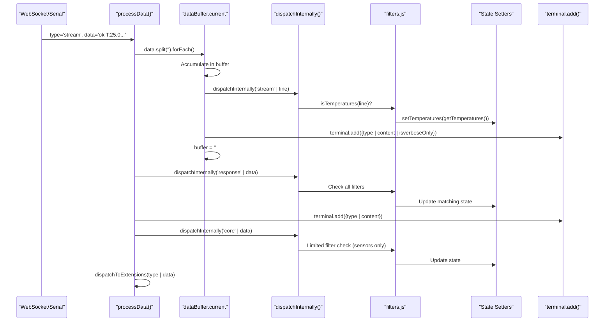

**Type-Specific Characteristics:**

|  |  |  |  |  |
| --- | --- | --- | --- | --- |
| `stream` | Character-by-character until `\r`/`\n` | Yes (with JSON beautify) | Full | Real-time serial data |
| `response` | None | Yes (unless `noecho=true`) | Full | Command response data |
| `core` | None | No | Sensors only | Internal state updates |
| `error` | None | Yes | None | Error messages |
| `echo` | None | Yes | None | User command echo |

**Sources:**[src/targets/Printer3D/Marlin/TargetContext.js#312-414](https://github.com/luc-github/ESP3D-WEBUI/blob/97c01e85/src/targets/Printer3D/Marlin/TargetContext.js#L312-L414)

### processData Function

The `processData` function is the main entry point for all incoming firmware data. It handles buffering, parsing, and routing to appropriate handlers.

**Function Signature:**`processData(type, data, noecho = false)`

**Parameters:**

- `type`: One of `"stream"`, `"response"`, `"core"`, `"error"`, or `"echo"`
- `data`: Raw string data from firmware
- `noecho`: Boolean to suppress terminal output (default: false)

**Sources:**[src/targets/Printer3D/Marlin/TargetContext.js#312-313](https://github.com/luc-github/ESP3D-WEBUI/blob/97c01e85/src/targets/Printer3D/Marlin/TargetContext.js#L312-L313)

### dataBuffer System

The `dataBuffer` ref maintains separate accumulators for each data type:

```
const dataBuffer = useRef({
    stream: "",
    core: "",
    response: "",
    error: "",
    echo: "",
})
```

**Stream Buffering Algorithm:**

```
// In processData for type == "stream"
data.split("").forEach((element, index) => {
    if (element == "\n" || element == "\r") {
        if (dataBuffer.current[type].length > 0) {
            // Process complete line
            dispatchInternally(type, dataBuffer.current[type])
            terminal.add({ type, content: dataBuffer.current[type], ... })
            dataBuffer.current[type] = ""
        }
    } else {
        dataBuffer.current[type] += element
    }
})
```

This character-by-character accumulation handles firmware that sends partial lines or uses inconsistent line endings (`\r`, `\n`, or `\r\n`). The `response` and `core` types bypass buffering since they arrive as complete messages.

**Sources:**[src/targets/Printer3D/Marlin/TargetContext.js#164-170](https://github.com/luc-github/ESP3D-WEBUI/blob/97c01e85/src/targets/Printer3D/Marlin/TargetContext.js#L164-L170)[src/targets/Printer3D/Marlin/TargetContext.js#318-373](https://github.com/luc-github/ESP3D-WEBUI/blob/97c01e85/src/targets/Printer3D/Marlin/TargetContext.js#L318-L373)

## Filter System

Filters are pairs of `is*()` and `get*()` functions in `filters.js` that detect and parse firmware-specific response patterns. The `dispatchInternally()` function checks each filter in sequence.

**Marlin Filter Functions**

|  |  |  |  |
| --- | --- | --- | --- |
| `isOk()` | `str.startsWith("ok")` | N/A (ignored) | None |
| `isTemperatures()` / `getTemperatures()` | `/T:.*\s@:[0-9]*/g` | `{ T:[], B:[], C:[], P:[], R:[], M:[] }` | `setTemperatures()` |
| `isPositions()` / `getPositions()` | `/X:\s*[+-]?[0-9.]+\s*Y:.*Z:.*E/` | `{ x, y, z }` | `setPositions()` |
| `isPrintStatus()` / `getPrintStatus()` | Multiple patterns | `{ status, printing, progress }` or `{ time }` | `globalStatus.current.printState` |
| `isPrintFileName()` / `getPrintFileName()` | `/Current\sfile:\s(.*)/` | filename string | `globalStatus.current.filename` |
| `isStatus()` / `getStatus()` | `/echo:busy:\s(.*)/ or /Error:(.*)/` | status string | `globalStatus.current.state` |
| `isFlowRate()` / `getFlowRate()` | `/echo:E([0-9])\sFlow:\s(.*)\%/` | `{ index, value }` | `flowsRate.current[index]` |
| `isFanSpeed()` / `getFanSpeed()` | `/M106\sP([0-9]+)\sS([0-9]+)/` | `{ index, value }` | `fansSpeed.current[index]` |
| `isFeedRate()` / `getFeedRate()` | `/FR:(.*)\%/` | `{ index: 0, value }` | `feedsRate.current[0]` |
| `isPrinterCapability()` / `getPrinterCapability()` | `FIRMWARE_NAME:` or `/^Cap:([^:]+):[0-1]$/` | Array of `{ name, value }` | `printerCapabilities` array |
| `isSensor()` / `getSensor()` | `str.startsWith("SENSOR:")` | Array of `{ value, unit }` | `setSensorData()` |
| `isStreamingStatus()` / `getStreamingStatus()` | JSON with `cmd: "701"` | `{ status, name, processed, total, elapsed }` | `setStreamStatus()` |

**Filter Application in dispatchInternally**

[Flowchart Diagram]

**Sources:**[src/targets/Printer3D/Marlin/filters.js#1-414](https://github.com/luc-github/ESP3D-WEBUI/blob/97c01e85/src/targets/Printer3D/Marlin/filters.js#L1-L414)[src/targets/Printer3D/Marlin/TargetContext.js#172-310](https://github.com/luc-github/ESP3D-WEBUI/blob/97c01e85/src/targets/Printer3D/Marlin/TargetContext.js#L172-L310)

### Temperature Parsing Example

**Marlin Temperature Format:**`ok T:25.00 /120.00 B:25.00 /0.00 @:127 B@:0`

**Filter Implementation:**

```
// Detection
const isTemperatures = (str) => {
    const regex_search = /T:.*\s@:[0-9]*/g
    return regex_search.test(str)
}
 
// Extraction
const getTemperatures = (str) => {
    const response = {
        T: [], // Extruders T0-T8
        B: [], // Heated bed
        // ...
    }
    const regex_search = 
        /(B|T|C|P|R)([\d]*):([+|-]?[0-9]*\.?[0-9]+|inf)? \/([+]?[0-9]*\.?[0-9]+)/g
    
    while ((result = regex_search.exec(str)) !== null) {
        response[result[1]][result[2] === "" ? 0 : result[2]] = {
            value: result[3],
            target: result[4]
        }
    }
    return response
}
```

**Sources:**[src/targets/Printer3D/Marlin/filters.js#44-78](https://github.com/luc-github/ESP3D-WEBUI/blob/97c01e85/src/targets/Printer3D/Marlin/filters.js#L44-L78)

## dispatchInternally Function

The `dispatchInternally(type, data)` function applies filter checks and routes data to state updates. It always calls `processor.handle()` for file operations, then applies type-specific filter chains.

**Sources:**[src/targets/Printer3D/Marlin/TargetContext.js#172-310](https://github.com/luc-github/ESP3D-WEBUI/blob/97c01e85/src/targets/Printer3D/Marlin/TargetContext.js#L172-L310)

### Historical Lists Management

Temperature history is maintained for graphing:

```
const MAX_TEMPERATURES_LIST_SIZE = 400
 
const add2TemperaturesList = (temperaturesSet) => {
    if (temperaturesListRef.current.length >= MAX_TEMPERATURES_LIST_SIZE) {
        temperaturesListRef.current.shift()
    }
    temperaturesListRef.current = 
        temperaturesListRef.current.concat(temperaturesSet)
    setTemperaturesList(temperaturesListRef.current)
}
```

**Sources:**[src/targets/Printer3D/Marlin/TargetContext.js#78-121](https://github.com/luc-github/ESP3D-WEBUI/blob/97c01e85/src/targets/Printer3D/Marlin/TargetContext.js#L78-L121)

## Terminal Integration

The `processData()` function sends processed lines to `terminal.add()` from the `DatasContext`:

```
const { terminal } = useDatasContext()
 
// In processData()
terminal.add({ type, content: dataBuffer.current[type], isverboseOnly })
```

**Sources:**[src/targets/Printer3D/Marlin/TargetContext.js#163](https://github.com/luc-github/ESP3D-WEBUI/blob/97c01e85/src/targets/Printer3D/Marlin/TargetContext.js#L163-L163)[src/targets/Printer3D/Marlin/TargetContext.js#347](https://github.com/luc-github/ESP3D-WEBUI/blob/97c01e85/src/targets/Printer3D/Marlin/TargetContext.js#L347-L347)

## Extension Dispatch

All processed data is forwarded to loaded extensions via the `dispatchToExtensions` helper:

```
dispatchToExtensions(type, data)
```

**Sources:**[src/targets/Printer3D/Marlin/TargetContext.js#412](https://github.com/luc-github/ESP3D-WEBUI/blob/97c01e85/src/targets/Printer3D/Marlin/TargetContext.js#L412-L412)

## Firmware-Specific Implementations

Each firmware implements its own `TargetContext.js` with specialized filters:

|  |  |
| --- | --- |
| Marlin | `src/targets/Printer3D/Marlin/TargetContext.js` |
| Smoothieware | `src/targets/Printer3D/Smoothieware/TargetContext.js` |
| Repetier | `src/targets/Printer3D/Repetier/TargetContext.js` |
| Marlin-embedded | `src/targets/Printer3D/Marlin-embedded/TargetContext.js` |

**Sources:**[src/targets/Printer3D/Marlin/TargetContext.js#1-18](https://github.com/luc-github/ESP3D-WEBUI/blob/97c01e85/src/targets/Printer3D/Marlin/TargetContext.js#L1-L18)[src/targets/Printer3D/Smoothieware/TargetContext.js#1-18](https://github.com/luc-github/ESP3D-WEBUI/blob/97c01e85/src/targets/Printer3D/Smoothieware/TargetContext.js#L1-L18)[src/targets/Printer3D/Repetier/TargetContext.js#1-18](https://github.com/luc-github/ESP3D-WEBUI/blob/97c01e85/src/targets/Printer3D/Repetier/TargetContext.js#L1-L18)[src/targets/Printer3D/Marlin-embedded/TargetContext.js#1-18](https://github.com/luc-github/ESP3D-WEBUI/blob/97c01e85/src/targets/Printer3D/Marlin-embedded/TargetContext.js#L1-L18)

## Context Store Structure

The `TargetContextProvider` exposes machine state via `useTargetContext()`:

```
const store = {
    positions,
    temperatures,
    temperaturesList: {
        current: temperaturesList,
        clear: clearTemperaturesList
    },
    status: status,
    streamStatus,
    processData
}
```

**Sources:**[src/targets/Printer3D/Marlin/TargetContext.js#418-461](https://github.com/luc-github/ESP3D-WEBUI/blob/97c01e85/src/targets/Printer3D/Marlin/TargetContext.js#L418-L461)

---

# 4.4-Filter-System

# Filter System
Relevant source files

- [src/components/Helpers/filters.js](https://github.com/luc-github/ESP3D-WEBUI/blob/97c01e85/src/components/Helpers/filters.js)
- [src/components/Helpers/storedState.js](https://github.com/luc-github/ESP3D-WEBUI/blob/97c01e85/src/components/Helpers/storedState.js)
- [src/components/Modal/logginModal.js](https://github.com/luc-github/ESP3D-WEBUI/blob/97c01e85/src/components/Modal/logginModal.js)
- [src/components/Panels/Status.js](https://github.com/luc-github/ESP3D-WEBUI/blob/97c01e85/src/components/Panels/Status.js)
- [src/contexts/DatasContext.js](https://github.com/luc-github/ESP3D-WEBUI/blob/97c01e85/src/contexts/DatasContext.js)
- [src/targets/CNC/Controls/QuickStopButton.js](https://github.com/luc-github/ESP3D-WEBUI/blob/97c01e85/src/targets/CNC/Controls/QuickStopButton.js)
- [src/targets/CNC/GRBL/Controls/BackgroundContainer.js](https://github.com/luc-github/ESP3D-WEBUI/blob/97c01e85/src/targets/CNC/GRBL/Controls/BackgroundContainer.js)
- [src/targets/Printer3D/Marlin-embedded/TargetContext.js](https://github.com/luc-github/ESP3D-WEBUI/blob/97c01e85/src/targets/Printer3D/Marlin-embedded/TargetContext.js)
- [src/targets/Printer3D/Marlin-embedded/filters.js](https://github.com/luc-github/ESP3D-WEBUI/blob/97c01e85/src/targets/Printer3D/Marlin-embedded/filters.js)
- [src/targets/Printer3D/Marlin/TargetContext.js](https://github.com/luc-github/ESP3D-WEBUI/blob/97c01e85/src/targets/Printer3D/Marlin/TargetContext.js)
- [src/targets/Printer3D/Marlin/filters.js](https://github.com/luc-github/ESP3D-WEBUI/blob/97c01e85/src/targets/Printer3D/Marlin/filters.js)
- [src/targets/Printer3D/Repetier/TargetContext.js](https://github.com/luc-github/ESP3D-WEBUI/blob/97c01e85/src/targets/Printer3D/Repetier/TargetContext.js)
- [src/targets/Printer3D/Repetier/filters.js](https://github.com/luc-github/ESP3D-WEBUI/blob/97c01e85/src/targets/Printer3D/Repetier/filters.js)
- [src/targets/Printer3D/Smoothieware/TargetContext.js](https://github.com/luc-github/ESP3D-WEBUI/blob/97c01e85/src/targets/Printer3D/Smoothieware/TargetContext.js)
- [src/targets/Printer3D/Smoothieware/filters.js](https://github.com/luc-github/ESP3D-WEBUI/blob/97c01e85/src/targets/Printer3D/Smoothieware/filters.js)
- [src/targets/Printer3D/Smoothieware/index.js](https://github.com/luc-github/ESP3D-WEBUI/blob/97c01e85/src/targets/Printer3D/Smoothieware/index.js)

## Purpose and Scope

The Filter System is the pattern matching and data extraction layer that transforms raw firmware responses into structured state objects. Each target (Marlin, GRBL, Repetier, etc.) implements firmware-specific filters that use regular expressions to identify and parse response formats. The system enables the WebUI to support multiple firmware types through a common abstraction while handling their different communication protocols.

For information about how filters integrate with the overall target architecture, see [Target Types and Structure](/org/luc-github/wiki/luc-github/ESP3D-WEBUI/page/4.1?branch=%223.0%22). For details on how parsed data updates UI state, see [TargetContext and Data Processing](/org/luc-github/wiki/luc-github/ESP3D-WEBUI/page/4.3?branch=%223.0%22).

## Filter Function Pattern

Filters are implemented as function pairs that follow a consistent naming convention:

|  |  |  |  |
| --- | --- | --- | --- |
| Test function | `is*()` | `boolean` | Tests if a string matches a specific pattern |
| Extractor function | `get*()` | `object` or `null` | Extracts structured data from a matched string |

### Filter Pattern Diagram

**Sources:**[src/targets/Printer3D/Marlin/filters.js#26-54](https://github.com/luc-github/ESP3D-WEBUI/blob/97c01e85/src/targets/Printer3D/Marlin/filters.js#L26-L54)

## Data Processing Pipeline

The filter system operates within the `dispatchInternally` function of each target's `TargetContext`. Raw data is tested against multiple filters in sequence until a match is found.

### Filter Processing Flow

**Sources:**[src/targets/Printer3D/Marlin/TargetContext.js#172-247](https://github.com/luc-github/ESP3D-WEBUI/blob/97c01e85/src/targets/Printer3D/Marlin/TargetContext.js#L172-L247)[src/targets/Printer3D/Smoothieware/TargetContext.js#151-213](https://github.com/luc-github/ESP3D-WEBUI/blob/97c01e85/src/targets/Printer3D/Smoothieware/TargetContext.js#L151-L213)

## Regex Pattern Matching

Each filter uses regular expressions to match firmware-specific response formats. The patterns capture groups that are then extracted into structured objects.

### Temperature Filter Example

The Marlin temperature filter handles multiple extruders, bed, chamber, and other sensors. It specifically accounts for variations like MKS serial protocols [src/targets/Printer3D/Marlin/filters.js#50](https://github.com/luc-github/ESP3D-WEBUI/blob/97c01e85/src/targets/Printer3D/Marlin/filters.js#L50-L50)

**Implementation:**

[src/targets/Printer3D/Marlin/filters.js#44-78](https://github.com/luc-github/ESP3D-WEBUI/blob/97c01e85/src/targets/Printer3D/Marlin/filters.js#L44-L78) defines the temperature filter:

- Line 45: `isTemperatures()` tests for the pattern using `/T:.*\s@:[0-9]*/g`.
- Line 61-62: `getTemperatures()` uses a global regex to capture tool type, index, current, and target.
- Line 72: Results are mapped to the response object using the tool type as the key and index as the array position.

**Sources:**[src/targets/Printer3D/Marlin/filters.js#36-78](https://github.com/luc-github/ESP3D-WEBUI/blob/97c01e85/src/targets/Printer3D/Marlin/filters.js#L36-L78)

## Common Filter Types

### Position Filters

Extract machine position data (X, Y, Z coordinates) from standard reporting formats.

**Test Pattern:**[src/targets/Printer3D/Marlin/filters.js#86-90](https://github.com/luc-github/ESP3D-WEBUI/blob/97c01e85/src/targets/Printer3D/Marlin/filters.js#L86-L90)

```
/X:\s*[+,-]?[0-9]*\.?[0-9]+?\s*Y:\s*[+,-]?[0-9]*\.?[0-9]+?\s*Z:\s*[+,-]?[0-9]*\.?[0-9]+?\s*E/
```

**Example Input:**`X:0.00 Y:0.00 Z:0.00 E:0.00 Count X:0 Y:0 Z:0`**Example Output:**`{x: "0.00", y: "0.00", z: "0.00"}`[src/targets/Printer3D/Marlin/filters.js#97](https://github.com/luc-github/ESP3D-WEBUI/blob/97c01e85/src/targets/Printer3D/Marlin/filters.js#L97-L97)

**Sources:**[src/targets/Printer3D/Marlin/filters.js#80-100](https://github.com/luc-github/ESP3D-WEBUI/blob/97c01e85/src/targets/Printer3D/Marlin/filters.js#L80-L100)

### Print Status Filters

Detect and parse printing progress information, supporting multiple formats including SD byte progress and M73 messages.

**Test Patterns:**[src/targets/Printer3D/Marlin/filters.js#106-124](https://github.com/luc-github/ESP3D-WEBUI/blob/97c01e85/src/targets/Printer3D/Marlin/filters.js#L106-L124)

- `/(Not\sSD\sprinting|Done\sprinting\sfile)/`
- `/SD\sprinting\sbyte\s([0-9]*)\/([0-9]*)/`
- `/echo:\sM73\sProgress:\s+([0-9.]*)%/`

**Sources:**[src/targets/Printer3D/Marlin/filters.js#102-180](https://github.com/luc-github/ESP3D-WEBUI/blob/97c01e85/src/targets/Printer3D/Marlin/filters.js#L102-L180)

### Status and Error Filters

Parse printer state and busy messages to update the UI status indicator.

**Test Patterns:**[src/targets/Printer3D/Marlin/filters.js#207-218](https://github.com/luc-github/ESP3D-WEBUI/blob/97c01e85/src/targets/Printer3D/Marlin/filters.js#L207-L218)

- `/echo:busy:\s(.*)/`
- `/Error:(.*)/`

**Sources:**[src/targets/Printer3D/Marlin/filters.js#204-231](https://github.com/luc-github/ESP3D-WEBUI/blob/97c01e85/src/targets/Printer3D/Marlin/filters.js#L204-L231)

## Integration with TargetContext

The filter system is tightly integrated with `TargetContextProvider` through the `dispatchInternally` function, which orchestrates filter execution and state updates.

### Filter-to-State Mapping

### State Update Flow

[src/targets/Printer3D/Marlin/TargetContext.js#178-247](https://github.com/luc-github/ESP3D-WEBUI/blob/97c01e85/src/targets/Printer3D/Marlin/TargetContext.js#L178-L247) shows the typical pattern:

1. **Temperature Logic**: Matches data, extracts tool values, and updates the temperature history list for charts [src/targets/Printer3D/Marlin/TargetContext.js#180-183](https://github.com/luc-github/ESP3D-WEBUI/blob/97c01e85/src/targets/Printer3D/Marlin/TargetContext.js#L180-L183)
2. **Print Status Logic**: Handles both progress percentage and print time estimation. If a time object is returned, it updates `globalStatus.current.printTime`[src/targets/Printer3D/Marlin/TargetContext.js#189-190](https://github.com/luc-github/ESP3D-WEBUI/blob/97c01e85/src/targets/Printer3D/Marlin/TargetContext.js#L189-L190)
3. **Estimation**: If printing, the system calculates `printLeftTime` using the `estimatedTime` utility [src/targets/Printer3D/Marlin/TargetContext.js#198-202](https://github.com/luc-github/ESP3D-WEBUI/blob/97c01e85/src/targets/Printer3D/Marlin/TargetContext.js#L198-L202)

**Sources:**[src/targets/Printer3D/Marlin/TargetContext.js#172-247](https://github.com/luc-github/ESP3D-WEBUI/blob/97c01e85/src/targets/Printer3D/Marlin/TargetContext.js#L172-L247)[src/targets/Printer3D/Smoothieware/TargetContext.js#151-213](https://github.com/luc-github/ESP3D-WEBUI/blob/97c01e85/src/targets/Printer3D/Smoothieware/TargetContext.js#L151-L213)

## Target-Specific Filter Implementations

Each firmware target implements its own filter set tailored to that firmware's response format. While the function signatures remain consistent, the regex patterns and parsing logic differ significantly.

|  |  |  |
| --- | --- | --- |
| Marlin | [src/targets/Printer3D/Marlin/filters.js](https://github.com/luc-github/ESP3D-WEBUI/blob/97c01e85/src/targets/Printer3D/Marlin/filters.js) | Detailed tool indexing (T0, T1, B, C) and M73 support. |
| Smoothieware | [src/targets/Printer3D/Smoothieware/filters.js](https://github.com/luc-github/ESP3D-WEBUI/blob/97c01e85/src/targets/Printer3D/Smoothieware/filters.js) | Unix-like file paths in progress reports (`file: /sd/...`) [src/targets/Printer3D/Smoothieware/filters.js#110](https://github.com/luc-github/ESP3D-WEBUI/blob/97c01e85/src/targets/Printer3D/Smoothieware/filters.js#L110-L110) |
| Repetier | [src/targets/Printer3D/Repetier/filters.js](https://github.com/luc-github/ESP3D-WEBUI/blob/97c01e85/src/targets/Printer3D/Repetier/filters.js) | Support for Repetier-specific fan and flow rate reporting. |

**Sources:**[src/targets/Printer3D/Marlin/filters.js#1-78](https://github.com/luc-github/ESP3D-WEBUI/blob/97c01e85/src/targets/Printer3D/Marlin/filters.js#L1-L78)[src/targets/Printer3D/Smoothieware/filters.js#107-161](https://github.com/luc-github/ESP3D-WEBUI/blob/97c01e85/src/targets/Printer3D/Smoothieware/filters.js#L107-L161)

## Extension of the Filter System

The filter system is designed for extensibility. To add support for a new firmware feature:

1. **Define Filter**: Add `isFeature` and `getFeature` to the target's `filters.js`.
2. **Import**: Import the new functions into the target's `TargetContext.js`.
3. **Dispatch**: Add a condition in `dispatchInternally`[src/targets/Printer3D/Marlin/TargetContext.js#172](https://github.com/luc-github/ESP3D-WEBUI/blob/97c01e85/src/targets/Printer3D/Marlin/TargetContext.js#L172-L172)
4. **Update State**: Use a `useState` hook to store the parsed data and pass it to the context provider.

**Sources:**[src/targets/Printer3D/Marlin/TargetContext.js#30-54](https://github.com/luc-github/ESP3D-WEBUI/blob/97c01e85/src/targets/Printer3D/Marlin/TargetContext.js#L30-L54)[src/targets/Printer3D/Marlin/filters.js#1-19](https://github.com/luc-github/ESP3D-WEBUI/blob/97c01e85/src/targets/Printer3D/Marlin/filters.js#L1-L19)

---

# 4.5-Variables-and-Events-System

# Variables and Events System
Relevant source files

- [config/targets/CNC/grblHAL/index.js](https://github.com/luc-github/ESP3D-WEBUI/blob/97c01e85/config/targets/CNC/grblHAL/index.js)
- [src/areas/elementsCache.js](https://github.com/luc-github/ESP3D-WEBUI/blob/97c01e85/src/areas/elementsCache.js)
- [src/contexts/UiContext.js](https://github.com/luc-github/ESP3D-WEBUI/blob/97c01e85/src/contexts/UiContext.js)
- [src/hooks/eventBus.js](https://github.com/luc-github/ESP3D-WEBUI/blob/97c01e85/src/hooks/eventBus.js)
- [src/targets/CNC/GRBL/index.js](https://github.com/luc-github/ESP3D-WEBUI/blob/97c01e85/src/targets/CNC/GRBL/index.js)
- [src/targets/CNC/grblHAL/DIRECTSD-source.js](https://github.com/luc-github/ESP3D-WEBUI/blob/97c01e85/src/targets/CNC/grblHAL/DIRECTSD-source.js)
- [src/targets/CNC/grblHAL/FLASH-source.js](https://github.com/luc-github/ESP3D-WEBUI/blob/97c01e85/src/targets/CNC/grblHAL/FLASH-source.js)
- [src/targets/CNC/grblHAL/MachineSettings.js](https://github.com/luc-github/ESP3D-WEBUI/blob/97c01e85/src/targets/CNC/grblHAL/MachineSettings.js)
- [src/targets/CNC/grblHAL/files.js](https://github.com/luc-github/ESP3D-WEBUI/blob/97c01e85/src/targets/CNC/grblHAL/files.js)
- [src/targets/CNC/grblHAL/index.js](https://github.com/luc-github/ESP3D-WEBUI/blob/97c01e85/src/targets/CNC/grblHAL/index.js)
- [src/targets/CNC/grblHAL/realCommandsTable.js](https://github.com/luc-github/ESP3D-WEBUI/blob/97c01e85/src/targets/CNC/grblHAL/realCommandsTable.js)
- [src/targets/CNC/grblHAL/translations/en.json](https://github.com/luc-github/ESP3D-WEBUI/blob/97c01e85/src/targets/CNC/grblHAL/translations/en.json)
- [src/targets/CNC/translations/en.json](https://github.com/luc-github/ESP3D-WEBUI/blob/97c01e85/src/targets/CNC/translations/en.json)

## Purpose and Scope

The Variables and Events System provides runtime customization and inter-component communication mechanisms in ESP3D-WEBUI. This system enables:

- **Dynamic command substitution** through named variables that map to firmware-specific commands.
- **Event-driven communication** between UI components and external extensions.
- **Runtime modification** of command tables without code changes.
- **Extension integration** by allowing external code to inject commands and subscribe to events.

This page covers the structure and usage of `variablesList` and `eventsList` objects. For information about how these variables are replaced in actual commands, see the `replaceVariables` function usage throughout the codebase. For target-specific data processing, see [TargetContext and Data Processing](/org/luc-github/wiki/luc-github/ESP3D-WEBUI/page/4.3?branch=%223.0%22). For file system command integration, see [File System Operations](/org/luc-github/wiki/luc-github/ESP3D-WEBUI/page/10?branch=%223.0%22).

---

## System Architecture

The Variables and Events System operates as a runtime registry that bridges UI components, file operations, and firmware-specific commands.

**Variables and Events Registry Architecture**

[Flowchart Diagram]

Sources: [src/targets/CNC/grblHAL/index.js#52-79](https://github.com/luc-github/ESP3D-WEBUI/blob/97c01e85/src/targets/CNC/grblHAL/index.js#L52-L79)[src/targets/CNC/GRBL/index.js#52-77](https://github.com/luc-github/ESP3D-WEBUI/blob/97c01e85/src/targets/CNC/GRBL/index.js#L52-L77)

---

## variablesList Object

The `variablesList` object provides a unified registry of all command variables available in a target. It is exported from each target's `index.js` and consumed by components that need to display, validate, or execute commands.

### Structure

**variablesList Class Structure**

[Class Diagram]

Sources: [src/targets/CNC/grblHAL/index.js#52-61](https://github.com/luc-github/ESP3D-WEBUI/blob/97c01e85/src/targets/CNC/grblHAL/index.js#L52-L61)

### Property Definitions

|  |  |  |
| --- | --- | --- |
| `commands` | `Array<Object>` | Combined array of `realCommandsTable` and `variablesTable` entries. |
| `addCommand` | `Function` | Adds a new command variable at runtime using `addObjectItem` helper. |
| `removeCommand` | `Function` | Removes a command variable by name using `removeObjectItem` helper. |
| `modes` | `Array<Object>` | G-code parser mode definitions from `gcode_parser_modes`. |
| `hideFeatures` | `Boolean` | Flag to hide advanced features (grblHAL only). |
| `allowEmptyLine` | `Boolean` | Flag to allow empty lines in command input (grblHAL only). |

Sources: [src/targets/CNC/grblHAL/index.js#52-61](https://github.com/luc-github/ESP3D-WEBUI/blob/97c01e85/src/targets/CNC/grblHAL/index.js#L52-L61)[src/targets/CNC/GRBL/index.js#52-59](https://github.com/luc-github/ESP3D-WEBUI/blob/97c01e85/src/targets/CNC/GRBL/index.js#L52-L59)

### Implementation Example

```
// From grblHAL target
const variablesList = {
    commands: [...realCommandsTable, ...variablesTable],
    addCommand: (variable) =>
        addObjectItem(variablesList.commands, "name", variable),
    removeCommand: (name) =>
        removeObjectItem(variablesList.commands, "name", name),
    modes: [...gcode_parser_modes],
    hideFeatures: false,
    allowEmptyLine: true,
}
```

Sources: [src/targets/CNC/grblHAL/index.js#52-61](https://github.com/luc-github/ESP3D-WEBUI/blob/97c01e85/src/targets/CNC/grblHAL/index.js#L52-L61)

---

## realCommandsTable Structure

The `realCommandsTable` contains firmware-specific real-time commands that are transmitted as raw byte sequences. These commands bypass normal command buffering and execute immediately.

### Command Entry Format

Each entry in `realCommandsTable` is an object with three properties:

**Command Entry Definition**

[Class Diagram]

Sources: [src/targets/CNC/grblHAL/realCommandsTable.js#20-50](https://github.com/luc-github/ESP3D-WEBUI/blob/97c01e85/src/targets/CNC/grblHAL/realCommandsTable.js#L20-L50)

### Example Entries

|  |  |  |
| --- | --- | --- |
| `#SOFTRESET#` | `\x18` | Immediately reset the controller. |
| `#STATUSREPORT#` | `\x80` | Request current status report. |
| `#CYCLESTART#` | `\x81` | Resume paused operation. |
| `#FEEDHOLD#` | `\x82` | Pause current operation. |
| `#FO100#` | `\x90` | Set feed override to 100%. |
| `#FO+10#` | `\x91` | Increase feed override by 10%. |
| `#SSO100#` | `\x99` | Set spindle speed override to 100%. |
| `#T-FLOODCOOLANT#` | `\xA0` | Toggle flood coolant. |

Sources: [src/targets/CNC/grblHAL/realCommandsTable.js#20-50](https://github.com/luc-github/ESP3D-WEBUI/blob/97c01e85/src/targets/CNC/grblHAL/realCommandsTable.js#L20-L50)

---

## eventsList Object

The `eventsList` object provides a simple event bus implementation for inter-component communication and extension integration. Components can register event handlers, emit events, and unregister handlers.

### Event Bus Pattern

**eventsList Interaction Flow**

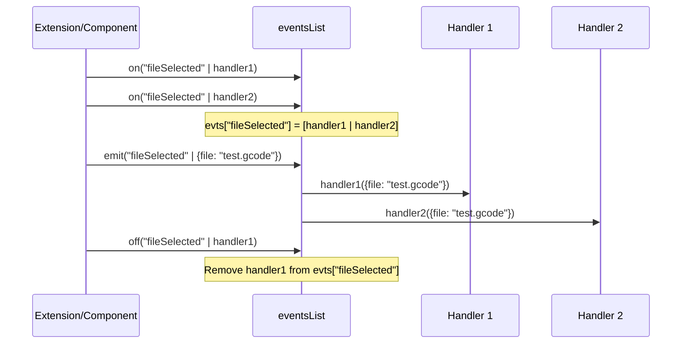

Sources: [src/targets/CNC/grblHAL/index.js#62-79](https://github.com/luc-github/ESP3D-WEBUI/blob/97c01e85/src/targets/CNC/grblHAL/index.js#L62-L79)

### API Methods

|  |  |  |
| --- | --- | --- |
| `on` | `(event: String, fn: Function) => void` | Register an event handler for the specified event name. |
| `off` | `(event: String, fn: Function) => void` | Unregister a specific event handler. |
| `emit` | `(event: String, data: Any) => void` | Trigger all handlers registered for the event, passing data. |

Sources: [src/targets/CNC/grblHAL/index.js#62-79](https://github.com/luc-github/ESP3D-WEBUI/blob/97c01e85/src/targets/CNC/grblHAL/index.js#L62-L79)

### Implementation Details

The implementation uses internal arrays to store functions associated with event keys.

```
const eventsList = {
    evts: [],
    on: (event, fn) => {
        if (typeof eventsList.evts[event] === "undefined") {
            eventsList.evts[event] = []
        }
        addObjectItem(eventsList.evts[event], "fn", { fn: fn })
    },
    off: (event, fn) => {
        // Note: references variablesList.evts instead of eventsList.evts in some versions
        removeObjectItem(eventsList.evts[event], "fn", fn)
    },
    emit: (event, data) => {
        if (eventsList.evts[event])
            eventsList.evts[event].forEach((element) => {
                if (typeof element.fn === "function") element.fn(data)
            })
    },
}
```

Sources: [src/targets/CNC/grblHAL/index.js#62-79](https://github.com/luc-github/ESP3D-WEBUI/blob/97c01e85/src/targets/CNC/grblHAL/index.js#L62-L79)[src/targets/CNC/GRBL/index.js#60-77](https://github.com/luc-github/ESP3D-WEBUI/blob/97c01e85/src/targets/CNC/GRBL/index.js#L60-L77)

---

## Runtime Command Management

The `addCommand` and `removeCommand` functions enable dynamic modification of the command registry at runtime. This is essential for extensions and plugins that need to inject custom commands.

**Runtime Command Modification**

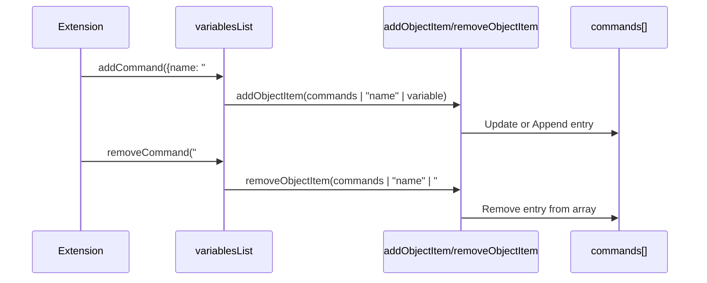

Sources: [src/targets/CNC/grblHAL/index.js#54-57](https://github.com/luc-github/ESP3D-WEBUI/blob/97c01e85/src/targets/CNC/grblHAL/index.js#L54-L57)

---

## Integration with File System Operations

The Variables and Events System integrates deeply with file system operations, particularly for constructing firmware-specific commands for file playback via the `play` command.

### Variable Replacement in File Commands

**File Command Variable Substitution**

[Flowchart Diagram]

Sources: [src/targets/CNC/grblHAL/DIRECTSD-source.js#106-119](https://github.com/luc-github/ESP3D-WEBUI/blob/97c01e85/src/targets/CNC/grblHAL/DIRECTSD-source.js#L106-L119)[src/targets/CNC/grblHAL/FLASH-source.js#115-128](https://github.com/luc-github/ESP3D-WEBUI/blob/97c01e85/src/targets/CNC/grblHAL/FLASH-source.js#L115-L128)

### Example: DIRECTSD Play Command Construction

```
play: (path, filename) => {
    const spath = (path + (path == "/" ? "" : "/") + filename).replaceAll(
        "//",
        "/"
    )
    const cmd = useUiContextFn
        .getValue("playcmd")        // Retrieves stored variable from UiContext
        .replace("#", spath)        // Replaces symbolic # with the actual file path
        .replaceAll("//", "/")
    return {
        type: "cmd",
        cmd,
    }
}
```

Sources: [src/targets/CNC/grblHAL/DIRECTSD-source.js#106-119](https://github.com/luc-github/ESP3D-WEBUI/blob/97c01e85/src/targets/CNC/grblHAL/DIRECTSD-source.js#L106-L119)

---

## Translation Integration

Variables are referenced in translation files to provide localized descriptions and labels. The translation system uses prefixed keys to namespace command-related strings.

**Translation Space to Code Entity Space**

[Flowchart Diagram]

Sources: [src/targets/CNC/translations/en.json#116-158](https://github.com/luc-github/ESP3D-WEBUI/blob/97c01e85/src/targets/CNC/translations/en.json#L116-L158)[src/targets/CNC/grblHAL/translations/en.json#2-10](https://github.com/luc-github/ESP3D-WEBUI/blob/97c01e85/src/targets/CNC/grblHAL/translations/en.json#L2-L10)

### Localization Examples

From the CNC target English translation file:

- `btnHAll`: "Home All axis" [src/targets/CNC/translations/en.json#116](https://github.com/luc-github/ESP3D-WEBUI/blob/97c01e85/src/targets/CNC/translations/en.json#L116-L116)
- `error:1`: "G-code words consist of a letter and a value. Letter was not found." [src/targets/CNC/translations/en.json#158](https://github.com/luc-github/ESP3D-WEBUI/blob/97c01e85/src/targets/CNC/translations/en.json#L158-L158)
- `$0`: "Step pulse, microseconds" [src/targets/CNC/grblHAL/translations/en.json#2](https://github.com/luc-github/ESP3D-WEBUI/blob/97c01e85/src/targets/CNC/grblHAL/translations/en.json#L2-L2)

---

## Export and Access

The Variables and Events System is exported from each target's `index.js` and made available to the rest of the application via the Target context.

```
export {
    // ...
    variablesList,
    eventsList,
    // ...
}
```

Sources: [src/targets/CNC/grblHAL/index.js#81-103](https://github.com/luc-github/ESP3D-WEBUI/blob/97c01e85/src/targets/CNC/grblHAL/index.js#L81-L103)[src/targets/CNC/GRBL/index.js#79-101](https://github.com/luc-github/ESP3D-WEBUI/blob/97c01e85/src/targets/CNC/GRBL/index.js#L79-L101)

---

# 5-User-Interface-Components

# User Interface Components
Relevant source files

- [Memo/preferences.md](https://github.com/luc-github/ESP3D-WEBUI/blob/97c01e85/Memo/preferences.md?plain=1)
- [src/components/Controls/FieldGroup.js](https://github.com/luc-github/ESP3D-WEBUI/blob/97c01e85/src/components/Controls/FieldGroup.js)
- [src/components/Controls/Fields/Boolean.js](https://github.com/luc-github/ESP3D-WEBUI/blob/97c01e85/src/components/Controls/Fields/Boolean.js)
- [src/components/Controls/Fields/Input.js](https://github.com/luc-github/ESP3D-WEBUI/blob/97c01e85/src/components/Controls/Fields/Input.js)
- [src/components/Controls/Fields/ItemsList.js](https://github.com/luc-github/ESP3D-WEBUI/blob/97c01e85/src/components/Controls/Fields/ItemsList.js)
- [src/components/Controls/Fields/Select.js](https://github.com/luc-github/ESP3D-WEBUI/blob/97c01e85/src/components/Controls/Fields/Select.js)
- [src/components/Controls/Fields/Slider.js](https://github.com/luc-github/ESP3D-WEBUI/blob/97c01e85/src/components/Controls/Fields/Slider.js)
- [src/components/Helpers/components.js](https://github.com/luc-github/ESP3D-WEBUI/blob/97c01e85/src/components/Helpers/components.js)
- [src/components/Helpers/index.js](https://github.com/luc-github/ESP3D-WEBUI/blob/97c01e85/src/components/Helpers/index.js)
- [src/components/Panels/Files.js](https://github.com/luc-github/ESP3D-WEBUI/blob/97c01e85/src/components/Panels/Files.js)
- [src/components/Panels/Jog.js](https://github.com/luc-github/ESP3D-WEBUI/blob/97c01e85/src/components/Panels/Jog.js)
- [src/components/Panels/JogCNC.js](https://github.com/luc-github/ESP3D-WEBUI/blob/97c01e85/src/components/Panels/JogCNC.js)
- [src/components/Panels/JogPlotter.js](https://github.com/luc-github/ESP3D-WEBUI/blob/97c01e85/src/components/Panels/JogPlotter.js)
- [src/components/Panels/LaserCNC.js](https://github.com/luc-github/ESP3D-WEBUI/blob/97c01e85/src/components/Panels/LaserCNC.js)
- [src/components/Panels/Notifications.js](https://github.com/luc-github/ESP3D-WEBUI/blob/97c01e85/src/components/Panels/Notifications.js)
- [src/components/Panels/OverridesCNC.js](https://github.com/luc-github/ESP3D-WEBUI/blob/97c01e85/src/components/Panels/OverridesCNC.js)
- [src/components/Panels/SpindleCNC.js](https://github.com/luc-github/ESP3D-WEBUI/blob/97c01e85/src/components/Panels/SpindleCNC.js)
- [src/style/components/_control.scss](https://github.com/luc-github/ESP3D-WEBUI/blob/97c01e85/src/style/components/_control.scss)

This page catalogs the major UI components that comprise the ESP3D-WEBUI interface, including panels, tabs, controls, and field components. It explains the component hierarchy, patterns for visibility management, context integration, and styling conventions.

**Scope**: This page focuses on the structure and behavior of UI components themselves. For state management via contexts, see [Context and State Management](/org/luc-github/wiki/luc-github/ESP3D-WEBUI/page/2.3?branch=%223.0%22). For panel-specific features (temperature monitoring, jogging, file management, etc.), see sections [Status and Monitoring Panels](/org/luc-github/wiki/luc-github/ESP3D-WEBUI/page/5.2?branch=%223.0%22) through [Terminal Panel](/org/luc-github/wiki/luc-github/ESP3D-WEBUI/page/5.6?branch=%223.0%22). For the settings configuration system that drives the InterfaceTab, see [Preferences System](/org/luc-github/wiki/luc-github/ESP3D-WEBUI/page/4.2?branch=%223.0%22) and [Settings and Configuration](/org/luc-github/wiki/luc-github/ESP3D-WEBUI/page/7?branch=%223.0%22).

---

## Component Architecture Overview

ESP3D-WEBUI follows a **hierarchical component structure** where high-level containers orchestrate multiple specialized components. The architecture employs Preact for rendering, context hooks for state access, and a dependency system for conditional visibility.

### Component Hierarchy

[Flowchart Diagram]

**Sources**: [src/areas/index.js#49-73](https://github.com/luc-github/ESP3D-WEBUI/blob/97c01e85/src/areas/index.js#L49-L73)[src/components/Panels/SpindleCNC.js#106-111](https://github.com/luc-github/ESP3D-WEBUI/blob/97c01e85/src/components/Panels/SpindleCNC.js#L106-L111)[src/components/Panels/LaserCNC.js#80-84](https://github.com/luc-github/ESP3D-WEBUI/blob/97c01e85/src/components/Panels/LaserCNC.js#L80-L84)[src/components/Panels/Files.js#57-71](https://github.com/luc-github/ESP3D-WEBUI/blob/97c01e85/src/components/Panels/Files.js#L57-L71)[src/components/Controls/FieldGroup.js#28-53](https://github.com/luc-github/ESP3D-WEBUI/blob/97c01e85/src/components/Controls/FieldGroup.js#L28-L53)

### Component Rendering Flow

The top-level `ViewContainer` determines which major UI area to render based on connection state:

[State Diagram]

The `ViewContainer` component [src/areas/index.js#49-73](https://github.com/luc-github/ESP3D-WEBUI/blob/97c01e85/src/areas/index.js#L49-L73) implements this logic by checking `dialogs.needLogin` and `connection.connectionState`.

**Sources**: [src/areas/index.js#49-73](https://github.com/luc-github/ESP3D-WEBUI/blob/97c01e85/src/areas/index.js#L49-L73)

---

## Core Component Types

### 1. Panels (Feature Modules)

Panels are self-contained UI sections. Each panel consumes contexts and checks visibility via `useUiContextFn.getValue()`.

- **SpindlePanel**: Controls CNC spindle modes (M3, M4, M5) and speeds [src/components/Panels/SpindleCNC.js#106-210](https://github.com/luc-github/ESP3D-WEBUI/blob/97c01e85/src/components/Panels/SpindleCNC.js#L106-L210)
- **LaserPanel**: Manages laser power percentages and test durations [src/components/Panels/LaserCNC.js#80-186](https://github.com/luc-github/ESP3D-WEBUI/blob/97c01e85/src/components/Panels/LaserCNC.js#L80-L186)
- **FilesPanel**: Integrated file manager supporting multiple filesystems like SD and Flash [src/components/Panels/Files.js#57-196](https://github.com/luc-github/ESP3D-WEBUI/blob/97c01e85/src/components/Panels/Files.js#L57-L196)

**Sources**: [src/components/Panels/SpindleCNC.js#106-210](https://github.com/luc-github/ESP3D-WEBUI/blob/97c01e85/src/components/Panels/SpindleCNC.js#L106-L210)[src/components/Panels/LaserCNC.js#80-186](https://github.com/luc-github/ESP3D-WEBUI/blob/97c01e85/src/components/Panels/LaserCNC.js#L80-L186)[src/components/Panels/Files.js#57-196](https://github.com/luc-github/ESP3D-WEBUI/blob/97c01e85/src/components/Panels/Files.js#L57-L196)

### 2. Tabs (Full-Page Views)

Tabs like the `InterfaceTab`[src/tabs/interface/index.js#229-552](https://github.com/luc-github/ESP3D-WEBUI/blob/97c01e85/src/tabs/interface/index.js#L229-L552) render user preferences using a schema-driven system. It iterates over setting groups and dynamically generates UI using the `Field` component.

### 3. Controls (Interactive Elements)

|  |  |  |
| --- | --- | --- |
| `ButtonImg` | [src/components/Controls/Buttons/ButtonImg.js](https://github.com/luc-github/ESP3D-WEBUI/blob/97c01e85/src/components/Controls/Buttons/ButtonImg.js) | Icon buttons with tooltips |
| `ContainerHelper` | [src/components/Controls/ContainerHelper.js](https://github.com/luc-github/ESP3D-WEBUI/blob/97c01e85/src/components/Controls/ContainerHelper.js) | Wrapper for collapsible sections |

### 4. Fields (Form Inputs)

The Field system maps data types to UI controls.

- **Input**: Handles text, number, and password types with reveal toggles [src/components/Controls/Fields/Input.js#44-206](https://github.com/luc-github/ESP3D-WEBUI/blob/97c01e85/src/components/Controls/Fields/Input.js#L44-L206)
- **Boolean**: Renders as a `form-switch` toggle [src/components/Controls/Fields/Boolean.js#38-100](https://github.com/luc-github/ESP3D-WEBUI/blob/97c01e85/src/components/Controls/Fields/Boolean.js#L38-L100)
- **Select**: Dropdown menus with dependency-aware options [src/components/Controls/Fields/Select.js#52-122](https://github.com/luc-github/ESP3D-WEBUI/blob/97c01e85/src/components/Controls/Fields/Select.js#L52-L122)
- **ItemsList**: Complex list editor for macros and panels [src/components/Controls/Fields/ItemsList.js#49-188](https://github.com/luc-github/ESP3D-WEBUI/blob/97c01e85/src/components/Controls/Fields/ItemsList.js#L49-L188)
- **Slider**: Combines a range input with a numeric text field [src/components/Controls/Fields/Slider.js#37-123](https://github.com/luc-github/ESP3D-WEBUI/blob/97c01e85/src/components/Controls/Fields/Slider.js#L37-L123)

**Sources**: [src/components/Controls/Fields/Input.js#44-206](https://github.com/luc-github/ESP3D-WEBUI/blob/97c01e85/src/components/Controls/Fields/Input.js#L44-L206)[src/components/Controls/Fields/Boolean.js#38-100](https://github.com/luc-github/ESP3D-WEBUI/blob/97c01e85/src/components/Controls/Fields/Boolean.js#L38-L100)[src/components/Controls/Fields/Select.js#52-122](https://github.com/luc-github/ESP3D-WEBUI/blob/97c01e85/src/components/Controls/Fields/Select.js#L52-L122)[src/components/Controls/Fields/ItemsList.js#49-188](https://github.com/luc-github/ESP3D-WEBUI/blob/97c01e85/src/components/Controls/Fields/ItemsList.js#L49-L188)[src/components/Controls/Fields/Slider.js#37-123](https://github.com/luc-github/ESP3D-WEBUI/blob/97c01e85/src/components/Controls/Fields/Slider.js#L37-L123)

---

## Component Patterns

### Dependency-Based Visibility

Visibility is managed via `checkDependencies()`, which evaluates rules against `interfaceSettings` and `connectionSettings`[src/components/Helpers/components.js#149-167](https://github.com/luc-github/ESP3D-WEBUI/blob/97c01e85/src/components/Helpers/components.js#L149-L167)

[Flowchart Diagram]

Components use `generateDependIds()` to create a list of IDs to watch for updates [src/components/Helpers/components.js#91-107](https://github.com/luc-github/ESP3D-WEBUI/blob/97c01e85/src/components/Helpers/components.js#L91-L107)

**Sources**: [src/components/Helpers/components.js#91-167](https://github.com/luc-github/ESP3D-WEBUI/blob/97c01e85/src/components/Helpers/components.js#L91-L167)[src/components/Controls/Fields/Input.js#155-165](https://github.com/luc-github/ESP3D-WEBUI/blob/97c01e85/src/components/Controls/Fields/Input.js#L155-L165)

### Validation Pattern

The `InterfaceTab` uses `generateValidationGlobal()` to validate fields like shortkeys (checking for duplicates) and numeric ranges [src/tabs/interface/index.js#45-229](https://github.com/luc-github/ESP3D-WEBUI/blob/97c01e85/src/tabs/interface/index.js#L45-L229)

---

## Styling System

The UI uses SCSS modules and the Spectre.css framework. Key styles are defined in `_control.scss`[src/style/components/_control.scss#1-356](https://github.com/luc-github/ESP3D-WEBUI/blob/97c01e85/src/style/components/_control.scss#L1-L356)

|  |  |  |
| --- | --- | --- |
| `.emergency-btn` | High-visibility stop button | [src/style/components/_control.scss#68-82](https://github.com/luc-github/ESP3D-WEBUI/blob/97c01e85/src/style/components/_control.scss#L68-L82) |
| `.terminal` | Scrollable command output | [src/style/components/_control.scss#206-233](https://github.com/luc-github/ESP3D-WEBUI/blob/97c01e85/src/style/components/_control.scss#L206-L233) |
| `.field-group` | Grouped field labels | [src/style/components/_control.scss#162-165](https://github.com/luc-github/ESP3D-WEBUI/blob/97c01e85/src/style/components/_control.scss#L162-L165) |
| `.itemEditor` | Layout for list item editing | [src/style/components/_control.scss#84-91](https://github.com/luc-github/ESP3D-WEBUI/blob/97c01e85/src/style/components/_control.scss#L84-L91) |

**Sources**: [src/style/components/_control.scss#1-356](https://github.com/luc-github/ESP3D-WEBUI/blob/97c01e85/src/style/components/_control.scss#L1-L356)

---

# 5.1-Panel-System

# Panel System
Relevant source files

- [src/areas/index.js](https://github.com/luc-github/ESP3D-WEBUI/blob/97c01e85/src/areas/index.js)
- [src/components/ExtraContent/index.js](https://github.com/luc-github/ESP3D-WEBUI/blob/97c01e85/src/components/ExtraContent/index.js)
- [src/components/Panels/Files.js](https://github.com/luc-github/ESP3D-WEBUI/blob/97c01e85/src/components/Panels/Files.js)
- [src/components/Panels/Jog.js](https://github.com/luc-github/ESP3D-WEBUI/blob/97c01e85/src/components/Panels/Jog.js)
- [src/components/Panels/JogCNC.js](https://github.com/luc-github/ESP3D-WEBUI/blob/97c01e85/src/components/Panels/JogCNC.js)
- [src/components/Panels/JogPlotter.js](https://github.com/luc-github/ESP3D-WEBUI/blob/97c01e85/src/components/Panels/JogPlotter.js)
- [src/components/Panels/Notifications.js](https://github.com/luc-github/ESP3D-WEBUI/blob/97c01e85/src/components/Panels/Notifications.js)
- [src/components/Panels/OverridesCNC.js](https://github.com/luc-github/ESP3D-WEBUI/blob/97c01e85/src/components/Panels/OverridesCNC.js)
- [src/pages/dashboard/index.js](https://github.com/luc-github/ESP3D-WEBUI/blob/97c01e85/src/pages/dashboard/index.js)

## Purpose and Scope

The Panel System is the modular UI organization architecture that structures the ESP3D-WEBUI interface into independently controllable, collapsible sections. This document explains how panels are defined, configured, ordered, and managed throughout the application lifecycle. The system allows for target-specific UI adaptation, where different machine types (3D Printers, CNC, Sandtables) display different sets of controls based on firmware capabilities.

---

## Panel Architecture Overview

The panel system provides a flexible container-based UI where each functional area (files, terminal, jog controls, etc.) is encapsulated as an independently controllable panel. Panels are primarily rendered within the `MainContainer` and managed via the `UiContext`.

### Panel Hierarchy in Component Tree

[Flowchart Diagram]

**Sources:**[src/areas/index.js#49-73](https://github.com/luc-github/ESP3D-WEBUI/blob/97c01e85/src/areas/index.js#L49-L73)[src/pages/dashboard/index.js#113-121](https://github.com/luc-github/ESP3D-WEBUI/blob/97c01e85/src/pages/dashboard/index.js#L113-L121)

---

## Panel Types and Components

### Core Panel Categories

The UI dynamically loads panels based on the `uisettings` and the machine target. Common panels include:

|  |  |  |
| --- | --- | --- |
| `StatusPanel` | `statusPanel` | Real-time machine status monitoring. |
| `JogPanel` | `jogPanel` | Manual axis movement (variants for [CNC](https://github.com/luc-github/ESP3D-WEBUI/blob/97c01e85/CNC)[Plotter](https://github.com/luc-github/ESP3D-WEBUI/blob/97c01e85/Plotter) and [3D Printer](https://github.com/luc-github/ESP3D-WEBUI/blob/97c01e85/3D Printer)). |
| `FilesPanel` | `filesPanel` | File system abstraction for SD, Flash, and TFT storage. |
| `NotificationsPanel` | `notificationsPanel` | Historical log of system messages and errors. |
| `OverridesPanel` | `OverridesPanel` | CNC-specific feed and spindle overrides. |
| `ExtraContent` | `extra_content_ID` | Iframe extensions, camera streams, or custom HTML. |

### Component Implementation Pattern

Standard panels utilize `ContainerHelper` for layout consistency and `FullScreenButton`/`CloseButton` for window management.

```
const NotificationsPanel = () => {
    const id = "notificationsPanel";
    // ...
    return (
        <div class="panel panel-dashboard" id={id}>
            <ContainerHelper id={id} /> 
            <div class="navbar">
                {/* Header with Icons and Title */}
                <FullScreenButton elementId={id} />
                <CloseButton elementId={id} />
            </div>
            <div class="panel-body panel-body-dashboard">
                {/* Content */}
            </div>
        </div>
    );
}
```

**Sources:**[src/components/Panels/Notifications.js#38-50](https://github.com/luc-github/ESP3D-WEBUI/blob/97c01e85/src/components/Panels/Notifications.js#L38-L50)[src/components/Panels/Notifications.js#110-129](https://github.com/luc-github/ESP3D-WEBUI/blob/97c01e85/src/components/Panels/Notifications.js#L110-L129)[src/components/Panels/Files.js#57-71](https://github.com/luc-github/ESP3D-WEBUI/blob/97c01e85/src/components/Panels/Files.js#L57-L71)

---

## Panel Visibility and State Management

### Visibility Logic

Panel visibility is determined by boolean flags in the interface settings (e.g., `showfilespanel`). The `Dashboard` component filters the `panels` list from `useUiContext()` to decide what to render.

[Flowchart Diagram]

### Dependency Resolution

Panels often depend on other settings. For example, the `OverridesPanel` only renders if `showoverridespanel` is true.

```
const OverridesControls = () => {
    const { overrides } = useTargetContext()
    if (!useUiContextFn.getValue("showoverridespanel")) return null
    // ...
}
```

**Sources:**[src/components/Panels/OverridesCNC.js#34-36](https://github.com/luc-github/ESP3D-WEBUI/blob/97c01e85/src/components/Panels/OverridesCNC.js#L34-L36)[src/pages/dashboard/index.js#113-121](https://github.com/luc-github/ESP3D-WEBUI/blob/97c01e85/src/pages/dashboard/index.js#L113-L121)

---

## Panel Ordering System

### Fixed vs. Dynamic Layout

The system supports two ordering modes controlled by the `fixedpanels` setting:

1. **Dynamic**: Panels appear in the order defined by the target's default list.
2. **Fixed**: Panels follow the user-defined order stored in `panelsorder`.

The `Dashboard` component tracks this via `uisettings.getValue("fixedpanels")`. When enabled, users can reorder panels, and the new sequence is persisted to the device's `preferences.json`.

**Sources:**[src/pages/dashboard/index.js#118-121](https://github.com/luc-github/ESP3D-WEBUI/blob/97c01e85/src/pages/dashboard/index.js#L118-L121)[src/targets/index.js#26](https://github.com/luc-github/ESP3D-WEBUI/blob/97c01e85/src/targets/index.js#L26-L26) (defaultPanelsList)

---

## Extra Content and Extensions

The `ExtraContent` system allows for dynamic UI injection. These items are not hardcoded but defined in settings.

### ExtraContent Architecture

[Flowchart Diagram]

### Key Functions

- `updateContentPosition()`: Calculates the bounding rectangle of the target container to position the absolute-layered extra content (like iframes or video).
- `handleRefresh()`: Triggers a reload of the content via the `eventBus`.
- `dispatchToExtensions()`: Facilitates communication between the WebUI and iframe-based extensions.

**Sources:**[src/components/ExtraContent/index.js#36-59](https://github.com/luc-github/ESP3D-WEBUI/blob/97c01e85/src/components/ExtraContent/index.js#L36-L59)[src/components/ExtraContent/index.js#116-121](https://github.com/luc-github/ESP3D-WEBUI/blob/97c01e85/src/components/ExtraContent/index.js#L116-L121)[src/areas/index.js#84-120](https://github.com/luc-github/ESP3D-WEBUI/blob/97c01e85/src/areas/index.js#L84-L120)

---

## Interaction and Control Flow

Panels interact with the machine firmware through the `useHttpFn` and `useTargetContext` hooks.

### Command Execution Flow (Files Example)

1. User clicks "Play" on a file in `FilesPanel`.
2. `FilesPanel` calls `files.command(currentFS, "play", file)`.
3. The command is sent via `createNewRequest` to `espHttpURL("command", { cmd: ... })`.
4. Success/Failure is reported via `toasts.addToast`.

```
const sendURLCmd = (cmd) => {
    createNewRequest(
        espHttpURL(cmd.url, cmd.args),
        { method: "GET" },
        {
            onSuccess: (result) => { /* Refresh list */ },
            onFail: (error) => { toasts.addToast({ content: error, type: "error" }) }
        }
    )
}
```

**Sources:**[src/components/Panels/Files.js#115-136](https://github.com/luc-github/ESP3D-WEBUI/blob/97c01e85/src/components/Panels/Files.js#L115-L136)[src/components/Panels/Jog.js#85-97](https://github.com/luc-github/ESP3D-WEBUI/blob/97c01e85/src/components/Panels/Jog.js#L85-L97)

---

## Keyboard Shortcuts Integration

The Panel System integrates with a global keyboard listener managed in the `Dashboard`.

- **Key Mapping**: Keys are mapped to panel buttons via `keymap` and `macros` preferences.
- **Bail Condition**: Shortcuts are disabled if the user is focused on an `INPUT` element to prevent accidental machine movement while typing G-code.
- **Auto-repeat**: Supports continuous movement for jogging if `enableautorepeat` is set.

**Sources:**[src/pages/dashboard/index.js#43-52](https://github.com/luc-github/ESP3D-WEBUI/blob/97c01e85/src/pages/dashboard/index.js#L43-L52)[src/pages/dashboard/index.js#91-110](https://github.com/luc-github/ESP3D-WEBUI/blob/97c01e85/src/pages/dashboard/index.js#L91-L110)

---

# 5.2-Status-and-Monitoring-Panels

# Status and Monitoring Panels
Relevant source files

- [src/components/Panels/Charts.js](https://github.com/luc-github/ESP3D-WEBUI/blob/97c01e85/src/components/Panels/Charts.js)
- [src/components/Panels/Extruders.js](https://github.com/luc-github/ESP3D-WEBUI/blob/97c01e85/src/components/Panels/Extruders.js)
- [src/components/Panels/Status.js](https://github.com/luc-github/ESP3D-WEBUI/blob/97c01e85/src/components/Panels/Status.js)
- [src/components/Panels/Temperatures.js](https://github.com/luc-github/ESP3D-WEBUI/blob/97c01e85/src/components/Panels/Temperatures.js)
- [src/targets/Printer3D/Marlin-embedded/TargetContext.js](https://github.com/luc-github/ESP3D-WEBUI/blob/97c01e85/src/targets/Printer3D/Marlin-embedded/TargetContext.js)
- [src/targets/Printer3D/Marlin/TargetContext.js](https://github.com/luc-github/ESP3D-WEBUI/blob/97c01e85/src/targets/Printer3D/Marlin/TargetContext.js)
- [src/targets/Printer3D/Marlin/filters.js](https://github.com/luc-github/ESP3D-WEBUI/blob/97c01e85/src/targets/Printer3D/Marlin/filters.js)
- [src/targets/Printer3D/Repetier/TargetContext.js](https://github.com/luc-github/ESP3D-WEBUI/blob/97c01e85/src/targets/Printer3D/Repetier/TargetContext.js)
- [src/targets/Printer3D/Smoothieware/TargetContext.js](https://github.com/luc-github/ESP3D-WEBUI/blob/97c01e85/src/targets/Printer3D/Smoothieware/TargetContext.js)

## Purpose and Scope

This page documents the **status and monitoring panels** in ESP3D-WEBUI, which provide real-time visibility into printer and machine operations. These panels display print progress, temperatures, positions, and machine state by consuming data from the firmware through the `TargetContext` system.

The primary monitoring panels are:

- **StatusPanel**: Real-time print job progress, filename, and machine state controls. [src/components/Panels/Status.js#168-378](https://github.com/luc-github/ESP3D-WEBUI/blob/97c01e85/src/components/Panels/Status.js#L168-L378)
- **TemperaturesPanel**: Current and target temperatures for extruders, beds, chambers, and other sensors. [src/components/Panels/Temperatures.js#106-259](https://github.com/luc-github/ESP3D-WEBUI/blob/97c01e85/src/components/Panels/Temperatures.js#L106-L259)
- **ChartsPanel**: Historical temperature and sensor data visualized via the Smoothie charting library. [src/components/Panels/Charts.js#55-296](https://github.com/luc-github/ESP3D-WEBUI/blob/97c01e85/src/components/Panels/Charts.js#L55-L296)

---

## Monitoring Panel Architecture

Monitoring panels consume real-time data from `TargetContext`, respond to user preferences from `SettingsContext`, and display firmware-specific information parsed by the filter system.

### Data Flow Diagram

This diagram bridges the gap between the firmware's raw output and the UI components.

[Flowchart Diagram]

**Sources**: [src/components/Panels/Status.js#23-27](https://github.com/luc-github/ESP3D-WEBUI/blob/97c01e85/src/components/Panels/Status.js#L23-L27)[src/targets/Printer3D/Marlin/TargetContext.js#172-230](https://github.com/luc-github/ESP3D-WEBUI/blob/97c01e85/src/targets/Printer3D/Marlin/TargetContext.js#L172-L230)[src/targets/Printer3D/Marlin/filters.js#26-180](https://github.com/luc-github/ESP3D-WEBUI/blob/97c01e85/src/targets/Printer3D/Marlin/filters.js#L26-L180)

---

## StatusPanel Component

The `StatusPanel` tracks active print jobs. It differentiates between files printed from the firmware's local storage (SD/TFT) and files streamed from the WebUI via the ESP701 protocol. [src/components/Panels/Status.js#72-166](https://github.com/luc-github/ESP3D-WEBUI/blob/97c01e85/src/components/Panels/Status.js#L72-L166)

### Status Data Structures

The panel consumes two distinct status objects from `TargetContext`:

|  |  |  |
| --- | --- | --- |
| `status` | `printState` (status, printing, progress), `filename`, `printTime`, `printLeftTime` | Firmware reports (e.g., M27) [src/targets/Printer3D/Marlin/TargetContext.js#80-84](https://github.com/luc-github/ESP3D-WEBUI/blob/97c01e85/src/targets/Printer3D/Marlin/TargetContext.js#L80-L84) |
| `streamStatus` | `status` (processing/pause), `name`, `progress`, `printTime`, `printLeftTime` | ESP701 WebUI Stream [src/targets/Printer3D/Marlin/TargetContext.js#77](https://github.com/luc-github/ESP3D-WEBUI/blob/97c01e85/src/targets/Printer3D/Marlin/TargetContext.js#L77-L77) |

### Control Buttons and Device Logic

The panel renders a `deviceList` that maps physical storage to UI controls. [src/components/Panels/Status.js#175-300](https://github.com/luc-github/ESP3D-WEBUI/blob/97c01e85/src/components/Panels/Status.js#L175-L300)

- **SD Card**: Uses `sdpausecmd`, `sdresumecmd`, `sdstopcmd`. [src/components/Panels/Status.js#184-192](https://github.com/luc-github/ESP3D-WEBUI/blob/97c01e85/src/components/Panels/Status.js#L184-L192)
- **TFT SD/USB**: Uses `tftsd*` and `tftusb*` command variants. [src/components/Panels/Status.js#220-250](https://github.com/luc-github/ESP3D-WEBUI/blob/97c01e85/src/components/Panels/Status.js#L220-L250)

**Sources**: [src/components/Panels/Status.js#72-166](https://github.com/luc-github/ESP3D-WEBUI/blob/97c01e85/src/components/Panels/Status.js#L72-L166)[src/targets/Printer3D/Marlin/TargetContext.js#187-215](https://github.com/luc-github/ESP3D-WEBUI/blob/97c01e85/src/targets/Printer3D/Marlin/TargetContext.js#L187-L215)

---

## TemperaturesPanel Component

The `TemperaturesPanel` provides a unified interface for monitoring and controlling all heating elements. [src/components/Panels/Temperatures.js#106-146](https://github.com/luc-github/ESP3D-WEBUI/blob/97c01e85/src/components/Panels/Temperatures.js#L106-L146)

### Heater Control Logic

The panel uses `target_temperatures` to track user input locally before sending commands. [src/components/Panels/Temperatures.js#42-46](https://github.com/luc-github/ESP3D-WEBUI/blob/97c01e85/src/components/Panels/Temperatures.js#L42-L46)

- **Validation**: Inputs are validated against `extrudermax`, `bedmax`, or `chambermax` settings. [src/components/Panels/Temperatures.js#172-202](https://github.com/luc-github/ESP3D-WEBUI/blob/97c01e85/src/components/Panels/Temperatures.js#L172-L202)
- **Command Generation**: Commands are generated using the `heaterCommand` helper, which replaces placeholders (`#` for index, `$` for value). [src/components/Panels/Temperatures.js#84-96](https://github.com/luc-github/ESP3D-WEBUI/blob/97c01e85/src/components/Panels/Temperatures.js#L84-L96)

### Temperature Tool Mapping

Data is categorized by tool prefix:

- `T`: Extruders [src/components/Panels/Temperatures.js#43](https://github.com/luc-github/ESP3D-WEBUI/blob/97c01e85/src/components/Panels/Temperatures.js#L43-L43)
- `B`: Heated Bed [src/components/Panels/Temperatures.js#44](https://github.com/luc-github/ESP3D-WEBUI/blob/97c01e85/src/components/Panels/Temperatures.js#L44-L44)
- `C`: Chamber [src/components/Panels/Temperatures.js#45](https://github.com/luc-github/ESP3D-WEBUI/blob/97c01e85/src/components/Panels/Temperatures.js#L45-L45)
- `R`: Redundant sensors [src/components/Panels/Temperatures.js#99](https://github.com/luc-github/ESP3D-WEBUI/blob/97c01e85/src/components/Panels/Temperatures.js#L99-L99)
- `M`: Motherboard [src/components/Panels/Temperatures.js#99](https://github.com/luc-github/ESP3D-WEBUI/blob/97c01e85/src/components/Panels/Temperatures.js#L99-L99)

**Sources**: [src/components/Panels/Temperatures.js#42-104](https://github.com/luc-github/ESP3D-WEBUI/blob/97c01e85/src/components/Panels/Temperatures.js#L42-L104)[src/components/Panels/Temperatures.js#148-163](https://github.com/luc-github/ESP3D-WEBUI/blob/97c01e85/src/components/Panels/Temperatures.js#L148-L163)

---

## ChartsPanel Component

The `ChartsPanel` uses the `SmoothieChart` library to provide real-time graphical monitoring of temperatures and sensors. [src/components/Panels/Charts.js#235-260](https://github.com/luc-github/ESP3D-WEBUI/blob/97c01e85/src/components/Panels/Charts.js#L235-L260)

### Chart Organization

Data is distributed across three distinct chart instances to maintain readability: [src/components/Panels/Charts.js#55-97](https://github.com/luc-github/ESP3D-WEBUI/blob/97c01e85/src/components/Panels/Charts.js#L55-L97)

1. **Chart 0**: Extruders (`T`) and Redundant sensors (`R`).
2. **Chart 1**: Bed (`B`), Chamber (`C`), Probe (`P`), and Motherboard (`M`).
3. **Chart 2**: Custom Sensors (`S`).

### Data Buffering

`TargetContext` maintains a `temperaturesList` and `sensorDataList` with a maximum size of `MAX_TEMPERATURES_LIST_SIZE` (400 entries). [src/targets/Printer3D/Marlin/TargetContext.js#78-121](https://github.com/luc-github/ESP3D-WEBUI/blob/97c01e85/src/targets/Printer3D/Marlin/TargetContext.js#L78-L121)

- **add2TemperaturesList**: Appends new data and shifts the array if it exceeds the limit. [src/targets/Printer3D/Marlin/TargetContext.js#114-121](https://github.com/luc-github/ESP3D-WEBUI/blob/97c01e85/src/targets/Printer3D/Marlin/TargetContext.js#L114-L121)

**Sources**: [src/components/Panels/Charts.js#55-136](https://github.com/luc-github/ESP3D-WEBUI/blob/97c01e85/src/components/Panels/Charts.js#L55-L136)[src/targets/Printer3D/Marlin/TargetContext.js#108-121](https://github.com/luc-github/ESP3D-WEBUI/blob/97c01e85/src/targets/Printer3D/Marlin/TargetContext.js#L108-L121)

---

## Implementation Details: Marlin Filter System

The monitoring panels rely on the `filters.js` file in each target directory to parse raw firmware strings.

### Code Entity Association

This diagram maps firmware strings to the internal functions that update the UI state.

[Flowchart Diagram]

### Regex Implementation Examples

- **Temperatures**: Matches Marlin format `T:.*\s@:[0-9]*`. [src/targets/Printer3D/Marlin/filters.js#44-47](https://github.com/luc-github/ESP3D-WEBUI/blob/97c01e85/src/targets/Printer3D/Marlin/filters.js#L44-L47)
- **Positions**: Matches coordinate strings `X:\s*[+,-]?[0-9]*\.?[0-9]+?\s*Y:...`. [src/targets/Printer3D/Marlin/filters.js#86-90](https://github.com/luc-github/ESP3D-WEBUI/blob/97c01e85/src/targets/Printer3D/Marlin/filters.js#L86-L90)
- **Print Progress**: Parses SD byte counts `SD\sprinting\sbyte\s([0-9]*)\/([0-9]*)`. [src/targets/Printer3D/Marlin/filters.js#109](https://github.com/luc-github/ESP3D-WEBUI/blob/97c01e85/src/targets/Printer3D/Marlin/filters.js#L109-L109)

**Sources**: [src/targets/Printer3D/Marlin/filters.js#44-117](https://github.com/luc-github/ESP3D-WEBUI/blob/97c01e85/src/targets/Printer3D/Marlin/filters.js#L44-L117)[src/targets/Printer3D/Marlin/TargetContext.js#177-210](https://github.com/luc-github/ESP3D-WEBUI/blob/97c01e85/src/targets/Printer3D/Marlin/TargetContext.js#L177-L210)

---

## Time Estimation Logic

The `TargetContext` includes an `estimatedTime` function used by the `StatusPanel` to calculate the "Time Left" display. [src/targets/Printer3D/Marlin/TargetContext.js#142-156](https://github.com/luc-github/ESP3D-WEBUI/blob/97c01e85/src/targets/Printer3D/Marlin/TargetContext.js#L142-L156)

```
const estimatedTime = (progress, time) => {
    // 1. Convert elapsed time object to total seconds
    const total = (time.day * 86400) + (time.hour * 3600) + (time.min * 60) + time.sec;
    // 2. Extrapolate total time based on progress percentage
    const totalSecondsLeft = (total * (100 - progress)) / progress;
    // 3. Return formatted time object
    return { day, hour, min, sec };
}
```

**Sources**: [src/targets/Printer3D/Marlin/TargetContext.js#142-156](https://github.com/luc-github/ESP3D-WEBUI/blob/97c01e85/src/targets/Printer3D/Marlin/TargetContext.js#L142-L156)[src/components/Panels/Status.js#29-65](https://github.com/luc-github/ESP3D-WEBUI/blob/97c01e85/src/components/Panels/Status.js#L29-L65)

---

# 5.3-Control-Panels

# Control Panels
Relevant source files

- [src/components/Controls/Fields/Input.js](https://github.com/luc-github/ESP3D-WEBUI/blob/97c01e85/src/components/Controls/Fields/Input.js)
- [src/components/Helpers/components.js](https://github.com/luc-github/ESP3D-WEBUI/blob/97c01e85/src/components/Helpers/components.js)
- [src/components/Helpers/index.js](https://github.com/luc-github/ESP3D-WEBUI/blob/97c01e85/src/components/Helpers/index.js)
- [src/components/Panels/Files.js](https://github.com/luc-github/ESP3D-WEBUI/blob/97c01e85/src/components/Panels/Files.js)
- [src/components/Panels/Jog.js](https://github.com/luc-github/ESP3D-WEBUI/blob/97c01e85/src/components/Panels/Jog.js)
- [src/components/Panels/JogCNC.js](https://github.com/luc-github/ESP3D-WEBUI/blob/97c01e85/src/components/Panels/JogCNC.js)
- [src/components/Panels/JogPlotter.js](https://github.com/luc-github/ESP3D-WEBUI/blob/97c01e85/src/components/Panels/JogPlotter.js)
- [src/components/Panels/LaserCNC.js](https://github.com/luc-github/ESP3D-WEBUI/blob/97c01e85/src/components/Panels/LaserCNC.js)
- [src/components/Panels/Notifications.js](https://github.com/luc-github/ESP3D-WEBUI/blob/97c01e85/src/components/Panels/Notifications.js)
- [src/components/Panels/OverridesCNC.js](https://github.com/luc-github/ESP3D-WEBUI/blob/97c01e85/src/components/Panels/OverridesCNC.js)
- [src/components/Panels/ProbeCNC.js](https://github.com/luc-github/ESP3D-WEBUI/blob/97c01e85/src/components/Panels/ProbeCNC.js)
- [src/components/Panels/SpindleCNC.js](https://github.com/luc-github/ESP3D-WEBUI/blob/97c01e85/src/components/Panels/SpindleCNC.js)
- [src/style/components/_control.scss](https://github.com/luc-github/ESP3D-WEBUI/blob/97c01e85/src/style/components/_control.scss)
- [src/tabs/interface/index.js](https://github.com/luc-github/ESP3D-WEBUI/blob/97c01e85/src/tabs/interface/index.js)

## Purpose and Scope

This document describes the **Control Panels** subsystem in ESP3D-WEBUI. Control Panels are interactive UI components that allow users to directly control machine hardware functions such as jogging axes, operating spindles, lasers, probes, and extruders. This page covers:

- The architecture and structure of control panels.
- The mapping between UI controls and firmware commands.
- The implementation of specific panels: `JogPanel`, `SpindlePanel`, `LaserPanel`, and `ProbePanel`.
- The data flow between user inputs, validation logic, and HTTP command dispatch.

---

## Overview of Control Panels

Control Panels are specialized UI panels that provide direct, real-time control over machine hardware. They are primarily located in `src/components/Panels/`.

**Diagram: Control Panel Types and Code Entities**

[Flowchart Diagram]

Sources: [src/components/Panels/JogCNC.js#28-35](https://github.com/luc-github/ESP3D-WEBUI/blob/97c01e85/src/components/Panels/JogCNC.js#L28-L35)[src/components/Panels/SpindleCNC.js#28-31](https://github.com/luc-github/ESP3D-WEBUI/blob/97c01e85/src/components/Panels/SpindleCNC.js#L28-L31)[src/components/Panels/LaserCNC.js#24-27](https://github.com/luc-github/ESP3D-WEBUI/blob/97c01e85/src/components/Panels/LaserCNC.js#L24-L27)[src/components/Panels/ProbeCNC.js#28-31](https://github.com/luc-github/ESP3D-WEBUI/blob/97c01e85/src/components/Panels/ProbeCNC.js#L28-L31)

---

## Control Panel Architecture

Control panels follow a consistent pattern for handling user interaction and machine feedback:

1. **State Management**: Panels use `useTargetContext` to access machine positions, states (Idle, Run, Hold), and pins [src/components/Panels/JogCNC.js#118-119](https://github.com/luc-github/ESP3D-WEBUI/blob/97c01e85/src/components/Panels/JogCNC.js#L118-L119)
2. **Input Validation**: Local state or refs (e.g., `spindleSpeedValue`) store user inputs. Validation is often handled via the `Field` component or local `hasError` functions [src/components/Panels/ProbeCNC.js#109-111](https://github.com/luc-github/ESP3D-WEBUI/blob/97c01e85/src/components/Panels/ProbeCNC.js#L109-L111)
3. **Command Dispatch**: Commands are sent via `createNewRequest` using the `espHttpURL("command", {cmd: ...})` helper [src/components/Panels/SpindleCNC.js#110-114](https://github.com/luc-github/ESP3D-WEBUI/blob/97c01e85/src/components/Panels/SpindleCNC.js#L110-L114)
4. **Variable Substitution**: Commands often contain placeholders (e.g., `M3 S#`). These are processed by `replaceVariables` using `variablesList.commands` before being sent [src/components/Panels/LaserCNC.js#106-113](https://github.com/luc-github/ESP3D-WEBUI/blob/97c01e85/src/components/Panels/LaserCNC.js#L106-L113)

### Common UI Components

- **`ButtonImg`**: Used for icon-based controls like directional arrows [src/components/Controls/index.js](https://github.com/luc-github/ESP3D-WEBUI/blob/97c01e85/src/components/Controls/index.js)
- **`Field`**: Wraps inputs (Number, Slider, Select) with labels and tooltips [src/components/Controls/Fields/Input.js#83-101](https://github.com/luc-github/ESP3D-WEBUI/blob/97c01e85/src/components/Controls/Fields/Input.js#L83-L101)
- **`PositionsControls`**: A sub-component used across jog panels to display real-time coordinates (MPos/WPos) without re-rendering the entire panel [src/components/Panels/JogCNC.js#50-112](https://github.com/luc-github/ESP3D-WEBUI/blob/97c01e85/src/components/Panels/JogCNC.js#L50-L112)

---

## Jog Panels

The Jog system is split into multiple implementations based on machine type:

- **`JogCNC.js`**: Supports standard CNC axes (X, Y, Z) and extended axes (A, B, C, U, V, W) [src/components/Panels/JogCNC.js#41-43](https://github.com/luc-github/ESP3D-WEBUI/blob/97c01e85/src/components/Panels/JogCNC.js#L41-L43)
- **`JogPlotter.js`**: Tailored for sand tables and plotters, including Pen Up/Down controls [src/components/Panels/JogPlotter.js#81-100](https://github.com/luc-github/ESP3D-WEBUI/blob/97c01e85/src/components/Panels/JogPlotter.js#L81-L100)
- **`Jog.js`**: Standard 3D printer jogging [src/components/Panels/Jog.js#69](https://github.com/luc-github/ESP3D-WEBUI/blob/97c01e85/src/components/Panels/Jog.js#L69-L69)

### Jog Logic Flow

When a user clicks a jog button:

1. The `clickBtn` or `sendJogCommand` function is triggered [src/components/Panels/Jog.js#122](https://github.com/luc-github/ESP3D-WEBUI/blob/97c01e85/src/components/Panels/Jog.js#L122-L122)
2. Distance and Feedrate are retrieved from UI state (`jogDistance`, `currentFeedRate`) [src/components/Panels/Jog.js#126-129](https://github.com/luc-github/ESP3D-WEBUI/blob/97c01e85/src/components/Panels/Jog.js#L126-L129)
3. A G-code string is constructed (e.g., `G91\nG1 X10 F3000\nG90`) and dispatched [src/components/Panels/Jog.js#130-135](https://github.com/luc-github/ESP3D-WEBUI/blob/97c01e85/src/components/Panels/Jog.js#L130-L135)

---

## Spindle and Laser Panels (CNC)

These panels manage secondary machine heads.

### Spindle Panel (`SpindleCNC.js`)

Controls rotation and cooling.

- **Commands**: `M3` (CW), `M4` (CCW), `M5` (Stop), `M7`/`M8` (Coolant) [src/components/Panels/SpindleCNC.js#121-179](https://github.com/luc-github/ESP3D-WEBUI/blob/97c01e85/src/components/Panels/SpindleCNC.js#L121-L179)
- **Dynamic Updates**: Uses `eventsList.on("reset", ...)` to handle firmware resets [src/components/Panels/SpindleCNC.js#53](https://github.com/luc-github/ESP3D-WEBUI/blob/97c01e85/src/components/Panels/SpindleCNC.js#L53-L53)
- **State Display**: Shows current `spindle_speed`, `feed_rate`, and `spindle_mode`[src/components/Panels/SpindleCNC.js#55-64](https://github.com/luc-github/ESP3D-WEBUI/blob/97c01e85/src/components/Panels/SpindleCNC.js#L55-L64)

### Laser Panel (`LaserCNC.js`)

Controls laser power and testing.

- **Test Fire**: Allows firing the laser for a specific duration (`lasertestduration`) at a set power percentage (`laserPercentage`) [src/components/Panels/LaserCNC.js#88-92](https://github.com/luc-github/ESP3D-WEBUI/blob/97c01e85/src/components/Panels/LaserCNC.js#L88-L92)
- **Power Scaling**: Calculates actual PWM values by multiplying `laserMaxPower` by `laserPercentage`[src/components/Panels/LaserCNC.js#192-196](https://github.com/luc-github/ESP3D-WEBUI/blob/97c01e85/src/components/Panels/LaserCNC.js#L192-L196)

---

## Probe Panel (`ProbeCNC.js`)

The Probe Panel facilitates tool length offsets and work surface detection.

- **Axis Selection**: Users can select which axis to probe (X, Y, Z, A, B, C) based on visibility settings [src/components/Panels/ProbeCNC.js#140-185](https://github.com/luc-github/ESP3D-WEBUI/blob/97c01e85/src/components/Panels/ProbeCNC.js#L140-L185)
- **Pin Monitoring**: Displays the real-time state of the Probe pin (`P`) [src/components/Panels/ProbeCNC.js#60-78](https://github.com/luc-github/ESP3D-WEBUI/blob/97c01e85/src/components/Panels/ProbeCNC.js#L60-L78)
- **G-Code Types**: Supports multiple probing commands like `G38.2` (Probe toward workpiece, stop on contact) [src/components/Panels/ProbeCNC.js#102-104](https://github.com/luc-github/ESP3D-WEBUI/blob/97c01e85/src/components/Panels/ProbeCNC.js#L102-L104)

**Diagram: Probing Data Flow**

[Flowchart Diagram]

Sources: [src/components/Panels/ProbeCNC.js#113-130](https://github.com/luc-github/ESP3D-WEBUI/blob/97c01e85/src/components/Panels/ProbeCNC.js#L113-L130)[src/components/Panels/ProbeCNC.js#55-59](https://github.com/luc-github/ESP3D-WEBUI/blob/97c01e85/src/components/Panels/ProbeCNC.js#L55-L59)[src/components/Helpers/strings.js#39](https://github.com/luc-github/ESP3D-WEBUI/blob/97c01e85/src/components/Helpers/strings.js#L39-L39)

---

## UI Styling and Components

The visual representation of these panels relies on the `_control.scss` stylesheet and specialized field components.

### CSS Patterns

- **Layout**: `.buttons-bar` and `.image-button-bar` use flexbox for aligning control buttons [src/style/components/_control.scss#1-7](https://github.com/luc-github/ESP3D-WEBUI/blob/97c01e85/src/style/components/_control.scss#L1-L7)
- **Special Buttons**: `.emergency-btn` provides high-visibility red styling for stop commands [src/style/components/_control.scss#68-82](https://github.com/luc-github/ESP3D-WEBUI/blob/97c01e85/src/style/components/_control.scss#L68-L82)
- **Input Groups**: `.field-group` and `.field-group-content` manage the spacing of labels and inputs [src/style/components/_control.scss#162-199](https://github.com/luc-github/ESP3D-WEBUI/blob/97c01e85/src/style/components/_control.scss#L162-L199)

### Input Component (`Input.js`)

The `Input` component is the workhorse for control panels. It handles:

- **Dependency Tracking**: Automatically hides/shows inputs based on other settings using `checkDependencies`[src/components/Controls/Fields/Input.js#156-165](https://github.com/luc-github/ESP3D-WEBUI/blob/97c01e85/src/components/Controls/Fields/Input.js#L156-L165)
- **Type Handling**: Supports `text`, `number`, `password` (with reveal toggle), and `slider`[src/components/Controls/Fields/Input.js#190-206](https://github.com/luc-github/ESP3D-WEBUI/blob/97c01e85/src/components/Controls/Fields/Input.js#L190-L206)
- **Shortkeys**: Allows capturing key combinations for jog movements [src/components/Controls/Fields/Input.js#112-135](https://github.com/luc-github/ESP3D-WEBUI/blob/97c01e85/src/components/Controls/Fields/Input.js#L112-L135)

Sources: [src/components/Controls/Fields/Input.js](https://github.com/luc-github/ESP3D-WEBUI/blob/97c01e85/src/components/Controls/Fields/Input.js)[src/style/components/_control.scss](https://github.com/luc-github/ESP3D-WEBUI/blob/97c01e85/src/style/components/_control.scss)[src/components/Helpers/components.js#149-167](https://github.com/luc-github/ESP3D-WEBUI/blob/97c01e85/src/components/Helpers/components.js#L149-L167)

---

## Key Points for Developers

1. **Haptic Feedback**: Most button interactions trigger `useUiContextFn.haptic()` for touch device support [src/components/Controls/Fields/Input.js#47](https://github.com/luc-github/ESP3D-WEBUI/blob/97c01e85/src/components/Controls/Fields/Input.js#L47-L47)
2. **Context Dependencies**: Panels must be wrapped in `TargetContextProvider` to receive the real-time data needed for `PositionsControls`[src/targets/index.js](https://github.com/luc-github/ESP3D-WEBUI/blob/97c01e85/src/targets/index.js)
3. **Command Echoing**: When sending commands, an `echo` parameter is often passed to `createNewRequest` so the Terminal panel can display the sent command [src/components/Panels/JogPlotter.js#121](https://github.com/luc-github/ESP3D-WEBUI/blob/97c01e85/src/components/Panels/JogPlotter.js#L121-L121)
4. **Conditional Visibility**: Panels use `checkDependencies` to ensure controls for hardware not present (e.g., a 4th axis `A`) are hidden [src/components/Panels/ProbeCNC.js#182-185](https://github.com/luc-github/ESP3D-WEBUI/blob/97c01e85/src/components/Panels/ProbeCNC.js#L182-L185)

Sources: [src/components/Panels/JogPlotter.js](https://github.com/luc-github/ESP3D-WEBUI/blob/97c01e85/src/components/Panels/JogPlotter.js)[src/components/Panels/SpindleCNC.js](https://github.com/luc-github/ESP3D-WEBUI/blob/97c01e85/src/components/Panels/SpindleCNC.js)[src/components/Helpers/components.js](https://github.com/luc-github/ESP3D-WEBUI/blob/97c01e85/src/components/Helpers/components.js)

---

# 5.4-File-Manager-Panel

# File Manager Panel
Relevant source files

- [src/components/Helpers/http.js](https://github.com/luc-github/ESP3D-WEBUI/blob/97c01e85/src/components/Helpers/http.js)
- [src/components/Panels/Files.js](https://github.com/luc-github/ESP3D-WEBUI/blob/97c01e85/src/components/Panels/Files.js)
- [src/components/Panels/Jog.js](https://github.com/luc-github/ESP3D-WEBUI/blob/97c01e85/src/components/Panels/Jog.js)
- [src/components/Panels/JogCNC.js](https://github.com/luc-github/ESP3D-WEBUI/blob/97c01e85/src/components/Panels/JogCNC.js)
- [src/components/Panels/JogPlotter.js](https://github.com/luc-github/ESP3D-WEBUI/blob/97c01e85/src/components/Panels/JogPlotter.js)
- [src/components/Panels/Notifications.js](https://github.com/luc-github/ESP3D-WEBUI/blob/97c01e85/src/components/Panels/Notifications.js)
- [src/components/Panels/OverridesCNC.js](https://github.com/luc-github/ESP3D-WEBUI/blob/97c01e85/src/components/Panels/OverridesCNC.js)
- [src/tabs/interface/importHelper.js](https://github.com/luc-github/ESP3D-WEBUI/blob/97c01e85/src/tabs/interface/importHelper.js)
- [src/targets/CNC/GRBL/index.js](https://github.com/luc-github/ESP3D-WEBUI/blob/97c01e85/src/targets/CNC/GRBL/index.js)
- [src/targets/CNC/grblHAL/DIRECTSD-source.js](https://github.com/luc-github/ESP3D-WEBUI/blob/97c01e85/src/targets/CNC/grblHAL/DIRECTSD-source.js)
- [src/targets/CNC/grblHAL/FLASH-source.js](https://github.com/luc-github/ESP3D-WEBUI/blob/97c01e85/src/targets/CNC/grblHAL/FLASH-source.js)
- [src/targets/CNC/grblHAL/files.js](https://github.com/luc-github/ESP3D-WEBUI/blob/97c01e85/src/targets/CNC/grblHAL/files.js)
- [src/targets/CNC/grblHAL/index.js](https://github.com/luc-github/ESP3D-WEBUI/blob/97c01e85/src/targets/CNC/grblHAL/index.js)
- [src/targets/CNC/grblHAL/realCommandsTable.js](https://github.com/luc-github/ESP3D-WEBUI/blob/97c01e85/src/targets/CNC/grblHAL/realCommandsTable.js)
- [src/targets/CNC/grblHAL/translations/en.json](https://github.com/luc-github/ESP3D-WEBUI/blob/97c01e85/src/targets/CNC/grblHAL/translations/en.json)
- [src/targets/CNC/translations/en.json](https://github.com/luc-github/ESP3D-WEBUI/blob/97c01e85/src/targets/CNC/translations/en.json)
- [src/targets/Printer3D/Marlin-embedded/SD-source.js](https://github.com/luc-github/ESP3D-WEBUI/blob/97c01e85/src/targets/Printer3D/Marlin-embedded/SD-source.js)
- [src/targets/Printer3D/Marlin/SD-source.js](https://github.com/luc-github/ESP3D-WEBUI/blob/97c01e85/src/targets/Printer3D/Marlin/SD-source.js)
- [src/targets/Printer3D/Marlin/SDEXT-source.js](https://github.com/luc-github/ESP3D-WEBUI/blob/97c01e85/src/targets/Printer3D/Marlin/SDEXT-source.js)

## Purpose and Scope

The File Manager Panel (`FilesPanel`) provides a unified interface for browsing, uploading, downloading, and managing files across multiple storage backends. These backends include internal flash memory (FLASH), SD cards accessed via serial protocol (SD, SDEXT), SD cards accessed via HTTP (DIRECTSD), and TFT display storage (TFTSD, TFTUSB).

This document focuses on the **FilesPanel** component implementation and the **file system abstraction layer** it integrates with, explaining how file operations are abstracted, routed to appropriate storage backends, and executed.

For information about the panel system architecture and visibility management, see [Panel System](/org/luc-github/wiki/luc-github/ESP3D-WEBUI/page/5.1?branch=%223.0%22). For details on the HTTP communication layer, see [Client-Server Communication](/org/luc-github/wiki/luc-github/ESP3D-WEBUI/page/2.2?branch=%223.0%22).

---

## FilesPanel Component Overview

The `FilesPanel` component is a functional Preact component that manages the state of the file browser, including the current path, file list cache, and loading status. It adapts its interface based on the supported file systems of the active target.

**Key Features:**

- **Filesystem Selector**: Populated by `files.supported` after checking dependencies like `flashfs` or `directsd`[src/targets/CNC/grblHAL/files.js#26-47](https://github.com/luc-github/ESP3D-WEBUI/blob/97c01e85/src/targets/CNC/grblHAL/files.js#L26-L47)
- **State Management**: Tracks `filePath`, `fileSystem`, and `filesList` using Preact hooks [src/components/Panels/Files.js#72-76](https://github.com/luc-github/ESP3D-WEBUI/blob/97c01e85/src/components/Panels/Files.js#L72-L76)
- **Cache System**: Uses `filesListCache` to store directory contents, minimizing redundant network requests [src/components/Panels/Files.js#50](https://github.com/luc-github/ESP3D-WEBUI/blob/97c01e85/src/components/Panels/Files.js#L50-L50)
- **Context Integration**: Consumes `useUiContext` for modals/toasts and `useTargetContextFn` for data processing [src/components/Panels/Files.js#78-79](https://github.com/luc-github/ESP3D-WEBUI/blob/97c01e85/src/components/Panels/Files.js#L78-L79)

**Sources:**[src/components/Panels/Files.js#57-84](https://github.com/luc-github/ESP3D-WEBUI/blob/97c01e85/src/components/Panels/Files.js#L57-L84)[src/targets/CNC/grblHAL/files.js#26-47](https://github.com/luc-github/ESP3D-WEBUI/blob/97c01e85/src/targets/CNC/grblHAL/files.js#L26-L47)

---

## Architecture Overview

The File Manager Panel operates through a three-tier architecture:

1. **UI Layer**: The `FilesPanel` component handles user interactions and displays file listings.
2. **Abstraction Layer**: The target-specific `files` object provides `capability()` and `command()` functions.
3. **Backend Layer**: Storage backend implementations (e.g., `FLASH-source.js`, `SD-source.js`) handle protocol-specific operations.

**FilesPanel Integration Architecture**

[Flowchart Diagram]

**Sources:**[src/components/Panels/Files.js#115-136](https://github.com/luc-github/ESP3D-WEBUI/blob/97c01e85/src/components/Panels/Files.js#L115-L136)[src/targets/CNC/grblHAL/files.js#49-74](https://github.com/luc-github/ESP3D-WEBUI/blob/97c01e85/src/targets/CNC/grblHAL/files.js#L49-L74)[src/targets/CNC/grblHAL/FLASH-source.js#53-60](https://github.com/luc-github/ESP3D-WEBUI/blob/97c01e85/src/targets/CNC/grblHAL/FLASH-source.js#L53-L60)[src/targets/Printer3D/Marlin/SD-source.js#84-89](https://github.com/luc-github/ESP3D-WEBUI/blob/97c01e85/src/targets/Printer3D/Marlin/SD-source.js#L84-L89)

---

## File System Abstraction Layer

### The `files` Object

Each target (e.g., `grblHAL`, `Marlin`) exports a `files` object. This object is the primary interface for the `FilesPanel`.

|  |  |  |
| --- | --- | --- |
| `supported` | Array of available filesystems | Filters based on `depend()` functions [src/targets/CNC/grblHAL/files.js#26-47](https://github.com/luc-github/ESP3D-WEBUI/blob/97c01e85/src/targets/CNC/grblHAL/files.js#L26-L47) |
| `capability()` | Checks feature support | Proxies to backend `capabilities` object [src/targets/CNC/grblHAL/files.js#59-66](https://github.com/luc-github/ESP3D-WEBUI/blob/97c01e85/src/targets/CNC/grblHAL/files.js#L59-L66) |
| `command()` | Generates action objects | Returns `{ type, url, cmd, args }`[src/targets/CNC/grblHAL/files.js#68-74](https://github.com/luc-github/ESP3D-WEBUI/blob/97c01e85/src/targets/CNC/grblHAL/files.js#L68-L74) |

**Sources:**[src/targets/CNC/grblHAL/files.js#77-82](https://github.com/luc-github/ESP3D-WEBUI/blob/97c01e85/src/targets/CNC/grblHAL/files.js#L77-L82)[src/targets/Printer3D/Marlin/files.js#123-127](https://github.com/luc-github/ESP3D-WEBUI/blob/97c01e85/src/targets/Printer3D/Marlin/files.js#L123-L127)

### The `capability()` Function

The `FilesPanel` calls `capability()` to determine which UI elements to display (e.g., Upload button, New Folder button).

**Panel Logic Example:**
The panel checks if the current filesystem supports `IsFlatFS` to decide whether to render hierarchical navigation or a simple list [src/components/Panels/Files.js#156-167](https://github.com/luc-github/ESP3D-WEBUI/blob/97c01e85/src/components/Panels/Files.js#L156-L167)

**Backend Implementation (grblHAL FLASH):**

```
const capabilities = {
    Upload: () => true,
    Download: () => true,
    DeleteFile: () => true,
    CreateDir: () => true,
    IsFlatFS: () => false
}
```

**Sources:**[src/targets/CNC/grblHAL/FLASH-source.js#24-51](https://github.com/luc-github/ESP3D-WEBUI/blob/97c01e85/src/targets/CNC/grblHAL/FLASH-source.js#L24-L51)[src/targets/CNC/grblHAL/files.js#59-66](https://github.com/luc-github/ESP3D-WEBUI/blob/97c01e85/src/targets/CNC/grblHAL/files.js#L59-L66)

### The `command()` Function

The `command()` function generates execution instructions. The `FilesPanel` processes the returned object based on its `type`.

**Execution Flow in FilesPanel:**

1. **type: "url"**: Calls `sendURLCmd(cmd)` which uses `createNewRequest` to perform an HTTP fetch [src/components/Panels/Files.js#115-136](https://github.com/luc-github/ESP3D-WEBUI/blob/97c01e85/src/components/Panels/Files.js#L115-L136)
2. **type: "cmd"**: Calls `sendSerialCmd(command)` which sends G-code/System commands to the firmware [src/components/Panels/Files.js#94-113](https://github.com/luc-github/ESP3D-WEBUI/blob/97c01e85/src/components/Panels/Files.js#L94-L113)

**Sources:**[src/components/Panels/Files.js#94-136](https://github.com/luc-github/ESP3D-WEBUI/blob/97c01e85/src/components/Panels/Files.js#L94-L136)[src/targets/CNC/grblHAL/files.js#68-74](https://github.com/luc-github/ESP3D-WEBUI/blob/97c01e85/src/targets/CNC/grblHAL/files.js#L68-L74)

---

## Data Flow: Listing Files

The following diagram traces the data flow from a user clicking "Refresh" to the UI updating with new file entries.

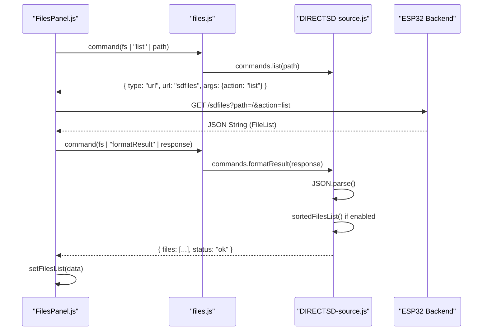

**Sources:**[src/components/Panels/Files.js#115-136](https://github.com/luc-github/ESP3D-WEBUI/blob/97c01e85/src/components/Panels/Files.js#L115-L136)[src/targets/CNC/grblHAL/DIRECTSD-source.js#54-76](https://github.com/luc-github/ESP3D-WEBUI/blob/97c01e85/src/targets/CNC/grblHAL/DIRECTSD-source.js#L54-L76)[src/targets/Printer3D/Marlin/SD-source.js#114-122](https://github.com/luc-github/ESP3D-WEBUI/blob/97c01e85/src/targets/Printer3D/Marlin/SD-source.js#L114-L122)

---

## Storage Backend Comparison

### FLASH (Internal)

- **Protocol**: HTTP [src/targets/CNC/grblHAL/FLASH-source.js#57](https://github.com/luc-github/ESP3D-WEBUI/blob/97c01e85/src/targets/CNC/grblHAL/FLASH-source.js#L57-L57)
- **Capabilities**: Full support for directories, multiple uploads, and downloads [src/targets/CNC/grblHAL/FLASH-source.js#24-51](https://github.com/luc-github/ESP3D-WEBUI/blob/97c01e85/src/targets/CNC/grblHAL/FLASH-source.js#L24-L51)
- **Pathing**: Uses `HostUploadPath` setting to prefix paths [src/targets/CNC/grblHAL/FLASH-source.js#63](https://github.com/luc-github/ESP3D-WEBUI/blob/97c01e85/src/targets/CNC/grblHAL/FLASH-source.js#L63-L63)

### SD / SDEXT (Serial)

- **Protocol**: Serial (G-code) [src/targets/Printer3D/Marlin/SD-source.js#87](https://github.com/luc-github/ESP3D-WEBUI/blob/97c01e85/src/targets/Printer3D/Marlin/SD-source.js#L87-L87)
- **Capabilities**: Usually flat filesystem; upload/delete depends on `SerialProtocol` (e.g., "MKS" support) [src/targets/Printer3D/Marlin/SD-source.js#61-75](https://github.com/luc-github/ESP3D-WEBUI/blob/97c01e85/src/targets/Printer3D/Marlin/SD-source.js#L61-L75)
- **Parsing**: Requires `formatFileSerialLine` to parse raw serial strings like `Begin file list...End file list`[src/targets/Printer3D/Marlin/SD-source.js#31-53](https://github.com/luc-github/ESP3D-WEBUI/blob/97c01e85/src/targets/Printer3D/Marlin/SD-source.js#L31-L53)

### DIRECTSD (HTTP-to-SD)

- **Protocol**: HTTP [src/targets/CNC/grblHAL/DIRECTSD-source.js#58](https://github.com/luc-github/ESP3D-WEBUI/blob/97c01e85/src/targets/CNC/grblHAL/DIRECTSD-source.js#L58-L58)
- **Capabilities**: Supports hierarchical directories and native downloads [src/targets/CNC/grblHAL/DIRECTSD-source.js#30-51](https://github.com/luc-github/ESP3D-WEBUI/blob/97c01e85/src/targets/CNC/grblHAL/DIRECTSD-source.js#L30-L51)
- **Integration**: Specific to targets like grblHAL or Marlin with specific SD connection modes [src/targets/CNC/grblHAL/files.js#38-46](https://github.com/luc-github/ESP3D-WEBUI/blob/97c01e85/src/targets/CNC/grblHAL/files.js#L38-L46)

---

## Response Processing and Parsing

For serial backends, the system must detect the start and end of a file list in the stream. This is defined in `responseSteps`.

**Example: Marlin SD Response Detection**

```
const responseSteps = {
    list: {
        start: (data) => data.startsWith("Begin file list"),
        end: (data) => data.startsWith("End file list"),
        error: (data) => data.indexOf("error") != -1 || data.indexOf("No SD card") != -1
    }
}
```

The `FilesPanel` uses these via the `processor` to "catch" the serial response and aggregate it into a content array before calling `formatResult`[src/targets/Printer3D/Marlin/SD-source.js#155-170](https://github.com/luc-github/ESP3D-WEBUI/blob/97c01e85/src/targets/Printer3D/Marlin/SD-source.js#L155-L170)

**Sources:**[src/targets/Printer3D/Marlin/SD-source.js#155-176](https://github.com/luc-github/ESP3D-WEBUI/blob/97c01e85/src/targets/Printer3D/Marlin/SD-source.js#L155-L176)[src/targets/Printer3D/Marlin/SDEXT-source.js#157-178](https://github.com/luc-github/ESP3D-WEBUI/blob/97c01e85/src/targets/Printer3D/Marlin/SDEXT-source.js#L157-L178)

---

## Summary Table of File Commands

|  |  |  |
| --- | --- | --- |
| **List** | `url` | `GET /files?path=/&action=list`[src/targets/CNC/grblHAL/FLASH-source.js#57](https://github.com/luc-github/ESP3D-WEBUI/blob/97c01e85/src/targets/CNC/grblHAL/FLASH-source.js#L57-L57) |
| **Upload** | `url` | `POST /files?path=/`[src/targets/CNC/grblHAL/FLASH-source.js#61](https://github.com/luc-github/ESP3D-WEBUI/blob/97c01e85/src/targets/CNC/grblHAL/FLASH-source.js#L61-L61) |
| **Delete** | `url` | `GET /files?path=/&action=delete&filename=f.nc`[src/targets/CNC/grblHAL/FLASH-source.js#87](https://github.com/luc-github/ESP3D-WEBUI/blob/97c01e85/src/targets/CNC/grblHAL/FLASH-source.js#L87-L87) |
| **Play** | `cmd` | `replace("#", path)` in `playcmd` setting [src/targets/CNC/grblHAL/FLASH-source.js#115](https://github.com/luc-github/ESP3D-WEBUI/blob/97c01e85/src/targets/CNC/grblHAL/FLASH-source.js#L115-L115) |
| **Create Dir** | `url` | `GET /files?path=/&action=createdir&filename=new`[src/targets/CNC/grblHAL/FLASH-source.js#92](https://github.com/luc-github/ESP3D-WEBUI/blob/97c01e85/src/targets/CNC/grblHAL/FLASH-source.js#L92-L92) |

**Sources:**[src/targets/CNC/grblHAL/FLASH-source.js#53-129](https://github.com/luc-github/ESP3D-WEBUI/blob/97c01e85/src/targets/CNC/grblHAL/FLASH-source.js#L53-L129)[src/targets/CNC/grblHAL/DIRECTSD-source.js#54-120](https://github.com/luc-github/ESP3D-WEBUI/blob/97c01e85/src/targets/CNC/grblHAL/DIRECTSD-source.js#L54-L120)

---

# 5.5-Settings-Interface

# Settings Interface
Relevant source files

- [src/components/Helpers/http.js](https://github.com/luc-github/ESP3D-WEBUI/blob/97c01e85/src/components/Helpers/http.js)
- [src/components/Panels/ProbeCNC.js](https://github.com/luc-github/ESP3D-WEBUI/blob/97c01e85/src/components/Panels/ProbeCNC.js)
- [src/hooks/useSettings.js](https://github.com/luc-github/ESP3D-WEBUI/blob/97c01e85/src/hooks/useSettings.js)
- [src/tabs/interface/importHelper.js](https://github.com/luc-github/ESP3D-WEBUI/blob/97c01e85/src/tabs/interface/importHelper.js)
- [src/tabs/interface/index.js](https://github.com/luc-github/ESP3D-WEBUI/blob/97c01e85/src/tabs/interface/index.js)
- [src/targets/Printer3D/Marlin-embedded/SD-source.js](https://github.com/luc-github/ESP3D-WEBUI/blob/97c01e85/src/targets/Printer3D/Marlin-embedded/SD-source.js)
- [src/targets/Printer3D/Marlin/SD-source.js](https://github.com/luc-github/ESP3D-WEBUI/blob/97c01e85/src/targets/Printer3D/Marlin/SD-source.js)
- [src/targets/Printer3D/Marlin/SDEXT-source.js](https://github.com/luc-github/ESP3D-WEBUI/blob/97c01e85/src/targets/Printer3D/Marlin/SDEXT-source.js)

The Settings Interface is the UI component that provides users with a comprehensive form-based editor for viewing, modifying, validating, and persisting application preferences. It renders all configurable settings organized by category, performs real-time validation, manages dependency-based field visibility, and handles import/export/save operations.

For information about the underlying preferences data structure and hierarchical inheritance system, see [Preferences System](/org/luc-github/wiki/luc-github/ESP3D-WEBUI/page/4.2?branch=%223.0%22). For details on individual field component implementations, see [Field Components](/org/luc-github/wiki/luc-github/ESP3D-WEBUI/page/5.7?branch=%223.0%22). For information about settings validation rules and dependency logic, see [Settings Validation and Dependencies](/org/luc-github/wiki/luc-github/ESP3D-WEBUI/page/7.4?branch=%223.0%22).

## Component Architecture

The `InterfaceTab` component serves as the main orchestrator for the settings interface, coordinating between the settings context, field rendering, validation logic, and persistence operations.

[Flowchart Diagram]

**Sources:**[src/tabs/interface/index.js#20-102](https://github.com/luc-github/ESP3D-WEBUI/blob/97c01e85/src/tabs/interface/index.js#L20-L102)[src/tabs/interface/index.js#336-416](https://github.com/luc-github/ESP3D-WEBUI/blob/97c01e85/src/tabs/interface/index.js#L336-L416)

## Settings Data Structure

The settings interface operates on a nested data structure where each setting field contains metadata for rendering, validation, and state tracking.

[Flowchart Diagram]

**Field Object Structure:**

|  |  |  |
| --- | --- | --- |
| `id` | string | Unique identifier for the field |
| `type` | string | Field type: text, number, select, boolean, icon, list, group |
| `label` | string | Translation key for field label |
| `value` | any | Current field value |
| `initial` | any | Original/default value for change detection |
| `hasmodified` | boolean | Whether value differs from initial |
| `haserror` | boolean | Whether validation has failed |
| `depend` | array | Dependency conditions for visibility/validity |
| `min`, `max` | number | Range constraints for numbers/text length |
| `step` | number | Increment step for number inputs |
| `regexpattern` | string | Validation regex for text inputs |
| `options` | array | Available options for select fields |
| `hide` | boolean | Whether to hide the field |
| `shortkey` | boolean | Whether this is a keyboard shortcut field |

**Sources:**[src/tabs/interface/index.js#45-299](https://github.com/luc-github/ESP3D-WEBUI/blob/97c01e85/src/tabs/interface/index.js#L45-L299)[src/tabs/interface/importHelper.js#30-167](https://github.com/luc-github/ESP3D-WEBUI/blob/97c01e85/src/tabs/interface/importHelper.js#L30-L167)

## Validation System

The validation system provides comprehensive real-time validation for all field types via `generateValidationGlobal`.

[Flowchart Diagram]

**Validation Rules by Field Type:**

|  |  |
| --- | --- |
| `shortkey` | Must not end with "+"; must be unique across jog keymap and macros [src/tabs/interface/index.js#60-102](https://github.com/luc-github/ESP3D-WEBUI/blob/97c01e85/src/tabs/interface/index.js#L60-L102) |
| `number` | Must satisfy min/max range; handles `minSecondary` for dual-range validation [src/tabs/interface/index.js#166-189](https://github.com/luc-github/ESP3D-WEBUI/blob/97c01e85/src/tabs/interface/index.js#L166-L189) |
| `text` | Must match `regexpattern` if provided; must satisfy min/max length constraints [src/tabs/interface/index.js#136-165](https://github.com/luc-github/ESP3D-WEBUI/blob/97c01e85/src/tabs/interface/index.js#L136-L165) |
| `select` | Selected option must be valid; option dependencies must be satisfied [src/tabs/interface/index.js#191-203](https://github.com/luc-github/ESP3D-WEBUI/blob/97c01e85/src/tabs/interface/index.js#L191-L203) |
| `list` | Stringified check for `newItem` or `hasmodified` flags; check for `haserror` in nested items [src/tabs/interface/index.js#119-135](https://github.com/luc-github/ESP3D-WEBUI/blob/97c01e85/src/tabs/interface/index.js#L119-L135) |
| `all types` | Step validation using modulo arithmetic with float precision handling [src/tabs/interface/index.js#104-118](https://github.com/luc-github/ESP3D-WEBUI/blob/97c01e85/src/tabs/interface/index.js#L104-L118) |

**Sources:**[src/tabs/interface/index.js#45-299](https://github.com/luc-github/ESP3D-WEBUI/blob/97c01e85/src/tabs/interface/index.js#L45-L299)

## Dependency System

The dependency system controls field visibility and validity based on other settings values or connection capabilities using `checkDependencies`.

[Flowchart Diagram]

**Sources:**[src/tabs/interface/index.js#40-43](https://github.com/luc-github/ESP3D-WEBUI/blob/97c01e85/src/tabs/interface/index.js#L40-L43)[src/components/Panels/ProbeCNC.js#148-165](https://github.com/luc-github/ESP3D-WEBUI/blob/97c01e85/src/components/Panels/ProbeCNC.js#L148-L165)[src/tabs/interface/importHelper.js#79-128](https://github.com/luc-github/ESP3D-WEBUI/blob/97c01e85/src/tabs/interface/importHelper.js#L79-L128)

## Action Buttons and Save Workflow

The interface provides actions for refreshing, importing, exporting, and saving settings.

### Save Implementation

The save operation uploads modified settings to the device as a `preferences.json` file.

1. **File Creation**: [src/tabs/interface/index.js#384-400](https://github.com/luc-github/ESP3D-WEBUI/blob/97c01e85/src/tabs/interface/index.js#L384-L400)
- Uses `exportPreferences()` with `false` flag to exclude unmodified values.
- Creates a `Blob` and wraps it in a `File` object.
2. **FormData Structure**:

- `path`: Host upload path.
- `creatPath`: Set to "true".
- `myfiles`: The generated JSON file.
3. **HTTP Request**: [src/tabs/interface/index.js#402-415](https://github.com/luc-github/ESP3D-WEBUI/blob/97c01e85/src/tabs/interface/index.js#L402-L415)
- Method: POST via `createNewRequest`.
- Reloads the page on success to apply changes.

### Import/Export

- **Export**: Generates a JSON blob containing settings, custom content, and extensions [src/tabs/interface/index.js#636-655](https://github.com/luc-github/ESP3D-WEBUI/blob/97c01e85/src/tabs/interface/index.js#L636-L655)
- **Import**: Uses `FileReader` to read local JSON and `importPreferencesSection` to merge data [src/tabs/interface/index.js#342-380](https://github.com/luc-github/ESP3D-WEBUI/blob/97c01e85/src/tabs/interface/index.js#L342-L380)

**Sources:**[src/tabs/interface/index.js#336-416](https://github.com/luc-github/ESP3D-WEBUI/blob/97c01e85/src/tabs/interface/index.js#L336-L416)[src/tabs/interface/exportHelper.js#1-10](https://github.com/luc-github/ESP3D-WEBUI/blob/97c01e85/src/tabs/interface/exportHelper.js#L1-L10)[src/tabs/interface/importHelper.js#1-10](https://github.com/luc-github/ESP3D-WEBUI/blob/97c01e85/src/tabs/interface/importHelper.js#L1-L10)

## Practical Usage in Panels

Panels like `ProbePanel` leverage the settings validation logic to ensure machine commands are safe.

**Field Rendering with Validation:**[src/components/Panels/ProbeCNC.js#583-637](https://github.com/luc-github/ESP3D-WEBUI/blob/97c01e85/src/components/Panels/ProbeCNC.js#L583-L637)

```
<Field
  inline
  id={element.id}
  type={element.type}
  label={T(element.label)}
  value={element.value.current}
  setValue={(val, update = false) => {
    if (!update) element.value.current = val
    const validationObj = generateValidation(element)
    setvalidation(validationObj)
    // ... update variablesList if valid
  }}
  validation={validation}
/>
```

**Sources:**[src/components/Panels/ProbeCNC.js#449-638](https://github.com/luc-github/ESP3D-WEBUI/blob/97c01e85/src/components/Panels/ProbeCNC.js#L449-L638)[src/hooks/useSettings.js#56-90](https://github.com/luc-github/ESP3D-WEBUI/blob/97c01e85/src/hooks/useSettings.js#L56-L90)

---

# 5.6-Terminal-Panel

# Terminal Panel
Relevant source files

- [src/components/Helpers/filters.js](https://github.com/luc-github/ESP3D-WEBUI/blob/97c01e85/src/components/Helpers/filters.js)
- [src/components/Helpers/storedState.js](https://github.com/luc-github/ESP3D-WEBUI/blob/97c01e85/src/components/Helpers/storedState.js)
- [src/components/Modal/logginModal.js](https://github.com/luc-github/ESP3D-WEBUI/blob/97c01e85/src/components/Modal/logginModal.js)
- [src/components/Panels/Terminal.js](https://github.com/luc-github/ESP3D-WEBUI/blob/97c01e85/src/components/Panels/Terminal.js)
- [src/contexts/DatasContext.js](https://github.com/luc-github/ESP3D-WEBUI/blob/97c01e85/src/contexts/DatasContext.js)
- [src/targets/CNC/Controls/QuickStopButton.js](https://github.com/luc-github/ESP3D-WEBUI/blob/97c01e85/src/targets/CNC/Controls/QuickStopButton.js)
- [src/targets/CNC/GRBL/Controls/BackgroundContainer.js](https://github.com/luc-github/ESP3D-WEBUI/blob/97c01e85/src/targets/CNC/GRBL/Controls/BackgroundContainer.js)

## Purpose and Scope

The Terminal Panel provides a direct G-code and command console for interacting with machine firmware. It serves as the primary interface for manual command entry, real-time output monitoring, and debugging. The panel supports features such as command history, auto-scroll management, verbose filtering, and variable replacement.

This document details the `TerminalPanel` component implementation, the underlying `DatasContext` state management, and the data flow between the UI and the firmware.

---

## Architecture and Data Flow

The Terminal Panel operates as a consumer of both the `DatasContext` (for message storage) and the `TargetContext` (for command processing).

### System Component Interaction

[Flowchart Diagram]

**Sources:**[src/components/Panels/Terminal.js#42-152](https://github.com/luc-github/ESP3D-WEBUI/blob/97c01e85/src/components/Panels/Terminal.js#L42-L152)[src/contexts/DatasContext.js#30-98](https://github.com/luc-github/ESP3D-WEBUI/blob/97c01e85/src/contexts/DatasContext.js#L30-L98)[src/components/Helpers/storedState.js#21-33](https://github.com/luc-github/ESP3D-WEBUI/blob/97c01e85/src/components/Helpers/storedState.js#L21-L33)

---

## State Management: DatasContext

The terminal's state is centralized in the `DatasContext` to ensure persistence across panel re-renders and to allow background data collection.

### Terminal State Structure

|  |  |  |  |
| --- | --- | --- | --- |
| `input` | `useRef` | [src/contexts/DatasContext.js#41](https://github.com/luc-github/ESP3D-WEBUI/blob/97c01e85/src/contexts/DatasContext.js#L41-L41) | Holds the current unsent input string. |
| `content` | `useState` | [src/contexts/DatasContext.js#36](https://github.com/luc-github/ESP3D-WEBUI/blob/97c01e85/src/contexts/DatasContext.js#L36-L36) | The array of messages currently rendered in the UI. |
| `inputHistory` | `useStoredState` | [src/contexts/DatasContext.js#37](https://github.com/luc-github/ESP3D-WEBUI/blob/97c01e85/src/contexts/DatasContext.js#L37-L37) | Command history persisted in `localStorage`. |
| `isVerbose` | `useRef` | [src/contexts/DatasContext.js#33](https://github.com/luc-github/ESP3D-WEBUI/blob/97c01e85/src/contexts/DatasContext.js#L33-L33) | Controls whether all messages or only "quiet" messages are shown. |
| `isAutoScroll` | `useRef` | [src/contexts/DatasContext.js#31](https://github.com/luc-github/ESP3D-WEBUI/blob/97c01e85/src/contexts/DatasContext.js#L31-L31) | Global toggle for automatic scrolling to bottom. |

### Content Buffering Logic

The context maintains two internal buffers: `terminalBuffer` (all data) and `terminalBufferQuiet` (filtered data). When `addTerminalContent` is called, it limits the array size based on the scroll state (typically 300-600 lines) using `limitArr` to prevent browser memory exhaustion [src/contexts/DatasContext.js#58-74](https://github.com/luc-github/ESP3D-WEBUI/blob/97c01e85/src/contexts/DatasContext.js#L58-L74)

**Sources:**[src/contexts/DatasContext.js#43-98](https://github.com/luc-github/ESP3D-WEBUI/blob/97c01e85/src/contexts/DatasContext.js#L43-L98)[src/components/Helpers/storedState.js#21-33](https://github.com/luc-github/ESP3D-WEBUI/blob/97c01e85/src/components/Helpers/storedState.js#L21-L33)

---

## Component Implementation

### Command Entry and History

The `TerminalPanel` implements a standard terminal UX with keyboard navigation for command history.

- **Keyboard Hooks (`onKeyUp`)**:

- `Enter` (13): Triggers `onSend`[src/components/Panels/Terminal.js#95-97](https://github.com/luc-github/ESP3D-WEBUI/blob/97c01e85/src/components/Panels/Terminal.js#L95-L97)
- `ArrowUp` (38): Navigates to the previous command in `terminal.inputHistory`[src/components/Panels/Terminal.js#98-100](https://github.com/luc-github/ESP3D-WEBUI/blob/97c01e85/src/components/Panels/Terminal.js#L98-L100)
- `ArrowDown` (40): Navigates to the next command or clears the input if at the end of history [src/components/Panels/Terminal.js#101-103](https://github.com/luc-github/ESP3D-WEBUI/blob/97c01e85/src/components/Panels/Terminal.js#L101-L103)

### Command Processing Pipeline

When a command is sent via `onSend`[src/components/Panels/Terminal.js#108-149](https://github.com/luc-github/ESP3D-WEBUI/blob/97c01e85/src/components/Panels/Terminal.js#L108-L149):

1. **Haptic Feedback**: Triggers a vibration if supported [src/components/Panels/Terminal.js#109](https://github.com/luc-github/ESP3D-WEBUI/blob/97c01e85/src/components/Panels/Terminal.js#L109-L109)
2. **Variable Replacement**: The command is passed through `replaceVariables` using the `variablesList.commands` pattern [src/components/Panels/Terminal.js#128](https://github.com/luc-github/ESP3D-WEBUI/blob/97c01e85/src/components/Panels/Terminal.js#L128-L128)
3. **Local Echo**: `processData("echo", ...)` is called to immediately display the sent command in the terminal [src/components/Panels/Terminal.js#126-129](https://github.com/luc-github/ESP3D-WEBUI/blob/97c01e85/src/components/Panels/Terminal.js#L126-L129)
4. **Network Request**: An HTTP GET request is created via `createNewRequest` to the `/command` endpoint [src/components/Panels/Terminal.js#130-134](https://github.com/luc-github/ESP3D-WEBUI/blob/97c01e85/src/components/Panels/Terminal.js#L130-L134)
5. **Response Handling**: On success, the result is passed to `processData("response", result)` for parsing and display [src/components/Panels/Terminal.js#136-138](https://github.com/luc-github/ESP3D-WEBUI/blob/97c01e85/src/components/Panels/Terminal.js#L136-L138)

**Sources:**[src/components/Panels/Terminal.js#71-149](https://github.com/luc-github/ESP3D-WEBUI/blob/97c01e85/src/components/Panels/Terminal.js#L71-L149)[src/targets/CNC/Controls/QuickStopButton.js#32-49](https://github.com/luc-github/ESP3D-WEBUI/blob/97c01e85/src/targets/CNC/Controls/QuickStopButton.js#L32-L49)

---

## User Interface Features

### Terminal Menu

The panel includes a specialized menu (accessible via the `PanelMenu` component) to control display behavior:

|  |  |  |
| --- | --- | --- |
| **Verbose Mode** | `S76` | Toggles between full stream and filtered output [src/components/Panels/Terminal.js#184-195](https://github.com/luc-github/ESP3D-WEBUI/blob/97c01e85/src/components/Panels/Terminal.js#L184-L195) |
| **Auto-scroll** | `S77` | Toggles automatic scrolling. If paused by user interaction, it can be resumed here [src/components/Panels/Terminal.js#197-207](https://github.com/luc-github/ESP3D-WEBUI/blob/97c01e85/src/components/Panels/Terminal.js#L197-L207) |
| **Clear** | `S78` | Calls `terminal.clear()` to empty the display and buffers [src/components/Panels/Terminal.js#215-220](https://github.com/luc-github/ESP3D-WEBUI/blob/97c01e85/src/components/Panels/Terminal.js#L215-L220) |

### Auto-Scroll Behavior

The component uses a `useRef` for the terminal output container (`terminalOutput`) and a `scrollToBottom` function.

- **Automatic Trigger**: Whenever `terminal.content` updates, an `useEffect` hook triggers `scrollToBottom`[src/components/Panels/Terminal.js#153-155](https://github.com/luc-github/ESP3D-WEBUI/blob/97c01e85/src/components/Panels/Terminal.js#L153-L155)
- **Pause Logic**: Scrolling is suppressed if `terminal.isAutoScrollPaused.current` is true, allowing users to inspect previous logs without the view jumping [src/components/Panels/Terminal.js#63-70](https://github.com/luc-github/ESP3D-WEBUI/blob/97c01e85/src/components/Panels/Terminal.js#L63-L70)

**Sources:**[src/components/Panels/Terminal.js#58-70](https://github.com/luc-github/ESP3D-WEBUI/blob/97c01e85/src/components/Panels/Terminal.js#L58-L70)[src/components/Panels/Terminal.js#182-221](https://github.com/luc-github/ESP3D-WEBUI/blob/97c01e85/src/components/Panels/Terminal.js#L182-L221)

---

## Technical Details: Variables and Replacement

The terminal supports dynamic variable replacement before commands are dispatched to the firmware. This is handled by `replaceVariables` [src/components/Helpers/index.js] and informed by `variablesList` from the target configuration.

[Flowchart Diagram]

**Sources:**[src/components/Panels/Terminal.js#128-132](https://github.com/luc-github/ESP3D-WEBUI/blob/97c01e85/src/components/Panels/Terminal.js#L128-L132)[src/targets/CNC/Controls/QuickStopButton.js#35-39](https://github.com/luc-github/ESP3D-WEBUI/blob/97c01e85/src/targets/CNC/Controls/QuickStopButton.js#L35-L39)

---

# 5.7-Field-Components

# Field Components
Relevant source files

- [Memo/preferences.md](https://github.com/luc-github/ESP3D-WEBUI/blob/97c01e85/Memo/preferences.md?plain=1)
- [src/components/Controls/Button.js](https://github.com/luc-github/ESP3D-WEBUI/blob/97c01e85/src/components/Controls/Button.js)
- [src/components/Controls/FieldGroup.js](https://github.com/luc-github/ESP3D-WEBUI/blob/97c01e85/src/components/Controls/FieldGroup.js)
- [src/components/Controls/Fields/Boolean.js](https://github.com/luc-github/ESP3D-WEBUI/blob/97c01e85/src/components/Controls/Fields/Boolean.js)
- [src/components/Controls/Fields/IconSelect.js](https://github.com/luc-github/ESP3D-WEBUI/blob/97c01e85/src/components/Controls/Fields/IconSelect.js)
- [src/components/Controls/Fields/Input.js](https://github.com/luc-github/ESP3D-WEBUI/blob/97c01e85/src/components/Controls/Fields/Input.js)
- [src/components/Controls/Fields/ItemsList.js](https://github.com/luc-github/ESP3D-WEBUI/blob/97c01e85/src/components/Controls/Fields/ItemsList.js)
- [src/components/Controls/Fields/Select.js](https://github.com/luc-github/ESP3D-WEBUI/blob/97c01e85/src/components/Controls/Fields/Select.js)
- [src/components/Controls/Fields/Slider.js](https://github.com/luc-github/ESP3D-WEBUI/blob/97c01e85/src/components/Controls/Fields/Slider.js)
- [src/components/Helpers/components.js](https://github.com/luc-github/ESP3D-WEBUI/blob/97c01e85/src/components/Helpers/components.js)
- [src/components/Helpers/index.js](https://github.com/luc-github/ESP3D-WEBUI/blob/97c01e85/src/components/Helpers/index.js)
- [src/components/Panels/LaserCNC.js](https://github.com/luc-github/ESP3D-WEBUI/blob/97c01e85/src/components/Panels/LaserCNC.js)
- [src/components/Panels/SpindleCNC.js](https://github.com/luc-github/ESP3D-WEBUI/blob/97c01e85/src/components/Panels/SpindleCNC.js)
- [src/style/components/_control.scss](https://github.com/luc-github/ESP3D-WEBUI/blob/97c01e85/src/style/components/_control.scss)

This page documents the reusable field components used throughout the ESP3D-WEBUI for user input and data entry. These components provide standardized input controls with built-in validation, dependency checking, and various specialized input modes.

## Overview

The field component system provides a consistent interface for user input across all panels and settings dialogs. The primary components are:

- **`Input`**: Core text/number input with multiple specialized modes [src/components/Controls/Fields/Input.js#83-360](https://github.com/luc-github/ESP3D-WEBUI/blob/97c01e85/src/components/Controls/Fields/Input.js#L83-L360)
- **`Field`**: Higher-level wrapper that adds labels and validation display [src/components/Controls/Fields/ItemsList.js#30](https://github.com/luc-github/ESP3D-WEBUI/blob/97c01e85/src/components/Controls/Fields/ItemsList.js#L30-L30)
- **`Select`**: Dropdown selection component [src/components/Controls/Fields/Select.js#52-123](https://github.com/luc-github/ESP3D-WEBUI/blob/97c01e85/src/components/Controls/Fields/Select.js#L52-L123)
- **`Boolean`**: Toggle switch for true/false values [src/components/Controls/Fields/Boolean.js#38-102](https://github.com/luc-github/ESP3D-WEBUI/blob/97c01e85/src/components/Controls/Fields/Boolean.js#L38-L102)
- **`FieldGroup`**: Container for grouping related fields with a legend [src/components/Controls/FieldGroup.js#28-54](https://github.com/luc-github/ESP3D-WEBUI/blob/97c01e85/src/components/Controls/FieldGroup.js#L28-L54)
- **`ItemsList`**: Complex component for managing lists of editable items (e.g., Macros, Custom Panels) [src/components/Controls/Fields/ItemsList.js#207-336](https://github.com/luc-github/ESP3D-WEBUI/blob/97c01e85/src/components/Controls/Fields/ItemsList.js#L207-L336)
- **`IconSelect`**: Modal-based icon picker [src/components/Controls/Fields/IconSelect.js#34-112](https://github.com/luc-github/ESP3D-WEBUI/blob/97c01e85/src/components/Controls/Fields/IconSelect.js#L34-L112)

All field components integrate with the `SettingsContext` and `UiContext` for state management and support conditional visibility through the dependency system [src/components/Controls/Fields/Input.js#102-106](https://github.com/luc-github/ESP3D-WEBUI/blob/97c01e85/src/components/Controls/Fields/Input.js#L102-L106)

**Sources:**[src/components/Controls/Fields/Input.js#1-361](https://github.com/luc-github/ESP3D-WEBUI/blob/97c01e85/src/components/Controls/Fields/Input.js#L1-L361)[src/components/Controls/FieldGroup.js#1-56](https://github.com/luc-github/ESP3D-WEBUI/blob/97c01e85/src/components/Controls/FieldGroup.js#L1-L56)[src/components/Controls/Fields/Boolean.js#1-103](https://github.com/luc-github/ESP3D-WEBUI/blob/97c01e85/src/components/Controls/Fields/Boolean.js#L1-L103)

## Component Architecture

[Flowchart Diagram]

**Sources:**[src/components/Controls/Fields/Input.js#83-360](https://github.com/luc-github/ESP3D-WEBUI/blob/97c01e85/src/components/Controls/Fields/Input.js#L83-L360)[src/components/Helpers/components.js#91-167](https://github.com/luc-github/ESP3D-WEBUI/blob/97c01e85/src/components/Helpers/components.js#L91-L167)[src/components/Controls/Fields/ItemsList.js#49-205](https://github.com/luc-github/ESP3D-WEBUI/blob/97c01e85/src/components/Controls/Fields/ItemsList.js#L49-L205)

## Core Field Components

### Input Component

The `Input` component is the most versatile field, handling standard text, numeric entries, and specialized data capture [src/components/Controls/Fields/Input.js#83-101](https://github.com/luc-github/ESP3D-WEBUI/blob/97c01e85/src/components/Controls/Fields/Input.js#L83-L101)

|  |  |  |
| --- | --- | --- |
| `type` | string | HTML type (`text`, `password`, `number`, `slider`) [src/components/Controls/Fields/Input.js#190-206](https://github.com/luc-github/ESP3D-WEBUI/blob/97c01e85/src/components/Controls/Fields/Input.js#L190-L206) |
| `extra` | string | Specialized modes: `dropList` (predefined options) or `scan` (WiFi AP list) [src/components/Controls/Fields/Input.js#207-324](https://github.com/luc-github/ESP3D-WEBUI/blob/97c01e85/src/components/Controls/Fields/Input.js#L207-L324) |
| `shortkey` | boolean | Captures key combinations (e.g., "Control+Alt+P") [src/components/Controls/Fields/Input.js#112-135](https://github.com/luc-github/ESP3D-WEBUI/blob/97c01e85/src/components/Controls/Fields/Input.js#L112-L135) |
| `append` | string | Unit or label appended to the input (e.g., "mm", "%") [src/components/Controls/Fields/Input.js#224-231](https://github.com/luc-github/ESP3D-WEBUI/blob/97c01e85/src/components/Controls/Fields/Input.js#L224-L231) |
| `prec` | number | Decimal precision hint shown in a tooltip [src/components/Controls/Fields/Input.js#109-110](https://github.com/luc-github/ESP3D-WEBUI/blob/97c01e85/src/components/Controls/Fields/Input.js#L109-L110) |

### Select Component

A standard dropdown component that supports conditional visibility for individual options [src/components/Controls/Fields/Select.js#29-50](https://github.com/luc-github/ESP3D-WEBUI/blob/97c01e85/src/components/Controls/Fields/Select.js#L29-L50)

- **Option Dependencies**: Individual `<option>` elements can be hidden based on firmware capabilities (e.g., only show "Camera" if `CameraName` is configured) [src/components/Controls/Fields/Select.js#40-48](https://github.com/luc-github/ESP3D-WEBUI/blob/97c01e85/src/components/Controls/Fields/Select.js#L40-L48)

### Boolean Component

Renders as a `form-switch` (toggle). It uses the `checked` attribute for value tracking [src/components/Controls/Fields/Boolean.js#86-98](https://github.com/luc-github/ESP3D-WEBUI/blob/97c01e85/src/components/Controls/Fields/Boolean.js#L86-L98)

### ItemsList Component

Used for high-level configuration like **Macros** or **Custom Panels**.

- **Dynamic CRUD**: Allows adding, removing, and reordering items [src/components/Controls/Fields/ItemsList.js#74-95](https://github.com/luc-github/ESP3D-WEBUI/blob/97c01e85/src/components/Controls/Fields/ItemsList.js#L74-L95)
- **Item Editor**: Each item in the list can expand into a sub-form for editing properties like icons, labels, and G-code commands [src/components/Controls/Fields/ItemsList.js#188-204](https://github.com/luc-github/ESP3D-WEBUI/blob/97c01e85/src/components/Controls/Fields/ItemsList.js#L188-L204)

**Sources:**[src/components/Controls/Fields/Input.js#83-101](https://github.com/luc-github/ESP3D-WEBUI/blob/97c01e85/src/components/Controls/Fields/Input.js#L83-L101)[src/components/Controls/Fields/Select.js#52-62](https://github.com/luc-github/ESP3D-WEBUI/blob/97c01e85/src/components/Controls/Fields/Select.js#L52-L62)[src/components/Controls/Fields/Boolean.js#38-55](https://github.com/luc-github/ESP3D-WEBUI/blob/97c01e85/src/components/Controls/Fields/Boolean.js#L38-L55)[src/components/Controls/Fields/ItemsList.js#207-230](https://github.com/luc-github/ESP3D-WEBUI/blob/97c01e85/src/components/Controls/Fields/ItemsList.js#L207-L230)

## Dependency System

The dependency system controls component visibility based on either user settings or firmware-reported connection properties.

### Visibility Flow

[Flowchart Diagram]

### Dependency Types

1. **Setting Dependency**: Visibility depends on another UI setting (e.g., show "M4" button only if `showM4ctrls` is enabled) [src/components/Helpers/components.js#127-147](https://github.com/luc-github/ESP3D-WEBUI/blob/97c01e85/src/components/Helpers/components.js#L127-L147)
2. **Connection Dependency**: Visibility depends on firmware features (e.g., show "Laser" panel only if firmware reports laser support via `ESP800`) [src/components/Helpers/components.js#110-125](https://github.com/luc-github/ESP3D-WEBUI/blob/97c01e85/src/components/Helpers/components.js#L110-L125)
3. **OR Groups**: Logic for complex conditions where visibility is granted if any sub-group of dependencies is met [src/components/Helpers/components.js#158-162](https://github.com/luc-github/ESP3D-WEBUI/blob/97c01e85/src/components/Helpers/components.js#L158-L162)

**Sources:**[src/components/Helpers/components.js#91-167](https://github.com/luc-github/ESP3D-WEBUI/blob/97c01e85/src/components/Helpers/components.js#L91-L167)[src/components/Controls/Fields/Input.js#155-165](https://github.com/luc-github/ESP3D-WEBUI/blob/97c01e85/src/components/Controls/Fields/Input.js#L155-L165)

## Styling and Visual Feedback

Field components utilize **Spectre.css** classes augmented by custom SCSS for specific behaviors [src/style/components/_control.scss#1-181](https://github.com/luc-github/ESP3D-WEBUI/blob/97c01e85/src/style/components/_control.scss#L1-L181)

### Validation Styles

Visual feedback is provided via border colors and shadows defined in `_control.scss`:

- **Modified State**: Fields that have unsaved changes receive an orange highlight (`rgba(255, 183, 0, .4)`) [src/components/Controls/Fields/ItemsList.js#102-107](https://github.com/luc-github/ESP3D-WEBUI/blob/97c01e85/src/components/Controls/Fields/ItemsList.js#L102-L107)
- **Error State**: Validation failures result in a red highlight (`rgba(255, 0, 0, .4)`) [src/components/Controls/Fields/ItemsList.js#109-111](https://github.com/luc-github/ESP3D-WEBUI/blob/97c01e85/src/components/Controls/Fields/ItemsList.js#L109-L111)
- **Submit Button**: In forms, the submit button is often hidden until a modification is detected via the `.has-modification` class [src/style/components/_control.scss#262-264](https://github.com/luc-github/ESP3D-WEBUI/blob/97c01e85/src/style/components/_control.scss#L262-L264)

### Custom Field Elements

- **`.field-group`**: Styled with a blue label and 0.8rem font [src/style/components/_control.scss#162-165](https://github.com/luc-github/ESP3D-WEBUI/blob/97c01e85/src/style/components/_control.scss#L162-L165)
- **`.fields-line`**: Uses `flexbox` to align inputs and buttons horizontally with `justify-content: space-between`[src/style/components/_control.scss#167-173](https://github.com/luc-github/ESP3D-WEBUI/blob/97c01e85/src/style/components/_control.scss#L167-L173)
- **`.itemEditor`**: A bordered container (`#dadee4`) for complex item editing [src/style/components/_control.scss#84-91](https://github.com/luc-github/ESP3D-WEBUI/blob/97c01e85/src/style/components/_control.scss#L84-L91)

**Sources:**[src/style/components/_control.scss#1-307](https://github.com/luc-github/ESP3D-WEBUI/blob/97c01e85/src/style/components/_control.scss#L1-L307)[src/components/Controls/Fields/ItemsList.js#101-111](https://github.com/luc-github/ESP3D-WEBUI/blob/97c01e85/src/components/Controls/Fields/ItemsList.js#L101-L111)

## Key Implementation Details

### Capturing Shortkeys

The `Input` component includes a specialized `onKeyPress` handler for capturing keyboard shortcuts. It prevents default browser behavior and constructs a string by checking `e.ctrlKey`, `e.altKey`, `e.shiftKey`, and `e.metaKey`[src/components/Controls/Fields/Input.js#112-135](https://github.com/luc-github/ESP3D-WEBUI/blob/97c01e85/src/components/Controls/Fields/Input.js#L112-L135)

### Password Masking

The `Reveal` sub-component manages a local `reveal` state. It toggles the `type` attribute of the parent input between `password` and `text` directly via a `ref` for immediate DOM response [src/components/Controls/Fields/Input.js#44-68](https://github.com/luc-github/ESP3D-WEBUI/blob/97c01e85/src/components/Controls/Fields/Input.js#L44-L68)

### Dynamic Precision

Numeric inputs support a `prec` prop. If provided, it generates a tooltip using the translation key `S208` ("$ decimals"), where `$` is replaced by the precision value [src/components/Controls/Fields/Input.js#109-110](https://github.com/luc-github/ESP3D-WEBUI/blob/97c01e85/src/components/Controls/Fields/Input.js#L109-L110)

**Sources:**[src/components/Controls/Fields/Input.js#44-135](https://github.com/luc-github/ESP3D-WEBUI/blob/97c01e85/src/components/Controls/Fields/Input.js#L44-L135)[src/components/Controls/Fields/Input.js#348-350](https://github.com/luc-github/ESP3D-WEBUI/blob/97c01e85/src/components/Controls/Fields/Input.js#L348-L350)

---

# 6-Styling-and-UI-Framework

# Styling and UI Framework
Relevant source files

- [src/components/Controls/Fields/Input.js](https://github.com/luc-github/ESP3D-WEBUI/blob/97c01e85/src/components/Controls/Fields/Input.js)
- [src/components/Helpers/components.js](https://github.com/luc-github/ESP3D-WEBUI/blob/97c01e85/src/components/Helpers/components.js)
- [src/components/Helpers/index.js](https://github.com/luc-github/ESP3D-WEBUI/blob/97c01e85/src/components/Helpers/index.js)
- [src/components/Panels/LaserCNC.js](https://github.com/luc-github/ESP3D-WEBUI/blob/97c01e85/src/components/Panels/LaserCNC.js)
- [src/components/Panels/SpindleCNC.js](https://github.com/luc-github/ESP3D-WEBUI/blob/97c01e85/src/components/Panels/SpindleCNC.js)
- [src/style/components/_app.scss](https://github.com/luc-github/ESP3D-WEBUI/blob/97c01e85/src/style/components/_app.scss)
- [src/style/components/_control.scss](https://github.com/luc-github/ESP3D-WEBUI/blob/97c01e85/src/style/components/_control.scss)
- [src/style/components/_panel.scss](https://github.com/luc-github/ESP3D-WEBUI/blob/97c01e85/src/style/components/_panel.scss)
- [src/targets/CNC/style/_index.scss](https://github.com/luc-github/ESP3D-WEBUI/blob/97c01e85/src/targets/CNC/style/_index.scss)

This page explains ESP3D-WEBUI's styling architecture, which uses Spectre.css as a lightweight CSS framework foundation supplemented with custom SCSS components. The styling system provides consistent, responsive interfaces across all firmware targets while maintaining a small footprint suitable for embedded device deployment.

Detailed styling patterns and component integration are covered in child pages:

- [Component Styling System](/org/luc-github/wiki/luc-github/ESP3D-WEBUI/page/6.1?branch=%223.0%22) — Detail the SCSS structure, CSS classes, and responsive design patterns
- [Preact and Spectre.css Integration](/org/luc-github/wiki/luc-github/ESP3D-WEBUI/page/6.2?branch=%223.0%22) — Explain how Preact components leverage Spectre.css and custom styles for consistent UI

For UI component documentation, see [User Interface Components](/org/luc-github/wiki/luc-github/ESP3D-WEBUI/page/5?branch=%223.0%22). For build pipeline details, see [Build System](/org/luc-github/wiki/luc-github/ESP3D-WEBUI/page/9?branch=%223.0%22).

---

## Framework Selection and Architecture

ESP3D-WEBUI uses **Spectre.css** (specifically the `luc-github/spectre` fork) as its base CSS framework. Spectre.css provides the foundational grid, form elements, and utility classes used throughout the application.

Custom SCSS components in [src/style/components/_control.scss#1-358](https://github.com/luc-github/ESP3D-WEBUI/blob/97c01e85/src/style/components/_control.scss#L1-L358) extend the framework with:

- **Firmware-specific UI patterns**: Terminal emulators, file browsers, and drop zones.
- **State-based styling**: Visual indicators for modified settings and validation errors.
- **Custom button variants**: Emergency stop buttons and specialized header buttons.
- **Mobile adaptations**: Overrides for touch-friendly targets and layout adjustments.

### Styling Build Pipeline

The build process transforms SCSS source into inlined CSS within the final `index.html.gz` to ensure the UI remains self-contained for ESP8266/ESP32 flash storage.

[Flowchart Diagram]

**Figure 1: CSS Processing Pipeline**

Sources: [src/style/components/_control.scss#1-358](https://github.com/luc-github/ESP3D-WEBUI/blob/97c01e85/src/style/components/_control.scss#L1-L358)[src/style/components/_app.scss#1-101](https://github.com/luc-github/ESP3D-WEBUI/blob/97c01e85/src/style/components/_app.scss#L1-L101)[src/targets/CNC/style/_index.scss#1-166](https://github.com/luc-github/ESP3D-WEBUI/blob/97c01e85/src/targets/CNC/style/_index.scss#L1-L166)

---

## Styling Layer Architecture

The styling system uses a cascading approach where specialized target styles build upon core application styles and framework defaults.

### CSS Layer Cascade

|  |  |  |
| --- | --- | --- |
| **Framework Base** | Spectre.css | Grid system, base typography, and standard form inputs (`.form-input`). |
| **Core Components** | `_control.scss` | Reusable UI patterns like `.terminal`, `.files-list`, and `.field-group`. |
| **Target Overrides** | Target `_index.scss` | Firmware-specific layouts (e.g., CNC Jog controls in [src/targets/CNC/style/_index.scss#90-149](https://github.com/luc-github/ESP3D-WEBUI/blob/97c01e85/src/targets/CNC/style/_index.scss#L90-L149)). |
| **State Modifiers** | Dynamic Classes | Visual feedback for logic states (e.g., `.has-modification` in [src/style/components/_control.scss#262-264](https://github.com/luc-github/ESP3D-WEBUI/blob/97c01e85/src/style/components/_control.scss#L262-L264)). |

### Component Style Organization

Custom styles are organized into functional groups within [src/style/components/_control.scss#1-358](https://github.com/luc-github/ESP3D-WEBUI/blob/97c01e85/src/style/components/_control.scss#L1-L358):

|  |  |  |
| --- | --- | --- |
| **Form Layouts** | `.fields-line`, `.field-group-content` | [src/style/components/_control.scss#167-199](https://github.com/luc-github/ESP3D-WEBUI/blob/97c01e85/src/style/components/_control.scss#L167-L199) |
| **Machine Control** | `.emergency-btn`, `.badge-container` | [src/style/components/_control.scss#38-82](https://github.com/luc-github/ESP3D-WEBUI/blob/97c01e85/src/style/components/_control.scss#L38-L82) |
| **File Management** | `.files-list`, `.drop-zone`, `.file-line` | [src/style/components/_control.scss#118-318](https://github.com/luc-github/ESP3D-WEBUI/blob/97c01e85/src/style/components/_control.scss#L118-L318) |
| **Terminal UI** | `.terminal`, `.echo`, `.error` | [src/style/components/_control.scss#206-233](https://github.com/luc-github/ESP3D-WEBUI/blob/97c01e85/src/style/components/_control.scss#L206-L233) |

Sources: [src/style/components/_control.scss#1-358](https://github.com/luc-github/ESP3D-WEBUI/blob/97c01e85/src/style/components/_control.scss#L1-L358)[src/targets/CNC/style/_index.scss#1-166](https://github.com/luc-github/ESP3D-WEBUI/blob/97c01e85/src/targets/CNC/style/_index.scss#L1-L166)

---

## State-Based Styling Pattern

ESP3D-WEBUI uses CSS classes to provide visual feedback for form field states. These classes are typically applied by the `Field` or `Input` components based on validation and modification logic.

[Flowchart Diagram]

**Figure 2: Association between Component State and CSS Entities**

### State Class Mappings

- **`.has-modification`**: Applied when a setting differs from its saved value. This triggers the visibility of the `.submitBtn`[src/style/components/_control.scss#262-264](https://github.com/luc-github/ESP3D-WEBUI/blob/97c01e85/src/style/components/_control.scss#L262-L264)
- **`.has-error`**: Used for validation failures, often changing icon colors to red (e.g., in `Reveal` component [src/components/Controls/Fields/Input.js#61-64](https://github.com/luc-github/ESP3D-WEBUI/blob/97c01e85/src/components/Controls/Fields/Input.js#L61-L64)).
- **`.bordered_warning`**: Applied to containers when a critical warning state is active [src/style/components/_control.scss#309-312](https://github.com/luc-github/ESP3D-WEBUI/blob/97c01e85/src/style/components/_control.scss#L309-L312)

Sources: [src/style/components/_control.scss#262-264](https://github.com/luc-github/ESP3D-WEBUI/blob/97c01e85/src/style/components/_control.scss#L262-L264)[src/components/Controls/Fields/Input.js#44-68](https://github.com/luc-github/ESP3D-WEBUI/blob/97c01e85/src/components/Controls/Fields/Input.js#L44-L68)

---

## Component Integration with Preact

Components integrate styles using standard `class` attributes and dynamic logic.

### Dependency-Driven Visibility

Components often use the `checkDependencies` helper to toggle visibility via inline styles or class application. In [src/components/Controls/Fields/Input.js#155-165](https://github.com/luc-github/ESP3D-WEBUI/blob/97c01e85/src/components/Controls/Fields/Input.js#L155-L165)`useEffect` monitors dependency changes to update the `display` style of the input group.

### Dynamic Class Construction

Target-specific panels, such as `SpindlePanel` or `LaserPanel`, construct class strings based on machine state. For example, CNC status controls map machine states to specific labels and tooltips [src/components/Panels/SpindleCNC.js#71-101](https://github.com/luc-github/ESP3D-WEBUI/blob/97c01e85/src/components/Panels/SpindleCNC.js#L71-L101)

[Flowchart Diagram]

**Figure 3: Mapping Logic to DOM Attributes**

Sources: [src/components/Controls/Fields/Input.js#155-165](https://github.com/luc-github/ESP3D-WEBUI/blob/97c01e85/src/components/Controls/Fields/Input.js#L155-L165)[src/components/Helpers/components.js#22-31](https://github.com/luc-github/ESP3D-WEBUI/blob/97c01e85/src/components/Helpers/components.js#L22-L31)[src/components/Panels/SpindleCNC.js#48-104](https://github.com/luc-github/ESP3D-WEBUI/blob/97c01e85/src/components/Panels/SpindleCNC.js#L48-L104)

---

## Responsive Design Considerations

The framework ensures usability across desktop and mobile devices through media queries and touch-specific adjustments.

- **Touch Targets**: Range inputs (`input[type="range"]`) have `pointer-events: none` on the track but `pointer-events: auto` on the thumb to prevent accidental scrolling while allowing precise adjustment [src/style/components/_control.scss#9-27](https://github.com/luc-github/ESP3D-WEBUI/blob/97c01e85/src/style/components/_control.scss#L9-L27)
- **Mobile Layouts**: The `.main-page-container` manages overflow-y for mobile scrolling [src/style/components/_app.scss#29-33](https://github.com/luc-github/ESP3D-WEBUI/blob/97c01e85/src/style/components/_app.scss#L29-L33) while `.panels-container` uses a grid with `repeat(auto-fill, minmax(340px, 1fr))` to stack panels on narrow screens [src/style/components/_app.scss#76-80](https://github.com/luc-github/ESP3D-WEBUI/blob/97c01e85/src/style/components/_app.scss#L76-L80)
- **Fullscreen Mode**: Specialized handling for `.fullscreen` ensures the application occupies the entire viewport [src/style/components/_app.scss#18-20](https://github.com/luc-github/ESP3D-WEBUI/blob/97c01e85/src/style/components/_app.scss#L18-L20)

Sources: [src/style/components/_control.scss#9-27](https://github.com/luc-github/ESP3D-WEBUI/blob/97c01e85/src/style/components/_control.scss#L9-L27)[src/style/components/_app.scss#76-80](https://github.com/luc-github/ESP3D-WEBUI/blob/97c01e85/src/style/components/_app.scss#L76-L80)[src/style/components/_app.scss#18-20](https://github.com/luc-github/ESP3D-WEBUI/blob/97c01e85/src/style/components/_app.scss#L18-L20)

---

# 6.1-Component-Styling-System

# Component Styling System
Relevant source files

- [src/components/Controls/Fields/Input.js](https://github.com/luc-github/ESP3D-WEBUI/blob/97c01e85/src/components/Controls/Fields/Input.js)
- [src/components/Helpers/components.js](https://github.com/luc-github/ESP3D-WEBUI/blob/97c01e85/src/components/Helpers/components.js)
- [src/components/Helpers/index.js](https://github.com/luc-github/ESP3D-WEBUI/blob/97c01e85/src/components/Helpers/index.js)
- [src/components/Panels/LaserCNC.js](https://github.com/luc-github/ESP3D-WEBUI/blob/97c01e85/src/components/Panels/LaserCNC.js)
- [src/components/Panels/SpindleCNC.js](https://github.com/luc-github/ESP3D-WEBUI/blob/97c01e85/src/components/Panels/SpindleCNC.js)
- [src/style/components/_app.scss](https://github.com/luc-github/ESP3D-WEBUI/blob/97c01e85/src/style/components/_app.scss)
- [src/style/components/_control.scss](https://github.com/luc-github/ESP3D-WEBUI/blob/97c01e85/src/style/components/_control.scss)
- [src/style/components/_menu.scss](https://github.com/luc-github/ESP3D-WEBUI/blob/97c01e85/src/style/components/_menu.scss)

## Purpose and Scope

This document describes the Component Styling System in ESP3D-WEBUI, which defines the visual appearance and behavior of all UI components through SCSS stylesheets and CSS class conventions. The system provides consistent styling for form controls, panels, state indicators, and responsive layouts.

The styling system leverages **Spectre.css** as a base framework, extending it with custom SCSS components to meet the specific needs of 3D printer and CNC machine interfaces.

## SCSS Architecture

The styling system is primarily defined in a series of SCSS files located in `src/style/components/`. The architecture follows a component-based organization where each major UI element type has its own dedicated style definition.

### Style Organization Diagram

[Flowchart Diagram]

**Sources:**[src/style/components/_control.scss#1-358](https://github.com/luc-github/ESP3D-WEBUI/blob/97c01e85/src/style/components/_control.scss#L1-L358)[src/style/components/_app.scss#1-101](https://github.com/luc-github/ESP3D-WEBUI/blob/97c01e85/src/style/components/_app.scss#L1-L101)[src/components/Controls/Fields/Input.js#1-101](https://github.com/luc-github/ESP3D-WEBUI/blob/97c01e85/src/components/Controls/Fields/Input.js#L1-L101)

## Core Style Classes

### Control and Button Classes

The system defines a comprehensive set of button and control styles that provide consistent interaction patterns across the application.

|  |  |  |
| --- | --- | --- |
| `.btn-xs` | Extra small button | `font-size: 0.4rem`, `height: 1rem`[src/style/components/_control.scss#53-58](https://github.com/luc-github/ESP3D-WEBUI/blob/97c01e85/src/style/components/_control.scss#L53-L58) |
| `.btn-close` | Close button styling | `padding-left: 3px !important`[src/style/components/_control.scss#60-62](https://github.com/luc-github/ESP3D-WEBUI/blob/97c01e85/src/style/components/_control.scss#L60-L62) |
| `.btn-header` | Header button background | `background-color: #f1f1fc`[src/style/components/_control.scss#64-66](https://github.com/luc-github/ESP3D-WEBUI/blob/97c01e85/src/style/components/_control.scss#L64-L66) |
| `.emergency-btn` | Emergency stop button | Red border, hover to red background [src/style/components/_control.scss#68-82](https://github.com/luc-github/ESP3D-WEBUI/blob/97c01e85/src/style/components/_control.scss#L68-L82) |
| `.image-button-bar` | Centered button container | `text-align: center`, `height: 2rem`[src/style/components/_control.scss#1-4](https://github.com/luc-github/ESP3D-WEBUI/blob/97c01e85/src/style/components/_control.scss#L1-L4) |
| `.badge-container` | Small status indicator | `border: 0.05rem solid #5755d9`, `width: 1.8rem`[src/style/components/_control.scss#38-45](https://github.com/luc-github/ESP3D-WEBUI/blob/97c01e85/src/style/components/_control.scss#L38-L45) |

**Sources:**[src/style/components/_control.scss#1-83](https://github.com/luc-github/ESP3D-WEBUI/blob/97c01e85/src/style/components/_control.scss#L1-L83)

### Form Input Classes

Form inputs use a layered styling approach with base classes and modifiers for different states. The `Input.js` component leverages these classes to provide advanced features like password masking and shortkey clearing.

[Flowchart Diagram]

The `Input` component demonstrates this pattern [src/components/Controls/Fields/Input.js#190-206](https://github.com/luc-github/ESP3D-WEBUI/blob/97c01e85/src/components/Controls/Fields/Input.js#L190-L206) For password inputs, the `has-icon-right` wrapper contains the input and a `Reveal` component that uses the `passwordReveal` class [src/components/Controls/Fields/Input.js#44-68](https://github.com/luc-github/ESP3D-WEBUI/blob/97c01e85/src/components/Controls/Fields/Input.js#L44-L68)

**Sources:**[src/components/Controls/Fields/Input.js#44-81](https://github.com/luc-github/ESP3D-WEBUI/blob/97c01e85/src/components/Controls/Fields/Input.js#L44-L81)[src/components/Controls/Fields/Input.js#190-206](https://github.com/luc-github/ESP3D-WEBUI/blob/97c01e85/src/components/Controls/Fields/Input.js#L190-L206)

### Fieldset and Layout Classes

Fieldsets provide semantic grouping and visual separation for related controls.

|  |  |  |
| --- | --- | --- |
| `.control-fieldset` | Basic control container | `font-size: 0.8rem !important`, black text [src/style/components/_control.scss#29-32](https://github.com/luc-github/ESP3D-WEBUI/blob/97c01e85/src/style/components/_control.scss#L29-L32) |
| `.fieldset-top-separator` | Top border only | `border-top: 0.05rem solid #dadee4`[src/style/components/_control.scss#149-151](https://github.com/luc-github/ESP3D-WEBUI/blob/97c01e85/src/style/components/_control.scss#L149-L151) |
| `.fieldset-bottom-separator` | Bottom border only | `border-bottom: 0.05rem solid #dadee4`[src/style/components/_control.scss#146-148](https://github.com/luc-github/ESP3D-WEBUI/blob/97c01e85/src/style/components/_control.scss#L146-L148) |
| `.fields-line` | Row container | `display: flex`, `justify-content: space-between`[src/style/components/_control.scss#167-173](https://github.com/luc-github/ESP3D-WEBUI/blob/97c01e85/src/style/components/_control.scss#L167-L173) |
| `.field-group-content` | Padded column | `display: flex`, `flex-direction: column`, `padding-left: 0.5rem`[src/style/components/_control.scss#192-199](https://github.com/luc-github/ESP3D-WEBUI/blob/97c01e85/src/style/components/_control.scss#L192-L199) |

**Sources:**[src/style/components/_control.scss#142-200](https://github.com/luc-github/ESP3D-WEBUI/blob/97c01e85/src/style/components/_control.scss#L142-L200)

## State-Based Styling System

The styling system includes a comprehensive state management approach that visually indicates modification status, validation errors, and success states.

### Modification State

The `.has-modification` class is applied to containers when a setting has been changed but not yet saved.

- **Submit Button Visibility:** The `.submitBtn` is hidden by default and only displayed when a parent has the `.has-modification` class [src/style/components/_control.scss#258-264](https://github.com/luc-github/ESP3D-WEBUI/blob/97c01e85/src/style/components/_control.scss#L258-L264)
- **Visual Feedback:** Modification states typically trigger orange/warning color themes to alert the user.

### Error and Success States

- **Terminal Colors:** The terminal component uses nested classes for semantic coloring: `.echo` for sent commands (blue) and `.error` for firmware errors (red, bold) [src/style/components/_control.scss#221-227](https://github.com/luc-github/ESP3D-WEBUI/blob/97c01e85/src/style/components/_control.scss#L221-L227)
- **Validation:** Components like `LaserPanel` use validation logic to determine if error styles should be applied [src/components/Panels/LaserCNC.js#97-103](https://github.com/luc-github/ESP3D-WEBUI/blob/97c01e85/src/components/Panels/LaserCNC.js#L97-L103)

**Sources:**[src/style/components/_control.scss#206-233](https://github.com/luc-github/ESP3D-WEBUI/blob/97c01e85/src/style/components/_control.scss#L206-L233)[src/components/Panels/LaserCNC.js#97-103](https://github.com/luc-github/ESP3D-WEBUI/blob/97c01e85/src/components/Panels/LaserCNC.js#L97-L103)

## Panel and Container Classes

### Layout Architecture

The application layout is defined in `_app.scss`, utilizing a flex-based grid system.

- **Main Container:**`#app` uses `flex-flow: column` to fill the 100vh viewport [src/style/components/_app.scss#12-16](https://github.com/luc-github/ESP3D-WEBUI/blob/97c01e85/src/style/components/_app.scss#L12-L16)
- **Grid System:**`.panels-container` uses CSS Grid to create a responsive dashboard: `grid-template-columns: repeat(auto-fill, minmax(340px, 1fr))`[src/style/components/_app.scss#76-80](https://github.com/luc-github/ESP3D-WEBUI/blob/97c01e85/src/style/components/_app.scss#L76-L80)
- **Responsive Padding:**`#main-container` removes padding on small screens (max-width: `$size-sm`) to maximize space [src/style/components/_app.scss#35-41](https://github.com/luc-github/ESP3D-WEBUI/blob/97c01e85/src/style/components/_app.scss#L35-L41)

**Sources:**[src/style/components/_app.scss#12-80](https://github.com/luc-github/ESP3D-WEBUI/blob/97c01e85/src/style/components/_app.scss#L12-L80)

### Panel-Specific Styles

- **Status Controls:**`.status-ctrls` is used in CNC panels to group real-time data like feed rate and spindle speed [src/components/Panels/SpindleCNC.js#71-101](https://github.com/luc-github/ESP3D-WEBUI/blob/97c01e85/src/components/Panels/SpindleCNC.js#L71-L101)
- **Extra Controls:**`.extra-control` provides a header/value pair for monitoring variables, often wrapped in a Spectre tooltip [src/components/Panels/SpindleCNC.js#85-97](https://github.com/luc-github/ESP3D-WEBUI/blob/97c01e85/src/components/Panels/SpindleCNC.js#L85-L97)

**Sources:**[src/components/Panels/SpindleCNC.js#71-101](https://github.com/luc-github/ESP3D-WEBUI/blob/97c01e85/src/components/Panels/SpindleCNC.js#L71-L101)

## Special Component Styles

### File List and Selection

The file manager uses specialized classes for list display and drag-and-drop interaction:

- **List Container:**`.files-list` provides a scrollable, bordered area [src/style/components/_control.scss#118-124](https://github.com/luc-github/ESP3D-WEBUI/blob/97c01e85/src/style/components/_control.scss#L118-L124)
- **File Row:**`.file-line` uses flexbox to align the file name and action buttons [src/style/components/_control.scss#295-302](https://github.com/luc-github/ESP3D-WEBUI/blob/97c01e85/src/style/components/_control.scss#L295-L302)
- **Hover Effect:** Rows change color and background on hover: `color: #5755d9`, `background-color: #f1f1fc`[src/style/components/_control.scss#314-318](https://github.com/luc-github/ESP3D-WEBUI/blob/97c01e85/src/style/components/_control.scss#L314-L318)
- **Drop Zone:**`.drop-zone--over` triggers an animated "border-dance" effect using CSS keyframes when a file is dragged over the target [src/style/components/_control.scss#126-140](https://github.com/luc-github/ESP3D-WEBUI/blob/97c01e85/src/style/components/_control.scss#L126-L140)

**Sources:**[src/style/components/_control.scss#118-140](https://github.com/luc-github/ESP3D-WEBUI/blob/97c01e85/src/style/components/_control.scss#L118-L140)[src/style/components/_control.scss#295-318](https://github.com/luc-github/ESP3D-WEBUI/blob/97c01e85/src/style/components/_control.scss#L295-L318)

### Menu and Navigation

Menu styling is handled in `_menu.scss`:

- **Menu Entries:**`.menu-entry` items have rounded corners and hover states [src/style/components/_menu.scss#24-32](https://github.com/luc-github/ESP3D-WEBUI/blob/97c01e85/src/style/components/_menu.scss#L24-L32)
- **Active State:** Active menu items in panels are highlighted with a blue background: `background: #5755d9`, `color: #f1f1fc`[src/style/components/_menu.scss#57-62](https://github.com/luc-github/ESP3D-WEBUI/blob/97c01e85/src/style/components/_menu.scss#L57-L62)

**Sources:**[src/style/components/_menu.scss#24-62](https://github.com/luc-github/ESP3D-WEBUI/blob/97c01e85/src/style/components/_menu.scss#L24-L62)

## Responsive and Mobile Patterns

### Mobile Visibility

The system uses utility classes to toggle visibility based on the `.mobile-view` state:

- `.hide-low`: Hidden when `.mobile-view` is active [src/style/components/_app.scss#65-67](https://github.com/luc-github/ESP3D-WEBUI/blob/97c01e85/src/style/components/_app.scss#L65-L67)
- `.show-low`: Displayed only when `.mobile-view` is active [src/style/components/_app.scss#69-71](https://github.com/luc-github/ESP3D-WEBUI/blob/97c01e85/src/style/components/_app.scss#L69-L71)

### Column System Integration

The `getColClasses` helper function in `components.js` maps responsive props to Spectre.css grid classes:

```
const getColClasses = ({ col, ...responsive }) => {
    const responsiveClasses = Object.keys(responsive).reduce(
        (acc, key, i) =>
            i == 0 ? acc : `${acc} col-${key}-${responsive[key]}`,
        ""
    )
    return `col-${col} ${responsiveClasses}`
}
```

This allows components to dynamically adjust their width (e.g., `col-6` on desktop, `col-sm-12` on mobile).

**Sources:**[src/components/Helpers/components.js#22-29](https://github.com/luc-github/ESP3D-WEBUI/blob/97c01e85/src/components/Helpers/components.js#L22-L29)[src/style/components/_app.scss#62-74](https://github.com/luc-github/ESP3D-WEBUI/blob/97c01e85/src/style/components/_app.scss#L62-L74)

## Component Helper Utilities

The `components.js` helper file provides essential functions for UI state management:

- **disableNode:** Recursively sets the `disabled` attribute on a DOM node and its children, while handling a specific hack for `dropdown-toggle` tabIndex [src/components/Helpers/components.js#60-83](https://github.com/luc-github/ESP3D-WEBUI/blob/97c01e85/src/components/Helpers/components.js#L60-L83)
- **disableUI:** A convenience wrapper that disables the three main UI regions: `#main`, `#info`, and `#menu`[src/components/Helpers/components.js#85-89](https://github.com/luc-github/ESP3D-WEBUI/blob/97c01e85/src/components/Helpers/components.js#L85-L89)
- **checkDependencies:** A core logic function that determines if a UI element should be visible based on current settings or connection status [src/components/Helpers/components.js#149-167](https://github.com/luc-github/ESP3D-WEBUI/blob/97c01e85/src/components/Helpers/components.js#L149-L167)

**Sources:**[src/components/Helpers/components.js#60-167](https://github.com/luc-github/ESP3D-WEBUI/blob/97c01e85/src/components/Helpers/components.js#L60-L167)

---

# 6.2-Preact-and-Spectre.css-Integration

# Preact and Spectre.css Integration
Relevant source files

- [Memo/preferences.md](https://github.com/luc-github/ESP3D-WEBUI/blob/97c01e85/Memo/preferences.md?plain=1)
- [src/components/Controls/FieldGroup.js](https://github.com/luc-github/ESP3D-WEBUI/blob/97c01e85/src/components/Controls/FieldGroup.js)
- [src/components/Controls/Fields/Boolean.js](https://github.com/luc-github/ESP3D-WEBUI/blob/97c01e85/src/components/Controls/Fields/Boolean.js)
- [src/components/Controls/Fields/Input.js](https://github.com/luc-github/ESP3D-WEBUI/blob/97c01e85/src/components/Controls/Fields/Input.js)
- [src/components/Controls/Fields/ItemsList.js](https://github.com/luc-github/ESP3D-WEBUI/blob/97c01e85/src/components/Controls/Fields/ItemsList.js)
- [src/components/Controls/Fields/Select.js](https://github.com/luc-github/ESP3D-WEBUI/blob/97c01e85/src/components/Controls/Fields/Select.js)
- [src/components/Controls/Fields/Slider.js](https://github.com/luc-github/ESP3D-WEBUI/blob/97c01e85/src/components/Controls/Fields/Slider.js)
- [src/components/Helpers/components.js](https://github.com/luc-github/ESP3D-WEBUI/blob/97c01e85/src/components/Helpers/components.js)
- [src/components/Helpers/index.js](https://github.com/luc-github/ESP3D-WEBUI/blob/97c01e85/src/components/Helpers/index.js)
- [src/components/Panels/LaserCNC.js](https://github.com/luc-github/ESP3D-WEBUI/blob/97c01e85/src/components/Panels/LaserCNC.js)
- [src/components/Panels/SpindleCNC.js](https://github.com/luc-github/ESP3D-WEBUI/blob/97c01e85/src/components/Panels/SpindleCNC.js)
- [src/style/components/_control.scss](https://github.com/luc-github/ESP3D-WEBUI/blob/97c01e85/src/style/components/_control.scss)
- [src/style/components/_panel.scss](https://github.com/luc-github/ESP3D-WEBUI/blob/97c01e85/src/style/components/_panel.scss)
- [src/targets/CNC/style/_index.scss](https://github.com/luc-github/ESP3D-WEBUI/blob/97c01e85/src/targets/CNC/style/_index.scss)

## Purpose and Scope

This page documents the selection rationale and integration architecture for Preact and Spectre.css as the core UI technologies in ESP3D-WEBUI. It explains why these lightweight alternatives were chosen over their more popular counterparts (React and Bootstrap) and how they are configured to work together in the build pipeline.

For information about component styling patterns and CSS customization, see [Component Styling System](/org/luc-github/wiki/luc-github/ESP3D-WEBUI/page/6.1?branch=%223.0%22).

---

## Technology Selection Rationale

### Preact Over React

ESP3D-WEBUI uses **Preact** instead of React as its view library. This decision addresses the specific constraints of embedded web deployment.

**Key Selection Criteria:**

|  |  |  |  |
| --- | --- | --- | --- |
| Bundle Size | ~3-4 KB | ~40+ KB | **Critical** for ESP32/ESP8266 deployment |
| API Compatibility | Compatible with React API | N/A | Enables reuse of React patterns |
| Virtual DOM | Full support | Full support | No functional compromise |
| Performance | Faster on constrained hardware | Optimized for large apps | Better for embedded targets |
| Memory Footprint | Minimal | Higher | Fits ESP32 RAM constraints |

**Deployment Context:** ESP3D-WEBUI must be deployed as a compressed `.html.gz` bundle on ESP32/ESP8266 microcontrollers with limited flash storage. Every kilobyte saved in the bundle directly impacts the feasibility of deployment.

### Spectre.css Over Bootstrap

**Spectre.css** was selected as the base CSS framework to replace heavier frameworks like Bootstrap with lighter CSS code.

**Comparison:**

|  |  |  |  |
| --- | --- | --- | --- |
| Size (minified) | ~10 KB | ~150 KB | 15x smaller |
| Flexbox-based | Yes | Partially | Modern layout system |
| Component Set | Essential components only | Extensive library | Sufficient for ESP3D needs |
| Customization | SCSS-based | SCSS-based | Both support theming |
| JavaScript | None required | Requires JS for components | Reduces dependencies |

**Custom Fork:** The project uses a custom fork of Spectre.css hosted at `luc-github/spectre`, allowing targeted modifications without upstream dependency.

---

## Integration Architecture

The following diagram illustrates how Preact and Spectre.css integrate through the build pipeline and runtime execution:

[Flowchart Diagram]

---

## Component Styling Patterns

### Preact Component Structure with Spectre.css

ESP3D-WEBUI components apply Spectre.css classes directly in JSX using the `class` attribute (Preact uses `class`, not `className`).

**Basic Pattern from Input Component:**

[Flowchart Diagram]

The `Input` component demonstrates typical Spectre.css integration:

[src/components/Controls/Fields/Input.js#174-187](https://github.com/luc-github/ESP3D-WEBUI/blob/97c01e85/src/components/Controls/Fields/Input.js#L174-L187)

**Key Pattern:** Components receive `class` props and merge them with Spectre.css base classes using template literals.

**Sources:**[src/components/Controls/Fields/Input.js#174-187](https://github.com/luc-github/ESP3D-WEBUI/blob/97c01e85/src/components/Controls/Fields/Input.js#L174-L187)[src/components/Controls/Fields/Input.js#192-205](https://github.com/luc-github/ESP3D-WEBUI/blob/97c01e85/src/components/Controls/Fields/Input.js#L192-L205)

### Spectre.css Class Categories

ESP3D-WEBUI uses these Spectre.css class categories throughout components:

|  |  |  |
| --- | --- | --- |
| Form Controls | `form-input`, `form-group`, `form-label`, `form-select`, `form-checkbox`, `form-switch`, `form-icon` | `Input`, `Field`, settings forms |
| Input Groups | `input-group`, `input-group-addon`, `input-group-btn` | `Input` with append/button |
| Buttons | `btn`, `btn-primary`, `btn-sm`, `btn-xs`, `btn-close` | All button components |
| Layout | `container`, `columns`, `column`, `col-*` | Panel layouts |
| Panels | `panel`, `panel-header`, `panel-body`, `navbar`, `navbar-section` | `SpindlePanel`, `LaserPanel` |
| Utilities | `tooltip`, `tooltip-left`, `tooltip-right`, `text-ellipsis` | Interactive controls |

**Sources:**[src/components/Controls/Fields/Input.js#198-206](https://github.com/luc-github/ESP3D-WEBUI/blob/97c01e85/src/components/Controls/Fields/Input.js#L198-L206)[src/components/Panels/SpindleCNC.js#86-88](https://github.com/luc-github/ESP3D-WEBUI/blob/97c01e85/src/components/Panels/SpindleCNC.js#L86-L88)[src/components/Controls/Fields/Boolean.js#86-89](https://github.com/luc-github/ESP3D-WEBUI/blob/97c01e85/src/components/Controls/Fields/Boolean.js#L86-L89)

### Real-World Example: Input Component Variants

The `Input` component shows how different Spectre.css patterns are applied based on props:

[Flowchart Diagram]

**Password Input Implementation:**[src/components/Controls/Fields/Input.js#190-206](https://github.com/luc-github/ESP3D-WEBUI/blob/97c01e85/src/components/Controls/Fields/Input.js#L190-L206)

**Input Group with Addon:**[src/components/Controls/Fields/Input.js#207-231](https://github.com/luc-github/ESP3D-WEBUI/blob/97c01e85/src/components/Controls/Fields/Input.js#L207-L231)

**Sources:**[src/components/Controls/Fields/Input.js#83-231](https://github.com/luc-github/ESP3D-WEBUI/blob/97c01e85/src/components/Controls/Fields/Input.js#L83-L231)

### Custom SCSS Extensions

Beyond Spectre.css base classes, ESP3D-WEBUI defines custom styles in `_control.scss` that extend or override framework defaults:

**Custom Button Styles:**[src/style/components/_control.scss#53-82](https://github.com/luc-github/ESP3D-WEBUI/blob/97c01e85/src/style/components/_control.scss#L53-L82)

**Custom Form Modifications:**[src/style/components/_control.scss#162-181](https://github.com/luc-github/ESP3D-WEBUI/blob/97c01e85/src/style/components/_control.scss#L162-L181)

These custom classes follow Spectre.css naming conventions (BEM-like) for consistency:

- `.btn-xs`: Extra small button variant (not in Spectre.css) [src/style/components/_control.scss#53-58](https://github.com/luc-github/ESP3D-WEBUI/blob/97c01e85/src/style/components/_control.scss#L53-L58)
- `.btn-header`: Header-specific button styling [src/style/components/_control.scss#64-66](https://github.com/luc-github/ESP3D-WEBUI/blob/97c01e85/src/style/components/_control.scss#L64-L66)
- `.emergency-btn`: Custom danger button for emergency stop [src/style/components/_control.scss#68-82](https://github.com/luc-github/ESP3D-WEBUI/blob/97c01e85/src/style/components/_control.scss#L68-L82)
- `.has-modification`: Form state indicator classes [src/style/components/_control.scss#262-264](https://github.com/luc-github/ESP3D-WEBUI/blob/97c01e85/src/style/components/_control.scss#L262-L264)

**Sources:**[src/style/components/_control.scss#1-264](https://github.com/luc-github/ESP3D-WEBUI/blob/97c01e85/src/style/components/_control.scss#L1-L264)

### Panel Component Pattern

Panels demonstrate hierarchical Spectre.css class application:

[Flowchart Diagram]

**Panel Layout Classes:**[src/style/components/_panel.scss#18-25](https://github.com/luc-github/ESP3D-WEBUI/blob/97c01e85/src/style/components/_panel.scss#L18-L25)

**Sources:**[src/style/components/_panel.scss#1-43](https://github.com/luc-github/ESP3D-WEBUI/blob/97c01e85/src/style/components/_panel.scss#L1-L43)

### Tooltip System Integration

ESP3D-WEBUI heavily uses Spectre.css tooltips with directional modifiers:

**Pattern:**

```
<div class="extra-control mt-1 tooltip tooltip-bottom" data-tooltip={T(element.label)}>
```

**Tooltip Usage in CNC Panels:**[src/components/Panels/SpindleCNC.js#86-88](https://github.com/luc-github/ESP3D-WEBUI/blob/97c01e85/src/components/Panels/SpindleCNC.js#L86-L88)

**Sources:**[src/components/Panels/SpindleCNC.js#86-88](https://github.com/luc-github/ESP3D-WEBUI/blob/97c01e85/src/components/Panels/SpindleCNC.js#L86-L88)[src/components/Panels/LaserCNC.js#59-61](https://github.com/luc-github/ESP3D-WEBUI/blob/97c01e85/src/components/Panels/LaserCNC.js#L59-L61)

### Icon Integration with preact-feather

The project uses `preact-feather` for inline SVG icons that integrate with Spectre.css sizing:

**Import Pattern:**[src/components/Controls/Fields/Input.js#22-29](https://github.com/luc-github/ESP3D-WEBUI/blob/97c01e85/src/components/Controls/Fields/Input.js#L22-L29)

**Usage with Buttons:**[src/components/Panels/SpindleCNC.js#185-210](https://github.com/luc-github/ESP3D-WEBUI/blob/97c01e85/src/components/Panels/SpindleCNC.js#L185-L210)

**Sources:**[src/components/Controls/Fields/Input.js#22-29](https://github.com/luc-github/ESP3D-WEBUI/blob/97c01e85/src/components/Controls/Fields/Input.js#L22-L29)[src/components/Panels/SpindleCNC.js#185-210](https://github.com/luc-github/ESP3D-WEBUI/blob/97c01e85/src/components/Panels/SpindleCNC.js#L185-L210)

### Dynamic Class Composition

Components use dynamic class composition to combine Spectre.css base classes with state-dependent modifiers:

**Example from FieldGroup:**[src/components/Controls/FieldGroup.js#35-44](https://github.com/luc-github/ESP3D-WEBUI/blob/97c01e85/src/components/Controls/FieldGroup.js#L35-L44)

**Sources:**[src/components/Controls/FieldGroup.js#35-44](https://github.com/luc-github/ESP3D-WEBUI/blob/97c01e85/src/components/Controls/FieldGroup.js#L35-L44)

### Conditional Rendering and Dependencies

The UI leverages a dependency system to show/hide components based on application state or settings. This is implemented via `checkDependencies` and `generateDependIds`.

**Dependency Logic:**[src/components/Helpers/components.js#149-167](https://github.com/luc-github/ESP3D-WEBUI/blob/97c01e85/src/components/Helpers/components.js#L149-L167)

**Integration in Input Component:**[src/components/Controls/Fields/Input.js#155-165](https://github.com/luc-github/ESP3D-WEBUI/blob/97c01e85/src/components/Controls/Fields/Input.js#L155-L165)

**Sources:**[src/components/Helpers/components.js#149-167](https://github.com/luc-github/ESP3D-WEBUI/blob/97c01e85/src/components/Helpers/components.js#L149-L167)[src/components/Controls/Fields/Input.js#155-165](https://github.com/luc-github/ESP3D-WEBUI/blob/97c01e85/src/components/Controls/Fields/Input.js#L155-L165)[src/components/Controls/FieldGroup.js#28-33](https://github.com/luc-github/ESP3D-WEBUI/blob/97c01e85/src/components/Controls/FieldGroup.js#L28-L33)

---

## Style Cascade and Specificity

### CSS Processing Order

The final stylesheet follows this cascade:

[Flowchart Diagram]

**Specificity Strategy:**

1. Spectre.css provides base low-specificity styles.
2. Custom SCSS in `src/style/components/` overrides framework defaults. [src/style/components/_control.scss#29-32](https://github.com/luc-github/ESP3D-WEBUI/blob/97c01e85/src/style/components/_control.scss#L29-L32)
3. Target-specific styles (e.g., CNC) provide layout for specialized controls. [src/targets/CNC/style/_index.scss#9-14](https://github.com/luc-github/ESP3D-WEBUI/blob/97c01e85/src/targets/CNC/style/_index.scss#L9-L14)

**Sources:**[src/style/components/_control.scss#29-32](https://github.com/luc-github/ESP3D-WEBUI/blob/97c01e85/src/style/components/_control.scss#L29-L32)[src/targets/CNC/style/_index.scss#1-28](https://github.com/luc-github/ESP3D-WEBUI/blob/97c01e85/src/targets/CNC/style/_index.scss#L1-L28)

### Runtime Characteristics

**Flexbox Usage:**
The UI relies heavily on Flexbox for responsive alignment of controls and status items.
[src/style/components/_control.scss#5-7](https://github.com/luc-github/ESP3D-WEBUI/blob/97c01e85/src/style/components/_control.scss#L5-L7)[src/targets/CNC/style/_index.scss#9-14](https://github.com/luc-github/ESP3D-WEBUI/blob/97c01e85/src/targets/CNC/style/_index.scss#L9-L14)

**Sources:**[src/style/components/_control.scss#5-7](https://github.com/luc-github/ESP3D-WEBUI/blob/97c01e85/src/style/components/_control.scss#L5-L7)[src/targets/CNC/style/_index.scss#9-14](https://github.com/luc-github/ESP3D-WEBUI/blob/97c01e85/src/targets/CNC/style/_index.scss#L9-L14)

---

# 7-Settings-and-Configuration

# Settings and Configuration
Relevant source files

- [src/components/Controls/Fields/Mask.js](https://github.com/luc-github/ESP3D-WEBUI/blob/97c01e85/src/components/Controls/Fields/Mask.js)
- [src/hooks/useSettings.js](https://github.com/luc-github/ESP3D-WEBUI/blob/97c01e85/src/hooks/useSettings.js)
- [src/targets/CNC/GRBL/preferences.json](https://github.com/luc-github/ESP3D-WEBUI/blob/97c01e85/src/targets/CNC/GRBL/preferences.json)
- [src/targets/CNC/grblHAL/preferences.json](https://github.com/luc-github/ESP3D-WEBUI/blob/97c01e85/src/targets/CNC/grblHAL/preferences.json)
- [src/targets/CNC/preferences.json](https://github.com/luc-github/ESP3D-WEBUI/blob/97c01e85/src/targets/CNC/preferences.json)
- [src/targets/Printer3D/Marlin-embedded/preferences.json](https://github.com/luc-github/ESP3D-WEBUI/blob/97c01e85/src/targets/Printer3D/Marlin-embedded/preferences.json)
- [src/targets/Printer3D/Marlin/preferences.json](https://github.com/luc-github/ESP3D-WEBUI/blob/97c01e85/src/targets/Printer3D/Marlin/preferences.json)
- [src/targets/Printer3D/Repetier/preferences.json](https://github.com/luc-github/ESP3D-WEBUI/blob/97c01e85/src/targets/Printer3D/Repetier/preferences.json)
- [src/targets/Printer3D/Smoothieware/preferences.json](https://github.com/luc-github/ESP3D-WEBUI/blob/97c01e85/src/targets/Printer3D/Smoothieware/preferences.json)
- [src/targets/Printer3D/preferences.json](https://github.com/luc-github/ESP3D-WEBUI/blob/97c01e85/src/targets/Printer3D/preferences.json)
- [src/targets/preferences.json](https://github.com/luc-github/ESP3D-WEBUI/blob/97c01e85/src/targets/preferences.json)
- [src/targets/translations/en.json](https://github.com/luc-github/ESP3D-WEBUI/blob/97c01e85/src/targets/translations/en.json)

This page provides a comprehensive guide to ESP3D-WEBUI's configuration system, which enables declarative, schema-driven UI generation for all user-configurable preferences. The system manages interface settings, connection parameters, and firmware-specific configurations through a hierarchical JSON structure with built-in dependency evaluation and validation.

**Scope**: This page covers the architecture, structure, and validation of the settings system. For specific setting categories, see:

- Interface settings (language, theme, panels): [Interface Settings](/org/luc-github/wiki/luc-github/ESP3D-WEBUI/page/7.1?branch=%223.0%22)
- Connection parameters (endpoints, authentication): [Connection Settings](/org/luc-github/wiki/luc-github/ESP3D-WEBUI/page/7.2?branch=%223.0%22)
- Target-specific options (temperatures, jog controls): [Target-Specific Settings](/org/luc-github/wiki/luc-github/ESP3D-WEBUI/page/7.3?branch=%223.0%22)
- Dependency logic and validation rules: [Settings Validation and Dependencies](/org/luc-github/wiki/luc-github/ESP3D-WEBUI/page/7.4?branch=%223.0%22)
- Backup and restore functionality: [Import and Export](/org/luc-github/wiki/luc-github/ESP3D-WEBUI/page/7.5?branch=%223.0%22)

---

## Settings Architecture

The configuration system employs a **three-tier cascading hierarchy** that allows the same codebase to support multiple machine types and firmware variants while minimizing duplication.

### Code Entity Mapping: Settings Hierarchy

The following diagram maps the logical layers of the configuration system to their specific file entities in the codebase.

Title: Settings Hierarchy Mapping

[Flowchart Diagram]

**Sources:**[src/targets/preferences.json#1-228](https://github.com/luc-github/ESP3D-WEBUI/blob/97c01e85/src/targets/preferences.json#L1-L228)[src/targets/Printer3D/preferences.json#1-205](https://github.com/luc-github/ESP3D-WEBUI/blob/97c01e85/src/targets/Printer3D/preferences.json#L1-L205)[src/targets/CNC/preferences.json#1-220](https://github.com/luc-github/ESP3D-WEBUI/blob/97c01e85/src/targets/CNC/preferences.json#L1-L220)[src/targets/Printer3D/Marlin/preferences.json#1-174](https://github.com/luc-github/ESP3D-WEBUI/blob/97c01e85/src/targets/Printer3D/Marlin/preferences.json#L1-L174)[src/targets/CNC/GRBL/preferences.json#1-205](https://github.com/luc-github/ESP3D-WEBUI/blob/97c01e85/src/targets/CNC/GRBL/preferences.json#L1-L205)

### Cascading Behavior

Settings are merged at runtime with the following precedence:

1. **Firmware-specific** overrides (e.g., [src/targets/Printer3D/Marlin/preferences.json](https://github.com/luc-github/ESP3D-WEBUI/blob/97c01e85/src/targets/Printer3D/Marlin/preferences.json))
2. **Machine type** defaults (e.g., [src/targets/Printer3D/preferences.json](https://github.com/luc-github/ESP3D-WEBUI/blob/97c01e85/src/targets/Printer3D/preferences.json))
3. **Base** interface settings (e.g., [src/targets/preferences.json](https://github.com/luc-github/ESP3D-WEBUI/blob/97c01e85/src/targets/preferences.json))

**Sources:**[src/targets/preferences.json#1-50](https://github.com/luc-github/ESP3D-WEBUI/blob/97c01e85/src/targets/preferences.json#L1-L50)[src/hooks/useSettings.js#41-48](https://github.com/luc-github/ESP3D-WEBUI/blob/97c01e85/src/hooks/useSettings.js#L41-L48)

---

## Preferences JSON Structure

All preferences files follow a consistent JSON schema with a root `settings` object containing named sections.

### Basic Structure

```
{
    "settings": {
        "section_id": [
            {
                "id": "setting_id",
                "type": "boolean|number|text|select|list|group|mask",
                "label": "TranslationKey (e.g. S63)",
                "value": "DefaultValue",
                "depend": [{"id": "other_id", "value": true}]
            }
        ]
    }
}
```

**Sources:**[src/targets/Printer3D/preferences.json#1-20](https://github.com/luc-github/ESP3D-WEBUI/blob/97c01e85/src/targets/Printer3D/preferences.json#L1-L20)[src/targets/preferences.json#1-15](https://github.com/luc-github/ESP3D-WEBUI/blob/97c01e85/src/targets/preferences.json#L1-L15)

### Common Setting Properties

|  |  |  |
| --- | --- | --- |
| `id` | Unique identifier used for lookup and persistence | [src/targets/preferences.json#5](https://github.com/luc-github/ESP3D-WEBUI/blob/97c01e85/src/targets/preferences.json#L5-L5) |
| `type` | Determines the UI component (e.g., `boolean` uses `Boolean.js`) | [src/components/Controls/Fields/Mask.js#49](https://github.com/luc-github/ESP3D-WEBUI/blob/97c01e85/src/components/Controls/Fields/Mask.js#L49-L49) |
| `label` | Translation key (e.g., `S68` for "Language") | [src/targets/translations/en.json#69](https://github.com/luc-github/ESP3D-WEBUI/blob/97c01e85/src/targets/translations/en.json#L69-L69) |
| `depend` | Logic array evaluated by `checkDependencies` | [src/components/Controls/Fields/Mask.js#31](https://github.com/luc-github/ESP3D-WEBUI/blob/97c01e85/src/components/Controls/Fields/Mask.js#L31-L31) |
| `options` | Used by `select` and `mask` types for choices | [src/targets/CNC/grblHAL/preferences.json#181-192](https://github.com/luc-github/ESP3D-WEBUI/blob/97c01e85/src/targets/CNC/grblHAL/preferences.json#L181-L192) |

---

## Setting Types and UI Controls

The system maps JSON `type` definitions to Preact functional components.

|  |  |  |  |
| --- | --- | --- | --- |
| `boolean` | `Boolean.js` | Toggle switch / Checkbox | `showstatuspanel`[src/targets/Printer3D/preferences.json#6](https://github.com/luc-github/ESP3D-WEBUI/blob/97c01e85/src/targets/Printer3D/preferences.json#L6-L6) |
| `number` | `Input.js` | Numeric input with `min`/`max` | `probefeedrate`[src/targets/CNC/preferences.json#34](https://github.com/luc-github/ESP3D-WEBUI/blob/97c01e85/src/targets/CNC/preferences.json#L34-L34) |
| `text` | `Input.js` | String input for commands | `emergencystop`[src/targets/Printer3D/Marlin/preferences.json#5-10](https://github.com/luc-github/ESP3D-WEBUI/blob/97c01e85/src/targets/Printer3D/Marlin/preferences.json#L5-L10) |
| `mask` | `Mask.js` | Bitmask editor (checkbox array) | Axis visibility [src/components/Controls/Fields/Mask.js#43](https://github.com/luc-github/ESP3D-WEBUI/blob/97c01e85/src/components/Controls/Fields/Mask.js#L43-L43) |
| `list` | `List.js` | Dynamic array (e.g., Macros) | `pollingcmds`[src/targets/Printer3D/Marlin/preferences.json#48-66](https://github.com/luc-github/ESP3D-WEBUI/blob/97c01e85/src/targets/Printer3D/Marlin/preferences.json#L48-L66) |
| `group` | `FieldGroup.js` | Nested settings container | `sdgroup`[src/targets/Printer3D/Marlin/preferences.json#70-174](https://github.com/luc-github/ESP3D-WEBUI/blob/97c01e85/src/targets/Printer3D/Marlin/preferences.json#L70-L174) |

**Sources:**[src/components/Controls/Fields/Mask.js#35-37](https://github.com/luc-github/ESP3D-WEBUI/blob/97c01e85/src/components/Controls/Fields/Mask.js#L35-L37)[src/targets/Printer3D/preferences.json#40-68](https://github.com/luc-github/ESP3D-WEBUI/blob/97c01e85/src/targets/Printer3D/preferences.json#L40-L68)

---

## The Dependency System

The `checkDependencies` mechanism enables dynamic UI adaptation based on the machine's state or other settings.

### Code Entity Mapping: Dependency Evaluation

This diagram illustrates how the UI adapts to firmware capabilities reported during connection.

Title: Dependency Logic Flow

[Flowchart Diagram]

**Sources:**[src/components/Controls/Fields/Mask.js#56-83](https://github.com/luc-github/ESP3D-WEBUI/blob/97c01e85/src/components/Controls/Fields/Mask.js#L56-L83)[src/targets/Printer3D/Marlin/preferences.json#93-106](https://github.com/luc-github/ESP3D-WEBUI/blob/97c01e85/src/targets/Printer3D/Marlin/preferences.json#L93-L106)

### Dependency Examples

- **Setting Dependency**: `openstatusonstart` depends on `showstatuspanel` being `true`. [src/targets/Printer3D/preferences.json#11-16](https://github.com/luc-github/ESP3D-WEBUI/blob/97c01e85/src/targets/Printer3D/preferences.json#L11-L16)
- **Connection Dependency**: `sdlistcmd` is only visible if `SDConnection` equals `'none'`. [src/targets/Printer3D/Marlin/preferences.json#88-107](https://github.com/luc-github/ESP3D-WEBUI/blob/97c01e85/src/targets/Printer3D/Marlin/preferences.json#L88-L107)
- **Complex OR Logic**: `default_filesystem` uses `orGroups` to check if *any* storage (Flash, SD, or TFT) is available. [src/targets/Printer3D/Repetier/preferences.json#158-182](https://github.com/luc-github/ESP3D-WEBUI/blob/97c01e85/src/targets/Printer3D/Repetier/preferences.json#L158-L182)

---

## Settings Persistence and Lifecycle

1. **Initialization**: `useSettings` hook triggers `getConnectionSettings` via command `[ESP800]`. [src/hooks/useSettings.js#173-180](https://github.com/luc-github/ESP3D-WEBUI/blob/97c01e85/src/hooks/useSettings.js#L173-L180)
2. **Polling**: If `enablepolling` is true, `initPolling` starts intervals for commands defined in `pollingcmds`. [src/hooks/useSettings.js#92-171](https://github.com/luc-github/ESP3D-WEBUI/blob/97c01e85/src/hooks/useSettings.js#L92-L171)
3. **Modification**: Components call `setValue` which updates the local state and tracks `hasmodified`. [src/components/Controls/Fields/Mask.js#143-156](https://github.com/luc-github/ESP3D-WEBUI/blob/97c01e85/src/components/Controls/Fields/Mask.js#L143-L156)
4. **Persistence**: User clicks "Save", which exports preferences and uploads them to the device as `preferences.json`. [src/hooks/useSettings.js#46-48](https://github.com/luc-github/ESP3D-WEBUI/blob/97c01e85/src/hooks/useSettings.js#L46-L48)

**Sources:**[src/hooks/useSettings.js#56-171](https://github.com/luc-github/ESP3D-WEBUI/blob/97c01e85/src/hooks/useSettings.js#L56-L171)[src/targets/Printer3D/Marlin/preferences.json#46-67](https://github.com/luc-github/ESP3D-WEBUI/blob/97c01e85/src/targets/Printer3D/Marlin/preferences.json#L46-L67)

---

## Summary of Child Pages

For deep technical implementation details, refer to the following sub-pages:

- **[Interface Settings](/org/luc-github/wiki/luc-github/ESP3D-WEBUI/page/7.1?branch=%223.0%22)**: UI customization, themes, and panel ordering.
- **[Connection Settings](/org/luc-github/wiki/luc-github/ESP3D-WEBUI/page/7.2?branch=%223.0%22)**: WebSocket/HTTP endpoints and SD modes (`direct`, `shared`, `none`).
- **[Target-Specific Settings](/org/luc-github/wiki/luc-github/ESP3D-WEBUI/page/7.3?branch=%223.0%22)**: Catalog of settings for Marlin, GRBL, Smoothieware, etc.
- **[Settings Validation and Dependencies](/org/luc-github/wiki/luc-github/ESP3D-WEBUI/page/7.4?branch=%223.0%22)**: Detailed logic for `checkDependencies` and `orGroups`.
- **[Import and Export](/org/luc-github/wiki/luc-github/ESP3D-WEBUI/page/7.5?branch=%223.0%22)**: JSON schema for backup files and the `importHelper` logic.

**Sources:**[src/hooks/useSettings.js#1-50](https://github.com/luc-github/ESP3D-WEBUI/blob/97c01e85/src/hooks/useSettings.js#L1-L50)[src/targets/preferences.json#1-100](https://github.com/luc-github/ESP3D-WEBUI/blob/97c01e85/src/targets/preferences.json#L1-L100)

---

# 7.1-Interface-Settings

# Interface Settings
Relevant source files

- [Memo/preferences.md](https://github.com/luc-github/ESP3D-WEBUI/blob/97c01e85/Memo/preferences.md?plain=1)
- [src/components/Controls/FieldGroup.js](https://github.com/luc-github/ESP3D-WEBUI/blob/97c01e85/src/components/Controls/FieldGroup.js)
- [src/components/Controls/Fields/Boolean.js](https://github.com/luc-github/ESP3D-WEBUI/blob/97c01e85/src/components/Controls/Fields/Boolean.js)
- [src/components/Controls/Fields/ItemsList.js](https://github.com/luc-github/ESP3D-WEBUI/blob/97c01e85/src/components/Controls/Fields/ItemsList.js)
- [src/components/Controls/Fields/Select.js](https://github.com/luc-github/ESP3D-WEBUI/blob/97c01e85/src/components/Controls/Fields/Select.js)
- [src/components/Controls/Fields/Slider.js](https://github.com/luc-github/ESP3D-WEBUI/blob/97c01e85/src/components/Controls/Fields/Slider.js)
- [src/components/Panels/ProbeCNC.js](https://github.com/luc-github/ESP3D-WEBUI/blob/97c01e85/src/components/Panels/ProbeCNC.js)
- [src/tabs/interface/index.js](https://github.com/luc-github/ESP3D-WEBUI/blob/97c01e85/src/tabs/interface/index.js)
- [src/targets/Printer3D/Marlin-embedded/preferences.json](https://github.com/luc-github/ESP3D-WEBUI/blob/97c01e85/src/targets/Printer3D/Marlin-embedded/preferences.json)
- [src/targets/Printer3D/Marlin/preferences.json](https://github.com/luc-github/ESP3D-WEBUI/blob/97c01e85/src/targets/Printer3D/Marlin/preferences.json)
- [src/targets/Printer3D/Repetier/preferences.json](https://github.com/luc-github/ESP3D-WEBUI/blob/97c01e85/src/targets/Printer3D/Repetier/preferences.json)
- [src/targets/Printer3D/Smoothieware/preferences.json](https://github.com/luc-github/ESP3D-WEBUI/blob/97c01e85/src/targets/Printer3D/Smoothieware/preferences.json)
- [src/targets/Printer3D/preferences.json](https://github.com/luc-github/ESP3D-WEBUI/blob/97c01e85/src/targets/Printer3D/preferences.json)
- [src/targets/preferences.json](https://github.com/luc-github/ESP3D-WEBUI/blob/97c01e85/src/targets/preferences.json)

## Purpose and Scope

This page documents the Interface Settings system, which provides a configuration UI for all WebUI preferences. Interface Settings encompasses panel visibility, connection parameters, firmware-specific commands, polling behavior, file system settings, and UI customization options. The system manages a hierarchical preferences structure that merges base, category-specific, and target-specific settings into a unified configuration interface.

For information about the underlying preferences hierarchy and target system, see [Target Configuration System](/org/luc-github/wiki/luc-github/ESP3D-WEBUI/page/4?branch=%223.0%22). For details on how settings are persisted and loaded, see [Settings and Configuration](/org/luc-github/wiki/luc-github/ESP3D-WEBUI/page/7?branch=%223.0%22).

---

## System Architecture

The Interface Settings system consists of three primary components: the preferences hierarchy that defines available settings, the `InterfaceTab` component that renders the settings UI, and the validation/dependency system that ensures configuration integrity.

### Data Flow and Components

[Flowchart Diagram]

**Sources:**[src/tabs/interface/index.js#1-686](https://github.com/luc-github/ESP3D-WEBUI/blob/97c01e85/src/tabs/interface/index.js#L1-L686)[src/targets/preferences.json#1-252](https://github.com/luc-github/ESP3D-WEBUI/blob/97c01e85/src/targets/preferences.json#L1-L252)[src/targets/Printer3D/preferences.json#1-206](https://github.com/luc-github/ESP3D-WEBUI/blob/97c01e85/src/targets/Printer3D/preferences.json#L1-L206)[src/targets/Printer3D/Marlin/preferences.json#1-200](https://github.com/luc-github/ESP3D-WEBUI/blob/97c01e85/src/targets/Printer3D/Marlin/preferences.json#L1-L200)

---

## Settings Structure

Interface settings are organized hierarchically into sections, each containing field definitions. The settings tree structure follows this pattern:

```
interfaceSettings.current.settings = {
    [sectionId]: [
        {
            id, type, label, value, initial,
            depend?, options?, min?, max?, help?, ...
        }
    ]
}
```

### Common Sections

|  |  |  |
| --- | --- | --- |
| `general` | Language, theme, auto-load, mobile view, audio/haptic feedback, shortcuts | [src/targets/preferences.json#3-97](https://github.com/luc-github/ESP3D-WEBUI/blob/97c01e85/src/targets/preferences.json#L3-L97) |
| `panels` | Panel order and fixed panels setting | [src/targets/Printer3D/Marlin/preferences.json#12-45](https://github.com/luc-github/ESP3D-WEBUI/blob/97c01e85/src/targets/Printer3D/Marlin/preferences.json#L12-L45) |
| `polling` | Enable polling and polling command definitions | [src/targets/preferences.json#99-119](https://github.com/luc-github/ESP3D-WEBUI/blob/97c01e85/src/targets/preferences.json#L99-L119) |
| `terminal` | Terminal panel visibility and behavior | [src/targets/preferences.json#120-153](https://github.com/luc-github/ESP3D-WEBUI/blob/97c01e85/src/targets/preferences.json#L120-L153) |
| `files` | File panel settings, file system configurations | [src/targets/preferences.json#154-168](https://github.com/luc-github/ESP3D-WEBUI/blob/97c01e85/src/targets/preferences.json#L154-L168) |
| `jog` | Jog panel settings, axis controls, home commands | [src/targets/preferences.json#169-183](https://github.com/luc-github/ESP3D-WEBUI/blob/97c01e85/src/targets/preferences.json#L169-L183) |
| `temperatures` | Temperature controls, preheat values, max temperatures | [src/targets/Printer3D/preferences.json#18-165](https://github.com/luc-github/ESP3D-WEBUI/blob/97c01e85/src/targets/Printer3D/preferences.json#L18-L165) |
| `charts` | Chart visibility for different sensors | [src/targets/Printer3D/preferences.json#166-206](https://github.com/luc-github/ESP3D-WEBUI/blob/97c01e85/src/targets/Printer3D/preferences.json#L166-L206) |
| `extruders` | Extruder settings, mixed extruder configuration | [src/targets/Printer3D/Marlin-embedded/preferences.json#159-202](https://github.com/luc-github/ESP3D-WEBUI/blob/97c01e85/src/targets/Printer3D/Marlin-embedded/preferences.json#L159-L202) |
| `status` | Status panel visibility and machine-specific commands | [src/targets/Printer3D/preferences.json#3-17](https://github.com/luc-github/ESP3D-WEBUI/blob/97c01e85/src/targets/Printer3D/preferences.json#L3-L17) |
| `notification` | Notification panel settings | [src/targets/preferences.json#184-205](https://github.com/luc-github/ESP3D-WEBUI/blob/97c01e85/src/targets/preferences.json#L184-L205) |
| `macros` | Macro panel visibility and macro definitions | [src/targets/preferences.json#206-227](https://github.com/luc-github/ESP3D-WEBUI/blob/97c01e85/src/targets/preferences.json#L206-L227) |

**Sources:**[src/targets/preferences.json#1-252](https://github.com/luc-github/ESP3D-WEBUI/blob/97c01e85/src/targets/preferences.json#L1-L252)[src/targets/Printer3D/preferences.json#1-206](https://github.com/luc-github/ESP3D-WEBUI/blob/97c01e85/src/targets/Printer3D/preferences.json#L1-L206)

---

## Field Types and Properties

Each setting field has a type that determines its UI rendering and validation behavior.

### Field Type Taxonomy

[Flowchart Diagram]

### Type-Specific Properties and Validation

|  |  |  |
| --- | --- | --- |
| `boolean` | [src/components/Controls/Fields/Boolean.js](https://github.com/luc-github/ESP3D-WEBUI/blob/97c01e85/src/components/Controls/Fields/Boolean.js) | None [src/tabs/interface/index.js#103](https://github.com/luc-github/ESP3D-WEBUI/blob/97c01e85/src/tabs/interface/index.js#L103-L103) |
| `text` | [src/components/Controls/Field.js](https://github.com/luc-github/ESP3D-WEBUI/blob/97c01e85/src/components/Controls/Field.js) | `regexpattern`, `min`, `max`, `minSecondary`[src/tabs/interface/index.js#136-165](https://github.com/luc-github/ESP3D-WEBUI/blob/97c01e85/src/tabs/interface/index.js#L136-L165) |
| `number` | [src/components/Controls/Field.js](https://github.com/luc-github/ESP3D-WEBUI/blob/97c01e85/src/components/Controls/Field.js) | `min`, `max`, `minSecondary`, `step` precision [src/tabs/interface/index.js#104-118](https://github.com/luc-github/ESP3D-WEBUI/blob/97c01e85/src/tabs/interface/index.js#L104-L118)[src/tabs/interface/index.js#166-186](https://github.com/luc-github/ESP3D-WEBUI/blob/97c01e85/src/tabs/interface/index.js#L166-L186) |
| `select` | [src/components/Controls/Fields/Select.js](https://github.com/luc-github/ESP3D-WEBUI/blob/97c01e85/src/components/Controls/Fields/Select.js) | Option existence and dependency check [src/tabs/interface/index.js#187-265](https://github.com/luc-github/ESP3D-WEBUI/blob/97c01e85/src/tabs/interface/index.js#L187-L265) |
| `list` | [src/components/Controls/Fields/ItemsList.js](https://github.com/luc-github/ESP3D-WEBUI/blob/97c01e85/src/components/Controls/Fields/ItemsList.js) | Item modification, error state, order tracking [src/tabs/interface/index.js#119-135](https://github.com/luc-github/ESP3D-WEBUI/blob/97c01e85/src/tabs/interface/index.js#L119-L135) |
| `group` | [src/components/Controls/FieldGroup.js](https://github.com/luc-github/ESP3D-WEBUI/blob/97c01e85/src/components/Controls/FieldGroup.js) | Sub-field recursive validation [src/tabs/interface/index.js#462-554](https://github.com/luc-github/ESP3D-WEBUI/blob/97c01e85/src/tabs/interface/index.js#L462-L554) |

**Sources:**[src/tabs/interface/index.js#45-299](https://github.com/luc-github/ESP3D-WEBUI/blob/97c01e85/src/tabs/interface/index.js#L45-L299)[src/components/Controls/FieldGroup.js#28-53](https://github.com/luc-github/ESP3D-WEBUI/blob/97c01e85/src/components/Controls/FieldGroup.js#L28-L53)[src/components/Controls/Fields/Select.js#52-123](https://github.com/luc-github/ESP3D-WEBUI/blob/97c01e85/src/components/Controls/Fields/Select.js#L52-L123)

---

## Validation System

The validation system ensures configuration integrity by checking field values against type constraints and business rules. The primary logic resides in `generateValidationGlobal` at [src/tabs/interface/index.js#45-299](https://github.com/luc-github/ESP3D-WEBUI/blob/97c01e85/src/tabs/interface/index.js#L45-L299)

### Validation Logic Flow

1. **Shortkey Check**: If the field is a keyboard shortcut, it checks for incomplete modifiers (e.g., "Ctrl+") and ensures no duplicates exist in `jog.keymap` or `macros.macros`[src/tabs/interface/index.js#60-102](https://github.com/luc-github/ESP3D-WEBUI/blob/97c01e85/src/tabs/interface/index.js#L60-L102)
2. **Step Check**: For numeric fields with a `step` property, it uses a multiplier hack to avoid floating-point precision issues during modulo verification [src/tabs/interface/index.js#104-118](https://github.com/luc-github/ESP3D-WEBUI/blob/97c01e85/src/tabs/interface/index.js#L104-L118)
3. **List Check**: Tracks if items in a list have been modified, have errors, or if the list order has changed [src/tabs/interface/index.js#119-135](https://github.com/luc-github/ESP3D-WEBUI/blob/97c01e85/src/tabs/interface/index.js#L119-L135)
4. **Text/Regex**: Applies `regexpattern` and length bounds (`min`, `max`, `minSecondary`) [src/tabs/interface/index.js#136-165](https://github.com/luc-github/ESP3D-WEBUI/blob/97c01e85/src/tabs/interface/index.js#L136-L165)
5. **Select**: Special handling for "camera" type options to ensure they only appear if a camera is configured in `connectionSettings`[src/tabs/interface/index.js#187-265](https://github.com/luc-github/ESP3D-WEBUI/blob/97c01e85/src/tabs/interface/index.js#L187-L265)

**Sources:**[src/tabs/interface/index.js#45-299](https://github.com/luc-github/ESP3D-WEBUI/blob/97c01e85/src/tabs/interface/index.js#L45-L299)

---

## Dependency System

Settings can conditionally display based on other setting values or connection properties. This is managed by `checkDependencies` in [src/components/Helpers.js](https://github.com/luc-github/ESP3D-WEBUI/blob/97c01e85/src/components/Helpers.js)

### Logic in Components

- **FieldGroup**: Uses `checkDependencies` to decide whether to render the entire fieldset [src/components/Controls/FieldGroup.js#30-33](https://github.com/luc-github/ESP3D-WEBUI/blob/97c01e85/src/components/Controls/FieldGroup.js#L30-L33)
- **Select Options**: Individual `<option>` elements can be hidden based on dependencies [src/components/Controls/Fields/Select.js#29-50](https://github.com/luc-github/ESP3D-WEBUI/blob/97c01e85/src/components/Controls/Fields/Select.js#L29-L50)
- **Fields**: The `Boolean`, `Select`, and `ItemsList` components use `useEffect` hooks to dynamically show/hide their DOM elements based on dependency changes [src/components/Controls/Fields/Boolean.js#69-79](https://github.com/luc-github/ESP3D-WEBUI/blob/97c01e85/src/components/Controls/Fields/Boolean.js#L69-L79)[src/components/Controls/Fields/Select.js#89-100](https://github.com/luc-github/ESP3D-WEBUI/blob/97c01e85/src/components/Controls/Fields/Select.js#L89-L100)

### Dependency Structure Example

```
{
    "id": "autorepeatdelay",
    "depend": [
        { "id": "enableautorepeat", "value": true }
    ]
}
```

**Sources:**[src/targets/preferences.json#82-94](https://github.com/luc-github/ESP3D-WEBUI/blob/97c01e85/src/targets/preferences.json#L82-L94)[src/components/Controls/FieldGroup.js#28-33](https://github.com/luc-github/ESP3D-WEBUI/blob/97c01e85/src/components/Controls/FieldGroup.js#L28-L33)

---

## Panel Ordering and Visibility

Panel visibility is controlled via boolean flags (e.g., `showstatuspanel`), while the sequence is managed by a `list` type setting.

### Marlin Panel Order Example

The order is defined as a sorted list in [src/targets/Printer3D/Marlin/preferences.json#19-44](https://github.com/luc-github/ESP3D-WEBUI/blob/97c01e85/src/targets/Printer3D/Marlin/preferences.json#L19-L44)

```
{
    "id": "panelsorder",
    "fixed": true,
    "sorted": true,
    "type": "list",
    "value": [
        { "id": "Files", "name": "files" },
        { "id": "Terminal", "name": "terminal" },
        { "id": "Jog", "name": "jog" },
        { "id": "Status", "name": "status" }
    ]
}
```

When `fixedpanels` is `true`, this order is enforced in the UI [src/targets/Printer3D/Marlin/preferences.json#21-26](https://github.com/luc-github/ESP3D-WEBUI/blob/97c01e85/src/targets/Printer3D/Marlin/preferences.json#L21-L26)

---

## Import and Export

The `InterfaceTab` provides buttons for managing configuration files.

- **Export**: Uses `exportPreferences` and `exportPreferencesSection` from [src/tabs/interface/exportHelper.js](https://github.com/luc-github/ESP3D-WEBUI/blob/97c01e85/src/tabs/interface/exportHelper.js) to serialize current settings into a JSON file [src/tabs/interface/index.js#37](https://github.com/luc-github/ESP3D-WEBUI/blob/97c01e85/src/tabs/interface/index.js#L37-L37)
- **Import**: Uses `importPreferencesSection` and `formatPreferences` from [src/tabs/interface/importHelper.js](https://github.com/luc-github/ESP3D-WEBUI/blob/97c01e85/src/tabs/interface/importHelper.js) to merge external JSON files into the current state [src/tabs/interface/index.js#38](https://github.com/luc-github/ESP3D-WEBUI/blob/97c01e85/src/tabs/interface/index.js#L38-L38)

**Sources:**[src/tabs/interface/index.js#30-38](https://github.com/luc-github/ESP3D-WEBUI/blob/97c01e85/src/tabs/interface/index.js#L30-L38)[src/tabs/interface/index.js#637-656](https://github.com/luc-github/ESP3D-WEBUI/blob/97c01e85/src/tabs/interface/index.js#L637-L656)

---

# 7.2-Connection-Settings

# Connection Settings
Relevant source files

- [server/CNC/GRBL/Flash/preferences.json](https://github.com/luc-github/ESP3D-WEBUI/blob/97c01e85/server/CNC/GRBL/Flash/preferences.json)
- [src/contexts/WsContext.js](https://github.com/luc-github/ESP3D-WEBUI/blob/97c01e85/src/contexts/WsContext.js)
- [src/targets/Printer3D/Marlin-embedded/preferences.json](https://github.com/luc-github/ESP3D-WEBUI/blob/97c01e85/src/targets/Printer3D/Marlin-embedded/preferences.json)
- [src/targets/Printer3D/Marlin/preferences.json](https://github.com/luc-github/ESP3D-WEBUI/blob/97c01e85/src/targets/Printer3D/Marlin/preferences.json)
- [src/targets/Printer3D/Repetier/preferences.json](https://github.com/luc-github/ESP3D-WEBUI/blob/97c01e85/src/targets/Printer3D/Repetier/preferences.json)
- [src/targets/Printer3D/Smoothieware/preferences.json](https://github.com/luc-github/ESP3D-WEBUI/blob/97c01e85/src/targets/Printer3D/Smoothieware/preferences.json)
- [src/targets/Printer3D/preferences.json](https://github.com/luc-github/ESP3D-WEBUI/blob/97c01e85/src/targets/Printer3D/preferences.json)
- [src/targets/preferences.json](https://github.com/luc-github/ESP3D-WEBUI/blob/97c01e85/src/targets/preferences.json)

This page documents the connection settings system in ESP3D-WEBUI, which consists of runtime properties that describe the connected firmware and device capabilities. These properties determine which user interface features are available and how file systems are accessed.

For user-configurable interface preferences, see [Interface Settings](/org/luc-github/wiki/luc-github/ESP3D-WEBUI/page/7.1?branch=%223.0%22). For firmware-specific configuration, see [Target-Specific Settings](/org/luc-github/wiki/luc-github/ESP3D-WEBUI/page/7.3?branch=%223.0%22).

---

## Overview

Connection settings are runtime properties provided by the ESP3D firmware that describe the connected device's capabilities, firmware type, and configuration. Unlike interface settings (which are user-configurable), connection settings are read-only properties determined by the hardware and firmware being controlled.

These properties drive the **dependency system** that conditionally shows/hides UI elements based on what the connected device supports. For example, SD card controls only appear when `SDConnection` indicates an SD card is present.

**Key Characteristics:**

- **Read-only**: Set by firmware, not user-configurable.
- **Dynamic**: Change when connecting to different devices.
- **Referenced via `connection_id`**: Used in dependency checks throughout `preferences.json` files [src/targets/Printer3D/Marlin/preferences.json#99-107](https://github.com/luc-github/ESP3D-WEBUI/blob/97c01e85/src/targets/Printer3D/Marlin/preferences.json#L99-L107)
- **Stored in `connectionSettings.current`**: Managed within `SettingsContext` and used for real-time UI filtering.

**Sources:**[src/targets/Printer3D/Marlin/preferences.json#99-107](https://github.com/luc-github/ESP3D-WEBUI/blob/97c01e85/src/targets/Printer3D/Marlin/preferences.json#L99-L107)[src/targets/Printer3D/preferences.json#1-168](https://github.com/luc-github/ESP3D-WEBUI/blob/97c01e85/src/targets/Printer3D/preferences.json#L1-L168)

---

## Connection Properties Reference

Connection properties are referenced in preferences files using the `connection_id` field in dependency declarations. The following table lists the primary connection properties:

|  |  |  |  |
| --- | --- | --- | --- |
| `SDConnection` | String | SD card access mode | `"none"`, `"direct"`, `"shared"` |
| `FlashFileSystem` | String | Flash storage availability | `"none"`, or filesystem type |
| `FWTargetID` | String | Firmware target identifier | `"10"` (Marlin), `"20"` (GRBL), `"30"` (Marlin-embedded) |
| `Screen` | String | Attached display type | `"none"`, `"tft"`, etc. |
| `SerialProtocol` | String | Serial communication protocol | `"MKS"`, standard Marlin, etc. |
| `Axisletters` | String | Available machine axes | `"XYZ"`, `"XYZABC"`, `"XYZUVW"`, etc. |

**Sources:**[src/targets/Printer3D/Marlin/preferences.json#99-107](https://github.com/luc-github/ESP3D-WEBUI/blob/97c01e85/src/targets/Printer3D/Marlin/preferences.json#L99-L107)[src/targets/Printer3D/Marlin-embedded/preferences.json#86-155](https://github.com/luc-github/ESP3D-WEBUI/blob/97c01e85/src/targets/Printer3D/Marlin-embedded/preferences.json#L86-L155)[server/CNC/GRBL/Flash/preferences.json#80-84](https://github.com/luc-github/ESP3D-WEBUI/blob/97c01e85/server/CNC/GRBL/Flash/preferences.json#L80-L84)

---

## SDConnection Modes

The `SDConnection` property controls how the WebUI accesses SD card storage and is the most frequently checked connection property. It has three distinct modes that affect file system operations:

### SDConnection State to Code Mapping

The following diagram bridges the natural language "SD Modes" to the specific JSON identifiers and G-code commands used in the implementation.

[Flowchart Diagram]

**Sources:**[src/targets/Printer3D/Marlin/preferences.json#99-173](https://github.com/luc-github/ESP3D-WEBUI/blob/97c01e85/src/targets/Printer3D/Marlin/preferences.json#L99-L173)[src/targets/Printer3D/Marlin-embedded/preferences.json#86-155](https://github.com/luc-github/ESP3D-WEBUI/blob/97c01e85/src/targets/Printer3D/Marlin-embedded/preferences.json#L86-L155)[src/targets/Printer3D/Smoothieware/preferences.json#87-112](https://github.com/luc-github/ESP3D-WEBUI/blob/97c01e85/src/targets/Printer3D/Smoothieware/preferences.json#L87-L112)

### Mode: `"none"`

**Standard SD card access through firmware protocol.**

- Firmware handles all SD operations using G-code commands (M20, M23, M30).
- WebUI sends commands like `M21;M20` to list files [src/targets/Printer3D/Marlin/preferences.json#91](https://github.com/luc-github/ESP3D-WEBUI/blob/97c01e85/src/targets/Printer3D/Marlin/preferences.json#L91-L91)
- Both FLASH and SD file systems are independently available.

### Mode: `"direct"`

**Direct hardware access - ESP3D controls the SD card.**

- ESP3D has physical control of the SD card.
- Files accessed via `DIRECTSD` file system abstraction.
- Enables upload/download capabilities not available in firmware-controlled mode.
- Used extensively in GrblHAL and specific Smoothieware configurations [src/targets/Printer3D/Smoothieware/preferences.json#87-96](https://github.com/luc-github/ESP3D-WEBUI/blob/97c01e85/src/targets/Printer3D/Smoothieware/preferences.json#L87-L96)

### Mode: `"shared"`

**Shared access - both firmware and ESP3D can access SD card.**

- Primarily used in `Marlin-embedded` configurations [src/targets/Printer3D/Marlin-embedded/preferences.json#86](https://github.com/luc-github/ESP3D-WEBUI/blob/97c01e85/src/targets/Printer3D/Marlin-embedded/preferences.json#L86-L86)
- Restricts operations to prevent conflicts.

---

## Dependency System Integration

Connection properties are checked using the **dependency system** to conditionally display settings and UI elements.

### Dependency Declaration Syntax

```
{
  "id": "sdlistcmd",
  "depend": [
    { "id": "sd", "value": true },
    { "connection_id": "SDConnection", "value": "=='none'" }
  ]
}
```

### Complex Logic: orGroups

The system supports complex conditional logic using `orGroups`, allowing settings to appear if any of multiple connection conditions are met.

```
{
    "id": "default_filesystem",
    "orGroups": [
        [{"id": "sd", "value": true}],
        [{"id": "flashfs", "value": true}],
        [{"id": "tftfs", "notvalue": "none"}, {"id": "tftsd", "value": true}]
    ]
}
```

**Sources:**[src/targets/Printer3D/Repetier/preferences.json#168-180](https://github.com/luc-github/ESP3D-WEBUI/blob/97c01e85/src/targets/Printer3D/Repetier/preferences.json#L168-L180)[src/targets/Printer3D/Marlin/preferences.json#380-402](https://github.com/luc-github/ESP3D-WEBUI/blob/97c01e85/src/targets/Printer3D/Marlin/preferences.json#L380-L402)

---

## Axis Configuration

The `Axisletters` connection property enables dynamic axis configuration. The UI adapts based on which axes the connected firmware reports.

### Axis Dependency Mapping

This diagram maps the `Axisletters` string to the specific boolean visibility settings in the UI.

[Flowchart Diagram]

**Sources:**[server/CNC/GRBL/Flash/preferences.json#91-96](https://github.com/luc-github/ESP3D-WEBUI/blob/97c01e85/server/CNC/GRBL/Flash/preferences.json#L91-L96)[src/targets/Printer3D/Marlin-embedded/preferences.json#168-201](https://github.com/luc-github/ESP3D-WEBUI/blob/97c01e85/src/targets/Printer3D/Marlin-embedded/preferences.json#L168-L201)

---

## Runtime Communication: WsContext

Connection settings are often updated or verified via the WebSocket connection. The `WsContext` manages the live data stream and processes messages that can affect connection state.

- **Message Processing**: The `onMessageCB` function handles incoming data [src/contexts/WsContext.js#73-142](https://github.com/luc-github/ESP3D-WEBUI/blob/97c01e85/src/contexts/WsContext.js#L73-L142)
- **Authentication**: Checks for session IDs and handles disconnects if the session times out [src/contexts/WsContext.js#94-101](https://github.com/luc-github/ESP3D-WEBUI/blob/97c01e85/src/contexts/WsContext.js#L94-L101)
- **Ping Mechanism**: Maintains the connection and verifies the active session [src/contexts/WsContext.js#55-71](https://github.com/luc-github/ESP3D-WEBUI/blob/97c01e85/src/contexts/WsContext.js#L55-L71)

### Connection State Machine

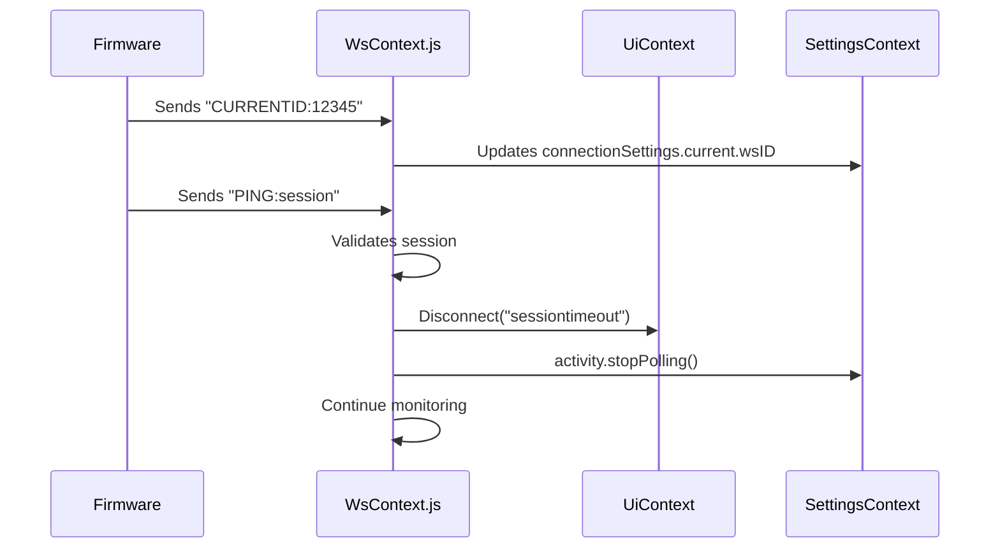

**Sources:**[src/contexts/WsContext.js#84-101](https://github.com/luc-github/ESP3D-WEBUI/blob/97c01e85/src/contexts/WsContext.js#L84-L101)[src/contexts/WsContext.js#144-166](https://github.com/luc-github/ESP3D-WEBUI/blob/97c01e85/src/contexts/WsContext.js#L144-L166)

---

## File System Selection Logic

The `default_filesystem` setting is a prime example of connection settings in action. It populates its dropdown options based on available hardware reported by the connection properties.

|  |  |  |
| --- | --- | --- |
| `FLASH` | `flashfs` is true | [src/targets/Printer3D/Repetier/preferences.json#184-187](https://github.com/luc-github/ESP3D-WEBUI/blob/97c01e85/src/targets/Printer3D/Repetier/preferences.json#L184-L187) |
| `SD` | `sd` is true AND `SDConnection == 'none'` | [src/targets/Printer3D/Repetier/preferences.json#189-195](https://github.com/luc-github/ESP3D-WEBUI/blob/97c01e85/src/targets/Printer3D/Repetier/preferences.json#L189-L195) |
| `DIRECTSD` | `sd` is true AND `SDConnection != 'none'` | [src/targets/Printer3D/Marlin-embedded/preferences.json#149-155](https://github.com/luc-github/ESP3D-WEBUI/blob/97c01e85/src/targets/Printer3D/Marlin-embedded/preferences.json#L149-L155) |
| `TFTSD` | `tftsd` is true | [src/targets/Printer3D/Repetier/preferences.json#196](https://github.com/luc-github/ESP3D-WEBUI/blob/97c01e85/src/targets/Printer3D/Repetier/preferences.json#L196-L196) |

**Sources:**[src/targets/Printer3D/Repetier/preferences.json#158-200](https://github.com/luc-github/ESP3D-WEBUI/blob/97c01e85/src/targets/Printer3D/Repetier/preferences.json#L158-L200)[src/targets/Printer3D/Marlin-embedded/preferences.json#111-157](https://github.com/luc-github/ESP3D-WEBUI/blob/97c01e85/src/targets/Printer3D/Marlin-embedded/preferences.json#L111-L157)

---

# 7.3-Target-Specific-Settings

# Target-Specific Settings
Relevant source files

- [src/components/Controls/Fields/Mask.js](https://github.com/luc-github/ESP3D-WEBUI/blob/97c01e85/src/components/Controls/Fields/Mask.js)
- [src/targets/CNC/GRBL/preferences.json](https://github.com/luc-github/ESP3D-WEBUI/blob/97c01e85/src/targets/CNC/GRBL/preferences.json)
- [src/targets/CNC/grblHAL/preferences.json](https://github.com/luc-github/ESP3D-WEBUI/blob/97c01e85/src/targets/CNC/grblHAL/preferences.json)
- [src/targets/CNC/preferences.json](https://github.com/luc-github/ESP3D-WEBUI/blob/97c01e85/src/targets/CNC/preferences.json)
- [src/targets/Printer3D/Marlin-embedded/preferences.json](https://github.com/luc-github/ESP3D-WEBUI/blob/97c01e85/src/targets/Printer3D/Marlin-embedded/preferences.json)
- [src/targets/Printer3D/Marlin/preferences.json](https://github.com/luc-github/ESP3D-WEBUI/blob/97c01e85/src/targets/Printer3D/Marlin/preferences.json)
- [src/targets/Printer3D/Repetier/preferences.json](https://github.com/luc-github/ESP3D-WEBUI/blob/97c01e85/src/targets/Printer3D/Repetier/preferences.json)
- [src/targets/Printer3D/Smoothieware/preferences.json](https://github.com/luc-github/ESP3D-WEBUI/blob/97c01e85/src/targets/Printer3D/Smoothieware/preferences.json)
- [src/targets/Printer3D/preferences.json](https://github.com/luc-github/ESP3D-WEBUI/blob/97c01e85/src/targets/Printer3D/preferences.json)
- [src/targets/preferences.json](https://github.com/luc-github/ESP3D-WEBUI/blob/97c01e85/src/targets/preferences.json)
- [src/targets/translations/en.json](https://github.com/luc-github/ESP3D-WEBUI/blob/97c01e85/src/targets/translations/en.json)

## Purpose and Scope

This document catalogs settings that are unique to specific machine types (3D Printers, CNC machines) and their firmware variants (Marlin, GRBL, Smoothieware, etc.). These settings extend the base interface settings to provide machine-specific controls like temperature management for 3D printers or probing controls for CNC machines.

For general interface settings (language, theme, panels), see [Interface Settings](/org/luc-github/wiki/luc-github/ESP3D-WEBUI/page/7.1?branch=%223.0%22). For connection configuration, see [Connection Settings](/org/luc-github/wiki/luc-github/ESP3D-WEBUI/page/7.2?branch=%223.0%22). For the dependency and validation system that controls setting visibility, see [Settings Validation and Dependencies](/org/luc-github/wiki/luc-github/ESP3D-WEBUI/page/7.4?branch=%223.0%22).

## Settings Hierarchy and Cascading

Target-specific settings follow a three-level cascading architecture where base preferences are specialized by machine type, then further customized by firmware variant.

### Target Preference Inheritance Tree

[Flowchart Diagram]

**Sources:**[src/targets/preferences.json#1-240](https://github.com/luc-github/ESP3D-WEBUI/blob/97c01e85/src/targets/preferences.json#L1-L240)[src/targets/Printer3D/preferences.json#1-1000](https://github.com/luc-github/ESP3D-WEBUI/blob/97c01e85/src/targets/Printer3D/preferences.json#L1-L1000)[src/targets/CNC/preferences.json#1-233](https://github.com/luc-github/ESP3D-WEBUI/blob/97c01e85/src/targets/CNC/preferences.json#L1-L233)[src/targets/Printer3D/Marlin/preferences.json#1-504](https://github.com/luc-github/ESP3D-WEBUI/blob/97c01e85/src/targets/Printer3D/Marlin/preferences.json#L1-L504)[src/targets/CNC/grblHAL/preferences.json#1-607](https://github.com/luc-github/ESP3D-WEBUI/blob/97c01e85/src/targets/CNC/grblHAL/preferences.json#L1-L607)

The merge process occurs at runtime when the interface loads, with later definitions overriding earlier ones. For example, Marlin's `pollingcmds` setting ([src/targets/Printer3D/Marlin/preferences.json#58-65](https://github.com/luc-github/ESP3D-WEBUI/blob/97c01e85/src/targets/Printer3D/Marlin/preferences.json#L58-L65)) replaces the empty base definition ([src/targets/preferences.json#107-118](https://github.com/luc-github/ESP3D-WEBUI/blob/97c01e85/src/targets/preferences.json#L107-L118)).

## 3D Printer Specific Settings

### Temperature Controls Settings

The `temperatures` settings group defines heater controls and their configuration for extruders, heated beds, chambers, probes, redundant sensors, and control boards.

### Printer3D Temperature Settings Structure

[Flowchart Diagram]

**Key Temperature Settings:**

|  |  |  |  |
| --- | --- | --- | --- |
| `extrudermax` | number | 280 | Maximum extruder temperature in °C |
| `extruderpreheat` | text | "190;220;230" | Semicolon-separated preset temperatures |
| `heatextruder` | text | "M104 S$ T#" | Command template with `$` (temp) and `#` (tool) placeholders |
| `bedmax` | number | 140 | Maximum bed temperature |
| `heatbed` | text | "M140 S$" | Bed heating command template |
| `chambermax` | number | 140 | Maximum chamber temperature |
| `heatchamber` | text | "M141 S$" | Chamber heating command template |

**Sources:**[src/targets/Printer3D/preferences.json#18-164](https://github.com/luc-github/ESP3D-WEBUI/blob/97c01e85/src/targets/Printer3D/preferences.json#L18-L164)

### Charts Settings

The `charts` group controls which temperature sensors appear in the real-time charting panel.

### Printer3D Charts Configuration

[Flowchart Diagram]

Each chart setting (type: `boolean`) controls whether a specific temperature sensor's data appears in the `ChartsPanel`. The `showsensorchart` setting has a dependency on `showsensorctrls`, demonstrating how settings can depend on other settings ([src/targets/Printer3D/preferences.json#219-224](https://github.com/luc-github/ESP3D-WEBUI/blob/97c01e85/src/targets/Printer3D/preferences.json#L219-L224)).

**Sources:**[src/targets/Printer3D/preferences.json#166-229](https://github.com/luc-github/ESP3D-WEBUI/blob/97c01e85/src/targets/Printer3D/preferences.json#L166-L229)

### Extruder Settings

The `extruders` group configures extrusion control parameters and multi-extruder support.

|  |  |  |  |
| --- | --- | --- | --- |
| `showextruderspanel` | boolean | true | Display extruder control panel |
| `openextrudersonstart` | boolean | true | Auto-open panel on startup |
| `efeedrate` | number | 400 | Extrusion feedrate in mm/min |
| `extruderdistance` | text | "5;10;100" | Preset extrusion distances in mm |
| `ismixedextruder` | boolean | false | Enable mixed/multi-color mode (Marlin-specific) |
| `enumber` | select | "1" | Number of extruders (1-6, for mixed mode) |
| `ecolors` | text | "blue;red;green;#FF00FF;cyan;black" | Color codes for each extruder |

**Sources:**[src/targets/Printer3D/preferences.json#231-263](https://github.com/luc-github/ESP3D-WEBUI/blob/97c01e85/src/targets/Printer3D/preferences.json#L231-L263)[src/targets/Printer3D/Marlin-embedded/preferences.json#159-202](https://github.com/luc-github/ESP3D-WEBUI/blob/97c01e85/src/targets/Printer3D/Marlin-embedded/preferences.json#L159-L202)

### 3D Printer Control Settings

The `controls` group provides settings for fan, speed, and flow rate controls.

### Printer3D Control Groups

[Flowchart Diagram]

**Command Template Syntax:**

- `$` is replaced with the selected value (temperature, percentage, speed)
- `#` is replaced with the tool/extruder index (0-based)
- `;` separates multiple commands to send sequentially

**Sources:**[src/targets/Printer3D/preferences.json#783-901](https://github.com/luc-github/ESP3D-WEBUI/blob/97c01e85/src/targets/Printer3D/preferences.json#L783-L901)[src/targets/Printer3D/Repetier/preferences.json#249-262](https://github.com/luc-github/ESP3D-WEBUI/blob/97c01e85/src/targets/Printer3D/Repetier/preferences.json#L249-L262)

### 3D Printer File System Settings

3D printer targets support extensive file system configurations including TFT screen SD/USB access.

### Printer3D File System Access

[Flowchart Diagram]

**TFT File System Support:**

The `tftfs` select setting enables support for TFT screens with onboard SD card or USB storage:

- **`none`**: No TFT screen support
- **`btt`**: BigTreeTech TFT protocol (M20 SD:, M23 SD:, M30 SD:)
- **`mks`**: Makerbase MKS TFT protocol (M998 prefix commands)

TFT commands use the `#` placeholder for file paths. The dependency `{ "connection_id": "Screen", "value": "=='none'" }` ensures TFT options only appear when no screen is directly connected via ESP3D ([src/targets/Printer3D/preferences.json#347-350](https://github.com/luc-github/ESP3D-WEBUI/blob/97c01e85/src/targets/Printer3D/preferences.json#L347-L350)).

**Sources:**[src/targets/Printer3D/preferences.json#265-594](https://github.com/luc-github/ESP3D-WEBUI/blob/97c01e85/src/targets/Printer3D/preferences.json#L265-L594)

## CNC Specific Settings

### Probe Settings

CNC targets include comprehensive probing controls for tool length and work offset measurement.

### CNC Probing Configuration

[Flowchart Diagram]

**Probe Command Variables:**

The `probepostcommand` template supports special placeholders:

- `#selected_axis#`: Replaced with the axis being probed (X, Y, or Z)
- `#probe_thickness#`: Replaced with the `probethickness` value ([src/targets/CNC/preferences.json#64](https://github.com/luc-github/ESP3D-WEBUI/blob/97c01e85/src/targets/CNC/preferences.json#L64-L64))

**Sources:**[src/targets/CNC/preferences.json#18-67](https://github.com/luc-github/ESP3D-WEBUI/blob/97c01e85/src/targets/CNC/preferences.json#L18-L67)

### Spindle and Laser Settings

CNC targets include dedicated controls for Spindle and Laser targets.

|  |  |  |  |
| --- | --- | --- | --- |
| `spindlespeed` | number | 1000 | Default RPM or PWM value for spindle |
| `showM4ctrls` | boolean | true | Show CCW spindle rotation control |
| `lasertest` | number | 10 | Duration of laser test pulse (ms) |
| `lasertestprecent` | number | 20 | Power level for laser test pulse (%) |
| `lasermax` | number | 1000 | Maximum laser power value for scaling |

**Sources:**[src/targets/CNC/preferences.json#69-178](https://github.com/luc-github/ESP3D-WEBUI/blob/97c01e85/src/targets/CNC/preferences.json#L69-L178)

## Firmware-Specific Overrides

### Marlin Firmware Settings

Marlin adds extensive SD card support and streaming control settings.

### Marlin SD and Polling Config

[Flowchart Diagram]

**Marlin SD Connection Modes:**

The `SDConnection` connection property determines SD card access mode:

- **`none`**: Protocol-based SD access via M-codes (M20, M23, M30)
- **`direct`**: Direct file system access bypassing Marlin
- **`shared`**: Shared access mode (Marlin-embedded only) ([src/targets/Printer3D/Marlin-embedded/preferences.json#86](https://github.com/luc-github/ESP3D-WEBUI/blob/97c01e85/src/targets/Printer3D/Marlin-embedded/preferences.json#L86-L86))

**Sources:**[src/targets/Printer3D/Marlin/preferences.json#1-504](https://github.com/luc-github/ESP3D-WEBUI/blob/97c01e85/src/targets/Printer3D/Marlin/preferences.json#L1-L504)[src/targets/Printer3D/Marlin-embedded/preferences.json#1-210](https://github.com/luc-github/ESP3D-WEBUI/blob/97c01e85/src/targets/Printer3D/Marlin-embedded/preferences.json#L1-L210)

### GrblHAL Firmware Settings

GrblHAL extends GRBL with support for up to 9 axes and enhanced file system capabilities.

### GrblHAL Axis and FS Mapping

[Flowchart Diagram]

**Sources:**[src/targets/CNC/grblHAL/preferences.json#1-607](https://github.com/luc-github/ESP3D-WEBUI/blob/97c01e85/src/targets/CNC/grblHAL/preferences.json#L1-L607)

## Setting Structure and Types

### Mask Component

The `mask` type provides a specialized UI for bitmask configuration. Each bit position corresponds to an option checkbox.

### Mask Component Logic (Code Entity Space)

[Flowchart Diagram]

**Mask Implementation:**

The `Mask` component ([src/components/Controls/Fields/Mask.js#43](https://github.com/luc-github/ESP3D-WEBUI/blob/97c01e85/src/components/Controls/Fields/Mask.js#L43-L43)) converts integer values to bit arrays using the `BitsArray` helper ([src/components/Controls/Fields/Mask.js#32](https://github.com/luc-github/ESP3D-WEBUI/blob/97c01e85/src/components/Controls/Fields/Mask.js#L32-L32)):

1. **Initialization:**`BitsArray.fromInt(value, maskSize)` creates the bit array ([src/components/Controls/Fields/Mask.js#91](https://github.com/luc-github/ESP3D-WEBUI/blob/97c01e85/src/components/Controls/Fields/Mask.js#L91-L91)).
2. **Rendering:** Each option renders a `Boolean` component inside a `FormGroup` ([src/components/Controls/Fields/Mask.js#138-160](https://github.com/luc-github/ESP3D-WEBUI/blob/97c01e85/src/components/Controls/Fields/Mask.js#L138-L160)).
3. **Updates:**`mask.setBit()` updates the bit state, and `mask.toInt()` converts the array back to an integer for persistence ([src/components/Controls/Fields/Mask.js#145-153](https://github.com/luc-github/ESP3D-WEBUI/blob/97c01e85/src/components/Controls/Fields/Mask.js#L145-L153)).

**Sources:**[src/components/Controls/Fields/Mask.js#1-168](https://github.com/luc-github/ESP3D-WEBUI/blob/97c01e85/src/components/Controls/Fields/Mask.js#L1-L168)

### Default Filesystem Selection

The `default_filesystem` setting demonstrates advanced dependency usage with conditional options.

### Default Filesystem Selection Logic

[Flowchart Diagram]

Each option in the select dropdown has its own `depend` array. The UI only displays options whose dependencies are satisfied ([src/targets/Printer3D/Marlin/preferences.json#309-327](https://github.com/luc-github/ESP3D-WEBUI/blob/97c01e85/src/targets/Printer3D/Marlin/preferences.json#L309-L327)).

**Sources:**[src/targets/Printer3D/Marlin/preferences.json#280-327](https://github.com/luc-github/ESP3D-WEBUI/blob/97c01e85/src/targets/Printer3D/Marlin/preferences.json#L280-L327)

## Translation Keys

Target-specific settings use prefixed translation keys to namespace strings:

|  |  |  |
| --- | --- | --- |
| `S` | General UI strings | `S63` = "Show" ([src/targets/translations/en.json#64](https://github.com/luc-github/ESP3D-WEBUI/blob/97c01e85/src/targets/translations/en.json#L64-L64)) |
| `P` | 3D Printer specific | `P82` = "Extruder" ([src/targets/translations/en.json#247](https://github.com/luc-github/ESP3D-WEBUI/blob/97c01e85/src/targets/translations/en.json#L247-L247)) |
| `CN` | CNC specific | `CN1` = "mm/min" ([src/targets/translations/en.json#278](https://github.com/luc-github/ESP3D-WEBUI/blob/97c01e85/src/targets/translations/en.json#L278-L278)) |
| `SM` | Smoothieware specific | `SM5` = "SD Direct" ([src/targets/translations/en.json#393](https://github.com/luc-github/ESP3D-WEBUI/blob/97c01e85/src/targets/translations/en.json#L393-L393)) |

**Sources:**[src/targets/translations/en.json#1-397](https://github.com/luc-github/ESP3D-WEBUI/blob/97c01e85/src/targets/translations/en.json#L1-L397)

---

# 7.4-Settings-Validation-and-Dependencies

# Settings Validation and Dependencies
Relevant source files

- [Memo/preferences.md](https://github.com/luc-github/ESP3D-WEBUI/blob/97c01e85/Memo/preferences.md?plain=1)
- [src/components/Controls/FieldGroup.js](https://github.com/luc-github/ESP3D-WEBUI/blob/97c01e85/src/components/Controls/FieldGroup.js)
- [src/components/Controls/Fields/Boolean.js](https://github.com/luc-github/ESP3D-WEBUI/blob/97c01e85/src/components/Controls/Fields/Boolean.js)
- [src/components/Controls/Fields/ItemsList.js](https://github.com/luc-github/ESP3D-WEBUI/blob/97c01e85/src/components/Controls/Fields/ItemsList.js)
- [src/components/Controls/Fields/Select.js](https://github.com/luc-github/ESP3D-WEBUI/blob/97c01e85/src/components/Controls/Fields/Select.js)
- [src/components/Controls/Fields/Slider.js](https://github.com/luc-github/ESP3D-WEBUI/blob/97c01e85/src/components/Controls/Fields/Slider.js)
- [src/hooks/useSettings.js](https://github.com/luc-github/ESP3D-WEBUI/blob/97c01e85/src/hooks/useSettings.js)
- [src/targets/Printer3D/Marlin-embedded/preferences.json](https://github.com/luc-github/ESP3D-WEBUI/blob/97c01e85/src/targets/Printer3D/Marlin-embedded/preferences.json)
- [src/targets/Printer3D/Marlin/preferences.json](https://github.com/luc-github/ESP3D-WEBUI/blob/97c01e85/src/targets/Printer3D/Marlin/preferences.json)
- [src/targets/Printer3D/Repetier/preferences.json](https://github.com/luc-github/ESP3D-WEBUI/blob/97c01e85/src/targets/Printer3D/Repetier/preferences.json)
- [src/targets/Printer3D/Smoothieware/preferences.json](https://github.com/luc-github/ESP3D-WEBUI/blob/97c01e85/src/targets/Printer3D/Smoothieware/preferences.json)
- [src/targets/Printer3D/preferences.json](https://github.com/luc-github/ESP3D-WEBUI/blob/97c01e85/src/targets/Printer3D/preferences.json)
- [src/targets/preferences.json](https://github.com/luc-github/ESP3D-WEBUI/blob/97c01e85/src/targets/preferences.json)

## Overview

The settings validation and dependency systems control field visibility and input validation in the Interface Tab and various control panels. Validation provides real-time feedback on user input, while dependencies conditionally show/hide settings based on other settings or hardware properties reported by the ESP3D device.

**Key Functions:**

- `generateValidationGlobal()`: Central validation logic for the Interface Tab [src/tabs/interface/index.js#45-299](https://github.com/luc-github/ESP3D-WEBUI/blob/97c01e85/src/tabs/interface/index.js#L45-L299)
- `checkDependencies()`: Evaluates visibility rules [src/components/Helpers/components.js#149-167](https://github.com/luc-github/ESP3D-WEBUI/blob/97c01e85/src/components/Helpers/components.js#L149-L167)
- `generateDependIds()`: Extracts dependency values for React effect tracking [src/components/Helpers/components.js#91-107](https://github.com/luc-github/ESP3D-WEBUI/blob/97c01e85/src/components/Helpers/components.js#L91-L107)

**Preferences Structure:**
Each field in `preferences.json` files defines:

- `depend`: Array of conditions controlling visibility [src/targets/Printer3D/preferences.json#15-16](https://github.com/luc-github/ESP3D-WEBUI/blob/97c01e85/src/targets/Printer3D/preferences.json#L15-L16)
- `min`, `max`, `step`: Numeric validation constraints [src/targets/Printer3D/preferences.json#84-88](https://github.com/luc-github/ESP3D-WEBUI/blob/97c01e85/src/targets/Printer3D/preferences.json#L84-L88)
- `regexpattern`: Text validation pattern [src/tabs/interface/index.js#138-139](https://github.com/luc-github/ESP3D-WEBUI/blob/97c01e85/src/tabs/interface/index.js#L138-L139)

**Sources:**[src/tabs/interface/index.js#45-299](https://github.com/luc-github/ESP3D-WEBUI/blob/97c01e85/src/tabs/interface/index.js#L45-L299)[src/components/Helpers/components.js#91-167](https://github.com/luc-github/ESP3D-WEBUI/blob/97c01e85/src/components/Helpers/components.js#L91-L167)[src/targets/Printer3D/preferences.json#1-100](https://github.com/luc-github/ESP3D-WEBUI/blob/97c01e85/src/targets/Printer3D/preferences.json#L1-L100)

## Validation System Architecture

The validation system executes when field values change via `setValue(val, update)` callbacks, returning a validation object with `{message, valid, modified}` properties.

**Validation Call Chain from InterfaceTab**

[Flowchart Diagram]

**Sources:**[src/tabs/interface/index.js#45-299](https://github.com/luc-github/ESP3D-WEBUI/blob/97c01e85/src/tabs/interface/index.js#L45-L299)[src/tabs/interface/index.js#317-334](https://github.com/luc-github/ESP3D-WEBUI/blob/97c01e85/src/tabs/interface/index.js#L317-L334)[src/tabs/interface/index.js#589-604](https://github.com/luc-github/ESP3D-WEBUI/blob/97c01e85/src/tabs/interface/index.js#L589-L604)

### Validation Object Structure

`generateValidationGlobal()` returns a validation object that controls UI rendering. The default state assumes modification [src/tabs/interface/index.js#54-58](https://github.com/luc-github/ESP3D-WEBUI/blob/97c01e85/src/tabs/interface/index.js#L54-L58):

|  |  |  |
| --- | --- | --- |
| `message` | JSX/String/null | Error text or icon (e.g., `<Flag />`) to display. |
| `valid` | boolean | Set to `false` if any constraint fails. |
| `modified` | boolean | `true` if current value differs from `initial`. |

**Field State Properties Updated:**[src/tabs/interface/index.js#270-278](https://github.com/luc-github/ESP3D-WEBUI/blob/97c01e85/src/tabs/interface/index.js#L270-L278)

```
fieldData.haserror = !validation.valid
if (fieldData.value == fieldData.initial) {
    fieldData.hasmodified = false
} else {
    fieldData.hasmodified = true
}
```

**Sources:**[src/tabs/interface/index.js#54-58](https://github.com/luc-github/ESP3D-WEBUI/blob/97c01e85/src/tabs/interface/index.js#L54-L58)[src/tabs/interface/index.js#270-278](https://github.com/luc-github/ESP3D-WEBUI/blob/97c01e85/src/tabs/interface/index.js#L270-L278)

## Validation Rules by Field Type

### Text Field Validation

Text fields validate against regex patterns and length constraints [src/tabs/interface/index.js#136-165](https://github.com/luc-github/ESP3D-WEBUI/blob/97c01e85/src/tabs/interface/index.js#L136-L165)

- **Regex**: Uses `new RegExp(fieldData.regexpattern).test(fieldData.value)`.
- **Length**: Supports `min`, `max`, and `minSecondary` (allowing a specific value OR a range).

### Number Field Validation

Number fields validate min/max bounds and step increments [src/tabs/interface/index.js#167-186](https://github.com/luc-github/ESP3D-WEBUI/blob/97c01e85/src/tabs/interface/index.js#L167-L186)

- **Step Check**: Uses integer multiplication to avoid floating-point precision errors [src/tabs/interface/index.js#104-118](https://github.com/luc-github/ESP3D-WEBUI/blob/97c01e85/src/tabs/interface/index.js#L104-L118)
- **Bounds**: Checks `fieldData.value` against `parseInt(fieldData.min)` and `parseInt(fieldData.max)`.

### List and Shortkey Validation

- **List**: Scans nested items for `haserror` or `hasmodified` flags [src/tabs/interface/index.js#119-135](https://github.com/luc-github/ESP3D-WEBUI/blob/97c01e85/src/tabs/interface/index.js#L119-L135)
- **Shortkey**: Checks for incomplete combinations (ending in `+`) and duplicates across macros and keymaps [src/tabs/interface/index.js#60-102](https://github.com/luc-github/ESP3D-WEBUI/blob/97c01e85/src/tabs/interface/index.js#L60-L102)

**Sources:**[src/tabs/interface/index.js#60-186](https://github.com/luc-github/ESP3D-WEBUI/blob/97c01e85/src/tabs/interface/index.js#L60-L186)

## Dependency System

The dependency system controls conditional visibility of settings fields and groups based on other setting values or hardware properties.

### checkDependencies Implementation

**checkDependencies() Function Hierarchy**

[Flowchart Diagram]

**Sources:**[src/components/Helpers/components.js#110-167](https://github.com/luc-github/ESP3D-WEBUI/blob/97c01e85/src/components/Helpers/components.js#L110-L167)

### Dependency Evaluation Flow

**Runtime Dependency Checking Sequence**

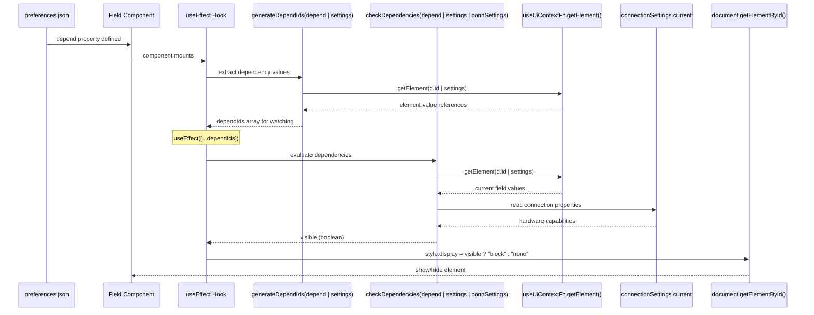

**Sources:**[src/components/Controls/Fields/Input.js#69-79](https://github.com/luc-github/ESP3D-WEBUI/blob/97c01e85/src/components/Controls/Fields/Input.js#L69-L79)[src/components/Helpers/components.js#91-107](https://github.com/luc-github/ESP3D-WEBUI/blob/97c01e85/src/components/Helpers/components.js#L91-L107)[src/components/Helpers/components.js#149-167](https://github.com/luc-github/ESP3D-WEBUI/blob/97c01e85/src/components/Helpers/components.js#L149-L167)

## Conditional Visibility Implementation

### Pre-render Filtering in InterfaceTab

The Interface Tab skips rendering for groups if dependencies are not met [src/tabs/interface/index.js#465-474](https://github.com/luc-github/ESP3D-WEBUI/blob/97c01e85/src/tabs/interface/index.js#L465-L474)

### Dynamic Style Updates in Field Components

Field components (e.g., `Boolean`, `Input`, `Select`) use `useEffect` to toggle `style.display` based on dependency evaluation results.

**Implementation in Boolean.js:**[src/components/Controls/Fields/Boolean.js#69-79](https://github.com/luc-github/ESP3D-WEBUI/blob/97c01e85/src/components/Controls/Fields/Boolean.js#L69-L79)

```
useEffect(() => {
    let visible = checkDependencies(depend, interfaceSettings.current.settings, connectionSettings.current)
    if (document.getElementById(id))
        document.getElementById(id).style.display = visible ? "block" : "none"
    if (document.getElementById("group-" + id))
        document.getElementById("group-" + id).style.display = visible ? "block" : "none"
}, [...dependIds])
```

**Sources:**[src/components/Controls/Fields/Boolean.js#69-79](https://github.com/luc-github/ESP3D-WEBUI/blob/97c01e85/src/components/Controls/Fields/Boolean.js#L69-L79)[src/components/Controls/Fields/Select.js#89-100](https://github.com/luc-github/ESP3D-WEBUI/blob/97c01e85/src/components/Controls/Fields/Select.js#L89-L100)[src/components/Controls/Fields/Slider.js#66-76](https://github.com/luc-github/ESP3D-WEBUI/blob/97c01e85/src/components/Controls/Fields/Slider.js#L66-L76)

## Save Status Management

The save button visibility is managed by `checkSaveStatus()`, which stringifies settings to look for `hasmodified` and `haserror` flags [src/tabs/interface/index.js#329-334](https://github.com/luc-github/ESP3D-WEBUI/blob/97c01e85/src/tabs/interface/index.js#L329-L334)

**checkSaveStatus() Logic:**

```
function checkSaveStatus() {
    const stringified = JSON.stringify(interfaceSettings.current.settings)
    const hasmodified = stringified.includes('"hasmodified":true')
    const haserrors = stringified.includes('"haserror":true')
    return !haserrors && hasmodified
}
```

Validation logic updates the global `showSave` state only if a writable filesystem (`isFlashFS` or `isSDFS`) is detected [src/tabs/interface/index.js#279-289](https://github.com/luc-github/ESP3D-WEBUI/blob/97c01e85/src/tabs/interface/index.js#L279-L289)

**Sources:**[src/tabs/interface/index.js#279-334](https://github.com/luc-github/ESP3D-WEBUI/blob/97c01e85/src/tabs/interface/index.js#L279-L334)

---

# 7.5-Import-and-Export

# Import and Export
Relevant source files

- [src/components/Helpers/http.js](https://github.com/luc-github/ESP3D-WEBUI/blob/97c01e85/src/components/Helpers/http.js)
- [src/components/Panels/ProbeCNC.js](https://github.com/luc-github/ESP3D-WEBUI/blob/97c01e85/src/components/Panels/ProbeCNC.js)
- [src/hooks/useSettings.js](https://github.com/luc-github/ESP3D-WEBUI/blob/97c01e85/src/hooks/useSettings.js)
- [src/tabs/interface/importHelper.js](https://github.com/luc-github/ESP3D-WEBUI/blob/97c01e85/src/tabs/interface/importHelper.js)
- [src/tabs/interface/index.js](https://github.com/luc-github/ESP3D-WEBUI/blob/97c01e85/src/tabs/interface/index.js)
- [src/targets/Printer3D/Marlin-embedded/SD-source.js](https://github.com/luc-github/ESP3D-WEBUI/blob/97c01e85/src/targets/Printer3D/Marlin-embedded/SD-source.js)
- [src/targets/Printer3D/Marlin/SD-source.js](https://github.com/luc-github/ESP3D-WEBUI/blob/97c01e85/src/targets/Printer3D/Marlin/SD-source.js)
- [src/targets/Printer3D/Marlin/SDEXT-source.js](https://github.com/luc-github/ESP3D-WEBUI/blob/97c01e85/src/targets/Printer3D/Marlin/SDEXT-source.js)

This document describes the Import and Export functionality in ESP3D-WEBUI, which allows users to backup, restore, and share their interface preferences and settings. This system provides mechanisms to export settings to a local JSON file, import settings from a JSON file, and save preferences directly to the ESP3D device's file system.

---

## System Overview

The Import and Export system operates on three levels:

1. **Export to Local File**: Downloads a JSON backup of all interface preferences to the user's computer.
2. **Import from Local File**: Uploads a JSON file to restore previously exported preferences.
3. **Save to Device**: Writes preferences to the ESP3D device's file system for persistent storage across firmware restarts.

### Data Flow and Code Entities

The following diagram maps the logical import/export actions to specific code entities and functions within the codebase.

**Import and Export Architecture**

[Flowchart Diagram]

**Sources**: [src/tabs/interface/index.js#20-40](https://github.com/luc-github/ESP3D-WEBUI/blob/97c01e85/src/tabs/interface/index.js#L20-L40)[src/tabs/interface/index.js#631-670](https://github.com/luc-github/ESP3D-WEBUI/blob/97c01e85/src/tabs/interface/index.js#L631-L670)[src/hooks/useSettings.js#56-61](https://github.com/luc-github/ESP3D-WEBUI/blob/97c01e85/src/hooks/useSettings.js#L56-L61)

---

## Export to Local File

### Export Button and Trigger

The export functionality is accessible through the Export button in the Interface tab, which triggers a download of all current preferences as a JSON file [src/tabs/interface/index.js#644-656](https://github.com/luc-github/ESP3D-WEBUI/blob/97c01e85/src/tabs/interface/index.js#L644-L656)

The export button implementation uses the `ButtonImg` component with the following configuration:

|  |  |  |
| --- | --- | --- |
| Label | "Export" | S52 |
| Tooltip | "Download preferences" | S53 |
| Icon | `ExternalLink` | - |
| Handler | `exportPreferences(interfaceSettings.current)` | - |

**Sources**: [src/tabs/interface/index.js#644-656](https://github.com/luc-github/ESP3D-WEBUI/blob/97c01e85/src/tabs/interface/index.js#L644-L656)

### Export Data Structure

The `exportPreferences()` function creates a JSON object containing three main sections [src/tabs/interface/index.js#37](https://github.com/luc-github/ESP3D-WEBUI/blob/97c01e85/src/tabs/interface/index.js#L37-L37):

1. **settings**: Complete interface preferences structure (Language, theme, panels, macros, etc.) [src/tabs/interface/index.js#384-388](https://github.com/luc-github/ESP3D-WEBUI/blob/97c01e85/src/tabs/interface/index.js#L384-L388)
2. **custom**: User-defined custom commands or scripts.
3. **extensions**: Extension-specific configurations.

The function accepts a boolean `downloadToFile`. When `true` (default), it creates a `Blob` and triggers a browser download [src/tabs/interface/index.js#384-386](https://github.com/luc-github/ESP3D-WEBUI/blob/97c01e85/src/tabs/interface/index.js#L384-L386)

**Sources**: [src/tabs/interface/index.js#37-38](https://github.com/luc-github/ESP3D-WEBUI/blob/97c01e85/src/tabs/interface/index.js#L37-L38)[src/tabs/interface/index.js#654](https://github.com/luc-github/ESP3D-WEBUI/blob/97c01e85/src/tabs/interface/index.js#L654-L654)

---

## Import from Local File

### Import Button and File Selection

The import process uses a hidden file input element [src/tabs/interface/index.js#420-426](https://github.com/luc-github/ESP3D-WEBUI/blob/97c01e85/src/tabs/interface/index.js#L420-L426) When the "Import" button (S54) is clicked, it programmatically triggers the `click()` event on this hidden input [src/tabs/interface/index.js#631-643](https://github.com/luc-github/ESP3D-WEBUI/blob/97c01e85/src/tabs/interface/index.js#L631-L643)

```
// Hidden file input in Interface Tab
<input
    ref={inputFile}
    type="file"
    class="d-none"
    accept=".json"
    onChange={fileSelected}
/>
```

**Sources**: [src/tabs/interface/index.js#420-426](https://github.com/luc-github/ESP3D-WEBUI/blob/97c01e85/src/tabs/interface/index.js#L420-L426)[src/tabs/interface/index.js#631-643](https://github.com/luc-github/ESP3D-WEBUI/blob/97c01e85/src/tabs/interface/index.js#L631-L643)

### File Processing and Validation

The `fileSelected` function handles the incoming file [src/tabs/interface/index.js#342-381](https://github.com/luc-github/ESP3D-WEBUI/blob/97c01e85/src/tabs/interface/index.js#L342-L381):

1. **FileReader**: Reads the file as text [src/tabs/interface/index.js#345-346](https://github.com/luc-github/ESP3D-WEBUI/blob/97c01e85/src/tabs/interface/index.js#L345-L346)
2. **JSON Parsing**: Parses the content. If it fails, a toast with error S56 is shown [src/tabs/interface/index.js#376-380](https://github.com/luc-github/ESP3D-WEBUI/blob/97c01e85/src/tabs/interface/index.js#L376-L380)
3. **importPreferencesSection**: Validates and merges settings from the file into the current context [src/tabs/interface/index.js#351-360](https://github.com/luc-github/ESP3D-WEBUI/blob/97c01e85/src/tabs/interface/index.js#L351-L360)
4. **formatPreferences**: Ensures the structure matches the application requirements [src/tabs/interface/index.js#364-365](https://github.com/luc-github/ESP3D-WEBUI/blob/97c01e85/src/tabs/interface/index.js#L364-L365)

**Sources**: [src/tabs/interface/index.js#342-381](https://github.com/luc-github/ESP3D-WEBUI/blob/97c01e85/src/tabs/interface/index.js#L342-L381)[src/tabs/interface/importHelper.js#1-180](https://github.com/luc-github/ESP3D-WEBUI/blob/97c01e85/src/tabs/interface/importHelper.js#L1-L180)

---

## Save to Device

### Save Button Visibility

The Save button visibility is controlled by `checkSaveStatus()`[src/tabs/interface/index.js#329-334](https://github.com/luc-github/ESP3D-WEBUI/blob/97c01e85/src/tabs/interface/index.js#L329-L334) It appears only if:

1. A file system is available (`isFlashFS` or `isSDFS`) [src/tabs/interface/index.js#310-315](https://github.com/luc-github/ESP3D-WEBUI/blob/97c01e85/src/tabs/interface/index.js#L310-L315)
2. Settings have been modified (`hasmodified` is true) [src/tabs/interface/index.js#329-334](https://github.com/luc-github/ESP3D-WEBUI/blob/97c01e85/src/tabs/interface/index.js#L329-L334)
3. There are no validation errors (`haserror` is false) [src/tabs/interface/index.js#329-334](https://github.com/luc-github/ESP3D-WEBUI/blob/97c01e85/src/tabs/interface/index.js#L329-L334)

**Sources**: [src/tabs/interface/index.js#310-334](https://github.com/luc-github/ESP3D-WEBUI/blob/97c01e85/src/tabs/interface/index.js#L310-L334)[src/tabs/interface/index.js#657-670](https://github.com/luc-github/ESP3D-WEBUI/blob/97c01e85/src/tabs/interface/index.js#L657-L670)

### Save Operation Flow

The `SaveSettings` function uploads the configuration to the ESP3D device [src/tabs/interface/index.js#383-416](https://github.com/luc-github/ESP3D-WEBUI/blob/97c01e85/src/tabs/interface/index.js#L383-L416)

**Save Settings Sequence**

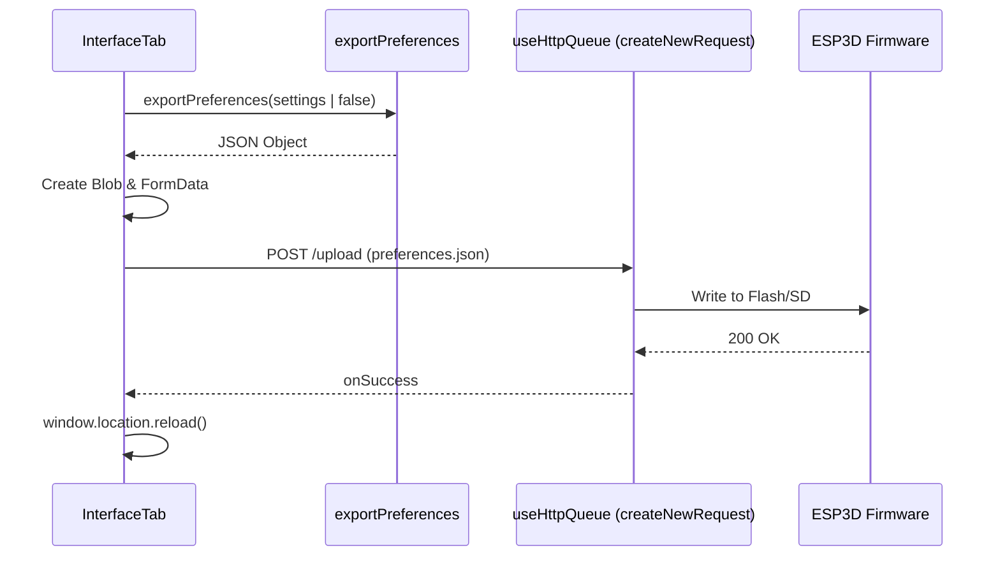

The upload includes `path` (from `HostUploadPath`), `creatPath`, and the file size [src/tabs/interface/index.js#393-400](https://github.com/luc-github/ESP3D-WEBUI/blob/97c01e85/src/tabs/interface/index.js#L393-L400) Upon success, the page reloads to apply the new persistent settings [src/tabs/interface/index.js#407-409](https://github.com/luc-github/ESP3D-WEBUI/blob/97c01e85/src/tabs/interface/index.js#L407-L409)

**Sources**: [src/tabs/interface/index.js#383-416](https://github.com/luc-github/ESP3D-WEBUI/blob/97c01e85/src/tabs/interface/index.js#L383-L416)[src/components/Helpers/http.js#37-49](https://github.com/luc-github/ESP3D-WEBUI/blob/97c01e85/src/components/Helpers/http.js#L37-L49)

---

## Validation and Helpers

### Global Validation

The `generateValidationGlobal` function is the core validator for imported or modified settings [src/tabs/interface/index.js#45-299](https://github.com/luc-github/ESP3D-WEBUI/blob/97c01e85/src/tabs/interface/index.js#L45-L299) It checks:

- **Shortkeys**: Ensures keyboard shortcuts are unique [src/tabs/interface/index.js#60-102](https://github.com/luc-github/ESP3D-WEBUI/blob/97c01e85/src/tabs/interface/index.js#L60-L102)
- **Numeric Ranges**: Validates `min`, `max`, and `step` (handling float precision) [src/tabs/interface/index.js#104-192](https://github.com/luc-github/ESP3D-WEBUI/blob/97c01e85/src/tabs/interface/index.js#L104-L192)
- **Regex Patterns**: Validates text fields against `regexpattern`[src/tabs/interface/index.js#137-143](https://github.com/luc-github/ESP3D-WEBUI/blob/97c01e85/src/tabs/interface/index.js#L137-L143)
- **Lists**: Tracks order changes and new items [src/tabs/interface/index.js#119-135](https://github.com/luc-github/ESP3D-WEBUI/blob/97c01e85/src/tabs/interface/index.js#L119-L135)

**Sources**: [src/tabs/interface/index.js#45-299](https://github.com/luc-github/ESP3D-WEBUI/blob/97c01e85/src/tabs/interface/index.js#L45-L299)

### Formatting Helpers

The `importHelper.js` provides `formatItem` and `formatItemsList` to normalize data structures like macros and extra panels [src/tabs/interface/importHelper.js#30-180](https://github.com/luc-github/ESP3D-WEBUI/blob/97c01e85/src/tabs/interface/importHelper.js#L30-L180) It maps raw JSON keys (like `cmds`, `icon`, `refreshtime`) to internal field types and sets up their validation rules (e.g., setting `min` and `step` for `refreshtime`) [src/tabs/interface/importHelper.js#45-70](https://github.com/luc-github/ESP3D-WEBUI/blob/97c01e85/src/tabs/interface/importHelper.js#L45-L70)

**Sources**: [src/tabs/interface/importHelper.js#30-180](https://github.com/luc-github/ESP3D-WEBUI/blob/97c01e85/src/tabs/interface/importHelper.js#L30-L180)

### Capability and Commands Integration

Targets (like Marlin) define how files are handled via `capabilities` and `commands`[src/targets/Printer3D/Marlin/SD-source.js#55-153](https://github.com/luc-github/ESP3D-WEBUI/blob/97c01e85/src/targets/Printer3D/Marlin/SD-source.js#L55-L153) While the interface settings are usually saved to Flash via the `HostTarget` API, the file system abstraction allows targets to specify if they support uploads or deletions [src/targets/Printer3D/Marlin/SD-source.js#61-81](https://github.com/luc-github/ESP3D-WEBUI/blob/97c01e85/src/targets/Printer3D/Marlin/SD-source.js#L61-L81)

**Sources**: [src/targets/Printer3D/Marlin/SD-source.js#55-153](https://github.com/luc-github/ESP3D-WEBUI/blob/97c01e85/src/targets/Printer3D/Marlin/SD-source.js#L55-L153)[src/targets/Printer3D/Marlin/SDEXT-source.js#55-155](https://github.com/luc-github/ESP3D-WEBUI/blob/97c01e85/src/targets/Printer3D/Marlin/SDEXT-source.js#L55-L155)

---

# 8-Internationalization

# Internationalization
Relevant source files

- [languages/cncgrblhalpack/en.json](https://github.com/luc-github/ESP3D-WEBUI/blob/97c01e85/languages/cncgrblhalpack/en.json)
- [languages/cncgrblpack/en.json](https://github.com/luc-github/ESP3D-WEBUI/blob/97c01e85/languages/cncgrblpack/en.json)
- [languages/printerpack/en.json](https://github.com/luc-github/ESP3D-WEBUI/blob/97c01e85/languages/printerpack/en.json)
- [languages/sandtablepack/en.json](https://github.com/luc-github/ESP3D-WEBUI/blob/97c01e85/languages/sandtablepack/en.json)
- [src/targets/CNC/GRBL/index.js](https://github.com/luc-github/ESP3D-WEBUI/blob/97c01e85/src/targets/CNC/GRBL/index.js)
- [src/targets/CNC/grblHAL/DIRECTSD-source.js](https://github.com/luc-github/ESP3D-WEBUI/blob/97c01e85/src/targets/CNC/grblHAL/DIRECTSD-source.js)
- [src/targets/CNC/grblHAL/FLASH-source.js](https://github.com/luc-github/ESP3D-WEBUI/blob/97c01e85/src/targets/CNC/grblHAL/FLASH-source.js)
- [src/targets/CNC/grblHAL/files.js](https://github.com/luc-github/ESP3D-WEBUI/blob/97c01e85/src/targets/CNC/grblHAL/files.js)
- [src/targets/CNC/grblHAL/index.js](https://github.com/luc-github/ESP3D-WEBUI/blob/97c01e85/src/targets/CNC/grblHAL/index.js)
- [src/targets/CNC/grblHAL/realCommandsTable.js](https://github.com/luc-github/ESP3D-WEBUI/blob/97c01e85/src/targets/CNC/grblHAL/realCommandsTable.js)
- [src/targets/CNC/grblHAL/translations/en.json](https://github.com/luc-github/ESP3D-WEBUI/blob/97c01e85/src/targets/CNC/grblHAL/translations/en.json)
- [src/targets/CNC/translations/en.json](https://github.com/luc-github/ESP3D-WEBUI/blob/97c01e85/src/targets/CNC/translations/en.json)
- [src/targets/Printer3D/translations/en.json](https://github.com/luc-github/ESP3D-WEBUI/blob/97c01e85/src/targets/Printer3D/translations/en.json)

This document describes the internationalization (i18n) system in ESP3D-WEBUI, including the translation system architecture, the organization of language packs, and the process for adding support for new languages. The system uses a hierarchical structure to provide common strings while allowing firmware-specific overrides.

For information about interface settings including language selection UI, see [Interface Settings](/org/luc-github/wiki/luc-github/ESP3D-WEBUI/page/7.1?branch=%223.0%22). For the build-time generation of these files, see [Build System](/org/luc-github/wiki/luc-github/ESP3D-WEBUI/page/9?branch=%223.0%22).

## Translation System Architecture

The ESP3D-WEBUI translation system is based on a key-value mapping where UI components reference string IDs rather than hard-coded text. A central `T()` function resolves these IDs at runtime based on the currently loaded language pack.

**Core Architecture Concepts:**

- **Key Prefixes:** Strings are categorized by scope: `S` for System/Shared, `P` for Printer3D, and `CN` for CNC targets.
- **Hierarchical Merging:** Translations cascade from a base set of shared strings to machine-specific and finally firmware-specific strings.
- **Dynamic Loading:** Language packs are stored as JSON files in the `languages/` directory and fetched by the browser during application initialization.

For details, see [Translation System Architecture](/org/luc-github/wiki/luc-github/ESP3D-WEBUI/page/8.1?branch=%223.0%22).

**Translation Resolution Flow:**

[Flowchart Diagram]

**Sources:**[src/targets/translations/en.json#1-25](https://github.com/luc-github/ESP3D-WEBUI/blob/97c01e85/src/targets/translations/en.json#L1-L25)[src/targets/Printer3D/translations/en.json#1-125](https://github.com/luc-github/ESP3D-WEBUI/blob/97c01e85/src/targets/Printer3D/translations/en.json#L1-L125)[src/targets/CNC/translations/en.json#1-125](https://github.com/luc-github/ESP3D-WEBUI/blob/97c01e85/src/targets/CNC/translations/en.json#L1-L125)

## Language Packs

Language packs are the final artifacts generated by the build system. They are organized by "target type" to ensure that a 3D printer build only downloads printer-related strings, while a CNC build downloads CNC-specific terminology and error codes.

**Available Packs:**

- **`printerpack`**: Contains `S` (System) and `P` (Printer) strings.
- **`cncgrblpack`**: Contains `S` (System), `CN` (CNC), and GRBL-specific error/status codes.
- **`cncgrblhalpack`**: Contains `S`, `CN`, and extended grblHAL configuration strings.
- **`sandtablepack`**: A specialized CNC pack for sand table targets.

For details, see [Language Packs](/org/luc-github/wiki/luc-github/ESP3D-WEBUI/page/8.2?branch=%223.0%22).

**System-to-Code Mapping:**

[Flowchart Diagram]

**Sources:**[languages/printerpack/en.json#1-100](https://github.com/luc-github/ESP3D-WEBUI/blob/97c01e85/languages/printerpack/en.json#L1-L100)[languages/cncgrblpack/en.json#1-100](https://github.com/luc-github/ESP3D-WEBUI/blob/97c01e85/languages/cncgrblpack/en.json#L1-L100)[languages/cncgrblhalpack/en.json#1-100](https://github.com/luc-github/ESP3D-WEBUI/blob/97c01e85/languages/cncgrblhalpack/en.json#L1-L100)

## Adding a New Language

Adding a new language involves creating localized versions of the JSON files in the source directories. The build system then automatically picks up these files to generate the corresponding language packs.

**Key Steps:**

1. Create a new `[lang_code].json` in `src/targets/translations/` for core UI strings.
2. Create machine-specific files in `src/targets/Printer3D/translations/` or `src/targets/CNC/translations/`.
3. Translate firmware-specific settings, such as the `$0` through `$380` settings for grblHAL.

For details, see [Adding a New Language](/org/luc-github/wiki/luc-github/ESP3D-WEBUI/page/8.3?branch=%223.0%22).

### String ID Usage Example

In code, translations are often referenced in `preferences.json` or directly in components. For instance, the CNC "Show axis" group uses the `CN8` key:

|  |  |  |
| --- | --- | --- |
| `S14` | "Settings" | [src/targets/translations/en.json#16](https://github.com/luc-github/ESP3D-WEBUI/blob/97c01e85/src/targets/translations/en.json#L16-L16) |
| `P29` | "Temperatures" | [src/targets/Printer3D/translations/en.json#24](https://github.com/luc-github/ESP3D-WEBUI/blob/97c01e85/src/targets/Printer3D/translations/en.json#L24-L24) |
| `CN8` | "Show axis" | [src/targets/CNC/translations/en.json#9](https://github.com/luc-github/ESP3D-WEBUI/blob/97c01e85/src/targets/CNC/translations/en.json#L9-L9) |
| `$100` | "X steps/mm" | [src/targets/CNC/grblHAL/translations/en.json#96](https://github.com/luc-github/ESP3D-WEBUI/blob/97c01e85/src/targets/CNC/grblHAL/translations/en.json#L96-L96) |

**Sources:**[src/targets/CNC/translations/en.json#1-10](https://github.com/luc-github/ESP3D-WEBUI/blob/97c01e85/src/targets/CNC/translations/en.json#L1-L10)[src/targets/CNC/grblHAL/translations/en.json#90-100](https://github.com/luc-github/ESP3D-WEBUI/blob/97c01e85/src/targets/CNC/grblHAL/translations/en.json#L90-L100)

---

# 8.1-Translation-System-Architecture

# Translation System Architecture
Relevant source files

- [languages/cncgrblhalpack/en.json](https://github.com/luc-github/ESP3D-WEBUI/blob/97c01e85/languages/cncgrblhalpack/en.json)
- [languages/cncgrblpack/en.json](https://github.com/luc-github/ESP3D-WEBUI/blob/97c01e85/languages/cncgrblpack/en.json)
- [languages/printerpack/en.json](https://github.com/luc-github/ESP3D-WEBUI/blob/97c01e85/languages/printerpack/en.json)
- [languages/sandtablepack/en.json](https://github.com/luc-github/ESP3D-WEBUI/blob/97c01e85/languages/sandtablepack/en.json)
- [src/components/Controls/Fields/Mask.js](https://github.com/luc-github/ESP3D-WEBUI/blob/97c01e85/src/components/Controls/Fields/Mask.js)
- [src/targets/CNC/GRBL/index.js](https://github.com/luc-github/ESP3D-WEBUI/blob/97c01e85/src/targets/CNC/GRBL/index.js)
- [src/targets/CNC/GRBL/preferences.json](https://github.com/luc-github/ESP3D-WEBUI/blob/97c01e85/src/targets/CNC/GRBL/preferences.json)
- [src/targets/CNC/grblHAL/DIRECTSD-source.js](https://github.com/luc-github/ESP3D-WEBUI/blob/97c01e85/src/targets/CNC/grblHAL/DIRECTSD-source.js)
- [src/targets/CNC/grblHAL/FLASH-source.js](https://github.com/luc-github/ESP3D-WEBUI/blob/97c01e85/src/targets/CNC/grblHAL/FLASH-source.js)
- [src/targets/CNC/grblHAL/files.js](https://github.com/luc-github/ESP3D-WEBUI/blob/97c01e85/src/targets/CNC/grblHAL/files.js)
- [src/targets/CNC/grblHAL/index.js](https://github.com/luc-github/ESP3D-WEBUI/blob/97c01e85/src/targets/CNC/grblHAL/index.js)
- [src/targets/CNC/grblHAL/preferences.json](https://github.com/luc-github/ESP3D-WEBUI/blob/97c01e85/src/targets/CNC/grblHAL/preferences.json)
- [src/targets/CNC/grblHAL/realCommandsTable.js](https://github.com/luc-github/ESP3D-WEBUI/blob/97c01e85/src/targets/CNC/grblHAL/realCommandsTable.js)
- [src/targets/CNC/grblHAL/translations/en.json](https://github.com/luc-github/ESP3D-WEBUI/blob/97c01e85/src/targets/CNC/grblHAL/translations/en.json)
- [src/targets/CNC/preferences.json](https://github.com/luc-github/ESP3D-WEBUI/blob/97c01e85/src/targets/CNC/preferences.json)
- [src/targets/CNC/translations/en.json](https://github.com/luc-github/ESP3D-WEBUI/blob/97c01e85/src/targets/CNC/translations/en.json)
- [src/targets/Printer3D/translations/en.json](https://github.com/luc-github/ESP3D-WEBUI/blob/97c01e85/src/targets/Printer3D/translations/en.json)
- [src/targets/translations/en.json](https://github.com/luc-github/ESP3D-WEBUI/blob/97c01e85/src/targets/translations/en.json)

This document describes the structure and organization of the internationalization (i18n) system in ESP3D-WEBUI. It covers translation file formats, key naming conventions, the cascading translation architecture, and how translations are integrated into UI components and the preferences system.

---

## Translation File Format

All translation files use JSON format with a flat key-value structure. Each file contains a `lang` property identifying the language name, followed by translation key-value pairs.

```
{
    "lang": "English",
    "S1": "Connection error",
    "S2": "Connecting",
    "P6": "Home all axis",
    "CN21": "Home all axis"
}
```

Translation keys can be:

- **Numeric with prefix**: (e.g., `S1`, `P42`, `CN15`, `$130`) [src/targets/translations/en.json#3-9](https://github.com/luc-github/ESP3D-WEBUI/blob/97c01e85/src/targets/translations/en.json#L3-L9)[src/targets/CNC/translations/en.json#2-20](https://github.com/luc-github/ESP3D-WEBUI/blob/97c01e85/src/targets/CNC/translations/en.json#L2-L20)
- **Descriptive strings**: (e.g., `jog`, `files`, `terminal`, `pause`, `heating`) [src/targets/translations/en.json#98-100](https://github.com/luc-github/ESP3D-WEBUI/blob/97c01e85/src/targets/translations/en.json#L98-L100)[src/targets/Printer3D/translations/en.json#120-124](https://github.com/luc-github/ESP3D-WEBUI/blob/97c01e85/src/targets/Printer3D/translations/en.json#L120-L124)

**Sources:**[src/targets/translations/en.json#1-150](https://github.com/luc-github/ESP3D-WEBUI/blob/97c01e85/src/targets/translations/en.json#L1-L150)[src/targets/CNC/translations/en.json#1-100](https://github.com/luc-github/ESP3D-WEBUI/blob/97c01e85/src/targets/CNC/translations/en.json#L1-L100)[src/targets/Printer3D/translations/en.json#1-126](https://github.com/luc-github/ESP3D-WEBUI/blob/97c01e85/src/targets/Printer3D/translations/en.json#L1-L126)

---

## Key Naming Conventions

The translation system employs a prefix-based namespace strategy to organize strings by context and target type:

|  |  |  |  |
| --- | --- | --- | --- |
| **S** | System/Shared strings | `S1` (Connection error), `S65` (Files) | All targets [src/targets/translations/en.json#3-66](https://github.com/luc-github/ESP3D-WEBUI/blob/97c01e85/src/targets/translations/en.json#L3-L66) |
| **P** | Printer-specific strings | `P6` (Home all axis), `P29` (Temperatures) | 3D Printer targets [src/targets/Printer3D/translations/en.json#7-24](https://github.com/luc-github/ESP3D-WEBUI/blob/97c01e85/src/targets/Printer3D/translations/en.json#L7-L24) |
| **CN** | CNC-specific strings | `CN21` (Home all axis), `CN35` (Laser) | CNC targets [src/targets/CNC/translations/en.json#22-26](https://github.com/luc-github/ESP3D-WEBUI/blob/97c01e85/src/targets/CNC/translations/en.json#L22-L26) |
| **$** | GRBL parameter descriptions | `$130` (X Max travel) | GRBL/grblHAL targets |
| **Descriptive** | Semantic keys | `jog`, `files`, `terminal`, `status` | Context-dependent [src/targets/translations/en.json#98-100](https://github.com/luc-github/ESP3D-WEBUI/blob/97c01e85/src/targets/translations/en.json#L98-L100) |
| **Button keys** | Keyboard shortcut labels | `btn+X`, `btnHX`, `btnStop` | Targets with keyboard support [src/targets/translations/en.json#230-235](https://github.com/luc-github/ESP3D-WEBUI/blob/97c01e85/src/targets/translations/en.json#L230-L235) |
| **Error keys** | Error/status messages | `error:1`, `ALARM:1`, `Hold:0`, `Door:1` | GRBL targets [src/targets/CNC/translations/en.json#125-158](https://github.com/luc-github/ESP3D-WEBUI/blob/97c01e85/src/targets/CNC/translations/en.json#L125-L158) |

### Variable Substitution Markers

Translation strings may include runtime variable placeholders:

- **`%s`**: Simple string substitution (e.g., `"About %s"`) [src/targets/translations/en.json#14](https://github.com/luc-github/ESP3D-WEBUI/blob/97c01e85/src/targets/translations/en.json#L14-L14)
- **`$`**: Index or value placeholder (e.g., `"Bed $"` or `"Extruder $"`) [src/targets/Printer3D/translations/en.json#33-37](https://github.com/luc-github/ESP3D-WEBUI/blob/97c01e85/src/targets/Printer3D/translations/en.json#L33-L37)
- **`#`**: Secondary index placeholder (e.g., `"$ is value, # is targeted index"`) [src/targets/Printer3D/translations/en.json#89](https://github.com/luc-github/ESP3D-WEBUI/blob/97c01e85/src/targets/Printer3D/translations/en.json#L89-L89)
- **`($)`** or **`(#)`**: Parenthetical placeholders (e.g., `"($) is axis"`) [src/targets/CNC/translations/en.json#12](https://github.com/luc-github/ESP3D-WEBUI/blob/97c01e85/src/targets/CNC/translations/en.json#L12-L12)

**Sources:**[src/targets/translations/en.json#1-240](https://github.com/luc-github/ESP3D-WEBUI/blob/97c01e85/src/targets/translations/en.json#L1-L240)[src/targets/CNC/translations/en.json#1-160](https://github.com/luc-github/ESP3D-WEBUI/blob/97c01e85/src/targets/CNC/translations/en.json#L1-L160)[src/targets/Printer3D/translations/en.json#1-100](https://github.com/luc-github/ESP3D-WEBUI/blob/97c01e85/src/targets/Printer3D/translations/en.json#L1-L100)

---

## Translation System Architecture

The architecture bridges the gap between raw machine data (like GRBL status reports) and the localized UI displayed to the user.

### Data Flow: Machine to Localized UI

[Flowchart Diagram]

**Sources:**[src/targets/CNC/grblHAL/index.js#23-36](https://github.com/luc-github/ESP3D-WEBUI/blob/97c01e85/src/targets/CNC/grblHAL/index.js#L23-L36)[src/targets/CNC/translations/en.json#149-158](https://github.com/luc-github/ESP3D-WEBUI/blob/97c01e85/src/targets/CNC/translations/en.json#L149-L158)

---

## Integration with Preferences System

The `preferences.json` files for different targets use translation keys for metadata like `label` and `help`. This allows the settings UI to be fully localized without hardcoded strings in the JSON configuration.

### Localizing Settings

[Flowchart Diagram]

- **Label Lookup**: `preferences.json` uses `S`, `P`, or `CN` keys for the `label` field. [src/targets/CNC/grblHAL/preferences.json#7-9](https://github.com/luc-github/ESP3D-WEBUI/blob/97c01e85/src/targets/CNC/grblHAL/preferences.json#L7-L9)
- **Group Labels**: Group components also utilize translation keys for titles. [src/targets/CNC/grblHAL/preferences.json#199](https://github.com/luc-github/ESP3D-WEBUI/blob/97c01e85/src/targets/CNC/grblHAL/preferences.json#L199-L199)
- **Mask Options**: Bitmask settings (like `Mask.js`) use translation keys for individual bit labels. [src/components/Controls/Fields/Mask.js#125-131](https://github.com/luc-github/ESP3D-WEBUI/blob/97c01e85/src/components/Controls/Fields/Mask.js#L125-L131)

**Sources:**[src/targets/CNC/grblHAL/preferences.json#1-200](https://github.com/luc-github/ESP3D-WEBUI/blob/97c01e85/src/targets/CNC/grblHAL/preferences.json#L1-L200)[src/components/Controls/Fields/Mask.js#99-135](https://github.com/luc-github/ESP3D-WEBUI/blob/97c01e85/src/components/Controls/Fields/Mask.js#L99-L135)[src/targets/translations/en.json#101](https://github.com/luc-github/ESP3D-WEBUI/blob/97c01e85/src/targets/translations/en.json#L101-L101)

---

## File System Abstraction and Localization

The translation system extends to the file system abstraction layer. Command results are formatted and status codes are translated before being returned to the UI.

- **formatResult**: In `FLASH-source.js` and `DIRECTSD-source.js`, the `formatResult` function uses helpers to translate machine status codes into human-readable strings. [src/targets/CNC/grblHAL/FLASH-source.js#71-78](https://github.com/luc-github/ESP3D-WEBUI/blob/97c01e85/src/targets/CNC/grblHAL/FLASH-source.js#L71-L78)[src/targets/CNC/grblHAL/DIRECTSD-source.js#69-76](https://github.com/luc-github/ESP3D-WEBUI/blob/97c01e85/src/targets/CNC/grblHAL/DIRECTSD-source.js#L69-L76)
- **Command Templates**: Play commands in the file system layer often use settings-defined command templates (like `playcmd`) which may contain variable markers. [src/targets/CNC/grblHAL/DIRECTSD-source.js#106-118](https://github.com/luc-github/ESP3D-WEBUI/blob/97c01e85/src/targets/CNC/grblHAL/DIRECTSD-source.js#L106-L118)

**Sources:**[src/targets/CNC/grblHAL/FLASH-source.js#115-128](https://github.com/luc-github/ESP3D-WEBUI/blob/97c01e85/src/targets/CNC/grblHAL/FLASH-source.js#L115-L128)[src/targets/CNC/grblHAL/DIRECTSD-source.js#106-118](https://github.com/luc-github/ESP3D-WEBUI/blob/97c01e85/src/targets/CNC/grblHAL/DIRECTSD-source.js#L106-L118)

---

## Summary of Key Functions

|  |  |  |
| --- | --- | --- |
| `T()` | Primary translation lookup function used in components. | Global Context |
| `variablesList` | Table of commands and variables used for command replacement. | [src/targets/CNC/grblHAL/index.js#52-61](https://github.com/luc-github/ESP3D-WEBUI/blob/97c01e85/src/targets/CNC/grblHAL/index.js#L52-L61) |
| `realCommandsTable` | Maps semantic names (e.g., `#SOFTRESET#`) to raw control characters (e.g., `\x18`). | [src/targets/CNC/grblHAL/realCommandsTable.js#20-50](https://github.com/luc-github/ESP3D-WEBUI/blob/97c01e85/src/targets/CNC/grblHAL/realCommandsTable.js#L20-L50) |
| `processor` | Firmware-specific logic that parses responses and prepares them for translation. | [src/targets/CNC/grblHAL/index.js#23](https://github.com/luc-github/ESP3D-WEBUI/blob/97c01e85/src/targets/CNC/grblHAL/index.js#L23-L23) |

**Sources:**[src/targets/CNC/grblHAL/index.js#52-79](https://github.com/luc-github/ESP3D-WEBUI/blob/97c01e85/src/targets/CNC/grblHAL/index.js#L52-L79)[src/targets/CNC/grblHAL/realCommandsTable.js#1-50](https://github.com/luc-github/ESP3D-WEBUI/blob/97c01e85/src/targets/CNC/grblHAL/realCommandsTable.js#L1-L50)

---

# 8.2-Language-Packs

# Language Packs
Relevant source files

- [languages/cncgrblhalpack/en.json](https://github.com/luc-github/ESP3D-WEBUI/blob/97c01e85/languages/cncgrblhalpack/en.json)
- [languages/cncgrblpack/en.json](https://github.com/luc-github/ESP3D-WEBUI/blob/97c01e85/languages/cncgrblpack/en.json)
- [languages/printerpack/en.json](https://github.com/luc-github/ESP3D-WEBUI/blob/97c01e85/languages/printerpack/en.json)
- [languages/sandtablepack/en.json](https://github.com/luc-github/ESP3D-WEBUI/blob/97c01e85/languages/sandtablepack/en.json)
- [src/targets/Printer3D/translations/en.json](https://github.com/luc-github/ESP3D-WEBUI/blob/97c01e85/src/targets/Printer3D/translations/en.json)

Language packs provide localized text strings for ESP3D-WEBUI across different machine types and firmware targets. This page documents the existing language pack structure, their organization, and the translation key conventions used throughout the codebase.

For information about how the translation system loads and applies language packs, see [Translation System Architecture](/org/luc-github/wiki/luc-github/ESP3D-WEBUI/page/8.1?branch=%223.0%22). For instructions on creating language packs for new languages, see [Adding a New Language](/org/luc-github/wiki/luc-github/ESP3D-WEBUI/page/8.3?branch=%223.0%22).

## Overview

ESP3D-WEBUI organizes translations into modular language packs that combine shared system strings with target-specific terminology. Each language pack is a JSON file containing key-value pairs where keys follow specific naming conventions to indicate their scope and usage.

## Language Pack Structure

Language packs exist in two primary locations within the codebase:

|  |  |  |
| --- | --- | --- |
| `languages/*pack/` | Complete language packs | System-wide + target-specific strings |
| `src/targets/*/translations/` | Target-only translations | Firmware-specific overrides |

### Translation Mapping Architecture

The following diagram maps the relationship between physical JSON files and the logical code entities (Translation Keys) used by the UI components.

[Flowchart Diagram]

**Sources:**[languages/printerpack/en.json#1-257](https://github.com/luc-github/ESP3D-WEBUI/blob/97c01e85/languages/printerpack/en.json#L1-L257)[languages/cncgrblpack/en.json#1-257](https://github.com/luc-github/ESP3D-WEBUI/blob/97c01e85/languages/cncgrblpack/en.json#L1-L257)[languages/cncgrblhalpack/en.json#1-257](https://github.com/luc-github/ESP3D-WEBUI/blob/97c01e85/languages/cncgrblhalpack/en.json#L1-L257)[languages/sandtablepack/en.json#1-257](https://github.com/luc-github/ESP3D-WEBUI/blob/97c01e85/languages/sandtablepack/en.json#L1-L257)[src/targets/Printer3D/translations/en.json#1-125](https://github.com/luc-github/ESP3D-WEBUI/blob/97c01e85/src/targets/Printer3D/translations/en.json#L1-L125)

## Language Pack Types

### Printer Pack

The `printerpack` contains translations for 3D printer interfaces supporting Marlin, Repetier, Smoothieware, and Marlin-embedded firmwares.

- **File:**[languages/printerpack/en.json#1-257](https://github.com/luc-github/ESP3D-WEBUI/blob/97c01e85/languages/printerpack/en.json#L1-L257)
- **Key Categories:**
- **System strings (S1-S225):** Connection errors [languages/printerpack/en.json#3-13](https://github.com/luc-github/ESP3D-WEBUI/blob/97c01e85/languages/printerpack/en.json#L3-L13) file operations [languages/printerpack/en.json#89-112](https://github.com/luc-github/ESP3D-WEBUI/blob/97c01e85/languages/printerpack/en.json#L89-L112) and UI generalities [languages/printerpack/en.json#14-25](https://github.com/luc-github/ESP3D-WEBUI/blob/97c01e85/languages/printerpack/en.json#L14-L25)
- **Panel identifiers:** Used as keys for panel titles like `temperatures`, `extruders`, `charts`, `controls`, `status`, `terminal`, `jog`, `files`[languages/printerpack/en.json#28-124](https://github.com/luc-github/ESP3D-WEBUI/blob/97c01e85/languages/printerpack/en.json#L28-L124)
- **Keyboard shortcuts:** Mapping physical keys to actions like `btn+X`, `btnHX`, `btnMotorOff`[languages/printerpack/en.json#230-243](https://github.com/luc-github/ESP3D-WEBUI/blob/97c01e85/languages/printerpack/en.json#L230-L243)

### CNC GRBL Pack

The `cncgrblpack` provides translations for CNC machines running standard GRBL firmware.

- **File:**[languages/cncgrblpack/en.json#1-257](https://github.com/luc-github/ESP3D-WEBUI/blob/97c01e85/languages/cncgrblpack/en.json#L1-L257)
- **Key Categories:**
- **System strings (S1-S225):** Identical base to the printer pack for consistency across the platform [languages/cncgrblpack/en.json#3-229](https://github.com/luc-github/ESP3D-WEBUI/blob/97c01e85/languages/cncgrblpack/en.json#L3-L229)
- **GRBL States:** Machine status labels like `Idle`, `Run`, `Hold`, `Jog`, `Home`, `Alarm`, `Sleep`, `Check`, `Door`[languages/cncgrblpack/en.json#251-254](https://github.com/luc-github/ESP3D-WEBUI/blob/97c01e85/languages/cncgrblpack/en.json#L251-L254)
- **Machine configuration:** Hardware specific strings like `chip id` and `radio_boot`[languages/cncgrblpack/en.json#255-257](https://github.com/luc-github/ESP3D-WEBUI/blob/97c01e85/languages/cncgrblpack/en.json#L255-L257)

### CNC grblHAL Pack

The `cncgrblhalpack` extends GRBL translations for grblHAL firmware with enhanced features and plugins.

- **File:**[languages/cncgrblhalpack/en.json#1-257](https://github.com/luc-github/ESP3D-WEBUI/blob/97c01e85/languages/cncgrblhalpack/en.json#L1-L257)
- **Structure:** Shares the same `S` key system as other packs but includes specific labels for grblHAL capabilities [languages/cncgrblhalpack/en.json#2-257](https://github.com/luc-github/ESP3D-WEBUI/blob/97c01e85/languages/cncgrblhalpack/en.json#L2-L257)

### Sand Table Pack

The `sandtablepack` provides translations for sand table machines running GRBL firmware with simplified CNC controls.

- **File:**[languages/sandtablepack/en.json#1-257](https://github.com/luc-github/ESP3D-WEBUI/blob/97c01e85/languages/sandtablepack/en.json#L1-L257)
- **Key Categories:**
- **System strings (S1-S225):** Full base system strings [languages/sandtablepack/en.json#3-229](https://github.com/luc-github/ESP3D-WEBUI/blob/97c01e85/languages/sandtablepack/en.json#L3-L229)
- **Notable Omissions:** Typically omits extruder or complex spindle/laser logic found in the heavier CNC/Printer packs while retaining core `jog` and `files` panels [languages/sandtablepack/en.json#98-99](https://github.com/luc-github/ESP3D-WEBUI/blob/97c01e85/languages/sandtablepack/en.json#L98-L99)

## Translation Key Naming Conventions

The system uses a prefixed numbering system to categorize strings, which allows the `T()` function to resolve strings across different machine contexts.

### Data Flow: Key to UI Component

This diagram shows how specific code entities consume translation keys from the JSON packs.

[Flowchart Diagram]

**Sources:**[languages/printerpack/en.json#3-124](https://github.com/luc-github/ESP3D-WEBUI/blob/97c01e85/languages/printerpack/en.json#L3-L124)[src/targets/Printer3D/translations/en.json#24-123](https://github.com/luc-github/ESP3D-WEBUI/blob/97c01e85/src/targets/Printer3D/translations/en.json#L24-L123)

### System Keys (S1-S225)

Common across all language packs. They cover core UI functionality:

- **S1-S11:** Connection errors and status [languages/printerpack/en.json#3-12](https://github.com/luc-github/ESP3D-WEBUI/blob/97c01e85/languages/printerpack/en.json#L3-L12)
- **S65-S66:** Core panel names like `Files` and `Jog`[languages/printerpack/en.json#66-67](https://github.com/luc-github/ESP3D-WEBUI/blob/97c01e85/languages/printerpack/en.json#L66-L67)
- **S145-S148:** Authentication and login [languages/printerpack/en.json#148-151](https://github.com/luc-github/ESP3D-WEBUI/blob/97c01e85/languages/printerpack/en.json#L148-L151)

### Printer Keys (P1-P124)

Specific to 3D printer targets, primarily found in `Printer3D` translations:

- **P6-P9:** Homing commands [src/targets/Printer3D/translations/en.json#7-10](https://github.com/luc-github/ESP3D-WEBUI/blob/97c01e85/src/targets/Printer3D/translations/en.json#L7-L10)
- **P29-P32:** Environmental controls like `Temperatures`, `Flow rate`, `Fan`, `Extrusion`[src/targets/Printer3D/translations/en.json#24-27](https://github.com/luc-github/ESP3D-WEBUI/blob/97c01e85/src/targets/Printer3D/translations/en.json#L24-L27)
- **P105-P111:** Print progress time units (`hours`, `mins`, `secs`) [src/targets/Printer3D/translations/en.json#100-106](https://github.com/luc-github/ESP3D-WEBUI/blob/97c01e85/src/targets/Printer3D/translations/en.json#L100-L106)

### Variable Substitution

Many translation strings include placeholders that are replaced at runtime by the `replaceVariables` utility or similar logic:

- `$` is used for numeric values (e.g., `"P37": "Bed $"`[src/targets/Printer3D/translations/en.json#33](https://github.com/luc-github/ESP3D-WEBUI/blob/97c01e85/src/targets/Printer3D/translations/en.json#L33-L33)).
- `#` is used for targeted indices (e.g., `"P94": "$ is value, # is targeted index"`[src/targets/Printer3D/translations/en.json#89](https://github.com/luc-github/ESP3D-WEBUI/blob/97c01e85/src/targets/Printer3D/translations/en.json#L89-L89)).
- `%s` is used for string substitution (e.g., `"S12": "About %s"`[languages/printerpack/en.json#14](https://github.com/luc-github/ESP3D-WEBUI/blob/97c01e85/languages/printerpack/en.json#L14-L14)).

**Sources:**[src/targets/Printer3D/translations/en.json#33-89](https://github.com/luc-github/ESP3D-WEBUI/blob/97c01e85/src/targets/Printer3D/translations/en.json#L33-L89)[languages/printerpack/en.json#14](https://github.com/luc-github/ESP3D-WEBUI/blob/97c01e85/languages/printerpack/en.json#L14-L14)

## Target-Specific Overrides

The file `src/targets/Printer3D/translations/en.json` demonstrates the override pattern. It defines printer-specific strings like `P5: "Sorry this UI is only for 3D printer, please use CNC one"`[src/targets/Printer3D/translations/en.json#6](https://github.com/luc-github/ESP3D-WEBUI/blob/97c01e85/src/targets/Printer3D/translations/en.json#L6-L6) and `P80` which provides a detailed mapping of keyboard keys for the jog panel [src/targets/Printer3D/translations/en.json#75](https://github.com/luc-github/ESP3D-WEBUI/blob/97c01e85/src/targets/Printer3D/translations/en.json#L75-L75)

**Sources:**[src/targets/Printer3D/translations/en.json#1-125](https://github.com/luc-github/ESP3D-WEBUI/blob/97c01e85/src/targets/Printer3D/translations/en.json#L1-L125)

---

# 8.3-Adding-a-New-Language

# Adding a New Language
Relevant source files

- [languages/cncgrblhalpack/en.json](https://github.com/luc-github/ESP3D-WEBUI/blob/97c01e85/languages/cncgrblhalpack/en.json)
- [languages/cncgrblpack/en.json](https://github.com/luc-github/ESP3D-WEBUI/blob/97c01e85/languages/cncgrblpack/en.json)
- [languages/printerpack/en.json](https://github.com/luc-github/ESP3D-WEBUI/blob/97c01e85/languages/printerpack/en.json)
- [languages/sandtablepack/en.json](https://github.com/luc-github/ESP3D-WEBUI/blob/97c01e85/languages/sandtablepack/en.json)
- [src/targets/Printer3D/translations/en.json](https://github.com/luc-github/ESP3D-WEBUI/blob/97c01e85/src/targets/Printer3D/translations/en.json)

## Purpose and Scope

This document provides a step-by-step guide for adding a new language translation to ESP3D-WEBUI. It covers the translation file structure, key naming conventions, and the build process for language packs. For information about how translations are loaded and used at runtime, see [Translation System Architecture](https://github.com/luc-github/ESP3D-WEBUI/blob/97c01e85/Translation System Architecture) For details on existing language packs, see [Language Packs](https://github.com/luc-github/ESP3D-WEBUI/blob/97c01e85/Language Packs)

---

## Translation System Overview

ESP3D-WEBUI uses a hierarchical translation system where translations are organized by target type and firmware, then merged during the build process into language packs.

### Data Flow: From Source to UI

The following diagram illustrates how raw JSON translation files are processed into target-specific language packs and consumed by the UI `T()` function.

[Flowchart Diagram]

**Sources:**[src/targets/Printer3D/translations/en.json#1-126](https://github.com/luc-github/ESP3D-WEBUI/blob/97c01e85/src/targets/Printer3D/translations/en.json#L1-L126)[languages/printerpack/en.json#1-257](https://github.com/luc-github/ESP3D-WEBUI/blob/97c01e85/languages/printerpack/en.json#L1-L257)[languages/cncgrblhalpack/en.json#1-257](https://github.com/luc-github/ESP3D-WEBUI/blob/97c01e85/languages/cncgrblhalpack/en.json#L1-L257)

---

## Translation File Structure

### File Locations

Translation files follow a hierarchical structure designed for override capabilities:

|  |  |  |  |
| --- | --- | --- | --- |
| **Base** | `src/targets/translations/{lang}.json` | Common translations used by all targets | `S1`: "Connection error" |
| **Target Type** | `src/targets/{TargetType}/translations/{lang}.json` | Target-specific translations | [src/targets/Printer3D/translations/en.json#1-126](https://github.com/luc-github/ESP3D-WEBUI/blob/97c01e85/src/targets/Printer3D/translations/en.json#L1-L126) |
| **Firmware** | `src/targets/{TargetType}/{Firmware}/translations/{lang}.json` | Firmware-specific overrides | Marlin-specific strings |

**Sources:**[src/targets/Printer3D/translations/en.json#1-126](https://github.com/luc-github/ESP3D-WEBUI/blob/97c01e85/src/targets/Printer3D/translations/en.json#L1-L126)[languages/printerpack/en.json#1-125](https://github.com/luc-github/ESP3D-WEBUI/blob/97c01e85/languages/printerpack/en.json#L1-L125)

### Key Naming Conventions

All translation files use a JSON structure where keys represent system identifiers.

|  |  |  |
| --- | --- | --- |
| `lang` | UI Language Selector | `"lang": "English"` |
| `S###` | Shared System Strings | `"S1": "Connection error"` |
| `P###` | Printer3D UI Components | `"P6": "Home all axis"` |
| `CN###` | CNC/GRBL UI Components | `"CN1": "mm/min"` |
| `btn###` | Control Buttons | `"btn+X": "X+"` |
| `move_#` | Jogging Increments | `"move_100": "Jog distance 100mm"` |

**Sources:**[src/targets/Printer3D/translations/en.json#1-15](https://github.com/luc-github/ESP3D-WEBUI/blob/97c01e85/src/targets/Printer3D/translations/en.json#L1-L15)[languages/printerpack/en.json#1-15](https://github.com/luc-github/ESP3D-WEBUI/blob/97c01e85/languages/printerpack/en.json#L1-L15)[languages/cncgrblpack/en.json#230-247](https://github.com/luc-github/ESP3D-WEBUI/blob/97c01e85/languages/cncgrblpack/en.json#L230-L247)

---

## Step-by-Step Guide to Adding a New Language

### Step 1: Create Base Translation File

Create a new file at `src/targets/translations/{lang_code}.json` (e.g., `fr.json`).

1. Use the English base as a template.
2. Translate values while keeping keys identical.
3. Ensure the `"lang"` key matches the native name of the language.

**Sources:**[languages/printerpack/en.json#1-2](https://github.com/luc-github/ESP3D-WEBUI/blob/97c01e85/languages/printerpack/en.json#L1-L2)

### Step 2: Create Target-Specific Translations

Create translation files for specific target types to handle specialized UI panels.

#### For Printer3D Target

Create `src/targets/Printer3D/translations/{lang_code}.json`. This file contains keys for temperatures, extruders, and 3D printing status [src/targets/Printer3D/translations/en.json#24-62](https://github.com/luc-github/ESP3D-WEBUI/blob/97c01e85/src/targets/Printer3D/translations/en.json#L24-L62)

#### For CNC Target

CNC-specific keys (CN-prefixed) are typically merged into `languages/cncgrblpack/` or `languages/cncgrblhalpack/`[languages/cncgrblpack/en.json#1-10](https://github.com/luc-github/ESP3D-WEBUI/blob/97c01e85/languages/cncgrblpack/en.json#L1-L10)

### Step 3: Mapping Code Entities to Natural Language

The following diagram bridges the "Natural Language Space" (what users see) to the "Code Entity Space" (the JSON keys used in code).

[Flowchart Diagram]

**Sources:**[src/targets/Printer3D/translations/en.json#7-24](https://github.com/luc-github/ESP3D-WEBUI/blob/97c01e85/src/targets/Printer3D/translations/en.json#L7-L24)[languages/printerpack/en.json#3-98](https://github.com/luc-github/ESP3D-WEBUI/blob/97c01e85/languages/printerpack/en.json#L3-L98)

---

## Translation Key Reference

### Shared Keys (S-prefixed)

Found in `languages/printerpack/en.json` and other packs:

- `S1-S11`: Connection management [languages/printerpack/en.json#3-13](https://github.com/luc-github/ESP3D-WEBUI/blob/97c01e85/languages/printerpack/en.json#L3-L13)
- `S13-S17`: Navigation and Dashboard [languages/printerpack/en.json#15-18](https://github.com/luc-github/ESP3D-WEBUI/blob/97c01e85/languages/printerpack/en.json#L15-L18)
- `S65-S67`: File and Jog panel headers [languages/printerpack/en.json#66-68](https://github.com/luc-github/ESP3D-WEBUI/blob/97c01e85/languages/printerpack/en.json#L66-L68)
- `S75-S82`: Terminal commands [languages/printerpack/en.json#76-84](https://github.com/luc-github/ESP3D-WEBUI/blob/97c01e85/languages/printerpack/en.json#L76-L84)

### Printer-Specific Keys (P-prefixed)

Defined in `src/targets/Printer3D/translations/en.json`:

- `P6-P9`: Homing operations [src/targets/Printer3D/translations/en.json#7-10](https://github.com/luc-github/ESP3D-WEBUI/blob/97c01e85/src/targets/Printer3D/translations/en.json#L7-L10)
- `P29-P43`: Temperature and Bed controls [src/targets/Printer3D/translations/en.json#24-39](https://github.com/luc-github/ESP3D-WEBUI/blob/97c01e85/src/targets/Printer3D/translations/en.json#L24-L39)
- `P53-P55`: Extrusion controls [src/targets/Printer3D/translations/en.json#49-51](https://github.com/luc-github/ESP3D-WEBUI/blob/97c01e85/src/targets/Printer3D/translations/en.json#L49-L51)
- `P95-P124`: SD and TFT command strings [src/targets/Printer3D/translations/en.json#90-119](https://github.com/luc-github/ESP3D-WEBUI/blob/97c01e85/src/targets/Printer3D/translations/en.json#L90-L119)

### Panel Identifiers

Special keys used to label the main UI panels:

- `"jog"`: [languages/printerpack/en.json#98](https://github.com/luc-github/ESP3D-WEBUI/blob/97c01e85/languages/printerpack/en.json#L98-L98)
- `"files"`: [languages/printerpack/en.json#99](https://github.com/luc-github/ESP3D-WEBUI/blob/97c01e85/languages/printerpack/en.json#L99-L99)
- `"terminal"`: [languages/printerpack/en.json#77](https://github.com/luc-github/ESP3D-WEBUI/blob/97c01e85/languages/printerpack/en.json#L77-L77)
- `"temperatures"`: [src/targets/Printer3D/translations/en.json#28](https://github.com/luc-github/ESP3D-WEBUI/blob/97c01e85/src/targets/Printer3D/translations/en.json#L28-L28)

---

## Best Practices

### 1. Placeholder Preservation

Some strings use `$` or `%s` as variables. These **must** remain in the translated string.

- `$` is used for dynamic values like "Bed $" or "Fan $" [src/targets/Printer3D/translations/en.json#33-86](https://github.com/luc-github/ESP3D-WEBUI/blob/97c01e85/src/targets/Printer3D/translations/en.json#L33-L86)
- `%s` is used for string substitution like "About %s" [languages/printerpack/en.json#14](https://github.com/luc-github/ESP3D-WEBUI/blob/97c01e85/languages/printerpack/en.json#L14-L14)

### 2. Character Encoding

All files must be saved in **UTF-8** without BOM to ensure special characters like `℃`[src/targets/Printer3D/translations/en.json#67](https://github.com/luc-github/ESP3D-WEBUI/blob/97c01e85/src/targets/Printer3D/translations/en.json#L67-L67) render correctly across different browser environments.

### 3. Testing the Build

After adding files, run the build script for the specific target:

```
npm run printer3d-marlin
```

The resulting `index.html.gz` will include the new language if the build pipeline correctly identifies the source files in `src/targets/`.

**Sources:**[src/targets/Printer3D/translations/en.json#33-86](https://github.com/luc-github/ESP3D-WEBUI/blob/97c01e85/src/targets/Printer3D/translations/en.json#L33-L86)[languages/printerpack/en.json#14](https://github.com/luc-github/ESP3D-WEBUI/blob/97c01e85/languages/printerpack/en.json#L14-L14)

---

# 9-Build-System

# Build System
Relevant source files

- [.all-contributorsrc](https://github.com/luc-github/ESP3D-WEBUI/blob/97c01e85/.all-contributorsrc)
- [.github/ci/final-check.sh](https://github.com/luc-github/ESP3D-WEBUI/blob/97c01e85/.github/ci/final-check.sh)
- [.github/workflows/build-ci.yml](https://github.com/luc-github/ESP3D-WEBUI/blob/97c01e85/.github/workflows/build-ci.yml)
- [LICENSE](https://github.com/luc-github/ESP3D-WEBUI/blob/97c01e85/LICENSE)
- [README.md](https://github.com/luc-github/ESP3D-WEBUI/blob/97c01e85/README.md?plain=1)
- [info.json](https://github.com/luc-github/ESP3D-WEBUI/blob/97c01e85/info.json)
- [package-lock.json](https://github.com/luc-github/ESP3D-WEBUI/blob/97c01e85/package-lock.json)
- [package.json](https://github.com/luc-github/ESP3D-WEBUI/blob/97c01e85/package.json)

This page documents the Webpack-based build system that compiles ESP3D-WEBUI source code into firmware-specific deployment artifacts. The build system handles transpilation, bundling, styling, optimization, and compression to produce single-file `index.html.gz` packages for each target configuration.

For information about the target configuration system that determines which features are included in each build, see [Target Configuration System](/org/luc-github/wiki/luc-github/ESP3D-WEBUI/page/4?branch=%223.0%22). For deployment procedures, see [Installation and Deployment](/org/luc-github/wiki/luc-github/ESP3D-WEBUI/page/1.3?branch=%223.0%22).

## Build Pipeline Overview

The ESP3D-WEBUI build pipeline transforms Preact JSX components and Sass stylesheets into optimized, compressed HTML files suitable for deployment on resource-constrained ESP32 devices.

The pipeline utilizes `webpack`[package.json#67](https://github.com/luc-github/ESP3D-WEBUI/blob/97c01e85/package.json#L67-L67) as the primary orchestrator, employing `babel-loader`[package.json#41](https://github.com/luc-github/ESP3D-WEBUI/blob/97c01e85/package.json#L41-L41) for JavaScript transpilation and `sass-loader`[package.json#65](https://github.com/luc-github/ESP3D-WEBUI/blob/97c01e85/package.json#L65-L65) for style processing.

[Flowchart Diagram]

**Sources:**[README.md#1-60](https://github.com/luc-github/ESP3D-WEBUI/blob/97c01e85/README.md?plain=1#L1-L60)[package.json#37-70](https://github.com/luc-github/ESP3D-WEBUI/blob/97c01e85/package.json#L37-L70)

### Build Stages

The build executes the following stages in sequence:

|  |  |  |
| --- | --- | --- |
| **Transpilation** | Babel 7.18.6, `babel-loader` | Converts JSX and modern JavaScript to ES5-compatible code [package.json#38-42](https://github.com/luc-github/ESP3D-WEBUI/blob/97c01e85/package.json#L38-L42) |
| **Styling** | Sass 1.53.0, `sass-loader`, `css-loader` | Compiles `.scss` files and processes CSS imports [package.json#49-65](https://github.com/luc-github/ESP3D-WEBUI/blob/97c01e85/package.json#L49-L65) |
| **Bundling** | Webpack 5.73.0 | Combines modules into single bundle per target [package.json#67](https://github.com/luc-github/ESP3D-WEBUI/blob/97c01e85/package.json#L67-L67) |
| **Extraction** | `mini-css-extract-plugin` | Separates CSS into standalone file [package.json#60](https://github.com/luc-github/ESP3D-WEBUI/blob/97c01e85/package.json#L60-L60) |
| **HTML Generation** | `html-webpack-plugin` | Creates HTML file with script/style references [package.json#59](https://github.com/luc-github/ESP3D-WEBUI/blob/97c01e85/package.json#L59-L59) |
| **Inlining** | `html-inline-css-webpack-plugin`, `html-inline-script-webpack-plugin` | Embeds CSS and JS directly into HTML [package.json#55-56](https://github.com/luc-github/ESP3D-WEBUI/blob/97c01e85/package.json#L55-L56) |
| **Minification** | `html-minimizer-webpack-plugin`, `html-minifier` | Removes whitespace and optimizes structure [package.json#57-58](https://github.com/luc-github/ESP3D-WEBUI/blob/97c01e85/package.json#L57-L58) |
| **Compression** | `compression-webpack-plugin` | Generates gzip-compressed output [package.json#45](https://github.com/luc-github/ESP3D-WEBUI/blob/97c01e85/package.json#L45-L45) |

For details, see [Build Pipeline Overview](/org/luc-github/wiki/luc-github/ESP3D-WEBUI/page/9.1?branch=%223.0%22).

**Sources:**[package.json#37-70](https://github.com/luc-github/ESP3D-WEBUI/blob/97c01e85/package.json#L37-L70)[README.md#20-30](https://github.com/luc-github/ESP3D-WEBUI/blob/97c01e85/README.md?plain=1#L20-L30)

## Multi-Target Build Configuration

ESP3D-WEBUI generates separate builds for each combination of machine type and firmware. Each build is configured through `npm` scripts in `package.json`[package.json#6-34](https://github.com/luc-github/ESP3D-WEBUI/blob/97c01e85/package.json#L6-L34) that set environment variables controlling which target is compiled.

[Flowchart Diagram]

**Sources:**[package.json#10-29](https://github.com/luc-github/ESP3D-WEBUI/blob/97c01e85/package.json#L10-L29)[README.md#54-75](https://github.com/luc-github/ESP3D-WEBUI/blob/97c01e85/README.md?plain=1#L54-L75)

### Target Build Matrix

The build system supports the following target combinations defined in `scripts`:

|  |  |  |  |
| --- | --- | --- | --- |
| **CNC** | GRBL | `npm run cnc-grbl` | `dist/CNC/GRBL/index.html.gz`[package.json#22](https://github.com/luc-github/ESP3D-WEBUI/blob/97c01e85/package.json#L22-L22) |
| **CNC** | grblHAL | `npm run cnc-grblhal` | `dist/CNC/GRBLHal/index.html.gz`[package.json#23](https://github.com/luc-github/ESP3D-WEBUI/blob/97c01e85/package.json#L23-L23) |
| **Printer3D** | Marlin | `npm run printer-marlin` | `dist/Printer3D/Marlin/index.html.gz`[package.json#19](https://github.com/luc-github/ESP3D-WEBUI/blob/97c01e85/package.json#L19-L19) |
| **Printer3D** | Marlin-embedded | `npm run printer-marlin-embedded` | `dist/Printer3D/Marlin-embedded/index.html.gz`[package.json#21](https://github.com/luc-github/ESP3D-WEBUI/blob/97c01e85/package.json#L21-L21) |
| **Printer3D** | Repetier | `npm run printer-repetier` | `dist/Printer3D/Repetier/index.html.gz`[package.json#18](https://github.com/luc-github/ESP3D-WEBUI/blob/97c01e85/package.json#L18-L18) |
| **Printer3D** | Smoothieware | `npm run printer-smoothieware` | `dist/Printer3D/Smoothieware/index.html.gz`[package.json#20](https://github.com/luc-github/ESP3D-WEBUI/blob/97c01e85/package.json#L20-L20) |
| **SandTable** | GRBL | `npm run sand-grbl` | `dist/SandTable/GRBL/index.html.gz`[package.json#24](https://github.com/luc-github/ESP3D-WEBUI/blob/97c01e85/package.json#L24-L24) |

The `npm run buildall`[package.json#29](https://github.com/luc-github/ESP3D-WEBUI/blob/97c01e85/package.json#L29-L29) script sequentially builds all target combinations.

For details, see [Multi-Target Build Configuration](/org/luc-github/wiki/luc-github/ESP3D-WEBUI/page/9.3?branch=%223.0%22).

**Sources:**[package.json#10-29](https://github.com/luc-github/ESP3D-WEBUI/blob/97c01e85/package.json#L10-L29)[README.md#64-75](https://github.com/luc-github/ESP3D-WEBUI/blob/97c01e85/README.md?plain=1#L64-L75)

## Development Workflow

The development environment provides hot module replacement, automatic backend restart, and concurrent process management. It uses `concurrently`[package.json#46](https://github.com/luc-github/ESP3D-WEBUI/blob/97c01e85/package.json#L46-L46) to run both the frontend dev server and the backend test server.

[Flowchart Diagram]

**Sources:**[package.json#8-17](https://github.com/luc-github/ESP3D-WEBUI/blob/97c01e85/package.json#L8-L17)[README.md#38-52](https://github.com/luc-github/ESP3D-WEBUI/blob/97c01e85/README.md?plain=1#L38-L52)

### Starting Development Server

To start the development environment for a specific target:

```
npm run dev-cnc-grblhal
```

This triggers the `dev-cnc-grblhal` script [package.json#11](https://github.com/luc-github/ESP3D-WEBUI/blob/97c01e85/package.json#L11-L11) which sets `TARGET_ENV=CNC` and `SUBTARGET_ENV=grblHAL` before launching `nodemon`[package.json#9](https://github.com/luc-github/ESP3D-WEBUI/blob/97c01e85/package.json#L9-L9) for the server and `webpack serve`[package.json#8](https://github.com/luc-github/ESP3D-WEBUI/blob/97c01e85/package.json#L8-L8) for the frontend.

For details, see [Development Workflow](/org/luc-github/wiki/luc-github/ESP3D-WEBUI/page/9.2?branch=%223.0%22).

**Sources:**[package.json#8-17](https://github.com/luc-github/ESP3D-WEBUI/blob/97c01e85/package.json#L8-L17)[README.md#38-52](https://github.com/luc-github/ESP3D-WEBUI/blob/97c01e85/README.md?plain=1#L38-L52)

## Build Dependencies and Tools

The build system relies on a set of dependencies optimized for generating small, fast-loading single-page applications.

### Core Build Tools

|  |  |
| --- | --- |
| **Framework** | `preact`[package.json#72](https://github.com/luc-github/ESP3D-WEBUI/blob/97c01e85/package.json#L72-L72)`spectre.css`[package.json#75](https://github.com/luc-github/ESP3D-WEBUI/blob/97c01e85/package.json#L75-L75) |
| **Bundler** | `webpack`[package.json#67](https://github.com/luc-github/ESP3D-WEBUI/blob/97c01e85/package.json#L67-L67)`webpack-cli`[package.json#68](https://github.com/luc-github/ESP3D-WEBUI/blob/97c01e85/package.json#L68-L68) |
| **Transpiler** | `@babel/core`[package.json#38](https://github.com/luc-github/ESP3D-WEBUI/blob/97c01e85/package.json#L38-L38)`babel-preset-preact`[package.json#42](https://github.com/luc-github/ESP3D-WEBUI/blob/97c01e85/package.json#L42-L42) |
| **Dev Server** | `express`[package.json#50](https://github.com/luc-github/ESP3D-WEBUI/blob/97c01e85/package.json#L50-L50)`webpack-dev-server`[package.json#69](https://github.com/luc-github/ESP3D-WEBUI/blob/97c01e85/package.json#L69-L69) |

For details, see [Dependencies and Tools](/org/luc-github/wiki/luc-github/ESP3D-WEBUI/page/9.4?branch=%223.0%22).

**Sources:**[package.json#37-76](https://github.com/luc-github/ESP3D-WEBUI/blob/97c01e85/package.json#L37-L76)[README.md#6-7](https://github.com/luc-github/ESP3D-WEBUI/blob/97c01e85/README.md?plain=1#L6-L7)

### Version Management

The project version is defined in `package.json`[package.json#3](https://github.com/luc-github/ESP3D-WEBUI/blob/97c01e85/package.json#L3-L3) as `3.0.0` and tracked in `info.json`[info.json#2](https://github.com/luc-github/ESP3D-WEBUI/blob/97c01e85/info.json#L2-L2) as `3.0.1`. Continuous integration is handled via GitHub Actions in `.github/workflows/build-ci.yml`[build-ci.yml#1-43](https://github.com/luc-github/ESP3D-WEBUI/blob/97c01e85/build-ci.yml#L1-L43) which runs `npm run buildall`[build-ci.yml#30](https://github.com/luc-github/ESP3D-WEBUI/blob/97c01e85/build-ci.yml#L30-L30) on every push to branches `2.1`, `3.0`, and `3.1`[build-ci.yml#6-8](https://github.com/luc-github/ESP3D-WEBUI/blob/97c01e85/build-ci.yml#L6-L8)

**Sources:**[package.json#3](https://github.com/luc-github/ESP3D-WEBUI/blob/97c01e85/package.json#L3-L3)[info.json#1-4](https://github.com/luc-github/ESP3D-WEBUI/blob/97c01e85/info.json#L1-L4)[build-ci.yml#1-13](https://github.com/luc-github/ESP3D-WEBUI/blob/97c01e85/build-ci.yml#L1-L13)

---

# 9.1-Build-Pipeline-Overview

# Build Pipeline Overview
Relevant source files

- [.all-contributorsrc](https://github.com/luc-github/ESP3D-WEBUI/blob/97c01e85/.all-contributorsrc)
- [.github/ci/final-check.sh](https://github.com/luc-github/ESP3D-WEBUI/blob/97c01e85/.github/ci/final-check.sh)
- [.github/workflows/build-ci.yml](https://github.com/luc-github/ESP3D-WEBUI/blob/97c01e85/.github/workflows/build-ci.yml)
- [LICENSE](https://github.com/luc-github/ESP3D-WEBUI/blob/97c01e85/LICENSE)
- [README.md](https://github.com/luc-github/ESP3D-WEBUI/blob/97c01e85/README.md?plain=1)
- [extensions/click2go/.prettierrc](https://github.com/luc-github/ESP3D-WEBUI/blob/97c01e85/extensions/click2go/.prettierrc)
- [extensions/gcodeViewer/.babel.rc](https://github.com/luc-github/ESP3D-WEBUI/blob/97c01e85/extensions/gcodeViewer/.babel.rc)
- [extensions/gcodeViewer/.prettierrc](https://github.com/luc-github/ESP3D-WEBUI/blob/97c01e85/extensions/gcodeViewer/.prettierrc)
- [extensions/gcodeViewer/LICENSE](https://github.com/luc-github/ESP3D-WEBUI/blob/97c01e85/extensions/gcodeViewer/LICENSE)
- [extensions/gcodeViewer/webpack.config.js](https://github.com/luc-github/ESP3D-WEBUI/blob/97c01e85/extensions/gcodeViewer/webpack.config.js)
- [info.json](https://github.com/luc-github/ESP3D-WEBUI/blob/97c01e85/info.json)
- [package.json](https://github.com/luc-github/ESP3D-WEBUI/blob/97c01e85/package.json)
- [src/components/Images/icons.js](https://github.com/luc-github/ESP3D-WEBUI/blob/97c01e85/src/components/Images/icons.js)

This document explains the build pipeline that transforms ESP3D-WEBUI source code into deployable artifacts. The pipeline uses Webpack, Babel, and various optimization tools to compile Preact components, SCSS styles, and target configurations into compressed HTML bundles suitable for deployment on resource-constrained ESP32/ESP8266 devices.

For information about running builds and development workflows, see [Development Workflow](/org/luc-github/wiki/luc-github/ESP3D-WEBUI/page/9.2?branch=%223.0%22). For details on multi-target build commands, see [Multi-Target Build Configuration](/org/luc-github/wiki/luc-github/ESP3D-WEBUI/page/9.3?branch=%223.0%22). For dependency documentation, see [Dependencies and Tools](/org/luc-github/wiki/luc-github/ESP3D-WEBUI/page/9.4?branch=%223.0%22).

## Purpose and Scope

The build pipeline serves three primary functions:

1. **Transpilation**: Convert modern JavaScript (ES6+) and JSX syntax into ES5-compatible code that runs on older browsers using `@babel/preset-env`[package.json#39](https://github.com/luc-github/ESP3D-WEBUI/blob/97c01e85/package.json#L39-L39)
2. **Bundling**: Combine hundreds of source files into a single optimized bundle using Webpack [package.json#67](https://github.com/luc-github/ESP3D-WEBUI/blob/97c01e85/package.json#L67-L67)
3. **Optimization**: Minimize file size through compression, minification, and gzip encoding to fit within the ~1MB constraint of ESP32 flash storage [package.json#45-54](https://github.com/luc-github/ESP3D-WEBUI/blob/97c01e85/package.json#L45-L54)

The pipeline produces target-specific bundles, where each firmware type (Marlin, GRBL, etc.) receives a customized build containing only relevant UI components and configurations [package.json#10-24](https://github.com/luc-github/ESP3D-WEBUI/blob/97c01e85/package.json#L10-L24)

## Build System Architecture

The build system is orchestrated by npm scripts defined in `package.json` that invoke Webpack with target-specific configurations.

### Pipeline Stages

The following diagram illustrates the data flow from source files to the final `.gz` artifact.

**Build Pipeline Flow**

[Flowchart Diagram]

**Sources:**[package.json#38-70](https://github.com/luc-github/ESP3D-WEBUI/blob/97c01e85/package.json#L38-L70)[README.md#54-74](https://github.com/luc-github/ESP3D-WEBUI/blob/97c01e85/README.md?plain=1#L54-L74)

### Key Build Tools and Their Roles

|  |  |  |
| --- | --- | --- |
| **Webpack** | Module bundler that orchestrates the entire build [package.json#67](https://github.com/luc-github/ESP3D-WEBUI/blob/97c01e85/package.json#L67-L67) | `config/webpack.prod.js` |
| **Babel** | Transpiles ES6+/JSX to ES5 JavaScript [package.json#38-42](https://github.com/luc-github/ESP3D-WEBUI/blob/97c01e85/package.json#L38-L42) | `.babelrc` (in extensions) or config |
| **Preact** | Lightweight React alternative (3KB) for UI components [package.json#72](https://github.com/luc-github/ESP3D-WEBUI/blob/97c01e85/package.json#L72-L72) | `babel-preset-preact` |
| **Sass** | Compiles SCSS to CSS [package.json#64-65](https://github.com/luc-github/ESP3D-WEBUI/blob/97c01e85/package.json#L64-L65) | `sass-loader` |
| **CompressionWebpackPlugin** | Generates .gz compressed assets [package.json#45](https://github.com/luc-github/ESP3D-WEBUI/blob/97c01e85/package.json#L45-L45) | Webpack plugins array |
| **HtmlWebpackPlugin** | Generates index.html with inlined assets [package.json#59](https://github.com/luc-github/ESP3D-WEBUI/blob/97c01e85/package.json#L59-L59) | Webpack plugins array |

**Sources:**[package.json#38-75](https://github.com/luc-github/ESP3D-WEBUI/blob/97c01e85/package.json#L38-L75)[extensions/gcodeViewer/webpack.config.js#1-54](https://github.com/luc-github/ESP3D-WEBUI/blob/97c01e85/extensions/gcodeViewer/webpack.config.js#L1-L54)

## Build Process Flow

### Target-Specific Bundling

Each build target is defined by environment variables passed via `cross-env` that determine which firmware-specific code to include [package.json#10-24](https://github.com/luc-github/ESP3D-WEBUI/blob/97c01e85/package.json#L10-L24)

**Build Command to Environment Mapping**

[Flowchart Diagram]

**Sources:**[package.json#11-23](https://github.com/luc-github/ESP3D-WEBUI/blob/97c01e85/package.json#L11-L23)[README.md#67-74](https://github.com/luc-github/ESP3D-WEBUI/blob/97c01e85/README.md?plain=1#L67-L74)

### Build Script Pattern

Each build script in `package.json` follows the pattern:

- Set `TARGET_ENV` (e.g., `CNC`, `Printer3D`, `SandTable`) [package.json#10-16](https://github.com/luc-github/ESP3D-WEBUI/blob/97c01e85/package.json#L10-L16)
- Set `SUBTARGET_ENV` (e.g., `Marlin`, `GRBL`, `Smoothieware`) [package.json#18-24](https://github.com/luc-github/ESP3D-WEBUI/blob/97c01e85/package.json#L18-L24)
- Invoke Webpack with `config/webpack.prod.js`[package.json#25](https://github.com/luc-github/ESP3D-WEBUI/blob/97c01e85/package.json#L25-L25)

### Asset Optimization

Webpack applies multiple optimization strategies to minimize bundle size:

#### JavaScript and CSS Inlining

To minimize the number of files the ESP device needs to serve, the pipeline uses `html-inline-script-webpack-plugin`[package.json#56](https://github.com/luc-github/ESP3D-WEBUI/blob/97c01e85/package.json#L56-L56) and `html-inline-css-webpack-plugin`[package.json#55](https://github.com/luc-github/ESP3D-WEBUI/blob/97c01e85/package.json#L55-L55) to embed all logic and styles directly into the `index.html`.

#### Gzip Compression

The final `index.html` is compressed using `CompressionWebpackPlugin`[package.json#45](https://github.com/luc-github/ESP3D-WEBUI/blob/97c01e85/package.json#L45-L45) or `gzipper`[package.json#54](https://github.com/luc-github/ESP3D-WEBUI/blob/97c01e85/package.json#L54-L54) This is critical because ESP3D firmware serves the `.gz` file directly to the browser to save flash space [README.md#54](https://github.com/luc-github/ESP3D-WEBUI/blob/97c01e85/README.md?plain=1#L54-L54)

## Output Directory Structure

The build process generates a structured output in the `dist/` directory based on the firmware target [README.md#62](https://github.com/luc-github/ESP3D-WEBUI/blob/97c01e85/README.md?plain=1#L62-L62):

```
dist/
├── CNC/
│   ├── GRBL/
│   │   └── index.html.gz
│   └── grblHAL/
│       └── index.html.gz
├── Printer3D/
│   ├── Marlin/
│   │   └── index.html.gz
│   ├── Marlin-embedded/
│   │   └── index.html.gz
│   ├── Repetier/
│   │   └── index.html.gz
│   └── Smoothieware/
│       └── index.html.gz
└── SandTable/
    └── GRBL/
        └── index.html.gz
```

**Sources:**[package.json#18-24](https://github.com/luc-github/ESP3D-WEBUI/blob/97c01e85/package.json#L18-L24)[README.md#43-50](https://github.com/luc-github/ESP3D-WEBUI/blob/97c01e85/README.md?plain=1#L43-L50)

## Build Configuration Files

### package.json Scripts

The `package.json` file defines build scripts for each target combination:

|  |  |  |
| --- | --- | --- |
| `buildall` | `npm run buildall` | Builds all targets sequentially [package.json#29](https://github.com/luc-github/ESP3D-WEBUI/blob/97c01e85/package.json#L29-L29) |
| `buildprinter` | `npm run buildprinter` | Builds all 3D printer variants [package.json#26](https://github.com/luc-github/ESP3D-WEBUI/blob/97c01e85/package.json#L26-L26) |
| `dev-<sys>-<fw>` | `npm run dev-cnc-grbl` | Starts dev server for specific target [package.json#10](https://github.com/luc-github/ESP3D-WEBUI/blob/97c01e85/package.json#L10-L10) |
| `package` | `node ./config/pack.js` | Packages files for distribution [package.json#30](https://github.com/luc-github/ESP3D-WEBUI/blob/97c01e85/package.json#L30-L30) |

**Sources:**[package.json#6-34](https://github.com/luc-github/ESP3D-WEBUI/blob/97c01e85/package.json#L6-L34)

## Extension Builds

Individual extensions, such as the `gcodeViewer`, maintain their own isolated build configurations [extensions/gcodeViewer/webpack.config.js#8](https://github.com/luc-github/ESP3D-WEBUI/blob/97c01e85/extensions/gcodeViewer/webpack.config.js#L8-L8) These use a similar pipeline:

1. **Entry**: Points to the extension HTML [extensions/gcodeViewer/webpack.config.js#9](https://github.com/luc-github/ESP3D-WEBUI/blob/97c01e85/extensions/gcodeViewer/webpack.config.js#L9-L9)
2. **Babel**: Transpiles using `@babel/preset-env`[extensions/gcodeViewer/.babel.rc#2](https://github.com/luc-github/ESP3D-WEBUI/blob/97c01e85/extensions/gcodeViewer/.babel.rc#L2-L2)
3. **Compression**: Generates `.gz` versions of the HTML [extensions/gcodeViewer/webpack.config.js#39](https://github.com/luc-github/ESP3D-WEBUI/blob/97c01e85/extensions/gcodeViewer/webpack.config.js#L39-L39)
4. **Cleanup**: Removes uncompressed artifacts using `FileManagerPlugin`[extensions/gcodeViewer/webpack.config.js#46-52](https://github.com/luc-github/ESP3D-WEBUI/blob/97c01e85/extensions/gcodeViewer/webpack.config.js#L46-L52)

**Sources:**[extensions/gcodeViewer/webpack.config.js#1-54](https://github.com/luc-github/ESP3D-WEBUI/blob/97c01e85/extensions/gcodeViewer/webpack.config.js#L1-L54)[extensions/gcodeViewer/.babel.rc#1-3](https://github.com/luc-github/ESP3D-WEBUI/blob/97c01e85/extensions/gcodeViewer/.babel.rc#L1-L3)

## Continuous Integration (CI)

The project uses GitHub Actions (`build-ci.yml`) to validate builds on every push to major branches (`2.1`, `3.0`, `3.1`) [build-ci.yml#4-13](https://github.com/luc-github/ESP3D-WEBUI/blob/97c01e85/build-ci.yml#L4-L13)

The CI workflow:

1. Sets up Node.js 16.x [build-ci.yml#21-23](https://github.com/luc-github/ESP3D-WEBUI/blob/97c01e85/build-ci.yml#L21-L23)
2. Installs dependencies via `npm install`[build-ci.yml#26](https://github.com/luc-github/ESP3D-WEBUI/blob/97c01e85/build-ci.yml#L26-L26)
3. Executes `npm run buildall` to ensure all target configurations compile correctly [build-ci.yml#30](https://github.com/luc-github/ESP3D-WEBUI/blob/97c01e85/build-ci.yml#L30-L30)
4. Reports status to Discord via a custom webhook script `final-check.sh`[build-ci.yml#37-42](https://github.com/luc-github/ESP3D-WEBUI/blob/97c01e85/build-ci.yml#L37-L42)

**Sources:**[.github/workflows/build-ci.yml#1-43](https://github.com/luc-github/ESP3D-WEBUI/blob/97c01e85/.github/workflows/build-ci.yml#L1-L43)[.github/ci/final-check.sh#1-35](https://github.com/luc-github/ESP3D-WEBUI/blob/97c01e85/.github/ci/final-check.sh#L1-L35)

---

# 9.2-Development-Workflow

# Development Workflow
Relevant source files

- [.all-contributorsrc](https://github.com/luc-github/ESP3D-WEBUI/blob/97c01e85/.all-contributorsrc)
- [.github/ci/final-check.sh](https://github.com/luc-github/ESP3D-WEBUI/blob/97c01e85/.github/ci/final-check.sh)
- [.github/workflows/build-ci.yml](https://github.com/luc-github/ESP3D-WEBUI/blob/97c01e85/.github/workflows/build-ci.yml)
- [LICENSE](https://github.com/luc-github/ESP3D-WEBUI/blob/97c01e85/LICENSE)
- [README.md](https://github.com/luc-github/ESP3D-WEBUI/blob/97c01e85/README.md?plain=1)
- [info.json](https://github.com/luc-github/ESP3D-WEBUI/blob/97c01e85/info.json)
- [package.json](https://github.com/luc-github/ESP3D-WEBUI/blob/97c01e85/package.json)
- [server/CNC/GRBL/Flash/preferences.json](https://github.com/luc-github/ESP3D-WEBUI/blob/97c01e85/server/CNC/GRBL/Flash/preferences.json)

## Purpose and Scope

This page documents the development environment for ESP3D-WEBUI, specifically focusing on the local development server, hot module replacement (HMR), and the concurrent execution of the frontend and backend mock servers. The development setup is designed to simulate an ESP3D-capable device (3D printer, CNC, or Sand Table) locally to allow for rapid UI iteration without needing physical hardware.

The workflow relies on `webpack-dev-server` for the Preact frontend and an Express-based mock server managed by `nodemon` to handle API and WebSocket requests.

---

## Environment Setup

### Prerequisites

The project requires Node.js and npm. The current development baseline uses **Node.js v20.8.0 LTS** and **npm 10.2.0**[README.md#22-30](https://github.com/luc-github/ESP3D-WEBUI/blob/97c01e85/README.md?plain=1#L22-L30)

### Installation

To initialize the development environment, install all dependencies defined in `package.json`:

```
npm install
```

This command installs critical development tools including `webpack`, `express`, `nodemon`, and `concurrently`[package.json#37-70](https://github.com/luc-github/ESP3D-WEBUI/blob/97c01e85/package.json#L37-L70)

---

## Development Server Architecture

The development environment utilizes a "Split-Process" architecture where the frontend assets and the backend API are served by distinct processes coordinated by `concurrently`[package.json#46](https://github.com/luc-github/ESP3D-WEBUI/blob/97c01e85/package.json#L46-L46)

### Process Coordination

When a developer executes a `dev-*` script, the following entity relationship occurs:

|  |  |  |
| --- | --- | --- |
| **Orchestrator** | `concurrently` | Manages lifecycles of both frontend and backend processes [package.json#10-17](https://github.com/luc-github/ESP3D-WEBUI/blob/97c01e85/package.json#L10-L17) |
| **Frontend Server** | `webpack-dev-server` | Serves HMR-enabled assets on port 8088 using `config/webpack.dev.js`[package.json#8](https://github.com/luc-github/ESP3D-WEBUI/blob/97c01e85/package.json#L8-L8) |
| **Backend Mock** | `nodemon` + `config/server.js` | Simulates ESP3D firmware behavior, API endpoints, and WebSockets [package.json#9](https://github.com/luc-github/ESP3D-WEBUI/blob/97c01e85/package.json#L9-L9) |
| **Environment** | `cross-env` | Injects `TARGET_ENV` and `SUBTARGET_ENV` to define the machine type [package.json#10-16](https://github.com/luc-github/ESP3D-WEBUI/blob/97c01e85/package.json#L10-L16) |

### Data Flow Diagram

The following diagram illustrates how the development server bridges the "Natural Language Space" (Developer Actions) to the "Code Entity Space" (Scripts and Configs).

**Development Runtime Flow**

[Flowchart Diagram]

**Sources:**[package.json#8-17](https://github.com/luc-github/ESP3D-WEBUI/blob/97c01e85/package.json#L8-L17)[README.md#38-52](https://github.com/luc-github/ESP3D-WEBUI/blob/97c01e85/README.md?plain=1#L38-L52)

---

## Target-Specific Execution

Because ESP3D-WEBUI is a multi-target project, the development server must be started with a specific machine and firmware context. This context determines which `preferences.json` and firmware filters are active.

### Available Dev Scripts

The `package.json` defines several specific targets:

|  |  |  |
| --- | --- | --- |
| `npm run dev-cnc-grbl` | `CNC` | `GRBL` |
| `npm run dev-cnc-grblhal` | `CNC` | `grblHAL` |
| `npm run dev-printer-marlin` | `Printer3D` | `Marlin` |
| `npm run dev-printer-marlin-embedded` | `Printer3D` | `Marlin-embedded` |
| `npm run dev-printer-repetier` | `Printer3D` | `Repetier` |
| `npm run dev-printer-smoothieware` | `Printer3D` | `Smoothieware` |
| `npm run dev-sand-grbl` | `SandTable` | `GRBL` |

**Sources:**[package.json#10-16](https://github.com/luc-github/ESP3D-WEBUI/blob/97c01e85/package.json#L10-L16)[README.md#43-51](https://github.com/luc-github/ESP3D-WEBUI/blob/97c01e85/README.md?plain=1#L43-L51)

---

## Hot Module Replacement (HMR) & Auto-Reload

The workflow supports two levels of automatic updates:

1. **Frontend HMR:** Handled by `webpack-dev-server`. When a `.js` or `.scss` file in the `src/` directory is modified, Webpack pushes the update to the browser without a full page refresh [package.json#8-69](https://github.com/luc-github/ESP3D-WEBUI/blob/97c01e85/package.json#L8-L69)
2. **Backend Auto-Restart:** Handled by `nodemon`. If the mock server logic in `config/server.js` or its dependencies is modified, the backend process restarts automatically to apply new API behaviors [package.json#9-61](https://github.com/luc-github/ESP3D-WEBUI/blob/97c01e85/package.json#L9-L61)

### Development vs. Production Pipeline

The development workflow bypasses the heavy optimization steps required for ESP3D hardware deployment (like Gzip compression and HTML inlining) to prioritize speed.

**Pipeline Entity Mapping**

[Flowchart Diagram]

**Sources:**[package.json#8-70](https://github.com/luc-github/ESP3D-WEBUI/blob/97c01e85/package.json#L8-L70)[README.md#54-74](https://github.com/luc-github/ESP3D-WEBUI/blob/97c01e85/README.md?plain=1#L54-L74)

---

## Mock Backend Implementation

The file `config/server.js` (referenced in [package.json#9](https://github.com/luc-github/ESP3D-WEBUI/blob/97c01e85/package.json#L9-L9)) serves as the simulation layer. It uses:

- `express`: To handle HTTP requests like `GET /files` or `POST /command`[package.json#50](https://github.com/luc-github/ESP3D-WEBUI/blob/97c01e85/package.json#L50-L50)
- `express-ws`: To simulate the WebSocket status stream used by firmware like GRBL or Marlin [package.json#53](https://github.com/luc-github/ESP3D-WEBUI/blob/97c01e85/package.json#L53-L53)
- `express-fileupload`: To handle simulated G-code uploads to the virtual SD card [package.json#51](https://github.com/luc-github/ESP3D-WEBUI/blob/97c01e85/package.json#L51-L51)

This allows developers to test the **File System Abstraction Layer** and **TargetContext** data processing without flashing hardware. For example, a developer can modify `server/CNC/GRBL/Flash/preferences.json`[server/CNC/GRBL/Flash/preferences.json#1-256](https://github.com/luc-github/ESP3D-WEBUI/blob/97c01e85/server/CNC/GRBL/Flash/preferences.json#L1-L256) to test how the UI renders different panel configurations (like `Jog`, `Terminal`, or `Spindle`) in the local dev environment.

**Sources:**[package.json#50-53](https://github.com/luc-github/ESP3D-WEBUI/blob/97c01e85/package.json#L50-L53)[server/CNC/GRBL/Flash/preferences.json#17-63](https://github.com/luc-github/ESP3D-WEBUI/blob/97c01e85/server/CNC/GRBL/Flash/preferences.json#L17-L63)

---

# 9.3-Multi-Target-Build-Configuration

# Multi-Target Build Configuration
Relevant source files

- [.all-contributorsrc](https://github.com/luc-github/ESP3D-WEBUI/blob/97c01e85/.all-contributorsrc)
- [.github/ci/final-check.sh](https://github.com/luc-github/ESP3D-WEBUI/blob/97c01e85/.github/ci/final-check.sh)
- [.github/workflows/build-ci.yml](https://github.com/luc-github/ESP3D-WEBUI/blob/97c01e85/.github/workflows/build-ci.yml)
- [LICENSE](https://github.com/luc-github/ESP3D-WEBUI/blob/97c01e85/LICENSE)
- [Memo/Commands.md](https://github.com/luc-github/ESP3D-WEBUI/blob/97c01e85/Memo/Commands.md?plain=1)
- [Memo/ESP3D [ESP400] format.md](Memo/ESP3D [ESP400] format.md)
- [README.md](https://github.com/luc-github/ESP3D-WEBUI/blob/97c01e85/README.md?plain=1)
- [config/targets/CNC/GRBL/index.js](https://github.com/luc-github/ESP3D-WEBUI/blob/97c01e85/config/targets/CNC/GRBL/index.js)
- [config/targets/Printer3D/Marlin-embedded/index.js](https://github.com/luc-github/ESP3D-WEBUI/blob/97c01e85/config/targets/Printer3D/Marlin-embedded/index.js)
- [config/targets/Printer3D/Marlin/index.js](https://github.com/luc-github/ESP3D-WEBUI/blob/97c01e85/config/targets/Printer3D/Marlin/index.js)
- [config/targets/Printer3D/Repetier/index.js](https://github.com/luc-github/ESP3D-WEBUI/blob/97c01e85/config/targets/Printer3D/Repetier/index.js)
- [config/targets/Printer3D/Smoothieware/index.js](https://github.com/luc-github/ESP3D-WEBUI/blob/97c01e85/config/targets/Printer3D/Smoothieware/index.js)
- [config/targets/SandTable/GRBL/index.js](https://github.com/luc-github/ESP3D-WEBUI/blob/97c01e85/config/targets/SandTable/GRBL/index.js)
- [info.json](https://github.com/luc-github/ESP3D-WEBUI/blob/97c01e85/info.json)
- [src/targets/Printer3D/Marlin/DIRECTSD-source.js](https://github.com/luc-github/ESP3D-WEBUI/blob/97c01e85/src/targets/Printer3D/Marlin/DIRECTSD-source.js)
- [src/targets/Printer3D/Marlin/FLASH-source.js](https://github.com/luc-github/ESP3D-WEBUI/blob/97c01e85/src/targets/Printer3D/Marlin/FLASH-source.js)
- [src/targets/Printer3D/Marlin/files.js](https://github.com/luc-github/ESP3D-WEBUI/blob/97c01e85/src/targets/Printer3D/Marlin/files.js)

## Purpose and Scope

This document explains how ESP3D-WEBUI's build system generates firmware-specific bundles from a single codebase using npm scripts and Webpack configurations. It covers the npm script naming conventions, target-to-output mappings, and the `dist/` directory structure produced by builds. For details on the underlying Webpack pipeline and Babel transpilation, see [Build Pipeline Overview](/org/luc-github/wiki/luc-github/ESP3D-WEBUI/page/9.1?branch=%223.0%22). For information on running development servers with hot-reloading, see [Development Workflow](/org/luc-github/wiki/luc-github/ESP3D-WEBUI/page/9.2?branch=%223.0%22).

---

## Build Target Architecture

ESP3D-WEBUI supports three machine categories, each with multiple firmware variants. The build system generates a separate, optimized `index.html.gz` bundle for each combination.

[Flowchart Diagram]

**Sources:**[README.md#43-74](https://github.com/luc-github/ESP3D-WEBUI/blob/97c01e85/README.md?plain=1#L43-L74)

---

## npm Script Naming Conventions

### Development Scripts

Development scripts follow the pattern `npm run dev-<system>-<firmware>` and start a development server with hot module replacement. These scripts are used to test specific firmware targets against a local simulation server.

|  |  |  |  |
| --- | --- | --- | --- |
| `dev-cnc-grbl` | CNC | GRBL | [http://localhost:8088](http://localhost:8088) |
| `dev-cnc-grblhal` | CNC | GRBLHal | [http://localhost:8088](http://localhost:8088) |
| `dev-printer-marlin` | 3D Printer | Marlin | [http://localhost:8088](http://localhost:8088) |
| `dev-printer-marlin-embedded` | 3D Printer | Marlin-embedded | [http://localhost:8088](http://localhost:8088) |
| `dev-printer-repetier` | 3D Printer | Repetier | [http://localhost:8088](http://localhost:8088) |
| `dev-printer-smoothieware` | 3D Printer | Smoothieware | [http://localhost:8088](http://localhost:8088) |
| `dev-sand-grbl` | Sand Table | GRBL | [http://localhost:8088](http://localhost:8088) |

**Sources:**[README.md#38-52](https://github.com/luc-github/ESP3D-WEBUI/blob/97c01e85/README.md?plain=1#L38-L52)

### Production Build Scripts

Production build scripts follow the pattern `npm run <system>-<firmware>` and generate a single compressed bundle.

|  |  |
| --- | --- |
| `cnc-grbl` | `dist/CNC/GRBL/index.html.gz` |
| `cnc-grblhal` | `dist/CNC/GRBLHal/index.html.gz` |
| `printer-marlin` | `dist/Printer3D/Marlin/index.html.gz` |
| `printer-marlin-embedded` | `dist/Printer3D/Marlin-embedded/index.html.gz` |
| `printer-repetier` | `dist/Printer3D/Repetier/index.html.gz` |
| `printer-smoothieware` | `dist/Printer3D/Smoothieware/index.html.gz` |
| `sand-grbl` | `dist/SandTable/GRBL/index.html.gz` |

**Sources:**[README.md#54-74](https://github.com/luc-github/ESP3D-WEBUI/blob/97c01e85/README.md?plain=1#L54-L74)

### Build All Targets

The `buildall` command generates production builds for all targets sequentially. This is the standard command used in Continuous Integration (CI) pipelines to ensure all variants compile correctly.

```
npm run buildall
```

**Sources:**[README.md#59-62](https://github.com/luc-github/ESP3D-WEBUI/blob/97c01e85/README.md?plain=1#L59-L62)[.github/workflows/build-ci.yml#28-30](https://github.com/luc-github/ESP3D-WEBUI/blob/97c01e85/.github/workflows/build-ci.yml#L28-L30)

---

## dist/ Directory Structure

The build process generates a hierarchical directory structure organized by machine category and firmware type. Each target contains its own `index.html.gz`.

[Flowchart Diagram]

**Sources:**[README.md#54-74](https://github.com/luc-github/ESP3D-WEBUI/blob/97c01e85/README.md?plain=1#L54-L74)

---

## Build Flow: Source to Target

The build process transforms source code into target-specific bundles through environment-variable-driven selection of target logic.

[Flowchart Diagram]

### Build Process Details

1. **Script Execution**: Running `npm run printer-marlin` sets environment variables that identify the target system and firmware.
2. **FileSystem Abstraction**: The build pulls in specific file system logic. For example, `src/targets/Printer3D/Marlin/files.js` defines which storage backends (FLASH, SD, DIRECTSD) are active based on target capabilities [src/targets/Printer3D/Marlin/files.js#30-85](https://github.com/luc-github/ESP3D-WEBUI/blob/97c01e85/src/targets/Printer3D/Marlin/files.js#L30-L85)
3. **Capability Mapping**: Target-specific modules like `FLASH-source.js` define what operations the UI can perform (e.g., `Upload`, `DeleteFile`) [src/targets/Printer3D/Marlin/FLASH-source.js#24-54](https://github.com/luc-github/ESP3D-WEBUI/blob/97c01e85/src/targets/Printer3D/Marlin/FLASH-source.js#L24-L54)
4. **Command Mapping**: Modules define how to translate UI actions into firmware-specific G-Code or HTTP commands [src/targets/Printer3D/Marlin/DIRECTSD-source.js#60-156](https://github.com/luc-github/ESP3D-WEBUI/blob/97c01e85/src/targets/Printer3D/Marlin/DIRECTSD-source.js#L60-L156)
5. **Optimization**: The final bundle is minified and gzip-compressed to minimize the footprint on ESP32/ESP8266 devices.

**Sources:**[src/targets/Printer3D/Marlin/files.js#1-129](https://github.com/luc-github/ESP3D-WEBUI/blob/97c01e85/src/targets/Printer3D/Marlin/files.js#L1-L129)[src/targets/Printer3D/Marlin/FLASH-source.js#24-54](https://github.com/luc-github/ESP3D-WEBUI/blob/97c01e85/src/targets/Printer3D/Marlin/FLASH-source.js#L24-L54)[src/targets/Printer3D/Marlin/DIRECTSD-source.js#60-156](https://github.com/luc-github/ESP3D-WEBUI/blob/97c01e85/src/targets/Printer3D/Marlin/DIRECTSD-source.js#L60-L156)

---

## Target-Specific Configuration Loading

Each build loads configuration cascades from base to firmware-specific settings. The build system uses environment variables to select the appropriate target modules at compile time.

[Flowchart Diagram]

The build system distinguishes between simulation logic (used by the dev server) and runtime logic (compiled into the bundle):

- **Simulation Logic**: Located in `config/targets/`, these files (like `config/targets/Printer3D/Marlin/index.js`) simulate firmware responses for development [config/targets/Printer3D/Marlin/index.js#173-220](https://github.com/luc-github/ESP3D-WEBUI/blob/97c01e85/config/targets/Printer3D/Marlin/index.js#L173-L220)
- **Runtime Logic**: Located in `src/targets/`, these files define the actual UI behavior and communication protocols for the production bundle [src/targets/Printer3D/Marlin/files.js#1-27](https://github.com/luc-github/ESP3D-WEBUI/blob/97c01e85/src/targets/Printer3D/Marlin/files.js#L1-L27)

**Sources:**[config/targets/Printer3D/Marlin/index.js#1-220](https://github.com/luc-github/ESP3D-WEBUI/blob/97c01e85/config/targets/Printer3D/Marlin/index.js#L1-L220)[src/targets/Printer3D/Marlin/files.js#1-27](https://github.com/luc-github/ESP3D-WEBUI/blob/97c01e85/src/targets/Printer3D/Marlin/files.js#L1-L27)

---

## Deployment to ESP3D Devices

After building, the `index.html.gz` file for the target firmware must be uploaded to the ESP3D device's file system:

1. **Build the target**: e.g., `npm run printer-marlin`.
2. **Locate the output**: `dist/Printer3D/Marlin/index.html.gz`.
3. **Upload to device**: Use ESP3D's web interface or serial commands to upload the file to the device's FLASH storage.
4. **Access the UI**: Navigate to the device's IP address in a browser.

The ESP3D firmware serves the compressed HTML directly from FLASH, decompressing it on-the-fly during HTTP requests. This approach minimizes storage requirements on resource-constrained devices.

**Sources:**[README.md#54-62](https://github.com/luc-github/ESP3D-WEBUI/blob/97c01e85/README.md?plain=1#L54-L62)[README.md#9-13](https://github.com/luc-github/ESP3D-WEBUI/blob/97c01e85/README.md?plain=1#L9-L13)

---

# 9.4-Dependencies-and-Tools

# Dependencies and Tools
Relevant source files

- [.all-contributorsrc](https://github.com/luc-github/ESP3D-WEBUI/blob/97c01e85/.all-contributorsrc)
- [.github/ci/final-check.sh](https://github.com/luc-github/ESP3D-WEBUI/blob/97c01e85/.github/ci/final-check.sh)
- [.github/workflows/build-ci.yml](https://github.com/luc-github/ESP3D-WEBUI/blob/97c01e85/.github/workflows/build-ci.yml)
- [LICENSE](https://github.com/luc-github/ESP3D-WEBUI/blob/97c01e85/LICENSE)
- [README.md](https://github.com/luc-github/ESP3D-WEBUI/blob/97c01e85/README.md?plain=1)
- [info.json](https://github.com/luc-github/ESP3D-WEBUI/blob/97c01e85/info.json)
- [package-lock.json](https://github.com/luc-github/ESP3D-WEBUI/blob/97c01e85/package-lock.json)
- [package.json](https://github.com/luc-github/ESP3D-WEBUI/blob/97c01e85/package.json)

This page documents the key npm packages and development tools used in the ESP3D-WEBUI build system and runtime environment. It catalogs the roles of Preact, Express, and various Webpack plugins in producing the final optimized `index.html.gz` files.

## Dependency Overview

The project leverages a modern JavaScript toolchain centered around Preact for the UI and Webpack for the build pipeline. As an interface for embedded systems, the primary goal of the dependency selection is to minimize the final bundle size while maintaining a robust developer experience.

Sources: [package.json#71-76](https://github.com/luc-github/ESP3D-WEBUI/blob/97c01e85/package.json#L71-L76)[package.json#37-70](https://github.com/luc-github/ESP3D-WEBUI/blob/97c01e85/package.json#L37-L70)

## Core Runtime Dependencies

### Preact Ecosystem

The UI is built using **Preact**, chosen for its small footprint (approx. 3KB) compared to React.

- **preact**: The core UI framework providing the Virtual DOM and component lifecycle [package.json#72](https://github.com/luc-github/ESP3D-WEBUI/blob/97c01e85/package.json#L72-L72)
- **preact-feather**: Provides the Feather icon set as Preact components [package.json#73](https://github.com/luc-github/ESP3D-WEBUI/blob/97c01e85/package.json#L73-L73)
- **smoothie**: Used for real-time charting of temperatures and sensor data [package.json#74](https://github.com/luc-github/ESP3D-WEBUI/blob/97c01e85/package.json#L74-L74)

### UI Framework

- **spectre.css**: A lightweight, responsive, and modern CSS framework. The project uses a custom fork maintained by the author [package.json#75](https://github.com/luc-github/ESP3D-WEBUI/blob/97c01e85/package.json#L75-L75)

## Build System Tools

### Webpack and Transpilation

The build process is managed by **Webpack 5**, which orchestrates the transformation of source code into a single-file production artifact.

- **webpack**: The module bundler [package.json#67](https://github.com/luc-github/ESP3D-WEBUI/blob/97c01e85/package.json#L67-L67)
- **babel-loader**: Integrates Babel to transpile modern JavaScript (ES6+) and JSX (via `babel-preset-preact`) into browser-compatible code [package.json#41-42](https://github.com/luc-github/ESP3D-WEBUI/blob/97c01e85/package.json#L41-L42)
- **sass-loader**: Compiles SCSS files into CSS using the `sass` compiler [package.json#64-65](https://github.com/luc-github/ESP3D-WEBUI/blob/97c01e85/package.json#L64-L65)

### Optimization Plugins

Because the target hardware (ESP32/ESP8266) has limited storage, several plugins are used to aggressively shrink the output:

- **html-webpack-plugin**: Generates the base HTML file [package.json#59](https://github.com/luc-github/ESP3D-WEBUI/blob/97c01e85/package.json#L59-L59)
- **html-inline-script-webpack-plugin**: Inlines all JavaScript directly into the HTML file to reduce HTTP requests [package.json#56](https://github.com/luc-github/ESP3D-WEBUI/blob/97c01e85/package.json#L56-L56)
- **html-inline-css-webpack-plugin**: Inlines all CSS into the HTML file [package.json#35](https://github.com/luc-github/ESP3D-WEBUI/blob/97c01e85/package.json#L35-L35)
- **compression-webpack-plugin**: Automatically generates the `.gz` version of the final file [package.json#45](https://github.com/luc-github/ESP3D-WEBUI/blob/97c01e85/package.json#L45-L45)

## Development and Simulation Tools

To facilitate development without constant flashing to hardware, the project includes a comprehensive simulation environment.

### Express Dev Server

The `config/server.js` file uses **Express** to mimic the API of the ESP3D firmware [package.json#9](https://github.com/luc-github/ESP3D-WEBUI/blob/97c01e85/package.json#L9-L9)

- **express**: The web server framework [package.json#50](https://github.com/luc-github/ESP3D-WEBUI/blob/97c01e85/package.json#L50-L50)
- **express-ws**: Adds WebSocket support to simulate real-time printer status updates [package.json#53](https://github.com/luc-github/ESP3D-WEBUI/blob/97c01e85/package.json#L53-L53)
- **express-fileupload**: Handles simulated file uploads to the "SD Card" or "Flash" [package.json#51](https://github.com/luc-github/ESP3D-WEBUI/blob/97c01e85/package.json#L51-L51)
- **nodemon**: Automatically restarts the dev server when backend configuration changes [package.json#61](https://github.com/luc-github/ESP3D-WEBUI/blob/97c01e85/package.json#L61-L61)

### Data Flow: Dev Server to UI

The following diagram illustrates how the development tools bridge the gap between the local filesystem and the Preact UI components.

Sources: [package.json#8-17](https://github.com/luc-github/ESP3D-WEBUI/blob/97c01e85/package.json#L8-L17)[README.md#38-53](https://github.com/luc-github/ESP3D-WEBUI/blob/97c01e85/README.md?plain=1#L38-L53)

## Build Scripts and Automation

The `package.json` defines several scripts to manage the multi-target architecture.

|  |  |
| --- | --- |
| `npm install` | Downloads all dependencies specified in `package.json`[README.md#35](https://github.com/luc-github/ESP3D-WEBUI/blob/97c01e85/README.md?plain=1#L35-L35) |
| `npm run dev-<target>` | Starts both the Express server and Webpack dev server concurrently for a specific firmware [package.json#10-16](https://github.com/luc-github/ESP3D-WEBUI/blob/97c01e85/package.json#L10-L16) |
| `npm run buildall` | Executes production builds for every supported firmware target [package.json#29](https://github.com/luc-github/ESP3D-WEBUI/blob/97c01e85/package.json#L29-L29) |
| `npm run package` | Runs `config/pack.js` to prepare files for distribution [package.json#30](https://github.com/luc-github/ESP3D-WEBUI/blob/97c01e85/package.json#L30-L30) |

Sources: [package.json#6-34](https://github.com/luc-github/ESP3D-WEBUI/blob/97c01e85/package.json#L6-L34)[README.md#54-75](https://github.com/luc-github/ESP3D-WEBUI/blob/97c01e85/README.md?plain=1#L54-L75)

## Versioning and Compatibility

- **Node.js**: The project is developed and tested using Node.js v20.8.0 [README.md#22-26](https://github.com/luc-github/ESP3D-WEBUI/blob/97c01e85/README.md?plain=1#L22-L26)
- **Firmware Compatibility**: The UI is specifically designed for ESP3DLib 3.0, ESP3D 3.0, grblHAL, and ESP3D_TFT 1.0 [README.md#9](https://github.com/luc-github/ESP3D-WEBUI/blob/97c01e85/README.md?plain=1#L9-L9)
- **CI/CD**: GitHub Actions (`.github/workflows/build-ci.yml`) uses Node.js 16.x to run `npm install` and `npm run buildall` on every push to ensure build stability [.github/workflows/build-ci.yml#20-30](https://github.com/luc-github/ESP3D-WEBUI/blob/97c01e85/.github/workflows/build-ci.yml#L20-L30)

Sources: [README.md#20-30](https://github.com/luc-github/ESP3D-WEBUI/blob/97c01e85/README.md?plain=1#L20-L30)[.github/workflows/build-ci.yml#1-43](https://github.com/luc-github/ESP3D-WEBUI/blob/97c01e85/.github/workflows/build-ci.yml#L1-L43)

---

# 10-File-System-Operations

# File System Operations
Relevant source files

- [src/components/Helpers/http.js](https://github.com/luc-github/ESP3D-WEBUI/blob/97c01e85/src/components/Helpers/http.js)
- [src/tabs/interface/importHelper.js](https://github.com/luc-github/ESP3D-WEBUI/blob/97c01e85/src/tabs/interface/importHelper.js)
- [src/targets/CNC/GRBL/index.js](https://github.com/luc-github/ESP3D-WEBUI/blob/97c01e85/src/targets/CNC/GRBL/index.js)
- [src/targets/CNC/grblHAL/DIRECTSD-source.js](https://github.com/luc-github/ESP3D-WEBUI/blob/97c01e85/src/targets/CNC/grblHAL/DIRECTSD-source.js)
- [src/targets/CNC/grblHAL/FLASH-source.js](https://github.com/luc-github/ESP3D-WEBUI/blob/97c01e85/src/targets/CNC/grblHAL/FLASH-source.js)
- [src/targets/CNC/grblHAL/files.js](https://github.com/luc-github/ESP3D-WEBUI/blob/97c01e85/src/targets/CNC/grblHAL/files.js)
- [src/targets/CNC/grblHAL/index.js](https://github.com/luc-github/ESP3D-WEBUI/blob/97c01e85/src/targets/CNC/grblHAL/index.js)
- [src/targets/CNC/grblHAL/realCommandsTable.js](https://github.com/luc-github/ESP3D-WEBUI/blob/97c01e85/src/targets/CNC/grblHAL/realCommandsTable.js)
- [src/targets/CNC/grblHAL/translations/en.json](https://github.com/luc-github/ESP3D-WEBUI/blob/97c01e85/src/targets/CNC/grblHAL/translations/en.json)
- [src/targets/CNC/translations/en.json](https://github.com/luc-github/ESP3D-WEBUI/blob/97c01e85/src/targets/CNC/translations/en.json)
- [src/targets/FLASH-source.js](https://github.com/luc-github/ESP3D-WEBUI/blob/97c01e85/src/targets/FLASH-source.js)
- [src/targets/Printer3D/Marlin-embedded/SD-source.js](https://github.com/luc-github/ESP3D-WEBUI/blob/97c01e85/src/targets/Printer3D/Marlin-embedded/SD-source.js)
- [src/targets/Printer3D/Marlin/SD-source.js](https://github.com/luc-github/ESP3D-WEBUI/blob/97c01e85/src/targets/Printer3D/Marlin/SD-source.js)
- [src/targets/Printer3D/Marlin/SDEXT-source.js](https://github.com/luc-github/ESP3D-WEBUI/blob/97c01e85/src/targets/Printer3D/Marlin/SDEXT-source.js)
- [src/targets/Printer3D/Smoothieware/SD-source.js](https://github.com/luc-github/ESP3D-WEBUI/blob/97c01e85/src/targets/Printer3D/Smoothieware/SD-source.js)
- [src/targets/Printer3D/Smoothieware/SDEXT-source.js](https://github.com/luc-github/ESP3D-WEBUI/blob/97c01e85/src/targets/Printer3D/Smoothieware/SDEXT-source.js)

## Purpose and Scope

ESP3D-WEBUI implements a file system abstraction layer that provides a unified API for accessing diverse storage backends. The abstraction decouples the UI from storage-specific protocols, allowing the same Files Panel component to work with FLASH (internal flash), SD cards (via serial or HTTP), external SD cards, and TFT display storage.

The abstraction consists of:

- **files.js**: Exports `files` object with `capability()` and `command()` functions [src/targets/CNC/grblHAL/files.js#77-82](https://github.com/luc-github/ESP3D-WEBUI/blob/97c01e85/src/targets/CNC/grblHAL/files.js#L77-L82)
- **Backend implementations**: `*-source.js` files like `FLASH-source.js`, `SD-source.js`, and `DIRECTSD-source.js`[src/targets/CNC/grblHAL/FLASH-source.js#1-134](https://github.com/luc-github/ESP3D-WEBUI/blob/97c01e85/src/targets/CNC/grblHAL/FLASH-source.js#L1-L134)[src/targets/Printer3D/Marlin/SD-source.js#1-181](https://github.com/luc-github/ESP3D-WEBUI/blob/97c01e85/src/targets/Printer3D/Marlin/SD-source.js#L1-L181)
- **Capability queries**: Check if operations are supported (Upload, Download, DeleteFile, etc.) [src/targets/CNC/grblHAL/files.js#49-52](https://github.com/luc-github/ESP3D-WEBUI/blob/97c01e85/src/targets/CNC/grblHAL/files.js#L49-L52)
- **Command descriptors**: Return operation specifications (HTTP URL, serial command, etc.) [src/targets/CNC/grblHAL/files.js#54-57](https://github.com/luc-github/ESP3D-WEBUI/blob/97c01e85/src/targets/CNC/grblHAL/files.js#L54-L57)

**Child Pages:**

- [File System Architecture](/org/luc-github/wiki/luc-github/ESP3D-WEBUI/page/10.1?branch=%223.0%22) — Detailed look at the `files.command()` and `files.capability()` API and capability manifest system.
- [Storage Backend Implementations](/org/luc-github/wiki/luc-github/ESP3D-WEBUI/page/10.2?branch=%223.0%22) — Documentation for FLASH, SD, DIRECTSD, SDEXT, TFTSD, and TFTUSB backends.
- [File Operations and Protocols](/org/luc-github/wiki/luc-github/ESP3D-WEBUI/page/10.3?branch=%223.0%22) — Details on list, upload, download, delete, and play operations across different protocols.

**Sources:**[src/targets/CNC/grblHAL/files.js#1-84](https://github.com/luc-github/ESP3D-WEBUI/blob/97c01e85/src/targets/CNC/grblHAL/files.js#L1-L84)[src/targets/Printer3D/Marlin/SD-source.js#1-181](https://github.com/luc-github/ESP3D-WEBUI/blob/97c01e85/src/targets/Printer3D/Marlin/SD-source.js#L1-L181)

---

## Architecture Overview

The file system abstraction provides a unified API that allows the WebUI to work with diverse storage types through two primary functions: `capability()` and `command()`. Target modules export a `files` object that encapsulates all file system operations.

**File System Abstraction Architecture**

[Flowchart Diagram]

**Sources:**[src/targets/CNC/grblHAL/files.js#49-82](https://github.com/luc-github/ESP3D-WEBUI/blob/97c01e85/src/targets/CNC/grblHAL/files.js#L49-L82)[src/targets/Printer3D/Marlin/SD-source.js#55-153](https://github.com/luc-github/ESP3D-WEBUI/blob/97c01e85/src/targets/Printer3D/Marlin/SD-source.js#L55-L153)

---

## File System Interface

### The `files` Object

Each target's `files.js` exports a `files` object implementing the abstraction API. This object includes `command`, `capability`, and a list of `supported` file systems [src/targets/CNC/grblHAL/files.js#77-82](https://github.com/luc-github/ESP3D-WEBUI/blob/97c01e85/src/targets/CNC/grblHAL/files.js#L77-L82)

For details, see [File System Architecture](/org/luc-github/wiki/luc-github/ESP3D-WEBUI/page/10.1?branch=%223.0%22).

### capability() and command()

The `capability()` function dispatches to backend-specific capability checks, returning a boolean indicating if an operation like `Upload` or `CreateDir` is supported [src/targets/CNC/grblHAL/files.js#59-66](https://github.com/luc-github/ESP3D-WEBUI/blob/97c01e85/src/targets/CNC/grblHAL/files.js#L59-L66)

The `command()` function dispatches to backend-specific command handlers, returning a descriptor that tells the UI how to execute the operation (e.g., via a `url` or a serial `cmd`) [src/targets/CNC/grblHAL/files.js#68-74](https://github.com/luc-github/ESP3D-WEBUI/blob/97c01e85/src/targets/CNC/grblHAL/files.js#L68-L74)

**Sources:**[src/targets/CNC/grblHAL/files.js#59-74](https://github.com/luc-github/ESP3D-WEBUI/blob/97c01e85/src/targets/CNC/grblHAL/files.js#L59-L74)

---

## Storage Backend Implementations

Storage backends are defined in separate `-source.js` files. Each backend implements a set of capabilities and commands tailored to its specific communication protocol.

### FLASH Backend

Provides HTTP-based access to internal flash storage. It typically supports full CRUD operations and hierarchical directories [src/targets/CNC/grblHAL/FLASH-source.js#24-50](https://github.com/luc-github/ESP3D-WEBUI/blob/97c01e85/src/targets/CNC/grblHAL/FLASH-source.js#L24-L50)

### SD and SDEXT Backends

Access SD cards via serial M-codes (like `M20` for listing). These are often flat file systems and require complex response parsing to extract file names and sizes from serial output [src/targets/Printer3D/Marlin/SD-source.js#31-53](https://github.com/luc-github/ESP3D-WEBUI/blob/97c01e85/src/targets/Printer3D/Marlin/SD-source.js#L31-L53)[src/targets/Printer3D/Marlin/SD-source.js#84-153](https://github.com/luc-github/ESP3D-WEBUI/blob/97c01e85/src/targets/Printer3D/Marlin/SD-source.js#L84-L153)

### DIRECTSD Backend

Used when the ESP3D device has direct HTTP access to the SD card (e.g., grblHAL with `SDConnection` enabled). It uses the `/sdfiles` endpoint for high-speed operations [src/targets/CNC/grblHAL/DIRECTSD-source.js#54-120](https://github.com/luc-github/ESP3D-WEBUI/blob/97c01e85/src/targets/CNC/grblHAL/DIRECTSD-source.js#L54-L120)

For details, see [Storage Backend Implementations](/org/luc-github/wiki/luc-github/ESP3D-WEBUI/page/10.2?branch=%223.0%22).

**Sources:**[src/targets/CNC/grblHAL/FLASH-source.js#1-134](https://github.com/luc-github/ESP3D-WEBUI/blob/97c01e85/src/targets/CNC/grblHAL/FLASH-source.js#L1-L134)[src/targets/Printer3D/Marlin/SD-source.js#1-181](https://github.com/luc-github/ESP3D-WEBUI/blob/97c01e85/src/targets/Printer3D/Marlin/SD-source.js#L1-L181)[src/targets/CNC/grblHAL/DIRECTSD-source.js#1-125](https://github.com/luc-github/ESP3D-WEBUI/blob/97c01e85/src/targets/CNC/grblHAL/DIRECTSD-source.js#L1-L125)

---

## File Operations and Protocols

The abstraction layer handles the differences between HTTP-based JSON APIs and Serial-based text protocols.

**Operation Protocol Mapping**

|  |  |  |
| --- | --- | --- |
| **List** | `GET /files?action=list`[src/targets/CNC/grblHAL/FLASH-source.js#54-60](https://github.com/luc-github/ESP3D-WEBUI/blob/97c01e85/src/targets/CNC/grblHAL/FLASH-source.js#L54-L60) | `M20` (or configured `sdlistcmd`) [src/targets/Printer3D/Marlin/SD-source.js#85-90](https://github.com/luc-github/ESP3D-WEBUI/blob/97c01e85/src/targets/Printer3D/Marlin/SD-source.js#L85-L90) |
| **Delete** | `POST /files?action=delete`[src/targets/CNC/grblHAL/FLASH-source.js#87-93](https://github.com/luc-github/ESP3D-WEBUI/blob/97c01e85/src/targets/CNC/grblHAL/FLASH-source.js#L87-L93) | `M30` (or configured `sddeletecmd`) [src/targets/Printer3D/Marlin/SD-source.js#142-152](https://github.com/luc-github/ESP3D-WEBUI/blob/97c01e85/src/targets/Printer3D/Marlin/SD-source.js#L142-L152) |
| **Play** | `M23/M24` or `[ESP700]` stream [src/targets/CNC/grblHAL/FLASH-source.js#115-128](https://github.com/luc-github/ESP3D-WEBUI/blob/97c01e85/src/targets/CNC/grblHAL/FLASH-source.js#L115-L128) | `M23/M24` (or configured `sdplaycmd`) [src/targets/Printer3D/Marlin/SD-source.js#131-141](https://github.com/luc-github/ESP3D-WEBUI/blob/97c01e85/src/targets/Printer3D/Marlin/SD-source.js#L131-L141) |

**Response Parsing**
Serial backends use `responseSteps` to identify the start and end of multi-line file lists [src/targets/Printer3D/Marlin/SD-source.js#155-176](https://github.com/luc-github/ESP3D-WEBUI/blob/97c01e85/src/targets/Printer3D/Marlin/SD-source.js#L155-L176) HTTP backends parse JSON results and apply status formatting via `formatStatus`[src/targets/CNC/grblHAL/DIRECTSD-source.js#69-76](https://github.com/luc-github/ESP3D-WEBUI/blob/97c01e85/src/targets/CNC/grblHAL/DIRECTSD-source.js#L69-L76)

For details, see [File Operations and Protocols](/org/luc-github/wiki/luc-github/ESP3D-WEBUI/page/10.3?branch=%223.0%22).

**Sources:**[src/targets/CNC/grblHAL/FLASH-source.js#53-129](https://github.com/luc-github/ESP3D-WEBUI/blob/97c01e85/src/targets/CNC/grblHAL/FLASH-source.js#L53-L129)[src/targets/Printer3D/Marlin/SD-source.js#84-176](https://github.com/luc-github/ESP3D-WEBUI/blob/97c01e85/src/targets/Printer3D/Marlin/SD-source.js#L84-L176)[src/targets/CNC/grblHAL/DIRECTSD-source.js#54-120](https://github.com/luc-github/ESP3D-WEBUI/blob/97c01e85/src/targets/CNC/grblHAL/DIRECTSD-source.js#L54-L120)

---

# 10.1-File-System-Architecture

# File System Architecture
Relevant source files

- [src/components/Helpers/http.js](https://github.com/luc-github/ESP3D-WEBUI/blob/97c01e85/src/components/Helpers/http.js)
- [src/components/Panels/Files.js](https://github.com/luc-github/ESP3D-WEBUI/blob/97c01e85/src/components/Panels/Files.js)
- [src/components/Panels/Jog.js](https://github.com/luc-github/ESP3D-WEBUI/blob/97c01e85/src/components/Panels/Jog.js)
- [src/components/Panels/JogCNC.js](https://github.com/luc-github/ESP3D-WEBUI/blob/97c01e85/src/components/Panels/JogCNC.js)
- [src/components/Panels/JogPlotter.js](https://github.com/luc-github/ESP3D-WEBUI/blob/97c01e85/src/components/Panels/JogPlotter.js)
- [src/components/Panels/Notifications.js](https://github.com/luc-github/ESP3D-WEBUI/blob/97c01e85/src/components/Panels/Notifications.js)
- [src/components/Panels/OverridesCNC.js](https://github.com/luc-github/ESP3D-WEBUI/blob/97c01e85/src/components/Panels/OverridesCNC.js)
- [src/tabs/interface/importHelper.js](https://github.com/luc-github/ESP3D-WEBUI/blob/97c01e85/src/tabs/interface/importHelper.js)
- [src/targets/CNC/GRBL/index.js](https://github.com/luc-github/ESP3D-WEBUI/blob/97c01e85/src/targets/CNC/GRBL/index.js)
- [src/targets/CNC/grblHAL/DIRECTSD-source.js](https://github.com/luc-github/ESP3D-WEBUI/blob/97c01e85/src/targets/CNC/grblHAL/DIRECTSD-source.js)
- [src/targets/CNC/grblHAL/FLASH-source.js](https://github.com/luc-github/ESP3D-WEBUI/blob/97c01e85/src/targets/CNC/grblHAL/FLASH-source.js)
- [src/targets/CNC/grblHAL/files.js](https://github.com/luc-github/ESP3D-WEBUI/blob/97c01e85/src/targets/CNC/grblHAL/files.js)
- [src/targets/CNC/grblHAL/index.js](https://github.com/luc-github/ESP3D-WEBUI/blob/97c01e85/src/targets/CNC/grblHAL/index.js)
- [src/targets/CNC/grblHAL/realCommandsTable.js](https://github.com/luc-github/ESP3D-WEBUI/blob/97c01e85/src/targets/CNC/grblHAL/realCommandsTable.js)
- [src/targets/CNC/grblHAL/translations/en.json](https://github.com/luc-github/ESP3D-WEBUI/blob/97c01e85/src/targets/CNC/grblHAL/translations/en.json)
- [src/targets/CNC/translations/en.json](https://github.com/luc-github/ESP3D-WEBUI/blob/97c01e85/src/targets/CNC/translations/en.json)
- [src/targets/Printer3D/Marlin-embedded/SD-source.js](https://github.com/luc-github/ESP3D-WEBUI/blob/97c01e85/src/targets/Printer3D/Marlin-embedded/SD-source.js)
- [src/targets/Printer3D/Marlin/SD-source.js](https://github.com/luc-github/ESP3D-WEBUI/blob/97c01e85/src/targets/Printer3D/Marlin/SD-source.js)
- [src/targets/Printer3D/Marlin/SDEXT-source.js](https://github.com/luc-github/ESP3D-WEBUI/blob/97c01e85/src/targets/Printer3D/Marlin/SDEXT-source.js)

## Purpose and Scope

This document describes the file system abstraction layer that provides a unified interface for interacting with diverse storage backends in ESP3D-WEBUI. The architecture enables the UI to work with multiple storage types (FLASH, SD cards, TFT controllers, etc.) through a consistent API, despite fundamentally different communication protocols and capabilities.

The system is designed to handle both modern JSON-based HTTP APIs (like those found in grblHAL or ESP3D 3.0) and legacy serial-based protocols (like Marlin's `M20` file listing) through a single abstraction.

## Unified Files API

The file system architecture centers on a single `files` object that exposes two primary methods: `command()` and `capability()`. This object is exported from target-specific `files.js` modules and provides a filesystem-agnostic interface for all file operations.

### System Architecture Overview

The following diagram shows the relationship between the UI components, the unified API, and the target-specific backend implementations.

**Code Entity Mapping: UI to Backend**

[Flowchart Diagram]

**Sources:**[src/targets/CNC/grblHAL/files.js#77-81](https://github.com/luc-github/ESP3D-WEBUI/blob/97c01e85/src/targets/CNC/grblHAL/files.js#L77-L81)[src/components/Panels/Files.js#44-48](https://github.com/luc-github/ESP3D-WEBUI/blob/97c01e85/src/components/Panels/Files.js#L44-L48)

### API Structure

The `files` object is constructed with three core properties:

|  |  |  |
| --- | --- | --- |
| `command` | Function | Routes file operation commands to the appropriate backend |
| `capability` | Function | Queries whether a backend supports a specific operation |
| `supported` | Array | List of available filesystems with dependency checks |

**Sources:**[src/targets/CNC/grblHAL/files.js#77-81](https://github.com/luc-github/ESP3D-WEBUI/blob/97c01e85/src/targets/CNC/grblHAL/files.js#L77-L81)

### Command Routing Implementation

The `command()` function accepts a filesystem identifier (e.g., `"FLASH"`, `"SD"`, `"DIRECTSD"`) as the first argument, followed by an operation name and optional parameters. It acts as a router to the specific backend's command dictionary.

```
function command() {
    const [filesystem, cmd, ...rest] = arguments
    if (commands[filesystem] && commands[filesystem][cmd])
        return commands[filesystem][cmd](...rest)
    console.log("Unknown command ", cmd, " for ", filesystem)
    return { type: "error" }
}
```

**Sources:**[src/targets/CNC/grblHAL/files.js#68-74](https://github.com/luc-github/ESP3D-WEBUI/blob/97c01e85/src/targets/CNC/grblHAL/files.js#L68-L74)

### Capability Queries

The `capability()` function determines if a filesystem supports a specific operation at runtime. This is crucial because some capabilities (like Upload) may depend on the active serial protocol (e.g., MKS protocol support).

```
function capability() {
    const [filesystem, cap, ...rest] = arguments
    if (!filesystem) return false
    if (capabilities[filesystem] && capabilities[filesystem][cap])
        return capabilities[filesystem][cap](...rest)
    console.log("Unknown capability ", cap, " for ", filesystem)
    return false
}
```

**Sources:**[src/targets/CNC/grblHAL/files.js#59-66](https://github.com/luc-github/ESP3D-WEBUI/blob/97c01e85/src/targets/CNC/grblHAL/files.js#L59-L66)

## Storage Backend Types

Each firmware target supports a different set of storage backends. Backends are organized by source files that export `capabilities` and `commands` objects.

### grblHAL Target Backends

- **FLASH**: Internal ESP memory using `FLASH-source.js`. Supports full file operations (create/delete/upload) via HTTP. [src/targets/CNC/grblHAL/FLASH-source.js#24-51](https://github.com/luc-github/ESP3D-WEBUI/blob/97c01e85/src/targets/CNC/grblHAL/FLASH-source.js#L24-L51)
- **DIRECTSD**: SD card connected directly to the ESP, managed via `DIRECTSD-source.js`. Supports directories and standard file operations via the `sdfiles` endpoint. [src/targets/CNC/grblHAL/DIRECTSD-source.js#25-52](https://github.com/luc-github/ESP3D-WEBUI/blob/97c01e85/src/targets/CNC/grblHAL/DIRECTSD-source.js#L25-L52)

### Marlin Target Backends

- **SD**: Primary firmware-controlled SD card. Often limited to flat file structures and serial-based `M20` listing. [src/targets/Printer3D/Marlin/SD-source.js#55-82](https://github.com/luc-github/ESP3D-WEBUI/blob/97c01e85/src/targets/Printer3D/Marlin/SD-source.js#L55-L82)
- **SDEXT**: External SD card support, often used for multi-SD setups. [src/targets/Printer3D/Marlin/SDEXT-source.js#55-82](https://github.com/luc-github/ESP3D-WEBUI/blob/97c01e85/src/targets/Printer3D/Marlin/SDEXT-source.js#L55-L82)

## Capability System

The `capabilities` object defines the functional surface area of a backend.

### Capability Definitions

- **Process**: Determines if a file (by extension) can be "played" or printed. [src/targets/CNC/grblHAL/FLASH-source.js#25-27](https://github.com/luc-github/ESP3D-WEBUI/blob/97c01e85/src/targets/CNC/grblHAL/FLASH-source.js#L25-L27)
- **IsFlatFS**: Returns `true` if the filesystem does not support subdirectories (common in legacy SD implementations). [src/targets/Printer3D/Marlin/SD-source.js#60](https://github.com/luc-github/ESP3D-WEBUI/blob/97c01e85/src/targets/Printer3D/Marlin/SD-source.js#L60-L60)
- **Upload**: Checks if uploading is supported. Often returns a boolean or an error code like `"E1"`. [src/targets/Printer3D/Marlin/SD-source.js#61-66](https://github.com/luc-github/ESP3D-WEBUI/blob/97c01e85/src/targets/Printer3D/Marlin/SD-source.js#L61-L66)

### Implementation Example: DIRECTSD (grblHAL)

```
const capabilities = {
    Process: (path, filename) => canProcessFile(filename),
    UseFilters: () => true,
    IsFlatFS: () => false,
    Upload: () => true,
    Download: () => true,
    DeleteFile: () => true,
    DeleteDir: () => true,
    CreateDir: () => true,
}
```

**Sources:**[src/targets/CNC/grblHAL/DIRECTSD-source.js#25-52](https://github.com/luc-github/ESP3D-WEBUI/blob/97c01e85/src/targets/CNC/grblHAL/DIRECTSD-source.js#L25-L52)

## Command System and Request Types

The `commands` object defines how to construct requests. Unlike capabilities which return status, commands return **Action Objects** that tell the UI how to proceed.

### Action Object Types

1. **type: "url"**: UI should perform an HTTP request to the specified `url` with `args`. [src/targets/CNC/grblHAL/FLASH-source.js#56-60](https://github.com/luc-github/ESP3D-WEBUI/blob/97c01e85/src/targets/CNC/grblHAL/FLASH-source.js#L56-L60)
2. **type: "cmd"**: UI should send a G-code or serial command via the command endpoint. [src/targets/CNC/grblHAL/DIRECTSD-source.js#111-118](https://github.com/luc-github/ESP3D-WEBUI/blob/97c01e85/src/targets/CNC/grblHAL/DIRECTSD-source.js#L111-L118)
3. **type: "refresh"**: UI should wait and then refresh the file list. [src/targets/Printer3D/Marlin/SDEXT-source.js#105-111](https://github.com/luc-github/ESP3D-WEBUI/blob/97c01e85/src/targets/Printer3D/Marlin/SDEXT-source.js#L105-L111)

### Data Flow: File Listing

The `FilesPanel` component orchestrates the flow from request to display.

**Code Entity Space: File Listing Flow**

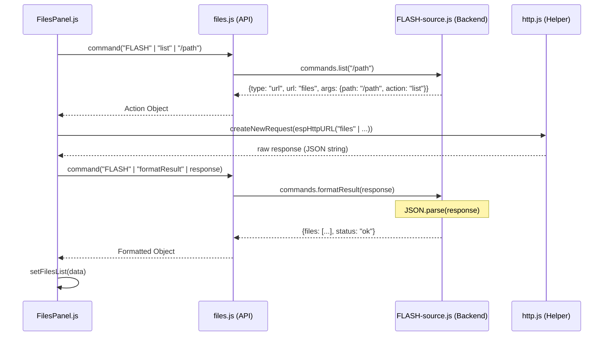

**Sources:**[src/components/Panels/Files.js#115-136](https://github.com/luc-github/ESP3D-WEBUI/blob/97c01e85/src/components/Panels/Files.js#L115-L136)[src/targets/CNC/grblHAL/FLASH-source.js#54-78](https://github.com/luc-github/ESP3D-WEBUI/blob/97c01e85/src/targets/CNC/grblHAL/FLASH-source.js#L54-L78)

## Parsing and Formatting

Backends are responsible for converting raw firmware/server output into a standard format the UI understands.

### JSON Formatting (Modern)

Used by FLASH and DIRECTSD. It simply parses the incoming JSON and optionally sorts the results.

```
formatResult: (resultTxT) => {
    const res = JSON.parse(resultTxT)
    if (useUiContextFn.getValue("sort_flashfs_files")){
        res.files = sortedFilesList(res.files)
    } 
    res.status = formatStatus(res.status)
    return res
}
```

**Sources:**[src/targets/CNC/grblHAL/FLASH-source.js#71-78](https://github.com/luc-github/ESP3D-WEBUI/blob/97c01e85/src/targets/CNC/grblHAL/FLASH-source.js#L71-L78)

### Serial Parsing (Legacy)

Used by Marlin SD. It uses regex to extract file names and sizes from multi-line serial output (e.g., from `M20`).

```
const formatFileSerialLine = (lines) => {
    // ... regex logic to match filenames and sizes ...
    const lineParserPattern = `^(?:(?<path>.*\\.(?:${extensionsPattern}))? *(?<size>\\d+)? )?(?:(?<pathAlt>.*\\.(?:${extensionsPattern}))? *((?<sizeAlt>\\d*) *)?)$`
    // ... reduction into file objects ...
}
```

**Sources:**[src/targets/Printer3D/Marlin/SD-source.js#31-53](https://github.com/luc-github/ESP3D-WEBUI/blob/97c01e85/src/targets/Printer3D/Marlin/SD-source.js#L31-L53)

## Dependency System

The availability of a filesystem is determined by the `depend` property in the `supported` list. This checks both UI visibility settings and hardware configuration settings.

```
{
    value: "DIRECTSD",
    name: "S190",
    depend: () => {
        return (
            useUiContextFn.getValue("directsd") &&
            useSettingsContextFn.getValue("SDConnection") != "none"
        )
    },
}
```

**Sources:**[src/targets/CNC/grblHAL/files.js#38-46](https://github.com/luc-github/ESP3D-WEBUI/blob/97c01e85/src/targets/CNC/grblHAL/files.js#L38-L46)

---

# 10.2-Storage-Backend-Implementations

# Storage Backend Implementations
Relevant source files

- [config/targets/Printer3D/Marlin/index.js](https://github.com/luc-github/ESP3D-WEBUI/blob/97c01e85/config/targets/Printer3D/Marlin/index.js)
- [src/components/Helpers/http.js](https://github.com/luc-github/ESP3D-WEBUI/blob/97c01e85/src/components/Helpers/http.js)
- [src/tabs/interface/importHelper.js](https://github.com/luc-github/ESP3D-WEBUI/blob/97c01e85/src/tabs/interface/importHelper.js)
- [src/targets/FLASH-source.js](https://github.com/luc-github/ESP3D-WEBUI/blob/97c01e85/src/targets/FLASH-source.js)
- [src/targets/Printer3D/Marlin-embedded/SD-source.js](https://github.com/luc-github/ESP3D-WEBUI/blob/97c01e85/src/targets/Printer3D/Marlin-embedded/SD-source.js)
- [src/targets/Printer3D/Marlin/DIRECTSD-source.js](https://github.com/luc-github/ESP3D-WEBUI/blob/97c01e85/src/targets/Printer3D/Marlin/DIRECTSD-source.js)
- [src/targets/Printer3D/Marlin/FLASH-source.js](https://github.com/luc-github/ESP3D-WEBUI/blob/97c01e85/src/targets/Printer3D/Marlin/FLASH-source.js)
- [src/targets/Printer3D/Marlin/SD-source.js](https://github.com/luc-github/ESP3D-WEBUI/blob/97c01e85/src/targets/Printer3D/Marlin/SD-source.js)
- [src/targets/Printer3D/Marlin/SDEXT-source.js](https://github.com/luc-github/ESP3D-WEBUI/blob/97c01e85/src/targets/Printer3D/Marlin/SDEXT-source.js)
- [src/targets/Printer3D/Marlin/files.js](https://github.com/luc-github/ESP3D-WEBUI/blob/97c01e85/src/targets/Printer3D/Marlin/files.js)
- [src/targets/Printer3D/Smoothieware/SD-source.js](https://github.com/luc-github/ESP3D-WEBUI/blob/97c01e85/src/targets/Printer3D/Smoothieware/SD-source.js)
- [src/targets/Printer3D/Smoothieware/SDEXT-source.js](https://github.com/luc-github/ESP3D-WEBUI/blob/97c01e85/src/targets/Printer3D/Smoothieware/SDEXT-source.js)

## Purpose and Scope

This document provides a detailed technical reference for all storage backend implementations in ESP3D-WEBUI. Each backend encapsulates the protocol-specific logic for interacting with a particular storage medium (FLASH memory, SD cards, TFT display storage, etc.).

For information about the unified `files` API that abstracts these backends, see [File System Architecture](/org/luc-github/wiki/luc-github/ESP3D-WEBUI/page/10.1?branch=%223.0%22). For details on specific file operations and their protocol-level implementations, see [File Operations and Protocols](/org/luc-github/wiki/luc-github/ESP3D-WEBUI/page/10.3?branch=%223.0%22).

## Backend Interface Structure

All storage backends follow a common interface pattern defined in `*-source.js` files. Each backend exports an object containing two primary properties: `capabilities` and `commands`, with an optional `responseSteps` property for serial protocol-based backends.

### Capabilities Object

The `capabilities` object defines which operations a storage backend supports through a set of boolean-returning functions:

[Flowchart Diagram]

**Sources:**[src/targets/Printer3D/Marlin/FLASH-source.js#24-54](https://github.com/luc-github/ESP3D-WEBUI/blob/97c01e85/src/targets/Printer3D/Marlin/FLASH-source.js#L24-L54)[src/targets/Printer3D/Marlin/SD-source.js#55-82](https://github.com/luc-github/ESP3D-WEBUI/blob/97c01e85/src/targets/Printer3D/Marlin/SD-source.js#L55-L82)[src/targets/Printer3D/Marlin/DIRECTSD-source.js#25-58](https://github.com/luc-github/ESP3D-WEBUI/blob/97c01e85/src/targets/Printer3D/Marlin/DIRECTSD-source.js#L25-L58)

### Commands Object

The `commands` object contains functions that generate operation requests. Each function returns an object describing how to execute the operation (either via a URL request or a firmware command):

[Flowchart Diagram]

**Sources:**[src/targets/Printer3D/Marlin/FLASH-source.js#56-141](https://github.com/luc-github/ESP3D-WEBUI/blob/97c01e85/src/targets/Printer3D/Marlin/FLASH-source.js#L56-L141)[src/targets/Printer3D/Marlin/SD-source.js#84-153](https://github.com/luc-github/ESP3D-WEBUI/blob/97c01e85/src/targets/Printer3D/Marlin/SD-source.js#L84-L153)[src/targets/Printer3D/Marlin/DIRECTSD-source.js#60-156](https://github.com/luc-github/ESP3D-WEBUI/blob/97c01e85/src/targets/Printer3D/Marlin/DIRECTSD-source.js#L60-L156)

### Response Steps Object (Serial Protocol Only)

Serial protocol-based backends (SD, SDEXT, TFTSD, TFTUSB) include a `responseSteps` object that defines how to parse multi-line serial responses from the firmware:

[Flowchart Diagram]

**Sources:**[src/targets/Printer3D/Marlin/SD-source.js#155-177](https://github.com/luc-github/ESP3D-WEBUI/blob/97c01e85/src/targets/Printer3D/Marlin/SD-source.js#L155-L177)[src/targets/Printer3D/Marlin/SDEXT-source.js#157-178](https://github.com/luc-github/ESP3D-WEBUI/blob/97c01e85/src/targets/Printer3D/Marlin/SDEXT-source.js#L157-L178)[src/targets/Printer3D/Marlin/TFT-SD-source.js#239-265](https://github.com/luc-github/ESP3D-WEBUI/blob/97c01e85/src/targets/Printer3D/Marlin/TFT-SD-source.js#L239-L265)

## 3D Printer Storage Backends

ESP3D-WEBUI supports six storage backends for 3D printers running Marlin firmware. These backends handle different storage configurations and communication protocols.

### FLASH Storage Backend

**File:**[src/targets/Printer3D/Marlin/FLASH-source.js#1-146](https://github.com/luc-github/ESP3D-WEBUI/blob/97c01e85/src/targets/Printer3D/Marlin/FLASH-source.js#L1-L146)

FLASH storage represents the ESP device's internal filesystem (LittleFS or SPIFFS). This backend provides full file management capabilities and is used for storing G-code files that can be streamed to the printer.

#### Capabilities

[Flowchart Diagram]

#### Key Operations

|  |  |  |  |
| --- | --- | --- | --- |
| `list` | URL | `files?path={path}&action=list` | List files in directory |
| `upload` | URL | `files?path={HostUploadPath+path}` | Upload file to FLASH |
| `download` | URL | `{HostUploadPath+path}/{filename}` | Download file from FLASH |
| `play` | Command | `[ESP700]stream={fullpath}` (direct) or `M23 {path}\nM24` (shared) | Execute G-code file |
| `delete` | URL | `files?path={path}&action=delete&filename={filename}` | Delete file |
| `deletedir` | URL | `files?path={path}&action=deletedir&filename={filename}` | Delete directory |
| `createdir` | URL | `files?path={path}&action=createdir&filename={filename}` | Create directory |

#### Special Features

- Supports file sorting via `sort_flashfs_files` UI setting ([src/targets/Printer3D/Marlin/FLASH-source.js#76-78](https://github.com/luc-github/ESP3D-WEBUI/blob/97c01e85/src/targets/Printer3D/Marlin/FLASH-source.js#L76-L78)).
- Respects `HostUploadPath` setting for upload destination ([src/targets/Printer3D/Marlin/FLASH-source.js#66-67](https://github.com/luc-github/ESP3D-WEBUI/blob/97c01e85/src/targets/Printer3D/Marlin/FLASH-source.js#L66-L67)).
- Streaming support required for file processing ([src/targets/Printer3D/Marlin/FLASH-source.js#26-29](https://github.com/luc-github/ESP3D-WEBUI/blob/97c01e85/src/targets/Printer3D/Marlin/FLASH-source.js#L26-L29)).
- Hierarchical filesystem (not flat) ([src/targets/Printer3D/Marlin/FLASH-source.js#32](https://github.com/luc-github/ESP3D-WEBUI/blob/97c01e85/src/targets/Printer3D/Marlin/FLASH-source.js#L32-L32)).

**Sources:**[src/targets/Printer3D/Marlin/FLASH-source.js#1-146](https://github.com/luc-github/ESP3D-WEBUI/blob/97c01e85/src/targets/Printer3D/Marlin/FLASH-source.js#L1-L146)

### SD Storage Backend

**File:**[src/targets/Printer3D/Marlin/SD-source.js#1-181](https://github.com/luc-github/ESP3D-WEBUI/blob/97c01e85/src/targets/Printer3D/Marlin/SD-source.js#L1-L181)

SD storage represents the printer's built-in SD card accessed through Marlin G-code commands (M20, M23, M30, M24). This is treated as a flat filesystem with limited capabilities due to firmware protocol constraints.

#### Capabilities

[Flowchart Diagram]

#### Serial Protocol Commands

The SD backend uses Marlin-specific G-code commands retrieved from UI context settings:

|  |  |  |  |
| --- | --- | --- | --- |
| `list` | `sdlistcmd` setting | `M20` | `Begin file list...End file list` |
| `play` | `sdplaycmd` setting | `M23 {filepath}\nM24` | N/A |
| `delete` | `sddeletecmd` setting | `M30 {filepath}` | `File deleted:...ok` |
| `upload` | N/A | `/upload?path={path}` (MKS only) | N/A |

#### Line Parsing

The backend parses serial responses using regex patterns to extract file information:

```
// Pattern from src/targets/Printer3D/Marlin/SD-source.js:37
const lineParserPattern = `^(?:(?<path>.*\\.(?:${extensionsPattern}))? *(?<size>\\d+)? )?(?:(?<pathAlt>.*\\.(?:${extensionsPattern}))? *((?<sizeAlt>\\d*) *)?)$`
```

Files are matched against the extension filter from `filesfilter` UI setting ([src/targets/Printer3D/Marlin/SD-source.js#32-37](https://github.com/luc-github/ESP3D-WEBUI/blob/97c01e85/src/targets/Printer3D/Marlin/SD-source.js#L32-L37)).

#### Response Steps

[State Diagram]

**Sources:**[src/targets/Printer3D/Marlin/SD-source.js#1-181](https://github.com/luc-github/ESP3D-WEBUI/blob/97c01e85/src/targets/Printer3D/Marlin/SD-source.js#L1-L181)

### DIRECTSD Storage Backend

**File:**[src/targets/Printer3D/Marlin/DIRECTSD-source.js#1-161](https://github.com/luc-github/ESP3D-WEBUI/blob/97c01e85/src/targets/Printer3D/Marlin/DIRECTSD-source.js#L1-L161)

DIRECTSD storage represents direct hardware access to the SD card, bypassing the Marlin firmware. This provides full file system capabilities with hierarchical directory support.

#### Capabilities

[Flowchart Diagram]

#### HTTP Operations

All operations use the `/sdfiles` endpoint with action parameters:

|  |  |  |  |
| --- | --- | --- | --- |
| `list` | `sdfiles?path={path}&action=list` | `list` | - |
| `upload` | `sdfiles?path={path}` | (implicit) | - |
| `delete` | `sdfiles?path={path}&action=delete&filename={filename}` | `delete` | `filename` |
| `deletedir` | `sdfiles?path={path}&action=deletedir&filename={filename}` | `deletedir` | `filename` |
| `createdir` | `sdfiles?path={path}&action=createdir&filename={filename}` | `createdir` | `filename` (spaces replaced with `_`) |
| `download` | `/sd{path}/{filename}` | - | - |

#### File Streaming vs. Firmware Execution

The `play` command behavior depends on `Streaming` and `SDConnection` settings:

[Flowchart Diagram]

**Sources:**[src/targets/Printer3D/Marlin/DIRECTSD-source.js#1-161](https://github.com/luc-github/ESP3D-WEBUI/blob/97c01e85/src/targets/Printer3D/Marlin/DIRECTSD-source.js#L1-L161)

### SDEXT Storage Backend

**File:**[src/targets/Printer3D/Marlin/SDEXT-source.js#1-183](https://github.com/luc-github/ESP3D-WEBUI/blob/97c01e85/src/targets/Printer3D/Marlin/SDEXT-source.js#L1-L183)

SDEXT storage represents an external SD card (secondary SD card slot) accessed through Marlin commands. This is typically a flat filesystem with limited capabilities similar to the primary SD backend.

#### Capabilities

[Flowchart Diagram]

#### Command Configuration

SDEXT uses distinct UI context settings from SD for its commands:

|  |  |  |
| --- | --- | --- |
| `list` | `sdextlistcmd` | External SD list command |
| `play` | `sdextplaycmd` | External SD play command (# replaced with path) |
| `delete` | `sdextdeletecmd` | External SD delete command (# replaced with path) |

#### File Sorting

SDEXT has its own sorting configuration independent of SD:

```
// From src/targets/Printer3D/Marlin/SDEXT-source.js:124
const isSorted = useUiContextFn.getValue("sort_sdext_files")
```

**Sources:**[src/targets/Printer3D/Marlin/SDEXT-source.js#1-183](https://github.com/luc-github/ESP3D-WEBUI/blob/97c01e85/src/targets/Printer3D/Marlin/SDEXT-source.js#L1-L183)

### TFT SD Storage Backend

**File:**[src/targets/Printer3D/Marlin/TFT-SD-source.js#1-270](https://github.com/luc-github/ESP3D-WEBUI/blob/97c01e85/src/targets/Printer3D/Marlin/TFT-SD-source.js#L1-L270)

TFT SD storage represents SD cards connected to TFT display controllers (e.g., BigTreeTech, MKS displays). These displays have their own command protocols for file management.

#### Protocol-Specific Commands

TFT SD supports two protocols: MKS and BigTreeTech (BTT). Commands are selected based on `SerialProtocol` setting or `tftfs` UI value:

#### File List Parsing

TFT SD uses a custom line parser that handles directory entries and file entries differently:

```
// From src/targets/Printer3D/Marlin/TFT-SD-source.js:34-41
const regList = [
    {
        regex: SerialProtocol == "MKS" ? "^(.*).DIR$" : "^\\/(.*)\\/$",
        extract: (res) => { return { name: res[1], size: -1 } }
    },
    {
        regex: "^(.*\\.GCODE)$",
        extract: (res) => { return { name: res[1], size: "" } }
    }
]
```

Directories are identified by `.DIR` suffix (MKS) or `/.../` pattern (BTT) ([src/targets/Printer3D/Marlin/TFT-SD-source.js#34-48](https://github.com/luc-github/ESP3D-WEBUI/blob/97c01e85/src/targets/Printer3D/Marlin/TFT-SD-source.js#L34-L48)).

**Sources:**[src/targets/Printer3D/Marlin/TFT-SD-source.js#1-270](https://github.com/luc-github/ESP3D-WEBUI/blob/97c01e85/src/targets/Printer3D/Marlin/TFT-SD-source.js#L1-L270)

### TFT USB Storage Backend

**File:**[src/targets/Printer3D/Marlin/TFT-USB-source.js#1-270](https://github.com/luc-github/ESP3D-WEBUI/blob/97c01e85/src/targets/Printer3D/Marlin/TFT-USB-source.js#L1-L270)

TFT USB storage represents USB drives connected to TFT display controllers. The implementation follows the same pattern as TFT SD with protocol-specific command routing for MKS and BTT displays.

**Sources:**[src/targets/Printer3D/Marlin/TFT-USB-source.js#1-270](https://github.com/luc-github/ESP3D-WEBUI/blob/97c01e85/src/targets/Printer3D/Marlin/TFT-USB-source.js#L1-L270)

## Smoothieware Storage Implementation

Smoothieware uses a different protocol for SD access, relying on `echo` commands to delimit file lists and standard Smoothie commands for operations.

### SD Storage (Smoothie)

**File:**[src/targets/Printer3D/Smoothieware/SD-source.js#1-185](https://github.com/luc-github/ESP3D-WEBUI/blob/97c01e85/src/targets/Printer3D/Smoothieware/SD-source.js#L1-L185)

#### Command Generation

Smoothie wraps the list command in `echo` statements to allow the parser to identify the start and end of the file list:

```
// From src/targets/Printer3D/Smoothieware/SD-source.js:84-97
list: (path, filename) => {
    const spath = (path + (path == "/" ? "" : "/")).replaceAll("//", "/")
    const cmd = "echo BeginFiles;" + 
                useUiContextFn.getValue("sdlistcmd").replace("#", spath) + 
                ";echo EndFiles"
    return { type: "cmd", cmd }
}
```

#### Capabilities

Smoothie SD supports deletion only if paths do not contain spaces ([src/targets/Printer3D/Smoothieware/SD-source.js#72-74](https://github.com/luc-github/ESP3D-WEBUI/blob/97c01e85/src/targets/Printer3D/Smoothieware/SD-source.js#L72-L74)).

**Sources:**[src/targets/Printer3D/Smoothieware/SD-source.js#1-185](https://github.com/luc-github/ESP3D-WEBUI/blob/97c01e85/src/targets/Printer3D/Smoothieware/SD-source.js#L1-L185)

## Backend Registration and Integration

Storage backends are registered and exposed through target-specific `files.js` modules. These modules aggregate individual backend exports and provide the unified interface consumed by the UI.

### Marlin Files Module

**File:**[src/targets/Printer3D/Marlin/files.js#1-130](https://github.com/luc-github/ESP3D-WEBUI/blob/97c01e85/src/targets/Printer3D/Marlin/files.js#L1-L130)

[Flowchart Diagram]

#### Supported Filesystems Array

The `supportedFileSystems` array defines which storage backends are available and when they should be visible:

```
// From src/targets/Printer3D/Marlin/files.js:30-85
const supportedFileSystems = [
    {
        value: "FLASH",
        name: "S137",  // Translation key
        depend: () => {
            return useUiContextFn.getValue("flashfs") && 
                   useSettingsContextFn.getValue("FlashFileSystem") != "none"
        }
    },
    // ... more filesystems
]
```

#### Capabilities and Command Routing

The `files.js` module provides the `capability()` and `command()` functions used by the rest of the application to interact with storage:

- `capability(filesystem, cap, ...rest)`: Routes capability checks ([src/targets/Printer3D/Marlin/files.js#105-112](https://github.com/luc-github/ESP3D-WEBUI/blob/97c01e85/src/targets/Printer3D/Marlin/files.js#L105-L112)).
- `command(filesystem, cmd, ...rest)`: Routes command generation ([src/targets/Printer3D/Marlin/files.js#114-121](https://github.com/luc-github/ESP3D-WEBUI/blob/97c01e85/src/targets/Printer3D/Marlin/files.js#L114-L121)).

**Sources:**[src/targets/Printer3D/Marlin/files.js#1-130](https://github.com/luc-github/ESP3D-WEBUI/blob/97c01e85/src/targets/Printer3D/Marlin/files.js#L1-L130)

## Capability Matrix Summary

|  |  |  |  |  |  |  |  |  |
| --- | --- | --- | --- | --- | --- | --- | --- | --- |
| **FLASH** | Marlin | Streaming req. | No | No | Yes | Yes | Yes | Yes |
| **SD** | Marlin | Yes | Yes | Yes | MKS only | No | Not MKS | No |
| **DIRECTSD** | Marlin | Conditional | Yes | No | Yes | Yes | Yes | Yes |
| **SDEXT** | Marlin | Yes | Yes | Yes | MKS only | No | Not MKS | No |
| **TFTSD** | Marlin | Yes | Yes | No | MKS only | No | Not MKS | No |
| **TFTUSB** | Marlin | Yes | Yes | No | MKS only | No | Not MKS | No |
| **SD** | Smoothie | Conditional | Yes | No | No | No | Space-limit | No |

**Sources:**[src/targets/Printer3D/Marlin/FLASH-source.js](https://github.com/luc-github/ESP3D-WEBUI/blob/97c01e85/src/targets/Printer3D/Marlin/FLASH-source.js)[src/targets/Printer3D/Marlin/SD-source.js](https://github.com/luc-github/ESP3D-WEBUI/blob/97c01e85/src/targets/Printer3D/Marlin/SD-source.js)[src/targets/Printer3D/Marlin/DIRECTSD-source.js](https://github.com/luc-github/ESP3D-WEBUI/blob/97c01e85/src/targets/Printer3D/Marlin/DIRECTSD-source.js)[src/targets/Printer3D/Marlin/SDEXT-source.js](https://github.com/luc-github/ESP3D-WEBUI/blob/97c01e85/src/targets/Printer3D/Marlin/SDEXT-source.js)[src/targets/Printer3D/Marlin/TFT-SD-source.js](https://github.com/luc-github/ESP3D-WEBUI/blob/97c01e85/src/targets/Printer3D/Marlin/TFT-SD-source.js)[src/targets/Printer3D/Smoothieware/SD-source.js](https://github.com/luc-github/ESP3D-WEBUI/blob/97c01e85/src/targets/Printer3D/Smoothieware/SD-source.js)

---

# 10.3-File-Operations-and-Protocols

# File Operations and Protocols
Relevant source files

- [src/components/Helpers/http.js](https://github.com/luc-github/ESP3D-WEBUI/blob/97c01e85/src/components/Helpers/http.js)
- [src/tabs/interface/importHelper.js](https://github.com/luc-github/ESP3D-WEBUI/blob/97c01e85/src/tabs/interface/importHelper.js)
- [src/targets/CNC/GRBL/index.js](https://github.com/luc-github/ESP3D-WEBUI/blob/97c01e85/src/targets/CNC/GRBL/index.js)
- [src/targets/CNC/grblHAL/DIRECTSD-source.js](https://github.com/luc-github/ESP3D-WEBUI/blob/97c01e85/src/targets/CNC/grblHAL/DIRECTSD-source.js)
- [src/targets/CNC/grblHAL/FLASH-source.js](https://github.com/luc-github/ESP3D-WEBUI/blob/97c01e85/src/targets/CNC/grblHAL/FLASH-source.js)
- [src/targets/CNC/grblHAL/files.js](https://github.com/luc-github/ESP3D-WEBUI/blob/97c01e85/src/targets/CNC/grblHAL/files.js)
- [src/targets/CNC/grblHAL/index.js](https://github.com/luc-github/ESP3D-WEBUI/blob/97c01e85/src/targets/CNC/grblHAL/index.js)
- [src/targets/CNC/grblHAL/realCommandsTable.js](https://github.com/luc-github/ESP3D-WEBUI/blob/97c01e85/src/targets/CNC/grblHAL/realCommandsTable.js)
- [src/targets/CNC/grblHAL/translations/en.json](https://github.com/luc-github/ESP3D-WEBUI/blob/97c01e85/src/targets/CNC/grblHAL/translations/en.json)
- [src/targets/CNC/translations/en.json](https://github.com/luc-github/ESP3D-WEBUI/blob/97c01e85/src/targets/CNC/translations/en.json)
- [src/targets/Printer3D/Marlin-embedded/SD-source.js](https://github.com/luc-github/ESP3D-WEBUI/blob/97c01e85/src/targets/Printer3D/Marlin-embedded/SD-source.js)
- [src/targets/Printer3D/Marlin/SD-source.js](https://github.com/luc-github/ESP3D-WEBUI/blob/97c01e85/src/targets/Printer3D/Marlin/SD-source.js)
- [src/targets/Printer3D/Marlin/SDEXT-source.js](https://github.com/luc-github/ESP3D-WEBUI/blob/97c01e85/src/targets/Printer3D/Marlin/SDEXT-source.js)

## Purpose and Scope

This page documents the file operations API and communication protocols used by ESP3D-WEBUI to interact with different storage backends. It covers the command structure, operation types (list, upload, delete, play, etc.), protocol variants (serial vs HTTP), and backend-specific implementations.

For information about the overall file system architecture and the capability API, see [File System Architecture](/org/luc-github/wiki/luc-github/ESP3D-WEBUI/page/10.1?branch=%223.0%22). For details on specific storage backend characteristics and availability checking, see [Storage Backend Implementations](/org/luc-github/wiki/luc-github/ESP3D-WEBUI/page/10.2?branch=%223.0%22).

## Command Structure

Each storage backend implements a `commands` object containing functions for file operations. All command functions follow a consistent interface and return command objects that specify the protocol type and required parameters.

### Command Object Format

All command functions return an object with the following structure:

|  |  |  |  |
| --- | --- | --- | --- |
| `type` | string | Protocol type: `"cmd"`, `"url"`, `"refresh"`, `"none"`, or `"error"` | Yes |
| `cmd` | string | Serial command string | For `type: "cmd"` |
| `url` | string | HTTP endpoint path | For `type: "url"` |
| `args` | object | Query parameters or request data | For `type: "url"` |
| `arg` | any | Additional argument data | Optional |
| `timeOut` | number | Operation timeout in milliseconds | Optional |

**Sources:**[src/targets/CNC/grblHAL/FLASH-source.js#53-129](https://github.com/luc-github/ESP3D-WEBUI/blob/97c01e85/src/targets/CNC/grblHAL/FLASH-source.js#L53-L129)[src/targets/Printer3D/Marlin/SD-source.js#84-153](https://github.com/luc-github/ESP3D-WEBUI/blob/97c01e85/src/targets/Printer3D/Marlin/SD-source.js#L84-L153)[src/targets/CNC/grblHAL/DIRECTSD-source.js#54-120](https://github.com/luc-github/ESP3D-WEBUI/blob/97c01e85/src/targets/CNC/grblHAL/DIRECTSD-source.js#L54-L120)

## Protocol Types

### Serial Command Protocol

**Type:**`"cmd"`

Commands sent directly to firmware via serial communication. Used primarily for SD and SDEXT operations where the firmware manages the storage.

**Example Command Objects:**

```
// List SD card files
{ type: "cmd", cmd: "M20" }
 
// Play file from SD
{ type: "cmd", cmd: "M23 /print.gcode\nM24" }
 
// Delete file from SD
{ type: "cmd", cmd: "M30 /old.gcode" }
```

**Diagram: Serial Command Flow**

[Flowchart Diagram]

**Sources:**[src/targets/Printer3D/Marlin/SD-source.js#85-153](https://github.com/luc-github/ESP3D-WEBUI/blob/97c01e85/src/targets/Printer3D/Marlin/SD-source.js#L85-L153)[src/targets/Printer3D/Marlin/SDEXT-source.js#85-154](https://github.com/luc-github/ESP3D-WEBUI/blob/97c01e85/src/targets/Printer3D/Marlin/SDEXT-source.js#L85-L154)

### HTTP/REST Protocol

**Type:**`"url"`

Commands sent via HTTP requests to ESP3D's web server. Used for FLASH and DIRECTSD operations where the ESP32 device manages the storage directly through its filesystem APIs.

**Example Command Objects:**

```
// List files via HTTP
{ 
    type: "url", 
    url: "files", 
    args: { path: "/", action: "list" } 
}
 
// Upload to DIRECTSD
{ 
    type: "url", 
    url: "sdfiles", 
    args: { path: "/gcodes" } 
}
 
// Delete via HTTP
{ 
    type: "url", 
    url: "files", 
    args: { path: "/", action: "delete", filename: "test.gcode" } 
}
```

**Diagram: HTTP Command Flow**

[Flowchart Diagram]

**Sources:**[src/targets/CNC/grblHAL/FLASH-source.js#54-114](https://github.com/luc-github/ESP3D-WEBUI/blob/97c01e85/src/targets/CNC/grblHAL/FLASH-source.js#L54-L114)[src/targets/CNC/grblHAL/DIRECTSD-source.js#55-105](https://github.com/luc-github/ESP3D-WEBUI/blob/97c01e85/src/targets/CNC/grblHAL/DIRECTSD-source.js#L55-L105)[src/components/Helpers/http.js#37-49](https://github.com/luc-github/ESP3D-WEBUI/blob/97c01e85/src/components/Helpers/http.js#L37-L49)

### Special Protocol Types

**Refresh Type:**`type: "refresh"`

Triggers a UI refresh after a specified timeout. Used after operations that require processing time before results are visible.

```
// Post-upload refresh for MKS protocol
{
    type: "refresh",
    arg: false,
    timeOut: 3000  // 3 second delay
}
```

**None Type:**`type: "none"`

Indicates no action is required after an operation.

**Error Type:**`type: "error"`

Returned when a command is invalid or unsupported for the specified backend.

**Sources:**[src/targets/Printer3D/Marlin/SD-source.js#104-113](https://github.com/luc-github/ESP3D-WEBUI/blob/97c01e85/src/targets/Printer3D/Marlin/SD-source.js#L104-L113)[src/targets/Printer3D/Marlin/SDEXT-source.js#104-113](https://github.com/luc-github/ESP3D-WEBUI/blob/97c01e85/src/targets/Printer3D/Marlin/SDEXT-source.js#L104-L113)

## Standard File Operations

### List Operation

Lists files and directories at a specified path.

**Function Signature:**

```
commands.list(path, filename)
```

**Parameters:**

- `path` (string): Directory path to list
- `filename` (string): Not used for list operation

**Protocol Variants by Backend:**

[Flowchart Diagram]

**Implementation Examples:**

```
// FLASH-source.js:54-60
list: (path, filename) => {
    return {
        type: "url",
        url: "files",
        args: { path, action: "list" },
    }
}
 
// SD-source.js:85-90
list: (path, filename) => {
    return {
        type: "cmd",
        cmd: useUiContextFn.getValue("sdlistcmd"),
    }
}
```

**Sources:**[src/targets/CNC/grblHAL/FLASH-source.js#54-60](https://github.com/luc-github/ESP3D-WEBUI/blob/97c01e85/src/targets/CNC/grblHAL/FLASH-source.js#L54-L60)[src/targets/Printer3D/Marlin/SD-source.js#85-90](https://github.com/luc-github/ESP3D-WEBUI/blob/97c01e85/src/targets/Printer3D/Marlin/SD-source.js#L85-L90)[src/targets/CNC/grblHAL/DIRECTSD-source.js#55-61](https://github.com/luc-github/ESP3D-WEBUI/blob/97c01e85/src/targets/CNC/grblHAL/DIRECTSD-source.js#L55-L61)[src/targets/Printer3D/Marlin/SDEXT-source.js#85-90](https://github.com/luc-github/ESP3D-WEBUI/blob/97c01e85/src/targets/Printer3D/Marlin/SDEXT-source.js#L85-L90)

### Upload Operation

Uploads files to storage. Implementation varies significantly by backend and firmware protocol.

**Function Signature:**

```
commands.upload(path, filename)
```

**Implementation Matrix:**

|  |  |  |  |  |
| --- | --- | --- | --- | --- |
| FLASH | HTTP | `files` | Prepends `HostUploadPath` setting | Full support |
| DIRECTSD | HTTP | `sdfiles` | Uses path directly | Full support |
| SD (MKS) | HTTP | `upload` | Uses path directly | Special MKS protocol |
| SD (Standard) | N/A | Returns list cmd | Not supported | Fallback to list |
| SDEXT (MKS) | HTTP | `upload` | Uses path directly | Special MKS protocol |
| SDEXT (Standard) | N/A | Returns list cmd | Not supported | Fallback to list |

**MKS Protocol Special Handling:**

The MKS firmware variant requires special upload handling:

```
// SD-source.js:91-103
upload: (path, filename) => {
    if (useSettingsContextFn.getValue("SerialProtocol") == "MKS")
        return {
            type: "url",
            url: "upload",
            args: { path },
        }
    // Standard protocol doesn't support upload via serial
    return {
        type: "cmd",
        cmd: useUiContextFn.getValue("sdlistcmd"),
    }
}
```

**FLASH Upload with Path Prefix:**

```
// FLASH-source.js:61-70
upload: (path, filename) => {
    const upath = (
        useSettingsContextFn.getValue("HostUploadPath") + path
    ).replaceAll("//", "/")
    return {
        type: "url",
        url: "files",
        args: { path: upath },
    }
}
```

**Sources:**[src/targets/CNC/grblHAL/FLASH-source.js#61-70](https://github.com/luc-github/ESP3D-WEBUI/blob/97c01e85/src/targets/CNC/grblHAL/FLASH-source.js#L61-L70)[src/targets/Printer3D/Marlin/SD-source.js#91-103](https://github.com/luc-github/ESP3D-WEBUI/blob/97c01e85/src/targets/Printer3D/Marlin/SD-source.js#L91-L103)[src/targets/CNC/grblHAL/DIRECTSD-source.js#62-68](https://github.com/luc-github/ESP3D-WEBUI/blob/97c01e85/src/targets/CNC/grblHAL/DIRECTSD-source.js#L62-L68)[src/targets/Printer3D/Marlin/SDEXT-source.js#91-103](https://github.com/luc-github/ESP3D-WEBUI/blob/97c01e85/src/targets/Printer3D/Marlin/SDEXT-source.js#L91-L103)

### Post-Upload Actions

Some backends require post-upload processing or delays.

**Function Signature:**

```
commands.postUpload(path, filename)
```

**MKS Protocol Refresh:**

```
// SD-source.js:104-113
postUpload: (path, filename) => {
    if (useSettingsContextFn.getValue("SerialProtocol") == "MKS") {
        return {
            type: "refresh",
            arg: false,
            timeOut: 3000,
        }
    }
    return { type: "none" }
}
```

**Sources:**[src/targets/Printer3D/Marlin/SD-source.js#104-113](https://github.com/luc-github/ESP3D-WEBUI/blob/97c01e85/src/targets/Printer3D/Marlin/SD-source.js#L104-L113)[src/targets/Printer3D/Marlin/SDEXT-source.js#104-113](https://github.com/luc-github/ESP3D-WEBUI/blob/97c01e85/src/targets/Printer3D/Marlin/SDEXT-source.js#L104-L113)

### Delete File Operation

Removes a single file from storage.

**Function Signature:**

```
commands.delete(path, filename)
```

**HTTP-Based Delete:**

```
// FLASH-source.js:88-93
delete: (path, filename) => {
    return {
        type: "url",
        url: "files",
        args: { path, action: "delete", filename },
    }
}
```

**Serial-Based Delete:**

```
// SD-source.js:142-152
delete: (path, filename) => {
    const spath = (path + (path == "/" ? "" : "/") + filename).replaceAll(
        "//",
        "/"
    )
    const cmd = useUiContextFn.getValue("sddeletecmd").replace("#", spath)
    return {
        type: "cmd",
        cmd,
    }
}
```

**Capability Checking:**

Not all serial protocols support delete:

```
// SD-source.js:73-75
DeleteFile: () => {
    return useSettingsContextFn.getValue("SerialProtocol") != "MKS"
}
```

**Sources:**[src/targets/CNC/grblHAL/FLASH-source.js#88-93](https://github.com/luc-github/ESP3D-WEBUI/blob/97c01e85/src/targets/CNC/grblHAL/FLASH-source.js#L88-L93)[src/targets/Printer3D/Marlin/SD-source.js#73-152](https://github.com/luc-github/ESP3D-WEBUI/blob/97c01e85/src/targets/Printer3D/Marlin/SD-source.js#L73-L152)[src/targets/CNC/grblHAL/DIRECTSD-source.js#85-91](https://github.com/luc-github/ESP3D-WEBUI/blob/97c01e85/src/targets/CNC/grblHAL/DIRECTSD-source.js#L85-L91)

### Delete Directory Operation

Removes an entire directory. Only supported by hierarchical filesystems.

**Function Signature:**

```
commands.deletedir(path, filename)
```

**Implementation:**

```
// FLASH-source.js:80-86
deletedir: (path, filename) => {
    return {
        type: "url",
        url: "files",
        args: { path, action: "deletedir", filename },
    }
}
```

**Availability:**

- ✓ FLASH
- ✓ DIRECTSD
- ✗ SD (flat filesystem)
- ✗ SDEXT (flat filesystem)

**Sources:**[src/targets/CNC/grblHAL/FLASH-source.js#80-86](https://github.com/luc-github/ESP3D-WEBUI/blob/97c01e85/src/targets/CNC/grblHAL/FLASH-source.js#L80-L86)[src/targets/CNC/grblHAL/DIRECTSD-source.js#78-84](https://github.com/luc-github/ESP3D-WEBUI/blob/97c01e85/src/targets/CNC/grblHAL/DIRECTSD-source.js#L78-L84)

### Create Directory Operation

Creates a new directory in hierarchical filesystems.

**Function Signature:**

```
commands.createdir(path, filename)
```

**FLASH Implementation:**

```
// FLASH-source.js:94-100
createdir: (path, filename) => {
    return {
        type: "url",
        url: "files",
        args: { path, action: "createdir", filename },
    }
}
```

**DIRECTSD Implementation:**

```
// DIRECTSD-source.js:92-98
createdir: (path, filename) => {
    return {
        type: "url",
        url: "sdfiles",
        args: { path, action: "createdir", filename },
    }
}
```

**Sources:**[src/targets/CNC/grblHAL/FLASH-source.js#94-100](https://github.com/luc-github/ESP3D-WEBUI/blob/97c01e85/src/targets/CNC/grblHAL/FLASH-source.js#L94-L100)[src/targets/CNC/grblHAL/DIRECTSD-source.js#92-98](https://github.com/luc-github/ESP3D-WEBUI/blob/97c01e85/src/targets/CNC/grblHAL/DIRECTSD-source.js#L92-L98)

### Download Operation

Downloads a file from storage to the client browser.

**Function Signature:**

```
commands.download(path, filename)
```

**Protocol Decision Flow:**

[Flowchart Diagram]

**FLASH Implementation:**

```
// FLASH-source.js:101-114
download: (path, filename) => {
    const upath = (
        useSettingsContextFn.getValue("HostUploadPath") +
        path +
        (path == "/" ? "" : "/") +
        filename
    ).replaceAll("//", "/")
    return {
        type: "url",
        url: upath,
        args: {},
    }
}
```

**DIRECTSD Implementation:**

```
// DIRECTSD-source.js:99-105
download: (path, filename) => {
    return {
        type: "url",
        url: path + (path.endsWith("/") ? "" : "/") + filename,
        args: {},
    }
}
```

**Capability Check:**

```
// SD-source.js:70-72
Download: () => {
    return false
}
```

**Sources:**[src/targets/CNC/grblHAL/FLASH-source.js#101-114](https://github.com/luc-github/ESP3D-WEBUI/blob/97c01e85/src/targets/CNC/grblHAL/FLASH-source.js#L101-L114)[src/targets/CNC/grblHAL/DIRECTSD-source.js#99-105](https://github.com/luc-github/ESP3D-WEBUI/blob/97c01e85/src/targets/CNC/grblHAL/DIRECTSD-source.js#L99-L105)[src/targets/Printer3D/Marlin/SD-source.js#70-72](https://github.com/luc-github/ESP3D-WEBUI/blob/97c01e85/src/targets/Printer3D/Marlin/SD-source.js#L70-L72)

### Play Operation

Starts processing a G-code file on the firmware.

**Function Signature:**

```
commands.play(path, filename)
```

**Marlin SD Play:**

```
// SD-source.js:131-141
play: (path, filename) => {
    const spath = (path + (path == "/" ? "" : "/") + filename).replaceAll(
        "//",
        "/"
    )
    const cmd = useUiContextFn.getValue("sdplaycmd").replace("#", spath)
    return {
        type: "cmd",
        cmd,
    }
}
```

**grblHAL FLASH Play:**

```
// FLASH-source.js:115-128
play: (path, filename) => {
    const spath = (path + (path == "/" ? "" : "/") + filename).replaceAll(
        "//",
        "/"
    )
    const cmd = useUiContextFn
        .getValue("playcmd")
        .replace("#", spath)
        .replaceAll("//", "/")
    return {
        type: "cmd",
        cmd,
    }
}
```

**Sources:**[src/targets/Printer3D/Marlin/SD-source.js#131-141](https://github.com/luc-github/ESP3D-WEBUI/blob/97c01e85/src/targets/Printer3D/Marlin/SD-source.js#L131-L141)[src/targets/CNC/grblHAL/FLASH-source.js#115-128](https://github.com/luc-github/ESP3D-WEBUI/blob/97c01e85/src/targets/CNC/grblHAL/FLASH-source.js#L115-L128)[src/targets/CNC/grblHAL/DIRECTSD-source.js#106-119](https://github.com/luc-github/ESP3D-WEBUI/blob/97c01e85/src/targets/CNC/grblHAL/DIRECTSD-source.js#L106-L119)

## Result Processing Operations

### Format Result

Parses raw response data into structured file listings.

**Function Signature:**

```
commands.formatResult(resultText)
```

**HTTP Response Processing:**

```
// FLASH-source.js:71-78
formatResult: (resultTxT) => {
    const res = JSON.parse(resultTxT)
    if (useUiContextFn.getValue("sort_flashfs_files")){
        res.files = sortedFilesList(res.files)
    } 
    res.status = formatStatus(res.status)
    return res
}
```

**Serial Response Processing:**

```
// SD-source.js:114-122
formatResult: (result) => {
    const files = formatFileSerialLine(result.content)
    const isSorted = useUiContextFn.getValue("sort_sd_files")
    return {
        files: isSorted? sortedFilesList(files, false) : files,
        status: formatStatus(result.status),
    }
}
```

**Serial Line Parser Diagram:**

[Flowchart Diagram]

**Sources:**[src/targets/CNC/grblHAL/FLASH-source.js#71-78](https://github.com/luc-github/ESP3D-WEBUI/blob/97c01e85/src/targets/CNC/grblHAL/FLASH-source.js#L71-L78)[src/targets/Printer3D/Marlin/SD-source.js#31-122](https://github.com/luc-github/ESP3D-WEBUI/blob/97c01e85/src/targets/Printer3D/Marlin/SD-source.js#L31-L122)[src/targets/CNC/grblHAL/DIRECTSD-source.js#69-76](https://github.com/luc-github/ESP3D-WEBUI/blob/97c01e85/src/targets/CNC/grblHAL/DIRECTSD-source.js#L69-L76)

### Filter Result

Filters file listings by path for flat filesystems.

**Function Signature:**

```
commands.filterResult(data, path)
```

**Implementation:**

```
// SD-source.js:123-130
filterResult: (data, path) => {
    const isSorted = useUiContextFn.getValue("sort_sd_files")
    const res = {}
    res.files = isSorted? sortedFilesList(filterResultFiles(data.files, path), false) : filterResultFiles(data.files, path)
    res.status = formatStatus(data.status)
    return res
}
```

**Sources:**[src/targets/Printer3D/Marlin/SD-source.js#123-130](https://github.com/luc-github/ESP3D-WEBUI/blob/97c01e85/src/targets/Printer3D/Marlin/SD-source.js#L123-L130)[src/targets/Printer3D/Marlin/SDEXT-source.js#122-130](https://github.com/luc-github/ESP3D-WEBUI/blob/97c01e85/src/targets/Printer3D/Marlin/SDEXT-source.js#L122-L130)

## Serial Response Steps

For serial-based operations, backends define response patterns to detect command start, completion, and errors.

### List Response Steps

```
// SD-source.js:156-168
list: {
    start: (data) => data.startsWith("Begin file list"),
    end: (data) => data.startsWith("End file list"),
    error: (data) => {
        return (
            data.indexOf("error") != -1 ||
            data.indexOf("echo:No SD card") != -1 ||
            data.indexOf("echo:No media") != -1 ||
            data.indexOf('echo:Unknown command: "M21"') != -1 ||
            data.indexOf('echo:Unknown command: "M20"') != -1
        )
    },
}
```

**Sources:**[src/targets/Printer3D/Marlin/SD-source.js#156-168](https://github.com/luc-github/ESP3D-WEBUI/blob/97c01e85/src/targets/Printer3D/Marlin/SD-source.js#L156-L168)[src/targets/Printer3D/Marlin/SDEXT-source.js#157-170](https://github.com/luc-github/ESP3D-WEBUI/blob/97c01e85/src/targets/Printer3D/Marlin/SDEXT-source.js#L157-L170)

## Command Invocation API

### Command Function

The `files.command()` function dispatches operations to the appropriate backend.

```
// grblHAL/files.js:68-74
function command() {
    const [filesystem, cmd, ...rest] = arguments
    if (commands[filesystem] && commands[filesystem][cmd])
        return commands[filesystem][cmd](...rest)
    console.log("Unknown command ", cmd, " for ", filesystem)
    return { type: "error" }
}
```

**Sources:**[src/targets/CNC/grblHAL/files.js#68-74](https://github.com/luc-github/ESP3D-WEBUI/blob/97c01e85/src/targets/CNC/grblHAL/files.js#L68-L74)

## Context Dependencies

File operations depend on runtime settings from `UiContext` and `SettingsContext`.

### UI Context Settings

|  |  |  |
| --- | --- | --- |
| `sdlistcmd` | SD list command | SD.commands.list |
| `sdplaycmd` | SD play template | SD.commands.play |
| `sddeletecmd` | SD delete template | SD.commands.delete |
| `filesfilter` | Extension filter | formatFileSerialLine |
| `sort_sd_files` | Sort SD listings | SD.commands.formatResult |

**Sources:**[src/targets/Printer3D/Marlin/SD-source.js#32-152](https://github.com/luc-github/ESP3D-WEBUI/blob/97c01e85/src/targets/Printer3D/Marlin/SD-source.js#L32-L152)[src/targets/CNC/grblHAL/FLASH-source.js#71-128](https://github.com/luc-github/ESP3D-WEBUI/blob/97c01e85/src/targets/CNC/grblHAL/FLASH-source.js#L71-L128)

## Operation Availability Summary

|  |  |  |  |  |
| --- | --- | --- | --- | --- |
| **List** | ✓ HTTP | ✓ HTTP | ✓ Serial | ✓ Serial |
| **Upload** | ✓ HTTP | ✓ HTTP | MKS only | MKS only |
| **Download** | ✓ HTTP | ✓ HTTP | ✗ | ✗ |
| **DeleteFile** | ✓ | ✓ | Non-MKS | Non-MKS |
| **DeleteDir** | ✓ | ✓ | ✗ | ✗ |
| **CreateDir** | ✓ | ✓ | ✗ | ✗ |

**Sources:**[src/targets/CNC/grblHAL/FLASH-source.js#24-51](https://github.com/luc-github/ESP3D-WEBUI/blob/97c01e85/src/targets/CNC/grblHAL/FLASH-source.js#L24-L51)[src/targets/CNC/grblHAL/DIRECTSD-source.js#25-52](https://github.com/luc-github/ESP3D-WEBUI/blob/97c01e85/src/targets/CNC/grblHAL/DIRECTSD-source.js#L25-L52)[src/targets/Printer3D/Marlin/SD-source.js#55-82](https://github.com/luc-github/ESP3D-WEBUI/blob/97c01e85/src/targets/Printer3D/Marlin/SD-source.js#L55-L82)[src/targets/Printer3D/Marlin/SDEXT-source.js#55-82](https://github.com/luc-github/ESP3D-WEBUI/blob/97c01e85/src/targets/Printer3D/Marlin/SDEXT-source.js#L55-L82)

---

# 11-Development-Guide

# Development Guide
Relevant source files

- [.all-contributorsrc](https://github.com/luc-github/ESP3D-WEBUI/blob/97c01e85/.all-contributorsrc)
- [.github/ci/final-check.sh](https://github.com/luc-github/ESP3D-WEBUI/blob/97c01e85/.github/ci/final-check.sh)
- [.github/workflows/build-ci.yml](https://github.com/luc-github/ESP3D-WEBUI/blob/97c01e85/.github/workflows/build-ci.yml)
- [.gitignore](https://github.com/luc-github/ESP3D-WEBUI/blob/97c01e85/.gitignore)
- [LICENSE](https://github.com/luc-github/ESP3D-WEBUI/blob/97c01e85/LICENSE)
- [README.md](https://github.com/luc-github/ESP3D-WEBUI/blob/97c01e85/README.md?plain=1)
- [dist/BUNDLE_SIZES.md](https://github.com/luc-github/ESP3D-WEBUI/blob/97c01e85/dist/BUNDLE_SIZES.md?plain=1)
- [dist/Printer3D/Repetier/index.html.gz](https://github.com/luc-github/ESP3D-WEBUI/blob/97c01e85/dist/Printer3D/Repetier/index.html.gz)
- [dist/Printer3D/Smoothieware/index.html.gz](https://github.com/luc-github/ESP3D-WEBUI/blob/97c01e85/dist/Printer3D/Smoothieware/index.html.gz)
- [dist/SandTable/GRBL/index.html.gz](https://github.com/luc-github/ESP3D-WEBUI/blob/97c01e85/dist/SandTable/GRBL/index.html.gz)
- [info.json](https://github.com/luc-github/ESP3D-WEBUI/blob/97c01e85/info.json)
- [src/components/App/version.js](https://github.com/luc-github/ESP3D-WEBUI/blob/97c01e85/src/components/App/version.js)
- [src/components/ExtraContent/extraContentItem.js](https://github.com/luc-github/ESP3D-WEBUI/blob/97c01e85/src/components/ExtraContent/extraContentItem.js)
- [tools/format_sources.py](https://github.com/luc-github/ESP3D-WEBUI/blob/97c01e85/tools/format_sources.py)
- [tools/release_bundle_sizes.py](https://github.com/luc-github/ESP3D-WEBUI/blob/97c01e85/tools/release_bundle_sizes.py)

This guide provides practical information for developers who want to contribute to or extend ESP3D-WEBUI. It covers environment setup, codebase organization, development workflows, and common extension patterns.

For information about the overall architecture, see [Architecture Overview](/org/luc-github/wiki/luc-github/ESP3D-WEBUI/page/2?branch=%223.0%22). For target-specific implementation details, see [Target Configuration System](/org/luc-github/wiki/luc-github/ESP3D-WEBUI/page/4?branch=%223.0%22). For detailed API references, see [API Reference](/org/luc-github/wiki/luc-github/ESP3D-WEBUI/page/14?branch=%223.0%22).

---

## Development Environment Setup

### Prerequisites

ESP3D-WEBUI requires Node.js LTS (v20.8.0 recommended) and npm (v10.2.0 or later).

```
# Verify installation
node -v  # Should show v20.8.0
npm -v   # Should show 10.2.0
```

### Initial Setup

Clone the repository and install dependencies:

```
git clone https://github.com/luc-github/ESP3D-WEBUI
cd ESP3D-WEBUI
npm install
```

This installs all required packages including Preact, Webpack, Babel, and other build tools as defined in the project configuration.

**Sources:**[README.md#20-36](https://github.com/luc-github/ESP3D-WEBUI/blob/97c01e85/README.md?plain=1#L20-L36)

---

## Project Structure Overview

The codebase follows a modular structure separating common code from target-specific implementations.

### Directory Organization

[Flowchart Diagram]

**Key Directories:**

|  |  |
| --- | --- |
| `src/areas/` | Top-level UI containers (Menu, Main, Connection) |
| `src/components/` | Reusable UI components (Controls, Fields, Modals) |
| `src/contexts/` | Global state management (UiContext, SettingsContext, TargetContext) |
| `src/targets/` | Target-specific code and configuration |
| `dist/` | Production build outputs (index.html.gz per target) |
| `tools/` | Python scripts for formatting and release management |

**Sources:**[README.md#46-50](https://github.com/luc-github/ESP3D-WEBUI/blob/97c01e85/README.md?plain=1#L46-L50)[tools/format_sources.py#31-32](https://github.com/luc-github/ESP3D-WEBUI/blob/97c01e85/tools/format_sources.py#L31-L32)[dist/BUNDLE_SIZES.md#5-13](https://github.com/luc-github/ESP3D-WEBUI/blob/97c01e85/dist/BUNDLE_SIZES.md?plain=1#L5-L13)

---

## Development Workflow

### Starting the Development Server

The development server provides hot module replacement and mock API support.

```
# Start dev server for a specific target
npm run dev-<system>-<firmware>
 
# Examples:
npm run dev-printer-marlin
npm run dev-cnc-grbl
```

This starts a local server at `http://localhost:8088`.

### Build Commands

```
# Build all targets (production)
npm run buildall
 
# Build specific target
npm run <system>-<firmware>
```

Each build produces a compressed `index.html.gz` file in `dist/<System>/<Firmware>/`. For details on bundle sizes, see `dist/BUNDLE_SIZES.md`.

**Development Workflow Diagram:**

[Flowchart Diagram]

**Sources:**[README.md#38-75](https://github.com/luc-github/ESP3D-WEBUI/blob/97c01e85/README.md?plain=1#L38-L75)[tools/format_sources.py#13-43](https://github.com/luc-github/ESP3D-WEBUI/blob/97c01e85/tools/format_sources.py#L13-L43)[dist/BUNDLE_SIZES.md#1-16](https://github.com/luc-github/ESP3D-WEBUI/blob/97c01e85/dist/BUNDLE_SIZES.md?plain=1#L1-L16)

---

## Application Entry Points

### Main Entry Point

The application bootstraps through a hierarchy of containers that manage rendering and state initialization.

[Flowchart Diagram]

**Key Logic:**

- **`ContentContainer`**: Root component that initializes icon sets and sets up extension message handling via `window.addEventListener("message", processExtensionMessage)`.
- **`processExtensionMessage`**: Handles `postMessage` communication with iframe extensions, supporting types like `cmd`, `query`, and `upload`.

**Sources:**[src/areas/index.js#75-204](https://github.com/luc-github/ESP3D-WEBUI/blob/97c01e85/src/areas/index.js#L75-L204)[src/areas/index.js#84-167](https://github.com/luc-github/ESP3D-WEBUI/blob/97c01e85/src/areas/index.js#L84-L167)

---

## Component Development Patterns

### Standard Component Structure

ESP3D-WEBUI uses Preact with hooks. The `ExtraContentItem` component is a primary example of managing complex lifecycles involving external content and iframes.

[Flowchart Diagram]

**Key Patterns:**

1. **Visibility State Management**: Uses global `visibilityState` and `isLoadedState` objects to track component status across re-renders [src/components/ExtraContent/extraContentItem.js#31-32](https://github.com/luc-github/ESP3D-WEBUI/blob/97c01e85/src/components/ExtraContent/extraContentItem.js#L31-L32)
2. **Event Bus Integration**: Listens for `updateState` events to handle visibility, position, and refresh commands [src/components/ExtraContent/extraContentItem.js#139-141](https://github.com/luc-github/ESP3D-WEBUI/blob/97c01e85/src/components/ExtraContent/extraContentItem.js#L139-L141)
3. **Conditional Loading**: Only loads content when visible and not paused [src/components/ExtraContent/extraContentItem.js#102-105](https://github.com/luc-github/ESP3D-WEBUI/blob/97c01e85/src/components/ExtraContent/extraContentItem.js#L102-L105)

**Sources:**[src/components/ExtraContent/extraContentItem.js#31-192](https://github.com/luc-github/ESP3D-WEBUI/blob/97c01e85/src/components/ExtraContent/extraContentItem.js#L31-L192)

---

## Extension System

### Creating an Extension

Extensions run in iframes and communicate with the main UI via `postMessage`.

**Extension Message Protocol:**

[Flowchart Diagram]

**Message Types:**

|  |  |
| --- | --- |
| `cmd` | Send G-code or machine commands |
| `query` | Query ESP3D API endpoints |
| `upload` | Upload files to the device |
| `notification` | Main UI notifying extension of visibility changes |

**Sources:**[src/areas/index.js#84-167](https://github.com/luc-github/ESP3D-WEBUI/blob/97c01e85/src/areas/index.js#L84-L167)[src/components/ExtraContent/extraContentItem.js#159-164](https://github.com/luc-github/ESP3D-WEBUI/blob/97c01e85/src/components/ExtraContent/extraContentItem.js#L159-L164)

---

## Testing and Debugging

### Debugging Strategies

**1. Event Bus Monitoring:**
Track communication between components by listening to the `eventBus`:

```
import { eventBus } from "../../hooks/eventBus"
// Listen for state updates
```

**2. HTTP Request Tracking:**
Monitor outgoing requests using `useHttpFn`:

```
const { createNewRequest } = useHttpFn
```

**3. Version Verification:**
Verify the running version and build in the UI footer or console:

- `webUIversion`: [src/components/App/version.js#20](https://github.com/luc-github/ESP3D-WEBUI/blob/97c01e85/src/components/App/version.js#L20-L20)
- `webUIbuild`: [src/components/App/version.js#19](https://github.com/luc-github/ESP3D-WEBUI/blob/97c01e85/src/components/App/version.js#L19-L19)

**Sources:**[src/components/ExtraContent/extraContentItem.js#27-47](https://github.com/luc-github/ESP3D-WEBUI/blob/97c01e85/src/components/ExtraContent/extraContentItem.js#L27-L47)[src/components/App/version.js#18-25](https://github.com/luc-github/ESP3D-WEBUI/blob/97c01e85/src/components/App/version.js#L18-L25)

---

## Next Steps

- For a detailed map of the directory structure, see [Project Structure](/org/luc-github/wiki/luc-github/ESP3D-WEBUI/page/11.1?branch=%223.0%22)
- To create a new firmware target, see [Adding a New Target](/org/luc-github/wiki/luc-github/ESP3D-WEBUI/page/11.2?branch=%223.0%22)
- For UI development patterns, see [Creating UI Components](/org/luc-github/wiki/luc-github/ESP3D-WEBUI/page/11.3?branch=%223.0%22)
- To manage global state, see [Working with Contexts](/org/luc-github/wiki/luc-github/ESP3D-WEBUI/page/11.4?branch=%223.0%22)
- For debugging techniques, see [Testing and Debugging](/org/luc-github/wiki/luc-github/ESP3D-WEBUI/page/11.5?branch=%223.0%22)

---

# 11.1-Project-Structure

# Project Structure
Relevant source files

- [.all-contributorsrc](https://github.com/luc-github/ESP3D-WEBUI/blob/97c01e85/.all-contributorsrc)
- [.github/ci/final-check.sh](https://github.com/luc-github/ESP3D-WEBUI/blob/97c01e85/.github/ci/final-check.sh)
- [.github/workflows/build-ci.yml](https://github.com/luc-github/ESP3D-WEBUI/blob/97c01e85/.github/workflows/build-ci.yml)
- [.gitignore](https://github.com/luc-github/ESP3D-WEBUI/blob/97c01e85/.gitignore)
- [LICENSE](https://github.com/luc-github/ESP3D-WEBUI/blob/97c01e85/LICENSE)
- [README.md](https://github.com/luc-github/ESP3D-WEBUI/blob/97c01e85/README.md?plain=1)
- [dist/BUNDLE_SIZES.md](https://github.com/luc-github/ESP3D-WEBUI/blob/97c01e85/dist/BUNDLE_SIZES.md?plain=1)
- [info.json](https://github.com/luc-github/ESP3D-WEBUI/blob/97c01e85/info.json)
- [src/areas/index.js](https://github.com/luc-github/ESP3D-WEBUI/blob/97c01e85/src/areas/index.js)
- [tools/format_sources.py](https://github.com/luc-github/ESP3D-WEBUI/blob/97c01e85/tools/format_sources.py)
- [tools/release_bundle_sizes.py](https://github.com/luc-github/ESP3D-WEBUI/blob/97c01e85/tools/release_bundle_sizes.py)

## Purpose and Scope

This document maps out the ESP3D-WEBUI repository directory structure and explains the purpose of each key directory and file type. It provides a reference for developers who need to locate specific functionality or understand how the multi-target build system organizes source code into deployable artifacts.

---

## Repository Root Structure

The repository follows a standard Node.js project layout with specialized directories for the multi-firmware build pipeline:

[Flowchart Diagram]

**Sources:**[README.md#1-75](https://github.com/luc-github/ESP3D-WEBUI/blob/97c01e85/README.md?plain=1#L1-L75)[info.json#1-5](https://github.com/luc-github/ESP3D-WEBUI/blob/97c01e85/info.json#L1-L5)[tools/format_sources.py#31-32](https://github.com/luc-github/ESP3D-WEBUI/blob/97c01e85/tools/format_sources.py#L31-L32)

### Key Root Files and Directories

|  |  |
| --- | --- |
| `package.json` | Defines dependencies and target-specific build scripts (e.g., `npm run cnc-grbl`). [README.md#43-75](https://github.com/luc-github/ESP3D-WEBUI/blob/97c01e85/README.md?plain=1#L43-L75) |
| `info.json` | Stores current release (`version`) and development (`devt`) version strings. [info.json#1-5](https://github.com/luc-github/ESP3D-WEBUI/blob/97c01e85/info.json#L1-L5) |
| `src/` | The core Preact application source. [src/areas/index.js#20-25](https://github.com/luc-github/ESP3D-WEBUI/blob/97c01e85/src/areas/index.js#L20-L25) |
| `dist/` | Generated production builds. Contains gzipped `index.html` files for various firmware targets. [dist/BUNDLE_SIZES.md#5-13](https://github.com/luc-github/ESP3D-WEBUI/blob/97c01e85/dist/BUNDLE_SIZES.md?plain=1#L5-L13) |
| `tools/` | Python utility scripts for source formatting and release bundle size reporting. [tools/format_sources.py#1-13](https://github.com/luc-github/ESP3D-WEBUI/blob/97c01e85/tools/format_sources.py#L1-L13)[tools/release_bundle_sizes.py#1-15](https://github.com/luc-github/ESP3D-WEBUI/blob/97c01e85/tools/release_bundle_sizes.py#L1-L15) |
| `.all-contributorsrc` | Configuration for tracking project contributors. [.all-contributorsrc#1-28](https://github.com/luc-github/ESP3D-WEBUI/blob/97c01e85/.all-contributorsrc#L1-L28) |

---

## Source Directory Structure (`src/`)

The `src/` directory contains the Preact-based frontend, organized by functional layers:

[Flowchart Diagram]

**Sources:**[src/areas/index.js#20-42](https://github.com/luc-github/ESP3D-WEBUI/blob/97c01e85/src/areas/index.js#L20-L42)[src/components/ExtraContent/extraContentItem.js#1-34](https://github.com/luc-github/ESP3D-WEBUI/blob/97c01e85/src/components/ExtraContent/extraContentItem.js#L1-L34)

### Component and Utility Organization

|  |  |  |
| --- | --- | --- |
| `areas/` | `ViewContainer`, `MainContainer` | Manages the high-level transition between the connection screen and the main control dashboard. [src/areas/index.js#49-73](https://github.com/luc-github/ESP3D-WEBUI/blob/97c01e85/src/areas/index.js#L49-L73) |
| `components/Controls/` | `Field`, `FieldGroup` | Standardized UI inputs and layout helpers used across all panels. [src/areas/index.js#38](https://github.com/luc-github/ESP3D-WEBUI/blob/97c01e85/src/areas/index.js#L38-L38) |
| `components/Helpers/` | `espHttpURL`, `dispatchToExtensions` | Networking utilities and the bridge for the iframe-based extension system. [src/areas/index.js#40](https://github.com/luc-github/ESP3D-WEBUI/blob/97c01e85/src/areas/index.js#L40-L40) |
| `components/Translations/` | `T()`, `baseLangRessource` | The internationalization engine that maps keys to localized strings. [src/areas/index.js#41](https://github.com/luc-github/ESP3D-WEBUI/blob/97c01e85/src/areas/index.js#L41-L41) |
| `contexts/` | `useUiContext`, `useSettingsContext` | Hooks for accessing global application state (e.g., connection status, user settings). [src/areas/index.js#26-35](https://github.com/luc-github/ESP3D-WEBUI/blob/97c01e85/src/areas/index.js#L26-L35) |

---

## Target and Build Output Mapping

The project uses a "Multi-Target Build Architecture" where a single codebase generates different binaries based on the machine type and firmware.

### Build Entity Relationship

The following diagram bridges the **Natural Language Space** (Machine Types) to the **Code Entity Space** (Build Scripts and Dist Paths):

[Flowchart Diagram]

**Sources:**[README.md#43-75](https://github.com/luc-github/ESP3D-WEBUI/blob/97c01e85/README.md?plain=1#L43-L75)[dist/BUNDLE_SIZES.md#5-13](https://github.com/luc-github/ESP3D-WEBUI/blob/97c01e85/dist/BUNDLE_SIZES.md?plain=1#L5-L13)

### Build Artifacts (`dist/`)

The build process produces gzipped bundles optimized for ESP32/ESP8266 flash storage.

|  |  |  |  |
| --- | --- | --- | --- |
| CNC | GRBL | `dist/CNC/GRBL/index.html.gz` | 86.6 KB |
| CNC | GRBLHal | `dist/CNC/GRBLHal/index.html.gz` | 91.2 KB |
| Printer3D | Marlin | `dist/Printer3D/Marlin/index.html.gz` | 95.7 KB |
| Printer3D | Smoothieware | `dist/Printer3D/Smoothieware/index.html.gz` | 94.0 KB |
| SandTable | GRBL | `dist/SandTable/GRBL/index.html.gz` | 78.5 KB |

**Sources:**[dist/BUNDLE_SIZES.md#5-15](https://github.com/luc-github/ESP3D-WEBUI/blob/97c01e85/dist/BUNDLE_SIZES.md?plain=1#L5-L15)[tools/release_bundle_sizes.py#106-128](https://github.com/luc-github/ESP3D-WEBUI/blob/97c01e85/tools/release_bundle_sizes.py#L106-L128)

---

## Application Lifecycle Entry Point

The `src/areas/index.js` file serves as the primary orchestrator for the application UI state.

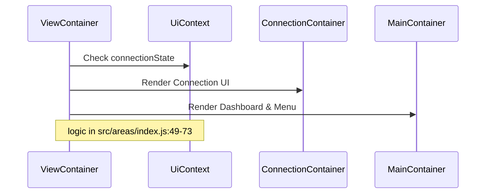

### Core Logic Entities in `src/areas/index.js`

- **`ViewContainer`**: The root component that evaluates `connectionState.connected` and `connectionState.authenticate` to decide which high-level area to display. [src/areas/index.js#49-73](https://github.com/luc-github/ESP3D-WEBUI/blob/97c01e85/src/areas/index.js#L49-L73)
- **`ContentContainer`**: A wrapper that handles global event listeners, specifically for the extension system via `processExtensionMessage`. [src/areas/index.js#75-84](https://github.com/luc-github/ESP3D-WEBUI/blob/97c01e85/src/areas/index.js#L75-L84)
- **`processExtensionMessage`**: A switch-case handler for messages coming from embedded iframes (extensions), supporting `cmd`, `query`, and `upload` operations. [src/areas/index.js#84-165](https://github.com/luc-github/ESP3D-WEBUI/blob/97c01e85/src/areas/index.js#L84-L165)
- **`createNewRequest`**: Invoked within `processExtensionMessage` to translate extension requests into actual HTTP calls to the ESP firmware. [src/areas/index.js#92-124](https://github.com/luc-github/ESP3D-WEBUI/blob/97c01e85/src/areas/index.js#L92-L124)

**Sources:**[src/areas/index.js#49-165](https://github.com/luc-github/ESP3D-WEBUI/blob/97c01e85/src/areas/index.js#L49-L165)

---

# 11.2-Adding-a-New-Target

# Adding a New Target
Relevant source files

- [config/targets/Printer3D/Marlin/index.js](https://github.com/luc-github/ESP3D-WEBUI/blob/97c01e85/config/targets/Printer3D/Marlin/index.js)
- [src/targets/CNC/GRBL/index.js](https://github.com/luc-github/ESP3D-WEBUI/blob/97c01e85/src/targets/CNC/GRBL/index.js)
- [src/targets/CNC/grblHAL/DIRECTSD-source.js](https://github.com/luc-github/ESP3D-WEBUI/blob/97c01e85/src/targets/CNC/grblHAL/DIRECTSD-source.js)
- [src/targets/CNC/grblHAL/FLASH-source.js](https://github.com/luc-github/ESP3D-WEBUI/blob/97c01e85/src/targets/CNC/grblHAL/FLASH-source.js)
- [src/targets/CNC/grblHAL/files.js](https://github.com/luc-github/ESP3D-WEBUI/blob/97c01e85/src/targets/CNC/grblHAL/files.js)
- [src/targets/CNC/grblHAL/index.js](https://github.com/luc-github/ESP3D-WEBUI/blob/97c01e85/src/targets/CNC/grblHAL/index.js)
- [src/targets/CNC/grblHAL/realCommandsTable.js](https://github.com/luc-github/ESP3D-WEBUI/blob/97c01e85/src/targets/CNC/grblHAL/realCommandsTable.js)
- [src/targets/CNC/grblHAL/translations/en.json](https://github.com/luc-github/ESP3D-WEBUI/blob/97c01e85/src/targets/CNC/grblHAL/translations/en.json)
- [src/targets/CNC/translations/en.json](https://github.com/luc-github/ESP3D-WEBUI/blob/97c01e85/src/targets/CNC/translations/en.json)
- [src/targets/Printer3D/Marlin-embedded/preferences.json](https://github.com/luc-github/ESP3D-WEBUI/blob/97c01e85/src/targets/Printer3D/Marlin-embedded/preferences.json)
- [src/targets/Printer3D/Marlin/DIRECTSD-source.js](https://github.com/luc-github/ESP3D-WEBUI/blob/97c01e85/src/targets/Printer3D/Marlin/DIRECTSD-source.js)
- [src/targets/Printer3D/Marlin/FLASH-source.js](https://github.com/luc-github/ESP3D-WEBUI/blob/97c01e85/src/targets/Printer3D/Marlin/FLASH-source.js)
- [src/targets/Printer3D/Marlin/files.js](https://github.com/luc-github/ESP3D-WEBUI/blob/97c01e85/src/targets/Printer3D/Marlin/files.js)
- [src/targets/Printer3D/Marlin/preferences.json](https://github.com/luc-github/ESP3D-WEBUI/blob/97c01e85/src/targets/Printer3D/Marlin/preferences.json)
- [src/targets/Printer3D/Repetier/preferences.json](https://github.com/luc-github/ESP3D-WEBUI/blob/97c01e85/src/targets/Printer3D/Repetier/preferences.json)
- [src/targets/Printer3D/Smoothieware/preferences.json](https://github.com/luc-github/ESP3D-WEBUI/blob/97c01e85/src/targets/Printer3D/Smoothieware/preferences.json)
- [src/targets/Printer3D/preferences.json](https://github.com/luc-github/ESP3D-WEBUI/blob/97c01e85/src/targets/Printer3D/preferences.json)
- [src/targets/preferences.json](https://github.com/luc-github/ESP3D-WEBUI/blob/97c01e85/src/targets/preferences.json)

## Purpose and Scope

This document provides a step-by-step guide for implementing a new firmware target in ESP3D-WEBUI. A "target" is a combination of machine type (e.g., 3D Printer, CNC) and firmware type (e.g., Marlin, GRBL, Smoothieware) that requires specific communication protocols, UI settings, and file system handling.

By the end of this guide, you will have created a new target directory with all required components: preferences configuration, state management, protocol filters, file system abstraction, and build integration.

---

## Target Directory Structure

The system uses a hierarchical structure where specific firmware implementations inherit from machine types, which in turn inherit from a base configuration.

[Flowchart Diagram]

**Target Directory Layout:**

- `src/targets/preferences.json`: Base preferences for all targets [src/targets/preferences.json#1-252](https://github.com/luc-github/ESP3D-WEBUI/blob/97c01e85/src/targets/preferences.json#L1-L252)
- `src/targets/MachineType/preferences.json`: Settings common to a machine class (e.g., 3D printers) [src/targets/Printer3D/preferences.json#1-250](https://github.com/luc-github/ESP3D-WEBUI/blob/97c01e85/src/targets/Printer3D/preferences.json#L1-L250)
- `src/targets/MachineType/FirmwareName/index.js`: The entry point exporting the target configuration [config/targets/Printer3D/Marlin/index.js#1-250](https://github.com/luc-github/ESP3D-WEBUI/blob/97c01e85/config/targets/Printer3D/Marlin/index.js#L1-L250)

**Sources:**[src/targets/Printer3D/Marlin/preferences.json#1-150](https://github.com/luc-github/ESP3D-WEBUI/blob/97c01e85/src/targets/Printer3D/Marlin/preferences.json#L1-L150)[src/targets/CNC/grblHAL/index.js#1-103](https://github.com/luc-github/ESP3D-WEBUI/blob/97c01e85/src/targets/CNC/grblHAL/index.js#L1-L103)[src/targets/preferences.json#1-100](https://github.com/luc-github/ESP3D-WEBUI/blob/97c01e85/src/targets/preferences.json#L1-L100)

---

## Step 1: Create Preferences Configuration

The preferences system uses a cascading hierarchy where firmware-specific settings inherit and override machine-type and base settings.

### 1.1 Setting Types and Structure

Settings are defined in `preferences.json` as an object containing arrays of setting objects categorized by panel or function (e.g., `general`, `status`, `temperatures`).

|  |  |  |
| --- | --- | --- |
| `boolean` | Toggle flag | `{ "id": "sd", "type": "boolean", "value": false }`[src/targets/Printer3D/Marlin/preferences.json#81-86](https://github.com/luc-github/ESP3D-WEBUI/blob/97c01e85/src/targets/Printer3D/Marlin/preferences.json#L81-L86) |
| `number` | Numeric value | `{ "id": "extrudermax", "type": "number", "value": "280" }`[src/targets/Printer3D/preferences.json#46-51](https://github.com/luc-github/ESP3D-WEBUI/blob/97c01e85/src/targets/Printer3D/preferences.json#L46-L51) |
| `text` | String input | `{ "id": "emergencystop", "type": "text", "value": "M112" }`[src/targets/Printer3D/Marlin/preferences.json#5-10](https://github.com/luc-github/ESP3D-WEBUI/blob/97c01e85/src/targets/Printer3D/Marlin/preferences.json#L5-L10) |
| `list` | Array of objects | `{ "id": "pollingcmds", "type": "list", "value": [...] }`[src/targets/Printer3D/Marlin/preferences.json#48-66](https://github.com/luc-github/ESP3D-WEBUI/blob/97c01e85/src/targets/Printer3D/Marlin/preferences.json#L48-L66) |
| `group` | Nested settings | `{ "id": "sdgroup", "type": "group", "value": [...] }`[src/targets/Printer3D/Marlin/preferences.json#70-174](https://github.com/luc-github/ESP3D-WEBUI/blob/97c01e85/src/targets/Printer3D/Marlin/preferences.json#L70-L174) |

### 1.2 Dependency System

Settings can be conditionally shown based on other settings or connection properties using the `depend` key.

```
{
    "id": "sdlistcmd",
    "type": "text",
    "label": "P95",
    "value": "M21;M20",
    "depend": [
        { "id": "sd", "value": true },
        { "connection_id": "SDConnection", "value": "=='none'" }
    ]
}
```

*Example from [src/targets/Printer3D/Marlin/preferences.json#88-107](https://github.com/luc-github/ESP3D-WEBUI/blob/97c01e85/src/targets/Printer3D/Marlin/preferences.json#L88-L107)*

**Sources:**[src/targets/Printer3D/Marlin/preferences.json#1-175](https://github.com/luc-github/ESP3D-WEBUI/blob/97c01e85/src/targets/Printer3D/Marlin/preferences.json#L1-L175)[src/targets/Printer3D/preferences.json#1-165](https://github.com/luc-github/ESP3D-WEBUI/blob/97c01e85/src/targets/Printer3D/preferences.json#L1-L165)[src/targets/preferences.json#1-120](https://github.com/luc-github/ESP3D-WEBUI/blob/97c01e85/src/targets/preferences.json#L1-L120)

---

## Step 2: Implement TargetContext and Data Processing

The `TargetContext.js` (and the `processor.js` it uses) manages firmware-specific state and parses incoming data streams.

### 2.1 Data Flow Diagram

This diagram bridges the natural language requirement of "parsing printer data" to the specific code entities involved.

[Flowchart Diagram]

### 2.2 Key Components

1. **`processData`**: The central function for handling incoming data from WebSockets or HTTP responses [src/targets/CNC/grblHAL/index.js#89](https://github.com/luc-github/ESP3D-WEBUI/blob/97c01e85/src/targets/CNC/grblHAL/index.js#L89-L89)
2. **`processor`**: A firmware-specific object that handles logic for particular command responses [src/targets/CNC/grblHAL/processor.js#1-50](https://github.com/luc-github/ESP3D-WEBUI/blob/97c01e85/src/targets/CNC/grblHAL/processor.js#L1-L50)
3. **`variablesList`**: Defines available commands and G-code modes for the UI [src/targets/CNC/grblHAL/index.js#52-61](https://github.com/luc-github/ESP3D-WEBUI/blob/97c01e85/src/targets/CNC/grblHAL/index.js#L52-L61)

**Sources:**[src/targets/CNC/grblHAL/index.js#23-36](https://github.com/luc-github/ESP3D-WEBUI/blob/97c01e85/src/targets/CNC/grblHAL/index.js#L23-L36)[src/targets/CNC/grblHAL/TargetContext.js#1-100](https://github.com/luc-github/ESP3D-WEBUI/blob/97c01e85/src/targets/CNC/grblHAL/TargetContext.js#L1-L100)

---

## Step 3: Implement File System Abstraction

Each target must define how it interacts with different storage backends (FLASH, SD, DIRECTSD).

### 3.1 File System Mapping

[Flowchart Diagram]

### 3.2 Capability and Command Pattern

Backends must export a `capabilities` object and a `commands` object.

- **Capabilities**: Boolean checks like `Upload`, `Download`, or `DeleteFile`[src/targets/Printer3D/Marlin/DIRECTSD-source.js#25-58](https://github.com/luc-github/ESP3D-WEBUI/blob/97c01e85/src/targets/Printer3D/Marlin/DIRECTSD-source.js#L25-L58)
- **Commands**: Functions returning the URL or G-code command for an action like `list`, `play`, or `delete`[src/targets/Printer3D/Marlin/DIRECTSD-source.js#60-156](https://github.com/luc-github/ESP3D-WEBUI/blob/97c01e85/src/targets/Printer3D/Marlin/DIRECTSD-source.js#L60-L156)

**Example Play Command Logic:**
For `DIRECTSD`, the `play` command may either use a specialized stream command (`[ESP700]stream=`) or a standard G-code sequence (`M23 #; M24`) depending on the `Streaming` setting [src/targets/Printer3D/Marlin/DIRECTSD-source.js#127-155](https://github.com/luc-github/ESP3D-WEBUI/blob/97c01e85/src/targets/Printer3D/Marlin/DIRECTSD-source.js#L127-L155)

**Sources:**[src/targets/CNC/grblHAL/files.js#1-82](https://github.com/luc-github/ESP3D-WEBUI/blob/97c01e85/src/targets/CNC/grblHAL/files.js#L1-L82)[src/targets/Printer3D/Marlin/DIRECTSD-source.js#1-160](https://github.com/luc-github/ESP3D-WEBUI/blob/97c01e85/src/targets/Printer3D/Marlin/DIRECTSD-source.js#L1-L160)[src/targets/Printer3D/Marlin/FLASH-source.js#1-145](https://github.com/luc-github/ESP3D-WEBUI/blob/97c01e85/src/targets/Printer3D/Marlin/FLASH-source.js#L1-L145)

---

## Step 4: Finalizing the Target Entry Point (`index.js`)

The `index.js` file in the target directory exports all necessary components for the build system and runtime.

### 4.1 Required Exports

|  |  |  |
| --- | --- | --- |
| `Target` | Internal identifier string | [src/targets/CNC/grblHAL/index.js#43](https://github.com/luc-github/ESP3D-WEBUI/blob/97c01e85/src/targets/CNC/grblHAL/index.js#L43-L43) |
| `Name` | Display name for the firmware | [src/targets/CNC/grblHAL/index.js#45](https://github.com/luc-github/ESP3D-WEBUI/blob/97c01e85/src/targets/CNC/grblHAL/index.js#L45-L45) |
| `files` | The file system abstraction object | [src/targets/CNC/grblHAL/index.js#87](https://github.com/luc-github/ESP3D-WEBUI/blob/97c01e85/src/targets/CNC/grblHAL/index.js#L87-L87) |
| `variablesList` | Table of real-time commands and modes | [src/targets/CNC/grblHAL/index.js#97](https://github.com/luc-github/ESP3D-WEBUI/blob/97c01e85/src/targets/CNC/grblHAL/index.js#L97-L97) |
| `TargetContextProvider` | Preact context provider for machine state | [src/targets/CNC/grblHAL/index.js#92](https://github.com/luc-github/ESP3D-WEBUI/blob/97c01e85/src/targets/CNC/grblHAL/index.js#L92-L92) |
| `realCommandsTable` | Mapping of control characters to UI names | [src/targets/CNC/grblHAL/realCommandsTable.js#20-50](https://github.com/luc-github/ESP3D-WEBUI/blob/97c01e85/src/targets/CNC/grblHAL/realCommandsTable.js#L20-L50) |

### 4.2 Real-time Commands

Targets like GRBL/grblHAL use non-printable characters for real-time control (e.g., Soft Reset `0x18`, Status Report `0x80`). These are defined in a `realCommandsTable`[src/targets/CNC/grblHAL/realCommandsTable.js#21-22](https://github.com/luc-github/ESP3D-WEBUI/blob/97c01e85/src/targets/CNC/grblHAL/realCommandsTable.js#L21-L22)

**Sources:**[src/targets/CNC/grblHAL/index.js#81-103](https://github.com/luc-github/ESP3D-WEBUI/blob/97c01e85/src/targets/CNC/grblHAL/index.js#L81-L103)[src/targets/CNC/grblHAL/realCommandsTable.js#1-52](https://github.com/luc-github/ESP3D-WEBUI/blob/97c01e85/src/targets/CNC/grblHAL/realCommandsTable.js#L1-L52)

---

## Step 5: Internationalization

New targets should include localized strings in a `translations` subdirectory. Strings are indexed by unique IDs (e.g., `CN1`, `CN10`) to allow for easy replacement in the UI components [src/targets/CNC/translations/en.json#1-10](https://github.com/luc-github/ESP3D-WEBUI/blob/97c01e85/src/targets/CNC/translations/en.json#L1-L10)

**Sources:**[src/targets/CNC/translations/en.json#1-180](https://github.com/luc-github/ESP3D-WEBUI/blob/97c01e85/src/targets/CNC/translations/en.json#L1-L180)[src/targets/CNC/grblHAL/translations/en.json#1-50](https://github.com/luc-github/ESP3D-WEBUI/blob/97c01e85/src/targets/CNC/grblHAL/translations/en.json#L1-L50)

---

# 11.3-Creating-UI-Components

# Creating UI Components
Relevant source files

- [Memo/preferences.md](https://github.com/luc-github/ESP3D-WEBUI/blob/97c01e85/Memo/preferences.md?plain=1)
- [src/components/Controls/FieldGroup.js](https://github.com/luc-github/ESP3D-WEBUI/blob/97c01e85/src/components/Controls/FieldGroup.js)
- [src/components/Controls/Fields/Boolean.js](https://github.com/luc-github/ESP3D-WEBUI/blob/97c01e85/src/components/Controls/Fields/Boolean.js)
- [src/components/Controls/Fields/Input.js](https://github.com/luc-github/ESP3D-WEBUI/blob/97c01e85/src/components/Controls/Fields/Input.js)
- [src/components/Controls/Fields/ItemsList.js](https://github.com/luc-github/ESP3D-WEBUI/blob/97c01e85/src/components/Controls/Fields/ItemsList.js)
- [src/components/Controls/Fields/Select.js](https://github.com/luc-github/ESP3D-WEBUI/blob/97c01e85/src/components/Controls/Fields/Select.js)
- [src/components/Controls/Fields/Slider.js](https://github.com/luc-github/ESP3D-WEBUI/blob/97c01e85/src/components/Controls/Fields/Slider.js)
- [src/components/Helpers/components.js](https://github.com/luc-github/ESP3D-WEBUI/blob/97c01e85/src/components/Helpers/components.js)
- [src/components/Helpers/index.js](https://github.com/luc-github/ESP3D-WEBUI/blob/97c01e85/src/components/Helpers/index.js)
- [src/components/Panels/Files.js](https://github.com/luc-github/ESP3D-WEBUI/blob/97c01e85/src/components/Panels/Files.js)
- [src/components/Panels/Jog.js](https://github.com/luc-github/ESP3D-WEBUI/blob/97c01e85/src/components/Panels/Jog.js)
- [src/components/Panels/JogCNC.js](https://github.com/luc-github/ESP3D-WEBUI/blob/97c01e85/src/components/Panels/JogCNC.js)
- [src/components/Panels/JogPlotter.js](https://github.com/luc-github/ESP3D-WEBUI/blob/97c01e85/src/components/Panels/JogPlotter.js)
- [src/components/Panels/LaserCNC.js](https://github.com/luc-github/ESP3D-WEBUI/blob/97c01e85/src/components/Panels/LaserCNC.js)
- [src/components/Panels/Notifications.js](https://github.com/luc-github/ESP3D-WEBUI/blob/97c01e85/src/components/Panels/Notifications.js)
- [src/components/Panels/OverridesCNC.js](https://github.com/luc-github/ESP3D-WEBUI/blob/97c01e85/src/components/Panels/OverridesCNC.js)
- [src/components/Panels/SpindleCNC.js](https://github.com/luc-github/ESP3D-WEBUI/blob/97c01e85/src/components/Panels/SpindleCNC.js)
- [src/style/components/_control.scss](https://github.com/luc-github/ESP3D-WEBUI/blob/97c01e85/src/style/components/_control.scss)

This guide explains how to create new Preact components for ESP3D-WEBUI, following the project's established patterns for component structure, context usage, styling, and integration with the application architecture.

Components in ESP3D-WEBUI fit into the architecture shown in the [Architecture Overview](/org/luc-github/wiki/luc-github/ESP3D-WEBUI/page/2?branch=%223.0%22). They consume context providers (`UiContext`, `SettingsContext`, `TargetContext`), render within the panel system managed by `MainContainer`, and communicate with the ESP3D backend via HTTP requests.

---

## Component Structure and Preact Basics

ESP3D-WEBUI uses Preact, a lightweight React alternative with the same API. All components are functional components using hooks for state management. The build system transforms JSX via Babel.

### Component Architecture Integration

[Flowchart Diagram]

Sources: [src/areas/index.js#49-147](https://github.com/luc-github/ESP3D-WEBUI/blob/97c01e85/src/areas/index.js#L49-L147)[src/components/Panels/SpindleCNC.js#23-28](https://github.com/luc-github/ESP3D-WEBUI/blob/97c01e85/src/components/Panels/SpindleCNC.js#L23-L28)[src/components/Panels/Files.js#33-46](https://github.com/luc-github/ESP3D-WEBUI/blob/97c01e85/src/components/Panels/Files.js#L33-L46)

### Basic Component Template

[Flowchart Diagram]

A minimal component follows this pattern:

**Import Section:**

- `h` and `Fragment` from `preact` for JSX rendering.
- Hooks from `preact/hooks`: `useState`, `useEffect`, `useRef`.
- Context hooks: `useUiContext`, `useSettingsContext`, `useTargetContext`, `useUiContextFn`.
- Helper functions: `espHttpURL`, `checkDependencies`, `replaceVariables`.
- Translation: `T` function from `../../Translations`.
- Icons from `preact-feather`: `Zap`, `Wind`, `Sun`, `Power`, `Trash2`.
- Control components: `ButtonImg`, `Field`, `FullScreenButton`, `CloseButton`, `ContainerHelper`.

**Component Definition:**

```
export const MyComponent = () => {
    const { states } = useTargetContext()
    const { interfaceSettings, connectionSettings } = useSettingsContext()
    const { createNewRequest } = useHttpFn
    const [localState, setLocalState] = useState(initialValue)
    
    // Early return if panel is disabled in settings
    if (!useUiContextFn.getValue("showmycomponent")) return null
    
    return (
        <ContainerHelper id="mycomponent" title={T("S100")}>
            <div class="form-group">
               {/* Component content */}
            </div>
        </ContainerHelper>
    )
}
```

Sources: [src/components/Panels/SpindleCNC.js#106-115](https://github.com/luc-github/ESP3D-WEBUI/blob/97c01e85/src/components/Panels/SpindleCNC.js#L106-L115)[src/components/Panels/LaserCNC.js#80-96](https://github.com/luc-github/ESP3D-WEBUI/blob/97c01e85/src/components/Panels/LaserCNC.js#L80-L96)[src/components/Controls/Fields/Input.js#83-102](https://github.com/luc-github/ESP3D-WEBUI/blob/97c01e85/src/components/Controls/Fields/Input.js#L83-L102)

---

## Consuming Contexts

ESP3D-WEBUI uses three primary contexts for state management. Components consume these contexts to access global state and functions.

### Context Usage Patterns

|  |  |  |
| --- | --- | --- |
| `useUiContext` | UI state & notifications | `toasts`, `modals`, `panels`, `connection` |
| `useSettingsContext` | User preferences | `interfaceSettings`, `connectionSettings` |
| `useTargetContext` | Firmware state | `states`, `status`, `variablesList` |
| `useUiContextFn` | UI Utility functions | `getValue()`, `setValue()`, `haptic()` |

**Example: Accessing Firmware States**

```
const { states, status } = useTargetContext()
// Access states.spindle_speed or states.feed_rate
```

**Example: Checking Interface Settings**

```
const showSpindle = useUiContextFn.getValue("showspindlepanel")
```

Sources: [src/components/Panels/SpindleCNC.js#107-113](https://github.com/luc-github/ESP3D-WEBUI/blob/97c01e85/src/components/Panels/SpindleCNC.js#L107-L113)[src/components/Panels/LaserCNC.js#81-83](https://github.com/luc-github/ESP3D-WEBUI/blob/97c01e85/src/components/Panels/LaserCNC.js#L81-L83)[src/components/Controls/Fields/Input.js#34-42](https://github.com/luc-github/ESP3D-WEBUI/blob/97c01e85/src/components/Controls/Fields/Input.js#L34-L42)

---

## Field Components

The project provides a set of reusable field components in `src/components/Controls/Fields/` that handle labeling, help tooltips, and dependency-based visibility.

### Common Field Props

- `label`: Translatable string key (e.g., `"CN59"`).
- `id`: Unique HTML ID for the input.
- `value`: Current value (often a ref or state object).
- `setValue`: Callback function to update the value.
- `depend`: Array of dependency objects for conditional visibility.
- `help`: Translation key for the help tooltip.

### Input Component Features

The `Input` component ([src/components/Controls/Fields/Input.js](https://github.com/luc-github/ESP3D-WEBUI/blob/97c01e85/src/components/Controls/Fields/Input.js)) includes built-in logic for:

- **Password Reveal**: Toggles visibility for password types using `Eye`/`EyeOff` icons [src/components/Controls/Fields/Input.js#44-68](https://github.com/luc-github/ESP3D-WEBUI/blob/97c01e85/src/components/Controls/Fields/Input.js#L44-L68)
- **Clear Text**: Provides a clear button for shortkey inputs [src/components/Controls/Fields/Input.js#70-81](https://github.com/luc-github/ESP3D-WEBUI/blob/97c01e85/src/components/Controls/Fields/Input.js#L70-L81)
- **Dependency Tracking**: Automatically hides/shows itself based on the `depend` prop using `checkDependencies`[src/components/Controls/Fields/Input.js#155-165](https://github.com/luc-github/ESP3D-WEBUI/blob/97c01e85/src/components/Controls/Fields/Input.js#L155-L165)

### Select and Boolean Components

- **Select**: Renders a dropdown. It can filter options based on dependencies (e.g., only showing camera options if a camera is configured) [src/components/Controls/Fields/Select.js#39-48](https://github.com/luc-github/ESP3D-WEBUI/blob/97c01e85/src/components/Controls/Fields/Select.js#L39-L48)
- **Boolean**: Renders a switch/toggle [src/components/Controls/Fields/Boolean.js#86-100](https://github.com/luc-github/ESP3D-WEBUI/blob/97c01e85/src/components/Controls/Fields/Boolean.js#L86-L100)

Sources: [src/components/Controls/Fields/Input.js#83-101](https://github.com/luc-github/ESP3D-WEBUI/blob/97c01e85/src/components/Controls/Fields/Input.js#L83-L101)[src/components/Controls/Fields/Select.js#52-63](https://github.com/luc-github/ESP3D-WEBUI/blob/97c01e85/src/components/Controls/Fields/Select.js#L52-L63)[src/components/Controls/Fields/Boolean.js#38-49](https://github.com/luc-github/ESP3D-WEBUI/blob/97c01e85/src/components/Controls/Fields/Boolean.js#L38-L49)

---

## Dependency System

Visibility of UI components is often tied to firmware capabilities or user settings. This is handled by `checkDependencies` in [src/components/Helpers/components.js#149-167](https://github.com/luc-github/ESP3D-WEBUI/blob/97c01e85/src/components/Helpers/components.js#L149-L167)

### Dependency Structure

A dependency object typically looks like this:

```
{ id: "showCoolantctrls", value: true }
// OR for connection-based checks
{ connection_id: "ESP800", contains: "Marlin" }
```

### Usage in Components

Components like `FieldGroup` and `Input` use `useEffect` to monitor these dependencies and update their display style:

```
useEffect(() => {
    let visible = checkDependencies(depend, interfaceSettings.current.settings, connectionSettings.current)
    if (document.getElementById(id))
        document.getElementById(id).style.display = visible ? "block" : "none"
}, [...dependIds])
```

Sources: [src/components/Helpers/components.js#149-167](https://github.com/luc-github/ESP3D-WEBUI/blob/97c01e85/src/components/Helpers/components.js#L149-L167)[src/components/Controls/Fields/Input.js#155-165](https://github.com/luc-github/ESP3D-WEBUI/blob/97c01e85/src/components/Controls/Fields/Input.js#L155-L165)[src/components/Controls/FieldGroup.js#28-33](https://github.com/luc-github/ESP3D-WEBUI/blob/97c01e85/src/components/Controls/FieldGroup.js#L28-L33)

---

## Styling with Spectre.css and SCSS

ESP3D-WEBUI uses **Spectre.css** as the base framework, supplemented by custom SCSS in `src/style/components/_control.scss`.

### Key CSS Classes

|  |  |  |
| --- | --- | --- |
| `.buttons-bar` | Flex container for button groups | [src/style/components/_control.scss#5](https://github.com/luc-github/ESP3D-WEBUI/blob/97c01e85/src/style/components/_control.scss#L5-L5) |
| `.emergency-btn` | Styled red button for critical stops | [src/style/components/_control.scss#68](https://github.com/luc-github/ESP3D-WEBUI/blob/97c01e85/src/style/components/_control.scss#L68-L68) |
| `.form-input` | Standard Spectre input styling | [src/components/Controls/Fields/Input.js#179](https://github.com/luc-github/ESP3D-WEBUI/blob/97c01e85/src/components/Controls/Fields/Input.js#L179-L179) |
| `.field-group` | Container for related fields | [src/style/components/_control.scss#162](https://github.com/luc-github/ESP3D-WEBUI/blob/97c01e85/src/style/components/_control.scss#L162-L162) |
| `.status-ctrls` | Container for real-time status indicators | [src/components/Panels/SpindleCNC.js#71](https://github.com/luc-github/ESP3D-WEBUI/blob/97c01e85/src/components/Panels/SpindleCNC.js#L71-L71) |

### Layout Patterns

Panels usually wrap their content in a `ContainerHelper` which provides a consistent header with optional `FullScreenButton` and `CloseButton`[src/components/Panels/SpindleCNC.js#106-111](https://github.com/luc-github/ESP3D-WEBUI/blob/97c01e85/src/components/Panels/SpindleCNC.js#L106-L111)

Sources: [src/style/components/_control.scss#1-173](https://github.com/luc-github/ESP3D-WEBUI/blob/97c01e85/src/style/components/_control.scss#L1-L173)[src/components/Panels/SpindleCNC.js#29](https://github.com/luc-github/ESP3D-WEBUI/blob/97c01e85/src/components/Panels/SpindleCNC.js#L29-L29)

---

## Data Flow and Communication

Components interact with the firmware using the `useHttpFn` hook and the `espHttpURL` helper.

### Sending Commands

To send a G-code command, components use `createNewRequest`:

```
const sendCommand = (command) => {
    createNewRequest(
        espHttpURL("command", {
            cmd: replaceVariables(variablesList.commands, command),
        }),
        {
            method: "GET",
            echo: replaceVariables(variablesList.commands, command, true),
        },
        {
            onSuccess: (result) => { /* handle success */ },
            onFail: (error) => { toasts.addToast({ content: error, type: "error" }) }
        }
    )
}
```

### Real-time Events

Components can listen for firmware events (like a machine reset) using the `eventsList` emitter:

```
eventsList.on("reset", (data) => {
    console.log("Reset happened:", data)
})
```

Sources: [src/components/Panels/LaserCNC.js#105-122](https://github.com/luc-github/ESP3D-WEBUI/blob/97c01e85/src/components/Panels/LaserCNC.js#L105-L122)[src/components/Panels/SpindleCNC.js#43-53](https://github.com/luc-github/ESP3D-WEBUI/blob/97c01e85/src/components/Panels/SpindleCNC.js#L43-L53)[src/components/Helpers/strings.js#39](https://github.com/luc-github/ESP3D-WEBUI/blob/97c01e85/src/components/Helpers/strings.js#L39-L39)

---

## File Operations in UI

The `FilesPanel` ([src/components/Panels/Files.js](https://github.com/luc-github/ESP3D-WEBUI/blob/97c01e85/src/components/Panels/Files.js)) demonstrates complex UI logic involving the file system abstraction.

### Implementation Flow

[Flowchart Diagram]

### Key Functions

- `files.command(fs, "list", path)`: Generates the command for the specific file system [src/components/Panels/Files.js#121-125](https://github.com/luc-github/ESP3D-WEBUI/blob/97c01e85/src/components/Panels/Files.js#L121-L125)
- `files.capability(fs, "IsFlatFS")`: Checks if the target filesystem supports directories [src/components/Panels/Files.js#156](https://github.com/luc-github/ESP3D-WEBUI/blob/97c01e85/src/components/Panels/Files.js#L156-L156)

Sources: [src/components/Panels/Files.js#57-194](https://github.com/luc-github/ESP3D-WEBUI/blob/97c01e85/src/components/Panels/Files.js#L57-L194)[src/targets/index.js#44](https://github.com/luc-github/ESP3D-WEBUI/blob/97c01e85/src/targets/index.js#L44-L44)

---

# 11.4-Working-with-Contexts

# Working with Contexts
Relevant source files

- [src/areas/elementsCache.js](https://github.com/luc-github/ESP3D-WEBUI/blob/97c01e85/src/areas/elementsCache.js)
- [src/components/Helpers/filters.js](https://github.com/luc-github/ESP3D-WEBUI/blob/97c01e85/src/components/Helpers/filters.js)
- [src/components/Helpers/storedState.js](https://github.com/luc-github/ESP3D-WEBUI/blob/97c01e85/src/components/Helpers/storedState.js)
- [src/components/Modal/logginModal.js](https://github.com/luc-github/ESP3D-WEBUI/blob/97c01e85/src/components/Modal/logginModal.js)
- [src/contexts/DatasContext.js](https://github.com/luc-github/ESP3D-WEBUI/blob/97c01e85/src/contexts/DatasContext.js)
- [src/contexts/UiContext.js](https://github.com/luc-github/ESP3D-WEBUI/blob/97c01e85/src/contexts/UiContext.js)
- [src/hooks/eventBus.js](https://github.com/luc-github/ESP3D-WEBUI/blob/97c01e85/src/hooks/eventBus.js)
- [src/hooks/useSettings.js](https://github.com/luc-github/ESP3D-WEBUI/blob/97c01e85/src/hooks/useSettings.js)
- [src/targets/CNC/Controls/QuickStopButton.js](https://github.com/luc-github/ESP3D-WEBUI/blob/97c01e85/src/targets/CNC/Controls/QuickStopButton.js)
- [src/targets/CNC/GRBL/Controls/BackgroundContainer.js](https://github.com/luc-github/ESP3D-WEBUI/blob/97c01e85/src/targets/CNC/GRBL/Controls/BackgroundContainer.js)

This document explains how to consume and update the primary Preact contexts in ESP3D-WEBUI: `UiContext`, `SettingsContext`, `TargetContext`, and `DatasContext`. These contexts provide global state management across the application.

## Context Architecture Overview

ESP3D-WEBUI uses four primary contexts to manage application state, organized in a provider hierarchy:

Title: Context Providers and State Distribution

[Flowchart Diagram]

**Sources:**[src/contexts/UiContext.js#35-56](https://github.com/luc-github/ESP3D-WEBUI/blob/97c01e85/src/contexts/UiContext.js#L35-L56)[src/contexts/DatasContext.js#30-103](https://github.com/luc-github/ESP3D-WEBUI/blob/97c01e85/src/contexts/DatasContext.js#L30-L103)

## Consuming Contexts in Components

Contexts are consumed using specialized hooks. These hooks provide access to both the state and the functions required to manipulate that state.

### UiContext Consumption

The `UiContext` manages the visual state of the interface, including modals, toasts, and connection status.

**Key UI Entities:**

- `toasts`: Manages temporary notifications via `addToast`[src/contexts/UiContext.js#98-113](https://github.com/luc-github/ESP3D-WEBUI/blob/97c01e85/src/contexts/UiContext.js#L98-L113)
- `modals`: Manages overlay dialogs via `addModal` and `removeModal`[src/contexts/UiContext.js#125-139](https://github.com/luc-github/ESP3D-WEBUI/blob/97c01e85/src/contexts/UiContext.js#L125-L139)
- `connectionState`: Tracks if the UI is `connected` or requires `authenticate`[src/contexts/UiContext.js#52-56](https://github.com/luc-github/ESP3D-WEBUI/blob/97c01e85/src/contexts/UiContext.js#L52-L56)

```
import { useUiContext } from "../contexts"
 
const MyComponent = () => {
    const { toasts, modals, connectionState } = useUiContext();
    
    const notify = () => {
        toasts.addToast({ content: "Action Successful", type: "success" });
    };
    
    return <button onClick={notify}>Notify</button>;
}
```

**Sources:**[src/contexts/UiContext.js#33-34](https://github.com/luc-github/ESP3D-WEBUI/blob/97c01e85/src/contexts/UiContext.js#L33-L34)[src/components/Modal/logginModal.js#34](https://github.com/luc-github/ESP3D-WEBUI/blob/97c01e85/src/components/Modal/logginModal.js#L34-L34)

### SettingsContext Consumption

The `SettingsContext` provides access to user preferences and interface configurations. It is often paired with the `useSettings` hook to trigger remote data fetching.

**Key Settings Entities:**

- `interfaceSettings`: Holds theme, language, and panel configurations [src/hooks/useSettings.js#60-61](https://github.com/luc-github/ESP3D-WEBUI/blob/97c01e85/src/hooks/useSettings.js#L60-L61)
- `uisettings.getValue()`: A helper function to safely retrieve nested configuration values [src/hooks/useSettings.js#95-98](https://github.com/luc-github/ESP3D-WEBUI/blob/97c01e85/src/hooks/useSettings.js#L95-L98)

**Sources:**[src/hooks/useSettings.js#56-61](https://github.com/luc-github/ESP3D-WEBUI/blob/97c01e85/src/hooks/useSettings.js#L56-L61)[src/areas/elementsCache.js#29](https://github.com/luc-github/ESP3D-WEBUI/blob/97c01e85/src/areas/elementsCache.js#L29-L29)

### TargetContext Consumption

The `TargetContext` provides real-time data from the machine firmware. It is target-specific (e.g., GRBL vs Marlin).

Title: Target Data Flow to UI

[Flowchart Diagram]

**Sources:**[src/hooks/useSettings.js#59-81](https://github.com/luc-github/ESP3D-WEBUI/blob/97c01e85/src/hooks/useSettings.js#L59-L81)[src/targets/CNC/GRBL/Controls/BackgroundContainer.js#27-40](https://github.com/luc-github/ESP3D-WEBUI/blob/97c01e85/src/targets/CNC/GRBL/Controls/BackgroundContainer.js#L27-L40)

## Specialized State Management

### Terminal and Data Buffering (`DatasContext`)

The `DatasContext` handles high-frequency data streams, specifically the G-Code terminal. It implements a dual-buffer system to support "Verbose" and "Quiet" modes.

|  |  |  |
| --- | --- | --- |
| `terminalBuffer` | Full log of all communications | `useRef([])`[src/contexts/DatasContext.js#34](https://github.com/luc-github/ESP3D-WEBUI/blob/97c01e85/src/contexts/DatasContext.js#L34-L34) |
| `terminalBufferQuiet` | Filtered log (no verbose/polling) | `useRef([])`[src/contexts/DatasContext.js#35](https://github.com/luc-github/ESP3D-WEBUI/blob/97c01e85/src/contexts/DatasContext.js#L35-L35) |
| `addTerminalContent` | Logic to append and limit buffer size | `limitArr()`[src/contexts/DatasContext.js#49-78](https://github.com/luc-github/ESP3D-WEBUI/blob/97c01e85/src/contexts/DatasContext.js#L49-L78) |

**Sources:**[src/contexts/DatasContext.js#30-103](https://github.com/luc-github/ESP3D-WEBUI/blob/97c01e85/src/contexts/DatasContext.js#L30-L103)

### Persistent State (`useStoredState`)

For state that must survive page refreshes but does not belong in the machine settings (e.g., terminal command history), the `useStoredState` hook bridges Preact state with `localStorage`.

- **Usage**: `const [history, setHistory] = useStoredState("key", [])`[src/components/Helpers/storedState.js#21-33](https://github.com/luc-github/ESP3D-WEBUI/blob/97c01e85/src/components/Helpers/storedState.js#L21-L33)
- **Example**: Used in `DatasContext` for `terminalInputHistory`[src/contexts/DatasContext.js#37-40](https://github.com/luc-github/ESP3D-WEBUI/blob/97c01e85/src/contexts/DatasContext.js#L37-L40)

### EventBus (Non-Context Communication)

For performance-critical or decoupled communication where a full Context re-render is undesirable, the `EventBus` class provides a singleton emitter/listener pattern.

- **`eventBus.on(event, callback)`**: Registers a listener [src/hooks/eventBus.js#32-52](https://github.com/luc-github/ESP3D-WEBUI/blob/97c01e85/src/hooks/eventBus.js#L32-L52)
- **`eventBus.emit(event, data)`**: Triggers all registered callbacks [src/hooks/eventBus.js#60-68](https://github.com/luc-github/ESP3D-WEBUI/blob/97c01e85/src/hooks/eventBus.js#L60-L68)

**Sources:**[src/hooks/eventBus.js#25-78](https://github.com/luc-github/ESP3D-WEBUI/blob/97c01e85/src/hooks/eventBus.js#L25-L78)

## Implementation Patterns

### Updating Settings via Commands

When a setting is updated, it often involves sending a command to the ESP3D backend. The `useSettings` hook provides a `sendCommand` wrapper that integrates with `processData` to update the `TargetContext` immediately if the response contains state information.

Title: Command and Response Pipeline

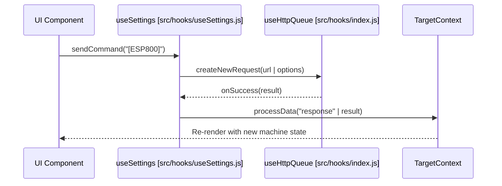

**Sources:**[src/hooks/useSettings.js#63-90](https://github.com/luc-github/ESP3D-WEBUI/blob/97c01e85/src/hooks/useSettings.js#L63-L90)

### Modal Management Example

Modals are managed globally. Components like `logginModal.js` use the `modals` object from `UiContext` to inject themselves into the UI stack.

1. **Check existence**: `modals.getModalIndex(id) == -1`[src/components/Modal/logginModal.js#84](https://github.com/luc-github/ESP3D-WEBUI/blob/97c01e85/src/components/Modal/logginModal.js#L84-L84)
2. **Add Modal**: `modals.addModal({ id, title, content, footer })`[src/components/Modal/logginModal.js#85-146](https://github.com/luc-github/ESP3D-WEBUI/blob/97c01e85/src/components/Modal/logginModal.js#L85-L146)
3. **Remove Modal**: `modals.removeModal(modals.getModalIndex(id))`[src/components/Modal/logginModal.js#77](https://github.com/luc-github/ESP3D-WEBUI/blob/97c01e85/src/components/Modal/logginModal.js#L77-L77)

**Sources:**[src/components/Modal/logginModal.js#33-147](https://github.com/luc-github/ESP3D-WEBUI/blob/97c01e85/src/components/Modal/logginModal.js#L33-L147)

---

# 11.5-Testing-and-Debugging

# Testing and Debugging
Relevant source files

- [.all-contributorsrc](https://github.com/luc-github/ESP3D-WEBUI/blob/97c01e85/.all-contributorsrc)
- [.github/ci/final-check.sh](https://github.com/luc-github/ESP3D-WEBUI/blob/97c01e85/.github/ci/final-check.sh)
- [.github/workflows/build-ci.yml](https://github.com/luc-github/ESP3D-WEBUI/blob/97c01e85/.github/workflows/build-ci.yml)
- [LICENSE](https://github.com/luc-github/ESP3D-WEBUI/blob/97c01e85/LICENSE)
- [README.md](https://github.com/luc-github/ESP3D-WEBUI/blob/97c01e85/README.md?plain=1)
- [info.json](https://github.com/luc-github/ESP3D-WEBUI/blob/97c01e85/info.json)
- [server/CNC/GRBL/Flash/preferences.json](https://github.com/luc-github/ESP3D-WEBUI/blob/97c01e85/server/CNC/GRBL/Flash/preferences.json)

This page documents testing strategies, debugging techniques, and troubleshooting workflows for ESP3D-WEBUI development. It covers development server usage, browser debugging tools, common issues, and target-specific debugging approaches.

For information about setting up the development environment and project structure, see [Project Structure](/org/luc-github/wiki/luc-github/ESP3D-WEBUI/page/11.1?branch=%223.0%22). For guidance on creating components, see [Creating UI Components](/org/luc-github/wiki/luc-github/ESP3D-WEBUI/page/11.3?branch=%223.0%22).

---

## Development Server Environment

ESP3D-WEBUI provides a comprehensive development server that enables live testing with hot module replacement and backend simulation.

### Starting the Development Server

The development server runs both a Webpack dev server (frontend) and Express backend concurrently. Before starting, ensure dependencies are installed via `npm install`[README.md#32-36](https://github.com/luc-github/ESP3D-WEBUI/blob/97c01e85/README.md?plain=1#L32-L36)

```
npm run dev-<system>-<firmware>
```

Where:

- `<system>`: `cnc`, `printer`, or `sand`[README.md#46-50](https://github.com/luc-github/ESP3D-WEBUI/blob/97c01e85/README.md?plain=1#L46-L50)
- `<firmware>`: `grbl`, `grblhal`, `marlin`, `marlin-embedded`, `repetier`, or `smoothieware`[README.md#47-50](https://github.com/luc-github/ESP3D-WEBUI/blob/97c01e85/README.md?plain=1#L47-L50)

Example:

```
npm run dev-printer-marlin
```

This starts the application at `http://localhost:8088` with full hot-reloading capabilities [README.md#52](https://github.com/luc-github/ESP3D-WEBUI/blob/97c01e85/README.md?plain=1#L52-L52)

**Sources**: [README.md#32-52](https://github.com/luc-github/ESP3D-WEBUI/blob/97c01e85/README.md?plain=1#L32-L52)

### Development Server Architecture

The development environment bridges the gap between the source code and the running application by simulating the ESP3D hardware environment.

[Flowchart Diagram]

**Sources**: [README.md#43-52](https://github.com/luc-github/ESP3D-WEBUI/blob/97c01e85/README.md?plain=1#L43-L52)[package.json#1-100](https://github.com/luc-github/ESP3D-WEBUI/blob/97c01e85/package.json#L1-L100) (Note: package.json logic inferred from README npm scripts).

### Hot Module Replacement

Webpack dev server provides instant updates without full page reloads.

|  |  |  |
| --- | --- | --- |
| **Component Updates** | Preact components update in-place | UI development |
| **Style Changes** | CSS injected without reload | Visual tweaking |
| **Context Changes** | May require manual refresh | State management updates |
| **Config Changes** | Requires server restart | Target/preference changes |

When HMR fails (usually for context or state changes), manually refresh the browser or restart the dev server.

---

## Browser Developer Tools

### Console Debugging

ESP3D-WEBUI components and helpers can be debugged using standard `console` methods.

**Recommended Logging Patterns**:

- Prefix logs with component/module name in brackets: `[StatusPanel]`
- Use `console.error()` for error conditions
- Use `console.warn()` for unexpected but handled situations
- Use `console.table()` for array/object data visualization

### Network Panel Debugging

The Network panel reveals all HTTP and WebSocket communication.

[Flowchart Diagram]

**Key Network Debugging Steps**:

1. **Check Request Formatting**: Verify `espHttpURL()` constructs correct endpoints.
2. **Inspect Authentication**: Look for `Authorization` headers in requests.
3. **Monitor Response Codes**: `401` = auth failure, `500` = server error.
4. **Examine WebSocket Frames**: Real-time data appears as separate frames.

**Sources**: [README.md#52](https://github.com/luc-github/ESP3D-WEBUI/blob/97c01e85/README.md?plain=1#L52-L52)

---

## Debugging Techniques by System Component

### Connection Debugging

**Common Connection Issues**:

[Flowchart Diagram]

**Sources**: [README.md#42-50](https://github.com/luc-github/ESP3D-WEBUI/blob/97c01e85/README.md?plain=1#L42-L50)

### State Management Debugging

**Context State Flow Debugging**:

1. **Add Logging in processData**: Log input and output in the firmware-specific `processor`.
2. **Verify Filter Functions**: Check if `isTemperature` or `isPosition` returns true for the incoming raw string.
3. **Inspect Context State**: Use React DevTools to view current state in `UiContext` or `TargetContext`.

### File System Operations Debugging

**File Operation Error Diagnosis**:

|  |  |  |
| --- | --- | --- |
| **Upload Fails** | Network error or 500 | Check file size limits, endpoint URL |
| **List Empty** | No files shown | Verify `files.capability()` returns correct capabilities |
| **Delete Fails** | Permission error | Verify capability manifest for the specific filesystem (FLASH, SD, etc.) |

**Sources**: [server/CNC/GRBL/Flash/preferences.json#77-84](https://github.com/luc-github/ESP3D-WEBUI/blob/97c01e85/server/CNC/GRBL/Flash/preferences.json#L77-L84)

---

## Build and Deployment Debugging

### Webpack Build Errors

Common build failures include Babel transformation errors or missing modules. The build process uses Webpack to generate production versions in the `dist` directory [README.md#62](https://github.com/luc-github/ESP3D-WEBUI/blob/97c01e85/README.md?plain=1#L62-L62)

**Debug Build Process**:

```
# Build all targets to check for global regressions
npm run buildall
```

**Sources**: [README.md#59-62](https://github.com/luc-github/ESP3D-WEBUI/blob/97c01e85/README.md?plain=1#L59-L62)

### Target Configuration Debugging

**Verify Target Build Outputs**:

[Flowchart Diagram]

**Post-Build Checks**:

1. Verify `index.html.gz` exists in the target-specific `dist` folder [README.md#54-62](https://github.com/luc-github/ESP3D-WEBUI/blob/97c01e85/README.md?plain=1#L54-L62)
2. Ensure the file size is within the limits of the target ESP device (typically < 500KB).

**Sources**: [README.md#54-74](https://github.com/luc-github/ESP3D-WEBUI/blob/97c01e85/README.md?plain=1#L54-L74)[server/CNC/GRBL/Flash/preferences.json#1-256](https://github.com/luc-github/ESP3D-WEBUI/blob/97c01e85/server/CNC/GRBL/Flash/preferences.json#L1-L256)

---

## Continuous Integration (CI)

The project uses GitHub Actions for automated build testing.

### build-ci Workflow

The CI pipeline automatically triggers on pushes and pull requests to branches `2.1`, `3.0`, and `3.1`[.github/workflows/build-ci.yml#3-13](https://github.com/luc-github/ESP3D-WEBUI/blob/97c01e85/.github/workflows/build-ci.yml#L3-L13)

**CI Steps**:

1. **Setup**: Uses Node.js 16.x [.github/workflows/build-ci.yml#21-23](https://github.com/luc-github/ESP3D-WEBUI/blob/97c01e85/.github/workflows/build-ci.yml#L21-L23)
2. **Installation**: Runs `npm install`[.github/workflows/build-ci.yml#26](https://github.com/luc-github/ESP3D-WEBUI/blob/97c01e85/.github/workflows/build-ci.yml#L26-L26)
3. **Build**: Runs `npm run buildall` to ensure all targets compile correctly [.github/workflows/build-ci.yml#30](https://github.com/luc-github/ESP3D-WEBUI/blob/97c01e85/.github/workflows/build-ci.yml#L30-L30)
4. **Notification**: Sends success or failure status to a Discord webhook via `final-check.sh`[.github/workflows/build-ci.yml#37-42](https://github.com/luc-github/ESP3D-WEBUI/blob/97c01e85/.github/workflows/build-ci.yml#L37-L42)

**Sources**: [.github/workflows/build-ci.yml#1-43](https://github.com/luc-github/ESP3D-WEBUI/blob/97c01e85/.github/workflows/build-ci.yml#L1-L43)[.github/ci/final-check.sh#1-35](https://github.com/luc-github/ESP3D-WEBUI/blob/97c01e85/.github/ci/final-check.sh#L1-L35)

---

## Common Development Pitfalls

### Pitfall 1: localStorage Caching Old Settings

**Scenario**: UI shows old settings despite code changes in `preferences.json`.
**Cause**: Settings persisted in browser `localStorage` override the defaults provided in the target configuration.
**Solution**: Clear browser storage or use Incognito mode for testing fresh configurations.

### Pitfall 2: Target Mismatch

**Scenario**: Commands fail or responses are not parsed.
**Cause**: The dev server was started with a different firmware target than the one the hardware/simulation is using.
**Solution**: Ensure the `npm run dev-<system>-<firmware>` command matches your target hardware [README.md#43-50](https://github.com/luc-github/ESP3D-WEBUI/blob/97c01e85/README.md?plain=1#L43-L50)

### Pitfall 3: Version Incompatibility

**Scenario**: WebUI fails to communicate with the device.
**Cause**: ESP3D-WEBUI 3.0 is only compatible with ESP3DLib 3.0, ESP3D 3.0, and grblHAL [README.md#9](https://github.com/luc-github/ESP3D-WEBUI/blob/97c01e85/README.md?plain=1#L9-L9)**Solution**: Verify the firmware version on the ESP device.

**Sources**: [README.md#9-50](https://github.com/luc-github/ESP3D-WEBUI/blob/97c01e85/README.md?plain=1#L9-L50)

---

# 12-Firmware-Specific-Guides

# Firmware-Specific Guides
Relevant source files

- [src/components/Controls/Fields/Mask.js](https://github.com/luc-github/ESP3D-WEBUI/blob/97c01e85/src/components/Controls/Fields/Mask.js)
- [src/components/Panels/Status.js](https://github.com/luc-github/ESP3D-WEBUI/blob/97c01e85/src/components/Panels/Status.js)
- [src/targets/CNC/GRBL/preferences.json](https://github.com/luc-github/ESP3D-WEBUI/blob/97c01e85/src/targets/CNC/GRBL/preferences.json)
- [src/targets/CNC/grblHAL/preferences.json](https://github.com/luc-github/ESP3D-WEBUI/blob/97c01e85/src/targets/CNC/grblHAL/preferences.json)
- [src/targets/CNC/preferences.json](https://github.com/luc-github/ESP3D-WEBUI/blob/97c01e85/src/targets/CNC/preferences.json)
- [src/targets/Printer3D/Marlin-embedded/TargetContext.js](https://github.com/luc-github/ESP3D-WEBUI/blob/97c01e85/src/targets/Printer3D/Marlin-embedded/TargetContext.js)
- [src/targets/Printer3D/Marlin-embedded/preferences.json](https://github.com/luc-github/ESP3D-WEBUI/blob/97c01e85/src/targets/Printer3D/Marlin-embedded/preferences.json)
- [src/targets/Printer3D/Marlin/TargetContext.js](https://github.com/luc-github/ESP3D-WEBUI/blob/97c01e85/src/targets/Printer3D/Marlin/TargetContext.js)
- [src/targets/Printer3D/Marlin/filters.js](https://github.com/luc-github/ESP3D-WEBUI/blob/97c01e85/src/targets/Printer3D/Marlin/filters.js)
- [src/targets/Printer3D/Marlin/preferences.json](https://github.com/luc-github/ESP3D-WEBUI/blob/97c01e85/src/targets/Printer3D/Marlin/preferences.json)
- [src/targets/Printer3D/Repetier/TargetContext.js](https://github.com/luc-github/ESP3D-WEBUI/blob/97c01e85/src/targets/Printer3D/Repetier/TargetContext.js)
- [src/targets/Printer3D/Repetier/preferences.json](https://github.com/luc-github/ESP3D-WEBUI/blob/97c01e85/src/targets/Printer3D/Repetier/preferences.json)
- [src/targets/Printer3D/Smoothieware/TargetContext.js](https://github.com/luc-github/ESP3D-WEBUI/blob/97c01e85/src/targets/Printer3D/Smoothieware/TargetContext.js)
- [src/targets/Printer3D/Smoothieware/preferences.json](https://github.com/luc-github/ESP3D-WEBUI/blob/97c01e85/src/targets/Printer3D/Smoothieware/preferences.json)
- [src/targets/Printer3D/preferences.json](https://github.com/luc-github/ESP3D-WEBUI/blob/97c01e85/src/targets/Printer3D/preferences.json)
- [src/targets/preferences.json](https://github.com/luc-github/ESP3D-WEBUI/blob/97c01e85/src/targets/preferences.json)
- [src/targets/translations/en.json](https://github.com/luc-github/ESP3D-WEBUI/blob/97c01e85/src/targets/translations/en.json)

This section provides detailed documentation for each firmware type supported by ESP3D-WEBUI. It explains the firmware-specific adaptations, protocol differences, data processing patterns, and configuration requirements that enable the WebUI to communicate correctly with Marlin, GRBL, Smoothieware, Repetier, and their variants.

For general target configuration concepts, see [Target Configuration System](/org/luc-github/wiki/luc-github/ESP3D-WEBUI/page/4?branch=%223.0%22). For file system abstraction details across firmware types, see [File System Operations](/org/luc-github/wiki/luc-github/ESP3D-WEBUI/page/10?branch=%223.0%22).

---

## Overview of Firmware Support

ESP3D-WEBUI implements firmware support through a **target-based architecture** where each firmware type has its own isolated module containing firmware-specific state management, protocol parsers, and configuration.

The following firmware types are fully supported:

|  |  |  |  |
| --- | --- | --- | --- |
| Marlin | 3D Printer | M-code protocol, ESP701 streaming, TFT support | `Printer3D/Marlin` |
| Marlin-embedded | 3D Printer | Shared SD connection, simplified protocol | `Printer3D/Marlin-embedded` |
| Repetier | 3D Printer | Alternative M-code syntax, flow control | `Printer3D/Repetier` |
| Smoothieware | 3D Printer | Unix-like commands, dual SD cards | `Printer3D/Smoothieware` |
| GRBL | CNC | Real-time commands, status reports, 3-6 axes | `CNC/GRBL` |
| GrblHAL | CNC | Extended GRBL, up to 9 axes (XYZABCUVW) | `CNC/grblHAL` |

**Sources**: [src/targets/Printer3D/Marlin/preferences.json#1-12](https://github.com/luc-github/ESP3D-WEBUI/blob/97c01e85/src/targets/Printer3D/Marlin/preferences.json#L1-L12)[src/targets/CNC/grblHAL/preferences.json#1-12](https://github.com/luc-github/ESP3D-WEBUI/blob/97c01e85/src/targets/CNC/grblHAL/preferences.json#L1-L12)[src/targets/Printer3D/Repetier/preferences.json#1-12](https://github.com/luc-github/ESP3D-WEBUI/blob/97c01e85/src/targets/Printer3D/Repetier/preferences.json#L1-L12)

---

## Target Architecture

Each firmware target follows a consistent directory structure that isolates firmware-specific logic while sharing common components from the base target layers.

### System Architecture to Code Entity Mapping

The following diagram bridges the high-level firmware support concepts to the specific files and classes in the codebase.

[Flowchart Diagram]

**Sources**: [src/targets/Printer3D/Marlin/TargetContext.js#72-109](https://github.com/luc-github/ESP3D-WEBUI/blob/97c01e85/src/targets/Printer3D/Marlin/TargetContext.js#L72-L109)[src/targets/Printer3D/Marlin/TargetContext.js#164-210](https://github.com/luc-github/ESP3D-WEBUI/blob/97c01e85/src/targets/Printer3D/Marlin/TargetContext.js#L164-L210)[src/targets/Printer3D/Marlin/filters.js#26-54](https://github.com/luc-github/ESP3D-WEBUI/blob/97c01e85/src/targets/Printer3D/Marlin/filters.js#L26-L54)

---

## Preference Configuration Hierarchy

Settings are defined in a **three-tier cascading hierarchy**. For example, the `emergencystop` command is defined differently across firmware types in their respective `preferences.json` files.

### Emergency Stop Command Mapping

|  |  |  |
| --- | --- | --- |
| Marlin | `M112` | [src/targets/Printer3D/Marlin/preferences.json#8](https://github.com/luc-github/ESP3D-WEBUI/blob/97c01e85/src/targets/Printer3D/Marlin/preferences.json#L8-L8) |
| Repetier | `M112` | [src/targets/Printer3D/Repetier/preferences.json#8](https://github.com/luc-github/ESP3D-WEBUI/blob/97c01e85/src/targets/Printer3D/Repetier/preferences.json#L8-L8) |
| GRBL | `#SAFETYDOOR#` | [src/targets/CNC/GRBL/preferences.json#8](https://github.com/luc-github/ESP3D-WEBUI/blob/97c01e85/src/targets/CNC/GRBL/preferences.json#L8-L8) |
| GrblHAL | `#SAFETYDOOR#` | [src/targets/CNC/grblHAL/preferences.json#8](https://github.com/luc-github/ESP3D-WEBUI/blob/97c01e85/src/targets/CNC/grblHAL/preferences.json#L8-L8) |

### Axis Configuration Mapping

CNC targets use dynamic dependencies to show or hide axes based on the `Axisletters` connection property.

[Flowchart Diagram]

**Sources**: [src/targets/CNC/grblHAL/preferences.json#202-210](https://github.com/luc-github/ESP3D-WEBUI/blob/97c01e85/src/targets/CNC/grblHAL/preferences.json#L202-L210)[src/targets/CNC/GRBL/preferences.json#176-194](https://github.com/luc-github/ESP3D-WEBUI/blob/97c01e85/src/targets/CNC/GRBL/preferences.json#L176-L194)[src/components/Controls/Fields/Mask.js#73-83](https://github.com/luc-github/ESP3D-WEBUI/blob/97c01e85/src/components/Controls/Fields/Mask.js#L73-L83)

---

## Data Processing and Filters

Each target implements a `filters.js` file that contains regex-based parsers for the firmware's specific output format.

### Filter Implementation Pattern

All firmware targets implement the **is/get filter pattern** where detection and extraction are separated:

```
// Example from src/targets/Printer3D/Marlin/filters.js
const isTemperatures = (str) => {
    const regex_search = /T:.*\s@:[0-9]*/g
    return regex_search.test(str)
}
 
const getTemperatures = (str) => {
    // ... regex logic to extract B, T, C, P, R values ...
    // returns structured object for setTemperatures()
}
```

**Common Filter Entities**:

|  |  |  |
| --- | --- | --- |
| Temperature | `isTemperatures` | `isTemperatures` |
| Position | `isPositions` | `isPositions` |
| Print Status | `isPrintStatus` | `isPrintStatus` |
| Capability | `isPrinterCapability` | `isCapability` |

**Sources**: [src/targets/Printer3D/Marlin/filters.js#44-60](https://github.com/luc-github/ESP3D-WEBUI/blob/97c01e85/src/targets/Printer3D/Marlin/filters.js#L44-L60)[src/targets/Printer3D/Marlin/TargetContext.js#31-54](https://github.com/luc-github/ESP3D-WEBUI/blob/97c01e85/src/targets/Printer3D/Marlin/TargetContext.js#L31-L54)

---

## Polling and Real-Time Commands

Firmware types differ in their support for periodic status queries and real-time command handling. These are defined in the `polling` section of the target's `preferences.json`.

**Polling Configuration Comparison**:

|  |  |  |  |
| --- | --- | --- | --- |
| Marlin | `M105` | 3000ms | [src/targets/Printer3D/Marlin/preferences.json#62-63](https://github.com/luc-github/ESP3D-WEBUI/blob/97c01e85/src/targets/Printer3D/Marlin/preferences.json#L62-L63) |
| Repetier | `M105` | 3000ms | [src/targets/Printer3D/Repetier/preferences.json#62-63](https://github.com/luc-github/ESP3D-WEBUI/blob/97c01e85/src/targets/Printer3D/Repetier/preferences.json#L62-L63) |
| GrblHAL | `?;[ESP701]json` | 3000ms | [src/targets/CNC/grblHAL/preferences.json#62-63](https://github.com/luc-github/ESP3D-WEBUI/blob/97c01e85/src/targets/CNC/grblHAL/preferences.json#L62-L63) |

---

## Subsections

This overview introduces the firmware-specific adaptation patterns. For detailed implementation specifics, refer to the following subsections:

- **[Marlin Support](/org/luc-github/wiki/luc-github/ESP3D-WEBUI/page/12.1?branch=%223.0%22)** — Document Marlin-specific features including M-codes, ESP701 streaming, and TFT screen support.
- **[Marlin-Embedded Support](/org/luc-github/wiki/luc-github/ESP3D-WEBUI/page/12.2?branch=%223.0%22)** — Explain the differences in Marlin-embedded mode including shared connection and simplified SD access.
- **[GRBL Support](/org/luc-github/wiki/luc-github/ESP3D-WEBUI/page/12.3?branch=%223.0%22)** — Detail GRBL-specific features including real-time commands, status report parsing, and axis configuration.
- **[GrblHAL Support](/org/luc-github/wiki/luc-github/ESP3D-WEBUI/page/12.4?branch=%223.0%22)** — Explain GrblHAL enhancements including extended axes (U, V, W), enhanced probing, and DIRECTSD.
- **[Smoothieware Support](/org/luc-github/wiki/luc-github/ESP3D-WEBUI/page/12.5?branch=%223.0%22)** — Document Smoothieware-specific Unix-like commands and configuration system.
- **[Repetier Support](/org/luc-github/wiki/luc-github/ESP3D-WEBUI/page/12.6?branch=%223.0%22)** — Explain Repetier-specific command syntax and flow control mechanisms.

---

# 12.1-Marlin-Support

# Marlin Support
Relevant source files

- [config/targets/Printer3D/Marlin/index.js](https://github.com/luc-github/ESP3D-WEBUI/blob/97c01e85/config/targets/Printer3D/Marlin/index.js)
- [src/components/Panels/Status.js](https://github.com/luc-github/ESP3D-WEBUI/blob/97c01e85/src/components/Panels/Status.js)
- [src/targets/Printer3D/Marlin-embedded/TargetContext.js](https://github.com/luc-github/ESP3D-WEBUI/blob/97c01e85/src/targets/Printer3D/Marlin-embedded/TargetContext.js)
- [src/targets/Printer3D/Marlin/DIRECTSD-source.js](https://github.com/luc-github/ESP3D-WEBUI/blob/97c01e85/src/targets/Printer3D/Marlin/DIRECTSD-source.js)
- [src/targets/Printer3D/Marlin/FLASH-source.js](https://github.com/luc-github/ESP3D-WEBUI/blob/97c01e85/src/targets/Printer3D/Marlin/FLASH-source.js)
- [src/targets/Printer3D/Marlin/TargetContext.js](https://github.com/luc-github/ESP3D-WEBUI/blob/97c01e85/src/targets/Printer3D/Marlin/TargetContext.js)
- [src/targets/Printer3D/Marlin/files.js](https://github.com/luc-github/ESP3D-WEBUI/blob/97c01e85/src/targets/Printer3D/Marlin/files.js)
- [src/targets/Printer3D/Marlin/filters.js](https://github.com/luc-github/ESP3D-WEBUI/blob/97c01e85/src/targets/Printer3D/Marlin/filters.js)
- [src/targets/Printer3D/Marlin/stream.js](https://github.com/luc-github/ESP3D-WEBUI/blob/97c01e85/src/targets/Printer3D/Marlin/stream.js)
- [src/targets/Printer3D/Repetier/TargetContext.js](https://github.com/luc-github/ESP3D-WEBUI/blob/97c01e85/src/targets/Printer3D/Repetier/TargetContext.js)
- [src/targets/Printer3D/Smoothieware/TargetContext.js](https://github.com/luc-github/ESP3D-WEBUI/blob/97c01e85/src/targets/Printer3D/Smoothieware/TargetContext.js)

## Purpose and Scope

This document details ESP3D-WEBUI's integration with Marlin firmware, covering Marlin-specific command protocols, response parsing, file system operations, TFT display support, and real-time data streaming. For information about the Marlin-embedded mode (where ESP3D is compiled directly into Marlin), see [Marlin-Embedded Support](/org/luc-github/wiki/luc-github/ESP3D-WEBUI/page/12.2?branch=%223.0%22). For general printer target architecture, see [Multi-Target Build Architecture](/org/luc-github/wiki/luc-github/ESP3D-WEBUI/page/2.1?branch=%223.0%22).

---

## Marlin Protocol Architecture

ESP3D-WEBUI communicates with Marlin using a combination of standard G-code commands, Marlin-specific M-codes, and ESP3D custom commands. The system parses responses using pattern-matching filters to extract structured data from serial output.

### Command and Response Flow

[Flowchart Diagram]

**Sources:**[src/targets/Printer3D/Marlin/TargetContext.js#172-310](https://github.com/luc-github/ESP3D-WEBUI/blob/97c01e85/src/targets/Printer3D/Marlin/TargetContext.js#L172-L310)[src/targets/Printer3D/Marlin/filters.js#1-414](https://github.com/luc-github/ESP3D-WEBUI/blob/97c01e85/src/targets/Printer3D/Marlin/filters.js#L1-L414)[src/components/Panels/Status.js#168-378](https://github.com/luc-github/ESP3D-WEBUI/blob/97c01e85/src/components/Panels/Status.js#L168-L378)

---

## Response Filter System

Marlin responses are parsed using the `is*` and `get*` filter pattern. Each filter function identifies a specific response type and extracts structured data from it.

### Core Filter Functions

|  |  |  |  |
| --- | --- | --- | --- |
| `isTemperatures()` | `/T:.*\s@:[0-9]*/` | `ok T:25.00 /120.00 B:25.00 /0.00` | `{T: [{value, target}], B: [...]}` |
| `isPositions()` | `/X:\s*[+,-]?[0-9]*\.?[0-9]+?...` | `X:0.00 Y:0.00 Z:0.00 E:0.00` | `{x: "0.00", y: "0.00", z: "0.00"}` |
| `isPrintStatus()` | `/SD\sprinting\sbyte\s...` | `SD printing byte 990/1000` | `{status: "Printing", printing: true, progress: "99.00"}` |
| `isPrintFileName()` | `/Current\sfile:\s(.*)` | `Current file: test.gco` | `"test.gco"` |
| `isStatus()` | `/echo:busy:\s(.*)` | `echo:busy: processing` | `"processing"` |
| `isFlowRate()` | `/echo:E([0-9])\sFlow:\s(.*)\%/` | `echo:E0 Flow: 100%` | `{index: 0, value: "100"}` |
| `isFanSpeed()` | `/M106\sP([0-9]+)\sS([0-9]+)/` | `M106 P0 S255` | `{index: 0, value: "100.00"}` |
| `isFeedRate()` | `/FR:(.*)\%/` | `FR:100%` | `{index: 0, value: "100"}` |
| `isPrinterCapability()` | `/^Cap:([^:]+):[0-1]$/` | `Cap:AUTOREPORT_TEMP:1` | `[{name: "AUTOREPORT_TEMP", value: "1"}]` |
| `isSensor()` | `SENSOR:...` | `SENSOR: 25.4[C] 45.2[%]` | `[{value: "25.4", unit: "C"}, ...]` |

**Sources:**[src/targets/Printer3D/Marlin/filters.js#23-414](https://github.com/luc-github/ESP3D-WEBUI/blob/97c01e85/src/targets/Printer3D/Marlin/filters.js#L23-L414)

### Filter Processing in TargetContext

[Flowchart Diagram]

The `dispatchInternally` function [src/targets/Printer3D/Marlin/TargetContext.js#172-310](https://github.com/luc-github/ESP3D-WEBUI/blob/97c01e85/src/targets/Printer3D/Marlin/TargetContext.js#L172-L310) handles three data types:

- **`stream`**: Serial output from firmware (line-buffered with `\n`/`\r` handling)
- **`response`**: HTTP command responses (JSON or text)
- **`core`**: Internal system messages

**Sources:**[src/targets/Printer3D/Marlin/TargetContext.js#172-310](https://github.com/luc-github/ESP3D-WEBUI/blob/97c01e85/src/targets/Printer3D/Marlin/TargetContext.js#L172-L310)[src/targets/Printer3D/Marlin/filters.js#44-78](https://github.com/luc-github/ESP3D-WEBUI/blob/97c01e85/src/targets/Printer3D/Marlin/filters.js#L44-L78)

---

## File System Support

Marlin supports six distinct file system types, each with different capabilities and communication protocols. The unified `files` API abstracts these differences.

### Supported File Systems

[Flowchart Diagram]

**Sources:**[src/targets/Printer3D/Marlin/files.js#29-103](https://github.com/luc-github/ESP3D-WEBUI/blob/97c01e85/src/targets/Printer3D/Marlin/files.js#L29-L103)

### File System Capabilities Matrix

|  |  |  |  |  |  |  |
| --- | --- | --- | --- | --- | --- | --- |
| **Process** | ✓ | ✓ | ✓ (direct/shared) | ✓ (streaming enabled) | ✗ | ✗ |
| **UseFilters** | ✓ | ✓ | ✓ | ✗ | ✓ | ✓ |
| **IsFlatFS** | ✓ | ✓ | ✗ | ✗ | ✓ | ✓ |
| **Upload** | MKS only | MKS only | ✓ | ✓ | ✗ | ✗ |
| **UploadMultiple** | ✗ | ✗ | ✓ | ✓ | ✗ | ✗ |
| **Download** | ✗ | ✗ | ✓ | ✓ | ✗ | ✗ |
| **DeleteFile** | ✓ (non-MKS) | ✓ (non-MKS) | ✓ | ✓ | ✓ | ✓ |
| **DeleteDir** | ✗ | ✗ | ✓ | ✓ | ✗ | ✗ |
| **CreateDir** | ✗ | ✗ | ✓ | ✓ | ✗ | ✗ |

**Sources:**[src/targets/Printer3D/Marlin/DIRECTSD-source.js#25-58](https://github.com/luc-github/ESP3D-WEBUI/blob/97c01e85/src/targets/Printer3D/Marlin/DIRECTSD-source.js#L25-L58)[src/targets/Printer3D/Marlin/FLASH-source.js#24-54](https://github.com/luc-github/ESP3D-WEBUI/blob/97c01e85/src/targets/Printer3D/Marlin/FLASH-source.js#L24-L54)

### SD Card Protocol (Standard Marlin)

The SD file system uses standard Marlin M-codes:

|  |  |  |
| --- | --- | --- |
| **List** | `M21;M20` | `sdlistcmd` preference |
| **Play** | `M21;M23 #;M24` | `#` = filename placeholder |
| **Delete** | `M21;M30 #` | Non-MKS protocol only |

**Response Format:**

```
Begin file list
V2T-TEST.GCO 569266
PIKA2.GCO 1635116
End file list
ok
```

**Sources:**[src/targets/Printer3D/Marlin/files.js#42-50](https://github.com/luc-github/ESP3D-WEBUI/blob/97c01e85/src/targets/Printer3D/Marlin/files.js#L42-L50)

### DIRECTSD Protocol

When `SDConnection` is set to `"direct"` or `"shared"` in ESP3D settings, the WebUI communicates with the SD card via HTTP endpoints instead of M-codes:

|  |  |  |
| --- | --- | --- |
| **List** | `/sdfiles?path=/&action=list` | GET |
| **Upload** | `/sdfiles?path=/` | POST |
| **Delete** | `/sdfiles?path=/&action=delete&filename=test.gco` | GET |
| **DeleteDir** | `/sdfiles?path=/&action=deletedir&filename=folder` | GET |
| **CreateDir** | `/sdfiles?path=/&action=createdir&filename=newfolder` | GET |
| **Download** | `/sd/path/to/file.gco` | GET |

**Play Command:** If streaming is enabled and SDConnection is `"direct"`, files are played via ESP700:

```
[ESP700]stream=/sd/path/to/file.gco
```

**Sources:**[src/targets/Printer3D/Marlin/DIRECTSD-source.js#60-156](https://github.com/luc-github/ESP3D-WEBUI/blob/97c01e85/src/targets/Printer3D/Marlin/DIRECTSD-source.js#L60-L156)

### TFT Display Support (BTT/MKS)

TFT displays with their own SD/USB card readers require vendor-specific commands. The `tftfs` preference selects the protocol:

#### BTT TFT Protocol

|  |  |  |
| --- | --- | --- |
| **List SD** | `M20 SD:#` | `#` = path placeholder |
| **List USB** | `M20 U:#` | USB drive listing |
| **Play SD** | `M23 SD:#;M24` | Start printing from SD |
| **Play USB** | `M23 U:#;M24` | Start printing from USB |

#### MKS TFT Protocol

|  |  |  |
| --- | --- | --- |
| **List SD** | `M998 1;M20 1:#` | Select SD (1), then list |
| **List USB** | `M998 0;M20 0:#` | Select USB (0), then list |

**Sources:**[src/targets/Printer3D/Marlin/files.js#72-84](https://github.com/luc-github/ESP3D-WEBUI/blob/97c01e85/src/targets/Printer3D/Marlin/files.js#L72-L84)

---

## Temperature and Position Monitoring

### Temperature Response Format

Marlin reports temperatures using a compact string format:

```
ok T:25.00 /120.00 B:25.00 /0.00 @:127 B@:0
T:25.00 /50.00 B:25.00 /0.00 T0:25.00 /50.00 T1:25.00 /0.00 @:127 B@:0
```

**Parsing Logic:**

```
Regex: /(B|T|C|P|R)([\d]*):([+|-]?[0-9]*\.?[0-9]+|inf)? \/([+]?[0-9]*\.?[0-9]+)/g
```

The `getTemperatures` function [src/targets/Printer3D/Marlin/filters.js#49-78](https://github.com/luc-github/ESP3D-WEBUI/blob/97c01e85/src/targets/Printer3D/Marlin/filters.js#L49-L78) extracts:

- **Tool Letter**: T (extruder), B (bed), C (chamber), P (probe), R (redundant), M (motherboard)
- **Index**: Optional number (e.g., T0, T1)
- **Current Value**: Temperature reading
- **Target Value**: Setpoint

**Temperature State Structure:**

```
{
    T: [{value: "25.00", target: "120.00"}, ...],  // Extruders 0-8
    B: [{value: "25.00", target: "0.00"}],         // Bed
    C: [{value: "25.00", target: "0.00"}],         // Chamber
    P: [{value: "25.00", target: "0.00"}],         // Probe
    R: [{value: "25.00", target: "0.00"}],         // Redundant
    M: [{value: "25.00", target: "0.00"}]          // Motherboard
}
```

**MKS Protocol Handling:** MKS firmware always reports T0, T1, and B even if devices don't exist. The filter [src/targets/Printer3D/Marlin/filters.js#71](https://github.com/luc-github/ESP3D-WEBUI/blob/97c01e85/src/targets/Printer3D/Marlin/filters.js#L71-L71) ignores entries with `value == 0` when `SerialProtocol == "MKS"`.

**Sources:**[src/targets/Printer3D/Marlin/filters.js#44-78](https://github.com/luc-github/ESP3D-WEBUI/blob/97c01e85/src/targets/Printer3D/Marlin/filters.js#L44-L78)[src/targets/Printer3D/Marlin/TargetContext.js#101-109](https://github.com/luc-github/ESP3D-WEBUI/blob/97c01e85/src/targets/Printer3D/Marlin/TargetContext.js#L101-L109)

### Position Response Format

Positions are reported by the M114 command:

```
X:0.00 Y:0.00 Z:0.00 E:0.00 Count X:0 Y:0 Z:0
```

**Parsing:**

```
// Regex: /X:\s*([+,-]?[0-9]*\.?[0-9]+)?\s*Y:\s*([+,-]?[0-9]*\.?[0-9]+)?\s*Z:\s*([+,-]?[0-9]*\.?[0-9]+)?\s*E/
const positions = getPositions(str)  // Returns: {x: "0.00", y: "0.00", z: "0.00"}
```

**Sources:**[src/targets/Printer3D/Marlin/filters.js#86-100](https://github.com/luc-github/ESP3D-WEBUI/blob/97c01e85/src/targets/Printer3D/Marlin/filters.js#L86-L100)[src/targets/Printer3D/Marlin/TargetContext.js#72-76](https://github.com/luc-github/ESP3D-WEBUI/blob/97c01e85/src/targets/Printer3D/Marlin/TargetContext.js#L72-L76)

### Temperature Charts

The `temperaturesList` array [src/targets/Printer3D/Marlin/TargetContext.js#111-126](https://github.com/luc-github/ESP3D-WEBUI/blob/97c01e85/src/targets/Printer3D/Marlin/TargetContext.js#L111-L126) stores up to 400 temperature readings with timestamps for charting:

```
temperaturesList = [
    {
        temperatures: {T: [...], B: [...], C: [...]},
        time: Date
    },
    ...
]
```

**Sources:**[src/targets/Printer3D/Marlin/TargetContext.js#78-126](https://github.com/luc-github/ESP3D-WEBUI/blob/97c01e85/src/targets/Printer3D/Marlin/TargetContext.js#L78-L126)

---

## Print Status and Control

### Print Status Detection

Marlin reports print status through multiple message types:

|  |  |  |  |
| --- | --- | --- | --- |
| **Not Printing** | `Not SD printing` | `Not SD printing` | `{status: "Not SD printing", printing: false, progress: 0}` |
| **Done** | `Done printing file` | `Done printing file` | `{status: "Done printing file", printing: false, progress: 100}` |
| **Progress (bytes)** | `SD printing byte X/Y` | `SD printing byte 990/1000` | `{status: "Printing", printing: true, progress: "99.00"}` |
| **Progress (M73)** | `echo: M73 Progress: X%...` | `echo: M73 Progress: 50%;...` | `{status: "Printing: 30m remaining", printing: true, progress: "50.00"}` |
| **Print Time** | `echo:Print time: ...` | `echo:Print time: 1h 23m 45s` | `{time: {hour: "1", min: "23", sec: "45"}, printing: true}` |

**Print Time Estimation:**
The `estimatedTime` function [src/targets/Printer3D/Marlin/TargetContext.js#142-156](https://github.com/luc-github/ESP3D-WEBUI/blob/97c01e85/src/targets/Printer3D/Marlin/TargetContext.js#L142-L156) calculates remaining time:

```
totalSecondsLeft = (printTime * (100 - progress)) / progress
```

**Sources:**[src/targets/Printer3D/Marlin/filters.js#106-180](https://github.com/luc-github/ESP3D-WEBUI/blob/97c01e85/src/targets/Printer3D/Marlin/filters.js#L106-L180)[src/targets/Printer3D/Marlin/TargetContext.js#187-209](https://github.com/luc-github/ESP3D-WEBUI/blob/97c01e85/src/targets/Printer3D/Marlin/TargetContext.js#L187-L209)

### Print Control Commands

The StatusPanel [src/components/Panels/Status.js#168-378](https://github.com/luc-github/ESP3D-WEBUI/blob/97c01e85/src/components/Panels/Status.js#L168-L378) provides play/pause/stop controls for different file system types:

[Flowchart Diagram]

**Sources:**[src/components/Panels/Status.js#175-377](https://github.com/luc-github/ESP3D-WEBUI/blob/97c01e85/src/components/Panels/Status.js#L175-L377)

---

## ESP701 Streaming

ESP701 is a custom command that enables the ESP3D device to stream G-code files directly to Marlin, with progress tracking and control. This is available when `Streaming` is enabled in ESP3D settings.

### Streaming Status Response

**Request:**

```
GET /command?cmd=[ESP701]
```

**Response (JSON):**

```
{
    "cmd": "701",
    "status": "ok",
    "data": {
        "status": "processing",
        "total": "159694",
        "processed": "6719",
        "elapsed": "5739645",
        "type": "2",
        "name": "/ESP3DPrintFile.gcode"
    }
}
```

**Parsing Logic [src/targets/Printer3D/Marlin/filters.js#362-387](https://github.com/luc-github/ESP3D-WEBUI/blob/97c01e85/src/targets/Printer3D/Marlin/filters.js#L362-L387):**

```
const isStreamingStatus = (str) => {
    const res = JSON.parse(str)
    return res.cmd == "701" && typeof res.data != "undefined"
}
 
const getStreamingStatus = (str) => {
    const res = JSON.parse(str)
    return res.data
}
```

**Progress Calculation [src/targets/Printer3D/Marlin/TargetContext.js#267-271](https://github.com/luc-github/ESP3D-WEBUI/blob/97c01e85/src/targets/Printer3D/Marlin/TargetContext.js#L267-L271):**

```
progress = Math.round((processed / total) * 100).toFixed(2)
```

**Sources:**[src/targets/Printer3D/Marlin/filters.js#362-387](https://github.com/luc-github/ESP3D-WEBUI/blob/97c01e85/src/targets/Printer3D/Marlin/filters.js#L362-L387)[src/targets/Printer3D/Marlin/TargetContext.js#258-307](https://github.com/luc-github/ESP3D-WEBUI/blob/97c01e85/src/targets/Printer3D/Marlin/TargetContext.js#L258-L307)

### ESP700 Stream Control

Files can be streamed using the ESP700 command:

|  |  |
| --- | --- |
| **FLASH** | `[ESP700]stream=/fs/path/to/file.gco` |
| **DIRECTSD** | `[ESP700]stream=/sd/path/to/file.gco` |

**Play Command Implementation [src/targets/Printer3D/Marlin/FLASH-source.js#118-140](https://github.com/luc-github/ESP3D-WEBUI/blob/97c01e85/src/targets/Printer3D/Marlin/FLASH-source.js#L118-L140):**

```
play: (path, filename) => {
    if (Streaming == "Enabled" && SDConnection == "direct") {
        let fullpath = "/fs" + path + (path.endsWith("/") ? "" : "/") + filename
        return {
            type: "cmd",
            cmd: "[ESP700]stream=" + fullpath.replaceAll(" ", " ")
        }
    }
}
```

**Sources:**[src/targets/Printer3D/Marlin/FLASH-source.js#118-140](https://github.com/luc-github/ESP3D-WEBUI/blob/97c01e85/src/targets/Printer3D/Marlin/FLASH-source.js#L118-L140)[src/targets/Printer3D/Marlin/DIRECTSD-source.js#128-155](https://github.com/luc-github/ESP3D-WEBUI/blob/97c01e85/src/targets/Printer3D/Marlin/DIRECTSD-source.js#L128-L155)

---

## Printer Capabilities Detection

Marlin's M115 command reports firmware information and capabilities.

**Parsing Logic [src/targets/Printer3D/Marlin/filters.js#315-339](https://github.com/luc-github/ESP3D-WEBUI/blob/97c01e85/src/targets/Printer3D/Marlin/filters.js#L315-L339):**

```
// Firmware name regex:
/^FIRMWARE_NAME:(?<firmware_name>[^\(]+)\s\((?<firmware_date>[^\)]*)\)...
 
// Capability regex:
/^Cap:(?<item>[^:]+):(?<value>[0-1])$/
```

**Storage:** Capabilities are stored in the `printerCapabilities` array [src/targets/Printer3D/Marlin/TargetContext.js#68](https://github.com/luc-github/ESP3D-WEBUI/blob/97c01e85/src/targets/Printer3D/Marlin/TargetContext.js#L68-L68) using `addObjectItem` to prevent duplicates.

**Sources:**[src/targets/Printer3D/Marlin/filters.js#307-339](https://github.com/luc-github/ESP3D-WEBUI/blob/97c01e85/src/targets/Printer3D/Marlin/filters.js#L307-L339)[src/targets/Printer3D/Marlin/TargetContext.js#232-239](https://github.com/luc-github/ESP3D-WEBUI/blob/97c01e85/src/targets/Printer3D/Marlin/TargetContext.js#L232-L239)

---

## Development Server Simulation

The development server [config/targets/Printer3D/Marlin/index.js#1-904](https://github.com/luc-github/ESP3D-WEBUI/blob/97c01e85/config/targets/Printer3D/Marlin/index.js#L1-L904) simulates a Marlin printer for testing, including:

- **Temperature simulation** with heating/cooling curves [config/targets/Printer3D/Marlin/index.js#77-127](https://github.com/luc-github/ESP3D-WEBUI/blob/97c01e85/config/targets/Printer3D/Marlin/index.js#L77-L127)
- **Fake M115 responses** with capabilities [config/targets/Printer3D/Marlin/index.js#338-376](https://github.com/luc-github/ESP3D-WEBUI/blob/97c01e85/config/targets/Printer3D/Marlin/index.js#L338-L376)
- **SD card file listings**[config/targets/Printer3D/Marlin/index.js#207-253](https://github.com/luc-github/ESP3D-WEBUI/blob/97c01e85/config/targets/Printer3D/Marlin/index.js#L207-L253)
- **M503 configuration dump**[config/targets/Printer3D/Marlin/index.js#377-461](https://github.com/luc-github/ESP3D-WEBUI/blob/97c01e85/config/targets/Printer3D/Marlin/index.js#L377-L461)
- **ESP701 streaming status**[config/targets/Printer3D/Marlin/index.js#469-497](https://github.com/luc-github/ESP3D-WEBUI/blob/97c01e85/config/targets/Printer3D/Marlin/index.js#L469-L497)

**Sources:**[config/targets/Printer3D/Marlin/index.js#1-904](https://github.com/luc-github/ESP3D-WEBUI/blob/97c01e85/config/targets/Printer3D/Marlin/index.js#L1-L904)

---

# 12.2-Marlin-Embedded-Support

# Marlin-Embedded Support
Relevant source files

- [config/targets/Printer3D/Marlin/index.js](https://github.com/luc-github/ESP3D-WEBUI/blob/97c01e85/config/targets/Printer3D/Marlin/index.js)
- [src/targets/CNC/GRBL/stream.js](https://github.com/luc-github/ESP3D-WEBUI/blob/97c01e85/src/targets/CNC/GRBL/stream.js)
- [src/targets/CNC/grblHAL/stream.js](https://github.com/luc-github/ESP3D-WEBUI/blob/97c01e85/src/targets/CNC/grblHAL/stream.js)
- [src/targets/Printer3D/Marlin-embedded/preferences.json](https://github.com/luc-github/ESP3D-WEBUI/blob/97c01e85/src/targets/Printer3D/Marlin-embedded/preferences.json)
- [src/targets/Printer3D/Marlin-embedded/stream.js](https://github.com/luc-github/ESP3D-WEBUI/blob/97c01e85/src/targets/Printer3D/Marlin-embedded/stream.js)
- [src/targets/Printer3D/Marlin/DIRECTSD-source.js](https://github.com/luc-github/ESP3D-WEBUI/blob/97c01e85/src/targets/Printer3D/Marlin/DIRECTSD-source.js)
- [src/targets/Printer3D/Marlin/FLASH-source.js](https://github.com/luc-github/ESP3D-WEBUI/blob/97c01e85/src/targets/Printer3D/Marlin/FLASH-source.js)
- [src/targets/Printer3D/Marlin/files.js](https://github.com/luc-github/ESP3D-WEBUI/blob/97c01e85/src/targets/Printer3D/Marlin/files.js)
- [src/targets/Printer3D/Marlin/preferences.json](https://github.com/luc-github/ESP3D-WEBUI/blob/97c01e85/src/targets/Printer3D/Marlin/preferences.json)
- [src/targets/Printer3D/Repetier/preferences.json](https://github.com/luc-github/ESP3D-WEBUI/blob/97c01e85/src/targets/Printer3D/Repetier/preferences.json)
- [src/targets/Printer3D/Smoothieware/preferences.json](https://github.com/luc-github/ESP3D-WEBUI/blob/97c01e85/src/targets/Printer3D/Smoothieware/preferences.json)
- [src/targets/Printer3D/preferences.json](https://github.com/luc-github/ESP3D-WEBUI/blob/97c01e85/src/targets/Printer3D/preferences.json)
- [src/targets/preferences.json](https://github.com/luc-github/ESP3D-WEBUI/blob/97c01e85/src/targets/preferences.json)

**Purpose**: This page documents the Marlin-embedded target configuration for ESP3D-WEBUI. Marlin-embedded refers to ESP3D firmware running directly within Marlin firmware via `esp3dlib` integration, as opposed to ESP3D running on a separate ESP32/ESP8266 module that communicates with Marlin over serial. This architecture results in simplified file system support and direct hardware integration.

For standard Marlin support with ESP3D on a separate module, see [Marlin Support](/org/luc-github/wiki/luc-github/ESP3D-WEBUI/page/12.1?branch=%223.0%22). For other 3D printer firmware variants, see [Repetier Support](/org/luc-github/wiki/luc-github/ESP3D-WEBUI/page/12.6?branch=%223.0%22) and [Smoothieware Support](/org/luc-github/wiki/luc-github/ESP3D-WEBUI/page/12.5?branch=%223.0%22).

---

## Architecture Overview

Marlin-embedded represents a deployment configuration where ESP3D firmware runs as an embedded library within Marlin via `esp3dlib` integration, rather than as a bridge between a web client and Marlin over serial communication.

**Deployment Architecture Comparison**

[Flowchart Diagram]

**Key Architectural Differences:**

|  |  |  |
| --- | --- | --- |
| Hardware | Separate ESP + Marlin boards | Single board with integrated ESP |
| Communication | Serial UART, M-codes | Direct library function calls |
| SD Card Access | `M20`/`M23`/`M30` or `DIRECTSD` | `SDConnection: "shared"` |
| File Systems | FLASH, SD, DIRECTSD, SDEXT, TFTSD, TFTUSB | FLASH, SD, DIRECTSD only |
| Streaming Status | `[ESP701]` command with `streamStatus` state | Native `printState` from Marlin only |
| TFT Support | BTT/MKS `tftfs`, `tftsd`, `tftusb` | Not available |

**Sources:**[src/targets/Printer3D/Marlin-embedded/preferences.json#1-206](https://github.com/luc-github/ESP3D-WEBUI/blob/97c01e85/src/targets/Printer3D/Marlin-embedded/preferences.json#L1-L206)[src/targets/Printer3D/Marlin/preferences.json#1-175](https://github.com/luc-github/ESP3D-WEBUI/blob/97c01e85/src/targets/Printer3D/Marlin/preferences.json#L1-L175)

---

## Target Configuration Structure

The Marlin-embedded target follows the standard ESP3D-WEBUI target structure with specialized implementations for embedded integration.

[Flowchart Diagram]

The target shares logic with standard Marlin but differs primarily in preferences and available features.

**Sources:**[src/targets/Printer3D/Marlin-embedded/preferences.json#1-50](https://github.com/luc-github/ESP3D-WEBUI/blob/97c01e85/src/targets/Printer3D/Marlin-embedded/preferences.json#L1-L50)[src/targets/Printer3D/Marlin-embedded/stream.js#1-42](https://github.com/luc-github/ESP3D-WEBUI/blob/97c01e85/src/targets/Printer3D/Marlin-embedded/stream.js#L1-L42)

---

## Preferences and Settings

### Simplified File System Configuration

Marlin-embedded only supports file systems accessible through Marlin's native SD layer or ESP's internal FLASH. TFT display file systems (BTT/MKS) and external SD cards are not available.

**File System Availability Comparison**

[Flowchart Diagram]

**SD Group Configuration with Shared Access Constraint**

[src/targets/Printer3D/Marlin-embedded/preferences.json#69-108](https://github.com/luc-github/ESP3D-WEBUI/blob/97c01e85/src/targets/Printer3D/Marlin-embedded/preferences.json#L69-L108)

The `sd` boolean setting is only enabled when `SDConnection` connection property equals `"shared"`:

```
{
    "id": "sd",
    "type": "boolean",
    "label": "S63",
    "value": false,
    "depend": [{ "connection_id": "SDConnection", "value": "=='shared'" }]
}
```

This dependency at line 86 ensures SD access is only available when Marlin and ESP3D share the same SD card hardware.

**File System Selection Options**

[src/targets/Printer3D/Marlin-embedded/preferences.json#111-157](https://github.com/luc-github/ESP3D-WEBUI/blob/97c01e85/src/targets/Printer3D/Marlin-embedded/preferences.json#L111-L157)

|  |  |  |
| --- | --- | --- |
| `"FLASH"` | Internal Flash (S137) | `flashfs: true` |
| `"SD"` | SD Card (S190) | `sd: true` AND `SDConnection: "none"` |
| `"DIRECTSD"` | SD Card (S190) | `sd: true` AND `SDConnection: "!='none'"` |

**Sources:**[src/targets/Printer3D/Marlin-embedded/preferences.json#69-157](https://github.com/luc-github/ESP3D-WEBUI/blob/97c01e85/src/targets/Printer3D/Marlin-embedded/preferences.json#L69-L157)[src/targets/Printer3D/Marlin/preferences.json#68-175](https://github.com/luc-github/ESP3D-WEBUI/blob/97c01e85/src/targets/Printer3D/Marlin/preferences.json#L68-L175)

### Status Commands

The status panel configuration is simplified because Marlin-embedded doesn't support TFT-based print operations. Only standard SD card commands are available.

[src/targets/Printer3D/Marlin-embedded/preferences.json#203-206](https://github.com/luc-github/ESP3D-WEBUI/blob/97c01e85/src/targets/Printer3D/Marlin-embedded/preferences.json#L203-L206)

```
{
    "id": "sdcommands",
    "type": "group",
    "label": "P101",
    "depend": [
        {"id": "sd", "value": true},
        {"id": "showstatuspanel", "value": true}
    ]
}
```

Standard Marlin includes much more complex dependencies for `sdlistcmd`, `sdplaycmd`, and `sddeletecmd` involving `SerialProtocol` checks (e.g., MKS specific protocols), which are omitted in the embedded target.

**Sources:**[src/targets/Printer3D/Marlin-embedded/preferences.json#203-206](https://github.com/luc-github/ESP3D-WEBUI/blob/97c01e85/src/targets/Printer3D/Marlin-embedded/preferences.json#L203-L206)[src/targets/Printer3D/Marlin/preferences.json#88-153](https://github.com/luc-github/ESP3D-WEBUI/blob/97c01e85/src/targets/Printer3D/Marlin/preferences.json#L88-L153)

---

## Data Streaming and Filtering

Marlin-embedded implements a specialized `isVerboseOnly` function to filter console output in the terminal.

[src/targets/Printer3D/Marlin-embedded/stream.js#23-40](https://github.com/luc-github/ESP3D-WEBUI/blob/97c01e85/src/targets/Printer3D/Marlin-embedded/stream.js#L23-L40)

```
const isVerboseOnly = (type, data) => {
    const line = data.trim()
    if (
        isTemperatures(line) ||
        isPositions(line) ||
        line.trim().length == 0 ||
        line.startsWith("echo:") ||
        line.startsWith("ok") ||
        line.startsWith("M105") ||
        line.startsWith("M114") ||
        line.startsWith("FR:") ||
        line.startsWith("SENSOR:") ||
        (line.startsWith("{") && line.endsWith("}"))
    )
        return true
    else return false
}
```

This function ensures that frequent status updates (Temperatures, Positions, M105/M114 echoes) do not clutter the terminal unless verbose mode is enabled. It uses filters `isTemperatures` and `isPositions` imported from the target's filter set.

**Sources:**[src/targets/Printer3D/Marlin-embedded/stream.js#21-42](https://github.com/luc-github/ESP3D-WEBUI/blob/97c01e85/src/targets/Printer3D/Marlin-embedded/stream.js#L21-L42)

---

## File System Operations

Marlin-embedded utilizes the same file system source abstractions as Marlin, but with different configurations.

### DIRECTSD Support

When `SDConnection` is set to `direct` or `shared`, the `DIRECTSD` source is used for high-speed HTTP-based file operations.

[src/targets/Printer3D/Marlin/DIRECTSD-source.js#25-58](https://github.com/luc-github/ESP3D-WEBUI/blob/97c01e85/src/targets/Printer3D/Marlin/DIRECTSD-source.js#L25-L58)

|  |  |
| --- | --- |
| `Process` | Returns `canProcessFile(filename)` if `SDConnection` is `direct` or `shared`. |
| `Upload` | Enabled (`true`). |
| `Download` | Enabled (`true`). |
| `DeleteFile` | Enabled (`true`). |

The `play` command in `DIRECTSD-source.js` adapts to the streaming mode:
[src/targets/Printer3D/Marlin/DIRECTSD-source.js#127-155](https://github.com/luc-github/ESP3D-WEBUI/blob/97c01e85/src/targets/Printer3D/Marlin/DIRECTSD-source.js#L127-L155)

- If `Streaming` is enabled and `SDConnection` is `direct`: Uses `[ESP700]stream=/sd/...`
- Otherwise: Uses the command defined in `sdplaycmd` (typically `M21;M23 #;M24`).

**Sources:**[src/targets/Printer3D/Marlin/DIRECTSD-source.js#25-155](https://github.com/luc-github/ESP3D-WEBUI/blob/97c01e85/src/targets/Printer3D/Marlin/DIRECTSD-source.js#L25-L155)

### FLASH Support

The internal Flash file system is available for storing G-code macros or small files.

[src/targets/Printer3D/Marlin/FLASH-source.js#118-140](https://github.com/luc-github/ESP3D-WEBUI/blob/97c01e85/src/targets/Printer3D/Marlin/FLASH-source.js#L118-L140)

- `play`: If `Streaming` is enabled, it uses `[ESP700]stream=/fs/...`. Otherwise, it falls back to native Marlin commands `M23 path/file` and `M24`.

**Sources:**[src/targets/Printer3D/Marlin/FLASH-source.js#24-140](https://github.com/luc-github/ESP3D-WEBUI/blob/97c01e85/src/targets/Printer3D/Marlin/FLASH-source.js#L24-L140)

---

## Development and Mocking

The `config/targets/Printer3D/Marlin/index.js` file provides a mock server environment for testing Marlin-embedded features without physical hardware.

[config/targets/Printer3D/Marlin/index.js#173-216](https://github.com/luc-github/ESP3D-WEBUI/blob/97c01e85/config/targets/Printer3D/Marlin/index.js#L173-L216)

- **Command Simulation**: Handles `M114` (Position), `M105` (Temperature), and `M20` (File listing).
- **Temperature Simulation**: Simulates heating/cooling for Extruders (T), Bed (B), Chamber (C), and Probe (P) using `updateTemperature`.

**Sources:**[config/targets/Printer3D/Marlin/index.js#33-171](https://github.com/luc-github/ESP3D-WEBUI/blob/97c01e85/config/targets/Printer3D/Marlin/index.js#L33-L171)[config/targets/Printer3D/Marlin/index.js#173-216](https://github.com/luc-github/ESP3D-WEBUI/blob/97c01e85/config/targets/Printer3D/Marlin/index.js#L173-L216)

---

## Summary of Differences

|  |  |  |
| --- | --- | --- |
| `SDConnection` | Defaults to `shared` | Defaults to `none` |
| `sd` dependency | `connection_id: "shared"` | `showfilespanel: true` |
| TFT Support | ❌ Not available | ✅ Supports `TFTSD`, `TFTUSB` |
| SDEXT Support | ❌ Not available | ✅ Supports External SD |
| SD List Cmd | Standard `M21;M20` | Complex dependencies on `SerialProtocol` |
| Stream Filtering | Includes `echo:`, `M105`, `M114` | Firmware specific |

**Sources:**[src/targets/Printer3D/Marlin-embedded/preferences.json#1-206](https://github.com/luc-github/ESP3D-WEBUI/blob/97c01e85/src/targets/Printer3D/Marlin-embedded/preferences.json#L1-L206)[src/targets/Printer3D/Marlin/preferences.json#1-175](https://github.com/luc-github/ESP3D-WEBUI/blob/97c01e85/src/targets/Printer3D/Marlin/preferences.json#L1-L175)[src/targets/Printer3D/Marlin-embedded/stream.js#23-40](https://github.com/luc-github/ESP3D-WEBUI/blob/97c01e85/src/targets/Printer3D/Marlin-embedded/stream.js#L23-L40)

---

# 12.3-GRBL-Support

# GRBL Support
Relevant source files

- [src/components/Controls/Fields/Mask.js](https://github.com/luc-github/ESP3D-WEBUI/blob/97c01e85/src/components/Controls/Fields/Mask.js)
- [src/targets/CNC/GRBL/index.js](https://github.com/luc-github/ESP3D-WEBUI/blob/97c01e85/src/targets/CNC/GRBL/index.js)
- [src/targets/CNC/GRBL/preferences.json](https://github.com/luc-github/ESP3D-WEBUI/blob/97c01e85/src/targets/CNC/GRBL/preferences.json)
- [src/targets/CNC/GRBL/stream.js](https://github.com/luc-github/ESP3D-WEBUI/blob/97c01e85/src/targets/CNC/GRBL/stream.js)
- [src/targets/CNC/grblHAL/DIRECTSD-source.js](https://github.com/luc-github/ESP3D-WEBUI/blob/97c01e85/src/targets/CNC/grblHAL/DIRECTSD-source.js)
- [src/targets/CNC/grblHAL/FLASH-source.js](https://github.com/luc-github/ESP3D-WEBUI/blob/97c01e85/src/targets/CNC/grblHAL/FLASH-source.js)
- [src/targets/CNC/grblHAL/files.js](https://github.com/luc-github/ESP3D-WEBUI/blob/97c01e85/src/targets/CNC/grblHAL/files.js)
- [src/targets/CNC/grblHAL/index.js](https://github.com/luc-github/ESP3D-WEBUI/blob/97c01e85/src/targets/CNC/grblHAL/index.js)
- [src/targets/CNC/grblHAL/preferences.json](https://github.com/luc-github/ESP3D-WEBUI/blob/97c01e85/src/targets/CNC/grblHAL/preferences.json)
- [src/targets/CNC/grblHAL/realCommandsTable.js](https://github.com/luc-github/ESP3D-WEBUI/blob/97c01e85/src/targets/CNC/grblHAL/realCommandsTable.js)
- [src/targets/CNC/grblHAL/stream.js](https://github.com/luc-github/ESP3D-WEBUI/blob/97c01e85/src/targets/CNC/grblHAL/stream.js)
- [src/targets/CNC/grblHAL/translations/en.json](https://github.com/luc-github/ESP3D-WEBUI/blob/97c01e85/src/targets/CNC/grblHAL/translations/en.json)
- [src/targets/CNC/preferences.json](https://github.com/luc-github/ESP3D-WEBUI/blob/97c01e85/src/targets/CNC/preferences.json)
- [src/targets/CNC/translations/en.json](https://github.com/luc-github/ESP3D-WEBUI/blob/97c01e85/src/targets/CNC/translations/en.json)
- [src/targets/Printer3D/Marlin-embedded/stream.js](https://github.com/luc-github/ESP3D-WEBUI/blob/97c01e85/src/targets/Printer3D/Marlin-embedded/stream.js)
- [src/targets/translations/en.json](https://github.com/luc-github/ESP3D-WEBUI/blob/97c01e85/src/targets/translations/en.json)

This document details ESP3D-WEBUI's support for GRBL firmware, a popular G-code interpreter for CNC machines. GRBL is a high-performance, low-latency firmware that runs on Arduino-compatible controllers and provides real-time machine control. The WebUI provides a complete interface for GRBL-based CNC machines including status monitoring, jogging controls, file management, and real-time command execution.

**Scope**: This page covers the standard GRBL firmware target. For the enhanced grblHAL variant (which includes plugin support and additional features), see [GrblHAL Support](/org/luc-github/wiki/luc-github/ESP3D-WEBUI/page/12.4?branch=%223.0%22). For general CNC configuration shared across both GRBL and grblHAL, refer to machine type preferences.

## Target Architecture

The GRBL target implementation follows the pluggable firmware architecture described in [Target Configuration System](/org/luc-github/wiki/luc-github/ESP3D-WEBUI/page/4?branch=%223.0%22). The main entry point is [src/targets/CNC/GRBL/index.js](https://github.com/luc-github/ESP3D-WEBUI/blob/97c01e85/src/targets/CNC/GRBL/index.js) which exports all GRBL-specific components and configurations.

[Flowchart Diagram]

**Sources**: [src/targets/CNC/GRBL/index.js#20-101](https://github.com/luc-github/ESP3D-WEBUI/blob/97c01e85/src/targets/CNC/GRBL/index.js#L20-L101)

### Target Identification

The GRBL target is identified by the following constants defined in [src/targets/CNC/GRBL/index.js#43-51](https://github.com/luc-github/ESP3D-WEBUI/blob/97c01e85/src/targets/CNC/GRBL/index.js#L43-L51):

|  |  |  |
| --- | --- | --- |
| `Target` | `"GRBL"` | Target firmware identifier |
| `webUIbuild` | `"G3"` | WebUI build version for GRBL |
| `Name` | `"ESP3D"` | Display name |
| `fwUrl` | Array of URLs | Links to ESP3D and ESP3D-TFT repos |
| `restartdelay` | `30` | Seconds to wait after restart |

## Real-Time Commands System

GRBL uses special single-byte commands that can be sent at any time without line buffering. These commands provide immediate control over machine operation and status reporting.

[Flowchart Diagram]

**Sources**: [src/targets/CNC/GRBL/index.js#52-59](https://github.com/luc-github/ESP3D-WEBUI/blob/97c01e85/src/targets/CNC/GRBL/index.js#L52-L59)[src/targets/CNC/grblHAL/realCommandsTable.js#20-50](https://github.com/luc-github/ESP3D-WEBUI/blob/97c01e85/src/targets/CNC/grblHAL/realCommandsTable.js#L20-L50)

### Real-Time Command Table

The complete set of real-time commands is defined in [src/targets/CNC/grblHAL/realCommandsTable.js](https://github.com/luc-github/ESP3D-WEBUI/blob/97c01e85/src/targets/CNC/grblHAL/realCommandsTable.js) (shared between GRBL and grblHAL). Key commands include:

|  |  |  |
| --- | --- | --- |
| `#SOFTRESET#` | `0x18` | Perform soft reset of controller |
| `#STATUSREPORT#` | `0x80` | Request status report (`?`) |
| `#CYCLESTART#` | `0x81` | Resume operation (`~`) |
| `#FEEDHOLD#` | `0x82` | Pause motion (`!`) |
| `#SAFETYDOOR#` | `0x84` | Trigger safety door protocol |
| `#JOGCANCEL#` | `0x85` | Cancel jog motion |
| `#FO100#` | `0x90` | Feed override 100% |
| `#SSO100#` | `0x99` | Spindle speed override 100% |

**Sources**: [src/targets/CNC/grblHAL/realCommandsTable.js#21-49](https://github.com/luc-github/ESP3D-WEBUI/blob/97c01e85/src/targets/CNC/grblHAL/realCommandsTable.js#L21-L49)

## File System Support

GRBL supports two file system backends for storing G-code files: `FLASH` (internal storage) and `DIRECTSD` (SD card access via HTTP).

[Flowchart Diagram]

**Sources**: [src/targets/CNC/grblHAL/files.js#49-81](https://github.com/luc-github/ESP3D-WEBUI/blob/97c01e85/src/targets/CNC/grblHAL/files.js#L49-L81)[src/targets/CNC/grblHAL/FLASH-source.js#131-133](https://github.com/luc-github/ESP3D-WEBUI/blob/97c01e85/src/targets/CNC/grblHAL/FLASH-source.js#L131-L133)[src/targets/CNC/grblHAL/DIRECTSD-source.js#122-124](https://github.com/luc-github/ESP3D-WEBUI/blob/97c01e85/src/targets/CNC/grblHAL/DIRECTSD-source.js#L122-L124)

### File System Capabilities

Both `FLASH` and `DIRECTSD` backends implement the capability interface defined in [src/targets/CNC/grblHAL/files.js#49-57](https://github.com/luc-github/ESP3D-WEBUI/blob/97c01e85/src/targets/CNC/grblHAL/files.js#L49-L57)

|  |  |  |  |
| --- | --- | --- | --- |
| `Process()` | ✓ | ✓ | Can play G-code files [src/targets/CNC/grblHAL/FLASH-source.js#25-27](https://github.com/luc-github/ESP3D-WEBUI/blob/97c01e85/src/targets/CNC/grblHAL/FLASH-source.js#L25-L27) |
| `IsFlatFS()` | false | false | Supports directory hierarchy [src/targets/CNC/grblHAL/DIRECTSD-source.js#30](https://github.com/luc-github/ESP3D-WEBUI/blob/97c01e85/src/targets/CNC/grblHAL/DIRECTSD-source.js#L30-L30) |
| `Upload()` | ✓ | ✓ | Upload files [src/targets/CNC/grblHAL/FLASH-source.js#30-32](https://github.com/luc-github/ESP3D-WEBUI/blob/97c01e85/src/targets/CNC/grblHAL/FLASH-source.js#L30-L32) |
| `Download()` | ✓ | ✓ | Download files [src/targets/CNC/grblHAL/DIRECTSD-source.js#40-42](https://github.com/luc-github/ESP3D-WEBUI/blob/97c01e85/src/targets/CNC/grblHAL/DIRECTSD-source.js#L40-L42) |

### File System Commands

The `files.command()` function maps operations to firmware-specific HTTP endpoints or G-code commands:

- **List**: Uses `action: "list"` on `/files` or `/sdfiles`[src/targets/CNC/grblHAL/FLASH-source.js#54-60](https://github.com/luc-github/ESP3D-WEBUI/blob/97c01e85/src/targets/CNC/grblHAL/FLASH-source.js#L54-L60)
- **Play**: Generates a G-code command based on the `playcmd` preference (default `$F=#`) [src/targets/CNC/grblHAL/DIRECTSD-source.js#106-119](https://github.com/luc-github/ESP3D-WEBUI/blob/97c01e85/src/targets/CNC/grblHAL/DIRECTSD-source.js#L106-L119)
- **Format Result**: Parses JSON results and applies sorting if `sort_flashfs_files` or `sort_directsd_files` is enabled [src/targets/CNC/grblHAL/FLASH-source.js#71-78](https://github.com/luc-github/ESP3D-WEBUI/blob/97c01e85/src/targets/CNC/grblHAL/FLASH-source.js#L71-L78)

## CNC-Specific UI Panels

GRBL targets include several specialized panels for CNC machine control, configured in the base CNC preferences [src/targets/CNC/preferences.json](https://github.com/luc-github/ESP3D-WEBUI/blob/97c01e85/src/targets/CNC/preferences.json)

### Jog Panel

The Jog panel provides manual machine control with configurable axes and feed rates.

- **Axis Support**: Configurable via `showx`, `showy`, `showz`, `showa`, `showb`, `showc` settings [src/targets/CNC/GRBL/preferences.json#177-212](https://github.com/luc-github/ESP3D-WEBUI/blob/97c01e85/src/targets/CNC/GRBL/preferences.json#L177-L212)
- **Keyboard Mapping**: Maps physical keys to G-code actions (e.g., `ArrowRight` to `btn+X`) [src/targets/CNC/GRBL/preferences.json#301-310](https://github.com/luc-github/ESP3D-WEBUI/blob/97c01e85/src/targets/CNC/GRBL/preferences.json#L301-L310)
- **Homing**: Uses the `homecmd` template (default `$H#`) [src/targets/CNC/preferences.json#209-214](https://github.com/luc-github/ESP3D-WEBUI/blob/97c01e85/src/targets/CNC/preferences.json#L209-L214)

### Probe Panel

Assists with tool length measurement and work piece probing.

- **Probing Command**: Configurable via `probepostcommand`[src/targets/CNC/preferences.json#61-67](https://github.com/luc-github/ESP3D-WEBUI/blob/97c01e85/src/targets/CNC/preferences.json#L61-L67)
- **Variables**: Supports `#selected_axis#` and `#probe_thickness#` substitution in post-probing commands [src/targets/CNC/preferences.json#64](https://github.com/luc-github/ESP3D-WEBUI/blob/97c01e85/src/targets/CNC/preferences.json#L64-L64)

### Overrides Panel

Provides real-time control over machine performance using single-byte commands.

- **Feed Overrides**: Mapped to `#FO100#`, `#FO+10#`, etc. [src/targets/CNC/grblHAL/realCommandsTable.js#31-35](https://github.com/luc-github/ESP3D-WEBUI/blob/97c01e85/src/targets/CNC/grblHAL/realCommandsTable.js#L31-L35)
- **Spindle Overrides**: Mapped to `#SSO100#`, `#SSO+10#`, etc. [src/targets/CNC/grblHAL/realCommandsTable.js#39-43](https://github.com/luc-github/ESP3D-WEBUI/blob/97c01e85/src/targets/CNC/grblHAL/realCommandsTable.js#L39-L43)

## Status Reporting and Polling

GRBL status is monitored through periodic polling defined in the `pollingcmds` preference [src/targets/CNC/GRBL/preferences.json#46-66](https://github.com/luc-github/ESP3D-WEBUI/blob/97c01e85/src/targets/CNC/GRBL/preferences.json#L46-L66)

- **Default Polling**: Every 3000ms, sending `?` (Status Report) and `[ESP701]json` (ESP3D system info) [src/targets/CNC/GRBL/preferences.json#59-64](https://github.com/luc-github/ESP3D-WEBUI/blob/97c01e85/src/targets/CNC/GRBL/preferences.json#L59-L64)
- **Status Parsing**: Machine states (Idle, Run, Alarm, etc.) and error codes are translated using target-specific language packs [src/targets/CNC/translations/en.json#125-157](https://github.com/luc-github/ESP3D-WEBUI/blob/97c01e85/src/targets/CNC/translations/en.json#L125-L157)

**Sources**: [src/targets/CNC/GRBL/preferences.json#46-67](https://github.com/luc-github/ESP3D-WEBUI/blob/97c01e85/src/targets/CNC/GRBL/preferences.json#L46-L67)[src/targets/CNC/translations/en.json#125-175](https://github.com/luc-github/ESP3D-WEBUI/blob/97c01e85/src/targets/CNC/translations/en.json#L125-L175)

---

# 12.4-GrblHAL-Support

# GrblHAL Support
Relevant source files

- [config/targets/CNC/grblHAL/index.js](https://github.com/luc-github/ESP3D-WEBUI/blob/97c01e85/config/targets/CNC/grblHAL/index.js)
- [src/components/Controls/Fields/Mask.js](https://github.com/luc-github/ESP3D-WEBUI/blob/97c01e85/src/components/Controls/Fields/Mask.js)
- [src/targets/CNC/GRBL/index.js](https://github.com/luc-github/ESP3D-WEBUI/blob/97c01e85/src/targets/CNC/GRBL/index.js)
- [src/targets/CNC/GRBL/preferences.json](https://github.com/luc-github/ESP3D-WEBUI/blob/97c01e85/src/targets/CNC/GRBL/preferences.json)
- [src/targets/CNC/grblHAL/DIRECTSD-source.js](https://github.com/luc-github/ESP3D-WEBUI/blob/97c01e85/src/targets/CNC/grblHAL/DIRECTSD-source.js)
- [src/targets/CNC/grblHAL/FLASH-source.js](https://github.com/luc-github/ESP3D-WEBUI/blob/97c01e85/src/targets/CNC/grblHAL/FLASH-source.js)
- [src/targets/CNC/grblHAL/MachineSettings.js](https://github.com/luc-github/ESP3D-WEBUI/blob/97c01e85/src/targets/CNC/grblHAL/MachineSettings.js)
- [src/targets/CNC/grblHAL/files.js](https://github.com/luc-github/ESP3D-WEBUI/blob/97c01e85/src/targets/CNC/grblHAL/files.js)
- [src/targets/CNC/grblHAL/index.js](https://github.com/luc-github/ESP3D-WEBUI/blob/97c01e85/src/targets/CNC/grblHAL/index.js)
- [src/targets/CNC/grblHAL/preferences.json](https://github.com/luc-github/ESP3D-WEBUI/blob/97c01e85/src/targets/CNC/grblHAL/preferences.json)
- [src/targets/CNC/grblHAL/realCommandsTable.js](https://github.com/luc-github/ESP3D-WEBUI/blob/97c01e85/src/targets/CNC/grblHAL/realCommandsTable.js)
- [src/targets/CNC/grblHAL/translations/en.json](https://github.com/luc-github/ESP3D-WEBUI/blob/97c01e85/src/targets/CNC/grblHAL/translations/en.json)
- [src/targets/CNC/preferences.json](https://github.com/luc-github/ESP3D-WEBUI/blob/97c01e85/src/targets/CNC/preferences.json)
- [src/targets/CNC/translations/en.json](https://github.com/luc-github/ESP3D-WEBUI/blob/97c01e85/src/targets/CNC/translations/en.json)
- [src/targets/translations/en.json](https://github.com/luc-github/ESP3D-WEBUI/blob/97c01e85/src/targets/translations/en.json)

This page documents the GrblHAL firmware target implementation in ESP3D-WEBUI. GrblHAL is an enhanced version of GRBL that provides extended features including additional axes (U, V, W), native SD card support, and an expanded settings system.

For standard GRBL support, see [GRBL Support](/org/luc-github/wiki/luc-github/ESP3D-WEBUI/page/12.3?branch=%223.0%22). For general CNC machine configuration, see [Target-Specific Settings](/org/luc-github/wiki/luc-github/ESP3D-WEBUI/page/7.3?branch=%223.0%22). For file system operations, see [File System Operations](/org/luc-github/wiki/luc-github/ESP3D-WEBUI/page/10?branch=%223.0%22).

## Overview

GrblHAL extends the original GRBL firmware with advanced features for CNC applications. The ESP3D-WEBUI GrblHAL target provides specialized support for these enhancements while maintaining compatibility with the core GRBL protocol.

**Key Enhancements over Standard GRBL:**

- Support for 9 axes (X, Y, Z, A, B, C, U, V, W) [src/targets/CNC/grblHAL/preferences.json#202-309](https://github.com/luc-github/ESP3D-WEBUI/blob/97c01e85/src/targets/CNC/grblHAL/preferences.json#L202-L309)
- Native `DIRECTSD` file system access via `/sdfiles`[src/targets/CNC/grblHAL/DIRECTSD-source.js#54-61](https://github.com/luc-github/ESP3D-WEBUI/blob/97c01e85/src/targets/CNC/grblHAL/DIRECTSD-source.js#L54-L61)
- Extended settings system with specialized EEPROM formatting [src/targets/CNC/grblHAL/MachineSettings.js#85-90](https://github.com/luc-github/ESP3D-WEBUI/blob/97c01e85/src/targets/CNC/grblHAL/MachineSettings.js#L85-L90)
- Enhanced real-time command set (50+ commands) [src/targets/CNC/grblHAL/realCommandsTable.js#20-50](https://github.com/luc-github/ESP3D-WEBUI/blob/97c01e85/src/targets/CNC/grblHAL/realCommandsTable.js#L20-L50)
- File execution via `$F=` command [src/targets/CNC/grblHAL/DIRECTSD-source.js#106-119](https://github.com/luc-github/ESP3D-WEBUI/blob/97c01e85/src/targets/CNC/grblHAL/DIRECTSD-source.js#L106-L119)
- JSON-based polling and status reporting via `[ESP701]json`[src/targets/CNC/grblHAL/preferences.json#62-63](https://github.com/luc-github/ESP3D-WEBUI/blob/97c01e85/src/targets/CNC/grblHAL/preferences.json#L62-L63)

**Sources:**[src/targets/CNC/grblHAL/index.js#43-103](https://github.com/luc-github/ESP3D-WEBUI/blob/97c01e85/src/targets/CNC/grblHAL/index.js#L43-L103)[src/targets/CNC/grblHAL/preferences.json#1-133](https://github.com/luc-github/ESP3D-WEBUI/blob/97c01e85/src/targets/CNC/grblHAL/preferences.json#L1-L133)

## Target Architecture

[Flowchart Diagram]

**GrblHAL Target Exports:**

|  |  |  |
| --- | --- | --- |
| `Target` | string | "grblHAL" identifier [src/targets/CNC/grblHAL/index.js#43](https://github.com/luc-github/ESP3D-WEBUI/blob/97c01e85/src/targets/CNC/grblHAL/index.js#L43-L43) |
| `webUIbuild` | string | "GH5" build version [src/targets/CNC/grblHAL/index.js#44](https://github.com/luc-github/ESP3D-WEBUI/blob/97c01e85/src/targets/CNC/grblHAL/index.js#L44-L44) |
| `files` | object | File system abstraction with FLASH and DIRECTSD [src/targets/CNC/grblHAL/files.js#77-81](https://github.com/luc-github/ESP3D-WEBUI/blob/97c01e85/src/targets/CNC/grblHAL/files.js#L77-L81) |
| `processor` | function | Data processing and filtering [src/targets/CNC/grblHAL/index.js#23](https://github.com/luc-github/ESP3D-WEBUI/blob/97c01e85/src/targets/CNC/grblHAL/index.js#L23-L23) |
| `TargetContextProvider` | component | State management context [src/targets/CNC/grblHAL/TargetContext.js#1-50](https://github.com/luc-github/ESP3D-WEBUI/blob/97c01e85/src/targets/CNC/grblHAL/TargetContext.js#L1-L50) |
| `realCommandsTable` | array | Real-time command definitions [src/targets/CNC/grblHAL/realCommandsTable.js#20-50](https://github.com/luc-github/ESP3D-WEBUI/blob/97c01e85/src/targets/CNC/grblHAL/realCommandsTable.js#L20-L50) |
| `variablesList` | object | Commands and modes for variable substitution [src/targets/CNC/grblHAL/index.js#52-61](https://github.com/luc-github/ESP3D-WEBUI/blob/97c01e85/src/targets/CNC/grblHAL/index.js#L52-L61) |
| `eventsList` | object | Event system for target-specific hooks [src/targets/CNC/grblHAL/index.js#62-79](https://github.com/luc-github/ESP3D-WEBUI/blob/97c01e85/src/targets/CNC/grblHAL/index.js#L62-L79) |

**Sources:**[src/targets/CNC/grblHAL/index.js#20-103](https://github.com/luc-github/ESP3D-WEBUI/blob/97c01e85/src/targets/CNC/grblHAL/index.js#L20-L103)[src/targets/CNC/grblHAL/files.js#1-84](https://github.com/luc-github/ESP3D-WEBUI/blob/97c01e85/src/targets/CNC/grblHAL/files.js#L1-L84)

## File System Support

GrblHAL provides native support for two file system types: `FLASH` (ESP internal storage) and `DIRECTSD` (hardware-level SD card access).

### File System Implementation

[Flowchart Diagram]

### DIRECTSD Implementation

The `DIRECTSD` backend provides hardware-level access to SD cards without protocol translation through the firmware.

**Key Features:**

- Direct HTTP access via `/sdfiles` endpoint [src/targets/CNC/grblHAL/DIRECTSD-source.js#58](https://github.com/luc-github/ESP3D-WEBUI/blob/97c01e85/src/targets/CNC/grblHAL/DIRECTSD-source.js#L58-L58)
- Full directory support (non-flat file system) [src/targets/CNC/grblHAL/DIRECTSD-source.js#30](https://github.com/luc-github/ESP3D-WEBUI/blob/97c01e85/src/targets/CNC/grblHAL/DIRECTSD-source.js#L30-L30)
- Multiple file upload capability [src/targets/CNC/grblHAL/DIRECTSD-source.js#37](https://github.com/luc-github/ESP3D-WEBUI/blob/97c01e85/src/targets/CNC/grblHAL/DIRECTSD-source.js#L37-L37)
- Sorting controlled by `sort_directsd_files` preference [src/targets/CNC/grblHAL/DIRECTSD-source.js#71-73](https://github.com/luc-github/ESP3D-WEBUI/blob/97c01e85/src/targets/CNC/grblHAL/DIRECTSD-source.js#L71-L73)

**Command Structure:**

|  |  |  |  |
| --- | --- | --- | --- |
| `list` | `/sdfiles` | `path`, `action=list` | List directory contents [src/targets/CNC/grblHAL/DIRECTSD-source.js#55-61](https://github.com/luc-github/ESP3D-WEBUI/blob/97c01e85/src/targets/CNC/grblHAL/DIRECTSD-source.js#L55-L61) |
| `upload` | `/sdfiles` | `path` | Upload files to path [src/targets/CNC/grblHAL/DIRECTSD-source.js#62-68](https://github.com/luc-github/ESP3D-WEBUI/blob/97c01e85/src/targets/CNC/grblHAL/DIRECTSD-source.js#L62-L68) |
| `delete` | `/sdfiles` | `path`, `action=delete`, `filename` | Delete file [src/targets/CNC/grblHAL/DIRECTSD-source.js#85-91](https://github.com/luc-github/ESP3D-WEBUI/blob/97c01e85/src/targets/CNC/grblHAL/DIRECTSD-source.js#L85-L91) |
| `deletedir` | `/sdfiles` | `path`, `action=deletedir`, `filename` | Delete directory [src/targets/CNC/grblHAL/DIRECTSD-source.js#78-84](https://github.com/luc-github/ESP3D-WEBUI/blob/97c01e85/src/targets/CNC/grblHAL/DIRECTSD-source.js#L78-L84) |
| `createdir` | `/sdfiles` | `path`, `action=createdir`, `filename` | Create directory [src/targets/CNC/grblHAL/DIRECTSD-source.js#92-98](https://github.com/luc-github/ESP3D-WEBUI/blob/97c01e85/src/targets/CNC/grblHAL/DIRECTSD-source.js#L92-L98) |
| `download` | `/{path}/{filename}` | none | Download file [src/targets/CNC/grblHAL/DIRECTSD-source.js#99-105](https://github.com/luc-github/ESP3D-WEBUI/blob/97c01e85/src/targets/CNC/grblHAL/DIRECTSD-source.js#L99-L105) |
| `play` | command | `$F={path}` | Execute G-code file [src/targets/CNC/grblHAL/DIRECTSD-source.js#106-119](https://github.com/luc-github/ESP3D-WEBUI/blob/97c01e85/src/targets/CNC/grblHAL/DIRECTSD-source.js#L106-L119) |

**Sources:**[src/targets/CNC/grblHAL/DIRECTSD-source.js#1-125](https://github.com/luc-github/ESP3D-WEBUI/blob/97c01e85/src/targets/CNC/grblHAL/DIRECTSD-source.js#L1-L125)[src/targets/CNC/grblHAL/files.js#25-84](https://github.com/luc-github/ESP3D-WEBUI/blob/97c01e85/src/targets/CNC/grblHAL/files.js#L25-L84)

### FLASH Implementation

The `FLASH` backend accesses ESP internal storage through the `/files` endpoint [src/targets/CNC/grblHAL/FLASH-source.js#57](https://github.com/luc-github/ESP3D-WEBUI/blob/97c01e85/src/targets/CNC/grblHAL/FLASH-source.js#L57-L57)

**Key Features:**

- Uses `HostUploadPath` for path resolution [src/targets/CNC/grblHAL/FLASH-source.js#63](https://github.com/luc-github/ESP3D-WEBUI/blob/97c01e85/src/targets/CNC/grblHAL/FLASH-source.js#L63-L63)
- Supports sorting via `sort_flashfs_files` preference [src/targets/CNC/grblHAL/FLASH-source.js#73-75](https://github.com/luc-github/ESP3D-WEBUI/blob/97c01e85/src/targets/CNC/grblHAL/FLASH-source.js#L73-L75)
- Directory operations included (Create/Delete) [src/targets/CNC/grblHAL/FLASH-source.js#80-99](https://github.com/luc-github/ESP3D-WEBUI/blob/97c01e85/src/targets/CNC/grblHAL/FLASH-source.js#L80-L99)
- Play command executes via `$F=`[src/targets/CNC/grblHAL/FLASH-source.js#115-128](https://github.com/luc-github/ESP3D-WEBUI/blob/97c01e85/src/targets/CNC/grblHAL/FLASH-source.js#L115-L128)

**Sources:**[src/targets/CNC/grblHAL/FLASH-source.js#1-134](https://github.com/luc-github/ESP3D-WEBUI/blob/97c01e85/src/targets/CNC/grblHAL/FLASH-source.js#L1-L134)[src/targets/CNC/grblHAL/preferences.json#134-157](https://github.com/luc-github/ESP3D-WEBUI/blob/97c01e85/src/targets/CNC/grblHAL/preferences.json#L134-L157)

## Extended Axis Support

GrblHAL extends standard GRBL's 6-axis support (X, Y, Z, A, B, C) with three additional axes (U, V, W), enabling 9-axis CNC control.

### Axis Configuration Structure

[Flowchart Diagram]

### Axis Visibility Dependencies

Each axis has a conditional dependency on the firmware's axis configuration via the `Axisletters` connection setting [src/targets/CNC/grblHAL/preferences.json#207-208](https://github.com/luc-github/ESP3D-WEBUI/blob/97c01e85/src/targets/CNC/grblHAL/preferences.json#L207-L208)

**Example Dependency (U Axis):**

```
{
    "id": "showu",
    "type": "boolean",
    "depend": [
        {
            "connection_id": "Axisletters",
            "contains": "U"
        }
    ],
    "label": "U",
    "value": true
}
```

This pattern is repeated for V and W axes at [src/targets/CNC/grblHAL/preferences.json#286-309](https://github.com/luc-github/ESP3D-WEBUI/blob/97c01e85/src/targets/CNC/grblHAL/preferences.json#L286-L309)

### Feed Rate Configuration

Each axis (including U, V, W) has an associated feed rate setting in the `jog` preferences group [src/targets/CNC/grblHAL/preferences.json#195-470](https://github.com/luc-github/ESP3D-WEBUI/blob/97c01e85/src/targets/CNC/grblHAL/preferences.json#L195-L470)

|  |  |  |  |  |
| --- | --- | --- | --- | --- |
| XY | `xyfeedrate` | 1000 | mm/min | showx OR showy, Axisletters contains "Y" |
| Z | `zfeedrate` | 1000 | mm/min | showz, Axisletters contains "Z" |
| A | `afeedrate` | 1000 | mm/min | showa, Axisletters contains "A" |
| B | `bfeedrate` | 1000 | mm/min | showb, Axisletters contains "B" |
| C | `cfeedrate` | 1000 | mm/min | showc, Axisletters contains "C" |
| U | `ufeedrate` | 1000 | mm/min | showu, Axisletters contains "U" |
| V | `vfeedrate` | 1000 | mm/min | showv, Axisletters contains "V" |
| W | `wfeedrate` | 1000 | mm/min | showw, Axisletters contains "W" |

**Sources:**[src/targets/CNC/grblHAL/preferences.json#195-470](https://github.com/luc-github/ESP3D-WEBUI/blob/97c01e85/src/targets/CNC/grblHAL/preferences.json#L195-L470)

## Real-Time Commands

GrblHAL extends GRBL's real-time command set with additional control characters for enhanced functionality, defined in `realCommandsTable.js`.

### Command Definitions

Commands are defined as objects with `name`, `value`, and `notprintable` properties [src/targets/CNC/grblHAL/realCommandsTable.js#20-50](https://github.com/luc-github/ESP3D-WEBUI/blob/97c01e85/src/targets/CNC/grblHAL/realCommandsTable.js#L20-L50)

**Example Commands:**

|  |  |  |  |
| --- | --- | --- | --- |
| `#SOFTRESET#` | `\x18` | 0x18 | Soft reset controller [src/targets/CNC/grblHAL/realCommandsTable.js#21](https://github.com/luc-github/ESP3D-WEBUI/blob/97c01e85/src/targets/CNC/grblHAL/realCommandsTable.js#L21-L21) |
| `#STATUSREPORT#` | `\x80` | 0x80 | Request status report [src/targets/CNC/grblHAL/realCommandsTable.js#22](https://github.com/luc-github/ESP3D-WEBUI/blob/97c01e85/src/targets/CNC/grblHAL/realCommandsTable.js#L22-L22) |
| `#CYCLESTART#` | `\x81` | 0x81 | Resume from feed hold [src/targets/CNC/grblHAL/realCommandsTable.js#23](https://github.com/luc-github/ESP3D-WEBUI/blob/97c01e85/src/targets/CNC/grblHAL/realCommandsTable.js#L23-L23) |
| `#FEEDHOLD#` | `\x82` | 0x82 | Pause motion [src/targets/CNC/grblHAL/realCommandsTable.js#24](https://github.com/luc-github/ESP3D-WEBUI/blob/97c01e85/src/targets/CNC/grblHAL/realCommandsTable.js#L24-L24) |
| `#SAFETYDOOR#` | `\x84` | 0x84 | Trigger safety door [src/targets/CNC/grblHAL/realCommandsTable.js#26](https://github.com/luc-github/ESP3D-WEBUI/blob/97c01e85/src/targets/CNC/grblHAL/realCommandsTable.js#L26-L26) |
| `#JOGCANCEL#` | `\x85` | 0x85 | Cancel jog motion [src/targets/CNC/grblHAL/realCommandsTable.js#27](https://github.com/luc-github/ESP3D-WEBUI/blob/97c01e85/src/targets/CNC/grblHAL/realCommandsTable.js#L27-L27) |
| `#COMPLETEREPORT#` | `\x87` | 0x87 | Request complete report [src/targets/CNC/grblHAL/realCommandsTable.js#28](https://github.com/luc-github/ESP3D-WEBUI/blob/97c01e85/src/targets/CNC/grblHAL/realCommandsTable.js#L28-L28) |
| `#MPG-ENABLE-TOGGLE#` | `\x8B` | 0x8B | Toggle MPG mode [src/targets/CNC/grblHAL/realCommandsTable.js#30](https://github.com/luc-github/ESP3D-WEBUI/blob/97c01e85/src/targets/CNC/grblHAL/realCommandsTable.js#L30-L30) |
| `#FO100#` | `\x90` | 0x90 | Feed override 100% [src/targets/CNC/grblHAL/realCommandsTable.js#31](https://github.com/luc-github/ESP3D-WEBUI/blob/97c01e85/src/targets/CNC/grblHAL/realCommandsTable.js#L31-L31) |
| `#SSO100#` | `\x99` | 0x99 | Spindle override 100% [src/targets/CNC/grblHAL/realCommandsTable.js#39](https://github.com/luc-github/ESP3D-WEBUI/blob/97c01e85/src/targets/CNC/grblHAL/realCommandsTable.js#L39-L39) |
| `#T-SPINDLESTOP#` | `\x9E` | 0x9E | Toggle spindle stop [src/targets/CNC/grblHAL/realCommandsTable.js#44](https://github.com/luc-github/ESP3D-WEBUI/blob/97c01e85/src/targets/CNC/grblHAL/realCommandsTable.js#L44-L44) |
| `#T-FLOODCOOLANT#` | `\xA0` | 0xA0 | Toggle flood coolant [src/targets/CNC/grblHAL/realCommandsTable.js#45](https://github.com/luc-github/ESP3D-WEBUI/blob/97c01e85/src/targets/CNC/grblHAL/realCommandsTable.js#L45-L45) |
| `#PIDREPORT#` | `\xA2` | 0xA2 | Request PID report [src/targets/CNC/grblHAL/realCommandsTable.js#47](https://github.com/luc-github/ESP3D-WEBUI/blob/97c01e85/src/targets/CNC/grblHAL/realCommandsTable.js#L47-L47) |
| `#TOOLCHANGE#` | `\xA3` | 0xA3 | Tool change command [src/targets/CNC/grblHAL/realCommandsTable.js#48](https://github.com/luc-github/ESP3D-WEBUI/blob/97c01e85/src/targets/CNC/grblHAL/realCommandsTable.js#L48-L48) |

**Sources:**[src/targets/CNC/grblHAL/realCommandsTable.js#1-53](https://github.com/luc-github/ESP3D-WEBUI/blob/97c01e85/src/targets/CNC/grblHAL/realCommandsTable.js#L1-L53)

## Settings and Configuration

### Machine Settings Interface

The `MachineSettings` component provides a specialized UI for managing GrblHAL's extensive EEPROM settings [src/targets/CNC/grblHAL/MachineSettings.js#45-202](https://github.com/luc-github/ESP3D-WEBUI/blob/97c01e85/src/targets/CNC/grblHAL/MachineSettings.js#L45-L202)

**Key Features:**

- **Dynamic Loading**: Settings are fetched using the `eeprom` command from `CMD-source.js`[src/targets/CNC/grblHAL/MachineSettings.js#109-110](https://github.com/luc-github/ESP3D-WEBUI/blob/97c01e85/src/targets/CNC/grblHAL/MachineSettings.js#L109-L110)
- **Caching**: Settings are stored in `machineSettings.cache` to prevent redundant network requests [src/targets/CNC/grblHAL/MachineSettings.js#42-43](https://github.com/luc-github/ESP3D-WEBUI/blob/97c01e85/src/targets/CNC/grblHAL/MachineSettings.js#L42-L43)
- **Validation**: Fields are validated in real-time using `generateValidation`, which checks for modifications against `initial` values [src/targets/CNC/grblHAL/MachineSettings.js#134-162](https://github.com/luc-github/ESP3D-WEBUI/blob/97c01e85/src/targets/CNC/grblHAL/MachineSettings.js#L134-L162)
- **Catch Response**: Uses `processor.startCatchResponse` to parse the incoming serial stream into a structured settings list [src/targets/CNC/grblHAL/MachineSettings.js#112-118](https://github.com/luc-github/ESP3D-WEBUI/blob/97c01e85/src/targets/CNC/grblHAL/MachineSettings.js#L112-L118)

### Keyboard Mapping

GrblHAL includes a comprehensive keyboard shortcut system for jog panel operations, defined in the `keymap` preference [src/targets/CNC/grblHAL/preferences.json#472-603](https://github.com/luc-github/ESP3D-WEBUI/blob/97c01e85/src/targets/CNC/grblHAL/preferences.json#L472-L603)

**Key Mapping Entries:**
Each entry maps a button ID to a keyboard key. The keymap is a `list` type with `nodelete` and `fixed` constraints [src/targets/CNC/grblHAL/preferences.json#472-476](https://github.com/luc-github/ESP3D-WEBUI/blob/97c01e85/src/targets/CNC/grblHAL/preferences.json#L472-L476)

**Example Key Mapping:**

```
{
    "id": "btn+X",
    "name": "btn+X",
    "key": "ArrowRight"
}
```

**Sources:**[src/targets/CNC/grblHAL/preferences.json#472-603](https://github.com/luc-github/ESP3D-WEBUI/blob/97c01e85/src/targets/CNC/grblHAL/preferences.json#L472-L603)[src/targets/CNC/grblHAL/MachineSettings.js#1-202](https://github.com/luc-github/ESP3D-WEBUI/blob/97c01e85/src/targets/CNC/grblHAL/MachineSettings.js#L1-L202)

## Integration and State Management

### Target Context

The `TargetContextProvider` manages the runtime state for GrblHAL, including axes visibility and real-time command availability [src/targets/CNC/grblHAL/TargetContext.js#1-50](https://github.com/luc-github/ESP3D-WEBUI/blob/97c01e85/src/targets/CNC/grblHAL/TargetContext.js#L1-L50)

**Variables and Events:**

- `variablesList`: Combines `realCommandsTable` and `variablesTable` for command substitution [src/targets/CNC/grblHAL/index.js#52-61](https://github.com/luc-github/ESP3D-WEBUI/blob/97c01e85/src/targets/CNC/grblHAL/index.js#L52-L61)
- `eventsList`: A pub/sub system allowing components to subscribe to target-specific events [src/targets/CNC/grblHAL/index.js#62-79](https://github.com/luc-github/ESP3D-WEBUI/blob/97c01e85/src/targets/CNC/grblHAL/index.js#L62-L79)

### Data Processing

The `processor` object handles incoming data from the firmware. It includes:

- `processData()`: Main entry point for parsing responses.
- `startCatchResponse()`: Redirects serial output to a specific handler (used for EEPROM reading) [src/targets/CNC/grblHAL/MachineSettings.js#112-118](https://github.com/luc-github/ESP3D-WEBUI/blob/97c01e85/src/targets/CNC/grblHAL/MachineSettings.js#L112-L118)

**Sources:**[src/targets/CNC/grblHAL/index.js#20-103](https://github.com/luc-github/ESP3D-WEBUI/blob/97c01e85/src/targets/CNC/grblHAL/index.js#L20-L103)[src/targets/CNC/grblHAL/MachineSettings.js#45-124](https://github.com/luc-github/ESP3D-WEBUI/blob/97c01e85/src/targets/CNC/grblHAL/MachineSettings.js#L45-L124)

---

# 12.5-Smoothieware-Support

# Smoothieware Support
Relevant source files

- [src/targets/FLASH-source.js](https://github.com/luc-github/ESP3D-WEBUI/blob/97c01e85/src/targets/FLASH-source.js)
- [src/targets/Printer3D/Marlin-embedded/filters.js](https://github.com/luc-github/ESP3D-WEBUI/blob/97c01e85/src/targets/Printer3D/Marlin-embedded/filters.js)
- [src/targets/Printer3D/Repetier/filters.js](https://github.com/luc-github/ESP3D-WEBUI/blob/97c01e85/src/targets/Printer3D/Repetier/filters.js)
- [src/targets/Printer3D/Smoothieware/SD-source.js](https://github.com/luc-github/ESP3D-WEBUI/blob/97c01e85/src/targets/Printer3D/Smoothieware/SD-source.js)
- [src/targets/Printer3D/Smoothieware/SDEXT-source.js](https://github.com/luc-github/ESP3D-WEBUI/blob/97c01e85/src/targets/Printer3D/Smoothieware/SDEXT-source.js)
- [src/targets/Printer3D/Smoothieware/filters.js](https://github.com/luc-github/ESP3D-WEBUI/blob/97c01e85/src/targets/Printer3D/Smoothieware/filters.js)
- [src/targets/Printer3D/Smoothieware/index.js](https://github.com/luc-github/ESP3D-WEBUI/blob/97c01e85/src/targets/Printer3D/Smoothieware/index.js)
- [src/targets/Printer3D/Smoothieware/stream.js](https://github.com/luc-github/ESP3D-WEBUI/blob/97c01e85/src/targets/Printer3D/Smoothieware/stream.js)

## Overview

This document describes the Smoothieware firmware target implementation in ESP3D-WEBUI. Smoothieware support enables the WebUI to communicate with machines running Smoothieware firmware, which uses Unix-like commands for file operations rather than standard G-code M-codes for SD card management. The implementation includes specialized response filters for parsing Smoothieware's unique output formats and a customized file system abstraction layer.

**Sources:**[src/targets/Printer3D/Smoothieware/index.js#42-43](https://github.com/luc-github/ESP3D-WEBUI/blob/97c01e85/src/targets/Printer3D/Smoothieware/index.js#L42-L43)[src/targets/Printer3D/Smoothieware/filters.js#1-250](https://github.com/luc-github/ESP3D-WEBUI/blob/97c01e85/src/targets/Printer3D/Smoothieware/filters.js#L1-L250)

---

## Architecture Overview

Smoothieware support follows the multi-target architecture pattern, extending the base Printer3D configuration. The implementation is modularized into specialized files for filtering, file system operations, and UI state management.

[Flowchart Diagram]

**Diagram: Smoothieware Target Component Hierarchy**

**Sources:**[src/targets/Printer3D/Smoothieware/index.js#21-37](https://github.com/luc-github/ESP3D-WEBUI/blob/97c01e85/src/targets/Printer3D/Smoothieware/index.js#L21-L37)[src/targets/Printer3D/Smoothieware/files.js#21-25](https://github.com/luc-github/ESP3D-WEBUI/blob/97c01e85/src/targets/Printer3D/Smoothieware/files.js#L21-L25)

---

## File System Implementation

### Unix-like Command Mapping

Unlike Marlin or Repetier, Smoothieware uses Unix-style commands for SD card interaction. The `SD-source.js` and `SDEXT-source.js` files implement these mappings by wrapping paths in `ls`, `play`, and `rm` commands.

|  |  |  |
| --- | --- | --- |
| **List Files** | `echo BeginFiles;ls -s /sd/#;echo EndFiles` | [src/targets/Printer3D/Smoothieware/SD-source.js#84-97](https://github.com/luc-github/ESP3D-WEBUI/blob/97c01e85/src/targets/Printer3D/Smoothieware/SD-source.js#L84-L97) |
| **Play File** | `play /sd/#` | [src/targets/Printer3D/Smoothieware/SD-source.js#123-135](https://github.com/luc-github/ESP3D-WEBUI/blob/97c01e85/src/targets/Printer3D/Smoothieware/SD-source.js#L123-L135) |
| **Delete File** | `rm /sd/#;echo:delete:#` | [src/targets/Printer3D/Smoothieware/SD-source.js#137-152](https://github.com/luc-github/ESP3D-WEBUI/blob/97c01e85/src/targets/Printer3D/Smoothieware/SD-source.js#L137-L152) |

### Response Parsing (SD/SDEXT)

The `formatFileSerialLine` function parses the text-based output of the `ls` command. Smoothieware represents directories with a trailing slash and files with a space-separated size.

```
const formatFileSerialLine = (acc, line) => {
    if (line.endsWith("/")) {
        acc.push({ name: line.substring(0, line.length - 1), size: -1 })
    } else {
        const pos = line.lastIndexOf(" ")
        if (pos != -1) {
            acc.push({
                name: line.substring(0, pos),
                size: formatFileSizeToString(line.substring(pos + 1)),
            })
        }
    }
    return acc
}
```

**Sources:**[src/targets/Printer3D/Smoothieware/SD-source.js#31-48](https://github.com/luc-github/ESP3D-WEBUI/blob/97c01e85/src/targets/Printer3D/Smoothieware/SD-source.js#L31-L48)[src/targets/Printer3D/Smoothieware/SDEXT-source.js#32-49](https://github.com/luc-github/ESP3D-WEBUI/blob/97c01e85/src/targets/Printer3D/Smoothieware/SDEXT-source.js#L32-L49)

---

## Data Processing & Filters

The `filters.js` file contains the regex-based logic for identifying and extracting data from the firmware's serial stream.

### Temperature Parsing

Smoothieware reports temperatures in a format like `ok T:26.3 /100.0 @255`. The regex `/(B|T|C|P|R)([\d]*):([+|-]?[0-9]*\.?[0-9]+|inf)? \/([+]?[0-9]*\.?[0-9]+)/g` is used to capture:

1. **Tool Type**: B (Bed), T (Extruder), C (Chamber), etc.
2. **Index**: Tool number.
3. **Current**: Current temperature (or `inf`).
4. **Target**: Setpoint temperature.

**Sources:**[src/targets/Printer3D/Smoothieware/filters.js#38-79](https://github.com/luc-github/ESP3D-WEBUI/blob/97c01e85/src/targets/Printer3D/Smoothieware/filters.js#L38-L79)

### Position Tracking

Coordinates are extracted from the `C:` response (e.g., `ok C: X:0.0000 Y:0.0000 Z:0.0000 E:0.0000`).

**Sources:**[src/targets/Printer3D/Smoothieware/filters.js#86-101](https://github.com/luc-github/ESP3D-WEBUI/blob/97c01e85/src/targets/Printer3D/Smoothieware/filters.js#L86-L101)

### Print Progress

Smoothieware reports progress via strings like `file: /sd/test.gco, 15 % complete`. The filter `getPrintStatus` extracts the percentage and toggles the `printing` state.

**Sources:**[src/targets/Printer3D/Smoothieware/filters.js#106-139](https://github.com/luc-github/ESP3D-WEBUI/blob/97c01e85/src/targets/Printer3D/Smoothieware/filters.js#L106-L139)

---

## Stream Management

The `stream.js` utility defines which firmware responses should be considered "verbose" and hidden from the main terminal to prevent clutter.

[Flowchart Diagram]

**Diagram: Smoothieware Verbose Data Filtering**

**Sources:**[src/targets/Printer3D/Smoothieware/stream.js#23-37](https://github.com/luc-github/ESP3D-WEBUI/blob/97c01e85/src/targets/Printer3D/Smoothieware/stream.js#L23-L37)

---

## Target Capabilities

Smoothieware support includes specific machine settings and UI components defined in `index.js`.

- **Variables System**: Uses `variablesTable` to define runtime G-code macros and command shortcuts. [src/targets/Printer3D/Smoothieware/index.js#51-57](https://github.com/luc-github/ESP3D-WEBUI/blob/97c01e85/src/targets/Printer3D/Smoothieware/index.js#L51-L57)
- **Event System**: Implements a local `eventsList` for target-specific event emission (`on`, `off`, `emit`). [src/targets/Printer3D/Smoothieware/index.js#58-75](https://github.com/luc-github/ESP3D-WEBUI/blob/97c01e85/src/targets/Printer3D/Smoothieware/index.js#L58-L75)
- **UI Customization**: Exports `MixedExtrudersControl` and `QuickButtonsBar` for the control interface. [src/targets/Printer3D/Smoothieware/index.js#92-100](https://github.com/luc-github/ESP3D-WEBUI/blob/97c01e85/src/targets/Printer3D/Smoothieware/index.js#L92-L100)

**Sources:**[src/targets/Printer3D/Smoothieware/index.js#77-100](https://github.com/luc-github/ESP3D-WEBUI/blob/97c01e85/src/targets/Printer3D/Smoothieware/index.js#L77-L100)[src/targets/Printer3D/Smoothieware/variablesTable.js#1-50](https://github.com/luc-github/ESP3D-WEBUI/blob/97c01e85/src/targets/Printer3D/Smoothieware/variablesTable.js#L1-L50)

---

# 12.6-Repetier-Support

# Repetier Support
Relevant source files

- [src/targets/Printer3D/Marlin-embedded/filters.js](https://github.com/luc-github/ESP3D-WEBUI/blob/97c01e85/src/targets/Printer3D/Marlin-embedded/filters.js)
- [src/targets/Printer3D/Marlin-embedded/preferences.json](https://github.com/luc-github/ESP3D-WEBUI/blob/97c01e85/src/targets/Printer3D/Marlin-embedded/preferences.json)
- [src/targets/Printer3D/Marlin/preferences.json](https://github.com/luc-github/ESP3D-WEBUI/blob/97c01e85/src/targets/Printer3D/Marlin/preferences.json)
- [src/targets/Printer3D/Repetier/filters.js](https://github.com/luc-github/ESP3D-WEBUI/blob/97c01e85/src/targets/Printer3D/Repetier/filters.js)
- [src/targets/Printer3D/Repetier/preferences.json](https://github.com/luc-github/ESP3D-WEBUI/blob/97c01e85/src/targets/Printer3D/Repetier/preferences.json)
- [src/targets/Printer3D/Repetier/stream.js](https://github.com/luc-github/ESP3D-WEBUI/blob/97c01e85/src/targets/Printer3D/Repetier/stream.js)
- [src/targets/Printer3D/Smoothieware/filters.js](https://github.com/luc-github/ESP3D-WEBUI/blob/97c01e85/src/targets/Printer3D/Smoothieware/filters.js)
- [src/targets/Printer3D/Smoothieware/index.js](https://github.com/luc-github/ESP3D-WEBUI/blob/97c01e85/src/targets/Printer3D/Smoothieware/index.js)
- [src/targets/Printer3D/Smoothieware/preferences.json](https://github.com/luc-github/ESP3D-WEBUI/blob/97c01e85/src/targets/Printer3D/Smoothieware/preferences.json)
- [src/targets/Printer3D/preferences.json](https://github.com/luc-github/ESP3D-WEBUI/blob/97c01e85/src/targets/Printer3D/preferences.json)
- [src/targets/preferences.json](https://github.com/luc-github/ESP3D-WEBUI/blob/97c01e85/src/targets/preferences.json)

This page documents ESP3D-WEBUI's support for Repetier firmware, including its specific response formats, command syntax, and flow control mechanisms. The Repetier target is implemented as a specialized configuration within the `Printer3D` target family.

## Overview

Repetier firmware utilizes a distinct communication protocol compared to Marlin or GRBL. ESP3D-WEBUI provides a dedicated target implementation at `src/targets/Printer3D/Repetier/` that parses Repetier-specific responses and manages machine state through a customized `TargetContext`.

Key technical characteristics include:

- Specific temperature reporting formats (`T:50.88 /0 B:50.88 /0 B@:0 @:0`).
- SD printing progress reported in bytes rather than percentages (`SD printing byte 123/456`).
- Dedicated filters for fan speed, flow rate, and feed rate parsing.

**Sources:**[src/targets/Printer3D/Repetier/filters.js#37-45](https://github.com/luc-github/ESP3D-WEBUI/blob/97c01e85/src/targets/Printer3D/Repetier/filters.js#L37-L45)[src/targets/Printer3D/Repetier/filters.js#109-110](https://github.com/luc-github/ESP3D-WEBUI/blob/97c01e85/src/targets/Printer3D/Repetier/filters.js#L109-L110)

## Target Directory Structure

The Repetier target follows the standard modular architecture, delegating parsing to filters and file operations to a processor.

[Flowchart Diagram]

**Sources:**[src/targets/Printer3D/Repetier/TargetContext.js#1-30](https://github.com/luc-github/ESP3D-WEBUI/blob/97c01e85/src/targets/Printer3D/Repetier/TargetContext.js#L1-L30)

## Command Syntax and UI Configuration

The Repetier implementation defines specific G-code sequences for common operations in its `preferences.json`.

### File System Commands

Repetier uses standard `M20`, `M21`, `M23`, and `M24` commands but requires specific sequencing for reliability:

- **List SD:**`M21;M20`[src/targets/Printer3D/Repetier/preferences.json#97](https://github.com/luc-github/ESP3D-WEBUI/blob/97c01e85/src/targets/Printer3D/Repetier/preferences.json#L97-L97)
- **Play File:**`M21;M23 #;M24`[src/targets/Printer3D/Repetier/preferences.json#118](https://github.com/luc-github/ESP3D-WEBUI/blob/97c01e85/src/targets/Printer3D/Repetier/preferences.json#L118-L118)
- **Delete File:**`M21;M30 #`[src/targets/Printer3D/Repetier/preferences.json#135](https://github.com/luc-github/ESP3D-WEBUI/blob/97c01e85/src/targets/Printer3D/Repetier/preferences.json#L135-L135)

### UI Panels and Polling

The default panel order for Repetier includes Files, Terminal, Jog, Extruders, Temperatures, Charts, Status, Controls, Notifications, Macros, and Extracontents [src/targets/Printer3D/Repetier/preferences.json#32-42](https://github.com/luc-github/ESP3D-WEBUI/blob/97c01e85/src/targets/Printer3D/Repetier/preferences.json#L32-L42) Polling is configured by default to request temperatures using `M105` every 3000ms [src/targets/Printer3D/Repetier/preferences.json#58-64](https://github.com/luc-github/ESP3D-WEBUI/blob/97c01e85/src/targets/Printer3D/Repetier/preferences.json#L58-L64)

**Sources:**[src/targets/Printer3D/Repetier/preferences.json#1-156](https://github.com/luc-github/ESP3D-WEBUI/blob/97c01e85/src/targets/Printer3D/Repetier/preferences.json#L1-L156)

## Data Processing Pipeline

The `TargetContextProvider` for Repetier implements a `processData` function that handles raw strings from the firmware. It uses a line-buffering strategy to ensure complete responses are parsed.

### Natural Language to Code Entity Mapping (Processing)

[Flowchart Diagram]

**Sources:**[src/targets/Printer3D/Repetier/TargetContext.js#219-265](https://github.com/luc-github/ESP3D-WEBUI/blob/97c01e85/src/targets/Printer3D/Repetier/TargetContext.js#L219-L265)[src/targets/Printer3D/Repetier/TargetContext.js#153-217](https://github.com/luc-github/ESP3D-WEBUI/blob/97c01e85/src/targets/Printer3D/Repetier/TargetContext.js#L153-L217)

## Filter System and Response Formats

Repetier's `filters.js` contains the logic for identifying and extracting data from firmware strings.

### Temperature Parsing

Repetier reports temperatures in a format that includes power levels (`@:` and `B@:`).

- **Regex:**`/(B|T|C|P|R)([\d]*):([+|-]?[0-9]*\.?[0-9]+|inf)? \/([+]?[0-9]*\.?[0-9]+)/g`[src/targets/Printer3D/Repetier/filters.js#63-65](https://github.com/luc-github/ESP3D-WEBUI/blob/97c01e85/src/targets/Printer3D/Repetier/filters.js#L63-L65)
- **Function:**`getTemperatures(str)` populates an object with arrays for Extruders (T), Bed (B), Chamber (C), Probe (P), and Redundant (R) sensors [src/targets/Printer3D/Repetier/filters.js#52-78](https://github.com/luc-github/ESP3D-WEBUI/blob/97c01e85/src/targets/Printer3D/Repetier/filters.js#L52-L78)

### Print Status (Byte-based)

Unlike Marlin which often reports percentage, Repetier reports progress as bytes printed vs total bytes.

- **Format:**`SD printing byte 123/456`[src/targets/Printer3D/Repetier/filters.js#109](https://github.com/luc-github/ESP3D-WEBUI/blob/97c01e85/src/targets/Printer3D/Repetier/filters.js#L109-L109)
- **Logic:** The UI calculates the percentage using `(parseFloat(result[1]) / parseInt(result[2])) * 100`[src/targets/Printer3D/Repetier/filters.js#134-140](https://github.com/luc-github/ESP3D-WEBUI/blob/97c01e85/src/targets/Printer3D/Repetier/filters.js#L134-L140)

### Fan, Flow, and Feed Rates

Repetier provides specific status lines for machine factors:

- **Fan Speed:**`Fanspeed:255` -> Parsed to 0-100% [src/targets/Printer3D/Repetier/filters.js#207-229](https://github.com/luc-github/ESP3D-WEBUI/blob/97c01e85/src/targets/Printer3D/Repetier/filters.js#L207-L229)
- **Flow Rate:**`FlowMultiply:100`[src/targets/Printer3D/Repetier/filters.js#234-240](https://github.com/luc-github/ESP3D-WEBUI/blob/97c01e85/src/targets/Printer3D/Repetier/filters.js#L234-L240)
- **Feed Rate:**`SpeedMultiply:100`[src/targets/Printer3D/Repetier/filters.js#254-260](https://github.com/luc-github/ESP3D-WEBUI/blob/97c01e85/src/targets/Printer3D/Repetier/filters.js#L254-L260)

**Sources:**[src/targets/Printer3D/Repetier/filters.js#1-260](https://github.com/luc-github/ESP3D-WEBUI/blob/97c01e85/src/targets/Printer3D/Repetier/filters.js#L1-L260)

## Terminal Flow Control

To keep the terminal readable, the `stream.js` file defines `isVerboseOnly` to filter out high-frequency status updates.

### Verbose Filtering Logic

[Flowchart Diagram]

**Sources:**[src/targets/Printer3D/Repetier/stream.js#23-39](https://github.com/luc-github/ESP3D-WEBUI/blob/97c01e85/src/targets/Printer3D/Repetier/stream.js#L23-L39)

## State Management (TargetContext)

The `TargetContextProvider` maintains the machine state using several `useState` and `useRef` hooks to ensure the UI stays synchronized with the hardware.

|  |  |  |
| --- | --- | --- |
| **Positions** | `positions` | Stores `{x, y, z}` coordinates [src/targets/Printer3D/Repetier/TargetContext.js#68-74](https://github.com/luc-github/ESP3D-WEBUI/blob/97c01e85/src/targets/Printer3D/Repetier/TargetContext.js#L68-L74) |
| **Temperatures** | `temperatures` | Map of all heater and sensor values [src/targets/Printer3D/Repetier/TargetContext.js#98-106](https://github.com/luc-github/ESP3D-WEBUI/blob/97c01e85/src/targets/Printer3D/Repetier/TargetContext.js#L98-L106) |
| **Status** | `status` | Tracks `printState`, `filename`, and general `state`[src/targets/Printer3D/Repetier/TargetContext.js#77-93](https://github.com/luc-github/ESP3D-WEBUI/blob/97c01e85/src/targets/Printer3D/Repetier/TargetContext.js#L77-L93) |
| **Machine Rates** | `fanSpeed`, `flowRate`, `feedRate` | Arrays for multi-extruder/fan setups [src/targets/Printer3D/Repetier/TargetContext.js#82-88](https://github.com/luc-github/ESP3D-WEBUI/blob/97c01e85/src/targets/Printer3D/Repetier/TargetContext.js#L82-L88) |

**Sources:**[src/targets/Printer3D/Repetier/TargetContext.js#66-141](https://github.com/luc-github/ESP3D-WEBUI/blob/97c01e85/src/targets/Printer3D/Repetier/TargetContext.js#L66-L141)

## Flow Control and Acknowledgment

Repetier uses standard "ok" acknowledgments, but the web interface specifically checks for them to manage the command queue. The `isOk` filter in Repetier simply checks if a string starts with "ok" [src/targets/Printer3D/Repetier/filters.js#26-31](https://github.com/luc-github/ESP3D-WEBUI/blob/97c01e85/src/targets/Printer3D/Repetier/filters.js#L26-L31)

Unlike Marlin, Repetier doesn't typically embed temperature data inside the "ok" response (e.g., `ok T:20...`), so the check is straightforward:

```
const isOk = (str) => {
    if (str.startsWith("ok")) {
        return true
    }
    return false
}
```

**Sources:**[src/targets/Printer3D/Repetier/filters.js#26-31](https://github.com/luc-github/ESP3D-WEBUI/blob/97c01e85/src/targets/Printer3D/Repetier/filters.js#L26-L31)[src/targets/Printer3D/Marlin-embedded/filters.js#27-31](https://github.com/luc-github/ESP3D-WEBUI/blob/97c01e85/src/targets/Printer3D/Marlin-embedded/filters.js#L27-L31)

---

# 13-Advanced-Topics

# Advanced Topics
Relevant source files

- [dist/Printer3D/Repetier/index.html.gz](https://github.com/luc-github/ESP3D-WEBUI/blob/97c01e85/dist/Printer3D/Repetier/index.html.gz)
- [dist/Printer3D/Smoothieware/index.html.gz](https://github.com/luc-github/ESP3D-WEBUI/blob/97c01e85/dist/Printer3D/Smoothieware/index.html.gz)
- [dist/SandTable/GRBL/index.html.gz](https://github.com/luc-github/ESP3D-WEBUI/blob/97c01e85/dist/SandTable/GRBL/index.html.gz)
- [extensions/gcodeViewer/dist/gcodeViewer.html.gz](https://github.com/luc-github/ESP3D-WEBUI/blob/97c01e85/extensions/gcodeViewer/dist/gcodeViewer.html.gz)
- [extensions/gcodeViewer/package.json](https://github.com/luc-github/ESP3D-WEBUI/blob/97c01e85/extensions/gcodeViewer/package.json)
- [extensions/gcodeViewer/src/gcodeViewer.html](https://github.com/luc-github/ESP3D-WEBUI/blob/97c01e85/extensions/gcodeViewer/src/gcodeViewer.html)
- [src/areas/index.js](https://github.com/luc-github/ESP3D-WEBUI/blob/97c01e85/src/areas/index.js)
- [src/components/App/version.js](https://github.com/luc-github/ESP3D-WEBUI/blob/97c01e85/src/components/App/version.js)
- [src/components/ExtraContent/extraContentItem.js](https://github.com/luc-github/ESP3D-WEBUI/blob/97c01e85/src/components/ExtraContent/extraContentItem.js)

This document covers advanced features for power users and integrators, including the extension system for embedding custom functionality, custom content loading for cameras and dynamic content, and real-time data streaming architecture. These features enable deep integration and customization of the ESP3D-WEBUI interface.

For details on the extension system, see [Extension System](/org/luc-github/wiki/luc-github/ESP3D-WEBUI/page/13.1?branch=%223.0%22).
For details on dynamic content, see [Custom Content Loading](/org/luc-github/wiki/luc-github/ESP3D-WEBUI/page/13.2?branch=%223.0%22).
For details on real-time data, see [Real-time Data Streaming](/org/luc-github/wiki/luc-github/ESP3D-WEBUI/page/13.3?branch=%223.0%22).
For details on the G-code viewer, see [GCode Viewer Extension](/org/luc-github/wiki/luc-github/ESP3D-WEBUI/page/13.4?branch=%223.0%22).

---

## Extension System

The extension system allows embedding custom web applications within ESP3D-WEBUI using iframe sandboxed environments and bidirectional `postMessage` communication. Extensions are isolated HTML/JavaScript applications that can interact with the main UI and send commands to the machine firmware.

### Extension Architecture

The core of the extension system resides in `src/areas/index.js`, where the `processExtensionMessage` function acts as a bridge between the sandboxed iframe and the application's HTTP/WebSocket infrastructure.

[Flowchart Diagram]

**Extension Communication Flow**: Extensions send requests (commands or queries) via `postMessage`. The Main UI proxies these to the ESP3D backend and dispatches results back to the extension using the `id` provided in the original message.

Sources: [src/areas/index.js#84-164](https://github.com/luc-github/ESP3D-WEBUI/blob/97c01e85/src/areas/index.js#L84-L164)[src/components/Helpers#40](https://github.com/luc-github/ESP3D-WEBUI/blob/97c01e85/src/components/Helpers#L40-L40)

### Supported Message Types

The `processExtensionMessage` function handles several specific message types:

|  |  |  |
| --- | --- | --- |
| `cmd` | Sends a raw G-code command to the firmware | [src/areas/index.js#91-125](https://github.com/luc-github/ESP3D-WEBUI/blob/97c01e85/src/areas/index.js#L91-L125) |
| `query` | Executes an API call (e.g., `status`, `config`) | [src/areas/index.js#126-164](https://github.com/luc-github/ESP3D-WEBUI/blob/97c01e85/src/areas/index.js#L126-L164) |
| `upload` | Initiates a file upload to the device storage | [src/areas/index.js#165-174](https://github.com/luc-github/ESP3D-WEBUI/blob/97c01e85/src/areas/index.js#L165-L174) |
| `response` | Reserved for complex bidirectional sync | [src/areas/index.js#87-90](https://github.com/luc-github/ESP3D-WEBUI/blob/97c01e85/src/areas/index.js#L87-L90) |

For details, see [Extension System](/org/luc-github/wiki/luc-github/ESP3D-WEBUI/page/13.1?branch=%223.0%22).

---

## Custom Content Loading

The `ExtraContentItem` component provides a flexible system for loading and displaying dynamic content including camera feeds, static images, and custom HTML content with automatic refresh capabilities.

### Content Types and Logic

`ExtraContentItem` manages the lifecycle of external resources, including variable substitution for device-specific parameters.

[Flowchart Diagram]

**Content Processing**: The component converts raw responses into Blobs for images/HTML or directly manages iframe visibility for extensions.

Sources: [src/components/ExtraContent/extraContentItem.js#34-86](https://github.com/luc-github/ESP3D-WEBUI/blob/97c01e85/src/components/ExtraContent/extraContentItem.js#L34-L86)[src/components/ExtraContent/extraContentItem.js#118-131](https://github.com/luc-github/ESP3D-WEBUI/blob/97c01e85/src/components/ExtraContent/extraContentItem.js#L118-L131)

### Visibility and Refresh Management

To save resources, content loading is throttled based on the visibility of the parent panel or page. This is managed via `visibilityState` and `isLoadedState` module-level trackers.

For details, see [Custom Content Loading](/org/luc-github/wiki/luc-github/ESP3D-WEBUI/page/13.2?branch=%223.0%22).

---

## Real-time Data Streaming

Real-time monitoring is achieved through a pipeline that parses raw serial/WebSocket data into structured state.

### Data Processing Pipeline

Incoming data from the machine (e.g., Marlin or GRBL) is processed by a target-specific `processor.js` and filtered through a set of regex-based rules.

[Flowchart Diagram]

**Real-time Pipeline**: Raw strings are matched against filters (e.g., `isTemperatures`). If matched, data is extracted and pushed to the `TargetContext` and historical arrays for charting.

Sources: [src/targets/Printer3D/Marlin/TargetContext.js#70-105](https://github.com/luc-github/ESP3D-WEBUI/blob/97c01e85/src/targets/Printer3D/Marlin/TargetContext.js#L70-L105)[src/targets/Printer3D/Marlin/filters.js#44-78](https://github.com/luc-github/ESP3D-WEBUI/blob/97c01e85/src/targets/Printer3D/Marlin/filters.js#L44-L78)

For details, see [Real-time Data Streaming](/org/luc-github/wiki/luc-github/ESP3D-WEBUI/page/13.3?branch=%223.0%22).

---

## GCode Viewer Extension

The GCode Viewer is a standalone WebGL-based extension that visualizes the printing path. It is a prime example of the extension system in practice.

### Key Characteristics

- **Standalone WebGL**: Does not rely on external libraries like Three.js to minimize binary size [extensions/gcodeViewer/src/gcodeViewer.html#5](https://github.com/luc-github/ESP3D-WEBUI/blob/97c01e85/extensions/gcodeViewer/src/gcodeViewer.html#L5-L5)
- **Batch Processing**: Uses async/await and chunked file reading (8KB chunks) to prevent UI blocking [extensions/gcodeViewer/src/gcodeViewer.html#3-24](https://github.com/luc-github/ESP3D-WEBUI/blob/97c01e85/extensions/gcodeViewer/src/gcodeViewer.html#L3-L24)
- **Memory Management**: Limits vertices to `MAX_VERTICES = 1000000` to avoid memory overflow on embedded devices [extensions/gcodeViewer/src/gcodeViewer.html#48](https://github.com/luc-github/ESP3D-WEBUI/blob/97c01e85/extensions/gcodeViewer/src/gcodeViewer.html#L48-L48)

For details, see [GCode Viewer Extension](/org/luc-github/wiki/luc-github/ESP3D-WEBUI/page/13.4?branch=%223.0%22).

Sources: [extensions/gcodeViewer/src/gcodeViewer.html#1-100](https://github.com/luc-github/ESP3D-WEBUI/blob/97c01e85/extensions/gcodeViewer/src/gcodeViewer.html#L1-L100)[extensions/gcodeViewer/package.json#1-26](https://github.com/luc-github/ESP3D-WEBUI/blob/97c01e85/extensions/gcodeViewer/package.json#L1-L26)

---

# 13.1-Extension-System

# Extension System
Relevant source files

- [dist/Printer3D/Repetier/index.html.gz](https://github.com/luc-github/ESP3D-WEBUI/blob/97c01e85/dist/Printer3D/Repetier/index.html.gz)
- [dist/Printer3D/Smoothieware/index.html.gz](https://github.com/luc-github/ESP3D-WEBUI/blob/97c01e85/dist/Printer3D/Smoothieware/index.html.gz)
- [dist/SandTable/GRBL/index.html.gz](https://github.com/luc-github/ESP3D-WEBUI/blob/97c01e85/dist/SandTable/GRBL/index.html.gz)
- [extensions_samples/API.md](https://github.com/luc-github/ESP3D-WEBUI/blob/97c01e85/extensions_samples/API.md?plain=1)
- [extensions_samples/capabilities.html](https://github.com/luc-github/ESP3D-WEBUI/blob/97c01e85/extensions_samples/capabilities.html)
- [src/components/App/version.js](https://github.com/luc-github/ESP3D-WEBUI/blob/97c01e85/src/components/App/version.js)
- [src/components/ExtraContent/extraContentItem.js](https://github.com/luc-github/ESP3D-WEBUI/blob/97c01e85/src/components/ExtraContent/extraContentItem.js)

The Extension System provides an iframe-based architecture for third-party HTML/JavaScript applications to integrate with ESP3D-WEBUI. Extensions execute ESP3D commands, receive notifications, and access WebUI state while maintaining security isolation through the browser's same-origin policy.

---

## Core Components

The extension system consists of three primary code entities:

**ExtraContentItem Component**[[src/components/ExtraContent/extraContentItem.js#34-314](https://github.com/luc-github/ESP3D-WEBUI/blob/97c01e85/[src/components/ExtraContent/extraContentItem.js#L34-L314)]

- Manages iframe lifecycle and content loading.
- Tracks visibility state via `visibilityState` and `isLoadedState` objects [[src/components/ExtraContent/extraContentItem.js#31-32](https://github.com/luc-github/ESP3D-WEBUI/blob/97c01e85/[src/components/ExtraContent/extraContentItem.js#L31-L32)].
- Handles auto-refresh via `refreshIntervalRef`[[src/components/ExtraContent/extraContentItem.js#49](https://github.com/luc-github/ESP3D-WEBUI/blob/97c01e85/[src/components/ExtraContent/extraContentItem.js#L49-L49)].

**processExtensionMessage Function**[[src/areas/index.js#84-169](https://github.com/luc-github/ESP3D-WEBUI/blob/97c01e85/[src/areas/index.js#L84-L169)]

- Routes incoming extension messages to WebUI handlers.
- Validates message structure (`type` and `target` fields) [[src/areas/index.js#85](https://github.com/luc-github/ESP3D-WEBUI/blob/97c01e85/[src/areas/index.js#L85-L85)].
- Executes commands via `createNewRequest` from the `useHttpQueue` hook.

**dispatchToExtensions Function**[[src/components/Helpers](https://github.com/luc-github/ESP3D-WEBUI/blob/97c01e85/[src/components/Helpers)]

- Broadcasts messages to all loaded extension iframes.
- Iterates `elementsCache.panels` to find extension containers.
- Posts messages via `iframe.contentWindow.postMessage()`.

### Message Flow: Extension to WebUI

This diagram maps the natural language "Message Passing" to the specific code entities in `src/areas/index.js` and `src/components/Helpers`.

[Flowchart Diagram]

**Sources:**[[src/areas/index.js#84-169](https://github.com/luc-github/ESP3D-WEBUI/blob/97c01e85/[src/areas/index.js#L84-L169), [[src/components/Helpers](https://github.com/luc-github/ESP3D-WEBUI/blob/97c01e85/[src/components/Helpers), [[src/components/ExtraContent/extraContentItem.js#31-65](https://github.com/luc-github/ESP3D-WEBUI/blob/97c01e85/[src/components/ExtraContent/extraContentItem.js#L31-L65)

---

## Extension Loading Process

Extensions are configured in the `panels` section of the target's configuration and are instantiated by the `ExtraContentItem` component.

### Loading Sequence

The loading logic determines if the source is a remote URL or a local file that needs to be fetched and converted into a Blob URL for the iframe.

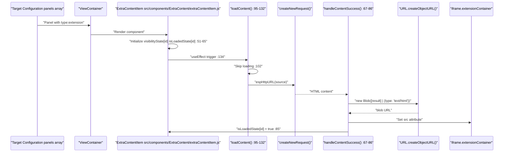

**Sources:**[[src/components/ExtraContent/extraContentItem.js#31-134](https://github.com/luc-github/ESP3D-WEBUI/blob/97c01e85/[src/components/ExtraContent/extraContentItem.js#L31-L134), [[src/components/ExtraContent/extraContentItem.js#67-86](https://github.com/luc-github/ESP3D-WEBUI/blob/97c01e85/[src/components/ExtraContent/extraContentItem.js#L67-L86)

### Loading Logic Details

- **Visibility Checks**: The component checks `visibilityState[id]` and whether the panel is currently visible in the UI context before loading [[src/components/ExtraContent/extraContentItem.js#102](https://github.com/luc-github/ESP3D-WEBUI/blob/97c01e85/[src/components/ExtraContent/extraContentItem.js#L102-L102)].
- **Source Handling**: If the `source` starts with `http`, it is used directly [[src/components/ExtraContent/extraContentItem.js#107-111](https://github.com/luc-github/ESP3D-WEBUI/blob/97c01e85/[src/components/ExtraContent/extraContentItem.js#L107-L111)]. Otherwise, the file is fetched via a GET request [[src/components/ExtraContent/extraContentItem.js#123-130](https://github.com/luc-github/ESP3D-WEBUI/blob/97c01e85/[src/components/ExtraContent/extraContentItem.js#L123-L130)].
- **Blob Conversion**: Local HTML content is converted into a `text/html` Blob to bypass same-origin restrictions for locally hosted extension files [[src/components/ExtraContent/extraContentItem.js#75-82](https://github.com/luc-github/ESP3D-WEBUI/blob/97c01e85/[src/components/ExtraContent/extraContentItem.js#L75-L82)].

---

## Message Passing Protocol

### Message Structure

All messages must include `type` and `target: "webui"`[[src/areas/index.js#85](https://github.com/luc-github/ESP3D-WEBUI/blob/97c01e85/[src/areas/index.js#L85-L85)].

|  |  |
| --- | --- |
| `type` | The action type: `cmd`, `query`, `toast`, `modal`, `notification`, `capabilities` |
| `target` | Must be `"webui"` for processing |
| `id` | Optional identifier for tracking specific requests |
| `content` | The payload (e.g., G-Code command, notification text) |
| `noDispatch` | If true, prevents broadcasting the response to other extensions [[src/areas/index.js#98](https://github.com/luc-github/ESP3D-WEBUI/blob/97c01e85/[src/areas/index.js#L98-L98)] |

### Extension to WebUI Actions

1. **Command (`type: "cmd"`)**: Sends G-Code or ESP commands [[src/areas/index.js#91-120](https://github.com/luc-github/ESP3D-WEBUI/blob/97c01e85/[src/areas/index.js#L91-L120)].
2. **Query (`type: "query"`)**: Requests current WebUI settings (Connection, Interface, Features) [[src/areas/index.js#123-150](https://github.com/luc-github/ESP3D-WEBUI/blob/97c01e85/[src/areas/index.js#L123-L150)].
3. **Toast (`type: "toast"`)**: Displays a transient UI notification [[src/areas/index.js#151-153](https://github.com/luc-github/ESP3D-WEBUI/blob/97c01e85/[src/areas/index.js#L151-L153)].
4. **Modal (`type: "modal"`)**: Triggers a complex dialog with buttons and input fields [[src/areas/index.js#154-167](https://github.com/luc-github/ESP3D-WEBUI/blob/97c01e85/[src/areas/index.js#L154-L167)].
5. **Capabilities (`type: "capabilities"`)**: Queries available features for a specific extension or system area [[extensions_samples/capabilities.html#9-13](https://github.com/luc-github/ESP3D-WEBUI/blob/97c01e85/[extensions_samples/capabilities.html#L9-L13)].

### WebUI to Extension Notifications

The WebUI uses `dispatchToExtensions` to notify iframes of state changes:

- **Visibility**: Extensions are notified when their containing panel is hidden or shown [[src/components/ExtraContent/extraContentItem.js#156-164](https://github.com/luc-github/ESP3D-WEBUI/blob/97c01e85/[src/components/ExtraContent/extraContentItem.js#L156-L164)].
- **Command Results**: Success or error responses from the machine firmware are broadcast to extensions [[src/areas/index.js#100-119](https://github.com/luc-github/ESP3D-WEBUI/blob/97c01e85/[src/areas/index.js#L100-L119)].

**Sources:**[[src/areas/index.js#84-169](https://github.com/luc-github/ESP3D-WEBUI/blob/97c01e85/[src/areas/index.js#L84-L169), [[src/components/ExtraContent/extraContentItem.js#156-164](https://github.com/luc-github/ESP3D-WEBUI/blob/97c01e85/[src/components/ExtraContent/extraContentItem.js#L156-L164), [[extensions_samples/API.md#61-126](https://github.com/luc-github/ESP3D-WEBUI/blob/97c01e85/[extensions_samples/API.md?plain=1#L61-L126)

---

## Security and Sandboxing

The extension system leverages browser security features to protect the main application:

- **Same-Origin Policy**: Extensions are loaded within an iframe. While they can communicate via `postMessage`, they cannot directly access the parent window's variables or the React state tree [[extensions_samples/API.md#55-57](https://github.com/luc-github/ESP3D-WEBUI/blob/97c01e85/[extensions_samples/API.md?plain=1#L55-L57)].
- **Validation**: `processExtensionMessage` strictly validates the `target` property before executing any commands [[src/areas/index.js#85](https://github.com/luc-github/ESP3D-WEBUI/blob/97c01e85/[src/areas/index.js#L85-L85)].
- **Blob URLs**: Using `URL.createObjectURL` for local extension files ensures they are treated as unique origins [[src/components/ExtraContent/extraContentItem.js#81-82](https://github.com/luc-github/ESP3D-WEBUI/blob/97c01e85/[src/components/ExtraContent/extraContentItem.js#L81-L82)].
- **Controlled API**: Extensions cannot call internal functions directly; they must request actions (like sending a command) through the defined message protocol, which enforces existing authentication and rate-limiting via `createNewRequest`[[src/areas/index.js#92-94](https://github.com/luc-github/ESP3D-WEBUI/blob/97c01e85/[src/areas/index.js#L92-L94)].

**Sources:**[[src/areas/index.js#84-94](https://github.com/luc-github/ESP3D-WEBUI/blob/97c01e85/[src/areas/index.js#L84-L94), [[src/components/ExtraContent/extraContentItem.js#74-82](https://github.com/luc-github/ESP3D-WEBUI/blob/97c01e85/[src/components/ExtraContent/extraContentItem.js#L74-L82), [[extensions_samples/API.md#27-58](https://github.com/luc-github/ESP3D-WEBUI/blob/97c01e85/[extensions_samples/API.md?plain=1#L27-L58)

---

# 13.2-Custom-Content-Loading

# Custom Content Loading
Relevant source files

- [dist/Printer3D/Repetier/index.html.gz](https://github.com/luc-github/ESP3D-WEBUI/blob/97c01e85/dist/Printer3D/Repetier/index.html.gz)
- [dist/Printer3D/Smoothieware/index.html.gz](https://github.com/luc-github/ESP3D-WEBUI/blob/97c01e85/dist/Printer3D/Smoothieware/index.html.gz)
- [dist/SandTable/GRBL/index.html.gz](https://github.com/luc-github/ESP3D-WEBUI/blob/97c01e85/dist/SandTable/GRBL/index.html.gz)
- [src/components/App/version.js](https://github.com/luc-github/ESP3D-WEBUI/blob/97c01e85/src/components/App/version.js)
- [src/components/ExtraContent/extraContentItem.js](https://github.com/luc-github/ESP3D-WEBUI/blob/97c01e85/src/components/ExtraContent/extraContentItem.js)
- [src/components/ExtraContent/index.js](https://github.com/luc-github/ESP3D-WEBUI/blob/97c01e85/src/components/ExtraContent/index.js)
- [src/pages/dashboard/index.js](https://github.com/luc-github/ESP3D-WEBUI/blob/97c01e85/src/pages/dashboard/index.js)

## Purpose and Scope

The Custom Content Loading system in ESP3D-WEBUI provides a unified framework for embedding dynamic external resources, such as MJPEG camera feeds, static images, HTML pages, and interactive iframe-based extensions. The core of this system is the `ExtraContentItem` component, which manages data fetching via the [File System Abstraction Layer](/org/luc-github/wiki/luc-github/ESP3D-WEBUI/page/10.1?branch=%223.0%22), visibility tracking, and bidirectional communication for extensions.

---

## Supported Content Types

The system categorizes content into four types, handled by `ExtraContentItem`[src/components/ExtraContent/extraContentItem.js#34-42](https://github.com/luc-github/ESP3D-WEBUI/blob/97c01e85/src/components/ExtraContent/extraContentItem.js#L34-L42)

|  |  |  |  |
| --- | --- | --- | --- |
| `camera` | `image/jpeg` | Blob URL (Auto-refresh) | MJPEG stream monitoring |
| `image` | `image/jpeg` | Blob URL (Static/Refresh) | Machine logos, static diagrams |
| `extension` | `text/html` | Sandboxed Iframe | G-code viewers, custom plugins |
| `content` | `text/html` | Sandboxed Iframe | Embedded documentation, help pages |

**Sources:**[src/components/ExtraContent/extraContentItem.js#69-80](https://github.com/luc-github/ESP3D-WEBUI/blob/97c01e85/src/components/ExtraContent/extraContentItem.js#L69-L80)

---

## Component Architecture and Data Flow

The `ExtraContentItem` component maintains a sophisticated internal state and leverages global module-level maps to track visibility across the application lifecycle.

### Component State and Global Tracking

The component uses `visibilityState` and `isLoadedState` objects defined outside the component scope to persist status across re-renders [src/components/ExtraContent/extraContentItem.js#31-32](https://github.com/luc-github/ESP3D-WEBUI/blob/97c01e85/src/components/ExtraContent/extraContentItem.js#L31-L32)

[Flowchart Diagram]

**Sources:**[src/components/ExtraContent/extraContentItem.js#31-65](https://github.com/luc-github/ESP3D-WEBUI/blob/97c01e85/src/components/ExtraContent/extraContentItem.js#L31-L65)[src/components/ExtraContent/extraContentItem.js#95-105](https://github.com/luc-github/ESP3D-WEBUI/blob/97c01e85/src/components/ExtraContent/extraContentItem.js#L95-L105)

---

## Content Loading Pipeline

Content is fetched either via absolute URLs or through the ESP3D internal communication queue.

1. **Request Initiation**: `loadContent` checks if the source is an absolute HTTP URL or a local file [src/components/ExtraContent/extraContentItem.js#107-112](https://github.com/luc-github/ESP3D-WEBUI/blob/97c01e85/src/components/ExtraContent/extraContentItem.js#L107-L112)
2. **Internal Fetch**: If local, it uses `createNewRequest` from `useHttpFn` to pull data from the device [src/components/ExtraContent/extraContentItem.js#123-130](https://github.com/luc-github/ESP3D-WEBUI/blob/97c01e85/src/components/ExtraContent/extraContentItem.js#L123-L130)
3. **Blob Conversion**: Successful responses are converted into `Blob` objects with the appropriate MIME type and mapped to a local `URL.createObjectURL`[src/components/ExtraContent/extraContentItem.js#67-82](https://github.com/luc-github/ESP3D-WEBUI/blob/97c01e85/src/components/ExtraContent/extraContentItem.js#L67-L82)
4. **State Synchronization**: The `isLoadedState[id]` is set to `true` to prevent redundant fetches unless a `forceRefresh` is triggered [src/components/ExtraContent/extraContentItem.js#85-86](https://github.com/luc-github/ESP3D-WEBUI/blob/97c01e85/src/components/ExtraContent/extraContentItem.js#L85-L86)

**Sources:**[src/components/ExtraContent/extraContentItem.js#67-86](https://github.com/luc-github/ESP3D-WEBUI/blob/97c01e85/src/components/ExtraContent/extraContentItem.js#L67-L86)[src/components/ExtraContent/extraContentItem.js#107-131](https://github.com/luc-github/ESP3D-WEBUI/blob/97c01e85/src/components/ExtraContent/extraContentItem.js#L107-L131)

---

## Visibility and Positioning System

Because custom content often lives in the `Dashboard` or specific panels, the UI must track the physical coordinates of the target container to overlay the content correctly.

### Position Synchronization

The `ExtraContent` wrapper (the parent of `ExtraContentItem`) uses an `eventBus` to communicate positioning data [src/components/ExtraContent/index.js#24-55](https://github.com/luc-github/ESP3D-WEBUI/blob/97c01e85/src/components/ExtraContent/index.js#L24-L55)

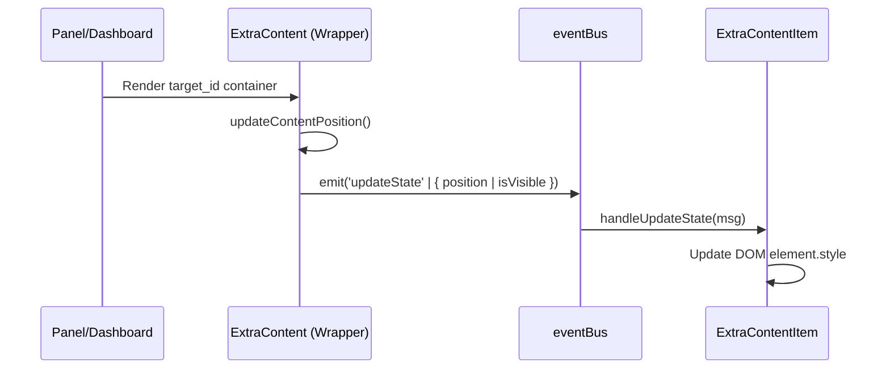

- **Scroll/Resize Listeners**: The system attaches listeners to the `#main` element and the window to recalculate positions in real-time [src/components/ExtraContent/index.js#95-101](https://github.com/luc-github/ESP3D-WEBUI/blob/97c01e85/src/components/ExtraContent/index.js#L95-L101)
- **Visibility Checks**: Content is only loaded if the parent panel is currently visible in the `UiContext`[src/components/ExtraContent/extraContentItem.js#102-105](https://github.com/luc-github/ESP3D-WEBUI/blob/97c01e85/src/components/ExtraContent/extraContentItem.js#L102-L105)

**Sources:**[src/components/ExtraContent/index.js#45-59](https://github.com/luc-github/ESP3D-WEBUI/blob/97c01e85/src/components/ExtraContent/index.js#L45-L59)[src/components/ExtraContent/index.js#95-101](https://github.com/luc-github/ESP3D-WEBUI/blob/97c01e85/src/components/ExtraContent/index.js#L95-L101)[src/components/ExtraContent/extraContentItem.js#140-175](https://github.com/luc-github/ESP3D-WEBUI/blob/97c01e85/src/components/ExtraContent/extraContentItem.js#L140-L175)

---

## Extension and Communication

Extensions utilize a sandboxed iframe. Bidirectional communication is handled via the `postMessage` API and the `dispatchToExtensions` helper [src/components/ExtraContent/extraContentItem.js#22](https://github.com/luc-github/ESP3D-WEBUI/blob/97c01e85/src/components/ExtraContent/extraContentItem.js#L22-L22)

### Notification Flow

When the main WebUI changes state (e.g., a panel is hidden), it notifies the extension [src/components/ExtraContent/extraContentItem.js#53-61](https://github.com/luc-github/ESP3D-WEBUI/blob/97c01e85/src/components/ExtraContent/extraContentItem.js#L53-L61):

```
// src/components/ExtraContent/extraContentItem.js:159-162
iframeElement.contentWindow.postMessage(
    { type: "notification", content: {isVisible: msg.isVisible}, id },
    "*"
)
```

### Refresh Control

For `camera` types, the UI provides manual controls:

- **Refresh**: Triggers `forceRefresh` via `eventBus`[src/components/ExtraContent/index.js#119](https://github.com/luc-github/ESP3D-WEBUI/blob/97c01e85/src/components/ExtraContent/index.js#L119-L119)
- **Pause/Play**: Toggles the `isPaused` state to stop the internal `setInterval`[src/components/ExtraContent/extraContentItem.js#46](https://github.com/luc-github/ESP3D-WEBUI/blob/97c01e85/src/components/ExtraContent/extraContentItem.js#L46-L46)

**Sources:**[src/components/ExtraContent/extraContentItem.js#53-61](https://github.com/luc-github/ESP3D-WEBUI/blob/97c01e85/src/components/ExtraContent/extraContentItem.js#L53-L61)[src/components/ExtraContent/index.js#116-121](https://github.com/luc-github/ESP3D-WEBUI/blob/97c01e85/src/components/ExtraContent/index.js#L116-L121)

---

## UI Rendering Logic

The component conditionally renders based on the `target` prop:

- **target="page"**: Renders a full-page container (`.page-container`) with a target div for content overlay [src/components/ExtraContent/index.js#164-175](https://github.com/luc-github/ESP3D-WEBUI/blob/97c01e85/src/components/ExtraContent/index.js#L164-L175)
- **target="panel"**: Renders a standard dashboard panel (`.panel-dashboard`) including a navbar with an icon, label, and control buttons (Refresh, FullScreen, Close) [src/components/ExtraContent/index.js#177-194](https://github.com/luc-github/ESP3D-WEBUI/blob/97c01e85/src/components/ExtraContent/index.js#L177-L194)

**Sources:**[src/components/ExtraContent/index.js#164-194](https://github.com/luc-github/ESP3D-WEBUI/blob/97c01e85/src/components/ExtraContent/index.js#L164-L194)

---

# 13.3-Real-time-Data-Streaming

# Real-time Data Streaming
Relevant source files

- [src/contexts/WsContext.js](https://github.com/luc-github/ESP3D-WEBUI/blob/97c01e85/src/contexts/WsContext.js)
- [src/targets/CNC/GRBL/stream.js](https://github.com/luc-github/ESP3D-WEBUI/blob/97c01e85/src/targets/CNC/GRBL/stream.js)
- [src/targets/CNC/grblHAL/stream.js](https://github.com/luc-github/ESP3D-WEBUI/blob/97c01e85/src/targets/CNC/grblHAL/stream.js)
- [src/targets/Printer3D/Marlin-embedded/stream.js](https://github.com/luc-github/ESP3D-WEBUI/blob/97c01e85/src/targets/Printer3D/Marlin-embedded/stream.js)
- [src/targets/Printer3D/Marlin/stream.js](https://github.com/luc-github/ESP3D-WEBUI/blob/97c01e85/src/targets/Printer3D/Marlin/stream.js)

## Purpose and Scope

This document explains the real-time data streaming architecture in ESP3D-WEBUI. Real-time streaming enables continuous monitoring of machine state (temperatures, positions, print progress) and live execution of G-code files through WebSocket connections. This page covers:

- WebSocket communication infrastructure and context management.
- Data types streamed from firmware (temperatures, positions, status, sensors).
- The `processData` pipeline that parses and dispatches streaming data.
- The ESP701 file streaming protocol for direct G-code execution.
- Temperature charting using the Smoothie.js library.
- Polling vs. auto-report mechanisms for different firmware types.

**Sources**: [src/contexts/WsContext.js#1-53](https://github.com/luc-github/ESP3D-WEBUI/blob/97c01e85/src/contexts/WsContext.js#L1-L53)[src/targets/Printer3D/Marlin/stream.js#1-41](https://github.com/luc-github/ESP3D-WEBUI/blob/97c01e85/src/targets/Printer3D/Marlin/stream.js#L1-L41)[src/targets/Printer3D/Marlin/filters.js#1-414](https://github.com/luc-github/ESP3D-WEBUI/blob/97c01e85/src/targets/Printer3D/Marlin/filters.js#L1-L414)

---

## WebSocket Communication Layer

The system uses WebSocket connections for bidirectional, low-latency streaming. The `WsContext` manages the lifecycle of this connection, including pings, reconnection logic, and initial message dispatching.

### WebSocket Architecture

[Flowchart Diagram]

**WebSocket Connection Lifecycle**:

- **Initialization**: Connection is managed within `WsContextProvider`[src/contexts/WsContext.js#41-52](https://github.com/luc-github/ESP3D-WEBUI/blob/97c01e85/src/contexts/WsContext.js#L41-L52)
- **Keep-Alive**: A `ping` function runs every 5000ms, sending the `ESPSESSIONID` to maintain the session [src/contexts/WsContext.js#38-71](https://github.com/luc-github/ESP3D-WEBUI/blob/97c01e85/src/contexts/WsContext.js#L38-L71)
- **Binary Support**: Incoming `ArrayBuffer` data is decoded as UTF-8 and passed to `processData` with the "stream" type [src/contexts/WsContext.js#77-79](https://github.com/luc-github/ESP3D-WEBUI/blob/97c01e85/src/contexts/WsContext.js#L77-L79)
- **Reconnection**: If the connection drops, `onCloseCB` attempts up to 4 reconnections before declaring a connection loss [src/contexts/WsContext.js#39-185](https://github.com/luc-github/ESP3D-WEBUI/blob/97c01e85/src/contexts/WsContext.js#L39-L185)

**Sources**: [src/contexts/WsContext.js#36-185](https://github.com/luc-github/ESP3D-WEBUI/blob/97c01e85/src/contexts/WsContext.js#L36-L185)[src/contexts/WsContext.js#73-142](https://github.com/luc-github/ESP3D-WEBUI/blob/97c01e85/src/contexts/WsContext.js#L73-L142)

---

## Data Types and Protocols

The streaming system handles multiple data types, each with firmware-specific formats. The **filter system** identifies and parses these formats into normalized data structures.

### Temperature Streaming

Temperature data includes extruders (T0-T8), heated bed (B), chamber (C), and sensors. Marlin reports temperatures in formats like `T:25.00 /210.00 B:60.00 /60.00`.

[Flowchart Diagram]

**Rolling Buffer**: The system maintains a circular buffer of temperature readings. When the buffer reaches 400 entries, the oldest entry is removed before adding the new entry, providing a rolling window for the UI charts.

**Sources**: [src/targets/Printer3D/Marlin/filters.js#44-78](https://github.com/luc-github/ESP3D-WEBUI/blob/97c01e85/src/targets/Printer3D/Marlin/filters.js#L44-L78)[src/targets/Printer3D/Marlin/stream.js#21-38](https://github.com/luc-github/ESP3D-WEBUI/blob/97c01e85/src/targets/Printer3D/Marlin/stream.js#L21-L38)

---

### Position Streaming

Position data reports coordinates for X, Y, Z axes.

- **Marlin Format**: `X:100.50 Y:75.25 Z:10.00 E:0.00`[src/targets/Printer3D/Marlin/filters.js#86-100](https://github.com/luc-github/ESP3D-WEBUI/blob/97c01e85/src/targets/Printer3D/Marlin/filters.js#L86-L100)
- **GRBL Format**: Encapsulated in status reports like `<Idle|MPos:0.000,0.000,0.000|FS:0,0>`[src/targets/CNC/GRBL/stream.js#28](https://github.com/luc-github/ESP3D-WEBUI/blob/97c01e85/src/targets/CNC/GRBL/stream.js#L28-L28)

**Position Filter**:

- **Detection**: `isPositions(line)` checks if the string contains coordinate patterns [src/targets/Printer3D/Marlin/stream.js#27](https://github.com/luc-github/ESP3D-WEBUI/blob/97c01e85/src/targets/Printer3D/Marlin/stream.js#L27-L27)
- **Regex Pattern**: `/X:\s*([+,-]?[0-9]*\.?[0-9]+)?\s*Y:\s*([+,-]?[0-9]*\.?[0-9]+)?\s*Z:\s*([+,-]?[0-9]*\.?[0-9]+)?\s*E/`[src/targets/Printer3D/Marlin/filters.js#87](https://github.com/luc-github/ESP3D-WEBUI/blob/97c01e85/src/targets/Printer3D/Marlin/filters.js#L87-L87)

**Sources**: [src/targets/Printer3D/Marlin/stream.js#21-39](https://github.com/luc-github/ESP3D-WEBUI/blob/97c01e85/src/targets/Printer3D/Marlin/stream.js#L21-L39)[src/targets/CNC/GRBL/stream.js#22-34](https://github.com/luc-github/ESP3D-WEBUI/blob/97c01e85/src/targets/CNC/GRBL/stream.js#L22-L34)

---

## Data Processing Pipeline

The `processData` function (consumed via `useTargetContext`) is the central dispatcher. It handles raw strings from `WsContext`.

### stream.js Logic

Each target provides a `stream.js` file defining `isVerboseOnly`. This function determines if a line should be treated as a background update (filtered from the main terminal if verbose mode is off) or a primary command response.

|  |  |  |
| --- | --- | --- |
| Marlin | [src/targets/Printer3D/Marlin/stream.js](https://github.com/luc-github/ESP3D-WEBUI/blob/97c01e85/src/targets/Printer3D/Marlin/stream.js) | `isTemperatures`, `isPositions`, `isPrintStatus`, `echo:`, `ok` |
| Marlin-embedded | [src/targets/Printer3D/Marlin-embedded/stream.js](https://github.com/luc-github/ESP3D-WEBUI/blob/97c01e85/src/targets/Printer3D/Marlin-embedded/stream.js) | `isTemperatures`, `isPositions`, `echo:`, `ok` |
| GRBL | [src/targets/CNC/GRBL/stream.js](https://github.com/luc-github/ESP3D-WEBUI/blob/97c01e85/src/targets/CNC/GRBL/stream.js) | Starts with `<`, `[`, `ok`, `SENSOR:`, or JSON `{}` |
| grblHAL | [src/targets/CNC/grblHAL/stream.js](https://github.com/luc-github/ESP3D-WEBUI/blob/97c01e85/src/targets/CNC/grblHAL/stream.js) | Same as GRBL (standardized CNC status reports) |

**Line Filtering Logic**:
In Marlin, lines starting with `M105`, `M106`, `M114`, or `FR:` (Feedrate) are flagged as `isVerboseOnly` to keep the terminal clean during high-frequency polling [src/targets/Printer3D/Marlin/stream.js#31-35](https://github.com/luc-github/ESP3D-WEBUI/blob/97c01e85/src/targets/Printer3D/Marlin/stream.js#L31-L35)

**Sources**: [src/targets/Printer3D/Marlin/stream.js#23-39](https://github.com/luc-github/ESP3D-WEBUI/blob/97c01e85/src/targets/Printer3D/Marlin/stream.js#L23-L39)[src/targets/CNC/GRBL/stream.js#22-34](https://github.com/luc-github/ESP3D-WEBUI/blob/97c01e85/src/targets/CNC/GRBL/stream.js#L22-L34)[src/targets/Printer3D/Marlin-embedded/stream.js#23-39](https://github.com/luc-github/ESP3D-WEBUI/blob/97c01e85/src/targets/Printer3D/Marlin-embedded/stream.js#L23-L39)

---

## ESP701 File Streaming Protocol

ESP701 is a proprietary protocol that allows the ESP3D device to execute G-code files directly from its storage (FLASH or SD) to the firmware serial port.

### ESP701 Status Parsing

When the UI polls with `[ESP701]`, the response is a JSON object. The filters identify this by checking if a line starts with `{` and ends with `}`[src/targets/Printer3D/Marlin/stream.js#37](https://github.com/luc-github/ESP3D-WEBUI/blob/97c01e85/src/targets/Printer3D/Marlin/stream.js#L37-L37)

**JSON Response Structure**:

- `status`: "processing", "no stream", "completed".
- `total`: Total file size in bytes.
- `processed`: Bytes sent to firmware.
- `name`: Path of the file being streamed.

**Sources**: [src/targets/Printer3D/Marlin/stream.js#37](https://github.com/luc-github/ESP3D-WEBUI/blob/97c01e85/src/targets/Printer3D/Marlin/stream.js#L37-L37)[src/targets/CNC/GRBL/stream.js#30](https://github.com/luc-github/ESP3D-WEBUI/blob/97c01e85/src/targets/CNC/GRBL/stream.js#L30-L30)

---

## Real-time Charting with Smoothie.js

The system integrates the **Smoothie** charting library to render real-time temperature and sensor graphs.

[Flowchart Diagram]

**Implementation Details**:

- **Performance**: Smoothie uses a single `<canvas>` element to render multiple data lines, minimizing DOM updates.
- **Interpolation**: It provides smooth transitions between data points, even if polling is irregular.
- **Synchronization**: Timestamps from the `processData` pipeline are used to ensure the X-axis accurately reflects the time the data was received.

**Sources**: [src/contexts/WsContext.js#51-52](https://github.com/luc-github/ESP3D-WEBUI/blob/97c01e85/src/contexts/WsContext.js#L51-L52)[src/targets/Printer3D/Marlin/filters.js#44-78](https://github.com/luc-github/ESP3D-WEBUI/blob/97c01e85/src/targets/Printer3D/Marlin/filters.js#L44-L78)

---

## Polling Mechanisms

When firmware does not support auto-reporting (e.g., `Cap:AUTOREPORT_TEMP:0`), the WebUI initiates polling.

### Polling Commands

|  |  |  |
| --- | --- | --- |
| `M105` | Request Temperatures | Marlin / Repetier |
| `M114` | Request Current Position | Marlin / Smoothie |
| `?` | Request Status Report | GRBL / grblHAL |
| `[ESP701]` | Request Streaming Progress | ESP3D Core |

The `WsContext` and `TargetContext` work together to ensure that these polling responses are parsed silently (via `isVerboseOnly`) so they do not clutter the user's terminal while still updating the UI state [src/targets/Printer3D/Marlin/stream.js#31-34](https://github.com/luc-github/ESP3D-WEBUI/blob/97c01e85/src/targets/Printer3D/Marlin/stream.js#L31-L34)

**Sources**: [src/targets/Printer3D/Marlin/stream.js#23-39](https://github.com/luc-github/ESP3D-WEBUI/blob/97c01e85/src/targets/Printer3D/Marlin/stream.js#L23-L39)[src/contexts/WsContext.js#73-142](https://github.com/luc-github/ESP3D-WEBUI/blob/97c01e85/src/contexts/WsContext.js#L73-L142)

---

# 13.4-GCode-Viewer-Extension

# GCode Viewer Extension
Relevant source files

- [extensions/click2go/.prettierrc](https://github.com/luc-github/ESP3D-WEBUI/blob/97c01e85/extensions/click2go/.prettierrc)
- [extensions/click2go/README.md](https://github.com/luc-github/ESP3D-WEBUI/blob/97c01e85/extensions/click2go/README.md?plain=1)
- [extensions/gcodeViewer/.babel.rc](https://github.com/luc-github/ESP3D-WEBUI/blob/97c01e85/extensions/gcodeViewer/.babel.rc)
- [extensions/gcodeViewer/.prettierrc](https://github.com/luc-github/ESP3D-WEBUI/blob/97c01e85/extensions/gcodeViewer/.prettierrc)
- [extensions/gcodeViewer/LICENSE](https://github.com/luc-github/ESP3D-WEBUI/blob/97c01e85/extensions/gcodeViewer/LICENSE)
- [extensions/gcodeViewer/README.md](https://github.com/luc-github/ESP3D-WEBUI/blob/97c01e85/extensions/gcodeViewer/README.md?plain=1)
- [extensions/gcodeViewer/dist/gcodeViewer.html.gz](https://github.com/luc-github/ESP3D-WEBUI/blob/97c01e85/extensions/gcodeViewer/dist/gcodeViewer.html.gz)
- [extensions/gcodeViewer/package.json](https://github.com/luc-github/ESP3D-WEBUI/blob/97c01e85/extensions/gcodeViewer/package.json)
- [extensions/gcodeViewer/src/gcodeViewer.html](https://github.com/luc-github/ESP3D-WEBUI/blob/97c01e85/extensions/gcodeViewer/src/gcodeViewer.html)
- [extensions/gcodeViewer/webpack.config.js](https://github.com/luc-github/ESP3D-WEBUI/blob/97c01e85/extensions/gcodeViewer/webpack.config.js)
- [src/components/Images/icons.js](https://github.com/luc-github/ESP3D-WEBUI/blob/97c01e85/src/components/Images/icons.js)

The GCode Viewer is a high-performance, WebGL-based extension designed for real-time 3D visualization of G-code toolpaths. It operates as a standalone component integrated into the ESP3D-WEBUI via the iframe-based extension system, providing interactive print previews and layer-by-layer analysis.

## Extension Architecture Overview

The GCode Viewer is implemented in `extensions/gcodeViewer/src/gcodeViewer.html`. It is designed to be lightweight and standalone, avoiding external dependencies like Three.js to minimize memory footprint on embedded devices [extensions/gcodeViewer/src/gcodeViewer.html#1-5](https://github.com/luc-github/ESP3D-WEBUI/blob/97c01e85/extensions/gcodeViewer/src/gcodeViewer.html#L1-L5)

### Technical Stack and Performance

- **Rendering Engine**: Custom WebGL implementation using raw shaders for grid and G-code paths [extensions/gcodeViewer/src/gcodeViewer.html#8-10](https://github.com/luc-github/ESP3D-WEBUI/blob/97c01e85/extensions/gcodeViewer/src/gcodeViewer.html#L8-L10)
- **Data Processing**: Uses batch processing and `async/await` to prevent UI blocking during large file parsing [extensions/gcodeViewer/src/gcodeViewer.html#3-4](https://github.com/luc-github/ESP3D-WEBUI/blob/97c01e85/extensions/gcodeViewer/src/gcodeViewer.html#L3-L4)
- **Memory Management**: Implements a `chunkSize` of 8KB for file reading to avoid memory overflow [extensions/gcodeViewer/src/gcodeViewer.html#22-23](https://github.com/luc-github/ESP3D-WEBUI/blob/97c01e85/extensions/gcodeViewer/src/gcodeViewer.html#L22-L23)
- **Geometry Limits**: Constrained by `MAX_VERTICES = 1000000` to ensure stability on mobile browsers [extensions/gcodeViewer/src/gcodeViewer.html#48](https://github.com/luc-github/ESP3D-WEBUI/blob/97c01e85/extensions/gcodeViewer/src/gcodeViewer.html#L48-L48)

### Code Entity Mapping

The following diagram maps the high-level visualization concepts to the specific variables and functions defined in the viewer's source code.

[Flowchart Diagram]

**Sources**: [extensions/gcodeViewer/src/gcodeViewer.html#8-60](https://github.com/luc-github/ESP3D-WEBUI/blob/97c01e85/extensions/gcodeViewer/src/gcodeViewer.html#L8-L60)[extensions/gcodeViewer/src/gcodeViewer.html#97-150](https://github.com/luc-github/ESP3D-WEBUI/blob/97c01e85/extensions/gcodeViewer/src/gcodeViewer.html#L97-L150)

## Loading and Lifecycle Management

The extension is bundled using Webpack and compressed into a `.html.gz` file for deployment to the ESP3D device [extensions/gcodeViewer/webpack.config.js#8-54](https://github.com/luc-github/ESP3D-WEBUI/blob/97c01e85/extensions/gcodeViewer/webpack.config.js#L8-L54)

### Build Pipeline

The build process transforms the source into a production-ready asset:

1. **Babel**: Transpiles modern JS for compatibility [extensions/gcodeViewer/package.json#13-15](https://github.com/luc-github/ESP3D-WEBUI/blob/97c01e85/extensions/gcodeViewer/package.json#L13-L15)
2. **HTML Loader**: Minifies the HTML template [extensions/gcodeViewer/webpack.config.js#15-18](https://github.com/luc-github/ESP3D-WEBUI/blob/97c01e85/extensions/gcodeViewer/webpack.config.js#L15-L18)
3. **Compression**: Gzips the final output to save space on FLASH storage [extensions/gcodeViewer/webpack.config.js#39-45](https://github.com/luc-github/ESP3D-WEBUI/blob/97c01e85/extensions/gcodeViewer/webpack.config.js#L39-L45)

### Initialization Sequence

When the main application loads the extension iframe, the following sequence occurs within `gcodeViewer.html`:

1. **Context Creation**: `gl` context is initialized.
2. **Matrix Setup**: Identity matrices are created for `mvMatrix` (Model-View) and `pMatrix` (Projection) [extensions/gcodeViewer/src/gcodeViewer.html#11-12](https://github.com/luc-github/ESP3D-WEBUI/blob/97c01e85/extensions/gcodeViewer/src/gcodeViewer.html#L11-L12)
3. **Camera Configuration**: Sets initial `cameraPosition` at `initialCameraDistance` (500 units) [extensions/gcodeViewer/src/gcodeViewer.html#76-85](https://github.com/luc-github/ESP3D-WEBUI/blob/97c01e85/extensions/gcodeViewer/src/gcodeViewer.html#L76-L85)
4. **Grid Generation**: Renders a machine bed grid based on `gridSide` (default 200mm) [extensions/gcodeViewer/src/gcodeViewer.html#71-72](https://github.com/luc-github/ESP3D-WEBUI/blob/97c01e85/extensions/gcodeViewer/src/gcodeViewer.html#L71-L72)

**Sources**: [extensions/gcodeViewer/src/gcodeViewer.html#7-86](https://github.com/luc-github/ESP3D-WEBUI/blob/97c01e85/extensions/gcodeViewer/src/gcodeViewer.html#L7-L86)[extensions/gcodeViewer/package.json#1-25](https://github.com/luc-github/ESP3D-WEBUI/blob/97c01e85/extensions/gcodeViewer/package.json#L1-L25)

## Data Flow and Message Protocol

The GCode Viewer communicates with the main WebUI via `window.postMessage`.

### Message Handling Integration

The main application in `src/areas/index.js` acts as a proxy between the firmware and the extension.

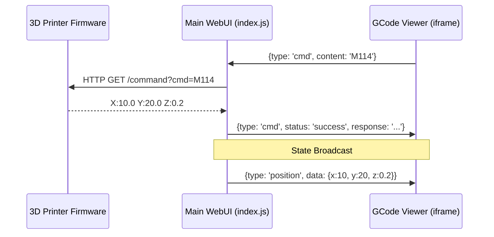

**Sources**: [src/areas/index.js#84-144](https://github.com/luc-github/ESP3D-WEBUI/blob/97c01e85/src/areas/index.js#L84-L144)[src/components/ExtraContent/extraContentItem.js#142-159](https://github.com/luc-github/ESP3D-WEBUI/blob/97c01e85/src/components/ExtraContent/extraContentItem.js#L142-L159)

## Visualization Logic

The viewer distinguishes between different types of machine movements to provide a clear visual representation of the print process.

### Movement Classifications

The viewer uses specific line widths and colors to categorize toolpaths [extensions/gcodeViewer/src/gcodeViewer.html#43-47](https://github.com/luc-github/ESP3D-WEBUI/blob/97c01e85/extensions/gcodeViewer/src/gcodeViewer.html#L43-L47):

|  |  |  |  |
| --- | --- | --- | --- |
| **Extrusion** | `lineWidths.extrude` | 0.4 | Solid paths where material is deposited |
| **Travel** | `lineWidths.move` | 0.1 | Rapid moves (G0) without extrusion |
| **Retraction** | `lineWidths.retract` | 0.1 | Vertical or small moves indicating filament pull-back |

### Coordinate Transformations

The viewer supports several UI states to match the physical machine configuration:

- **Invert XY**: Swaps axes for different machine orientations [extensions/gcodeViewer/src/gcodeViewer.html#65](https://github.com/luc-github/ESP3D-WEBUI/blob/97c01e85/extensions/gcodeViewer/src/gcodeViewer.html#L65-L65)
- **Invert Front/Back**: Flips the Y-axis [extensions/gcodeViewer/src/gcodeViewer.html#66](https://github.com/luc-github/ESP3D-WEBUI/blob/97c01e85/extensions/gcodeViewer/src/gcodeViewer.html#L66-L66)
- **Smart Zoom**: Automatically adjusts `scaleFactor` to fit the model within the viewport [extensions/gcodeViewer/src/gcodeViewer.html#67](https://github.com/luc-github/ESP3D-WEBUI/blob/97c01e85/extensions/gcodeViewer/src/gcodeViewer.html#L67-L67)

### Layer Analysis

The viewer calculates an `averageLayerHeight` by monitoring Z-axis changes in the G-code stream [extensions/gcodeViewer/src/gcodeViewer.html#51-58](https://github.com/luc-github/ESP3D-WEBUI/blob/97c01e85/extensions/gcodeViewer/src/gcodeViewer.html#L51-L58) This allows for:

1. **Layer Filtering**: Showing only a specific range of layers (`startLayer` to `endLayer`) [extensions/gcodeViewer/src/gcodeViewer.html#63-64](https://github.com/luc-github/ESP3D-WEBUI/blob/97c01e85/extensions/gcodeViewer/src/gcodeViewer.html#L63-L64)
2. **Optimization**: Reducing vertex density for layers below a certain `LAYER_OPTIMIZATION_THRESHOLD`[extensions/gcodeViewer/src/gcodeViewer.html#79](https://github.com/luc-github/ESP3D-WEBUI/blob/97c01e85/extensions/gcodeViewer/src/gcodeViewer.html#L79-L79)

**Sources**: [extensions/gcodeViewer/src/gcodeViewer.html#30-86](https://github.com/luc-github/ESP3D-WEBUI/blob/97c01e85/extensions/gcodeViewer/src/gcodeViewer.html#L30-L86)[extensions/gcodeViewer/README.md#1-16](https://github.com/luc-github/ESP3D-WEBUI/blob/97c01e85/extensions/gcodeViewer/README.md?plain=1#L1-L16)

## 3D Math and Matrix Operations

The extension includes a custom math library to handle 3D transformations without external dependencies.

|  |  |  |
| --- | --- | --- |
| `vec3_cross` | Calculates cross product for normal generation | [extensions/gcodeViewer/src/gcodeViewer.html#98-104](https://github.com/luc-github/ESP3D-WEBUI/blob/97c01e85/extensions/gcodeViewer/src/gcodeViewer.html#L98-L104) |
| `vec3_normalize` | Scales vectors to unit length | [extensions/gcodeViewer/src/gcodeViewer.html#107-110](https://github.com/luc-github/ESP3D-WEBUI/blob/97c01e85/extensions/gcodeViewer/src/gcodeViewer.html#L107-L110) |
| `createRotationMatrix` | Generates 4x4 matrix for camera/model rotation | [extensions/gcodeViewer/src/gcodeViewer.html#113-139](https://github.com/luc-github/ESP3D-WEBUI/blob/97c01e85/extensions/gcodeViewer/src/gcodeViewer.html#L113-L139) |
| `perspectiveMatrix` | Creates the frustum for 3D projection | [extensions/gcodeViewer/src/gcodeViewer.html#167-189](https://github.com/luc-github/ESP3D-WEBUI/blob/97c01e85/extensions/gcodeViewer/src/gcodeViewer.html#L167-L189) |
| `multiplyMatrices` | Combines transformations (Translate * Rotate * Scale) | [extensions/gcodeViewer/src/gcodeViewer.html#152-164](https://github.com/luc-github/ESP3D-WEBUI/blob/97c01e85/extensions/gcodeViewer/src/gcodeViewer.html#L152-L164) |

**Sources**: [extensions/gcodeViewer/src/gcodeViewer.html#97-234](https://github.com/luc-github/ESP3D-WEBUI/blob/97c01e85/extensions/gcodeViewer/src/gcodeViewer.html#L97-L234)

---

# 14-API-Reference

# API Reference
Relevant source files

- [extensions_samples/API.md](https://github.com/luc-github/ESP3D-WEBUI/blob/97c01e85/extensions_samples/API.md?plain=1)
- [src/areas/elementsCache.js](https://github.com/luc-github/ESP3D-WEBUI/blob/97c01e85/src/areas/elementsCache.js)
- [src/components/Helpers/filters.js](https://github.com/luc-github/ESP3D-WEBUI/blob/97c01e85/src/components/Helpers/filters.js)
- [src/components/Helpers/storedState.js](https://github.com/luc-github/ESP3D-WEBUI/blob/97c01e85/src/components/Helpers/storedState.js)
- [src/components/Modal/logginModal.js](https://github.com/luc-github/ESP3D-WEBUI/blob/97c01e85/src/components/Modal/logginModal.js)
- [src/contexts/DatasContext.js](https://github.com/luc-github/ESP3D-WEBUI/blob/97c01e85/src/contexts/DatasContext.js)
- [src/contexts/UiContext.js](https://github.com/luc-github/ESP3D-WEBUI/blob/97c01e85/src/contexts/UiContext.js)
- [src/hooks/eventBus.js](https://github.com/luc-github/ESP3D-WEBUI/blob/97c01e85/src/hooks/eventBus.js)
- [src/targets/CNC/Controls/QuickStopButton.js](https://github.com/luc-github/ESP3D-WEBUI/blob/97c01e85/src/targets/CNC/Controls/QuickStopButton.js)
- [src/targets/CNC/GRBL/Controls/BackgroundContainer.js](https://github.com/luc-github/ESP3D-WEBUI/blob/97c01e85/src/targets/CNC/GRBL/Controls/BackgroundContainer.js)

This document provides complete reference documentation for all public APIs in the ESP3D-WEBUI codebase. The WebUI exposes APIs through Preact contexts, custom hooks, service modules, and utility functions.

## Overview

The API surface is organized into five categories:

- **[Context APIs](/org/luc-github/wiki/luc-github/ESP3D-WEBUI/page/14.1?branch=%223.0%22)** — `useUiContext()`, `useSettingsContext()`, `useTargetContext()`, `useDatasContext()`
- **[File System API](/org/luc-github/wiki/luc-github/ESP3D-WEBUI/page/14.2?branch=%223.0%22)** — `files.capability()`, `files.command()`, storage source modules
- **[Target API](/org/luc-github/wiki/luc-github/ESP3D-WEBUI/page/14.3?branch=%223.0%22)** — `TargetContextProvider`, `processor`, `variablesList`, filter functions
- **[Communication API](/org/luc-github/wiki/luc-github/ESP3D-WEBUI/page/14.4?branch=%223.0%22)** — `useHttpQueue()`, `useHttpFn`, `espHttpURL()`, WebSocket handlers
- **[Utility Functions](/org/luc-github/wiki/luc-github/ESP3D-WEBUI/page/14.5?branch=%223.0%22)** — `checkDependencies()`, `replaceVariables()`, `useStoredState()`

All APIs follow functional programming patterns with hooks for stateful operations and pure functions for transformations.

**Sources:**[src/contexts/UiContext.js#33-57](https://github.com/luc-github/ESP3D-WEBUI/blob/97c01e85/src/contexts/UiContext.js#L33-L57)[src/contexts/DatasContext.js#27-105](https://github.com/luc-github/ESP3D-WEBUI/blob/97c01e85/src/contexts/DatasContext.js#L27-L105)[src/hooks/useHttpQueue.js](https://github.com/luc-github/ESP3D-WEBUI/blob/97c01e85/src/hooks/useHttpQueue.js)[src/components/Helpers/http.js](https://github.com/luc-github/ESP3D-WEBUI/blob/97c01e85/src/components/Helpers/http.js)

## API Categories

|  |  |  |  |
| --- | --- | --- | --- |
| **Context APIs** | `useUiContext()`, `useSettingsContext()`, `useTargetContext()`, `useDatasContext()` | [src/contexts/](https://github.com/luc-github/ESP3D-WEBUI/blob/97c01e85/src/contexts/) | [Context APIs](/org/luc-github/wiki/luc-github/ESP3D-WEBUI/page/14.1?branch=%223.0%22) |
| **File System API** | `files.capability()`, `files.command()`, storage source `capabilities` | [src/targets/*/files.js](https://github.com/luc-github/ESP3D-WEBUI/blob/97c01e85/src/targets/*/files.js) | [File System API](/org/luc-github/wiki/luc-github/ESP3D-WEBUI/page/14.2?branch=%223.0%22) |
| **Target API** | `TargetContextProvider`, `processor()`, `variablesList`, `eventsList` | [src/targets/*/index.js](https://github.com/luc-github/ESP3D-WEBUI/blob/97c01e85/src/targets/*/index.js) | [Target API](/org/luc-github/wiki/luc-github/ESP3D-WEBUI/page/14.3?branch=%223.0%22) |
| **Communication API** | `useHttpQueue()`, `createNewRequest()`, `espHttpURL()`, `useHttpFn` | [src/hooks/](https://github.com/luc-github/ESP3D-WEBUI/blob/97c01e85/src/hooks/) | [Communication API](/org/luc-github/wiki/luc-github/ESP3D-WEBUI/page/14.4?branch=%223.0%22) |
| **Utility Functions** | `checkDependencies()`, `replaceVariables()`, `useStoredState()`, `eventBus` | [src/components/Helpers/](https://github.com/luc-github/ESP3D-WEBUI/blob/97c01e85/src/components/Helpers/) | [Utility Functions](/org/luc-github/wiki/luc-github/ESP3D-WEBUI/page/14.5?branch=%223.0%22) |

**Sources:**[src/contexts/UiContext.js#27-35](https://github.com/luc-github/ESP3D-WEBUI/blob/97c01e85/src/contexts/UiContext.js#L27-L35)[src/contexts/DatasContext.js#27-29](https://github.com/luc-github/ESP3D-WEBUI/blob/97c01e85/src/contexts/DatasContext.js#L27-L29)[src/hooks/eventBus.js#25-80](https://github.com/luc-github/ESP3D-WEBUI/blob/97c01e85/src/hooks/eventBus.js#L25-L80)[src/components/Helpers/storedState.js#21-33](https://github.com/luc-github/ESP3D-WEBUI/blob/97c01e85/src/components/Helpers/storedState.js#L21-L33)

## API Architecture

**API Layer Hierarchy and Entity Mapping**

[Flowchart Diagram]

**Sources:**[src/targets/CNC/Controls/QuickStopButton.js#21-31](https://github.com/luc-github/ESP3D-WEBUI/blob/97c01e85/src/targets/CNC/Controls/QuickStopButton.js#L21-L31)[src/contexts/DatasContext.js#36-41](https://github.com/luc-github/ESP3D-WEBUI/blob/97c01e85/src/contexts/DatasContext.js#L36-L41)[src/hooks/eventBus.js#60-68](https://github.com/luc-github/ESP3D-WEBUI/blob/97c01e85/src/hooks/eventBus.js#L60-L68)[src/areas/elementsCache.js#74-100](https://github.com/luc-github/ESP3D-WEBUI/blob/97c01e85/src/areas/elementsCache.js#L74-L100)[src/components/Helpers/storedState.js#21-33](https://github.com/luc-github/ESP3D-WEBUI/blob/97c01e85/src/components/Helpers/storedState.js#L21-L33)

## API Access Patterns

### Context Hook Pattern (Stateful)

Used for components that need to react to state changes.

```
// src/contexts/DatasContext.js:28
const { terminal } = useDatasContext();
// terminal.content will trigger re-render on update [src/contexts/DatasContext.js:89]()
```

### Static Function Pattern (Non-Reactive)

Used for one-off operations or accessing logic without triggering renders.

```
// src/contexts/UiContext.js:27
import { useUiContextFn } from "../contexts"
useUiContextFn.haptic(); // [src/components/Modal/logginModal.js:53]()
```

### Event Bus Pattern

Used for cross-component communication outside of the Preact tree.

```
// src/hooks/eventBus.js:60
import { eventBus } from "../hooks/eventBus"
eventBus.emit('someEvent', data);
```

**Sources:**[src/contexts/DatasContext.js#28-86](https://github.com/luc-github/ESP3D-WEBUI/blob/97c01e85/src/contexts/DatasContext.js#L28-L86)[src/contexts/UiContext.js#27-34](https://github.com/luc-github/ESP3D-WEBUI/blob/97c01e85/src/contexts/UiContext.js#L27-L34)[src/hooks/eventBus.js#25-80](https://github.com/luc-github/ESP3D-WEBUI/blob/97c01e85/src/hooks/eventBus.js#L25-L80)

## Context System

**Context Provider Hierarchy and Data Responsibility**

[Flowchart Diagram]

### Context Provider Details

|  |  |  |  |
| --- | --- | --- | --- |
| **UI** | `UiContextProvider` | `modals`, `toasts`, `connectionState` | `addModal()`, `addToast()`, `setConnectionState()` |
| **Datas** | `DatasContextProvider` | `terminalContent`, `terminalInputHistory` | `addTerminalContent()`, `clearTerminal()` |
| **Target** | `TargetContextProvider` | `status`, `positions`, `alarmCode` | `setTemperatures()`, `setPositions()` |

**Sources:**[src/contexts/UiContext.js#35-56](https://github.com/luc-github/ESP3D-WEBUI/blob/97c01e85/src/contexts/UiContext.js#L35-L56)[src/contexts/DatasContext.js#30-41](https://github.com/luc-github/ESP3D-WEBUI/blob/97c01e85/src/contexts/DatasContext.js#L30-L41)[src/targets/CNC/GRBL/Controls/BackgroundContainer.js#27-40](https://github.com/luc-github/ESP3D-WEBUI/blob/97c01e85/src/targets/CNC/GRBL/Controls/BackgroundContainer.js#L27-L40)

## Communication API

The communication layer handles HTTP requests and WebSocket data routing. It ensures requests are properly formatted for the ESP3D backend.

- **`useHttpQueue`**: Manages a queue of requests to prevent overwhelming the ESP hardware [src/hooks/useHttpQueue.js](https://github.com/luc-github/ESP3D-WEBUI/blob/97c01e85/src/hooks/useHttpQueue.js)
- **`useHttpFn`**: Provides a standard interface for sending commands and creating requests [src/hooks/useHttpFn.js](https://github.com/luc-github/ESP3D-WEBUI/blob/97c01e85/src/hooks/useHttpFn.js)
- **`espHttpURL`**: Helper to construct URLs for specific endpoints like `/command`, `/files`, or `/login`[src/components/Helpers/http.js](https://github.com/luc-github/ESP3D-WEBUI/blob/97c01e85/src/components/Helpers/http.js)[src/components/Modal/logginModal.js#59](https://github.com/luc-github/ESP3D-WEBUI/blob/97c01e85/src/components/Modal/logginModal.js#L59-L59)

For details, see [Communication API](/org/luc-github/wiki/luc-github/ESP3D-WEBUI/page/14.4?branch=%223.0%22).

**Sources:**[src/hooks/useHttpFn.js](https://github.com/luc-github/ESP3D-WEBUI/blob/97c01e85/src/hooks/useHttpFn.js)[src/components/Modal/logginModal.js#58-60](https://github.com/luc-github/ESP3D-WEBUI/blob/97c01e85/src/components/Modal/logginModal.js#L58-L60)[src/targets/CNC/Controls/QuickStopButton.js#33-49](https://github.com/luc-github/ESP3D-WEBUI/blob/97c01e85/src/targets/CNC/Controls/QuickStopButton.js#L33-L49)

## File System API

The File System API abstracts storage operations across different backends (FLASH, SD, DIRECTSD).

- **`files.capability(source, action)`**: Checks if a storage source supports a specific action (e.g., `Upload`, `DeleteFile`) [src/targets/Printer3D/Marlin/files.js](https://github.com/luc-github/ESP3D-WEBUI/blob/97c01e85/src/targets/Printer3D/Marlin/files.js)
- **`files.command(source, action, params)`**: Returns the specific G-code or HTTP command required for the operation.
- **`sortedFilesList`**: Utility to sort file lists alphabetically while keeping directories at the top [src/components/Helpers/filters.js#24-44](https://github.com/luc-github/ESP3D-WEBUI/blob/97c01e85/src/components/Helpers/filters.js#L24-L44)

For details, see [File System API](/org/luc-github/wiki/luc-github/ESP3D-WEBUI/page/14.2?branch=%223.0%22).

**Sources:**[src/components/Helpers/filters.js#24-44](https://github.com/luc-github/ESP3D-WEBUI/blob/97c01e85/src/components/Helpers/filters.js#L24-L44)[src/targets/Printer3D/Marlin/files.js](https://github.com/luc-github/ESP3D-WEBUI/blob/97c01e85/src/targets/Printer3D/Marlin/files.js)

## Next Steps

For detailed documentation on specific API categories:

- [Context APIs](/org/luc-github/wiki/luc-github/ESP3D-WEBUI/page/14.1?branch=%223.0%22) — Detailed hook reference and state shapes.
- [File System API](/org/luc-github/wiki/luc-github/ESP3D-WEBUI/page/14.2?branch=%223.0%22) — Reference for storage source implementations.
- [Target API](/org/luc-github/wiki/luc-github/ESP3D-WEBUI/page/14.3?branch=%223.0%22) — Documentation for firmware-specific processors and filters.
- [Communication API](/org/luc-github/wiki/luc-github/ESP3D-WEBUI/page/14.4?branch=%223.0%22) — Reference for HTTP and WebSocket handling.
- [Utility Functions](/org/luc-github/wiki/luc-github/ESP3D-WEBUI/page/14.5?branch=%223.0%22) — Helper functions and validation utilities.

---

# 14.1-Context-APIs

# Context APIs
Relevant source files

- [src/areas/elementsCache.js](https://github.com/luc-github/ESP3D-WEBUI/blob/97c01e85/src/areas/elementsCache.js)
- [src/components/Helpers/filters.js](https://github.com/luc-github/ESP3D-WEBUI/blob/97c01e85/src/components/Helpers/filters.js)
- [src/components/Helpers/storedState.js](https://github.com/luc-github/ESP3D-WEBUI/blob/97c01e85/src/components/Helpers/storedState.js)
- [src/components/Modal/logginModal.js](https://github.com/luc-github/ESP3D-WEBUI/blob/97c01e85/src/components/Modal/logginModal.js)
- [src/contexts/DatasContext.js](https://github.com/luc-github/ESP3D-WEBUI/blob/97c01e85/src/contexts/DatasContext.js)
- [src/contexts/UiContext.js](https://github.com/luc-github/ESP3D-WEBUI/blob/97c01e85/src/contexts/UiContext.js)
- [src/hooks/eventBus.js](https://github.com/luc-github/ESP3D-WEBUI/blob/97c01e85/src/hooks/eventBus.js)
- [src/hooks/useSettings.js](https://github.com/luc-github/ESP3D-WEBUI/blob/97c01e85/src/hooks/useSettings.js)
- [src/targets/CNC/Controls/QuickStopButton.js](https://github.com/luc-github/ESP3D-WEBUI/blob/97c01e85/src/targets/CNC/Controls/QuickStopButton.js)
- [src/targets/CNC/GRBL/Controls/BackgroundContainer.js](https://github.com/luc-github/ESP3D-WEBUI/blob/97c01e85/src/targets/CNC/GRBL/Controls/BackgroundContainer.js)

This page documents the primary Preact context APIs that manage application state in ESP3D-WEBUI: `useUiContext`, `useSettingsContext`, `useTargetContext`, and `useDatasContext`. Each context provides a hook for accessing reactive state, and most provide a companion utility object (e.g., `useUiContextFn`) for imperative operations.

---

## Context System Architecture

The context providers are nested to ensure a specific dependency order. `SettingsContext` is typically outermost as UI and Target configurations depend on user preferences.

### Context Provider Hierarchy

[Flowchart Diagram]

**Sources:**[src/contexts/UiContext.js#35-101](https://github.com/luc-github/ESP3D-WEBUI/blob/97c01e85/src/contexts/UiContext.js#L35-L101)[src/contexts/DatasContext.js#30-103](https://github.com/luc-github/ESP3D-WEBUI/blob/97c01e85/src/contexts/DatasContext.js#L30-L103)[src/hooks/useSettings.js#58-62](https://github.com/luc-github/ESP3D-WEBUI/blob/97c01e85/src/hooks/useSettings.js#L58-L62)

---

## UiContext API

`UiContext` manages transient UI state including connection status, modal visibility, toast notifications, and panel visibility.

### Hook: `useUiContext()`

Returns an object containing reactive state and management functions:

|  |  |  |
| --- | --- | --- |
| `connection` | Object | Contains `connectionState` (`connected`, `authenticate`, `page`) [src/contexts/UiContext.js#52-56](https://github.com/luc-github/ESP3D-WEBUI/blob/97c01e85/src/contexts/UiContext.js#L52-L56) |
| `toasts` | Object | `addToast(newToast)`, `removeToast(uids)`[src/contexts/UiContext.js#98-123](https://github.com/luc-github/ESP3D-WEBUI/blob/97c01e85/src/contexts/UiContext.js#L98-L123) |
| `modals` | Object | `addModal(newModal)`, `removeModal(index)`, `getModalIndex(id)`[src/contexts/UiContext.js#125-139](https://github.com/luc-github/ESP3D-WEBUI/blob/97c01e85/src/contexts/UiContext.js#L125-L139) |
| `ui` | Object | General UI flags like `ready`, `setup`[src/contexts/UiContext.js#57](https://github.com/luc-github/ESP3D-WEBUI/blob/97c01e85/src/contexts/UiContext.js#L57-L57) |
| `uisettings` | Object | Provides `getValue(id)` for UI-specific configuration [src/contexts/UiContext.js#145-200](https://github.com/luc-github/ESP3D-WEBUI/blob/97c01e85/src/contexts/UiContext.js#L145-L200) |

### Utility: `useUiContextFn`

Provides imperative functions and shared logic. It includes a `getValue` helper used to check UI settings without triggering re-renders in every component.

**Usage Example (Extra Content):**
The `ElementsCache` uses `useUiContextFn.getValue` to determine if extra panels should be initialized.
[src/areas/elementsCache.js#43-48](https://github.com/luc-github/ESP3D-WEBUI/blob/97c01e85/src/areas/elementsCache.js#L43-L48)

**Sources:**[src/contexts/UiContext.js#27-143](https://github.com/luc-github/ESP3D-WEBUI/blob/97c01e85/src/contexts/UiContext.js#L27-L143)[src/areas/elementsCache.js#27-61](https://github.com/luc-github/ESP3D-WEBUI/blob/97c01e85/src/areas/elementsCache.js#L27-L61)

---

## SettingsContext API

`SettingsContext` manages persistent user preferences. It interacts closely with the `useSettings` hook to sync browser time and fetch connection configurations from the ESP device.

### Hook: `useSettingsContext()`

Provides access to three primary settings categories:

|  |  |  |
| --- | --- | --- |
| `interfaceSettings` | Ref/Object | UI preferences (language, theme, panel order) [src/hooks/useSettings.js#60-61](https://github.com/luc-github/ESP3D-WEBUI/blob/97c01e85/src/hooks/useSettings.js#L60-L61) |
| `connectionSettings` | Ref/Object | API endpoints and authentication settings [src/hooks/useSettings.js#60-61](https://github.com/luc-github/ESP3D-WEBUI/blob/97c01e85/src/hooks/useSettings.js#L60-L61) |
| `activity` | Object | Methods to start/stop polling [src/hooks/useSettings.js#135-164](https://github.com/luc-github/ESP3D-WEBUI/blob/97c01e85/src/hooks/useSettings.js#L135-L164) |

**Sources:**[src/hooks/useSettings.js#56-90](https://github.com/luc-github/ESP3D-WEBUI/blob/97c01e85/src/hooks/useSettings.js#L56-L90)[src/hooks/useSettings.js#173-189](https://github.com/luc-github/ESP3D-WEBUI/blob/97c01e85/src/hooks/useSettings.js#L173-L189)

---

## TargetContext API

`TargetContext` is the firmware-abstraction layer. It manages real-time machine data (temperatures, positions, alarms).

### Hook: `useTargetContext()`

Returns firmware-specific reactive state. For example, in CNC/GRBL targets:

|  |  |  |
| --- | --- | --- |
| `status` | String | Machine state (Idle, Run, Alarm) [src/targets/CNC/GRBL/Controls/BackgroundContainer.js#27](https://github.com/luc-github/ESP3D-WEBUI/blob/97c01e85/src/targets/CNC/GRBL/Controls/BackgroundContainer.js#L27-L27) |
| `alarmCode` | Number | Active GRBL alarm code [src/targets/CNC/GRBL/Controls/BackgroundContainer.js#27](https://github.com/luc-github/ESP3D-WEBUI/blob/97c01e85/src/targets/CNC/GRBL/Controls/BackgroundContainer.js#L27-L27) |
| `errorCode` | Number | Last received error code [src/targets/CNC/GRBL/Controls/BackgroundContainer.js#27](https://github.com/luc-github/ESP3D-WEBUI/blob/97c01e85/src/targets/CNC/GRBL/Controls/BackgroundContainer.js#L27-L27) |

### Utility: `useTargetContextFn`

Contains the critical `processData` function used to route incoming firmware strings to the correct parsers.

**Usage Example:**

```
const { processData } = useTargetContextFn
// Process a response from an HTTP command
processData("response", result, result.startsWith("{"))
```

[src/hooks/useSettings.js#59-80](https://github.com/luc-github/ESP3D-WEBUI/blob/97c01e85/src/hooks/useSettings.js#L59-L80)

**Sources:**[src/targets/CNC/GRBL/Controls/BackgroundContainer.js#26-40](https://github.com/luc-github/ESP3D-WEBUI/blob/97c01e85/src/targets/CNC/GRBL/Controls/BackgroundContainer.js#L26-L40)[src/hooks/useSettings.js#56-81](https://github.com/luc-github/ESP3D-WEBUI/blob/97c01e85/src/hooks/useSettings.js#L56-L81)

---

## DatasContext API

`DatasContext` manages high-volume data streams, specifically the Terminal output and command history. It uses `useStoredState` to persist command history in `localStorage`.

### Hook: `useDatasContext()`

|  |  |  |
| --- | --- | --- |
| `terminal.content` | Array | The array of messages to display in the terminal [src/contexts/DatasContext.js#89](https://github.com/luc-github/ESP3D-WEBUI/blob/97c01e85/src/contexts/DatasContext.js#L89-L89) |
| `terminal.add` | Function | Adds a message, handling "Verbose" vs "Quiet" buffers [src/contexts/DatasContext.js#49-78](https://github.com/luc-github/ESP3D-WEBUI/blob/97c01e85/src/contexts/DatasContext.js#L49-L78) |
| `terminal.clear` | Function | Flushes the terminal buffers [src/contexts/DatasContext.js#43-47](https://github.com/luc-github/ESP3D-WEBUI/blob/97c01e85/src/contexts/DatasContext.js#L43-L47) |
| `terminal.inputHistory` | Array | Persisted list of previous G-Code commands [src/contexts/DatasContext.js#92](https://github.com/luc-github/ESP3D-WEBUI/blob/97c01e85/src/contexts/DatasContext.js#L92-L92) |

**Sources:**[src/contexts/DatasContext.js#30-98](https://github.com/luc-github/ESP3D-WEBUI/blob/97c01e85/src/contexts/DatasContext.js#L30-L98)[src/components/Helpers/storedState.js#21-33](https://github.com/luc-github/ESP3D-WEBUI/blob/97c01e85/src/components/Helpers/storedState.js#L21-L33)

---

## Data Flow: Command and Response

This diagram bridges the **Natural Language Space** (User Action) to the **Code Entity Space** (Contexts and Hooks).

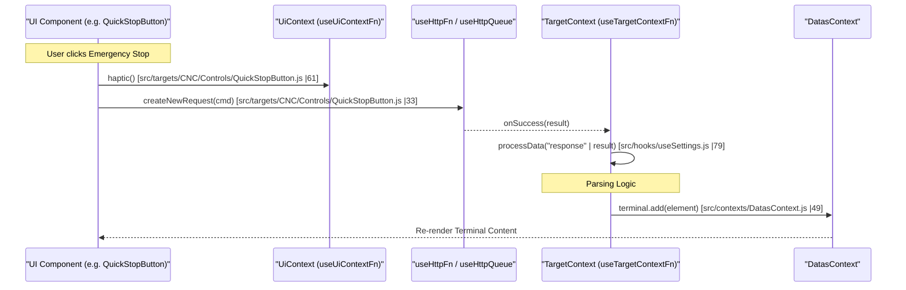

**Sources:**[src/targets/CNC/Controls/QuickStopButton.js#28-69](https://github.com/luc-github/ESP3D-WEBUI/blob/97c01e85/src/targets/CNC/Controls/QuickStopButton.js#L28-L69)[src/hooks/useSettings.js#63-90](https://github.com/luc-github/ESP3D-WEBUI/blob/97c01e85/src/hooks/useSettings.js#L63-L90)[src/contexts/DatasContext.js#49-78](https://github.com/luc-github/ESP3D-WEBUI/blob/97c01e85/src/contexts/DatasContext.js#L49-L78)

---

## Shared Utilities and Event Bus

While Contexts handle reactive state, the `eventBus` provides a lightweight mechanism for decoupled communication.

### EventBus

A simple pub/sub implementation used to share data without the overhead of Preact context re-renders.

- `on(event, callback, id)`: Register a listener [src/hooks/eventBus.js#32-52](https://github.com/luc-github/ESP3D-WEBUI/blob/97c01e85/src/hooks/eventBus.js#L32-L52)
- `emit(event, data)`: Trigger an event [src/hooks/eventBus.js#60-68](https://github.com/luc-github/ESP3D-WEBUI/blob/97c01e85/src/hooks/eventBus.js#L60-L68)

### Stored State

The `useStoredState` hook is a wrapper around `useState` that automatically synchronizes with `localStorage`.

- Used by `DatasContext` for `terminalInputHistory`[src/contexts/DatasContext.js#37-40](https://github.com/luc-github/ESP3D-WEBUI/blob/97c01e85/src/contexts/DatasContext.js#L37-L40)

**Sources:**[src/hooks/eventBus.js#25-78](https://github.com/luc-github/ESP3D-WEBUI/blob/97c01e85/src/hooks/eventBus.js#L25-L78)[src/components/Helpers/storedState.js#21-33](https://github.com/luc-github/ESP3D-WEBUI/blob/97c01e85/src/components/Helpers/storedState.js#L21-L33)

---

# 14.2-File-System-API

# File System API
Relevant source files

- [src/components/Helpers/http.js](https://github.com/luc-github/ESP3D-WEBUI/blob/97c01e85/src/components/Helpers/http.js)
- [src/tabs/interface/importHelper.js](https://github.com/luc-github/ESP3D-WEBUI/blob/97c01e85/src/tabs/interface/importHelper.js)
- [src/targets/CNC/GRBL/index.js](https://github.com/luc-github/ESP3D-WEBUI/blob/97c01e85/src/targets/CNC/GRBL/index.js)
- [src/targets/CNC/grblHAL/DIRECTSD-source.js](https://github.com/luc-github/ESP3D-WEBUI/blob/97c01e85/src/targets/CNC/grblHAL/DIRECTSD-source.js)
- [src/targets/CNC/grblHAL/FLASH-source.js](https://github.com/luc-github/ESP3D-WEBUI/blob/97c01e85/src/targets/CNC/grblHAL/FLASH-source.js)
- [src/targets/CNC/grblHAL/files.js](https://github.com/luc-github/ESP3D-WEBUI/blob/97c01e85/src/targets/CNC/grblHAL/files.js)
- [src/targets/CNC/grblHAL/index.js](https://github.com/luc-github/ESP3D-WEBUI/blob/97c01e85/src/targets/CNC/grblHAL/index.js)
- [src/targets/CNC/grblHAL/realCommandsTable.js](https://github.com/luc-github/ESP3D-WEBUI/blob/97c01e85/src/targets/CNC/grblHAL/realCommandsTable.js)
- [src/targets/CNC/grblHAL/translations/en.json](https://github.com/luc-github/ESP3D-WEBUI/blob/97c01e85/src/targets/CNC/grblHAL/translations/en.json)
- [src/targets/CNC/translations/en.json](https://github.com/luc-github/ESP3D-WEBUI/blob/97c01e85/src/targets/CNC/translations/en.json)
- [src/targets/FLASH-source.js](https://github.com/luc-github/ESP3D-WEBUI/blob/97c01e85/src/targets/FLASH-source.js)
- [src/targets/Printer3D/Marlin-embedded/SD-source.js](https://github.com/luc-github/ESP3D-WEBUI/blob/97c01e85/src/targets/Printer3D/Marlin-embedded/SD-source.js)
- [src/targets/Printer3D/Marlin/SD-source.js](https://github.com/luc-github/ESP3D-WEBUI/blob/97c01e85/src/targets/Printer3D/Marlin/SD-source.js)
- [src/targets/Printer3D/Marlin/SDEXT-source.js](https://github.com/luc-github/ESP3D-WEBUI/blob/97c01e85/src/targets/Printer3D/Marlin/SDEXT-source.js)
- [src/targets/Printer3D/Smoothieware/SD-source.js](https://github.com/luc-github/ESP3D-WEBUI/blob/97c01e85/src/targets/Printer3D/Smoothieware/SD-source.js)
- [src/targets/Printer3D/Smoothieware/SDEXT-source.js](https://github.com/luc-github/ESP3D-WEBUI/blob/97c01e85/src/targets/Printer3D/Smoothieware/SDEXT-source.js)

This document provides a technical reference for the File System API in ESP3D-WEBUI. The API provides a unified interface for interacting with various storage backends including internal FLASH, SD cards via serial protocols, and direct HTTP-based SD access (DIRECTSD). This abstraction layer allows UI components like the `FilesPanel` to perform operations without knowledge of the underlying storage implementation or firmware-specific command syntax.

---

## Architecture Overview

The File System API is implemented using a dispatcher pattern. The `files.js` file for each target routes capability checks and command requests to storage-specific source implementations. Each storage backend (FLASH, SD, DIRECTSD, SDEXT, etc.) implements a consistent interface comprising `capabilities` and `commands` objects.

### System Architecture

The following diagram illustrates the flow from UI components through the abstraction layer to the specific backend implementations and communication protocols.

**File System Entity Mapping**

[Flowchart Diagram]

**Sources:**[src/targets/CNC/grblHAL/files.js#1-84](https://github.com/luc-github/ESP3D-WEBUI/blob/97c01e85/src/targets/CNC/grblHAL/files.js#L1-L84)[src/targets/CNC/grblHAL/FLASH-source.js#1-134](https://github.com/luc-github/ESP3D-WEBUI/blob/97c01e85/src/targets/CNC/grblHAL/FLASH-source.js#L1-L134)[src/targets/CNC/grblHAL/DIRECTSD-source.js#1-124](https://github.com/luc-github/ESP3D-WEBUI/blob/97c01e85/src/targets/CNC/grblHAL/DIRECTSD-source.js#L1-L124)

---

## Backend Interface Definition

Every storage backend implementation (e.g., `FLASH-source.js`) must export an object containing `capabilities` and `commands`. Serial-based backends (like `SD-source.js` for Marlin) additionally export `responseSteps` to handle the asynchronous parsing of multi-line serial responses.

### Backend Component Structure

[Flowchart Diagram]

**Sources:**[src/targets/CNC/grblHAL/FLASH-source.js#24-131](https://github.com/luc-github/ESP3D-WEBUI/blob/97c01e85/src/targets/CNC/grblHAL/FLASH-source.js#L24-L131)[src/targets/Printer3D/Marlin/SD-source.js#55-178](https://github.com/luc-github/ESP3D-WEBUI/blob/97c01e85/src/targets/Printer3D/Marlin/SD-source.js#L55-L178)

---

## Supported File Systems

The `supportedFileSystems` array in `files.js` defines which backends are available for a specific firmware target. Each entry uses a `depend` function to check runtime settings (like `SDConnection` or `FlashFileSystem`) before enabling the storage type in the UI.

|  |  |  |  |
| --- | --- | --- | --- |
| `FLASH` | `S137` | `flashfs` (UI) && `FlashFileSystem != "none"` (Settings) | HTTP `/files` endpoint |
| `DIRECTSD` | `S190` | `directsd` (UI) && `SDConnection != "none"` (Settings) | HTTP `/sdfiles` endpoint |
| `SD` | `S190` | `sd` (UI) && `SDConnection == "none"` (Settings) | Serial `M20` / `M23` commands |
| `SDEXT` | `S191` | `sdext` (UI) && `!is_extra_sd_direct` (Settings) | Serial protocol extension |

**Sources:**[src/targets/CNC/grblHAL/files.js#26-47](https://github.com/luc-github/ESP3D-WEBUI/blob/97c01e85/src/targets/CNC/grblHAL/files.js#L26-L47)[src/targets/CNC/grblHAL/FLASH-source.js#53-129](https://github.com/luc-github/ESP3D-WEBUI/blob/97c01e85/src/targets/CNC/grblHAL/FLASH-source.js#L53-L129)[src/targets/CNC/grblHAL/DIRECTSD-source.js#54-120](https://github.com/luc-github/ESP3D-WEBUI/blob/97c01e85/src/targets/CNC/grblHAL/DIRECTSD-source.js#L54-L120)

---

## API Reference: files.capability()

The `capability()` function checks if a storage backend supports a specific operation.

**Signature:**`capability(filesystem, cap, ...rest)`[src/targets/CNC/grblHAL/files.js#59-66](https://github.com/luc-github/ESP3D-WEBUI/blob/97c01e85/src/targets/CNC/grblHAL/files.js#L59-L66)

### Common Capabilities

- **`Process(path, filename)`**: Returns `true` if the file type is supported for machine execution (e.g., `.gcode`). Uses `canProcessFile` helper [src/targets/CNC/grblHAL/FLASH-source.js#25-27](https://github.com/luc-github/ESP3D-WEBUI/blob/97c01e85/src/targets/CNC/grblHAL/FLASH-source.js#L25-L27)
- **`IsFlatFS()`**: Returns `true` for file systems that do not support nested directories (typically serial SD) [src/targets/Printer3D/Marlin/SD-source.js#60](https://github.com/luc-github/ESP3D-WEBUI/blob/97c01e85/src/targets/Printer3D/Marlin/SD-source.js#L60-L60)
- **`Upload()`**: Returns `true` if the backend supports file writing. For serial SD, this often depends on `SerialProtocol == "MKS"`[src/targets/Printer3D/Marlin/SD-source.js#61-66](https://github.com/luc-github/ESP3D-WEBUI/blob/97c01e85/src/targets/Printer3D/Marlin/SD-source.js#L61-L66)
- **`Download()`**: Returns `true` if the backend supports file retrieval. Usually `false` for serial-only SD [src/targets/Printer3D/Marlin/SD-source.js#70-72](https://github.com/luc-github/ESP3D-WEBUI/blob/97c01e85/src/targets/Printer3D/Marlin/SD-source.js#L70-L72)
- **`CreateDir()`**: Returns `true` if the backend supports directory creation [src/targets/CNC/grblHAL/FLASH-source.js#48-50](https://github.com/luc-github/ESP3D-WEBUI/blob/97c01e85/src/targets/CNC/grblHAL/FLASH-source.js#L48-L50)

---

## API Reference: files.command()

The `command()` function generates a "Command Object" that describes how to execute the requested operation.

**Signature:**`command(filesystem, cmd, ...rest)`[src/targets/CNC/grblHAL/files.js#68-74](https://github.com/luc-github/ESP3D-WEBUI/blob/97c01e85/src/targets/CNC/grblHAL/files.js#L68-L74)

### Command Object Structure

The returned object contains a `type` field which dictates how the communication layer handles the request:

|  |  |  |
| --- | --- | --- |
| `url` | `url`, `args` | Perform an HTTP GET/POST to the specified endpoint [src/targets/CNC/grblHAL/FLASH-source.js#56-60](https://github.com/luc-github/ESP3D-WEBUI/blob/97c01e85/src/targets/CNC/grblHAL/FLASH-source.js#L56-L60) |
| `cmd` | `cmd` | Send a raw G-code or firmware command [src/targets/CNC/grblHAL/FLASH-source.js#120-127](https://github.com/luc-github/ESP3D-WEBUI/blob/97c01e85/src/targets/CNC/grblHAL/FLASH-source.js#L120-L127) |
| `refresh` | `timeOut` | Refresh the file list after a delay [src/targets/Printer3D/Marlin/SD-source.js#107-111](https://github.com/luc-github/ESP3D-WEBUI/blob/97c01e85/src/targets/Printer3D/Marlin/SD-source.js#L107-L111) |
| `none` | - | No action required. |

### Standard Operations

- **`list(path)`**:

- **FLASH**: `{ type: "url", url: "files", args: { path, action: "list" } }`[src/targets/CNC/grblHAL/FLASH-source.js#54-60](https://github.com/luc-github/ESP3D-WEBUI/blob/97c01e85/src/targets/CNC/grblHAL/FLASH-source.js#L54-L60)
- **SD**: `{ type: "cmd", cmd: "M20" }` (variable based on `sdlistcmd`) [src/targets/Printer3D/Marlin/SD-source.js#85-89](https://github.com/luc-github/ESP3D-WEBUI/blob/97c01e85/src/targets/Printer3D/Marlin/SD-source.js#L85-L89)
- **`play(path, filename)`**:

- Constructs a command string using the `playcmd` or `sdplaycmd` setting, replacing the `#` placeholder with the full file path [src/targets/CNC/grblHAL/FLASH-source.js#115-128](https://github.com/luc-github/ESP3D-WEBUI/blob/97c01e85/src/targets/CNC/grblHAL/FLASH-source.js#L115-L128)
- **`formatResult(result)`**:

- A mandatory function that converts the backend response (JSON string or raw serial lines) into a standardized object containing `files` (array) and `status` (string) [src/targets/CNC/grblHAL/FLASH-source.js#71-78](https://github.com/luc-github/ESP3D-WEBUI/blob/97c01e85/src/targets/CNC/grblHAL/FLASH-source.js#L71-L78)

---

## Result Processing and Sorting

The API handles the parsing of raw data into the UI-compatible format.

### Sorting Implementation

Backends check UI settings to determine if sorting is required. For example, `FLASH-source.js` checks `sort_flashfs_files`[src/targets/CNC/grblHAL/FLASH-source.js#73-75](https://github.com/luc-github/ESP3D-WEBUI/blob/97c01e85/src/targets/CNC/grblHAL/FLASH-source.js#L73-L75) If true, it uses the `sortedFilesList` helper [src/targets/CNC/grblHAL/FLASH-source.js#21](https://github.com/luc-github/ESP3D-WEBUI/blob/97c01e85/src/targets/CNC/grblHAL/FLASH-source.js#L21-L21)

### Serial Line Parsing (Regex)

For serial SD backends, `formatFileSerialLine` uses a complex regex to extract file names and sizes from raw firmware output. It dynamically builds the regex based on the `filesfilter` setting (e.g., `.gcode|.nc`) [src/targets/Printer3D/Marlin/SD-source.js#31-53](https://github.com/luc-github/ESP3D-WEBUI/blob/97c01e85/src/targets/Printer3D/Marlin/SD-source.js#L31-L53)

---

## Response Steps (Serial Protocol)

For backends communicating over serial (SD/SDEXT), the `responseSteps` object defines the lifecycle of a multi-line command.

```
// Example from src/targets/Printer3D/Marlin/SD-source.js:156-170
const responseSteps = {
    list: {
        start: (data) => data.startsWith("Begin file list"),
        end: (data) => data.startsWith("End file list"),
        error: (data) => data.indexOf("error") != -1 || data.indexOf("No SD card") != -1
    }
}
```

This allows the system to aggregate all lines between the `start` and `end` triggers into a single result for `formatResult` to process.

**Sources:**[src/targets/Printer3D/Marlin/SD-source.js#155-178](https://github.com/luc-github/ESP3D-WEBUI/blob/97c01e85/src/targets/Printer3D/Marlin/SD-source.js#L155-L178)[src/targets/Printer3D/Marlin/SDEXT-source.js#157-178](https://github.com/luc-github/ESP3D-WEBUI/blob/97c01e85/src/targets/Printer3D/Marlin/SDEXT-source.js#L157-L178)

---

# 14.3-Target-API

# Target API
Relevant source files

- [config/targets/Printer3D/Marlin/index.js](https://github.com/luc-github/ESP3D-WEBUI/blob/97c01e85/config/targets/Printer3D/Marlin/index.js)
- [src/targets/CNC/GRBL/index.js](https://github.com/luc-github/ESP3D-WEBUI/blob/97c01e85/src/targets/CNC/GRBL/index.js)
- [src/targets/CNC/grblHAL/DIRECTSD-source.js](https://github.com/luc-github/ESP3D-WEBUI/blob/97c01e85/src/targets/CNC/grblHAL/DIRECTSD-source.js)
- [src/targets/CNC/grblHAL/FLASH-source.js](https://github.com/luc-github/ESP3D-WEBUI/blob/97c01e85/src/targets/CNC/grblHAL/FLASH-source.js)
- [src/targets/CNC/grblHAL/files.js](https://github.com/luc-github/ESP3D-WEBUI/blob/97c01e85/src/targets/CNC/grblHAL/files.js)
- [src/targets/CNC/grblHAL/index.js](https://github.com/luc-github/ESP3D-WEBUI/blob/97c01e85/src/targets/CNC/grblHAL/index.js)
- [src/targets/CNC/grblHAL/realCommandsTable.js](https://github.com/luc-github/ESP3D-WEBUI/blob/97c01e85/src/targets/CNC/grblHAL/realCommandsTable.js)
- [src/targets/CNC/grblHAL/translations/en.json](https://github.com/luc-github/ESP3D-WEBUI/blob/97c01e85/src/targets/CNC/grblHAL/translations/en.json)
- [src/targets/CNC/translations/en.json](https://github.com/luc-github/ESP3D-WEBUI/blob/97c01e85/src/targets/CNC/translations/en.json)
- [src/targets/Printer3D/Marlin-embedded/filters.js](https://github.com/luc-github/ESP3D-WEBUI/blob/97c01e85/src/targets/Printer3D/Marlin-embedded/filters.js)
- [src/targets/Printer3D/Marlin/DIRECTSD-source.js](https://github.com/luc-github/ESP3D-WEBUI/blob/97c01e85/src/targets/Printer3D/Marlin/DIRECTSD-source.js)
- [src/targets/Printer3D/Marlin/FLASH-source.js](https://github.com/luc-github/ESP3D-WEBUI/blob/97c01e85/src/targets/Printer3D/Marlin/FLASH-source.js)
- [src/targets/Printer3D/Marlin/files.js](https://github.com/luc-github/ESP3D-WEBUI/blob/97c01e85/src/targets/Printer3D/Marlin/files.js)
- [src/targets/Printer3D/Repetier/filters.js](https://github.com/luc-github/ESP3D-WEBUI/blob/97c01e85/src/targets/Printer3D/Repetier/filters.js)
- [src/targets/Printer3D/Smoothieware/filters.js](https://github.com/luc-github/ESP3D-WEBUI/blob/97c01e85/src/targets/Printer3D/Smoothieware/filters.js)
- [src/targets/Printer3D/Smoothieware/index.js](https://github.com/luc-github/ESP3D-WEBUI/blob/97c01e85/src/targets/Printer3D/Smoothieware/index.js)

The Target API defines the interface that each firmware target must implement to integrate with ESP3D-WEBUI. This API provides firmware-specific data processing, state management, file system operations, and UI customization. Each target (Marlin, GRBL, Smoothieware, etc.) exports a standardized set of functions and components from its `index.js` file.

For general context information, see [Context APIs](/org/luc-github/wiki/luc-github/ESP3D-WEBUI/page/14.1?branch=%223.0%22). For file system operations, see [File System API](/org/luc-github/wiki/luc-github/ESP3D-WEBUI/page/14.2?branch=%223.0%22). For target-specific configuration, see [Target-Specific Settings](/org/luc-github/wiki/luc-github/ESP3D-WEBUI/page/7.3?branch=%223.0%22).

---

## Target Exports Structure

Each target directory contains an `index.js` file that exports the complete target API. The exports follow a standardized structure across all firmware types.

### Target Export Architecture

[Flowchart Diagram]

**Sources:**[src/targets/CNC/grblHAL/index.js#81-104](https://github.com/luc-github/ESP3D-WEBUI/blob/97c01e85/src/targets/CNC/grblHAL/index.js#L81-L104)[src/targets/CNC/GRBL/index.js#79-102](https://github.com/luc-github/ESP3D-WEBUI/blob/97c01e85/src/targets/CNC/GRBL/index.js#L79-L102)

---

## Metadata Exports

### Core Metadata

|  |  |  |
| --- | --- | --- |
| `Target` | `string` | Internal target identifier (e.g., "grblHAL", "Marlin") |
| `Name` | `string` | Display name for the target |
| `fwUrl` | `string[]` | Array of firmware repository URLs |
| `webUIbuild` | `string` | Build identifier (e.g., "GH5", "G3") |
| `restartdelay` | `number` | Seconds to wait after firmware restart |

**Example from grblHAL:**

```
// From src/targets/CNC/grblHAL/index.js:43-51
const Target = "grblHAL"
const webUIbuild = "GH5"
const Name = "grblHAL"
const fwUrl = [
    "https://github.com/grblHAL",
    "https://github.com/luc-github/ESP3D-TFT",
]
const restartdelay = 30
```

**Sources:**[src/targets/CNC/grblHAL/index.js#43-51](https://github.com/luc-github/ESP3D-WEBUI/blob/97c01e85/src/targets/CNC/grblHAL/index.js#L43-L51)[src/targets/CNC/GRBL/index.js#43-51](https://github.com/luc-github/ESP3D-WEBUI/blob/97c01e85/src/targets/CNC/GRBL/index.js#L43-L51)

---

## TargetContext API

### Provider and Hooks

The target context provides firmware-specific state management through Preact context.

### TargetContext State and Methods

[Flowchart Diagram]

### useTargetContext Hook

Returns the target context store with firmware-specific state.

**Store Properties:**

|  |  |  |
| --- | --- | --- |
| `positions` | `{x, y, z}` | Current machine positions |
| `temperatures` | `object` | Temperature readings indexed by tool type (T, B, C, P, R, M, L) |
| `temperaturesList` | `{current, clear}` | Historical temperature data (max 400 entries) |
| `fanSpeed` | `{current, set}` | Fan speed control (indexed array) |
| `flowRate` | `{current, set}` | Flow rate control (indexed array) |
| `feedRate` | `{current, set}` | Feed rate control (indexed array) |
| `sensor` | `{S: array}` | Sensor data readings |
| `sensorList` | `{current, clear}` | Historical sensor data |
| `status` | `object` | Print status: `{printState, filename, state}` |
| `streamStatus` | `object` | Streaming status (Marlin only): `{status, progress, name, printTime, printLeftTime}` |
| `processData` | `function` | Data processing function |

**Temperature Data Structure:**

```
// Temperature indices by tool type
temperatures = {
    T: [],  // T0-T8: Extruders
    R: [],  // R0-R1: Redundant
    B: [],  // B0-B1: Bed
    C: [],  // C0-C1: Chamber
    P: [],  // P0-P1: Probe
    M: [],  // M0-M1: Board
    L: []   // L0-L1: Laser
}
 
// Each entry: {value: "25.00", target: "120.00"}
```

**Sources:**[src/targets/CNC/grblHAL/index.js#33-36](https://github.com/luc-github/ESP3D-WEBUI/blob/97c01e85/src/targets/CNC/grblHAL/index.js#L33-L36)[src/targets/CNC/GRBL/index.js#32-35](https://github.com/luc-github/ESP3D-WEBUI/blob/97c01e85/src/targets/CNC/GRBL/index.js#L32-L35)

---

## Data Processing Pipeline

### processData Function

The core data processing function handles incoming data from the firmware.

**Signature:**

```
processData(type, data, noecho = false)
```

**Parameters:**

|  |  |  |
| --- | --- | --- |
| `type` | `string` | Data channel: "stream", "response", "core", "error", "echo" |
| `data` | `string` | Raw data from firmware |
| `noecho` | `boolean` | Suppress terminal echo if true |

### Target Data Flow

[Flowchart Diagram]

**Processing by Data Type:**

|  |  |
| --- | --- |
| `stream` | Line-buffered processing, filter matching, state updates |
| `response` | JSON formatting, filter matching, optional echo suppression |
| `core` | Direct dispatch, no terminal echo |
| `error` | Terminal output, no filtering |
| `echo` | Terminal output, no filtering |

**Sources:**[src/targets/CNC/grblHAL/index.js#23-36](https://github.com/luc-github/ESP3D-WEBUI/blob/97c01e85/src/targets/CNC/grblHAL/index.js#L23-L36)[src/targets/Printer3D/Smoothieware/filters.js#26-235](https://github.com/luc-github/ESP3D-WEBUI/blob/97c01e85/src/targets/Printer3D/Smoothieware/filters.js#L26-L235)

---

## Filter System

### Filter Pattern

Each target implements `is*` and `get*` filter pairs to parse firmware-specific responses.

### Parser Logic Space

[Flowchart Diagram]

### Smoothieware Filter Examples

**Temperature Parsing:**

```
// Pattern: ok T:26.1 /0.0 @0 T1:inf /0.0 @0 B:inf /0.0 @0
// From src/targets/Printer3D/Smoothieware/filters.js:48-51
const isTemperatures = (str) => {
    const regex_search = /T:.*\s@[0-2]/g
    return regex_search.test(str)
}
 
// From src/targets/Printer3D/Smoothieware/filters.js:53-79
const getTemperatures = (str) => {
    let result = null
    const response = { T: [], R: [], B: [], C: [], P: [], M: [], L: [] }
    const regex_search = /(B|T|C|P|R)([\d]*):([+|-]?[0-9]*\.?[0-9]+|inf)? \/([+]?[0-9]*\.?[0-9]+)/g
    while ((result = regex_search.exec(str)) !== null) {
        response[result[1]][result[2] == "" ? 0 : result[2]] = {
            value: result[3],
            target: result[4],
        }
    }
    return response
}
```

**Position Parsing:**

```
// Pattern: ok C: X:0.0000 Y:0.0000 Z:0.0000 E:0.0000
// From src/targets/Printer3D/Smoothieware/filters.js:87-91
const isPositions = (str) => {
    const regex_search = /X:\s*[+,-]?[0-9]*\.?[0-9]+?\s*Y:\s*[+,-]?[0-9]*\.?[0-9]+?\s*Z:\s*[+,-]?[0-9]*\.?[0-9]+?\s*E/
    return regex_search.test(str)
}
 
// From src/targets/Printer3D/Smoothieware/filters.js:93-101
const getPositions = (str) => {
    let result = null
    const regex_search = /X:\s*([+,-]?[0-9]*\.?[0-9]+)?\s*Y:\s*([+,-]?[0-9]*\.?[0-9]+)?\s*Z:\s*([+,-]?[0-9]*\.?[0-9]+)?\s*E/
    if ((result = regex_search.exec(str)) !== null) {
        return { x: result[1], y: result[2], z: result[3] }
    }
    return null
}
```

**Sources:**[src/targets/Printer3D/Smoothieware/filters.js#48-101](https://github.com/luc-github/ESP3D-WEBUI/blob/97c01e85/src/targets/Printer3D/Smoothieware/filters.js#L48-L101)

---

## Variables List API

The `variablesList` object provides dynamic command and variable management.

### Command Variables Hierarchy

[Flowchart Diagram]

### Structure

```
// From src/targets/CNC/grblHAL/index.js:52-61
const variablesList = {
    commands: [...realCommandsTable, ...variablesTable],
    addCommand: (variable) =>
        addObjectItem(variablesList.commands, "name", variable),
    removeCommand: (name) =>
        removeObjectItem(variablesList.commands, "name", name),
    modes: [...gcode_parser_modes],
    hideFeatures: false,
    allowEmptyLine: true,
}
```

### Command Entry Format

```
// Real-time command (grblHAL)
// From src/targets/CNC/grblHAL/realCommandsTable.js:21-25
{ name: "#SOFTRESET#", value: "\x18", notprintable: true },
{ name: "#STATUSREPORT#", value: "\x80", notprintable: true },
{ name: "#CYCLESTART#", value: "\x81", notprintable: true },
```

**Sources:**[src/targets/CNC/grblHAL/index.js#52-61](https://github.com/luc-github/ESP3D-WEBUI/blob/97c01e85/src/targets/CNC/grblHAL/index.js#L52-L61)[src/targets/CNC/grblHAL/realCommandsTable.js#20-50](https://github.com/luc-github/ESP3D-WEBUI/blob/97c01e85/src/targets/CNC/grblHAL/realCommandsTable.js#L20-L50)

---

## Events List API

The `eventsList` object provides a simple event pub/sub system for inter-component communication within the target.

### Structure

```
// From src/targets/CNC/grblHAL/index.js:62-79
const eventsList = {
    evts: [],
    on: (event, fn) => {
        if (typeof eventsList.evts[event] === "undefined") {
            eventsList.evts[event] = []
        }
        addObjectItem(eventsList.evts[event], "fn", { fn: fn })
    },
    off: (event, fn) => {
        removeObjectItem(variablesList.evts[event], "fn", fn)
    },
    emit: (event, data) => {
        if (eventsList.evts[event])
            eventsList.evts[event].forEach((element) => {
                if (typeof element.fn === "function") element.fn(data)
            })
    },
}
```

**Sources:**[src/targets/CNC/grblHAL/index.js#62-79](https://github.com/luc-github/ESP3D-WEBUI/blob/97c01e85/src/targets/CNC/grblHAL/index.js#L62-L79)[src/targets/CNC/GRBL/index.js#60-77](https://github.com/luc-github/ESP3D-WEBUI/blob/97c01e85/src/targets/CNC/GRBL/index.js#L60-L77)

---

## Files API Integration

Each target exports a `files` object that abstracts file system operations. See [File System API](/org/luc-github/wiki/luc-github/ESP3D-WEBUI/page/14.2?branch=%223.0%22) for complete details.

### Storage Source Pattern

Each storage type (FLASH, DIRECTSD, etc.) implements a standardized interface:

```
// From src/targets/CNC/grblHAL/FLASH-source.js:24-51
const capabilities = {
    Process: (path, filename) => canProcessFile(filename),
    UseFilters: () => true,
    IsFlatFS: () => false,
    Upload: () => true,
    Download: () => true,
    DeleteFile: () => true,
    DeleteDir: () => true,
    CreateDir: () => true,
}
 
// From src/targets/CNC/grblHAL/FLASH-source.js:53-129
const commands = {
    list: (path, filename) => ({ type: "url", url: "files", args: { path, action: "list" } }),
    upload: (path, filename) => ({ type: "url", url: "files", args: { path: upath } }),
    formatResult: (resultTxT) => { ... },
    play: (path, filename) => ({ type: "cmd", cmd: playCommand }),
}
```

**Sources:**[src/targets/CNC/grblHAL/files.js#49-81](https://github.com/luc-github/ESP3D-WEBUI/blob/97c01e85/src/targets/CNC/grblHAL/files.js#L49-L81)[src/targets/CNC/grblHAL/FLASH-source.js#24-129](https://github.com/luc-github/ESP3D-WEBUI/blob/97c01e85/src/targets/CNC/grblHAL/FLASH-source.js#L24-L129)[src/targets/Printer3D/Marlin/DIRECTSD-source.js#25-156](https://github.com/luc-github/ESP3D-WEBUI/blob/97c01e85/src/targets/Printer3D/Marlin/DIRECTSD-source.js#L25-L156)

---

## UI Component Exports

Targets export specific UI components and configurations to customize the interface layout.

|  |  |  |
| --- | --- | --- |
| `MachineSettings` | Component | Component for firmware-specific machine settings |
| `machineSettings` | Object | Descriptor containing ID, title, and content component |
| `defaultPanelsList` | Array | Ordered list of panels to display by default |
| `InformationsControls` | Component | Custom status information display |
| `QuickButtonsBar` | Component | Custom action buttons for the header |
| `AppLogo` | Component | Firmware-specific branding logo |
| `WebUILogo` | Component | WebUI branding logo |

**Sources:**[src/targets/CNC/grblHAL/index.js#81-103](https://github.com/luc-github/ESP3D-WEBUI/blob/97c01e85/src/targets/CNC/grblHAL/index.js#L81-L103)[src/targets/CNC/GRBL/index.js#79-101](https://github.com/luc-github/ESP3D-WEBUI/blob/97c01e85/src/targets/CNC/GRBL/index.js#L79-L101)

---

# 14.4-Communication-API

# Communication API
Relevant source files

- [src/components/Helpers/http.js](https://github.com/luc-github/ESP3D-WEBUI/blob/97c01e85/src/components/Helpers/http.js)
- [src/components/Helpers/time.js](https://github.com/luc-github/ESP3D-WEBUI/blob/97c01e85/src/components/Helpers/time.js)
- [src/contexts/WsContext.js](https://github.com/luc-github/ESP3D-WEBUI/blob/97c01e85/src/contexts/WsContext.js)
- [src/tabs/interface/importHelper.js](https://github.com/luc-github/ESP3D-WEBUI/blob/97c01e85/src/tabs/interface/importHelper.js)
- [src/targets/Printer3D/Marlin-embedded/SD-source.js](https://github.com/luc-github/ESP3D-WEBUI/blob/97c01e85/src/targets/Printer3D/Marlin-embedded/SD-source.js)
- [src/targets/Printer3D/Marlin/SD-source.js](https://github.com/luc-github/ESP3D-WEBUI/blob/97c01e85/src/targets/Printer3D/Marlin/SD-source.js)
- [src/targets/Printer3D/Marlin/SDEXT-source.js](https://github.com/luc-github/ESP3D-WEBUI/blob/97c01e85/src/targets/Printer3D/Marlin/SDEXT-source.js)

This page documents the HTTP and WebSocket communication APIs used in ESP3D-WEBUI for sending commands, managing file operations, and receiving real-time data from the ESP3D device.

## HTTP Communication Architecture

ESP3D-WEBUI uses HTTP for commands, configuration, and file operations. The architecture is designed to handle the resource constraints of ESP32/ESP8266 devices by implementing request queuing and deduplication.

### Key Entities Mapping

[Flowchart Diagram]

**Sources:**[src/components/Helpers/http.js#37-49](https://github.com/luc-github/ESP3D-WEBUI/blob/97c01e85/src/components/Helpers/http.js#L37-L49)[src/contexts/WsContext.js#41-52](https://github.com/luc-github/ESP3D-WEBUI/blob/97c01e85/src/contexts/WsContext.js#L41-L52)

### HTTP Request Flow

[Flowchart Diagram]

**Sources:**[src/components/Helpers/http.js#37-49](https://github.com/luc-github/ESP3D-WEBUI/blob/97c01e85/src/components/Helpers/http.js#L37-L49)[src/contexts/WsContext.js#25-27](https://github.com/luc-github/ESP3D-WEBUI/blob/97c01e85/src/contexts/WsContext.js#L25-L27)

---

## useHttpQueue vs useHttpFn

The codebase distinguishes between queued operations (commands) and immediate operations (polling/config).

### useHttpQueueContext

**Use for:** G-code commands, file uploads, deletions.

- **Deduplication:** Prevents sending the same command multiple times if a previous identical request is still pending.
- **Sequential Execution:** Ensures commands reach the firmware in the correct order.
- **Management:** Provides `removeAllRequests()` to clear the queue during disconnects [src/contexts/WsContext.js#160](https://github.com/luc-github/ESP3D-WEBUI/blob/97c01e85/src/contexts/WsContext.js#L160-L160)

### useHttpFn

**Use for:** One-off configuration fetches or non-critical status checks.

- **Immediate:** Bypasses the queue.
- **Abortable:** Supports `abortRequest()` to cancel pending fetches [src/contexts/WsContext.js#53-54](https://github.com/luc-github/ESP3D-WEBUI/blob/97c01e85/src/contexts/WsContext.js#L53-L54)

---

## URL Construction with espHttpURL

The `espHttpURL` helper ensures URLs are correctly formatted with the device's host and query parameters.

### Implementation

[src/components/Helpers/http.js#37-49](https://github.com/luc-github/ESP3D-WEBUI/blob/97c01e85/src/components/Helpers/http.js#L37-L49)

```
const espHttpURL = (base = "", args = {}) => {
    const url = (() => {
        try {
            return new URL(base)
        } catch (error) {
            return new URL(base, `http://${window.location.host}`)
        }
    })()
    Object.entries(args).forEach(([key, value]) =>
        url.searchParams.append(key, value)
    )
    return url.toString()
}
```

**Sources:**[src/components/Helpers/http.js#37-49](https://github.com/luc-github/ESP3D-WEBUI/blob/97c01e85/src/components/Helpers/http.js#L37-L49)

---

## WebSocket Communication (WsContext)

The `WsContextProvider` manages the persistent real-time link to the ESP3D device. It handles authentication pings, binary stream processing, and notification dispatching.

### Message Processing Logic

When a message arrives via `wsConnection`, it is processed in `onMessageCB`[src/contexts/WsContext.js#73-142](https://github.com/luc-github/ESP3D-WEBUI/blob/97c01e85/src/contexts/WsContext.js#L73-L142):

1. **Binary Data:** If the data is an `ArrayBuffer`, it is decoded as UTF-8 and passed to `processData("stream", ...)`[src/contexts/WsContext.js#77-79](https://github.com/luc-github/ESP3D-WEBUI/blob/97c01e85/src/contexts/WsContext.js#L77-L79)
2. **Text Commands:**
- `CURRENTID`: Updates the local `wsID` in `connectionSettings`[src/contexts/WsContext.js#85-87](https://github.com/luc-github/ESP3D-WEBUI/blob/97c01e85/src/contexts/WsContext.js#L85-L87)
- `ACTIVEID`: If the ID doesn't match, triggers a disconnect [src/contexts/WsContext.js#88-92](https://github.com/luc-github/ESP3D-WEBUI/blob/97c01e85/src/contexts/WsContext.js#L88-L92)
- `PING`: Monitors session timeout and alerts the user if the session is about to expire [src/contexts/WsContext.js#93-101](https://github.com/luc-github/ESP3D-WEBUI/blob/97c01e85/src/contexts/WsContext.js#L93-L101)
- `NOTIFICATION`: Triggers a UI toast with types like `error`, `success`, or `warning`[src/contexts/WsContext.js#102-122](https://github.com/luc-github/ESP3D-WEBUI/blob/97c01e85/src/contexts/WsContext.js#L102-L122)
- `ERROR`: Logs the error and calls `abortRequest()` from `useHttpFn`[src/contexts/WsContext.js#123-135](https://github.com/luc-github/ESP3D-WEBUI/blob/97c01e85/src/contexts/WsContext.js#L123-L135)
- **Default:** Passes raw data to the target-specific `processData("core", ...)`[src/contexts/WsContext.js#137](https://github.com/luc-github/ESP3D-WEBUI/blob/97c01e85/src/contexts/WsContext.js#L137-L137)

### Connection Lifecycle

- **Ping Mechanism:** A heartbeat is sent every 5000ms (`pingDelay`) to keep the session alive [src/contexts/WsContext.js#38-71](https://github.com/luc-github/ESP3D-WEBUI/blob/97c01e85/src/contexts/WsContext.js#L38-L71)
- **Reconnection:** If the connection drops, the system attempts up to 4 reconnections (`maxReconnections`) before declaring a connection loss [src/contexts/WsContext.js#39-187](https://github.com/luc-github/ESP3D-WEBUI/blob/97c01e85/src/contexts/WsContext.js#L39-L187)
- **Cleanup:** On `Disconnect`, it stops polling, removes all queued HTTP requests, and clears UI modals [src/contexts/WsContext.js#144-166](https://github.com/luc-github/ESP3D-WEBUI/blob/97c01e85/src/contexts/WsContext.js#L144-L166)

**Sources:**[src/contexts/WsContext.js#36-187](https://github.com/luc-github/ESP3D-WEBUI/blob/97c01e85/src/contexts/WsContext.js#L36-L187)

---

## Target-Specific File Operations

The Communication API is often invoked by the File System Abstraction Layer. Different targets (like Marlin) define how commands are mapped to HTTP or Serial requests.

### Example: Marlin SDEXT Communication

For Marlin targets using an external SD card (`SDEXT`), file operations are translated into specific G-code commands or HTTP URLs.

|  |  |  |
| --- | --- | --- |
| **List Files** | `cmd` | Uses `sdextlistcmd` (usually `M20`) [src/targets/Printer3D/Marlin/SDEXT-source.js#85-90](https://github.com/luc-github/ESP3D-WEBUI/blob/97c01e85/src/targets/Printer3D/Marlin/SDEXT-source.js#L85-L90) |
| **Upload** | `url` | If `SerialProtocol` is `MKS`, uses `/upload` endpoint [src/targets/Printer3D/Marlin/SDEXT-source.js#91-97](https://github.com/luc-github/ESP3D-WEBUI/blob/97c01e85/src/targets/Printer3D/Marlin/SDEXT-source.js#L91-L97) |
| **Play** | `cmd` | Replaces `#` in `sdextplaycmd` with the file path [src/targets/Printer3D/Marlin/SDEXT-source.js#131-141](https://github.com/luc-github/ESP3D-WEBUI/blob/97c01e85/src/targets/Printer3D/Marlin/SDEXT-source.js#L131-L141) |
| **Delete** | `cmd` | Uses `sdextdeletecmd` (usually `M30`) [src/targets/Printer3D/Marlin/SDEXT-source.js#142-154](https://github.com/luc-github/ESP3D-WEBUI/blob/97c01e85/src/targets/Printer3D/Marlin/SDEXT-source.js#L142-L154) |

### Response Handling

Targets define `responseSteps` to parse the serial/HTTP output into a structured format. For example, a file list starts with `Begin file list` and ends with `End file list`[src/targets/Printer3D/Marlin/SD-source.js#156-160](https://github.com/luc-github/ESP3D-WEBUI/blob/97c01e85/src/targets/Printer3D/Marlin/SD-source.js#L156-L160)

**Sources:**[src/targets/Printer3D/Marlin/SDEXT-source.js#84-178](https://github.com/luc-github/ESP3D-WEBUI/blob/97c01e85/src/targets/Printer3D/Marlin/SDEXT-source.js#L84-L178)[src/targets/Printer3D/Marlin/SD-source.js#155-176](https://github.com/luc-github/ESP3D-WEBUI/blob/97c01e85/src/targets/Printer3D/Marlin/SD-source.js#L155-L176)

---

## Authentication and Security

### Cookie Management

The `getCookie` helper is used to retrieve the `ESPSESSIONID` for authentication pings [src/contexts/WsContext.js#66-67](https://github.com/luc-github/ESP3D-WEBUI/blob/97c01e85/src/contexts/WsContext.js#L66-L67)

[src/components/Helpers/http.js#19-33](https://github.com/luc-github/ESP3D-WEBUI/blob/97c01e85/src/components/Helpers/http.js#L19-L33)

```
function getCookie(cname) {
    let name = cname + "="
    let decodedCookie = decodeURIComponent(document.cookie)
    let ca = decodedCookie.split(";")
    for (var i = 0; i < ca.length; i++) {
        var c = ca[i]
        while (c.charAt(0) == " ") { c = c.substring(1) }
        if (c.indexOf(name) == 0) { return c.substring(name.length, c.length) }
    }
    return ""
}
```

### Captive Portal Detection

The API includes `isLimitedEnvironment(mode)` to detect if the browser is trapped in a captive portal (common when connecting to the ESP3D Access Point). It checks the `document.location.host` against a list of known detection URLs (e.g., `google.com`, `apple.com`, `detectportal.firefox.com`) [src/components/Helpers/http.js#51-83](https://github.com/luc-github/ESP3D-WEBUI/blob/97c01e85/src/components/Helpers/http.js#L51-L83)

**Sources:**[src/components/Helpers/http.js#19-83](https://github.com/luc-github/ESP3D-WEBUI/blob/97c01e85/src/components/Helpers/http.js#L19-L83)

---

# 14.5-Utility-Functions

# Utility Functions
Relevant source files

- [Memo/preferences.md](https://github.com/luc-github/ESP3D-WEBUI/blob/97c01e85/Memo/preferences.md?plain=1)
- [src/components/Controls/FieldGroup.js](https://github.com/luc-github/ESP3D-WEBUI/blob/97c01e85/src/components/Controls/FieldGroup.js)
- [src/components/Controls/Fields/Boolean.js](https://github.com/luc-github/ESP3D-WEBUI/blob/97c01e85/src/components/Controls/Fields/Boolean.js)
- [src/components/Controls/Fields/ItemsList.js](https://github.com/luc-github/ESP3D-WEBUI/blob/97c01e85/src/components/Controls/Fields/ItemsList.js)
- [src/components/Controls/Fields/Select.js](https://github.com/luc-github/ESP3D-WEBUI/blob/97c01e85/src/components/Controls/Fields/Select.js)
- [src/components/Controls/Fields/Slider.js](https://github.com/luc-github/ESP3D-WEBUI/blob/97c01e85/src/components/Controls/Fields/Slider.js)
- [src/components/Helpers/filters.js](https://github.com/luc-github/ESP3D-WEBUI/blob/97c01e85/src/components/Helpers/filters.js)
- [src/components/Helpers/storedState.js](https://github.com/luc-github/ESP3D-WEBUI/blob/97c01e85/src/components/Helpers/storedState.js)
- [src/components/Helpers/time.js](https://github.com/luc-github/ESP3D-WEBUI/blob/97c01e85/src/components/Helpers/time.js)
- [src/components/Modal/logginModal.js](https://github.com/luc-github/ESP3D-WEBUI/blob/97c01e85/src/components/Modal/logginModal.js)
- [src/contexts/DatasContext.js](https://github.com/luc-github/ESP3D-WEBUI/blob/97c01e85/src/contexts/DatasContext.js)
- [src/targets/CNC/Controls/QuickStopButton.js](https://github.com/luc-github/ESP3D-WEBUI/blob/97c01e85/src/targets/CNC/Controls/QuickStopButton.js)
- [src/targets/CNC/GRBL/Controls/BackgroundContainer.js](https://github.com/luc-github/ESP3D-WEBUI/blob/97c01e85/src/targets/CNC/GRBL/Controls/BackgroundContainer.js)

This page documents the utility functions and helper modules used throughout ESP3D-WEBUI. These functions provide reusable logic for dependency checking, validation, string processing, component creation, and various other common operations.

For information about the Context APIs that use these utilities, see [Context APIs](https://github.com/luc-github/ESP3D-WEBUI/blob/97c01e85/Context APIs) For details on the validation system within the settings interface, see [Settings Validation and Dependencies](https://github.com/luc-github/ESP3D-WEBUI/blob/97c01e85/Settings Validation and Dependencies)

## Overview and Organization

Utility functions are organized into several modules within `src/components/Helpers/`, with additional specialized utilities defined in component files where needed. The main export point is `src/components/Helpers/index.js`, which consolidates exports from multiple helper modules.

[Flowchart Diagram]

**Sources:**[src/components/Helpers/index.js#1-92](https://github.com/luc-github/ESP3D-WEBUI/blob/97c01e85/src/components/Helpers/index.js#L1-L92)[src/components/Helpers/components.js#1-179](https://github.com/luc-github/ESP3D-WEBUI/blob/97c01e85/src/components/Helpers/components.js#L1-L179)

## Dependency Checking System

The dependency system determines whether UI elements should be visible or enabled based on settings values, connection properties, and complex logical conditions.

### Core Functions

|  |  |  |
| --- | --- | --- |
| `checkDependencies` | [src/components/Helpers/components.js#149-167](https://github.com/luc-github/ESP3D-WEBUI/blob/97c01e85/src/components/Helpers/components.js#L149-L167) | Main entry point for dependency evaluation |
| `settingDepend` | [src/components/Helpers/components.js#127-147](https://github.com/luc-github/ESP3D-WEBUI/blob/97c01e85/src/components/Helpers/components.js#L127-L147) | Checks dependencies against interface settings |
| `connectionDepend` | [src/components/Helpers/components.js#110-125](https://github.com/luc-github/ESP3D-WEBUI/blob/97c01e85/src/components/Helpers/components.js#L110-L125) | Checks dependencies against connection properties |
| `generateDependIds` | [src/components/Helpers/components.js#91-107](https://github.com/luc-github/ESP3D-WEBUI/blob/97c01e85/src/components/Helpers/components.js#L91-L107) | Extracts setting IDs from dependency definitions |

### Dependency Evaluation Flow

[Flowchart Diagram]

**Sources:**[src/components/Helpers/components.js#91-167](https://github.com/luc-github/ESP3D-WEBUI/blob/97c01e85/src/components/Helpers/components.js#L91-L167)

### Usage Patterns

The dependency system is heavily used in UI components like `FieldGroup` and `Select` to conditionally render elements based on machine capabilities or user settings.

**Example: FieldGroup Dependency Check**[src/components/Controls/FieldGroup.js#28-33](https://github.com/luc-github/ESP3D-WEBUI/blob/97c01e85/src/components/Controls/FieldGroup.js#L28-L33)

```
const FieldGroup = ({ className, children, label, id, depend }) => {
    const { interfaceSettings, connectionSettings } = useSettingsContext()
    const canshow = checkDependencies(depend, interfaceSettings.current.settings, connectionSettings.current)
    if (!canshow) {
        return null
    }
    // ...
}
```

**Example: Select Option Dependency**[src/components/Controls/Fields/Select.js#29-38](https://github.com/luc-github/ESP3D-WEBUI/blob/97c01e85/src/components/Controls/Fields/Select.js#L29-L38)

```
const Option = ({ label, depend, ...props }) => {
    const { interfaceSettings, connectionSettings } = useSettingsContext()
    if (depend) {
        const canshow = checkDependencies(depend, interfaceSettings.current.settings, connectionSettings.current)
        if (!canshow) return null
    }
    // ...
}
```

**Sources:**[src/components/Controls/FieldGroup.js#28-33](https://github.com/luc-github/ESP3D-WEBUI/blob/97c01e85/src/components/Controls/FieldGroup.js#L28-L33)[src/components/Controls/Fields/Select.js#29-38](https://github.com/luc-github/ESP3D-WEBUI/blob/97c01e85/src/components/Controls/Fields/Select.js#L29-L38)[src/components/Helpers/components.js#127-167](https://github.com/luc-github/ESP3D-WEBUI/blob/97c01e85/src/components/Helpers/components.js#L127-L167)

## Validation Functions

Validation functions ensure user inputs meet requirements before enabling actions or saving settings.

### Global Validation Function

The `generateValidationGlobal` function provides comprehensive validation for interface settings. It returns a validation object with three properties:

```
{
    message: <JSX> | string | null,  // Validation error message
    valid: boolean,                   // Whether value is valid
    modified: boolean                 // Whether value has been modified
}
```

**Validation Rules Implemented:**

|  |  |  |
| --- | --- | --- |
| `shortkey` | No trailing "+", no duplicate keys | [src/tabs/interface/index.js#60-102](https://github.com/luc-github/ESP3D-WEBUI/blob/97c01e85/src/tabs/interface/index.js#L60-L102) |
| `number` | Min/max bounds, step precision, secondary min | [src/tabs/interface/index.js#104-186](https://github.com/luc-github/ESP3D-WEBUI/blob/97c01e85/src/tabs/interface/index.js#L104-L186) |
| `text` | Regex pattern, min/max length, secondary min | [src/tabs/interface/index.js#136-166](https://github.com/luc-github/ESP3D-WEBUI/blob/97c01e85/src/tabs/interface/index.js#L136-L166) |
| `select` | Valid option, option dependencies met | [src/tabs/interface/index.js#187-265](https://github.com/luc-github/ESP3D-WEBUI/blob/97c01e85/src/tabs/interface/index.js#L187-L265) |
| `list` | No errors in items, order tracking | [src/tabs/interface/index.js#119-135](https://github.com/luc-github/ESP3D-WEBUI/blob/97c01e85/src/tabs/interface/index.js#L119-L135) |

**Sources:**[src/tabs/interface/index.js#45-299](https://github.com/luc-github/ESP3D-WEBUI/blob/97c01e85/src/tabs/interface/index.js#L45-L299)

## String Processing Functions

String utilities handle formatting, variable replacement, and text transformations.

### Variable Replacement

The `replaceVariables` function substitutes placeholders in commands and text with actual values from the `variablesList`. This is critical for translating UI-level commands into firmware-specific G-Code.

**Usage in CNC QuickStopButton:**[src/targets/CNC/Controls/QuickStopButton.js#32-49](https://github.com/luc-github/ESP3D-WEBUI/blob/97c01e85/src/targets/CNC/Controls/QuickStopButton.js#L32-L49)

```
const SendCommand = (command) => {
    createNewRequest(
        espHttpURL("command", {
            cmd: replaceVariables(variablesList.commands, command),
        }),
        // ...
    )
}
```

**Sources:**[src/targets/CNC/Controls/QuickStopButton.js#32-49](https://github.com/luc-github/ESP3D-WEBUI/blob/97c01e85/src/targets/CNC/Controls/QuickStopButton.js#L32-L49)[src/components/Helpers/strings.js](https://github.com/luc-github/ESP3D-WEBUI/blob/97c01e85/src/components/Helpers/strings.js)

## Component Helper Functions

Component utilities assist with UI element creation, management, and styling.

### UI State Management

|  |  |  |
| --- | --- | --- |
| `disableNode` | Recursively disable/enable DOM nodes | [src/components/Helpers/components.js#60-83](https://github.com/luc-github/ESP3D-WEBUI/blob/97c01e85/src/components/Helpers/components.js#L60-L83) |
| `disableUI` | Disable main UI sections | [src/components/Helpers/components.js#85-89](https://github.com/luc-github/ESP3D-WEBUI/blob/97c01e85/src/components/Helpers/components.js#L85-L89) |
| `generateUID` | Generate unique identifiers | [src/components/Helpers/components.js#31](https://github.com/luc-github/ESP3D-WEBUI/blob/97c01e85/src/components/Helpers/components.js#L31-L31) |
| `getColClasses` | Generate responsive column classes | [src/components/Helpers/components.js#22-29](https://github.com/luc-github/ESP3D-WEBUI/blob/97c01e85/src/components/Helpers/components.js#L22-L29) |

**Sources:**[src/components/Helpers/components.js#22-89](https://github.com/luc-github/ESP3D-WEBUI/blob/97c01e85/src/components/Helpers/components.js#L22-L89)

## HTTP and Communication Helpers

### espHttpURL Function

The `espHttpURL` function constructs API endpoint URLs with proper parameter encoding. It is the standard way to build URLs for `fetch` requests within the application.

**Usage in Login Modal:**[src/components/Modal/logginModal.js#58-60](https://github.com/luc-github/ESP3D-WEBUI/blob/97c01e85/src/components/Modal/logginModal.js#L58-L60)

```
createNewTopRequest(
    espHttpURL("login"),
    { method: "POST", id: id, body: formData },
    // ...
)
```

**Sources:**[src/components/Modal/logginModal.js#58-60](https://github.com/luc-github/ESP3D-WEBUI/blob/97c01e85/src/components/Modal/logginModal.js#L58-L60)[src/components/Helpers/http.js](https://github.com/luc-github/ESP3D-WEBUI/blob/97c01e85/src/components/Helpers/http.js)

## Time and Localization Helpers

Time utilities provide browser-local time information, used for logging and machine synchronization.

|  |  |  |
| --- | --- | --- |
| `getBrowserTime` | Get local time in ISO 8601 format | `YYYY-MM-DDTHH:mm:ss` |
| `getBrowserTimeZone` | Get local timezone offset | `+/-HH:mm` |

**Sources:**[src/components/Helpers/time.js#20-45](https://github.com/luc-github/ESP3D-WEBUI/blob/97c01e85/src/components/Helpers/time.js#L20-L45)

## State Management Helpers

### useStoredState Hook

The `useStoredState` hook provides persistent state backed by `localStorage`. It is used to keep UI state (like terminal history) across page reloads.

[src/components/Helpers/storedState.js#21-33](https://github.com/luc-github/ESP3D-WEBUI/blob/97c01e85/src/components/Helpers/storedState.js#L21-L33)

```
export const useStoredState = (key, defaultValue) => {
    const stored = useMemo(() => {
        try {
            return JSON.parse(localStorage.getItem(key))
        } catch (e) {}
    })
    const [state, setInternalState] = useState(stored ?? defaultValue)
    const setState = (newState) => {
        setInternalState(newState)
        localStorage.setItem(key, JSON.stringify(newState))
    }
    return [state, setState]
}
```

**Terminal History Implementation:**[src/contexts/DatasContext.js#37-40](https://github.com/luc-github/ESP3D-WEBUI/blob/97c01e85/src/contexts/DatasContext.js#L37-L40)

```
const [terminalInputHistory, setTerminalInputHistory] = useStoredState(
    "terminalInputHistory",
    []
)
```

**Sources:**[src/components/Helpers/storedState.js#21-33](https://github.com/luc-github/ESP3D-WEBUI/blob/97c01e85/src/components/Helpers/storedState.js#L21-L33)[src/contexts/DatasContext.js#37-40](https://github.com/luc-github/ESP3D-WEBUI/blob/97c01e85/src/contexts/DatasContext.js#L37-L40)

## Data Buffering Utilities

### limitArr Function

The `limitArr` function is used to prevent memory exhaustion by capping the size of arrays, particularly for high-frequency data like terminal logs.

[src/contexts/DatasContext.js#58-61](https://github.com/luc-github/ESP3D-WEBUI/blob/97c01e85/src/contexts/DatasContext.js#L58-L61)

```
newData.verbose = limitArr(
    [...terminalBuffer.current, element],
    isAutoScrollPaused.current ? 600 : isAutoScroll.current ? 300 : 400
)
```

**Sources:**[src/contexts/DatasContext.js#49-78](https://github.com/luc-github/ESP3D-WEBUI/blob/97c01e85/src/contexts/DatasContext.js#L49-L78)[src/components/Helpers/arrays.js](https://github.com/luc-github/ESP3D-WEBUI/blob/97c01e85/src/components/Helpers/arrays.js)

## Summary of Helper Logic

[Flowchart Diagram]

**Sources:**[src/components/Controls/Fields/Boolean.js#63-79](https://github.com/luc-github/ESP3D-WEBUI/blob/97c01e85/src/components/Controls/Fields/Boolean.js#L63-L79)[src/targets/CNC/Controls/QuickStopButton.js#32-49](https://github.com/luc-github/ESP3D-WEBUI/blob/97c01e85/src/targets/CNC/Controls/QuickStopButton.js#L32-L49)[src/components/Helpers/components.js#91-167](https://github.com/luc-github/ESP3D-WEBUI/blob/97c01e85/src/components/Helpers/components.js#L91-L167)

---

# 15-Troubleshooting

# Troubleshooting
Relevant source files

- [.all-contributorsrc](https://github.com/luc-github/ESP3D-WEBUI/blob/97c01e85/.all-contributorsrc)
- [.github/ci/final-check.sh](https://github.com/luc-github/ESP3D-WEBUI/blob/97c01e85/.github/ci/final-check.sh)
- [.github/workflows/build-ci.yml](https://github.com/luc-github/ESP3D-WEBUI/blob/97c01e85/.github/workflows/build-ci.yml)
- [LICENSE](https://github.com/luc-github/ESP3D-WEBUI/blob/97c01e85/LICENSE)
- [README.md](https://github.com/luc-github/ESP3D-WEBUI/blob/97c01e85/README.md?plain=1)
- [info.json](https://github.com/luc-github/ESP3D-WEBUI/blob/97c01e85/info.json)
- [src/contexts/WsContext.js](https://github.com/luc-github/ESP3D-WEBUI/blob/97c01e85/src/contexts/WsContext.js)
- [src/targets/Printer3D/Marlin-embedded/preferences.json](https://github.com/luc-github/ESP3D-WEBUI/blob/97c01e85/src/targets/Printer3D/Marlin-embedded/preferences.json)
- [src/targets/Printer3D/Marlin/preferences.json](https://github.com/luc-github/ESP3D-WEBUI/blob/97c01e85/src/targets/Printer3D/Marlin/preferences.json)
- [src/targets/Printer3D/Repetier/preferences.json](https://github.com/luc-github/ESP3D-WEBUI/blob/97c01e85/src/targets/Printer3D/Repetier/preferences.json)
- [src/targets/Printer3D/Smoothieware/preferences.json](https://github.com/luc-github/ESP3D-WEBUI/blob/97c01e85/src/targets/Printer3D/Smoothieware/preferences.json)
- [src/targets/Printer3D/preferences.json](https://github.com/luc-github/ESP3D-WEBUI/blob/97c01e85/src/targets/Printer3D/preferences.json)
- [src/targets/preferences.json](https://github.com/luc-github/ESP3D-WEBUI/blob/97c01e85/src/targets/preferences.json)

This page provides solutions to common issues encountered when using or developing ESP3D-WEBUI. It covers connection problems, file system errors, build failures, firmware compatibility issues, and browser requirements.

For general installation instructions, see [Installation and Deployment](/org/luc-github/wiki/luc-github/ESP3D-WEBUI/page/1.3?branch=%223.0%22). For development setup, see [Development Guide](/org/luc-github/wiki/luc-github/ESP3D-WEBUI/page/11?branch=%223.0%22). For API-level debugging, see [API Reference](/org/luc-github/wiki/luc-github/ESP3D-WEBUI/page/14?branch=%223.0%22).

---

## Purpose and Scope

This troubleshooting guide addresses:

- **Runtime Issues**: Connection failures, WebSocket errors, authentication problems.
- **File Operations**: SD card detection, upload/download failures, storage access errors.
- **Build Problems**: Dependency errors, webpack failures, deployment issues.
- **Firmware Integration**: Target-specific issues, command parsing failures, status update problems.
- **Browser Compatibility**: Feature detection, WebSocket support, WebGL requirements.

Each section provides diagnostic steps, common error messages, and solutions with references to relevant code locations.

---

## Connection Issues

Connection problems are the most common category of issues. The WebUI requires both HTTP and WebSocket connectivity to function properly.

### Connection Architecture

[Flowchart Diagram]

**Diagram: Connection Architecture with Code Symbols**

The connection system is managed primarily via `WsContext.js`. It handles the WebSocket lifecycle (`onOpenCB`, `onMessageCB`, `onCloseCB`) and coordinates with `UiContext` to update the application's connection and authentication state.

Sources: [src/contexts/WsContext.js#36-180](https://github.com/luc-github/ESP3D-WEBUI/blob/97c01e85/src/contexts/WsContext.js#L36-L180)[README.md#52](https://github.com/luc-github/ESP3D-WEBUI/blob/97c01e85/README.md?plain=1#L52-L52)

### Symptom: Cannot Connect to ESP Device

**Error Messages:**

- `Connection failed`
- `Network error`
- `reconnecting ...` followed by `Connection lost`

**Diagnostic Steps:**

1. **Verify device IP address**: Ensure the browser URL matches the ESP device IP.
2. **Check ESP firmware compatibility**: Only compatible with ESP3DLib 3.0, ESP3D 3.0, grblHAL, and ESP3D_TFT 1.0 [README.md#9](https://github.com/luc-github/ESP3D-WEBUI/blob/97c01e85/README.md?plain=1#L9-L9)
3. **Verify WebSocket availability**: The WebUI attempts up to 4 reconnections before failing [src/contexts/WsContext.js#39-50](https://github.com/luc-github/ESP3D-WEBUI/blob/97c01e85/src/contexts/WsContext.js#L39-L50)
4. **Test HTTP server**: The backend uses `nodejs` (v20.8.0 recommended for dev) [README.md#22](https://github.com/luc-github/ESP3D-WEBUI/blob/97c01e85/README.md?plain=1#L22-L22)

**Solutions:**

|  |  |  |
| --- | --- | --- |
| Wrong Firmware | Flash compatible ESP3D 3.0+ firmware | [README.md#9](https://github.com/luc-github/ESP3D-WEBUI/blob/97c01e85/README.md?plain=1#L9-L9) |
| Session Timeout | Check if `sessiontimeout` is triggered in WebSocket | [src/contexts/WsContext.js#96](https://github.com/luc-github/ESP3D-WEBUI/blob/97c01e85/src/contexts/WsContext.js#L96-L96) |
| Max Reconnects | Check `maxReconnections` constant | [src/contexts/WsContext.js#39](https://github.com/luc-github/ESP3D-WEBUI/blob/97c01e85/src/contexts/WsContext.js#L39-L39) |

Sources: [README.md#9-30](https://github.com/luc-github/ESP3D-WEBUI/blob/97c01e85/README.md?plain=1#L9-L30)[src/contexts/WsContext.js#36-50](https://github.com/luc-github/ESP3D-WEBUI/blob/97c01e85/src/contexts/WsContext.js#L36-L50)

---

## File System Problems

File system operations depend on the storage backend (FLASH, SD, TFT) and target firmware capabilities.

### File System Architecture

[Flowchart Diagram]

**Diagram: File System Logic and G-Code Commands**

The file system behavior is heavily configured via `preferences.json` files for each target. For example, Marlin uses `M20` for listing and `M30` for deletion, while Smoothieware uses Unix-like `ls` and `rm` commands.

Sources: [src/targets/Printer3D/Marlin/preferences.json#88-153](https://github.com/luc-github/ESP3D-WEBUI/blob/97c01e85/src/targets/Printer3D/Marlin/preferences.json#L88-L153)[src/targets/Printer3D/Smoothieware/preferences.json#98-143](https://github.com/luc-github/ESP3D-WEBUI/blob/97c01e85/src/targets/Printer3D/Smoothieware/preferences.json#L98-L143)

### Symptom: SD Card Not Detected

**Diagnostic Steps:**

1. **Check SD Connection Mode**: Preferences define if SD is `none`, `shared`, or `direct`[src/targets/Printer3D/Marlin-embedded/preferences.json#86](https://github.com/luc-github/ESP3D-WEBUI/blob/97c01e85/src/targets/Printer3D/Marlin-embedded/preferences.json#L86-L86)
2. **Verify List Commands**: Marlin targets typically use `M21;M20` to initialize and list [src/targets/Printer3D/Marlin/preferences.json#91](https://github.com/luc-github/ESP3D-WEBUI/blob/97c01e85/src/targets/Printer3D/Marlin/preferences.json#L91-L91)
3. **Smoothieware Specifics**: Uses paths like `/sd/` and commands like `ls -s /sd/#`[src/targets/Printer3D/Smoothieware/preferences.json#101](https://github.com/luc-github/ESP3D-WEBUI/blob/97c01e85/src/targets/Printer3D/Smoothieware/preferences.json#L101-L101)

**Solutions:**

|  |  |  |
| --- | --- | --- |
| SD Not Initialized | Ensure `sdlistcmd` includes `M21` | [src/targets/Printer3D/Marlin/preferences.json#91](https://github.com/luc-github/ESP3D-WEBUI/blob/97c01e85/src/targets/Printer3D/Marlin/preferences.json#L91-L91) |
| Wrong Path | Smoothieware requires `/sd/` prefix | [src/targets/Printer3D/Smoothieware/preferences.json#101](https://github.com/luc-github/ESP3D-WEBUI/blob/97c01e85/src/targets/Printer3D/Smoothieware/preferences.json#L101-L101) |

Sources: [src/targets/Printer3D/Marlin/preferences.json#68-175](https://github.com/luc-github/ESP3D-WEBUI/blob/97c01e85/src/targets/Printer3D/Marlin/preferences.json#L68-L175)[src/targets/Printer3D/Smoothieware/preferences.json#68-151](https://github.com/luc-github/ESP3D-WEBUI/blob/97c01e85/src/targets/Printer3D/Smoothieware/preferences.json#L68-L151)

---

## Build Issues

Build problems typically occur during development when setting up the project or creating production bundles.

### Build Pipeline Overview

[Flowchart Diagram]

**Diagram: Build Process from Source to Dist**

The build system transforms Preact components and target-specific `preferences.json` into a compressed `index.html.gz` file located in the `dist/` folder.

Sources: [README.md#54-75](https://github.com/luc-github/ESP3D-WEBUI/blob/97c01e85/README.md?plain=1#L54-L75)[package.json#1-50](https://github.com/luc-github/ESP3D-WEBUI/blob/97c01e85/package.json#L1-L50)

### Symptom: npm install or build Fails

**Diagnostic Steps:**

1. **Check Node.js Version**: Ensure you are using v20.8.0 and npm 10.2.0 [README.md#22-30](https://github.com/luc-github/ESP3D-WEBUI/blob/97c01e85/README.md?plain=1#L22-L30)
2. **Verify Build Command**: Use `npm run buildall` for all targets or `npm run <system>-<firmware>` for a specific one [README.md#59-67](https://github.com/luc-github/ESP3D-WEBUI/blob/97c01e85/README.md?plain=1#L59-L67)

**Solutions:**

|  |  |  |
| --- | --- | --- |
| Version Mismatch | Use `node -v` to verify v20.8.0 | [README.md#25](https://github.com/luc-github/ESP3D-WEBUI/blob/97c01e85/README.md?plain=1#L25-L25) |
| Target Not Found | Verify target name (e.g., `cnc-grblhal`) | [README.md#72](https://github.com/luc-github/ESP3D-WEBUI/blob/97c01e85/README.md?plain=1#L72-L72) |

Sources: [README.md#20-75](https://github.com/luc-github/ESP3D-WEBUI/blob/97c01e85/README.md?plain=1#L20-L75)

---

## Target and Firmware Issues

Target-specific issues occur when firmware responses don't match expected formats or capabilities differ.

### Symptom: Status Not Updating

**Diagnostic Steps:**

1. **Check Polling Settings**: Polling must be enabled in `preferences.json` for status updates if WebSockets aren't pushing data [src/targets/Printer3D/Marlin/preferences.json#46-67](https://github.com/luc-github/ESP3D-WEBUI/blob/97c01e85/src/targets/Printer3D/Marlin/preferences.json#L46-L67)
2. **WebSocket Data Processing**: `WsContext` calls `processData` from `TargetContext` to handle incoming messages [src/contexts/WsContext.js#52](https://github.com/luc-github/ESP3D-WEBUI/blob/97c01e85/src/contexts/WsContext.js#L52-L52)

**Solutions:**

|  |  |  |
| --- | --- | --- |
| No Polling | Enable `enablepolling` in settings | [src/targets/preferences.json#101-105](https://github.com/luc-github/ESP3D-WEBUI/blob/97c01e85/src/targets/preferences.json#L101-L105) |
| Process Failure | Check `processData` in `WsContext` | [src/contexts/WsContext.js#73-142](https://github.com/luc-github/ESP3D-WEBUI/blob/97c01e85/src/contexts/WsContext.js#L73-L142) |

Sources: [src/contexts/WsContext.js#73-142](https://github.com/luc-github/ESP3D-WEBUI/blob/97c01e85/src/contexts/WsContext.js#L73-L142)[src/targets/preferences.json#99-119](https://github.com/luc-github/ESP3D-WEBUI/blob/97c01e85/src/targets/preferences.json#L99-L119)

---

## Browser Compatibility

The WebUI uses Preact and Spectre.css for a lightweight experience [README.md#6-7](https://github.com/luc-github/ESP3D-WEBUI/blob/97c01e85/README.md?plain=1#L6-L7)

**Diagnostic Steps:**

1. **Check for "Login required"**: If the UI hangs, check if `ESPSESSIONID` cookie is being sent in WebSocket pings [src/contexts/WsContext.js#66-67](https://github.com/luc-github/ESP3D-WEBUI/blob/97c01e85/src/contexts/WsContext.js#L66-L67)
2. **Mobile View**: Some features might be hidden if `mobileview` is enabled in settings [src/targets/preferences.json#23-27](https://github.com/luc-github/ESP3D-WEBUI/blob/97c01e85/src/targets/preferences.json#L23-L27)

Sources: [README.md#6-7](https://github.com/luc-github/ESP3D-WEBUI/blob/97c01e85/README.md?plain=1#L6-L7)[src/contexts/WsContext.js#66-67](https://github.com/luc-github/ESP3D-WEBUI/blob/97c01e85/src/contexts/WsContext.js#L66-L67)[src/targets/preferences.json#23-27](https://github.com/luc-github/ESP3D-WEBUI/blob/97c01e85/src/targets/preferences.json#L23-L27)

---

# 15.1-Connection-Issues

# Connection Issues
Relevant source files

- [server/CNC/GRBL/Flash/preferences.json](https://github.com/luc-github/ESP3D-WEBUI/blob/97c01e85/server/CNC/GRBL/Flash/preferences.json)
- [src/components/Helpers/filters.js](https://github.com/luc-github/ESP3D-WEBUI/blob/97c01e85/src/components/Helpers/filters.js)
- [src/components/Helpers/storedState.js](https://github.com/luc-github/ESP3D-WEBUI/blob/97c01e85/src/components/Helpers/storedState.js)
- [src/components/Modal/logginModal.js](https://github.com/luc-github/ESP3D-WEBUI/blob/97c01e85/src/components/Modal/logginModal.js)
- [src/contexts/DatasContext.js](https://github.com/luc-github/ESP3D-WEBUI/blob/97c01e85/src/contexts/DatasContext.js)
- [src/contexts/WsContext.js](https://github.com/luc-github/ESP3D-WEBUI/blob/97c01e85/src/contexts/WsContext.js)
- [src/targets/CNC/Controls/QuickStopButton.js](https://github.com/luc-github/ESP3D-WEBUI/blob/97c01e85/src/targets/CNC/Controls/QuickStopButton.js)
- [src/targets/CNC/GRBL/Controls/BackgroundContainer.js](https://github.com/luc-github/ESP3D-WEBUI/blob/97c01e85/src/targets/CNC/GRBL/Controls/BackgroundContainer.js)

## Purpose and Scope

This document covers troubleshooting connection problems between the browser client and the ESP32/ESP8266 device running ESP3D firmware. This includes authentication failures, WebSocket disconnections, timeout issues, and network configuration problems.

For issues related to firmware communication or data parsing, see [Data Processing Pipeline](/org/luc-github/wiki/luc-github/ESP3D-WEBUI/page/3.3?branch=%223.0%22). For extension communication problems, see [Extension System](/org/luc-github/wiki/luc-github/ESP3D-WEBUI/page/13.1?branch=%223.0%22). For general browser compatibility, see [Browser Compatibility](/org/luc-github/wiki/luc-github/ESP3D-WEBUI/page/15.5?branch=%223.0%22).

---

## Connection Architecture Overview

ESP3D-WEBUI uses a dual-channel communication model where HTTP handles commands and authentication while WebSocket provides real-time bidirectional data streaming.

[Flowchart Diagram]

The `ViewContainer` component determines which UI to render based on connection state. The `WsContext.js` manages the lifecycle of the WebSocket connection, including pings and automatic reconnection attempts.

**Sources:**[src/contexts/WsContext.js#41-71](https://github.com/luc-github/ESP3D-WEBUI/blob/97c01e85/src/contexts/WsContext.js#L41-L71)[src/components/Modal/logginModal.js#33-79](https://github.com/luc-github/ESP3D-WEBUI/blob/97c01e85/src/components/Modal/logginModal.js#L33-L79)

---

## Connection State Machine

The application manages connection state through the `UiContext` provider, specifically the `connection.connectionState` object. The `WsContext` monitors this state to trigger disconnections or handle session timeouts.

[State Diagram]

**Connection State Management:**
The `Disconnect` function in `WsContext.js` performs a clean shutdown of the session:

- Sets `connected` and `authenticate` to `false`[src/contexts/WsContext.js#146-150](https://github.com/luc-github/ESP3D-WEBUI/blob/97c01e85/src/contexts/WsContext.js#L146-L150)
- Closes the active `wsConnection.current`[src/contexts/WsContext.js#155](https://github.com/luc-github/ESP3D-WEBUI/blob/97c01e85/src/contexts/WsContext.js#L155-L155)
- Stops all active polling via `activity.stopPolling()`[src/contexts/WsContext.js#158](https://github.com/luc-github/ESP3D-WEBUI/blob/97c01e85/src/contexts/WsContext.js#L158-L158)
- Clears the HTTP queue using `removeAllRequests()`[src/contexts/WsContext.js#160](https://github.com/luc-github/ESP3D-WEBUI/blob/97c01e85/src/contexts/WsContext.js#L160-L160)

**Sources:**[src/contexts/WsContext.js#144-166](https://github.com/luc-github/ESP3D-WEBUI/blob/97c01e85/src/contexts/WsContext.js#L144-L166)

---

## Common Connection Problems

### 1. Authentication Failures and Loops

**Symptom:** Login dialog appears repeatedly or shows an error message even with correct credentials.

**Authentication Implementation:**
The `showLogin` modal in `src/components/Modal/logginModal.js` handles credential submission:

- It collects `USER` and `PASSWORD` and sends a `POST` request to `espHttpURL("login")`[src/components/Modal/logginModal.js#54-60](https://github.com/luc-github/ESP3D-WEBUI/blob/97c01e85/src/components/Modal/logginModal.js#L54-L60)
- On success, it triggers a `window.location.reload()` to refresh the session [src/components/Modal/logginModal.js#63](https://github.com/luc-github/ESP3D-WEBUI/blob/97c01e85/src/components/Modal/logginModal.js#L63-L63)
- If the login fails, it sets `showError` to true, displaying translation string `S201`[src/components/Modal/logginModal.js#127-131](https://github.com/luc-github/ESP3D-WEBUI/blob/97c01e85/src/components/Modal/logginModal.js#L127-L131)

**Common Causes:**

- **Session Timeout**: The WebSocket receives a `PING` response from the server indicating the session is about to expire or has expired [src/contexts/WsContext.js#93-101](https://github.com/luc-github/ESP3D-WEBUI/blob/97c01e85/src/contexts/WsContext.js#L93-L101)
- **Cookie Blocked**: The application relies on `ESPSESSIONID` cookie for pings [src/contexts/WsContext.js#66-67](https://github.com/luc-github/ESP3D-WEBUI/blob/97c01e85/src/contexts/WsContext.js#L66-L67) If the browser blocks cookies, the ping will send `PING:none`, potentially leading to a timeout.

**Sources:**[src/components/Modal/logginModal.js#53-79](https://github.com/luc-github/ESP3D-WEBUI/blob/97c01e85/src/components/Modal/logginModal.js#L53-L79)[src/contexts/WsContext.js#64-71](https://github.com/luc-github/ESP3D-WEBUI/blob/97c01e85/src/contexts/WsContext.js#L64-L71)

---

### 2. WebSocket Instability

**Symptom:** The interface connects but quickly disconnects or shows "Connection Lost".

**Reconnection Logic:**
The `WsContext.js` includes a reconnection mechanism:

- It tracks attempts using `reconnectCounter.current`[src/contexts/WsContext.js#180](https://github.com/luc-github/ESP3D-WEBUI/blob/97c01e85/src/contexts/WsContext.js#L180-L180)
- It allows up to `maxReconnections` (default: 4) before giving up and calling `Disconnect("connectionlost")`[src/contexts/WsContext.js#183-186](https://github.com/luc-github/ESP3D-WEBUI/blob/97c01e85/src/contexts/WsContext.js#L183-L186)
- It uses a `pingDelay` of 5000ms to keep the connection alive [src/contexts/WsContext.js#38](https://github.com/luc-github/ESP3D-WEBUI/blob/97c01e85/src/contexts/WsContext.js#L38-L38)

**WebSocket Message Handling:**

|  |  |  |
| --- | --- | --- |
| `CURRENTID` | Sets `connectionSettings.current.wsID` | [src/contexts/WsContext.js#85-87](https://github.com/luc-github/ESP3D-WEBUI/blob/97c01e85/src/contexts/WsContext.js#L85-L87) |
| `ACTIVEID` | Disconnects if ID mismatch ("already connected") | [src/contexts/WsContext.js#88-92](https://github.com/luc-github/ESP3D-WEBUI/blob/97c01e85/src/contexts/WsContext.js#L88-L92) |
| `PING` | Triggers `setShowKeepConnected(true)` if session < 30s | [src/contexts/WsContext.js#93-101](https://github.com/luc-github/ESP3D-WEBUI/blob/97c01e85/src/contexts/WsContext.js#L93-L101) |
| `ERROR` | Aborts current HTTP request and shows toast | [src/contexts/WsContext.js#123-135](https://github.com/luc-github/ESP3D-WEBUI/blob/97c01e85/src/contexts/WsContext.js#L123-L135) |
| `NOTIFICATION` | Displays a success/warning/error toast | [src/contexts/WsContext.js#102-122](https://github.com/luc-github/ESP3D-WEBUI/blob/97c01e85/src/contexts/WsContext.js#L102-L122) |

**Sources:**[src/contexts/WsContext.js#36-40](https://github.com/luc-github/ESP3D-WEBUI/blob/97c01e85/src/contexts/WsContext.js#L36-L40)[src/contexts/WsContext.js#84-142](https://github.com/luc-github/ESP3D-WEBUI/blob/97c01e85/src/contexts/WsContext.js#L84-L142)[src/contexts/WsContext.js#175-188](https://github.com/luc-github/ESP3D-WEBUI/blob/97c01e85/src/contexts/WsContext.js#L175-L188)

---

### 3. Command Timeouts and Emergency Stops

**Symptom:** Commands are sent but never receive a response, or the machine stops unexpectedly.

**Emergency Stop Implementation:**
The `QuickStopButton` sends a specialized command defined in settings:

- It retrieves the `emergencystop` command from UI context [src/targets/CNC/Controls/QuickStopButton.js#63](https://github.com/luc-github/ESP3D-WEBUI/blob/97c01e85/src/targets/CNC/Controls/QuickStopButton.js#L63-L63)
- It replaces variables (like `#SAFETYDOOR#` or `$H#`) using `replaceVariables`[src/targets/CNC/Controls/QuickStopButton.js#35](https://github.com/luc-github/ESP3D-WEBUI/blob/97c01e85/src/targets/CNC/Controls/QuickStopButton.js#L35-L35)
- Commands are sent via `createNewRequest` with an echo property to ensure they appear in the terminal [src/targets/CNC/Controls/QuickStopButton.js#33-40](https://github.com/luc-github/ESP3D-WEBUI/blob/97c01e85/src/targets/CNC/Controls/QuickStopButton.js#L33-L40)

**Firmware Errors:**
In GRBL targets, the `BackgroundContainer` monitors `alarmCode` and `errorCode` from the `TargetContext`[src/targets/CNC/GRBL/Controls/BackgroundContainer.js#27](https://github.com/luc-github/ESP3D-WEBUI/blob/97c01e85/src/targets/CNC/GRBL/Controls/BackgroundContainer.js#L27-L27) If these are non-zero, it automatically pushes an error toast to the UI [src/targets/CNC/GRBL/Controls/BackgroundContainer.js#32-39](https://github.com/luc-github/ESP3D-WEBUI/blob/97c01e85/src/targets/CNC/GRBL/Controls/BackgroundContainer.js#L32-L39)

**Sources:**[src/targets/CNC/Controls/QuickStopButton.js#28-69](https://github.com/luc-github/ESP3D-WEBUI/blob/97c01e85/src/targets/CNC/Controls/QuickStopButton.js#L28-L69)[src/targets/CNC/GRBL/Controls/BackgroundContainer.js#26-43](https://github.com/luc-github/ESP3D-WEBUI/blob/97c01e85/src/targets/CNC/GRBL/Controls/BackgroundContainer.js#L26-L43)[server/CNC/GRBL/Flash/preferences.json#15](https://github.com/luc-github/ESP3D-WEBUI/blob/97c01e85/server/CNC/GRBL/Flash/preferences.json#L15-L15)

---

### 4. Terminal and Data Buffer Issues

**Symptom:** Terminal output is missing, lagging, or the browser becomes unresponsive during high-traffic streaming.

**Data Flow:**

1. Raw data arrives via WebSocket `onMessageCB`[src/contexts/WsContext.js#73](https://github.com/luc-github/ESP3D-WEBUI/blob/97c01e85/src/contexts/WsContext.js#L73-L73)
2. Binary data (ArrayBuffer) is decoded as UTF-8 and passed to `processData("stream", ...)`[src/contexts/WsContext.js#77-79](https://github.com/luc-github/ESP3D-WEBUI/blob/97c01e85/src/contexts/WsContext.js#L77-L79)
3. Processed terminal lines are added via `addTerminalContent` in `DatasContext.js`[src/contexts/DatasContext.js#49](https://github.com/luc-github/ESP3D-WEBUI/blob/97c01e85/src/contexts/DatasContext.js#L49-L49)
4. The buffer is limited to 300-600 lines depending on scroll state to prevent memory exhaustion [src/contexts/DatasContext.js#60-73](https://github.com/luc-github/ESP3D-WEBUI/blob/97c01e85/src/contexts/DatasContext.js#L60-L73)

**Terminal Configuration:**

- `isVerbose`: If enabled, shows all traffic; if disabled, filters out `isverboseOnly` messages [src/contexts/DatasContext.js#64-77](https://github.com/luc-github/ESP3D-WEBUI/blob/97c01e85/src/contexts/DatasContext.js#L64-L77)
- `isAutoScrollPaused`: Increases buffer limit to 600 lines when the user is manually inspecting history [src/contexts/DatasContext.js#60](https://github.com/luc-github/ESP3D-WEBUI/blob/97c01e85/src/contexts/DatasContext.js#L60-L60)

**Sources:**[src/contexts/WsContext.js#73-80](https://github.com/luc-github/ESP3D-WEBUI/blob/97c01e85/src/contexts/WsContext.js#L73-L80)[src/contexts/DatasContext.js#49-78](https://github.com/luc-github/ESP3D-WEBUI/blob/97c01e85/src/contexts/DatasContext.js#L49-L78)

---

## Debugging Checklist

|  |  |  |
| --- | --- | --- |
| **Check Ping** | `WsContext.js` | Verify `PING:ESPSESSIONID` is being sent every 5s in Network tab. |
| **Verify Auth** | `logginModal.js` | Check if `POST /login` returns 200 and sets the cookie. |
| **Monitor Alarms** | `BackgroundContainer.js` | Look for `ALARM:X` or `error:X` toasts in the UI. |
| **Check Buffer** | `DatasContext.js` | If terminal is slow, toggle "Verbose" off to reduce DOM updates. |
| **Clear State** | `storedState.js` | If settings are corrupted, clear `localStorage` to reset `useStoredState` values. |

**Sources:**[src/contexts/WsContext.js#62](https://github.com/luc-github/ESP3D-WEBUI/blob/97c01e85/src/contexts/WsContext.js#L62-L62)[src/components/Modal/logginModal.js#62](https://github.com/luc-github/ESP3D-WEBUI/blob/97c01e85/src/components/Modal/logginModal.js#L62-L62)[src/targets/CNC/GRBL/Controls/BackgroundContainer.js#35-37](https://github.com/luc-github/ESP3D-WEBUI/blob/97c01e85/src/targets/CNC/GRBL/Controls/BackgroundContainer.js#L35-L37)[src/components/Helpers/storedState.js#21-33](https://github.com/luc-github/ESP3D-WEBUI/blob/97c01e85/src/components/Helpers/storedState.js#L21-L33)

---

# 15.2-File-System-Problems

# File System Problems
Relevant source files

- [src/components/Helpers/http.js](https://github.com/luc-github/ESP3D-WEBUI/blob/97c01e85/src/components/Helpers/http.js)
- [src/tabs/interface/importHelper.js](https://github.com/luc-github/ESP3D-WEBUI/blob/97c01e85/src/tabs/interface/importHelper.js)
- [src/targets/CNC/GRBL/index.js](https://github.com/luc-github/ESP3D-WEBUI/blob/97c01e85/src/targets/CNC/GRBL/index.js)
- [src/targets/CNC/grblHAL/DIRECTSD-source.js](https://github.com/luc-github/ESP3D-WEBUI/blob/97c01e85/src/targets/CNC/grblHAL/DIRECTSD-source.js)
- [src/targets/CNC/grblHAL/FLASH-source.js](https://github.com/luc-github/ESP3D-WEBUI/blob/97c01e85/src/targets/CNC/grblHAL/FLASH-source.js)
- [src/targets/CNC/grblHAL/files.js](https://github.com/luc-github/ESP3D-WEBUI/blob/97c01e85/src/targets/CNC/grblHAL/files.js)
- [src/targets/CNC/grblHAL/index.js](https://github.com/luc-github/ESP3D-WEBUI/blob/97c01e85/src/targets/CNC/grblHAL/index.js)
- [src/targets/CNC/grblHAL/realCommandsTable.js](https://github.com/luc-github/ESP3D-WEBUI/blob/97c01e85/src/targets/CNC/grblHAL/realCommandsTable.js)
- [src/targets/CNC/grblHAL/translations/en.json](https://github.com/luc-github/ESP3D-WEBUI/blob/97c01e85/src/targets/CNC/grblHAL/translations/en.json)
- [src/targets/CNC/translations/en.json](https://github.com/luc-github/ESP3D-WEBUI/blob/97c01e85/src/targets/CNC/translations/en.json)
- [src/targets/FLASH-source.js](https://github.com/luc-github/ESP3D-WEBUI/blob/97c01e85/src/targets/FLASH-source.js)
- [src/targets/Printer3D/Marlin-embedded/SD-source.js](https://github.com/luc-github/ESP3D-WEBUI/blob/97c01e85/src/targets/Printer3D/Marlin-embedded/SD-source.js)
- [src/targets/Printer3D/Marlin/SD-source.js](https://github.com/luc-github/ESP3D-WEBUI/blob/97c01e85/src/targets/Printer3D/Marlin/SD-source.js)
- [src/targets/Printer3D/Marlin/SDEXT-source.js](https://github.com/luc-github/ESP3D-WEBUI/blob/97c01e85/src/targets/Printer3D/Marlin/SDEXT-source.js)
- [src/targets/Printer3D/Smoothieware/SD-source.js](https://github.com/luc-github/ESP3D-WEBUI/blob/97c01e85/src/targets/Printer3D/Smoothieware/SD-source.js)
- [src/targets/Printer3D/Smoothieware/SDEXT-source.js](https://github.com/luc-github/ESP3D-WEBUI/blob/97c01e85/src/targets/Printer3D/Smoothieware/SDEXT-source.js)

This page documents troubleshooting procedures for file system operations in ESP3D-WEBUI. File system issues manifest as detection failures, upload errors, parsing failures, and configuration mismatches. The file system abstraction layer routes operations through `files.capability()` and `files.command()` interfaces to target-specific implementations like `FLASH`, `SD`, or `DIRECTSD`.

Related pages: [Connection Issues](https://github.com/luc-github/ESP3D-WEBUI/blob/97c01e85/Connection Issues) for authentication and WebSocket problems, [Target and Firmware Issues](https://github.com/luc-github/ESP3D-WEBUI/blob/97c01e85/Target and Firmware Issues) for firmware-specific command incompatibilities.

---

## Common File System Symptoms

File system problems typically manifest in the following ways:

|  |  |  |
| --- | --- | --- |
| File system not appearing in dropdown | Dependency check (`depend()`) failure | File System Detection |
| "No SD card" or "No media" errors | SD card not mounted or hardware issue | SD Card Mount Errors |
| File list shows "error" status | Serial parsing failure or firmware error | File List Parsing Errors |
| Upload button disabled or fails | Capability check returns `false` | Upload Failures |
| Files not deleted after command sent | Serial protocol mismatch or firmware issue | File Deletion Failures |
| File list empty but files exist | Extension filter or path issues | File List Parsing Errors |

---

## File System Architecture Overview

The file system abstraction layer routes operations through a common interface to firmware-specific implementations. Understanding this architecture is essential for diagnosing file system issues.

**File System Dispatcher Architecture**

[Flowchart Diagram]

Sources: [src/targets/CNC/grblHAL/files.js#49-57](https://github.com/luc-github/ESP3D-WEBUI/blob/97c01e85/src/targets/CNC/grblHAL/files.js#L49-L57)[src/targets/CNC/grblHAL/FLASH-source.js#24-51](https://github.com/luc-github/ESP3D-WEBUI/blob/97c01e85/src/targets/CNC/grblHAL/FLASH-source.js#L24-L51)[src/targets/Printer3D/Marlin/SD-source.js#55-82](https://github.com/luc-github/ESP3D-WEBUI/blob/97c01e85/src/targets/Printer3D/Marlin/SD-source.js#L55-L82)

---

## File System Detection

File systems only appear in the UI dropdown when their `depend()` function returns `true`. Detection failures are the most common file system issue.

**File System Detection Flow**

[Flowchart Diagram]

Sources: [src/targets/CNC/grblHAL/files.js#26-47](https://github.com/luc-github/ESP3D-WEBUI/blob/97c01e85/src/targets/CNC/grblHAL/files.js#L26-L47)[src/tabs/interface/importHelper.js#77-128](https://github.com/luc-github/ESP3D-WEBUI/blob/97c01e85/src/tabs/interface/importHelper.js#L77-L128)

### Troubleshooting Detection Failures

#### FLASH File System Not Detected

The FLASH detection logic in `supportedFileSystems` requires two conditions:

```
// From grblHAL/files.js:30-35
depend: () => {
    return (
        useUiContextFn.getValue("flashfs") &&
        useSettingsContextFn.getValue("FlashFileSystem") != "none"
    )
}
```

**Diagnostic Steps:**

1. **Check UI Context:** Open browser console and execute:
`useUiContextFn.getValue("flashfs")`. If `false`, the `flashfs` flag was not set during connection (usually via `[ESP420]` response).
2. **Check Settings Context:** Execute `useSettingsContextFn.getValue("FlashFileSystem")`. If it returns `"none"`, the firmware configuration prevents flash access.

Sources: [src/targets/CNC/grblHAL/files.js#30-35](https://github.com/luc-github/ESP3D-WEBUI/blob/97c01e85/src/targets/CNC/grblHAL/files.js#L30-L35)[src/tabs/interface/importHelper.js#81-88](https://github.com/luc-github/ESP3D-WEBUI/blob/97c01e85/src/tabs/interface/importHelper.js#L81-L88)

#### SD File System Not Detected

SD detection logic differs based on the `SDConnection` setting.

**SD (Serial Protocol):**

```
// From Marlin/files.js
depend: () => {
    return (
        useUiContextFn.getValue("sd") &&
        useSettingsContextFn.getValue("SDConnection") == "none"
    )
}
```

**DIRECTSD (HTTP Protocol):**

```
// From grblHAL/files.js:40-45
depend: () => {
    return (
        useUiContextFn.getValue("directsd") &&
        useSettingsContextFn.getValue("SDConnection") != "none"
    )
}
```

**Diagnostic Procedure:**

1. **Check SDConnection setting:** Execute `useSettingsContextFn.getValue("SDConnection")`.

- `"none"` → Uses SD (serial M-codes via `SD-source.js`).
- `"direct"` or `"shared"` → Uses DIRECTSD (HTTP via `DIRECTSD-source.js`).
2. **Verify M21 support (Serial SD only):** Send `M21` in terminal. If the response is `echo:Unknown command: "M21"`, the firmware lacks SD support.

Sources: [src/targets/CNC/grblHAL/files.js#38-46](https://github.com/luc-github/ESP3D-WEBUI/blob/97c01e85/src/targets/CNC/grblHAL/files.js#L38-L46)[src/targets/Printer3D/Marlin/SD-source.js#166-167](https://github.com/luc-github/ESP3D-WEBUI/blob/97c01e85/src/targets/Printer3D/Marlin/SD-source.js#L166-L167)

---

## File List Parsing Errors

File list operations fail when the response from firmware cannot be properly parsed. The parsing mechanism differs between HTTP-based and serial-based file systems.

### Serial SD File List Parsing

Serial-based file systems (SD, SDEXT) use `responseSteps` to parse firmware responses.

**responseSteps.list Object Structure (Marlin):**

```
// From SD-source.js:156-170
list: {
    start: (data) => data.startsWith("Begin file list"),
    end: (data) => data.startsWith("End file list"),
    error: (data) => {
        return (
            data.indexOf("error") != -1 ||
            data.indexOf("echo:No SD card") != -1 ||
            data.indexOf("echo:No media") != -1
        )
    }
}
```

**File Line Parsing Logic:**
The `formatFileSerialLine()` function constructs a regex pattern dynamically based on the `filesfilter` setting to extract filenames and sizes.

Sources: [src/targets/Printer3D/Marlin/SD-source.js#31-53](https://github.com/luc-github/ESP3D-WEBUI/blob/97c01e85/src/targets/Printer3D/Marlin/SD-source.js#L31-L53)[src/targets/Printer3D/Marlin/SD-source.js#156-170](https://github.com/luc-github/ESP3D-WEBUI/blob/97c01e85/src/targets/Printer3D/Marlin/SD-source.js#L156-L170)

### HTTP File List Parsing

HTTP-based file systems (FLASH, DIRECTSD) use `commands.formatResult()` to parse JSON responses.

**formatResult() Implementation:**

```
// From grblHAL/FLASH-source.js:71-78
formatResult: (resultTxT) => {
    const res = JSON.parse(resultTxT)
    if (useUiContextFn.getValue("sort_flashfs_files")){
        res.files = sortedFilesList(res.files)
    } 
    res.status = formatStatus(res.status)
    return res
}
```

Sources: [src/targets/CNC/grblHAL/FLASH-source.js#71-78](https://github.com/luc-github/ESP3D-WEBUI/blob/97c01e85/src/targets/CNC/grblHAL/FLASH-source.js#L71-L78)[src/targets/CNC/grblHAL/DIRECTSD-source.js#69-76](https://github.com/luc-github/ESP3D-WEBUI/blob/97c01e85/src/targets/CNC/grblHAL/DIRECTSD-source.js#L69-L76)

---

## Upload Failures

Upload capability depends on the `SerialProtocol` and `SDConnection` settings.

**Upload Capability Check Matrix**

|  |  |  |
| --- | --- | --- |
| FLASH | Always `true` | [FLASH-source.js#30-32](https://github.com/luc-github/ESP3D-WEBUI/blob/97c01e85/FLASH-source.js#L30-L32) |
| DIRECTSD | Always `true` | [DIRECTSD-source.js#31-33](https://github.com/luc-github/ESP3D-WEBUI/blob/97c01e85/DIRECTSD-source.js#L31-L33) |
| SD | MKS protocol only | `SerialProtocol == "MKS"`[SD-source.js#65](https://github.com/luc-github/ESP3D-WEBUI/blob/97c01e85/SD-source.js#L65-L65) |
| SDEXT | MKS protocol only | `SerialProtocol == "MKS"`[SDEXT-source.js#65](https://github.com/luc-github/ESP3D-WEBUI/blob/97c01e85/SDEXT-source.js#L65-L65) |

### SD/SDEXT Upload Issues

**Problem:** Upload button disabled for SD or SDEXT file systems.

**Root Cause:** Standard serial protocols do not support file upload via M-codes. Only the `MKS` protocol variant enables this in the WebUI.

**Solution:**

1. Use `DIRECTSD` if the hardware supports it.
2. Ensure `SerialProtocol` is set to `MKS` in Interface Settings if using MKS firmware.

Sources: [src/targets/Printer3D/Marlin/SD-source.js#61-66](https://github.com/luc-github/ESP3D-WEBUI/blob/97c01e85/src/targets/Printer3D/Marlin/SD-source.js#L61-L66)[src/targets/Printer3D/Marlin/SDEXT-source.js#61-66](https://github.com/luc-github/ESP3D-WEBUI/blob/97c01e85/src/targets/Printer3D/Marlin/SDEXT-source.js#L61-L66)

---

## File Deletion Failures

File deletion uses different mechanisms depending on the file system type.

### Serial-Based Deletion (SD, SDEXT)

**Command Template:**

```
// From SD-source.js:142-152
delete: (path, filename) => {
    const spath = (path + (path == "/" ? "" : "/") + filename).replaceAll("//", "/")
    const cmd = useUiContextFn.getValue("sddeletecmd").replace("#", spath)
    return { type: "cmd", cmd }
}
```

**Common Issue:** If `SerialProtocol` is set to `MKS`, deletion is disabled as the WebUI expects the MKS protocol to handle file management via HTTP.

Sources: [src/targets/Printer3D/Marlin/SD-source.js#73-75](https://github.com/luc-github/ESP3D-WEBUI/blob/97c01e85/src/targets/Printer3D/Marlin/SD-source.js#L73-L75)[src/targets/Printer3D/Marlin/SD-source.js#142-152](https://github.com/luc-github/ESP3D-WEBUI/blob/97c01e85/src/targets/Printer3D/Marlin/SD-source.js#L142-L152)

### HTTP-Based Deletion (FLASH, DIRECTSD)

**Command Structure:**

```
// From grblHAL/DIRECTSD-source.js:85-91
delete: (path, filename) => {
    return {
        type: "url",
        url: "sdfiles",
        args: { path, action: "delete", filename },
    }
}
```

**Troubleshooting:** Check the browser Network tab. A `404` indicates the file was not found by the backend, while a `500` suggests a file system error on the ESP device.

Sources: [src/targets/CNC/grblHAL/FLASH-source.js#87-93](https://github.com/luc-github/ESP3D-WEBUI/blob/97c01e85/src/targets/CNC/grblHAL/FLASH-source.js#L87-L93)[src/targets/CNC/grblHAL/DIRECTSD-source.js#85-91](https://github.com/luc-github/ESP3D-WEBUI/blob/97c01e85/src/targets/CNC/grblHAL/DIRECTSD-source.js#L85-L91)

---

## SD Card Mount Errors

SD card mount errors occur when firmware cannot access the physical hardware.

### GrblHAL SD Error Codes

GrblHAL provides specific error codes for SD failures:

|  |  |
| --- | --- |
| `error:60` | SD Mount Error |
| `error:61` | SD Read Error |
| `error:62` | SD Failed Open Directory |
| `error:63` | SD Directory Not Found |
| `error:64` | SD Not Mounted |

**Troubleshooting:** If these appear in the terminal, check the SD card formatting (FAT32) and physical connection to the controller.

Sources: [src/targets/CNC/translations/en.json#215-219](https://github.com/luc-github/ESP3D-WEBUI/blob/97c01e85/src/targets/CNC/translations/en.json#L215-L219)[src/targets/CNC/grblHAL/translations/en.json#215-219](https://github.com/luc-github/ESP3D-WEBUI/blob/97c01e85/src/targets/CNC/grblHAL/translations/en.json#L215-L219)

---

## Debugging Techniques

### Inspecting Context State

Execute in browser console to examine file system detection state:

```
// Availability flags
useUiContextFn.getValue("flashfs")
useUiContextFn.getValue("sd")
useUiContextFn.getValue("directsd")
 
// Settings affecting routing
useSettingsContextFn.getValue("SDConnection")
useSettingsContextFn.getValue("SerialProtocol")
```

### HTTP URL Generation

For `DIRECTSD` and `FLASH`, the WebUI generates URLs using `espHttpURL`:

```
// From grblHAL/FLASH-source.js:54-60
list: (path, filename) => {
    return {
        type: "url",
        url: "files",
        args: { path, action: "list" },
    }
}
```

The `espHttpURL` helper [src/components/Helpers/http.js#37-49](https://github.com/luc-github/ESP3D-WEBUI/blob/97c01e85/src/components/Helpers/http.js#L37-L49) ensures the request is routed to the correct host and path.

Sources: [src/targets/CNC/grblHAL/FLASH-source.js#54-60](https://github.com/luc-github/ESP3D-WEBUI/blob/97c01e85/src/targets/CNC/grblHAL/FLASH-source.js#L54-L60)[src/components/Helpers/http.js#37-49](https://github.com/luc-github/ESP3D-WEBUI/blob/97c01e85/src/components/Helpers/http.js#L37-L49)

---

# 15.3-Build-Issues

# Build Issues
Relevant source files

- [.all-contributorsrc](https://github.com/luc-github/ESP3D-WEBUI/blob/97c01e85/.all-contributorsrc)
- [.github/ci/final-check.sh](https://github.com/luc-github/ESP3D-WEBUI/blob/97c01e85/.github/ci/final-check.sh)
- [.github/workflows/build-ci.yml](https://github.com/luc-github/ESP3D-WEBUI/blob/97c01e85/.github/workflows/build-ci.yml)
- [LICENSE](https://github.com/luc-github/ESP3D-WEBUI/blob/97c01e85/LICENSE)
- [README.md](https://github.com/luc-github/ESP3D-WEBUI/blob/97c01e85/README.md?plain=1)
- [info.json](https://github.com/luc-github/ESP3D-WEBUI/blob/97c01e85/info.json)
- [package-lock.json](https://github.com/luc-github/ESP3D-WEBUI/blob/97c01e85/package-lock.json)
- [package.json](https://github.com/luc-github/ESP3D-WEBUI/blob/97c01e85/package.json)

This page addresses common problems encountered when installing dependencies, building the project, and generating deployment artifacts for the ESP3D-WEBUI. It covers issues related to `npm` package installation, Webpack compilation errors, development server failures, and production build problems.

For issues related to deploying built artifacts to ESP3D devices, see [Installation and Deployment](/org/luc-github/wiki/luc-github/ESP3D-WEBUI/page/1.3?branch=%223.0%22). For runtime connection problems after deployment, see [Connection Issues](/org/luc-github/wiki/luc-github/ESP3D-WEBUI/page/15.1?branch=%223.0%22). For target-specific build configuration problems, see [Target and Firmware Issues](/org/luc-github/wiki/luc-github/ESP3D-WEBUI/page/15.4?branch=%223.0%22).

---

## Prerequisites Verification

Before troubleshooting build issues, verify that your environment meets the minimum requirements specified in the project documentation.

### Required Versions

|  |  |  |
| --- | --- | --- |
| Node.js | v20.8.0 (LTS) | `node -v` |
| npm | 10.2.0+ | `npm -v` |

**Symptom**: Build fails with cryptic errors about unsupported syntax or missing features.

**Solution**: Ensure you are using Node.js LTS v20.x. Earlier versions lack support for modern ECMAScript features used by the build pipeline.

```
# Check current version
node -v
 
# If incorrect, install Node.js v20 LTS from nodejs.org
# Or use nvm (Node Version Manager)
nvm install 20
nvm use 20
```

**Sources**: [README.md#22-30](https://github.com/luc-github/ESP3D-WEBUI/blob/97c01e85/README.md?plain=1#L22-L30)

---

## npm Install Problems

### Clean Installation Process

The following diagram illustrates the recommended workflow for resolving dependency corruption or installation failures.

**Diagram: Dependency Recovery Workflow**

[Flowchart Diagram]

**Sources**: [package-lock.json#1-10](https://github.com/luc-github/ESP3D-WEBUI/blob/97c01e85/package-lock.json#L1-L10)[README.md#32-36](https://github.com/luc-github/ESP3D-WEBUI/blob/97c01e85/README.md?plain=1#L32-L36)

### Dependency Resolution Failures

**Symptom**: `npm install` fails with error messages about conflicting peer dependencies or unresolved packages.

**Common Errors**:

- `ERESOLVE unable to resolve dependency tree`
- `peer dependency warnings for @babel/core`
- `Cannot find module 'webpack'`

**Solution 1**: Use legacy peer dependency resolution (npm 7+):

```
npm install --legacy-peer-deps
```

**Solution 2**: Force clean installation:

```
# Remove all cached and installed packages
rm -rf node_modules package-lock.json
npm cache clean --force
npm install
```

**Sources**: [package-lock.json#1-50](https://github.com/luc-github/ESP3D-WEBUI/blob/97c01e85/package-lock.json#L1-L50)[README.md#32-36](https://github.com/luc-github/ESP3D-WEBUI/blob/97c01e85/README.md?plain=1#L32-L36)

### Custom Package Sources

**Symptom**: `spectre.css` fails to install or is missing.

**Note**: Unlike standard packages, `spectre.css` is pulled directly from a specific GitHub repository fork rather than the standard npm registry.

```
"spectre.css": "luc-github/spectre"
```

**Sources**: [package.json#75](https://github.com/luc-github/ESP3D-WEBUI/blob/97c01e85/package.json#L75-L75)[package-lock.json#15](https://github.com/luc-github/ESP3D-WEBUI/blob/97c01e85/package-lock.json#L15-L15)

---

## Webpack Build Errors

The build pipeline uses Webpack 5 with multiple plugins and loaders to generate the final `index.html.gz`.

### Build Pipeline Architecture

The following diagram maps the build tools to the specific code entities they process.

**Diagram: Build Pipeline Entity Map**

[Flowchart Diagram]

**Sources**: [package-lock.json#17-49](https://github.com/luc-github/ESP3D-WEBUI/blob/97c01e85/package-lock.json#L17-L49)[package.json#37-70](https://github.com/luc-github/ESP3D-WEBUI/blob/97c01e85/package.json#L37-L70)[README.md#54-74](https://github.com/luc-github/ESP3D-WEBUI/blob/97c01e85/README.md?plain=1#L54-L74)

### Common Module Failures

|  |  |  |
| --- | --- | --- |
| `preact` | Core UI Framework | `^10.10.1` |
| `smoothie` | Real-time Charting | `^1.36.0` |
| `babel-loader` | Transpilation | `^8.2.5` |
| `sass-loader` | Style processing | `^13.0.2` |

**Solution**: Verify versions in `package.json` and run `npm install`.

**Sources**: [package.json#38-76](https://github.com/luc-github/ESP3D-WEBUI/blob/97c01e85/package.json#L38-L76)[package-lock.json#11-50](https://github.com/luc-github/ESP3D-WEBUI/blob/97c01e85/package-lock.json#L11-L50)

---

## Development Server Issues

### Dev Server Architecture

The development environment runs two concurrent processes: a Webpack dev server for the frontend and an Express server for backend simulation.

**Diagram: Dev Environment Component Map**

[Flowchart Diagram]

**Sources**: [package.json#8-17](https://github.com/luc-github/ESP3D-WEBUI/blob/97c01e85/package.json#L8-L17)[package-lock.json#26-33](https://github.com/luc-github/ESP3D-WEBUI/blob/97c01e85/package-lock.json#L26-L33)[README.md#38-52](https://github.com/luc-github/ESP3D-WEBUI/blob/97c01e85/README.md?plain=1#L38-L52)

### Port Already in Use

**Symptom**: `Error: listen EADDRINUSE: address already in use :::8088`.

The simulation server defined in `config/server.js` defaults to port 8088.

**Solution**: Identify and kill the process using port 8088.

```
# Linux/macOS
lsof -ti:8088 | xargs kill -9
 
# Windows
netstat -ano | findstr :8088
taskkill /PID <PID> /F
```

**Sources**: [package.json#9](https://github.com/luc-github/ESP3D-WEBUI/blob/97c01e85/package.json#L9-L9)[README.md#52](https://github.com/luc-github/ESP3D-WEBUI/blob/97c01e85/README.md?plain=1#L52-L52)

---

## Production Build Issues

### Build Command Flow

Production builds are triggered by target-specific scripts in `package.json` which pass `TARGET_ENV` and `SUBTARGET_ENV` variables to the Webpack production configuration.

**Diagram: Production Build Process**

[Flowchart Diagram]

**Sources**: [package.json#18-29](https://github.com/luc-github/ESP3D-WEBUI/blob/97c01e85/package.json#L18-L29)[package-lock.json#24-40](https://github.com/luc-github/ESP3D-WEBUI/blob/97c01e85/package-lock.json#L24-L40)[README.md#54-74](https://github.com/luc-github/ESP3D-WEBUI/blob/97c01e85/README.md?plain=1#L54-L74)

### Target Script Reference

Ensure you are using the correct script for your target firmware:

|  |  |  |
| --- | --- | --- |
| Printer3D | Marlin | `printer-marlin` |
| Printer3D | Repetier | `printer-repetier` |
| Printer3D | Smoothieware | `printer-smoothieware` |
| CNC | GRBL | `cnc-grbl` |
| CNC | grblHAL | `cnc-grblhal` |
| SandTable | GRBL | `sand-grbl` |

**Sources**: [package.json#18-24](https://github.com/luc-github/ESP3D-WEBUI/blob/97c01e85/package.json#L18-L24)[README.md#66-74](https://github.com/luc-github/ESP3D-WEBUI/blob/97c01e85/README.md?plain=1#L66-L74)

---

## CI/CD and Automated Builds

The project uses GitHub Actions for continuous integration. Build failures in the CI environment are tracked via a specialized check script.

### CI Failure Debugging

The CI pipeline runs on `ubuntu-latest` and executes `npm run buildall`.

**Key CI Steps**:

1. `npm install`[ .github/workflows/build-ci.yml#26-27](https://github.com/luc-github/ESP3D-WEBUI/blob/97c01e85/ .github/workflows/build-ci.yml#L26-L27)
2. `npm run buildall`[ .github/workflows/build-ci.yml#30-31](https://github.com/luc-github/ESP3D-WEBUI/blob/97c01e85/ .github/workflows/build-ci.yml#L30-L31)
3. `bash ./.github/ci/final-check.sh`[ .github/workflows/build-ci.yml#37](https://github.com/luc-github/ESP3D-WEBUI/blob/97c01e85/ .github/workflows/build-ci.yml#L37-L37)

If the CI fails, the `final-check.sh` script sends a failure notification to Discord if a webhook is configured.

**Sources**: [ .github/workflows/build-ci.yml#15-43](https://github.com/luc-github/ESP3D-WEBUI/blob/97c01e85/ .github/workflows/build-ci.yml#L15-L43)[ .github/ci/final-check.sh#1-35](https://github.com/luc-github/ESP3D-WEBUI/blob/97c01e85/ .github/ci/final-check.sh#L1-L35)

---

## Memory and Performance Issues

### Build Process Runs Out of Memory

**Symptom**: `FATAL ERROR: Reached heap limit Allocation failed`.

**Solution**: Increase Node.js heap size before running the build.

```
# Linux/macOS
export NODE_OPTIONS="--max-old-space-size=4096"
npm run buildall
 
# Windows
set NODE_OPTIONS=--max-old-space-size=4096
npm run buildall
```

**Sources**: [README.md#59-74](https://github.com/luc-github/ESP3D-WEBUI/blob/97c01e85/README.md?plain=1#L59-L74)

---

## Getting Additional Help

If issues persist:

1. **Check Versioning**: Ensure `info.json` version matches your target requirements. [info.json#1-5](https://github.com/luc-github/ESP3D-WEBUI/blob/97c01e85/info.json#L1-L5)
2. **Discord Community**: Join the community at [https://discord.gg/Z4ujTwE](https://discord.gg/Z4ujTwE). [README.md#78](https://github.com/luc-github/ESP3D-WEBUI/blob/97c01e85/README.md?plain=1#L78-L78)
3. **Documentation**: Visit the official documentation site at [https://esp3d.io](https://esp3d.io). [README.md#82](https://github.com/luc-github/ESP3D-WEBUI/blob/97c01e85/README.md?plain=1#L82-L82)

**Sources**: [README.md#76-82](https://github.com/luc-github/ESP3D-WEBUI/blob/97c01e85/README.md?plain=1#L76-L82)[info.json#1-5](https://github.com/luc-github/ESP3D-WEBUI/blob/97c01e85/info.json#L1-L5)

---

# 15.4-Target-and-Firmware-Issues

# Target and Firmware Issues
Relevant source files

- [src/components/Controls/Fields/Mask.js](https://github.com/luc-github/ESP3D-WEBUI/blob/97c01e85/src/components/Controls/Fields/Mask.js)
- [src/components/Panels/Status.js](https://github.com/luc-github/ESP3D-WEBUI/blob/97c01e85/src/components/Panels/Status.js)
- [src/targets/CNC/GRBL/preferences.json](https://github.com/luc-github/ESP3D-WEBUI/blob/97c01e85/src/targets/CNC/GRBL/preferences.json)
- [src/targets/CNC/grblHAL/preferences.json](https://github.com/luc-github/ESP3D-WEBUI/blob/97c01e85/src/targets/CNC/grblHAL/preferences.json)
- [src/targets/CNC/preferences.json](https://github.com/luc-github/ESP3D-WEBUI/blob/97c01e85/src/targets/CNC/preferences.json)
- [src/targets/Printer3D/Marlin-embedded/TargetContext.js](https://github.com/luc-github/ESP3D-WEBUI/blob/97c01e85/src/targets/Printer3D/Marlin-embedded/TargetContext.js)
- [src/targets/Printer3D/Marlin-embedded/filters.js](https://github.com/luc-github/ESP3D-WEBUI/blob/97c01e85/src/targets/Printer3D/Marlin-embedded/filters.js)
- [src/targets/Printer3D/Marlin/TargetContext.js](https://github.com/luc-github/ESP3D-WEBUI/blob/97c01e85/src/targets/Printer3D/Marlin/TargetContext.js)
- [src/targets/Printer3D/Marlin/filters.js](https://github.com/luc-github/ESP3D-WEBUI/blob/97c01e85/src/targets/Printer3D/Marlin/filters.js)
- [src/targets/Printer3D/Repetier/TargetContext.js](https://github.com/luc-github/ESP3D-WEBUI/blob/97c01e85/src/targets/Printer3D/Repetier/TargetContext.js)
- [src/targets/Printer3D/Repetier/filters.js](https://github.com/luc-github/ESP3D-WEBUI/blob/97c01e85/src/targets/Printer3D/Repetier/filters.js)
- [src/targets/Printer3D/Smoothieware/TargetContext.js](https://github.com/luc-github/ESP3D-WEBUI/blob/97c01e85/src/targets/Printer3D/Smoothieware/TargetContext.js)
- [src/targets/Printer3D/Smoothieware/filters.js](https://github.com/luc-github/ESP3D-WEBUI/blob/97c01e85/src/targets/Printer3D/Smoothieware/filters.js)
- [src/targets/Printer3D/Smoothieware/index.js](https://github.com/luc-github/ESP3D-WEBUI/blob/97c01e85/src/targets/Printer3D/Smoothieware/index.js)
- [src/targets/translations/en.json](https://github.com/luc-github/ESP3D-WEBUI/blob/97c01e85/src/targets/translations/en.json)

## Purpose and Scope

This page addresses troubleshooting issues specific to firmware targets and their integration with ESP3D-WEBUI. It covers problems with target configuration files, firmware response parsing, filter pattern matching, and data processing in the `TargetContext` layer.

For general connection problems, see [Connection Issues](/org/luc-github/wiki/luc-github/ESP3D-WEBUI/page/15.1?branch=%223.0%22). For file system-related issues with SD cards or storage backends, see [File System Problems](/org/luc-github/wiki/luc-github/ESP3D-WEBUI/page/15.2?branch=%223.0%22). For information on adding new target support, see [Adding a New Target](/org/luc-github/wiki/luc-github/ESP3D-WEBUI/page/11.2?branch=%223.0%22).

---

## Target Configuration Architecture

The target system uses a hierarchical configuration structure where settings merge from base to machine type to firmware-specific overrides. Each target defines its own `TargetContext` to manage state and its own set of `filters` to parse incoming serial data.

### Target-to-Code Mapping

The following diagram maps high-level target concepts to specific code entities and their locations.

[Flowchart Diagram]

**Sources:**[src/targets/Printer3D/Marlin/TargetContext.js#1-62](https://github.com/luc-github/ESP3D-WEBUI/blob/97c01e85/src/targets/Printer3D/Marlin/TargetContext.js#L1-L62)[src/targets/CNC/preferences.json#1-200](https://github.com/luc-github/ESP3D-WEBUI/blob/97c01e85/src/targets/CNC/preferences.json#L1-L200)[src/targets/Printer3D/Smoothieware/TargetContext.js#1-62](https://github.com/luc-github/ESP3D-WEBUI/blob/97c01e85/src/targets/Printer3D/Smoothieware/TargetContext.js#L1-L62)

---

## Common Target Configuration Issues

### Missing or Incorrect Preference Dependencies

**Symptom:** UI elements appear when they shouldn't, or don't appear when expected (e.g., the Jog panel is missing axes).

**Cause:** The `depend` array in `preferences.json` contains incorrect conditions or references non-existent settings or `connection_id` values.

**Example Problem (grblHAL Axes):**
In `grblHAL`, axis visibility depends on the `Axisletters` connection property.

```
{
    "id": "showx",
    "type": "boolean",
    "depend": [
        {
            "connection_id": "Axisletters",
            "value": "contains:'X'"
        }
    ]
}
```

[src/targets/CNC/grblHAL/preferences.json#203-208](https://github.com/luc-github/ESP3D-WEBUI/blob/97c01e85/src/targets/CNC/grblHAL/preferences.json#L203-L208)

**Debugging Steps:**

1. Verify the `connection_id` matches the data returned by the ESP3D backend (usually via `[ESP800]` command).
2. Check `src/components/Controls/Fields/Mask.js` where `checkDependencies` is called to verify visibility logic [src/components/Controls/Fields/Mask.js#73-83](https://github.com/luc-github/ESP3D-WEBUI/blob/97c01e85/src/components/Controls/Fields/Mask.js#L73-L83)
3. Ensure boolean comparisons use literal `true`/`false`, not strings.

**Sources:**[src/targets/CNC/grblHAL/preferences.json#203-215](https://github.com/luc-github/ESP3D-WEBUI/blob/97c01e85/src/targets/CNC/grblHAL/preferences.json#L203-L215)[src/components/Controls/Fields/Mask.js#73-83](https://github.com/luc-github/ESP3D-WEBUI/blob/97c01e85/src/components/Controls/Fields/Mask.js#L73-L83)

---

## Filter and Parser Issues

### Filter Pattern Matching Flow

The `TargetContext` for each firmware uses a `dispatchInternally` function to route raw serial data through regex-based filters.

[Flowchart Diagram]

**Sources:**[src/targets/Printer3D/Marlin/TargetContext.js#172-213](https://github.com/luc-github/ESP3D-WEBUI/blob/97c01e85/src/targets/Printer3D/Marlin/TargetContext.js#L172-L213)[src/targets/Printer3D/Marlin/filters.js#26-54](https://github.com/luc-github/ESP3D-WEBUI/blob/97c01e85/src/targets/Printer3D/Marlin/filters.js#L26-L54)

### Temperature Parsing Failures

**Symptom:** Temperature panel shows no values or question marks despite firmware sending data.

**Marlin Regex:**
The filter uses `regex_search = /T:.*\s@:[0-9]*/g`[src/targets/Printer3D/Marlin/filters.js#45](https://github.com/luc-github/ESP3D-WEBUI/blob/97c01e85/src/targets/Printer3D/Marlin/filters.js#L45-L45)
If the firmware omits the power indicator (`@:`), the match fails.

**Smoothieware Variation:**
Smoothieware uses a different power indicator format: `regex_search = /T:.*\s@[0-2]/g`[src/targets/Printer3D/Smoothieware/filters.js#49](https://github.com/luc-github/ESP3D-WEBUI/blob/97c01e85/src/targets/Printer3D/Smoothieware/filters.js#L49-L49)

**MKS Protocol Quirks:**
MKS hardware often reports `T0`, `T1`, and `B` even if sensors are missing. The code filters out zero-values if `SerialProtocol` is set to `"MKS"`[src/targets/Printer3D/Marlin/filters.js#50-71](https://github.com/luc-github/ESP3D-WEBUI/blob/97c01e85/src/targets/Printer3D/Marlin/filters.js#L50-L71)

**Sources:**[src/targets/Printer3D/Marlin/filters.js#44-78](https://github.com/luc-github/ESP3D-WEBUI/blob/97c01e85/src/targets/Printer3D/Marlin/filters.js#L44-L78)[src/targets/Printer3D/Smoothieware/filters.js#48-79](https://github.com/luc-github/ESP3D-WEBUI/blob/97c01e85/src/targets/Printer3D/Smoothieware/filters.js#L48-L79)

---

## Firmware-Specific Logic Issues

### Print Progress and Time Estimation

Different firmwares report print progress and time in incompatible formats.

|  |  |  |
| --- | --- | --- |
| **Marlin** | `SD printing byte ([0-9]*)/([0-9]*)` | `echo:Print time: ...` |
| **Smoothieware** | `file: ..., ([0-9]*) % complete` | Part of progress string |
| **Repetier** | `Printing:([0-9.]*)%` | `MT:([0-9]*)` |

**Marlin Time Estimation Logic:**
In `Marlin/TargetContext.js`, if the firmware doesn't provide a "Time Left" value, the UI calculates it using `estimatedTime(progress, time)`[src/targets/Printer3D/Marlin/TargetContext.js#142-156](https://github.com/luc-github/ESP3D-WEBUI/blob/97c01e85/src/targets/Printer3D/Marlin/TargetContext.js#L142-L156)

**Sources:**[src/targets/Printer3D/Marlin/filters.js#127-180](https://github.com/luc-github/ESP3D-WEBUI/blob/97c01e85/src/targets/Printer3D/Marlin/filters.js#L127-L180)[src/targets/Printer3D/Smoothieware/filters.js#120-139](https://github.com/luc-github/ESP3D-WEBUI/blob/97c01e85/src/targets/Printer3D/Smoothieware/filters.js#L120-L139)[src/targets/Printer3D/Marlin/TargetContext.js#142-156](https://github.com/luc-github/ESP3D-WEBUI/blob/97c01e85/src/targets/Printer3D/Marlin/TargetContext.js#L142-L156)

### Smoothieware Unix-like Command Issues

Smoothieware uses Unix-style commands (`ls`, `play`, `rm`) rather than standard G-code (`M20`, `M23`, `M30`).

**Configuration in `preferences.json`:**

```
{
    "id": "playcmd",
    "value": "play /sd/#"
}
```

[src/targets/Printer3D/Smoothieware/preferences.json#134-143](https://github.com/luc-github/ESP3D-WEBUI/blob/97c01e85/src/targets/Printer3D/Smoothieware/preferences.json#L134-L143)

If these commands fail, ensure the machine is not in a "Halt" state. Smoothieware filters look for `ALARM` or `HALT` messages to update the machine state [src/targets/Printer3D/Smoothieware/filters.js#166-190](https://github.com/luc-github/ESP3D-WEBUI/blob/97c01e85/src/targets/Printer3D/Smoothieware/filters.js#L166-L190)

---

## Status Panel Troubleshooting

The `StatusPanel` aggregates data from `streamStatus` (ESP32-side streaming) and `status` (firmware-side reporting).

### Component Data Flow

[Flowchart Diagram]

**Sources:**[src/components/Panels/Status.js#72-166](https://github.com/luc-github/ESP3D-WEBUI/blob/97c01e85/src/components/Panels/Status.js#L72-L166)[src/components/Panels/Status.js#29-65](https://github.com/luc-github/ESP3D-WEBUI/blob/97c01e85/src/components/Panels/Status.js#L29-L65)

### Common Status Issues

1. **Infinity Time:** If `time.day` is `"Infinity"`, the `TimeControl` component returns `null` to prevent UI corruption [src/components/Panels/Status.js#35](https://github.com/luc-github/ESP3D-WEBUI/blob/97c01e85/src/components/Panels/Status.js#L35-L35)
2. **Hidden Panel:** The panel will not render if the `showstatuspanel` setting is false in `UiContext`[src/components/Panels/Status.js#74](https://github.com/luc-github/ESP3D-WEBUI/blob/97c01e85/src/components/Panels/Status.js#L74-L74)
3. **Unknown Print State:** If `status.printState.status` is `"Unknown"`, the firmware-specific status block is hidden [src/components/Panels/Status.js#130](https://github.com/luc-github/ESP3D-WEBUI/blob/97c01e85/src/components/Panels/Status.js#L130-L130)

**Sources:**[src/components/Panels/Status.js#35](https://github.com/luc-github/ESP3D-WEBUI/blob/97c01e85/src/components/Panels/Status.js#L35-L35)[src/components/Panels/Status.js#74](https://github.com/luc-github/ESP3D-WEBUI/blob/97c01e85/src/components/Panels/Status.js#L74-L74)[src/components/Panels/Status.js#130](https://github.com/luc-github/ESP3D-WEBUI/blob/97c01e85/src/components/Panels/Status.js#L130-L130)

---

## Debugging Techniques

### Terminal Verbose Mode

Enable verbose mode in the Terminal panel to see raw `stream` data. This allows you to verify if the firmware is actually sending the strings your filters are looking for.

### Translation Key Mapping

If the UI shows keys like `P105` or `S63` instead of text, the translation pack is missing the key or the target-specific translation file is not loaded.

- `P` keys: Target-specific (e.g., Printer) [src/targets/translations/en.json#250-260](https://github.com/luc-github/ESP3D-WEBUI/blob/97c01e85/src/targets/translations/en.json#L250-L260)
- `S` keys: Standard/System [src/targets/translations/en.json#1-200](https://github.com/luc-github/ESP3D-WEBUI/blob/97c01e85/src/targets/translations/en.json#L1-L200)
- `CN` keys: CNC-specific [src/targets/CNC/preferences.json#199](https://github.com/luc-github/ESP3D-WEBUI/blob/97c01e85/src/targets/CNC/preferences.json#L199-L199)

**Sources:**[src/targets/translations/en.json#1-300](https://github.com/luc-github/ESP3D-WEBUI/blob/97c01e85/src/targets/translations/en.json#L1-L300)[src/targets/CNC/preferences.json#199](https://github.com/luc-github/ESP3D-WEBUI/blob/97c01e85/src/targets/CNC/preferences.json#L199-L199)

---

# 15.5-Browser-Compatibility

# Browser Compatibility
Relevant source files

- [.all-contributorsrc](https://github.com/luc-github/ESP3D-WEBUI/blob/97c01e85/.all-contributorsrc)
- [.github/ci/final-check.sh](https://github.com/luc-github/ESP3D-WEBUI/blob/97c01e85/.github/ci/final-check.sh)
- [.github/workflows/build-ci.yml](https://github.com/luc-github/ESP3D-WEBUI/blob/97c01e85/.github/workflows/build-ci.yml)
- [LICENSE](https://github.com/luc-github/ESP3D-WEBUI/blob/97c01e85/LICENSE)
- [README.md](https://github.com/luc-github/ESP3D-WEBUI/blob/97c01e85/README.md?plain=1)
- [dist/Printer3D/Repetier/index.html.gz](https://github.com/luc-github/ESP3D-WEBUI/blob/97c01e85/dist/Printer3D/Repetier/index.html.gz)
- [dist/Printer3D/Smoothieware/index.html.gz](https://github.com/luc-github/ESP3D-WEBUI/blob/97c01e85/dist/Printer3D/Smoothieware/index.html.gz)
- [dist/SandTable/GRBL/index.html.gz](https://github.com/luc-github/ESP3D-WEBUI/blob/97c01e85/dist/SandTable/GRBL/index.html.gz)
- [info.json](https://github.com/luc-github/ESP3D-WEBUI/blob/97c01e85/info.json)
- [src/components/App/version.js](https://github.com/luc-github/ESP3D-WEBUI/blob/97c01e85/src/components/App/version.js)
- [src/components/ExtraContent/extraContentItem.js](https://github.com/luc-github/ESP3D-WEBUI/blob/97c01e85/src/components/ExtraContent/extraContentItem.js)
- [src/contexts/WsContext.js](https://github.com/luc-github/ESP3D-WEBUI/blob/97c01e85/src/contexts/WsContext.js)

## Purpose and Scope

This document details browser compatibility requirements, polyfill strategies, and feature detection mechanisms in ESP3D-WEBUI. It covers the build-time transpilation pipeline that ensures cross-browser support, runtime feature detection patterns, and minimum browser version requirements for core functionality.

The project is a rewrite using **Preact** and **Spectre.css** to achieve a lighter footprint suitable for ESP3D devices [README.md#6-7](https://github.com/luc-github/ESP3D-WEBUI/blob/97c01e85/README.md?plain=1#L6-L7) It is specifically designed for compatibility with **ESP3DLib 3.0**, **ESP3D 3.0**, and **grblHAL**[README.md#9-10](https://github.com/luc-github/ESP3D-WEBUI/blob/97c01e85/README.md?plain=1#L9-L10)

---

## Supported Browser Versions

ESP3D-WEBUI targets modern browsers while maintaining compatibility with slightly older versions through transpilation and polyfills. The application is optimized for resource-constrained environments, favoring a single-file distribution (`index.html.gz`) [README.md#54-62](https://github.com/luc-github/ESP3D-WEBUI/blob/97c01e85/README.md?plain=1#L54-L62)

### Minimum Browser Versions

|  |  |  |
| --- | --- | --- |
| Chrome/Edge | 80+ | Full support with all features |
| Firefox | 75+ | Full support with all features |
| Safari | 13.1+ | iOS Safari requires 13.4+ |
| Opera | 67+ | Chromium-based versions only |
| Samsung Internet | 13+ | Android-based browser |

### Feature Requirements

The following browser features are **required** for ESP3D-WEBUI to function:

- **WebSocket API**: Real-time bidirectional communication [src/contexts/WsContext.js#46-71](https://github.com/luc-github/ESP3D-WEBUI/blob/97c01e85/src/contexts/WsContext.js#L46-L71)
- **Fetch API**: HTTP requests handled via `useHttpFn`[src/components/ExtraContent/extraContentItem.js#23-47](https://github.com/luc-github/ESP3D-WEBUI/blob/97c01e85/src/components/ExtraContent/extraContentItem.js#L23-L47)
- **localStorage**: Persistent settings storage and cookie handling [src/contexts/WsContext.js#28-66](https://github.com/luc-github/ESP3D-WEBUI/blob/97c01e85/src/contexts/WsContext.js#L28-L66)
- **Blob API**: Handling dynamic content like camera feeds or extensions [src/components/ExtraContent/extraContentItem.js#67-82](https://github.com/luc-github/ESP3D-WEBUI/blob/97c01e85/src/components/ExtraContent/extraContentItem.js#L67-L82)
- **postMessage API**: Secure communication with extensions [src/components/ExtraContent/extraContentItem.js#156-163](https://github.com/luc-github/ESP3D-WEBUI/blob/97c01e85/src/components/ExtraContent/extraContentItem.js#L156-L163)
- **TextDecoder**: Used for processing binary stream data in the terminal [src/contexts/WsContext.js#77-79](https://github.com/luc-github/ESP3D-WEBUI/blob/97c01e85/src/contexts/WsContext.js#L77-L79)

Sources: [src/contexts/WsContext.js#19-80](https://github.com/luc-github/ESP3D-WEBUI/blob/97c01e85/src/contexts/WsContext.js#L19-L80)[src/components/ExtraContent/extraContentItem.js#20-86](https://github.com/luc-github/ESP3D-WEBUI/blob/97c01e85/src/components/ExtraContent/extraContentItem.js#L20-L86)[README.md#1-10](https://github.com/luc-github/ESP3D-WEBUI/blob/97c01e85/README.md?plain=1#L1-L10)

---

## Build Pipeline and Transpilation

The build system leverages **Node.js v20.8.0** and **npm v10.2.0**[README.md#22-30](https://github.com/luc-github/ESP3D-WEBUI/blob/97c01e85/README.md?plain=1#L22-L30) It uses Webpack and Babel to generate target-specific production versions [README.md#54-62](https://github.com/luc-github/ESP3D-WEBUI/blob/97c01e85/README.md?plain=1#L54-L62)

### Transpilation Flow

[Flowchart Diagram]

### Build Targets

The system generates specific builds for different machine types and firmwares, such as `cnc-grbl`, `printer-marlin`, and `sand-grbl`[README.md#43-51](https://github.com/luc-github/ESP3D-WEBUI/blob/97c01e85/README.md?plain=1#L43-L51) Each build is optimized for the specific firmware's data processing requirements.

Sources: [README.md#20-74](https://github.com/luc-github/ESP3D-WEBUI/blob/97c01e85/README.md?plain=1#L20-L74)[src/components/App/version.js#18-25](https://github.com/luc-github/ESP3D-WEBUI/blob/97c01e85/src/components/App/version.js#L18-L25)

---

## Web API Compatibility

### WebSocket Implementation (`WsContext`)

WebSocket support is mandatory. The `WsContextProvider` manages the lifecycle of the connection, including pings every 5000ms to maintain the session [src/contexts/WsContext.js#38-62](https://github.com/luc-github/ESP3D-WEBUI/blob/97c01e85/src/contexts/WsContext.js#L38-L62)

- **Binary Data**: Supports `ArrayBuffer` for terminal streams, decoded via `TextDecoder`[src/contexts/WsContext.js#77-79](https://github.com/luc-github/ESP3D-WEBUI/blob/97c01e85/src/contexts/WsContext.js#L77-L79)
- **Session Management**: Integrates with browser cookies to send `ESPSESSIONID` during pings [src/contexts/WsContext.js#65-68](https://github.com/luc-github/ESP3D-WEBUI/blob/97c01e85/src/contexts/WsContext.js#L65-L68)
- **Reconnection**: Implements an exponential backoff/retry logic limited to 4 attempts [src/contexts/WsContext.js#39-50](https://github.com/luc-github/ESP3D-WEBUI/blob/97c01e85/src/contexts/WsContext.js#L39-L50)

### Dynamic Content Loading (`ExtraContentItem`)

The `ExtraContentItem` component utilizes the **Blob API** and **URL.createObjectURL** to render external resources within the UI [src/components/ExtraContent/extraContentItem.js#67-82](https://github.com/luc-github/ESP3D-WEBUI/blob/97c01e85/src/components/ExtraContent/extraContentItem.js#L67-L82)

|  |  |  |
| --- | --- | --- |
| Camera/Image | `image/jpeg` | `new Blob([result], { type: "image/jpeg" })` |
| Extension | `text/html` | `new Blob([result], { type: "text/html" })` |
| Text/Logs | `text/plain` | `new Blob([result], { type: "text/plain" })` |

Sources: [src/contexts/WsContext.js#36-80](https://github.com/luc-github/ESP3D-WEBUI/blob/97c01e85/src/contexts/WsContext.js#L36-L80)[src/components/ExtraContent/extraContentItem.js#67-82](https://github.com/luc-github/ESP3D-WEBUI/blob/97c01e85/src/components/ExtraContent/extraContentItem.js#L67-L82)

---

## Extension and Iframe Communication

The system uses an iframe-based architecture for extensions, relying on the `postMessage` API for cross-window communication.

### Message Routing Logic

[Flowchart Diagram]

### Implementation Details

When the visibility of a panel changes, the `ExtraContentItem` notifies the extension so it can pause/resume resource-heavy operations [src/components/ExtraContent/extraContentItem.js#156-163](https://github.com/luc-github/ESP3D-WEBUI/blob/97c01e85/src/components/ExtraContent/extraContentItem.js#L156-L163)

Sources: [src/contexts/WsContext.js#28-165](https://github.com/luc-github/ESP3D-WEBUI/blob/97c01e85/src/contexts/WsContext.js#L28-L165)[src/components/ExtraContent/extraContentItem.js#138-166](https://github.com/luc-github/ESP3D-WEBUI/blob/97c01e85/src/components/ExtraContent/extraContentItem.js#L138-L166)

---

## Gzip Compression Compatibility

All production assets are delivered as compressed Gzip files [README.md#54-62](https://github.com/luc-github/ESP3D-WEBUI/blob/97c01e85/README.md?plain=1#L54-L62) This is verified by the CI pipeline which builds all targets and confirms the presence of valid `.gz` files [dist/Printer3D/Smoothieware/index.html.gz#1-2](https://github.com/luc-github/ESP3D-WEBUI/blob/97c01e85/dist/Printer3D/Smoothieware/index.html.gz#L1-L2)

### CI Build Matrix

The GitHub Actions workflow (`build-ci.yml`) validates the build process on `ubuntu-latest` using **Node.js 16.x**[ .github/workflows/build-ci.yml#17-23](https://github.com/luc-github/ESP3D-WEBUI/blob/97c01e85/ .github/workflows/build-ci.yml#L17-L23)

1. **npm install**: Installs dependencies including Preact and Spectre.css [ .github/workflows/build-ci.yml#24-27](https://github.com/luc-github/ESP3D-WEBUI/blob/97c01e85/ .github/workflows/build-ci.yml#L24-L27)
2. **npm run buildall**: Generates all target-specific `index.html.gz` files [ .github/workflows/build-ci.yml#28-31](https://github.com/luc-github/ESP3D-WEBUI/blob/97c01e85/ .github/workflows/build-ci.yml#L28-L31)

Sources: [ .github/workflows/build-ci.yml#1-31](https://github.com/luc-github/ESP3D-WEBUI/blob/97c01e85/ .github/workflows/build-ci.yml#L1-L31)[README.md#54-62](https://github.com/luc-github/ESP3D-WEBUI/blob/97c01e85/README.md?plain=1#L54-L62)[dist/Printer3D/Smoothieware/index.html.gz#1-2](https://github.com/luc-github/ESP3D-WEBUI/blob/97c01e85/dist/Printer3D/Smoothieware/index.html.gz#L1-L2)

---

## Known Browser-Specific Behaviors

### WebSocket Timeouts

The `WsContext` monitors session timeouts. If the server sends a PING response indicating a session value `<= 0`, the client automatically triggers a disconnect with the reason `"sessiontimeout"`[src/contexts/WsContext.js#93-97](https://github.com/luc-github/ESP3D-WEBUI/blob/97c01e85/src/contexts/WsContext.js#L93-L97)

### Content Visibility State

The UI maintains a `visibilityState` and `isLoadedState` for extra content items to prevent unnecessary re-renders and network requests in the browser [src/components/ExtraContent/extraContentItem.js#31-42](https://github.com/luc-github/ESP3D-WEBUI/blob/97c01e85/src/components/ExtraContent/extraContentItem.js#L31-L42)

### Versioning and Build Info

The browser UI displays the version string composed of `webUIversion` (e.g., "3.0.2") and the target-specific `webUIbuild`[src/components/App/version.js#19-25](https://github.com/luc-github/ESP3D-WEBUI/blob/97c01e85/src/components/App/version.js#L19-L25)

Sources: [src/contexts/WsContext.js#93-101](https://github.com/luc-github/ESP3D-WEBUI/blob/97c01e85/src/contexts/WsContext.js#L93-L101)[src/components/ExtraContent/extraContentItem.js#31-65](https://github.com/luc-github/ESP3D-WEBUI/blob/97c01e85/src/components/ExtraContent/extraContentItem.js#L31-L65)[src/components/App/version.js#19-25](https://github.com/luc-github/ESP3D-WEBUI/blob/97c01e85/src/components/App/version.js#L19-L25)

---

# 16-Glossary

# Glossary
Relevant source files

- [.all-contributorsrc](https://github.com/luc-github/ESP3D-WEBUI/blob/97c01e85/.all-contributorsrc)
- [.github/ci/final-check.sh](https://github.com/luc-github/ESP3D-WEBUI/blob/97c01e85/.github/ci/final-check.sh)
- [.github/workflows/build-ci.yml](https://github.com/luc-github/ESP3D-WEBUI/blob/97c01e85/.github/workflows/build-ci.yml)
- [LICENSE](https://github.com/luc-github/ESP3D-WEBUI/blob/97c01e85/LICENSE)
- [README.md](https://github.com/luc-github/ESP3D-WEBUI/blob/97c01e85/README.md?plain=1)
- [dist/Printer3D/Repetier/index.html.gz](https://github.com/luc-github/ESP3D-WEBUI/blob/97c01e85/dist/Printer3D/Repetier/index.html.gz)
- [dist/Printer3D/Smoothieware/index.html.gz](https://github.com/luc-github/ESP3D-WEBUI/blob/97c01e85/dist/Printer3D/Smoothieware/index.html.gz)
- [dist/SandTable/GRBL/index.html.gz](https://github.com/luc-github/ESP3D-WEBUI/blob/97c01e85/dist/SandTable/GRBL/index.html.gz)
- [extensions_samples/API.md](https://github.com/luc-github/ESP3D-WEBUI/blob/97c01e85/extensions_samples/API.md?plain=1)
- [info.json](https://github.com/luc-github/ESP3D-WEBUI/blob/97c01e85/info.json)
- [src/components/App/version.js](https://github.com/luc-github/ESP3D-WEBUI/blob/97c01e85/src/components/App/version.js)
- [src/components/ExtraContent/extraContentItem.js](https://github.com/luc-github/ESP3D-WEBUI/blob/97c01e85/src/components/ExtraContent/extraContentItem.js)
- [src/targets/CNC/GRBL/index.js](https://github.com/luc-github/ESP3D-WEBUI/blob/97c01e85/src/targets/CNC/GRBL/index.js)
- [src/targets/CNC/grblHAL/DIRECTSD-source.js](https://github.com/luc-github/ESP3D-WEBUI/blob/97c01e85/src/targets/CNC/grblHAL/DIRECTSD-source.js)
- [src/targets/CNC/grblHAL/FLASH-source.js](https://github.com/luc-github/ESP3D-WEBUI/blob/97c01e85/src/targets/CNC/grblHAL/FLASH-source.js)
- [src/targets/CNC/grblHAL/files.js](https://github.com/luc-github/ESP3D-WEBUI/blob/97c01e85/src/targets/CNC/grblHAL/files.js)
- [src/targets/CNC/grblHAL/index.js](https://github.com/luc-github/ESP3D-WEBUI/blob/97c01e85/src/targets/CNC/grblHAL/index.js)
- [src/targets/CNC/grblHAL/realCommandsTable.js](https://github.com/luc-github/ESP3D-WEBUI/blob/97c01e85/src/targets/CNC/grblHAL/realCommandsTable.js)
- [src/targets/CNC/grblHAL/translations/en.json](https://github.com/luc-github/ESP3D-WEBUI/blob/97c01e85/src/targets/CNC/grblHAL/translations/en.json)
- [src/targets/CNC/translations/en.json](https://github.com/luc-github/ESP3D-WEBUI/blob/97c01e85/src/targets/CNC/translations/en.json)
- [src/targets/Printer3D/Marlin-embedded/preferences.json](https://github.com/luc-github/ESP3D-WEBUI/blob/97c01e85/src/targets/Printer3D/Marlin-embedded/preferences.json)
- [src/targets/Printer3D/Marlin/preferences.json](https://github.com/luc-github/ESP3D-WEBUI/blob/97c01e85/src/targets/Printer3D/Marlin/preferences.json)
- [src/targets/Printer3D/Repetier/preferences.json](https://github.com/luc-github/ESP3D-WEBUI/blob/97c01e85/src/targets/Printer3D/Repetier/preferences.json)
- [src/targets/Printer3D/Smoothieware/preferences.json](https://github.com/luc-github/ESP3D-WEBUI/blob/97c01e85/src/targets/Printer3D/Smoothieware/preferences.json)
- [src/targets/Printer3D/preferences.json](https://github.com/luc-github/ESP3D-WEBUI/blob/97c01e85/src/targets/Printer3D/preferences.json)
- [src/targets/preferences.json](https://github.com/luc-github/ESP3D-WEBUI/blob/97c01e85/src/targets/preferences.json)

This page provides definitions for codebase-specific terms, jargon, and domain concepts used throughout the ESP3D-WEBUI project. It serves as a reference for onboarding engineers to understand the relationship between machine control concepts and their implementation in the code.

## Core Concepts

|  |  |  |
| --- | --- | --- |
| **Target** | A specific combination of machine type (CNC, Printer, SandTable) and firmware (Marlin, GRBL, etc.). | [src/targets/CNC/grblHAL/index.js#43-45](https://github.com/luc-github/ESP3D-WEBUI/blob/97c01e85/src/targets/CNC/grblHAL/index.js#L43-L45) |
| **WebUI Build** | A short identifier for the build version associated with a specific target. | [src/targets/CNC/grblHAL/index.js#44](https://github.com/luc-github/ESP3D-WEBUI/blob/97c01e85/src/targets/CNC/grblHAL/index.js#L44-L44) |
| **Processor** | A firmware-specific logic module that parses raw string responses from the machine into structured state objects. | [src/targets/CNC/grblHAL/index.js#23](https://github.com/luc-github/ESP3D-WEBUI/blob/97c01e85/src/targets/CNC/grblHAL/index.js#L23-L23) |
| **Preference** | A configuration item defined in JSON that controls UI behavior, machine commands, or visibility. | [src/targets/Printer3D/preferences.json#2-10](https://github.com/luc-github/ESP3D-WEBUI/blob/97c01e85/src/targets/Printer3D/preferences.json#L2-L10) |
| **Extension** | An iframe-based external module that interacts with the WebUI via message passing. | [src/components/ExtraContent/extraContentItem.js#53-61](https://github.com/luc-github/ESP3D-WEBUI/blob/97c01e85/src/components/ExtraContent/extraContentItem.js#L53-L61) |

### System Entity Mapping

The following diagram bridges the natural language concepts of the machine interface to the specific code entities that handle them.

**Entity Mapping: Interface to Code**

[Flowchart Diagram]

Sources: [src/targets/CNC/grblHAL/index.js#81-103](https://github.com/luc-github/ESP3D-WEBUI/blob/97c01e85/src/targets/CNC/grblHAL/index.js#L81-L103)[src/targets/Printer3D/preferences.json#1-10](https://github.com/luc-github/ESP3D-WEBUI/blob/97c01e85/src/targets/Printer3D/preferences.json#L1-L10)

## Target Configuration Jargon

### variablesList

A central registry within a `Target` that defines available commands, G-code parser modes, and feature flags. It combines `realCommandsTable` (standard firmware commands) and `variablesTable` (UI-specific variables).

- **Implementation**: Exported from the target's `index.js`.
- **Key Functions**: `addCommand` and `removeCommand` for runtime modification of available machine actions.
- **Sources**: [src/targets/CNC/grblHAL/index.js#52-61](https://github.com/luc-github/ESP3D-WEBUI/blob/97c01e85/src/targets/CNC/grblHAL/index.js#L52-L61)

### eventsList

An internal event bus for the `Target` to handle asynchronous updates or cross-component communication without polluting the global Preact context.

- **Methods**: `on(event, fn)`, `off(event, fn)`, and `emit(event, data)`.
- **Sources**: [src/targets/CNC/grblHAL/index.js#62-79](https://github.com/luc-github/ESP3D-WEBUI/blob/97c01e85/src/targets/CNC/grblHAL/index.js#L62-L79)

### Processor

The `processor` is a function or object responsible for interpreting the "chatter" from the machine. For example, in GRBL, it parses `<Idle|WPos:0,0,0...>` strings into coordinate updates.

- **Sources**: [src/targets/CNC/grblHAL/index.js#23](https://github.com/luc-github/ESP3D-WEBUI/blob/97c01e85/src/targets/CNC/grblHAL/index.js#L23-L23)[src/targets/CNC/grblHAL/index.js#89](https://github.com/luc-github/ESP3D-WEBUI/blob/97c01e85/src/targets/CNC/grblHAL/index.js#L89-L89)

## File System Abstraction

The WebUI uses a unified API to handle files across different physical storage backends.

|  |  |  |
| --- | --- | --- |
| **FLASH** | Internal ESP storage. | `src/targets/CNC/grblHAL/FLASH-source.js` |
| **SD** | Standard SD card connected to the controller. | [src/targets/Printer3D/Marlin/preferences.json#81](https://github.com/luc-github/ESP3D-WEBUI/blob/97c01e85/src/targets/Printer3D/Marlin/preferences.json#L81-L81) |
| **DIRECTSD** | High-speed SD access available on specific hardware like grblHAL. | `src/targets/CNC/grblHAL/DIRECTSD-source.js` |

**Data Flow: File Operations**

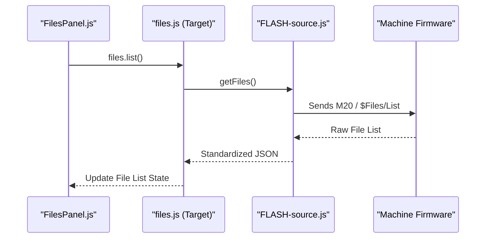

Sources: [src/targets/CNC/grblHAL/files.js#22](https://github.com/luc-github/ESP3D-WEBUI/blob/97c01e85/src/targets/CNC/grblHAL/files.js#L22-L22)[src/targets/Printer3D/Marlin/preferences.json#88-91](https://github.com/luc-github/ESP3D-WEBUI/blob/97c01e85/src/targets/Printer3D/Marlin/preferences.json#L88-L91)

## UI & Settings Concepts

### Preferences Hierarchy

Settings are loaded in a cascading fashion:

1. **Global Preferences**: Basic UI settings (language, theme). [src/targets/preferences.json#3-15](https://github.com/luc-github/ESP3D-WEBUI/blob/97c01e85/src/targets/preferences.json#L3-L15)
2. **Target Preferences**: Settings common to a machine type (e.g., all 3D Printers). [src/targets/Printer3D/preferences.json#2-10](https://github.com/luc-github/ESP3D-WEBUI/blob/97c01e85/src/targets/Printer3D/preferences.json#L2-L10)
3. **Firmware Preferences**: Specific overrides for a firmware (e.g., Marlin-specific G-codes). [src/targets/Printer3D/Marlin/preferences.json#3-11](https://github.com/luc-github/ESP3D-WEBUI/blob/97c01e85/src/targets/Printer3D/Marlin/preferences.json#L3-L11)

### Dependency System (`depend`)

Settings in `preferences.json` can have a `depend` array. This controls visibility or availability based on other settings. For example, `openstatusonstart` only appears if `showstatuspanel` is `true`.

- **Sources**: [src/targets/Printer3D/preferences.json#11-16](https://github.com/luc-github/ESP3D-WEBUI/blob/97c01e85/src/targets/Printer3D/preferences.json#L11-L16)

### ExtraContent / Extensions

- **ExtraContentItem**: A wrapper component for external resources like MJPEG camera streams or HTML iframes. [src/components/ExtraContent/extraContentItem.js#34-42](https://github.com/luc-github/ESP3D-WEBUI/blob/97c01e85/src/components/ExtraContent/extraContentItem.js#L34-L42)
- **Extension Container**: A specialized iframe that receives `notification` messages from the main UI regarding visibility and state. [src/components/ExtraContent/extraContentItem.js#53-61](https://github.com/luc-github/ESP3D-WEBUI/blob/97c01e85/src/components/ExtraContent/extraContentItem.js#L53-L61)

## Build & Versioning

- **webUIversion**: The semantic version of the core WebUI logic (e.g., `3.0.2`). [src/components/App/version.js#20](https://github.com/luc-github/ESP3D-WEBUI/blob/97c01e85/src/components/App/version.js#L20-L20)
- **webUIbuild**: A target-specific build suffix (e.g., `GH5` for grblHAL). [src/targets/CNC/grblHAL/index.js#44](https://github.com/luc-github/ESP3D-WEBUI/blob/97c01e85/src/targets/CNC/grblHAL/index.js#L44-L44)
- **dist/**: The output directory containing target-specific `index.html.gz` files. Each file is a standalone bundle for that specific machine/firmware combination. [dist/Printer3D/Smoothieware/index.html.gz#1](https://github.com/luc-github/ESP3D-WEBUI/blob/97c01e85/dist/Printer3D/Smoothieware/index.html.gz#L1-L1)

Sources: [src/components/App/version.js#18-25](https://github.com/luc-github/ESP3D-WEBUI/blob/97c01e85/src/components/App/version.js#L18-L25)[README.md#54-62](https://github.com/luc-github/ESP3D-WEBUI/blob/97c01e85/README.md?plain=1#L54-L62)